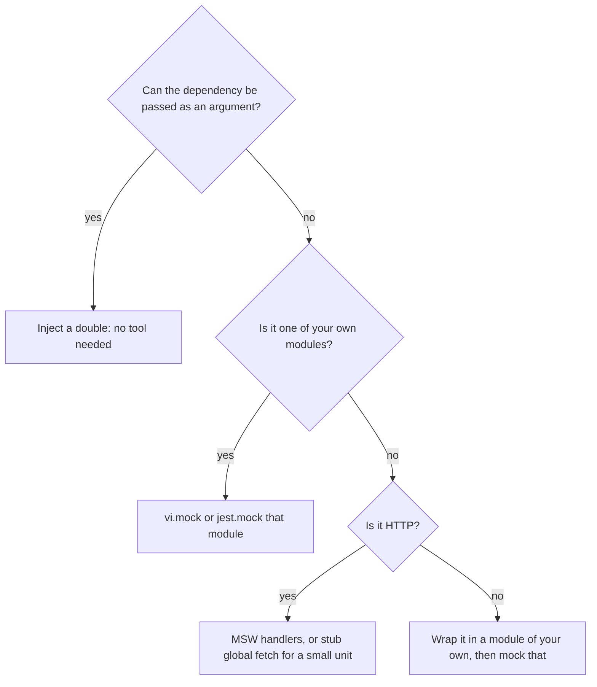

# Mocking modules, globals and fetch

> **Before this lesson:** you know the kinds of test double and when to prefer outcomes over interactions ([Test doubles in depth: dummies, stubs, spies, mocks and fakes](#/lesson/js-testing/test-doubles)), you have stubbed `fetch` by passing a fake in ([Stubbing HTTP requests](#/lesson/js-testing/stubbing-http)), and you can run a suite with Vitest or Jest ([Vitest, Jest and node:test in daily use](#/lesson/js-testing/modern-runners)). You need to know how `import` and `export` connect files ([ES modules and CommonJS](#/lesson/javascript/es-modules-commonjs)).

## In plain words

In the lessons so far, the code under test received its collaborators as arguments, so a test could hand in a double. A great deal of real code is not written that way. It reaches for its collaborators by itself: `import { sendEmail } from "./mailer.js"` at the top of the file, or a call to the global `fetch`, or `Date.now()`, or `Math.random()`. A test cannot pass anything in, because there is no parameter.

Think of an office telephone exchange. An employee dials "accounts" and is connected to the accounts department. During a fire drill the operator re-plugs the board so that "accounts" rings a desk in the training room. The employee dials the same number as always and never knows. **Module mocking** is the test runner acting as that operator: when the code under test asks for `./mailer.js`, the runner connects it to a stand-in. Replacing a global such as `fetch` is the same trick at a different switchboard.

Why it matters for a job: almost every existing codebase uses direct imports, so `vi.mock` and `jest.mock` appear in nearly every real test file. They also produce the most confusing failures a newcomer meets, such as a mock that "does not work" because of the order in which files load. "How would you mock `fetch`?" and "how do you mock a module?" are routine interview questions.

## Two ways code gets its collaborators

```javascript
// Style 1: passed in. The test supplies a double as an argument.
export async function register(email, { saveUser, sendEmail }) {
  const user = await saveUser({ email });
  await sendEmail(email, "Welcome!");
  return user;
}

// Style 2: imported. The function decides for itself where its collaborators come from.
import { saveUser } from "./db.js";
import { sendEmail } from "./mailer.js";

export async function register(email) {
  const user = await saveUser({ email });
  await sendEmail(email, "Welcome!");
  return user;
}
```

Style 1 is **dependency injection**: easy to test without any tool, at the price of longer parameter lists. Style 2 is shorter to call and is what most application code looks like. To test style 2, the test has to change what the two `import` lines deliver.

## How module mocking works underneath

When a program imports a file, the runtime loads that file once, keeps the result in a table (the **module cache**) and hands the same result to everyone who imports it later. A runner that wants to substitute a module puts its stand-in into that table *before* anybody asks for the real one.

The block below is a module system small enough to read in a minute. `define` registers a module, `require` loads it (once), and `mock` registers a replacement.

```js-run
function createModuleSystem() {
  const factories = {}, mocks = {}, cache = {};
  const system = {
    define(name, factory) { factories[name] = factory; },
    mock(name, factory) { mocks[name] = factory; delete cache[name]; },
    require(name) {
      if (!(name in cache)) cache[name] = (mocks[name] || factories[name])(system.require);   // load once
      return cache[name];
    },
  };
  return system;
}

function setUpProject() {
  const system = createModuleSystem();
  system.define("mailer", () => ({
    sendEmail: (to) => "REAL email sent to " + to,
  }));
  system.define("signup", (require) => {
    const { sendEmail } = require("mailer");            // like: import { sendEmail } from "./mailer.js"
    return { register: (email) => sendEmail(email) };
  });
  return system;
}

// Scenario A: the mock is registered BEFORE the code under test is loaded
const a = setUpProject();
a.mock("mailer", () => ({ sendEmail: (to) => "fake email to " + to }));
console.log("A:", a.require("signup").register("ada@example.com"));

// Scenario B: the code under test is loaded first, the mock comes too late
const b = setUpProject();
const signup = b.require("signup");                     // signup has already taken hold of the real sendEmail
b.mock("mailer", () => ({ sendEmail: (to) => "fake email to " + to }));
console.log("B:", signup.register("ada@example.com"));
```

Scenario B is the classic "my mock is ignored" bug. By the time the mock was registered, `signup` had already loaded the real mailer and kept a reference to its `sendEmail`. Replacing the table entry afterwards changes nothing for a module that has finished loading.

This is why Vitest and Jest **hoist** mock declarations. Hoisting means moving something to the top: before running a test file, the runner rewrites it so that every `vi.mock(...)` or `jest.mock(...)` call executes first, ahead of the `import` lines, wherever you wrote it in the file. Scenario A is then guaranteed.

## The real syntax

```javascript
// signup.test.js
import { test, expect, vi, beforeEach } from "vitest";
import { register } from "./signup.js";
import { sendEmail } from "./mailer.js";            // in this file, this is now the mock
import { saveUser } from "./db.js";

vi.mock("./mailer.js");                             // automatic mock: every export becomes vi.fn()
vi.mock("./db.js", () => ({                         // factory mock: you write the replacement
  saveUser: vi.fn(async (user) => ({ id: 1, ...user })),
}));

beforeEach(() => { vi.clearAllMocks(); });          // forget calls recorded by earlier tests

test("a new user is saved and welcomed", async () => {
  const user = await register("ada@example.com");

  expect(user).toEqual({ id: 1, email: "ada@example.com" });
  expect(sendEmail).toHaveBeenCalledWith("ada@example.com", "Welcome!");
});

test("no welcome email when saving fails", async () => {
  vi.mocked(saveUser).mockRejectedValueOnce(new Error("database down"));

  await expect(register("ada@example.com")).rejects.toThrow("database down");
  expect(sendEmail).not.toHaveBeenCalled();
});
```

```text
 ✓ signup.test.js (2 tests) 6ms
   ✓ a new user is saved and welcomed
   ✓ no welcome email when saving fails
```

What each piece does:

- `vi.mock("./mailer.js")` with no second argument is an **automatic mock**: the runner looks at the real module's exports and replaces each function with an empty recording function. The shape always matches the real module, which protects against typos in export names.
- `vi.mock("./db.js", () => ({ ... }))` takes a **factory**: a function returning the object that stands in for the module.
- The test file imports `sendEmail` from the mocked module like any other code would. What it receives is the mock, so it can make assertions on it.
- `vi.mocked(saveUser)` returns the same function; its only job is to tell TypeScript that mock methods such as `mockRejectedValueOnce` exist on it.
- `mockRejectedValueOnce` changes the answer for the next call only, so the second test gets a failure without disturbing other tests.

In Jest the file is the same with `jest.mock`, `jest.fn` and `jest.mocked`, and without the first import line.

### Four details that trip people up

**1. A factory cannot use variables declared further down the file.** Because the `vi.mock` call is hoisted above everything, a variable the factory refers to has not been initialised when the factory is set up. Create shared values with `vi.hoisted`, which is hoisted together with the mock:

```javascript
const { sendEmail } = vi.hoisted(() => ({ sendEmail: vi.fn() }));
vi.mock("./mailer.js", () => ({ sendEmail }));
```

Jest has a similar rule and makes one exception: variables whose names start with `mock` may be used inside a `jest.mock` factory.

**2. Replacing only part of a module.** Often you want one export faked and the rest real. The factory receives a function that loads the genuine module:

```javascript
vi.mock("./pricing.js", async (importOriginal) => ({
  ...(await importOriginal()),                      // keep every real export
  fetchExchangeRate: vi.fn(async () => 1.35),       // replace this one
}));
```

The Jest spelling is `{ ...jest.requireActual("./pricing.js"), fetchExchangeRate: jest.fn() }`. This is a **partial mock**.

**3. Default exports.** A module's default export lives under the key `default` in a Vitest factory: `vi.mock("./logger.js", () => ({ default: { info: vi.fn() } }))`.

**4. A partial mock does not change calls inside the module.** If `total()` and `fetchExchangeRate()` are in the same file and `total` calls `fetchExchangeRate` directly, it uses its own local reference, not the export table, so your replacement is bypassed. When you hit this, the two functions want to live in separate modules, or the dependency wants to be a parameter.

The built-in Node runner can also replace modules (`mock.module` in `node:test`), at the time of writing behind an experimental flag. With `node:test`, passing dependencies in is usually the smoother route.

## Clearing, resetting and restoring

Mocks keep state: recorded calls and programmed answers. State that survives from one test into the next makes tests depend on their order. Three operations exist, and their names are easy to confuse.

| Operation | Forgets recorded calls | Forgets programmed answers | Puts the original function back |
|---|---|---|---|
| `mockClear()` / `vi.clearAllMocks()` | yes | no | no |
| `mockReset()` / `vi.resetAllMocks()` | yes | yes | no |
| `mockRestore()` / `vi.restoreAllMocks()` | yes | yes | yes, for spies made with `spyOn` |

```js-run
function spyOn(object, name) {
  const original = object[name];
  let impl = original;
  const spy = (...args) => { spy.calls.push(args); return impl.apply(object, args); };
  spy.calls = [];
  spy.mockReturnValue = (value) => { impl = () => value; return spy; };
  spy.mockClear = () => { spy.calls.length = 0; };                            // calls only
  spy.mockReset = () => { spy.calls.length = 0; impl = () => undefined; };    // calls and behaviour
  spy.mockRestore = () => { object[name] = original; };                       // the real method returns
  object[name] = spy;
  return spy;
}

const rates = { get: (currency) => "REAL rate for " + currency };
const report = (label) => console.log(label.padEnd(28) + "-> " + rates.get("SGD") + (rates.get.calls ? "   (calls recorded: " + rates.get.calls.length + ")" : "   (not a spy)"));

const spy = spyOn(rates, "get").mockReturnValue(1.35);
report("after mockReturnValue(1.35)");
report("called again");                 // the count keeps growing: this leaks into the next test
spy.mockClear();
report("after mockClear");              // count restarted, programmed answer kept
spy.mockReset();
report("after mockReset");              // answer forgotten too
spy.mockRestore();
report("after mockRestore");            // the original is back
```

The leak shows on the second line: a later test asserting "called once" would see two calls. One detail differs between the tools. After a reset, a Jest mock returns `undefined`, as in this demo, while a current Vitest mock goes back to the implementation it was created with.

The safe setup is to let the runner do it for every test. Set `restoreMocks: true` (which also clears) in the Vitest or Jest configuration, or call `vi.restoreAllMocks()` in a global `afterEach`.

## Replacing globals

Some collaborators are not imported at all; they are globals that exist everywhere: `fetch`, `Date`, `Math.random`, `localStorage`, `console`. The rule for replacing a global by hand is strict: **whatever happens in the test, put the original back.** A `try` / `finally` block guarantees it.

```js-run
// --- the tiny test runner from lesson 1 ---
function test(name, fn) {
  try { fn(); console.log("PASS  " + name); }
  catch (e) { console.log("FAIL  " + name + "\n      -> " + e.message); }
}
function expect(actual) {
  const show = (v) => typeof v === "function" ? "[function]" : JSON.stringify(v);
  const fail = (msg) => { throw new Error(msg); };
  return {
    toBe(expected) {
      if (!Object.is(actual, expected)) fail("expected " + show(expected) + " but got " + show(actual));
    },
    toEqual(expected) {
      if (JSON.stringify(actual) !== JSON.stringify(expected)) fail("expected " + show(expected) + " but got " + show(actual));
    },
    toThrow(text = "") {
      try { actual(); } catch (e) {
        if (!String(e.message).includes(text)) fail("threw the wrong error: " + e.message);
        return;
      }
      fail("expected the function to throw, but it returned normally");
    },
  };
}
// --- end of runner ---

function rollDie() {
  return Math.floor(Math.random() * 6) + 1;       // 1 to 6
}

function withRandom(value, body) {                // replace Math.random for the duration of body
  const original = Math.random;
  Math.random = () => value;
  try { return body(); }
  finally { Math.random = original; }             // runs even if body throws
}

test("the lowest random number gives a 1", () => {
  expect(withRandom(0, rollDie)).toBe(1);
});
test("a random number close to 1 gives a 6, never a 7", () => {
  expect(withRandom(0.999999, rollDie)).toBe(6);
});
test("the middle gives a 4", () => {
  expect(withRandom(0.5, rollDie)).toBe(4);
});
test("Math.random is back to normal afterwards", () => {
  const values = new Set([Math.random(), Math.random(), Math.random()]);
  expect(values.size).toBe(3);                    // three different numbers: the real generator
});
```

With randomness pinned, the two ends of the range can be checked exactly. Those ends are where the off-by-one mistakes are. Replace `Math.floor` with `Math.round` and run again: the second test reports a 7, a face no die has.

The runners wrap this pattern:

```javascript
vi.spyOn(Math, "random").mockReturnValue(0.5);        // restored by vi.restoreAllMocks()
vi.stubGlobal("fetch", vi.fn());                       // undone by vi.unstubAllGlobals()
vi.stubEnv("API_URL", "http://test.local");            // environment variable; vi.unstubAllEnvs()
vi.useFakeTimers(); vi.setSystemTime(new Date("2030-01-15T12:00:00Z"));   // Date and timers
```

## fetch, with real Response objects

The earlier HTTP lesson stubbed `fetch` with hand-made objects such as `{ ok: true, json: async () => data }`. That is quick, but every such object is your own imitation of a response. Modern runtimes (browsers, Web Workers, Node 18 and later) provide the real `Response` class, so a stub can return the genuine article. Then `ok`, `status`, headers, `json()` and `text()` behave exactly as in production, including the awkward cases.

```js-run
// --- the tiny test runner from lesson 1, async edition ---
async function test(name, fn) {   // async: it can wait for promises
  try { await fn(); console.log("PASS  " + name); }
  catch (e) { console.log("FAIL  " + name + "\n      -> " + e.message); }
}
function expect(actual) {
  const show = (v) => typeof v === "function" ? "[function]" : JSON.stringify(v);
  const fail = (msg) => { throw new Error(msg); };
  return {
    toBe(expected) {
      if (!Object.is(actual, expected)) fail("expected " + show(expected) + " but got " + show(actual));
    },
    toEqual(expected) {
      if (JSON.stringify(actual) !== JSON.stringify(expected)) fail("expected " + show(expected) + " but got " + show(actual));
    },
    toThrow(text = "") {
      try { actual(); } catch (e) {
        if (!String(e.message).includes(text)) fail("threw the wrong error: " + e.message);
        return;
      }
      fail("expected the function to throw, but it returned normally");
    },
  };
}
// --- end of runner ---

// ---------- code under test ----------
async function loadRates(fetchFn) {
  let response;
  try {
    response = await fetchFn("/api/rates");
  } catch (error) {
    return { ok: false, reason: "offline" };                       // no response at all
  }
  if (!response.ok) return { ok: false, reason: "server said " + response.status };
  try {
    return { ok: true, rates: await response.json() };
  } catch (error) {
    return { ok: false, reason: "unreadable answer" };             // the body was not JSON
  }
}

// ---------- test helpers: real Response objects ----------
const json = (data, status = 200) => async () =>
  new Response(JSON.stringify(data), { status, headers: { "Content-Type": "application/json" } });
const text = (body, status = 200) => async () => new Response(body, { status });
const networkDown = async () => { throw new TypeError("Failed to fetch"); };

await test("returns the rates on success", async () => {
  expect(await loadRates(json({ SGD: 1.35 }))).toEqual({ ok: true, rates: { SGD: 1.35 } });
});

await test("reports the status for an error answer", async () => {
  expect(await loadRates(json({ error: "nope" }, 503))).toEqual({ ok: false, reason: "server said 503" });
});

await test("a 404 counts as an error although the promise fulfils", async () => {
  expect((await loadRates(text("Not Found", 404))).reason).toBe("server said 404");
});

await test("reports an unreadable answer when a 200 body is not JSON", async () => {
  expect(await loadRates(text("<html>login page</html>"))).toEqual({ ok: false, reason: "unreadable answer" });
});

await test("reports offline when no response arrives", async () => {
  expect(await loadRates(networkDown)).toEqual({ ok: false, reason: "offline" });
});
```

The fourth test is one that hand-made response objects rarely cover: a status of 200 with a body that is not JSON, which happens in real life when a proxy or a login redirect answers in place of the API. With a real `Response`, `json()` rejects exactly as it would in production.

When the code calls the global `fetch` directly, install the same stub as a global:

```javascript
import { test, expect, vi, afterEach } from "vitest";
import { loadRates } from "./rates.js";              // this version calls the global fetch itself

afterEach(() => { vi.unstubAllGlobals(); });

test("returns the rates on success", async () => {
  const fetchMock = vi.fn(async () => Response.json({ SGD: 1.35 }));
  vi.stubGlobal("fetch", fetchMock);

  expect(await loadRates()).toEqual({ ok: true, rates: { SGD: 1.35 } });
  expect(fetchMock).toHaveBeenCalledWith("/api/rates");
});
```

`Response.json(data)` is a shortcut that builds a JSON response with the right header.

## One level lower: intercepting at the network

Stubbing `fetch` replaces a function. A further option leaves `fetch` alone and intercepts the *request* after it has been made, answering it from handlers you define. The usual tool is **Mock Service Worker** (MSW). The code under test runs unmodified, with real `fetch`, real URL handling and real headers.

```javascript
// test/server.js
import { setupServer } from "msw/node";
import { http, HttpResponse } from "msw";

export const server = setupServer(
  http.get("https://api.example.com/rates", () => HttpResponse.json({ SGD: 1.35 })),   // default: the happy path
);

// test/setup.js  (listed in setupFiles)
import { beforeAll, afterEach, afterAll } from "vitest";
import { server } from "./server.js";

beforeAll(() => server.listen({ onUnhandledRequest: "error" }));           // unknown requests fail the test
afterEach(() => server.resetHandlers());                                   // drop per-test overrides
afterAll(() => server.close());
```

```javascript
// rates.test.js
import { http, HttpResponse } from "msw";
import { server } from "./test/server.js";

test("reports the status for an error answer", async () => {
  server.use(http.get("https://api.example.com/rates", () => new HttpResponse(null, { status: 503 })));   // this test only

  expect(await loadRates()).toEqual({ ok: false, reason: "server said 503" });
});
```

The handlers use a full address because a test running in Node has no page whose address a relative URL such as `/api/rates` could be completed from; this version of `loadRates` requests the full URL too.

Three properties make this attractive for component and integration tests: the handlers describe the API once and are shared by all tests; the same handlers can run in the browser during development, so the app works before the back end exists; and `onUnhandledRequest: "error"` gives the "complain about unplanned requests" behaviour for free.

## Choosing where to cut



| Technique | Strength | Weakness |
|---|---|---|
| Inject a double | Explicit, tool-free, works in every runner | The code must be designed for it |
| Mock a module | Works with code as it is | Tied to file paths; hoisting rules; moving a file breaks tests |
| Stub a global | Quick for a thin unit | Shared state that must be restored; hand-built answers unless you use `Response` |
| Intercept the network | Most realistic; handlers reused everywhere | A library to learn; slightly slower |

Two guidelines keep module mocking under control. **Mock at the boundary of the unit, not inside it.** Mocking a helper that belongs to the unit you are testing means the test no longer exercises the unit. **Mock what you own.** Do not mock a third-party package's internals; put a thin module of your own in front of it and mock that, so that only one file knows the package's interface.

> [!WARNING]
> Every stand-in for a server freezes your picture of that server at the moment you wrote it. If the real API changes a field name, mocked tests keep passing. Reduce the gap by generating types or handlers from a shared API description where one exists, by validating real responses against a schema at run time, and by keeping a few tests that talk to a real deployed test instance. A check that both sides still agree on the shape of their messages is a **contract test**.

> [!TIP]
> If a test file needs more than two or three `vi.mock` lines, read that as feedback on the design. The unit under test knows about too many other modules. Splitting it, or passing some collaborators in, usually shortens both the code and the test.

> [!INTERVIEW]
> **"How do you test a module that imports and calls an API client directly?"** Offer the options in order of preference. If you can change the code, inject the client or the `fetch` function and pass a stub. If not, mock the client module with `vi.mock` or `jest.mock`, remembering that the call is hoisted above imports and that mocks must be cleared between tests. For code that calls `fetch` itself, either stub the global and return real `Response` objects, or intercept at the network level with MSW so the code runs unmodified. Cover success, an error status, a network failure and a malformed body, and say how you keep the mocks from drifting: shared types or schemas, and a small number of tests against the real service.

## Common pitfalls

- **Expecting a mock declared mid-file to apply only from that line.** It is hoisted and applies to the whole file. For a mock that differs per test, change the mock's behaviour (`mockReturnValueOnce`), not its declaration.
- **Using an outer variable inside a mock factory.** It is not initialised yet when the hoisted call runs. Use `vi.hoisted`.
- **Forgetting the `default` key** for a default export in a Vitest factory.
- **Not clearing between tests.** Call counts and one-off answers leak. Turn on `restoreMocks` or `clearMocks`.
- **Mocking the module under test.** The test then checks the mock.
- **Mocking by path, then moving the file.** A mock is matched by the path you wrote. When a module moves, update the mock in the same commit; a stale path can leave the real module in use without any error.
- **A global replaced and never restored.** Later tests in the file run with the stand-in.
- **Hand-made response objects missing what the code uses.** A stub without `headers` or `text()` breaks as soon as the code reads them. Return a real `Response`.
- **Letting unknown requests through.** A mistyped URL then hits the real network or returns `undefined`. Make unplanned requests an error.

## Cheat sheet

| Need | Vitest | Jest |
|---|---|---|
| Automatic mock of a module | `vi.mock("./mailer.js")` | `jest.mock("./mailer.js")` |
| Mock with a factory | `vi.mock("./db.js", () => ({ saveUser: vi.fn() }))` | `jest.mock("./db.js", () => ({ saveUser: jest.fn() }))` |
| Keep the real exports | `async (importOriginal) => ({ ...(await importOriginal()), x: vi.fn() })` | `{ ...jest.requireActual("./m.js"), x: jest.fn() }` |
| Share a value with a factory | `vi.hoisted(() => ({ ... }))` | name the variable `mock...` |
| Typed access to a mock | `vi.mocked(fn)` | `jest.mocked(fn)` |
| Answer for one call | `fn.mockResolvedValueOnce(x)` / `mockRejectedValueOnce(e)` | same |
| Forget calls | `vi.clearAllMocks()` | `jest.clearAllMocks()` |
| Restore spies | `vi.restoreAllMocks()` | `jest.restoreAllMocks()` |
| Replace a global | `vi.stubGlobal("fetch", fn)`, `vi.unstubAllGlobals()` | `jest.spyOn(globalThis, "fetch")` |
| Pin randomness | `vi.spyOn(Math, "random").mockReturnValue(0.5)` | `jest.spyOn(Math, "random").mockReturnValue(0.5)` |
| Environment variable | `vi.stubEnv("KEY", "value")` | assign `process.env.KEY`, restore afterwards |
| Real response in a stub | `new Response(body, { status })`, `Response.json(data)` | same |
| Network-level handlers | `setupServer(http.get(url, () => HttpResponse.json(data)))` from `msw` | same |

## Summary

- Code that imports its collaborators cannot be handed doubles as arguments; the runner has to swap what the import delivers.
- A module mock is a replacement entry in the module table and must be in place before the code under test loads, which is why mock declarations are hoisted.
- Automatic mocks copy the real module's shape; factories let you write the replacement; partial mocks keep the real exports and replace some.
- Mocks hold state. Clear, reset or restore them between tests, preferably through configuration.
- Replace globals only with a guaranteed restore; the runner's `stubGlobal` and `spyOn` helpers provide one.
- Return real `Response` objects from a `fetch` stub so that error statuses and unreadable bodies behave as in production.
- Network-level interception runs the code unmodified and reuses one description of the API.
- Mock at the unit's boundary, mock what you own, and keep some check against the real service.

## Glossary

- **Module**: a file whose exports other files can import.
- **Module cache**: the runtime's table of modules that have already been loaded.
- **Module mocking**: making an import deliver a stand-in.
- **Hoisting**: moving a declaration to the top so it takes effect before the code around it.
- **Automatic mock**: a stand-in generated from the real module's exports, with every function replaced by an empty recording function.
- **Factory**: here, a function that returns the object used in place of a module.
- **Partial mock**: a module replacement that keeps some real exports.
- **Global**: a value available everywhere without an import, such as `fetch` or `Math`.
- **`Response`**: the built-in class representing an HTTP response.
- **Mock Service Worker (MSW)**: a library that intercepts requests at the network level and answers them from handlers.
- **Handler**: a function that produces the response for requests matching a method and URL.
- **Contract test**: a check that two sides of an interface still agree on the shape of what they exchange.
- **Dependency injection**: supplying a collaborator from outside, usually as an argument.

## Check yourself

```quiz
[
  {"q": "A test file has: import { register } from './signup.js'; on line 2 and vi.mock('./mailer.js'); on line 9. signup.js imports mailer.js. Does register use the mocked mailer?",
   "options": ["No, the import on line 2 ran first", "Yes: the runner hoists vi.mock above the imports before executing the file", "Only for tests declared after line 9", "It throws an error"],
   "answer": 1,
   "explain": "Mock declarations are moved to the top of the file, so the replacement is in the module table before signup.js is loaded."},
  {"q": "const fake = vi.fn(); vi.mock('./mailer.js', () => ({ sendEmail: fake })); fails with an error about accessing 'fake' before initialisation. Why?",
   "options": ["vi.fn cannot be used in factories", "The hoisted vi.mock runs before the const line, so fake does not exist yet; create it with vi.hoisted", "The path is wrong", "Factories must be async"],
   "answer": 1,
   "explain": "Hoisting moves the mock call, not your variable. vi.hoisted creates values that are hoisted along with it."},
  {"q": "Test 1 calls a module-mocked sendEmail once. Test 2 calls it once and asserts toHaveBeenCalledTimes(1). No clearing is configured. What does test 2 report?",
   "options": ["Pass", "Fail: the mock has recorded two calls, one from each test", "Pass, because each test gets a new module", "A hoisting error"],
   "answer": 1,
   "explain": "Within one file the same mock function is shared by all tests. Recorded calls accumulate unless cleared in beforeEach or by configuration."},
  {"q": "Which operation puts the original method back after vi.spyOn(rates, 'get').mockReturnValue(1.35)?",
   "options": ["mockClear", "mockReset", "mockRestore", "None of them"],
   "answer": 2,
   "explain": "Clear forgets calls, reset also forgets programmed answers, restore additionally reinstates the original function on the object."},
  {"q": "A fetch stub returns new Response('<html>login</html>', { status: 200 }) and the code calls response.json(). What happens?",
   "options": ["json() returns the string", "json() returns a promise that rejects, exactly as it would in production", "json() returns null", "The Response constructor throws"],
   "answer": 1,
   "explain": "A real Response parses its body on demand, and invalid JSON rejects. Hand-made response objects often miss this case."},
  {"q": "pricing.js exports total() and fetchExchangeRate(); total calls fetchExchangeRate directly. A partial mock replaces fetchExchangeRate. A test of total still hits the real function. Why?",
   "options": ["Partial mocks never work", "Inside the module, total refers to its own local function, not to the mocked export", "importOriginal was awaited", "Mocks cannot be async"],
   "answer": 1,
   "explain": "A module mock changes what importers receive. Calls within the same file bypass it. Split the functions into separate modules or pass the dependency in."},
  {"q": "An MSW server is started with onUnhandledRequest: 'error'. The code under test requests /api/rate (a typo for /api/rates). What happens?",
   "options": ["The request goes to the real network", "The test fails with a message about an unhandled request", "MSW answers 200 with an empty body", "Nothing"],
   "answer": 1,
   "explain": "With that option any request without a matching handler is an error, which turns silent typos into clear failures."},
  {"q": "The dependency can be passed as a parameter and you are free to change the code. Which technique should you reach for first?",
   "options": ["vi.mock with a factory", "vi.stubGlobal", "Injecting a double as an argument", "MSW"],
   "answer": 2,
   "explain": "Injection needs no tooling, has no hoisting or path coupling, and makes the dependency visible in the signature."}
]
```

> **Source:** Johansen, *Test-Driven JavaScript Development*, ch. 12 and 16 (stubbing the transport; stubbing and Node modules), extended with current tools. Docs: https://vitest.dev/guide/mocking , https://vitest.dev/api/vi.html#vi-mock , https://jestjs.io/docs/mock-functions , https://jestjs.io/docs/es6-class-mocks , https://mswjs.io/docs/ , https://developer.mozilla.org/en-US/docs/Web/API/Response
