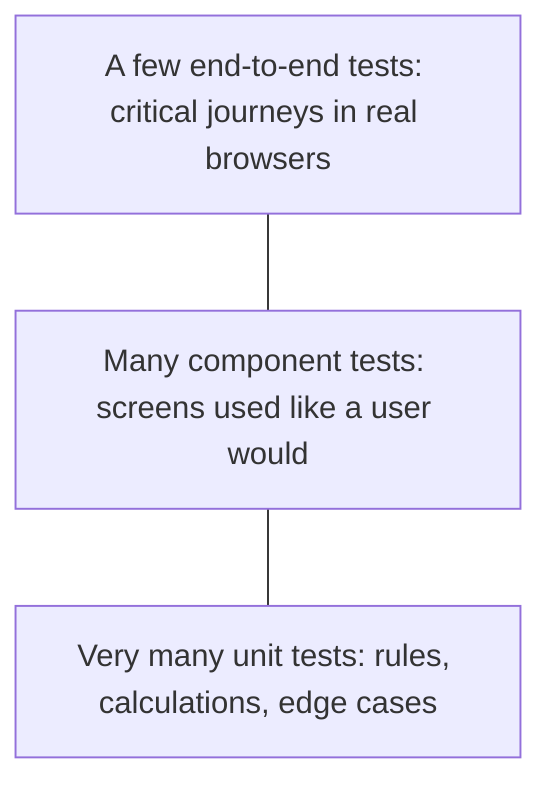

# Component and end-to-end tests: Testing Library and Playwright

> **Before this lesson:** you have tested a small DOM app in layers, with fixtures and real events ([Test-driving a DOM client: a packing list app](#/lesson/js-testing/dom-client-tdd)), you know what a simulated DOM and a headless browser are ([Tools of the trade: runners, styles, coverage and CI](#/lesson/js-testing/test-runners-tools)), and you can stub network answers ([Mocking modules, globals and fetch](#/lesson/js-testing/mocking-modules-fetch)). Basic HTML forms, labels and buttons are assumed.

## In plain words

A unit test checks one function with everything around it replaced. That is fast and precise, but users do not use functions. They look at a screen, find a button by its words, click it and read what happens. Two further kinds of test move step by step closer to that experience.

Think of a car factory. A machine checks that each bolt has the right thread: that is a unit test. A worker closes each assembled door to hear whether it shuts properly: that is a **component test**, one assembled piece checked the way a person would use it. At the end, a test driver takes one finished car in every hundred round the track: that is an **end-to-end test**, the whole product used for real. Nobody test-drives a car to check a bolt, and nobody ships a car because its bolts were fine.

In JavaScript the standard tool for component tests is **Testing Library**, which renders a piece of user interface into a DOM and gives you ways to find elements as a user would. The standard tool for end-to-end tests is **Playwright**, a program that drives real browsers through your running application. This lesson gives you both in outline: the ideas, the vocabulary and enough syntax to read and write a first test.

Why it matters for a job: front-end job descriptions name these two tools more than any others in testing. Interviewers ask "what is the difference between unit, integration and end-to-end tests, and how many of each would you write?", and take-home exercises are routinely reviewed for at least one component test that behaves like a user.

## Three levels, three trade-offs

| | Unit test | Component (or integration) test | End-to-end (E2E) test |
|---|---|---|---|
| What runs | One function or module | One screen or widget with its real children | The whole deployed application |
| Where | Node | Simulated DOM (jsdom, happy-dom) or a real browser | Real browsers |
| Replaced by doubles | Most collaborators | The network, sometimes the clock | As little as possible; third-party services |
| Speed per test | about a millisecond | tens of milliseconds | seconds |
| When it fails, the cause is | obvious | usually clear | anywhere in the stack |
| Confidence that users are fine | low | good | highest |



The shape is often drawn as a pyramid: a broad base of cheap tests and a small top of expensive ones. Some front-end teams argue for a thicker middle, because component tests catch the wiring mistakes that dominate UI bugs. Either way the principle is the same: **push each check down to the cheapest level that can perform it**, and keep the expensive levels for what only they can see.

## Testing Library: find things the way users do

### The guiding idea

The DOM tests in the packing-list lesson found elements with `querySelector("input[name=item]")` and `querySelector(".summary")`. Those selectors are implementation details. Rename a CSS class and the test breaks, although no user could tell the difference. Leave a button without any label, and the test still passes, although a user of a screen reader could not use the page.

Testing Library turns this round. Its queries locate elements by what a user perceives: the **role** of an element (button, checkbox, heading, link, text box), its visible text, the text of its label. A **screen reader** is software that reads a page aloud for people who cannot see it, and it works from exactly this information, which browsers expose through the **accessibility tree**. So a test that finds its elements by role and name keeps passing through redesigns, and fails when the page becomes unusable to assistive technology. That second property is a free accessibility check.

### The queries

Every query has a name made of two parts: a prefix that says how to behave when nothing matches, and a suffix that says what to look for.

| Prefix | No match | One match | Use for |
|---|---|---|---|
| `getBy...` | throws, with a listing of what is on the page | returns the element | things that should be there now |
| `queryBy...` | returns `null` | returns the element | asserting that something is **absent** |
| `findBy...` | keeps retrying, then rejects | resolves with the element | things that appear after waiting (async) |

Each has an `All` variant (`getAllByRole`) that returns an array.

Suffixes, in the order you should try them:

1. `ByRole("button", { name: "Add" })`: role plus accessible name. Works for almost every interactive element.
2. `ByLabelText("Email")`: the form field belonging to a label.
3. `ByPlaceholderText`, `ByText("No items yet")`, `ByDisplayValue`: what is visibly written.
4. `ByAltText`, `ByTitle`: images and tooltips.
5. `ByTestId("cart-total")`: an attribute `data-testid` added only for tests. The last resort, for elements with no role or text of their own.

### Roles and names, built by hand

To see that there is no magic, the page below implements `getByRole` and `getByLabelText` in about thirty lines and runs five tests with them against a small sign-in form. Read the test results at the bottom, especially the fourth.

```html-run
<!doctype html>
<html>
<head>
<style>
  body { font-family: sans-serif; margin: 16px; max-width: 560px; }
  form > * { display: block; margin: 8px 0; }
  .btn { display: inline-block; padding: 4px 10px; border: 1px solid #888; border-radius: 4px; cursor: pointer; }
  #report { margin-top: 16px; padding: 8px; background: #f4f4f4; font-family: monospace; white-space: pre-wrap; }
</style>
</head>
<body>
  <div id="app">
    <h2>Sign in</h2>
    <form>
      <label for="email">Email</label>
      <input id="email" type="email">
      <label><input type="checkbox"> Remember me</label>
      <button type="submit">Sign in</button>
      <div class="btn">Forgot password</div>
      <a href="#help">Help</a>
    </form>
    <p role="alert"></p>
  </div>
  <div id="report"></div>

<script>
  // ---------- the app ----------
  const root = document.getElementById("app");
  root.querySelector("form").addEventListener("submit", (event) => {
    event.preventDefault();
    const email = root.querySelector("#email").value.trim();
    root.querySelector("[role=alert]").textContent = email === "" ? "Enter your email." : "Welcome, " + email + "!";
  });

  // ---------- a miniature Testing Library ----------
  function roleOf(el) {
    if (el.hasAttribute("role")) return el.getAttribute("role");        // an explicit role wins
    const tag = el.tagName.toLowerCase();
    if (tag === "button") return "button";
    if (tag === "a" && el.hasAttribute("href")) return "link";
    if (/^h[1-6]$/.test(tag)) return "heading";
    if (tag === "input") return el.type === "checkbox" ? "checkbox" : "textbox";
    return null;                                                        // div, span, p: no role
  }
  function nameOf(el) {                                                 // the accessible name
    if (el.getAttribute("aria-label")) return el.getAttribute("aria-label").trim();
    if (el.labels && el.labels.length > 0) return el.labels[0].textContent.trim();
    return el.textContent.trim();
  }
  function getByRole(container, role, options = {}) {
    const withRole = [...container.querySelectorAll("*")].filter((el) => roleOf(el) !== null);
    const hits = withRole.filter((el) => roleOf(el) === role && (options.name === undefined || nameOf(el) === options.name));
    if (hits.length === 1) return hits[0];
    const listing = withRole.map((el) => roleOf(el) + ' "' + nameOf(el) + '"').join(", ");
    throw new Error("found " + hits.length + " elements with role " + role +
      (options.name ? ' and name "' + options.name + '"' : "") + ". Roles on the page: " + listing);
  }
  function getByLabelText(container, text) {
    for (const label of container.querySelectorAll("label")) {
      if (label.textContent.trim() === text && label.control) return label.control;
    }
    throw new Error('no form field is labelled "' + text + '"');
  }

  // ---------- tests written the way a user thinks ----------
  const lines = [];
  function test(name, fn) {
    root.querySelector("form").reset();                                 // fresh state for every test
    root.querySelector("[role=alert]").textContent = "";
    try { fn(); lines.push("PASS  " + name); } catch (e) { lines.push("FAIL  " + name + "\n      -> " + e.message); }
  }
  function expectEqual(actual, expected) {
    if (actual !== expected) throw new Error("expected " + JSON.stringify(expected) + " but got " + JSON.stringify(actual));
  }

  test("signing in with an email shows a welcome message", () => {
    getByLabelText(root, "Email").value = "ada@example.com";
    getByRole(root, "button", { name: "Sign in" }).click();
    expectEqual(getByRole(root, "alert").textContent, "Welcome, ada@example.com!");
  });
  test("signing in without an email shows an error", () => {
    getByRole(root, "button", { name: "Sign in" }).click();
    expectEqual(getByRole(root, "alert").textContent, "Enter your email.");
  });
  test("the checkbox can be found by its label text and ticked", () => {
    const box = getByRole(root, "checkbox", { name: "Remember me" });
    box.click();
    expectEqual(box.checked, true);
  });
  test("'Forgot password' can be found as a button", () => {
    getByRole(root, "button", { name: "Forgot password" });
  });
  test("the help link is a link", () => {
    expectEqual(getByRole(root, "link", { name: "Help" }).getAttribute("href"), "#help");
  });

  document.getElementById("report").textContent = lines.join("\n");
  root.querySelector("form").reset();
  root.querySelector("[role=alert]").textContent = "";
</script>
</body>
</html>
```

The fourth test fails, and its message lists every role on the page. "Forgot password" *looks* like a button, but it is a `<div>` with a border. A `<div>` has no role, cannot be reached with the Tab key and is not announced as a button by a screen reader. A selector such as `.btn` would have found it without complaint. The role query exposes a real defect. Change that line of the page to `<button type="button" class="btn">Forgot password</button>`, run again, and all five pass.

Notice also how the tests read: *the field labelled Email*, *the button named Sign in*, *the alert*. Nothing mentions an id or a class.

### The real library

The real library has the same queries with far more complete role and name rules, a `screen` object that searches the whole document, and a companion package, **user-event**, that simulates what a person does (typing key by key, tabbing, clicking with the full sequence of browser events). With the plain-DOM packing-list app:

```javascript
// packing.test.js  (Vitest, environment: "jsdom")
import { test, expect, beforeEach } from "vitest";
import { screen } from "@testing-library/dom";
import userEvent from "@testing-library/user-event";
import "@testing-library/jest-dom/vitest";               // adds matchers such as toBeChecked
import { mountPackingApp } from "./packing.js";

beforeEach(() => {
  document.body.innerHTML = `
    <form><label>Item <input name="item"></label><button>Add</button></form>
    <p class="error" role="alert"></p><ul></ul><p class="summary"></p>`;
  mountPackingApp(document.body);
});

test("adding an item shows it unticked and empties the field", async () => {
  const user = userEvent.setup();

  await user.type(screen.getByLabelText("Item"), "Passport");
  await user.click(screen.getByRole("button", { name: "Add" }));

  expect(screen.getByRole("checkbox", { name: "Passport" })).not.toBeChecked();
  expect(screen.getByLabelText("Item")).toHaveValue("");
});

test("a blank name shows an error and adds no row", async () => {
  const user = userEvent.setup();

  await user.click(screen.getByRole("button", { name: "Add" }));

  expect(screen.getByRole("alert")).toHaveTextContent("Type an item name first.");
  expect(screen.queryByRole("listitem")).not.toBeInTheDocument();     // queryBy: absence
});
```

For a framework there is a thin wrapper that adds a `render` function: `@testing-library/react`, `@testing-library/vue`, and so on. The test body stays the same; only the first line of setup changes to `render(<PackingList />)`. The React track shows this in [Testing with Vitest and React Testing Library](#/lesson/react/testing).

When the interface updates after a request, wait for the *result* to appear; do not wait for a duration:

```javascript
await user.click(screen.getByRole("button", { name: "Load rates" }));
expect(await screen.findByText("1 USD = 1.35 SGD")).toBeVisible();   // findBy retries until it appears
```

### What a component test should not do

- Reach into the component's internal state or call its methods. Act through the screen.
- Assert on class names or element structure, unless that is the requirement.
- Mock the component's own children. Render the real tree and replace only the network.
- Snapshot the whole rendered HTML. It fails on every change and tells you little.

## Playwright: a robot user in a real browser

### What it does

Playwright starts a real browser engine (Chromium, Firefox or WebKit, the engine behind Safari), opens your application at a URL, and performs clicks and key presses through the browser's automation interface. The test runs in Node and sends commands to the browser. Nothing is simulated: real layout, real CSS, real network stack. That is why an E2E test can catch a button hidden behind a cookie banner, which no jsdom test can.

```javascript
// e2e/packing.spec.js
import { test, expect } from "@playwright/test";

test("a visitor can build and tick off a packing list", async ({ page }) => {
  await page.goto("/");

  await page.getByLabel("Item").fill("Passport");
  await page.getByRole("button", { name: "Add" }).click();
  await expect(page.getByRole("listitem")).toHaveCount(1);

  await page.getByRole("checkbox", { name: "Passport" }).check();
  await expect(page.getByText("All 1 packed. Ready to go!")).toBeVisible();
});
```

```text
Running 3 tests using 3 workers
  ✓  [chromium] › packing.spec.js:4:1 › a visitor can build and tick off a packing list (1.2s)
  ✓  [firefox] › packing.spec.js:4:1 › a visitor can build and tick off a packing list (1.6s)
  ✓  [webkit] › packing.spec.js:4:1 › a visitor can build and tick off a packing list (1.4s)
  3 passed (4.1s)
```

The vocabulary will look familiar, because Playwright adopted Testing Library's approach: `getByRole`, `getByLabel`, `getByText`, `getByTestId`. The differences that matter:

- **`page`** is one browser tab, handed to the test by Playwright. Each test receives a brand-new browser context, with its own cookies and storage, so tests cannot leak a logged-in session into each other.
- **A locator is a description, not an element.** `page.getByRole("button", { name: "Add" })` does not search the page when it is written. It is resolved each time it is used, so it never goes stale when the page re-renders.
- **Actions wait by themselves.** Before `click()`, Playwright waits until the element exists, is visible, has stopped moving and is not covered or disabled. This is **auto-waiting**.
- **Assertions retry.** `await expect(locator).toBeVisible()` checks again and again until it holds or a time limit (five seconds by default) runs out. These are called web-first assertions.

### Why retrying assertions matter

In a real application the result of a click appears a little later: after a request, after a re-render. An assertion that checks once, immediately, fails at random depending on machine speed. The traditional patch was a fixed sleep, which is slow when generous and flaky when tight. A retrying assertion needs neither.

```js-run
const sleep = (ms) => new Promise((resolve) => setTimeout(resolve, ms));

async function expectEventually(check, { timeout = 1000, interval = 20 } = {}) {
  const started = Date.now();
  for (;;) {
    try { check(); return Date.now() - started; }                 // passed: report how long it took
    catch (error) {
      if (Date.now() - started >= timeout) throw new Error("gave up after " + timeout + " ms: " + error.message);
    }
    await sleep(interval);                                         // not yet: look again shortly
  }
}

// a pretend page: the banner appears 150 ms after the click, as if a server had to answer first
const page = {
  banner: null,
  clickSave() { setTimeout(() => { page.banner = "Saved"; }, 150); },
};
const bannerIs = (text) => () => { if (page.banner !== text) throw new Error("banner is " + JSON.stringify(page.banner)); };

page.clickSave();

try { bannerIs("Saved")(); console.log("check once, at once:      pass"); }
catch (e) { console.log("check once, at once:      FAIL (" + e.message + ")"); }

const took = await expectEventually(bannerIs("Saved"));
console.log("retrying check:           pass after about " + took + " ms");

try { await expectEventually(bannerIs("Deleted"), { timeout: 300 }); }
catch (e) { console.log("retrying, wrong text:     FAIL (" + e.message + ")"); }
```

The retrying check passes as soon as the banner appears, without anyone guessing a duration, and a wrong expectation still fails, with the last observed value in the message. Testing Library's `findBy...` and `waitFor`, and every Playwright `expect(locator)` assertion, work this way.

### Configuration in one screen

```javascript
// playwright.config.js
import { defineConfig, devices } from "@playwright/test";

export default defineConfig({
  testDir: "./e2e",
  retries: process.env.CI ? 2 : 0,                       // retry failed tests on the build server only
  use: {
    baseURL: "http://localhost:5173",                    // lets tests write page.goto("/")
    trace: "on-first-retry",                             // record a trace when a test had to be retried
  },
  webServer: {
    command: "npm run dev",                              // start the app before the tests
    url: "http://localhost:5173",
    reuseExistingServer: !process.env.CI,
  },
  projects: [
    { name: "chromium", use: { ...devices["Desktop Chrome"] } },
    { name: "firefox", use: { ...devices["Desktop Firefox"] } },
    { name: "webkit", use: { ...devices["Desktop Safari"] } },
  ],
});
```

Set-up is `npm init playwright@latest`, which installs the package and the browsers. Run with `npx playwright test`. Three tools are worth knowing from the start:

- `npx playwright test --ui` opens a window where you can run tests and step through each action with a picture of the page at that moment.
- A **trace** is a recording of a test run: every action, a snapshot of the page before and after, the network requests and the console output. When a test fails in CI, you download the trace and open it with `npx playwright show-trace`. It replaces guesswork about what the browser saw.
- `npx playwright codegen http://localhost:5173` records your clicks in a browser and writes the test code, with role-based locators. It is a good way to produce a first draft.

### Controlling the outside world

An E2E test should use your real front end and your real back end. Things you do not control are different: a payment provider, a maps service, an unreliable partner API. Playwright can answer those requests itself:

```javascript
await page.route("**/api/rates", (route) => route.fulfill({ json: { SGD: 1.35 } }));
```

For data, give each test what it needs and nothing shared: create a fresh user through your API at the start of the test, or reset a test database between tests. Tests that depend on records left by other tests fail as soon as they are run in parallel or in a different order. For sign-in, log in once in a setup step, save the browser's storage to a file, and let tests start from that saved state.

### Keeping selectors in one place

When twenty tests all fill in the same form, a change to that form means twenty edits. A **page object** is a small class that owns the locators and offers the actions as methods:

```javascript
export class PackingPage {
  constructor(page) { this.page = page; }
  async open() { await this.page.goto("/"); }
  async add(name) {
    await this.page.getByLabel("Item").fill(name);
    await this.page.getByRole("button", { name: "Add" }).click();
  }
  item(name) { return this.page.getByRole("checkbox", { name }); }
}

// in a test:
const packing = new PackingPage(page);
await packing.open();
await packing.add("Passport");
await expect(packing.item("Passport")).not.toBeChecked();
```

Keep assertions in the tests and actions in the page object.

### A little history

Driving a browser from a test is an old idea. The first widely used tool, Selenium, appeared in the mid-2000s; in that period unit tests for JavaScript were also run inside real browsers, because no other JavaScript runtime existed. Browser-driving tests of that era were slow and notoriously flaky, largely because every wait had to be written by hand. Auto-waiting and retrying assertions, popularised by Cypress and then Playwright, removed most of that pain. Cypress remains a common alternative that you may meet; the concepts in this lesson carry over.

## How many of each?

| Level | Typical amount | Good targets |
|---|---|---|
| Unit | Hundreds to thousands | Rules, calculations, parsers, state transitions, edge cases |
| Component | Dozens to hundreds | Each screen's main behaviours: shows data, validates, reports errors, reacts to clicks |
| End-to-end | A handful to a few dozen | Journeys the business cannot afford to break: sign up, sign in, search, pay |

A useful question for any proposed E2E test: *could a component test or a unit test catch this bug instead?* If so, write that one. Keep E2E tests for what only they see: that the pieces are connected, deployed and configured correctly.

> [!WARNING]
> **Retries hide flaky tests; they do not fix them.** A test that needs a second attempt has found something real: a missing wait, shared data, or a race in the application itself that users also hit. Treat "passed on retry" as a bug report. Turn traces on for retried tests so there is evidence to work from, and fix or quarantine the test instead of raising the retry count. The CI/CD track covers the practice in [Test data, asynchrony and flaky tests](#/lesson/cicd/test-data-flakiness).

> [!TIP]
> If `getByRole` cannot find your element, do not fall back to a test id straight away. First ask why it has no role or name. Usually the markup is wrong: a clickable `<div>`, an input with no label, an icon button with no text. Fixing the markup improves the product for real users and makes the test simple.

> [!INTERVIEW]
> **"Unit, integration and end-to-end: what is the difference, and how do you split your effort?"** Define each by what runs for real: a unit test runs one module with collaborators replaced; an integration or component test runs several real parts together, such as a rendered screen with only the network faked; an end-to-end test runs the deployed system in a real browser. Then the trade-off: speed and precise failures at the bottom, realism at the top. So the bulk of checks sit at the lowest level that can perform them, component tests cover what users do on each screen, and a small set of E2E tests guards the critical journeys. Mention how you keep E2E tests stable: role-based locators, auto-waiting assertions in place of sleeps, isolated test data, and traces for failures.

## Common pitfalls

- **Selecting by CSS class or DOM position.** Breaks on redesign and says nothing about accessibility. Use role, label or text.
- **`getBy` to assert absence.** It throws before your assertion runs. Use `queryBy` and `not.toBeInTheDocument()`.
- **Forgetting `await`** on `user.click`, `findBy...` or Playwright actions and assertions. The test moves on before the browser has acted.
- **Fixed sleeps** (`waitForTimeout(2000)`). Wait for the visible result with a retrying assertion.
- **`fireEvent` where a user would do more.** A real click also moves focus and fires several events; `user-event` reproduces them.
- **Test ids everywhere.** They work, but they bypass the accessibility check and litter the markup.
- **E2E tests for every validation rule.** Minutes of run time for checks a unit test does in a millisecond.
- **Tests that depend on each other's data.** Fine alone, broken in parallel.
- **Testing against production services you do not control.** Their outage becomes your red build. Route those requests to prepared answers.
- **Ignoring a test that "sometimes fails".** Users meet the same race.

## Cheat sheet

| Task | Testing Library | Playwright |
|---|---|---|
| By role and name | `screen.getByRole("button", { name: "Add" })` | `page.getByRole("button", { name: "Add" })` |
| By label | `screen.getByLabelText("Email")` | `page.getByLabel("Email")` |
| By text | `screen.getByText("No items yet")` | `page.getByText("No items yet")` |
| By test id | `screen.getByTestId("total")` | `page.getByTestId("total")` |
| Must be absent | `expect(screen.queryByText("Error")).not.toBeInTheDocument()` | `await expect(page.getByText("Error")).toBeHidden()` |
| Appears later | `await screen.findByText("Saved")` | `await expect(page.getByText("Saved")).toBeVisible()` |
| Type | `await user.type(field, "text")` | `await field.fill("text")` |
| Click | `await user.click(button)` | `await button.click()` |
| Tick a box | `await user.click(box)` | `await box.check()` |
| Search inside an element | `within(row).getByRole("button")` | `row.getByRole("button")` |
| Count | `expect(screen.getAllByRole("listitem")).toHaveLength(3)` | `await expect(page.getByRole("listitem")).toHaveCount(3)` |
| Fake a response | MSW handler | `await page.route(url, (route) => route.fulfill({ json }))` |
| Debug | `screen.debug()` prints the DOM | `--ui`, `--debug`, traces |

## Summary

- Component tests render one piece of interface and act on it like a user; end-to-end tests drive the whole application in a real browser.
- Each level costs more and tells you more than the one below. Put every check at the cheapest level that can perform it.
- Testing Library finds elements by role, label and text. Tests written this way survive redesigns and double as accessibility checks.
- `getBy` throws when nothing matches, `queryBy` returns `null` for absence checks, `findBy` waits for something to appear.
- Playwright locators are descriptions resolved at the moment of use; actions wait for the element to be ready and assertions retry.
- Wait for visible results, never for fixed durations.
- Keep E2E tests few, independent in their data, and focused on critical journeys. Treat a retried pass as a defect to investigate.

## Glossary

- **Component test**: a test that renders one part of the user interface and exercises it through the DOM.
- **End-to-end (E2E) test**: a test that drives the complete running application the way a user would.
- **Role**: the kind of thing an element is to assistive technology: button, link, checkbox, heading and so on.
- **Accessible name**: the text by which assistive technology identifies an element, taken from its label, content or `aria-label`.
- **Accessibility tree**: the browser's structure of roles and names that screen readers use.
- **Screen reader**: software that reads a page aloud and lets users operate it without seeing it.
- **Query**: a Testing Library function that looks up elements, such as `getByRole`.
- **user-event**: a companion library that simulates complete user interactions.
- **Locator**: in Playwright, a description of how to find an element, resolved each time it is used.
- **Auto-waiting**: waiting automatically until an element is ready before acting on it.
- **Web-first assertion**: an assertion that retries until it holds or a time limit expires.
- **Browser context**: an isolated browser session with its own cookies and storage.
- **Trace**: a recording of a test run with page snapshots, actions and network activity.
- **Page object**: a class that gathers the locators and actions for one page of the application.
- **Test id**: a `data-testid` attribute added to an element only so that tests can find it.

## Check yourself

```quiz
[
  {"q": "A page has <div class=\"btn\">Save</div> with a click handler. Which query finds it, and what does that tell you?",
   "options": ["getByRole('button', { name: 'Save' }) finds it", "getByRole does not find it because a div has no button role; the failure reveals that keyboard and screen-reader users cannot use it either", "No query can find a div", "getByLabelText('Save') finds it"],
   "answer": 1,
   "explain": "Role queries follow the accessibility tree. A styled div is not a button to assistive technology. The fix is to use a button element."},
  {"q": "You want to assert that no error message is shown. Which is correct?",
   "options": ["expect(screen.getByRole('alert')).not.toBeInTheDocument()", "expect(screen.queryByRole('alert')).not.toBeInTheDocument()", "expect(await screen.findByRole('alert')).toBeNull()", "screen.getAllByRole('alert')"],
   "answer": 1,
   "explain": "getBy throws when nothing matches, so the assertion is never reached. queryBy returns null for no match, which is what an absence check needs."},
  {"q": "A click triggers a request and 'Saved' appears about 150 ms later. Which assertion is both reliable and fast?",
   "options": ["expect(screen.getByText('Saved')) immediately", "await sleep(2000) then getByText", "expect(await screen.findByText('Saved')).toBeVisible()", "expect(screen.queryByText('Saved')).toBeNull()"],
   "answer": 2,
   "explain": "findBy retries until the element appears or a time limit passes. The immediate check fails; the sleep wastes time and still guesses."},
  {"q": "In Playwright, const add = page.getByRole('button', { name: 'Add' }) is written before page.goto('/'). Is that a problem?",
   "options": ["Yes, it throws because the page is empty", "No: a locator is only a description and is resolved when an action or assertion uses it", "Yes, it finds a stale element", "Only in Firefox"],
   "answer": 1,
   "explain": "Locators are lazy. Each use searches the current page, which is also why they do not go stale after a re-render."},
  {"q": "A team wants to check twelve validation rules of a sign-up form. Which split is most sensible?",
   "options": ["Twelve end-to-end tests", "Unit tests for the twelve rules, one or two component tests showing that an error is displayed, and one end-to-end test of a successful sign-up", "Only one end-to-end test with all twelve", "Only snapshots"],
   "answer": 1,
   "explain": "Each check belongs at the cheapest level that can perform it. Rules are unit-level; display is component-level; the connected journey is end-to-end."},
  {"q": "An end-to-end test fails about once in twenty runs and passes on retry. What is the right response?",
   "options": ["Increase retries to 5", "Treat it as a defect: use the trace to find the missing wait, shared data or application race, then fix or quarantine it", "Delete all end-to-end tests", "Add a ten-second sleep at the start"],
   "answer": 1,
   "explain": "A flaky test usually points at a real timing or isolation problem. Retries only hide it and erode trust in the suite."},
  {"q": "Why does each Playwright test get a new browser context?",
   "options": ["To make tests slower", "So cookies, storage and sessions from one test cannot affect another", "Because browsers cannot open two tabs", "To avoid needing a baseURL"],
   "answer": 1,
   "explain": "A fresh context is the E2E equivalent of a fresh fixture: isolation between tests."},
  {"q": "Which locator should be your first choice for a submit button labelled 'Pay now'?",
   "options": ["page.locator('#app > form > div:nth-child(3) > button')", "page.locator('.btn-primary')", "page.getByRole('button', { name: 'Pay now' })", "page.getByTestId('pay')"],
   "answer": 2,
   "explain": "Role and name match what the user perceives, survive layout and styling changes, and verify that the button is exposed correctly to assistive technology."}
]
```

> **Source:** Johansen, *Test-Driven JavaScript Development*, ch. 1 (unit and integration tests), ch. 3 (browser-based runners) and ch. 15 (testing DOM code), extended with current tools. Docs: https://testing-library.com/docs/queries/about , https://testing-library.com/docs/user-event/intro , https://github.com/testing-library/jest-dom , https://playwright.dev/docs/intro , https://playwright.dev/docs/locators , https://playwright.dev/docs/test-assertions , https://playwright.dev/docs/trace-viewer
