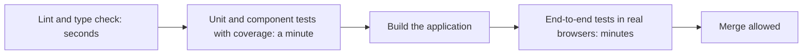

# Coverage, mutation testing and tests in CI

> **Before this lesson:** you have met line and branch coverage and a first CI workflow in [Tools of the trade: runners, styles, coverage and CI](#/lesson/js-testing/test-runners-tools), and you know the habit of breaking code on purpose to check a test from [Writing good unit tests: names, focus and test smells](#/lesson/js-testing/good-unit-tests). The three levels of test are described in [Component and end-to-end tests: Testing Library and Playwright](#/lesson/js-testing/testing-library-playwright).

## In plain words

Once a project has tests, three questions follow. Which parts of the code do the tests never touch? Would the tests notice if the code they do touch were wrong? And who makes sure the tests are run, every time, before a change reaches users?

Picture a night watchman in a small town. A map with his route drawn on it shows which streets he walked. Streets with no line on them were never checked, and that is worth knowing. But a line on a street only proves he walked down it; it does not prove he tried the doors. To find that out, an inspector secretly leaves a few doors unlocked and waits to see which ones get reported. Lastly, the rounds must happen every night without anyone having to remember, so they are put on a schedule.

- The route map is **code coverage**: a record of which code ran during the tests.
- The inspector's unlocked doors are **mutation testing**: small deliberate faults placed in the code to see whether any test fails.
- The schedule is **continuous integration** (CI): a server that runs the checks automatically on every change.

Why it matters for a job: every team argues about coverage targets, and interviewers like the question "is 100% coverage enough?" because the answer shows whether you understand what tests are for. Knowing how a pipeline runs tests, and what to do when it is slow or flaky, is daily work for any engineer.

## Coverage, one level deeper

### Four numbers

A coverage tool reports up to four percentages.

| Metric | Counts | Misses |
|---|---|---|
| **Line** | Lines that executed at least once | Two outcomes on one line |
| **Statement** | Statements that executed (several can share a line) | The same |
| **Function** | Functions that were called at least once | What happened inside them |
| **Branch** | Outcomes taken at each decision: both sides of every `if`, `? :`, `&&`, `||`, `??`, each `case` | Combinations of decisions; the exact boundary of a condition |

Branch coverage is the strictest of the four and the most informative. A single `if` without an `else` has two outcomes (the body runs, or it is skipped), and a test suite can execute every line while only ever taking one of them.

The block below instruments three decisions by hand, so you can watch line coverage reach 100% while branch coverage sits at half.

```js-run
const outcomes = {};                                   // decision id -> set of outcomes seen
const branch = (id, value) => { (outcomes[id] ||= new Set()).add(Boolean(value)); return value; };

function discount(customer, total) {
  let rate = 0;
  if (branch("is member", customer.member)) rate = 0.1;
  if (branch("big order", total > 100)) rate += 0.05;
  return branch("over the cap", rate > 0.12) ? 0.12 : rate;
}

function report(title) {
  const ids = Object.keys(outcomes);
  const taken = ids.reduce((sum, id) => sum + outcomes[id].size, 0);
  console.log(title + ": branch coverage " + taken + " of " + ids.length * 2 + " outcomes = " + Math.round(taken / (ids.length * 2) * 100) + "%");
  for (const id of ids) {
    for (const side of [true, false]) if (!outcomes[id].has(side)) console.log("   never saw '" + id + "' being " + side);
  }
}

console.log("discount(member, 200) =", discount({ member: true }, 200));
report("after one test (every line has run)");

console.log("discount(guest, 20)   =", discount({ member: false }, 20));
report("after two tests");
```

One call executes every line of `discount`, so a line-coverage report would show 100%. Half of the outcomes have never been seen. The second call brings branch coverage to 100% as well. Keep that in mind: we will come back to this "fully covered" function and find a fault the two tests cannot see.

### How the tool knows

There are two ways to collect the numbers, and you will see both names in configuration files.

- **Source instrumentation** rewrites your code before it runs, inserting counters much like the `branch(...)` calls above. The long-established JavaScript tool for this is Istanbul.
- **Engine-native coverage** asks the JavaScript engine, V8, which already tracks which pieces of code executed. Nothing is rewritten, so it is faster. The result is mapped back to your source lines.

Vitest offers both (`provider: "v8"` or `"istanbul"`); Jest uses Istanbul by default and can use V8; Node's own runner uses V8. For everyday purposes the reports are equivalent.

### Using the report

`npx vitest run --coverage` prints a table and can write an HTML report in which every file is shown with unexecuted lines and untaken branches highlighted. That page is the useful part. Open the file you changed most recently and look for red: each marked spot is a behaviour with no test. Then decide whether it deserves one.

Configuration you will meet:

```javascript
// vitest.config.js
export default defineConfig({
  test: {
    coverage: {
      provider: "v8",
      reporter: ["text", "html", "lcov"],          // lcov is a file format other tools read
      include: ["src/**"],
      exclude: ["src/**/*.test.js", "src/generated/**"],
      thresholds: {
        lines: 80, branches: 75,                   // the run fails below these
        "src/payments/**": { lines: 95, branches: 95 },   // stricter where mistakes cost money
      },
    },
  },
});
```

A **threshold** makes the test command fail when coverage drops below a number. Sensible teams use it as a ratchet against decline, set near the current level, and raise it for the code where defects are most expensive. Many teams also check **patch coverage**: the coverage of only the lines changed in a pull request, which asks the fair question "did you test what you added?" without demanding that old code be fixed first.

Occasionally a line cannot reasonably be tested, such as a branch that exists only for an unsupported platform. Tools accept a comment to leave it out (`/* v8 ignore next */`, `/* istanbul ignore next */`). Every such comment should carry a reason, because it is also the easiest way to hide untested code.

### What coverage cannot tell you

1. **Whether anything was checked.** Coverage counts execution. A test that calls a function and asserts nothing covers it completely.
2. **Whether the boundary is right.** Tests with 200 and 20 take both sides of `total > 100`. Neither would notice if the code said `total >= 100`.
3. **Whether combinations work.** Two decisions give four paths; 100% branch coverage is reachable with two tests.
4. **What is missing.** If the requirement "orders above 1000 need approval" was never implemented, there is no line to be uncovered. Coverage measures the code that exists, never the code that should.

So: **low coverage is reliable evidence of missing tests; high coverage is not evidence of good ones.** For the second question we need a different instrument.

## Mutation testing: would the tests notice?

### The idea

Take the production code and make one small change that ought to break it: turn `>=` into `>`, a `+` into a `-`, `true` into `false`, delete a statement. The changed copy is a **mutant**. Run the test suite against it.

- If at least one test fails, the suite noticed. The mutant is **killed**.
- If every test still passes, the suite cannot tell the broken code from the real code. The mutant **survived**, and it points at a specific gap.

Repeat for hundreds of small changes. The share of mutants killed is the **mutation score**. Unlike coverage, this number is hard to inflate: a test with no assertions kills nothing.

### A mutation tester in thirty lines

The block below holds a function as text, applies seven mutations one at a time, and runs two suites against each mutant. Both suites reach 100% line and branch coverage of `shipping`.

```js-run
const source = `
function shipping(total, member) {
  if (total >= 50) return 0;
  if (member) return 2;
  return 5;
}`;

const mutations = [
  ["total >= 50", "total > 50"],          // move the boundary
  ["total >= 50", "total < 50"],          // reverse the comparison
  ["return 0", "return 1"],               // change a constant
  ["if (member)", "if (!member)"],        // negate a condition
  ["if (member)", "if (true)"],           // force a condition
  ["return 2", "return 3"],
  ["return 5", "return 6"],
];

// Suite A executes every line and takes every branch, but checks little.
const suiteA = (shipping) =>
  shipping(100, false) === 0 &&
  shipping(10, false) === 5 &&
  typeof shipping(10, true) === "number";          // runs the member line, asserts almost nothing

// Suite B adds the boundary and the member price.
const suiteB = (shipping) =>
  suiteA(shipping) &&
  shipping(50, false) === 0 &&
  shipping(49, false) === 5 &&
  shipping(10, true) === 2;

const build = (text) => new Function(text + "; return shipping;")();

function mutationRun(name, suite) {
  if (!suite(build(source))) { console.log(name + ": fails on the ORIGINAL code, fix the suite first"); return; }
  let killed = 0;
  const survivors = [];
  for (const [from, to] of mutations) {
    let passes;
    try { passes = suite(build(source.replace(from, to))); } catch (error) { passes = false; }
    if (passes) survivors.push(from + "  ->  " + to); else killed++;
  }
  console.log(name + ": killed " + killed + " of " + mutations.length + " mutants, score " + Math.round(killed / mutations.length * 100) + "%");
  for (const s of survivors) console.log("   SURVIVED: " + s);
}

mutationRun("suite A (100% line and branch coverage)", suiteA);
mutationRun("suite B", suiteB);
```

Suite A leaves two mutants alive, and each survivor is a precise instruction. "`total >= 50` to `total > 50` survived" says: *no test pins what happens at exactly 50*. "`return 2` to `return 3` survived" says: *no test checks the member price*. Suite B adds those two facts and kills everything. Coverage could not distinguish the two suites; mutation testing could.

### In a real project

The standard tool for JavaScript and TypeScript is **StrykerJS**. It generates the mutants, runs your existing tests against each one and writes a report listing the survivors with the exact change that went unnoticed.

```text
$ npx stryker run
Mutation score: 82.61%
  shipping.js   killed 19  survived 4  no coverage 0
    [Survived] ConditionalExpression  shipping.js:3:7   total >= 50  ->  total > 50
```

Things to know before proposing it to a team:

- **It is slow.** The suite runs once per mutant, or per group of mutants. Tools speed this up by running only the tests that cover the mutated line, but it remains far heavier than a normal run. Typical use: on changed files in a pull request, or on important modules in a nightly job.
- **Some survivors are harmless.** A mutant that behaves identically to the original, for example changing `i < length` to `i !== length` in a simple loop, cannot be killed by any test. It is an **equivalent mutant**. Read survivors with judgement; do not chase 100%.
- **Its best use is local.** After finishing a function, mutate it by hand a few times, as the previous lesson described. The tool automates the same habit.

## Tests in CI: the schedule

### What the server does

A CI server reacts to a push or a pull request by taking a clean machine, fetching the code, installing dependencies and running a list of commands. A command signals success or failure through its **exit code**: the number a program hands back when it ends, 0 for success and anything else for failure. Test runners exit with a non-zero code when a test fails or a coverage threshold is missed, and that turns the job red. A red job blocks the merge when the repository is configured to require it.

The order of the checks matters. Run the cheapest, most frequently failing checks first, so that an obvious mistake is reported in seconds:



### A fuller workflow

```yaml
# .github/workflows/ci.yml
name: ci
on:
  pull_request:
  push:
    branches: [main]

jobs:
  unit:
    runs-on: ubuntu-latest
    strategy:
      matrix:
        node: [20, 22]                      # run the job once per Node version
    steps:
      - uses: actions/checkout@v4
      - uses: actions/setup-node@v4
        with:
          node-version: ${{ matrix.node }}
          cache: npm                        # reuse downloaded packages between runs
      - run: npm ci                         # exact versions from the lock file
      - run: npm run lint
      - run: npx vitest run --coverage      # fails on a failed test or a missed threshold
      - uses: actions/upload-artifact@v4
        if: ${{ !cancelled() }}
        with:
          name: coverage-node-${{ matrix.node }}
          path: coverage/

  e2e:
    needs: unit                             # only start when the unit job is green
    runs-on: ubuntu-latest
    steps:
      - uses: actions/checkout@v4
      - uses: actions/setup-node@v4
        with: { node-version: 22, cache: npm }
      - run: npm ci
      - run: npx playwright install --with-deps chromium
      - run: npx playwright test
      - uses: actions/upload-artifact@v4
        if: failure()                       # keep the evidence when something failed
        with:
          name: playwright-report
          path: playwright-report/
```

Reading it top to bottom:

- **`on`** lists the events that start the workflow: every pull request, and pushes to `main`.
- **`matrix`** runs the same job with different settings, here two Node versions, in parallel. Libraries use this to prove they work on every version they claim to support.
- **`cache: npm`** saves the downloaded packages keyed by the lock file, so later runs skip most of the download.
- **`needs: unit`** makes the slow browser job wait for the fast one. If a unit test is red, no browser minutes are spent.
- **`upload-artifact`** stores files from the run so a person can download them afterwards. An **artifact** here is any file a job produces and keeps: the HTML coverage report, or the Playwright report and traces from a failed run. Without the trace, an E2E failure that happens only on the CI machine is close to impossible to diagnose.

The CI/CD track explains pipelines in general; start with [A complete GitHub Actions pipeline, line by line](#/lesson/cicd/github-actions-workflow) and [Designing a fast commit stage](#/lesson/cicd/commit-stage-feedback).

### When the suite gets slow: sharding

Past a few minutes, people stop waiting for CI and start merging on hope. The standard remedy is **sharding**: split the test files into N groups and run each group on its own machine at the same time. All three runners support it with a flag such as `--shard=2/4` ("I am machine 2 of 4"). Each machine applies the same rule to the same sorted list of files, so every file runs exactly once without the machines having to talk to each other.

```js-run
function shardOf(files, index, total) {            // index is 1-based, as in --shard=2/4
  return [...files].sort().filter((file, position) => position % total === index - 1);
}

const files = ["cart.test.js", "auth.test.js", "search.test.js", "rates.test.js", "profile.test.js", "orders.test.js", "admin.test.js"];
const total = 3;
const seen = [];
for (let index = 1; index <= total; index++) {
  const mine = shardOf(files, index, total);
  seen.push(...mine);
  console.log("machine " + index + " of " + total + ": " + mine.join(", "));
}
console.log("every file exactly once: " + (seen.length === files.length && new Set(seen).size === files.length));
```

In a workflow, a matrix supplies the shard numbers:

```yaml
    strategy:
      matrix:
        shard: [1, 2, 3, 4]
    steps:
      # ...
      - run: npx playwright test --shard=${{ matrix.shard }}/4
```

Other levers, in the order to try them: remove real waiting from tests (fake timers, doubles); run only the tests affected by a change on pull requests and the full suite on the main branch; move the slowest suites (cross-browser runs, mutation testing) to a nightly schedule.

### Before CI: checks on your own machine

The cheapest failure is one that never leaves your laptop. A **Git hook** is a script Git runs at a certain moment, such as before a commit or before a push. Teams commonly use the `husky` package to install hooks and `lint-staged` to run the linter and the related tests only on the files being committed. Hooks should finish in seconds; anything slower gets skipped by annoyed developers, and CI remains the check that cannot be skipped.

### Flaky tests in a pipeline

A flaky test turns the pipeline into a slot machine: people re-run until it goes green, and from then on a red build means "press the button again". The damage is to trust, and it spreads to every other test. A workable policy:

1. **Detect.** Record which tests passed only on retry. Playwright and most CI systems report this.
2. **Quarantine quickly.** Move a known-flaky test out of the blocking set (a tag or a separate job) the same day, with a ticket and an owner. Do not leave it blocking, and do not delete it.
3. **Fix the cause.** The usual suspects are the ones from earlier lessons: real time, shared state or data, dependence on order, unawaited promises, real network.
4. **Put it back.** A quarantine with no exit is a slow deletion.

> [!WARNING]
> **A coverage number set as a goal gets gamed.** Demand 90% and you will receive tests that call functions and assert nothing, snapshot tests of everything, and ignore comments. The number goes up and the protection does not. Use coverage to find gaps, set thresholds to stop decline, and judge test quality by review and, where it matters most, by mutation score.

> [!TIP]
> Make the local command and the CI command the same thing. If CI runs `npm test`, a developer can reproduce a failure by running `npm test`. Pipelines built from long inline scripts that exist nowhere else are the source of "it only fails in CI" mysteries.

> [!INTERVIEW]
> **"Your project has 100% code coverage. Are you confident it has no bugs?"** No, and say why in three steps. Coverage records that code executed, not that results were checked, so assertion-free tests reach 100%. Even with good assertions, branch coverage does not pin boundaries or combinations, and it says nothing about requirements that were never implemented. And unit-level coverage says nothing about whether the parts are wired together correctly. Then say what you would add: review of the tests themselves, mutation testing on critical modules to measure whether tests detect faults, and component and end-to-end tests for integration. Close with the balanced view: coverage is still useful, as a detector of untested code and as a ratchet.

## Common pitfalls

- **Reading only the total.** 85% overall can hide a payments module at 20%. Look per file, and set stricter thresholds where it matters.
- **Reporting line coverage and ignoring branches.** One-line conditionals and default values hide untested outcomes.
- **Counting test files and generated code.** They distort the number. Exclude them.
- **Ignore comments without reasons.** Each one is an untested line that the report no longer shows.
- **Running mutation testing on everything, on every push.** It takes too long and people switch it off. Target changed files or key modules.
- **Chasing every surviving mutant.** Some are equivalent. Kill the ones that reveal a missing fact.
- **Watch mode or an interactive prompt in CI.** The job hangs until it times out.
- **`npm install` in CI.** It may pick newer versions than you tested with. Use `npm ci`.
- **No artifacts on failure.** A red E2E job with no trace or report cannot be diagnosed.
- **Retrying until green.** It hides flaky tests and real races alike.
- **Slow pre-commit hooks.** People bypass them; keep hooks to seconds.

## Cheat sheet

| Task | Command or setting |
|---|---|
| Coverage run | `npx vitest run --coverage`, `npx jest --coverage`, `node --test --experimental-test-coverage` |
| HTML report | `coverage.reporter: ["text", "html"]` (Vitest), `coverageReporters` (Jest) |
| Fail below a level | `coverage.thresholds` (Vitest), `coverageThreshold` (Jest) |
| Limit what is measured | `coverage.include` / `exclude` (Vitest), `collectCoverageFrom` (Jest) |
| Skip one line, with a reason | `/* v8 ignore next */`, `/* istanbul ignore next */` |
| Mutation testing | `npx stryker run` |
| Install exactly the locked versions | `npm ci` |
| Several Node versions | `strategy.matrix.node: [20, 22]` |
| Split a suite across machines | `--shard=1/4` (Vitest, Jest, Playwright) |
| Keep reports from a run | `actions/upload-artifact@v4` |
| Run a job after another | `needs: unit` |
| Run a step only after a failure | `if: failure()` |
| Local pre-commit checks | `husky` with `lint-staged` |

## Summary

- Coverage records which lines, statements, functions and branch outcomes ran during the tests. Branch coverage is the most telling of the four.
- Coverage finds untested code. It cannot show whether results were checked, whether boundaries are right, or what was never written.
- Mutation testing changes the code in small ways and runs the tests against each change. A surviving mutant names a fact that no test pins down.
- Mutation testing is expensive; apply it to changed or critical code and read survivors with judgement.
- CI runs the checks on a clean machine for every change and blocks merges on a non-zero exit code. Order the checks from fast to slow.
- Use a matrix for versions, caching for dependencies, artifacts for evidence, and sharding when the suite is slow.
- Handle flaky tests by detecting, quarantining with an owner, fixing and restoring them.

## Glossary

- **Code coverage**: the share of the code that executed during the test run.
- **Branch coverage**: the share of decision outcomes that were taken.
- **Instrumentation**: adding counters to code so that execution can be measured.
- **Threshold**: a minimum coverage value below which the run fails.
- **Patch coverage**: coverage measured only on the lines a change adds or modifies.
- **Mutant**: a copy of the code with one small deliberate fault.
- **Killed / survived**: a mutant is killed when some test fails against it, and survives when all tests pass.
- **Mutation score**: the percentage of mutants killed.
- **Equivalent mutant**: a mutant that behaves exactly like the original and so cannot be killed.
- **Continuous integration (CI)**: automatically building and testing every change on a shared server.
- **Exit code**: the number a program returns when it ends; 0 means success.
- **Matrix**: a CI feature that runs one job several times with different settings.
- **Artifact**: a file produced by a CI job and stored for later download.
- **Sharding**: splitting a test suite into parts that run on separate machines at the same time.
- **Git hook**: a script Git runs automatically at a certain point, such as before a commit.
- **Quarantine**: moving a flaky test out of the blocking set while it is being fixed.

## Check yourself

```quiz
[
  {"q": "function fee(total) { return total > 100 ? 0 : 5; } has one test: expect(fee(200)).toBe(0). What do line and branch coverage report?",
   "options": ["Line 100%, branch 100%", "Line 100%, branch 50%: the only line ran, but the outcome where the condition is false was never taken", "Line 50%, branch 50%", "Line 0%, branch 0%"],
   "answer": 1,
   "explain": "The whole function is one line, so it counts as executed. The conditional has two outcomes and the test took one."},
  {"q": "A suite reaches 100% branch coverage of if (total >= 50) return 0; using totals 100 and 10. The mutant total > 50 is generated. Killed or survived?",
   "options": ["Killed", "Survived: no test uses exactly 50, the only value where the two versions differ", "It cannot be generated", "Killed by coverage"],
   "answer": 1,
   "explain": "For 100 and 10 both comparisons give the same answer. Only a test at the boundary value can tell them apart."},
  {"q": "A test calls shipping(10, true) and asserts only that the result is a number. The mutant changing return 2 to return 3 is run. What happens, and what does coverage say about that line?",
   "options": ["Killed; line uncovered", "Survived, although the line counts as covered", "Killed; line covered", "Survived; line uncovered"],
   "answer": 1,
   "explain": "The line executes, so coverage is satisfied, but 3 is also a number, so the assertion cannot notice. Executed is not the same as verified."},
  {"q": "A mutation tool changes for (let i = 0; i < n; i++) to use i !== n, and no test can fail. What is this called and what should you do?",
   "options": ["A flaky mutant; retry", "An equivalent mutant; accept it, since the behaviour is identical", "A coverage gap; add a test", "A threshold; lower it"],
   "answer": 1,
   "explain": "For a loop that starts at 0 and steps by 1 up to a non-negative n, the two conditions behave the same. No test can or should distinguish them."},
  {"q": "A requirement says orders over 1000 need manager approval. Nobody implemented it. What does the coverage report show?",
   "options": ["An uncovered line", "Nothing: coverage measures existing code and cannot reveal code that was never written", "A failed threshold", "A surviving mutant"],
   "answer": 1,
   "explain": "Missing behaviour has no lines to be uncovered. Only tests derived from requirements can reveal it."},
  {"q": "In the workflow, the e2e job has needs: unit. A unit test fails. What happens to the e2e job?",
   "options": ["It runs anyway", "It is skipped, saving the browser minutes, and the workflow is red", "It runs first", "It is retried twice"],
   "answer": 1,
   "explain": "needs makes a job depend on another's success. Cheap checks act as a gate in front of expensive ones."},
  {"q": "Four machines run --shard=1/4 to --shard=4/4 over the same repository. Why does each test file run exactly once without coordination?",
   "options": ["The machines share a database", "Each applies the same deterministic rule to the same sorted file list, so the groups are disjoint and together complete", "The first machine assigns the files", "Files are chosen at random"],
   "answer": 1,
   "explain": "Sharding is a pure function of the file list, the shard index and the shard count. Identical inputs give consistent, non-overlapping groups."},
  {"q": "Management asks for a rule: 'every pull request must keep total coverage above 90%'. What is the most likely side effect, and a better variant?",
   "options": ["No side effect", "Tests written to execute lines without checking results; prefer thresholds that prevent decline, patch coverage on changed lines, and review of test quality", "Slower laptops", "More end-to-end tests"],
   "answer": 1,
   "explain": "A number used as a target invites the cheapest way to raise it. Coverage works as a gap detector and a ratchet, not as a quality score."}
]
```

> **Source:** Johansen, *Test-Driven JavaScript Development*, ch. 3 (Tools of the Trade) and ch. 17 (Writing Good Unit Tests, on deliberately breaking code), extended with current tools. Docs: https://vitest.dev/guide/coverage , https://jestjs.io/docs/configuration#coveragethreshold-object , https://nodejs.org/api/test.html#collecting-code-coverage , https://stryker-mutator.io/docs/stryker-js/introduction/ , https://docs.github.com/en/actions/writing-workflows , https://playwright.dev/docs/test-sharding
