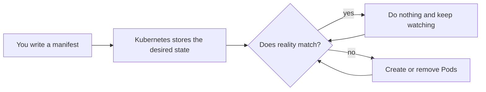

# What orchestration solves

## In plain words

You already know how to package a program into a container image and start it with `docker run`. That works well on one computer. Real products run on many computers at once, day and night, while people keep shipping new versions. Somebody has to decide which computer runs which container, notice when a container dies at 3 a.m., start a replacement, send users to the copies that are healthy, and swap in new versions without a visible outage.

**Orchestration** is the name for doing all of that automatically. An **orchestrator** is a program that takes a description of what you want running and keeps it running across a group of machines. **Kubernetes** (pronounced "koo-ber-NET-eez", often written **K8s** because eight letters sit between the K and the s) is the orchestrator that most of the industry has settled on.

An everyday picture: think of a busy restaurant. The cooks are your containers; each one knows how to prepare dishes. Without a manager, a cook who goes home ill is not replaced, two cooks fight over the same stove, and nobody tells the waiters which counter has food ready. A restaurant manager does not cook. The manager keeps a staffing plan ("four cooks on the grill, two on desserts"), watches the kitchen, calls in a replacement when someone leaves, and tells waiters where to collect plates. Kubernetes is that manager for containers.

Why this matters for a job: Kubernetes appears in a large share of backend, platform, data and machine-learning job adverts. Even if you never administer a cluster, you will be asked to read the files that describe your service, to find out why your service is not starting, and to explain in an interview what happens when a machine fails.

> **Before this lesson:** you should know what a container image and a container are. If those words are new, read [What a container is](#/lesson/docker/what-is-a-container) in the Docker track first. The lesson [Kubernetes for Docker users](#/lesson/docker/kubernetes-comparison) is a helpful preview but is not required.

## Life without an orchestrator

To see what Kubernetes gives you, picture a small company, Harbour Coffee, that sells coffee through a website. We will use this company throughout the track. Its software has three parts:

- `web`, the pages customers see,
- `menu-api`, a program that returns the list of drinks and prices,
- `orders-api`, a program that records orders in a database.

Each part is a container image. On day one the team rents a single server and types three commands:

```bash
docker run -d --name web        -p 80:8080 ghcr.io/harbour-coffee/web:1.0.0
docker run -d --name menu-api   ghcr.io/harbour-coffee/menu-api:1.0.0
docker run -d --name orders-api ghcr.io/harbour-coffee/orders-api:1.0.0
```

Reading the first line piece by piece: `docker run` starts a container; `-d` means "detached", so the command returns while the container keeps running in the background; `--name web` gives it a readable name; `-p 80:8080` connects port 80 of the server to port 8080 inside the container, so that browsers can reach it; the last part is the image to run and its version tag, `1.0.0`.

This is fine for a prototype. Then the business grows and problems arrive one after another.

**Problem 1: one server is one point of failure.** If that server loses power, the shop is closed. The team rents three servers. Now someone must decide which containers go where and must remember the decision.

**Problem 2: containers die.** A bug makes `orders-api` crash once a week. Somebody has to notice and restart it. Docker's `--restart` option helps on a single machine, but it cannot move the container to another server when the whole machine is gone.

**Problem 3: traffic changes.** On Monday mornings ten times more people order coffee. The team wants eight copies of `orders-api` in the morning and two at night. Starting and stopping copies by hand at 6 a.m. is nobody's idea of a good job.

**Problem 4: copies need a single front door.** With eight copies on three servers, which address should `web` call? The copies come and go, and each has a different address. Something must keep an up-to-date list and spread requests across the healthy ones. Spreading requests across copies is called **load balancing**.

**Problem 5: new versions.** Version 1.1.0 is ready. Stopping all the old containers and then starting new ones means a gap where customers see errors. Replacing them one at a time by hand, while checking each new one, is slow and easy to get wrong. And if 1.1.0 turns out to be broken, someone must put 1.0.0 back quickly.

**Problem 6: fitting things onto machines.** Each server has a fixed amount of processor time and memory. Put too many containers on one server and they starve each other. Put too few and you pay for idle hardware. Choosing a machine for each container, given what each one needs, is called **scheduling**.

**Problem 7: settings and passwords.** The database password must reach `orders-api` without being baked into the image or pasted into a chat message.

A team can solve each of these with shell scripts. Many teams did, between roughly 2013 and 2016. The scripts grew into home-made orchestrators that only their authors understood. Kubernetes exists so that nobody has to write that system again.

## What an orchestrator does

Here are the same seven problems with the Kubernetes answer next to each. You do not need to remember the names in the right-hand column yet; every one of them has its own lesson later.

| Problem | What you tell Kubernetes | The object that does it |
|---|---|---|
| Many machines | Nothing; machines join a **cluster** and are treated as one pool | Nodes |
| Containers die | "Keep N copies running" | Deployment |
| Traffic changes | "Keep CPU near 60%, between 2 and 10 copies" | HorizontalPodAutoscaler |
| A single front door | "Give these copies one stable name" | Service |
| New versions | "Change the image to 1.1.0, a few at a time" | Deployment rolling update |
| Fitting onto machines | "Each copy needs half a CPU and 256 MiB" | Scheduler, using requests |
| Settings and passwords | "Here are the values; mount them in" | ConfigMap and Secret |

Some vocabulary, one term at a time:

- A **node** is one machine (physical or virtual) that is part of the group.
- A **cluster** is the whole group of nodes managed together by one Kubernetes installation.
- A **Pod** is the smallest thing Kubernetes runs. For now, read "Pod" as "one running container with a thin wrapper around it". The Pod lessons explain the wrapper.
- A **replica** is one of several identical copies of the same Pod.
- An **object** is a record stored by Kubernetes that describes something you want to exist: a Deployment object, a Service object, and so on.
- A **manifest** is a text file, written in a format called YAML, that describes one or more objects.

### The big idea: you describe the result, not the steps

With `docker run` you give *commands*: do this now. With Kubernetes you give a *description*: this is how things should be. That description is called the **desired state**. Kubernetes continuously compares it with what is really running, the **actual state** (also called observed state), and acts to remove any difference. This style is called **declarative**, as opposed to **imperative** (step-by-step commands).

The restaurant manager again: you do not phone the manager every time a cook leaves. You hand over a staffing plan once. The manager keeps the kitchen matching the plan.



The loop on the right never stops. That is why a crashed container comes back without anyone being paged: after the crash the actual state says "2 copies", the desired state still says "3 copies", and the loop starts one more.

## Your first manifest, line by line

Below is the complete description of "three copies of `menu-api`". Do not try to memorise it. Read the explanation under it, and notice how little of it is about *how* to do anything.

```yaml
apiVersion: apps/v1
kind: Deployment
metadata:
  name: menu-api
  labels:
    app: menu-api
spec:
  replicas: 3
  selector:
    matchLabels:
      app: menu-api
  template:
    metadata:
      labels:
        app: menu-api
    spec:
      containers:
        - name: menu-api
          image: ghcr.io/harbour-coffee/menu-api:1.0.0
          ports:
            - containerPort: 8080
```

YAML is a way of writing structured data using indentation. A line such as `name: menu-api` is a **key** (`name`) and a **value** (`menu-api`). Indented lines belong to the key above them. A line starting with `-` is one item of a list.

- `apiVersion: apps/v1` says which part and version of the Kubernetes interface this object belongs to. Deployments live in a group called `apps`, at version `v1`. The lesson on [resources, groups and versions](#/lesson/kubernetes/api-resources-versions) explains the scheme.
- `kind: Deployment` is the type of object. A Deployment means "keep a number of identical Pods running and manage their updates".
- `metadata:` holds information *about* the object. `name: menu-api` is how you will refer to it. `labels:` are free-form key and value tags; here one label, `app: menu-api`.
- `spec:` (short for specification) is the desired state. Everything under it is what you want.
- `replicas: 3` asks for three copies.
- `selector:` tells the Deployment which Pods count as "its" Pods: any Pod carrying the label `app: menu-api`.
- `template:` is the stamp used to make each Pod. It has its own `metadata` (the label each Pod gets, which must match the selector) and its own `spec`.
- `containers:` is a list. It has one item, with a `name`, the `image` to run, and `containerPort: 8080`, which documents the port the program listens on.

You hand the file to the cluster with one command, then ask what exists:

```bash
$ kubectl apply -f menu-api.yaml
deployment.apps/menu-api created

$ kubectl get pods
NAME                        READY   STATUS    RESTARTS   AGE
menu-api-6c9d7b5f48-2xkqp   1/1     Running   0          12s
menu-api-6c9d7b5f48-9hvtn   1/1     Running   0          12s
menu-api-6c9d7b5f48-wd4mz   1/1     Running   0          12s
```

`kubectl` (said "cube control" or "cube cuttle") is the command-line tool for talking to a cluster. `apply -f menu-api.yaml` means "make the cluster match this file". The reply confirms that a Deployment was created. `kubectl get pods` lists Pods: three of them, each with a generated name, `1/1` containers ready, status `Running`, zero restarts.

Now delete one on purpose and look again:

```bash
$ kubectl delete pod menu-api-6c9d7b5f48-2xkqp
pod "menu-api-6c9d7b5f48-2xkqp" deleted

$ kubectl get pods
NAME                        READY   STATUS    RESTARTS   AGE
menu-api-6c9d7b5f48-9hvtn   1/1     Running   0          2m
menu-api-6c9d7b5f48-wd4mz   1/1     Running   0          2m
menu-api-6c9d7b5f48-r7c2j   1/1     Running   0          4s
```

There are three again. The newest one is four seconds old and has a different name. You did not restart anything. The desired state said three, the actual state dropped to two, and the loop closed the gap. This behaviour is called **self-healing**.

## A simulation you can run

The next block is a tiny model of that loop in plain Python. It is not Kubernetes; it is a toy with the same shape, so that you can watch the mechanism. Press Run, then try changing `desired` or the list of events.

```python-run
import itertools

counter = itertools.count(1)

def new_pod():
    return f"menu-api-{next(counter)}"

desired = 3                 # what the manifest asks for
actual = []                 # pods that currently exist

def reconcile():
    """Compare desired with actual and fix the difference."""
    while len(actual) < desired:
        pod = new_pod()
        actual.append(pod)
        print(f"   controller: too few, created {pod}")
    while len(actual) > desired:
        pod = actual.pop()
        print(f"   controller: too many, removed {pod}")

events = [
    ("apply manifest", None),
    ("pod crashes", 0),
    ("node dies, two pods lost", (0, 0)),
    ("scale to 5", 5),
    ("scale to 2", 2),
]

for name, detail in events:
    print(f"\nEVENT: {name}")
    if name == "pod crashes":
        print("   lost", actual.pop(detail))
    elif name.startswith("node dies"):
        for i in detail:
            print("   lost", actual.pop(i))
    elif name.startswith("scale"):
        desired = detail
    reconcile()
    print(f"   desired={desired} actual={len(actual)} -> {actual}")
```

Walk through the output. After "apply manifest" the list is empty, so three Pods are created. After "pod crashes" one disappears and a new one, with a new number, replaces it: Pods are replaced, never repaired. After the node failure two are lost and two are created. Scaling is the same loop with a different target. One function handles first deployment, crashes, node failures and scaling, because all four are the same situation: desired and actual disagree.

> [!TIP]
> When something surprising happens in a cluster, ask two questions: "what is the desired state?" and "what is the actual state?". Almost every Kubernetes behaviour is some controller closing the gap between the two.

## What Kubernetes is not

Newcomers often expect Kubernetes to do things it leaves to other tools. Knowing the boundary saves confusion.

- **It does not build images.** You build and push images with Docker or another builder, usually in a pipeline (see the [CI/CD track](#/lesson/cicd/pipeline-stages)). Kubernetes pulls finished images from a registry.
- **It does not understand your application.** It knows a container is running and, if you configure checks, whether it answers them. It does not know whether your orders are correct.
- **It does not provide databases, queues or logging by itself.** You can run those on Kubernetes, or use services from a cloud provider, but they are separate software.
- **It is not required for small systems.** One server with Docker Compose is a reasonable way to run a hobby project. Kubernetes repays its learning cost when you have several services, several machines, or a need for uptime during failures and releases.

> [!WARNING]
> Kubernetes restarts and replaces containers freely. Anything a container writes to its own filesystem disappears with it. Programs that must keep data need the storage objects described in the [storage module](#/lesson/kubernetes/volumes-pv-pvc). Assuming a container's local files will survive is one of the most common beginner mistakes.

## Pets and cattle, and why Pods are disposable

Operations people use a blunt comparison. A **pet** server has a name, is cared for by hand, and is nursed back to health when it is ill. **Cattle** servers are numbered, identical, and replaced when one fails. Kubernetes treats Pods as cattle. A Pod that fails is not repaired; a new one is made from the template. The new one has a new name and a new network address.

This has two consequences that shape everything else in the track:

1. **Nothing should depend on a particular Pod.** Other programs reach your Pods through a Service, a stable name that always points at whichever Pods are currently healthy.
2. **Your program should tolerate being stopped and started.** It should start quickly, shut down cleanly when asked, and keep important data outside the container.

Applications built this way are sometimes called **cloud-native**: designed to run as many small, replaceable pieces that can be scaled, updated and healed by automation. A related word is **microservices**: an application split into small independent services (like `web`, `menu-api` and `orders-api`) instead of one large program. Kubernetes does not require microservices, but it makes running many small services practical.

## A day in the life: the same problems, solved

Return to Harbour Coffee, now on Kubernetes, and replay Monday.

- 05:50. Traffic rises. An autoscaler sees processor use on `orders-api` climb above its target and raises `replicas` from 2 to 6. The scheduler places the four new Pods on nodes with free capacity.
- 07:15. A node's disk fails. Kubernetes marks the node as not ready. The Pods that were on it are counted as missing and replacements start on the remaining nodes. Customers are routed only to Pods that pass their health checks.
- 10:00. A developer merges version 1.1.0. The pipeline changes one line in the manifest, the image tag, and applies it. Kubernetes starts new Pods, waits for each to report ready, and removes old ones a few at a time.
- 10:04. Error rates rise. The developer runs one command, `kubectl rollout undo deployment/orders-api`, and the previous version is rolled back in the same gradual way.
- 22:00. Traffic falls. The autoscaler lowers `replicas` back to 2.

Nobody logged in to a server. Every action was either a change to the desired state or the system reacting to a change in the actual state.

> [!INTERVIEW]
> **"What problems does Kubernetes solve?"** A strong answer names concrete capabilities, not buzzwords: it schedules containers onto a pool of machines based on declared resource needs; it keeps a declared number of replicas running and replaces failed ones (self-healing); it gives groups of Pods a stable name and load-balances across the healthy ones; it scales replicas up and down; it performs rolling updates and rollbacks; and it injects configuration and secrets. Then add the unifying idea: all of this is driven by a declarative desired state that controllers continuously reconcile against reality.

## Common pitfalls

- **Treating `kubectl` like `docker run`.** Typing one-off imperative commands works, but the result is not recorded anywhere. Keep manifests in version control and apply them, so the desired state is written down and reviewable.
- **Expecting a Pod to keep its name or address.** Both change whenever the Pod is replaced. Use labels and Services to find Pods.
- **Deleting a Pod to "stop" an application.** If a Deployment owns the Pod, a replacement appears within seconds. To stop the application, change the desired state: set `replicas: 0` or delete the Deployment.
- **Assuming Kubernetes knows your app is healthy.** Without the probes described in the [Pod lifecycle lesson](#/lesson/kubernetes/pod-lifecycle-resources), "Running" only means the process has started.
- **Adopting Kubernetes for a single small service.** The operational cost is real. Use it when its benefits apply.

## Cheat sheet

| Term | One-line meaning |
|---|---|
| Orchestrator | Software that deploys and manages containers across many machines |
| Cluster | A set of machines managed as one by Kubernetes |
| Node | One machine in the cluster |
| Pod | The smallest runnable unit; wraps one or more containers |
| Replica | One of several identical Pods |
| Manifest | A YAML file describing objects |
| Desired state | What the manifests say should exist |
| Actual state | What exists right now |
| Reconciliation | Comparing the two and acting on the difference |
| Self-healing | Automatic replacement of failed Pods |
| Scheduling | Choosing a node for each Pod |
| Rolling update | Replacing old Pods with new ones gradually |
| `kubectl apply -f file.yaml` | Send a manifest; make the cluster match it |
| `kubectl get pods` | List Pods |

## Summary

Containers solve packaging. They do not solve running many containers across many machines with failures, traffic swings and frequent releases. An orchestrator takes over that work. Kubernetes does it through a declarative model: you store a description of the desired state, and control loops keep the actual state matching it. From that single idea come self-healing, scaling, rolling updates and rollbacks. Pods are disposable, so applications reach each other through stable Services and keep data outside the container. The rest of this track opens each box in turn, beginning with where Kubernetes came from and then how a cluster is put together.

## Glossary

- **Orchestration**: automatic deployment, placement, scaling, healing and updating of containers.
- **Kubernetes (K8s)**: the most widely used open-source container orchestrator.
- **Cluster**: machines managed together by one Kubernetes installation.
- **Node**: a single machine in a cluster.
- **Pod**: the smallest unit Kubernetes schedules, containing one or more containers.
- **Replica**: an identical copy of a Pod.
- **Object**: a stored record describing something that should exist in the cluster.
- **Manifest**: a YAML file that defines objects.
- **YAML**: an indentation-based text format for structured data.
- **Declarative**: describing the wanted result and letting the system work out the steps.
- **Imperative**: giving the steps one command at a time.
- **Desired state / actual state**: what should exist, and what does exist.
- **Reconciliation**: the repeated compare-and-correct cycle.
- **Self-healing**: replacing failed Pods without human action.
- **Load balancing**: spreading requests across several copies.
- **Scheduling**: picking a node for a Pod.
- **Cloud-native**: built to run as replaceable, automatable pieces.
- **Microservices**: an application split into small independent services.

```quiz
[
  {"q": "A Deployment asks for 4 replicas. One node fails and takes 2 Pods with it. What happens next?",
   "options": ["Nothing until an administrator restarts the node", "The Deployment's desired count drops to 2", "Two replacement Pods are created on other nodes", "The two lost Pods are moved, keeping their names and addresses"],
   "answer": 2,
   "explain": "Desired state is still 4 and actual state is 2, so the control loop creates 2 new Pods. They are new Pods with new names and addresses, not the old ones moved."},
  {"q": "Which statement best describes the declarative model?",
   "options": ["You run a sequence of commands in the right order", "You describe the end result and the system works to reach and keep it", "You write a script that the cluster executes once", "You log in to each node and start containers"],
   "answer": 1,
   "explain": "Declarative means stating the desired state. Controllers continuously reconcile reality towards it."},
  {"q": "You delete a Pod that belongs to a Deployment with replicas: 3 because you want the application stopped. Why is the application still running a moment later?",
   "options": ["kubectl delete does not work on Pods", "The Deployment saw 2 instead of 3 and created a replacement", "The Pod was restored from a backup", "Pods cannot be deleted while they are healthy"],
   "answer": 1,
   "explain": "Deleting a Pod changes actual state only. To stop the app you must change desired state, for example scale to 0 or delete the Deployment."},
  {"q": "Which of these is NOT something Kubernetes does by itself?",
   "options": ["Choose a node for each Pod", "Replace failed Pods", "Build your container image from source code", "Roll out a new image version gradually"],
   "answer": 2,
   "explain": "Images are built and pushed by a build tool or pipeline. Kubernetes pulls finished images from a registry."},
  {"q": "Why should other programs not connect to a Pod by its own IP address?",
   "options": ["Pod addresses are secret", "Pods have no addresses", "A replaced Pod gets a new address, so the old one stops working", "Kubernetes blocks traffic between Pods"],
   "answer": 2,
   "explain": "Pods are disposable; each replacement has a new name and IP. A Service provides the stable name in front of them."},
  {"q": "In the manifest in this lesson, what is the role of spec.template?",
   "options": ["It lists the nodes to use", "It is the pattern from which each Pod replica is created", "It stores the current number of running Pods", "It sets the cluster's Kubernetes version"],
   "answer": 1,
   "explain": "The template is the Pod stamp: every replica is created from it, with the labels and containers it defines."},
  {"q": "A container writes uploaded files to its own filesystem. The Pod is replaced during an update. What happens to the files?",
   "options": ["They are copied to the new Pod automatically", "They are lost, because the new Pod starts from the image", "They are kept on the node and remounted", "The update is blocked until the files are backed up"],
   "answer": 1,
   "explain": "A container's writable layer is discarded with the container. Data that must survive needs a volume backed by persistent storage."}
]
```

> **Source:** Poulton, *The Kubernetes Book*, ch. 1 (topic coverage only). Official docs: https://kubernetes.io/docs/concepts/overview/ and https://kubernetes.io/docs/concepts/workloads/controllers/deployment/
