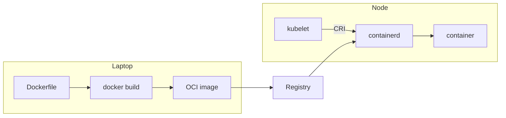

# History, the ecosystem and the data-centre operating system

## In plain words

The previous lesson said what Kubernetes does. This one answers three questions a newcomer usually has next: where did it come from, who is in charge of it, and why do people keep calling it "the operating system of the cloud"?

Start with the last one, using an everyday picture. The operating system on your laptop (Windows, macOS or Linux) hides the hardware from your programs. A text editor does not know which processor core it runs on or which sector of the disk holds your file. It asks the operating system for "some processor time" and "a file", and the operating system works out the details. Kubernetes plays the same role one level up. Instead of hiding the cores and disks of one computer, it hides the *computers* of a whole data centre. Your application asks for "three copies, half a processor each, reachable under this name", and Kubernetes works out which machines to use.

Why this matters for a job: interviewers like to open with background questions ("What is Kubernetes? Where did it come from? What is the CNCF?") because the answers show whether you understand the tool or have only memorised commands. The same background also explains practical things you will meet in your first week, such as why a cluster does not contain Docker any more and why there are so many add-on projects.

> **Before this lesson:** read [What orchestration solves](#/lesson/kubernetes/what-orchestration-solves). You need the words cluster, node, Pod, manifest and desired state.

## A short history

### Before containers were popular

In the early 2000s Google ran its search, mail and advertising systems on very large numbers of cheap machines. Running one application per machine wasted capacity, so Google packed many programs onto each machine, isolated from one another by Linux kernel features, and built internal systems to decide what ran where. The best known of these internal systems is called **Borg**; a later research system was called **Omega**. Neither was released to the public, but papers describing the lessons learned were published.

### Docker makes containers easy (2013)

Linux had the building blocks for containers for years, but they were hard to use. In 2013 Docker wrapped them in a friendly tool and, more importantly, an image format that let anyone package a program once and run it anywhere. Containers spread quickly. Very soon teams had more containers than they could manage by hand, which created the need described in the previous lesson.

### Kubernetes appears (2014 to 2015)

In 2014 a group of Google engineers started a new, open-source orchestrator that applied the lessons of Borg and Omega to Docker-style containers. They named it Kubernetes, a Greek word for the person who steers a ship (a helmsman or pilot). That is why the logo is a ship's wheel, and why so many related projects have nautical names (Helm, Harbor, and so on). The wheel has seven spokes, a quiet reference to the project's internal code name, which came from a science-fiction character.

Two details are worth being precise about, because they are often said wrongly:

- Kubernetes is **not** an open-source release of Borg. It is a separate program, written from scratch, by people who had worked on Borg and Omega and wanted to keep the good ideas.
- Kubernetes is written in the **Go** programming language and is released under the **Apache 2.0** licence, a permissive open-source licence that lets companies use and modify it freely.

Version 1.0 was released in July 2015. At the same time Google handed the project to a new neutral organisation, so that no single company would own it.

### The CNCF

That organisation is the **Cloud Native Computing Foundation (CNCF)**, part of the Linux Foundation. The CNCF does not write Kubernetes; contributors from hundreds of companies do. The foundation owns the trademark, organises the conferences (KubeCon), runs the certification exams (the CKA and CKAD you may have heard of), and looks after a large catalogue of related projects. Projects in the catalogue move through maturity levels called **sandbox**, **incubating** and **graduated**. Kubernetes was the first to graduate.

Neutral ownership mattered. Around 2015 to 2017 several orchestrators competed: Docker Swarm, Apache Mesos with Marathon, HashiCorp Nomad and Kubernetes. Because every large cloud provider could adopt Kubernetes without handing control to a rival, they all did, and by about 2018 it was the common choice. Each major cloud now sells a managed Kubernetes service, which the lesson on [getting a cluster](#/lesson/kubernetes/getting-a-cluster) compares.

### How releases work today

Kubernetes publishes a new **minor version** roughly three times a year. Versions are written `1.x.y`: `x` is the minor version (new features), `y` is the patch number (bug and security fixes). The project maintains the three most recent minor versions at any time. At the time of writing, late 2026, those are 1.35, 1.36 and 1.37. Each minor version is therefore supported for about a year, which means clusters need regular upgrades; an unmaintained cluster falls out of support quickly.

New features go through stages: **alpha** (off by default, may change or vanish), **beta** (usually on, may still change in details) and **stable**, also called **GA** for "generally available" (will be kept compatible). When this track says a feature is stable since some version, that is what it means.

## Kubernetes and Docker: clearing up a common confusion

Many newcomers hear "Kubernetes dropped Docker" and worry that their Docker knowledge is wasted. It is not. Here is what happened.

A node needs a program that pulls images and starts containers. That program is called a **container runtime**. Early Kubernetes talked to the Docker Engine for this. Docker Engine is a large tool with many features Kubernetes does not need, and inside it the real work of running containers is done by a smaller component called **containerd** (said "container-dee").

To avoid being tied to one runtime, Kubernetes defined a standard plug-in interface, the **Container Runtime Interface (CRI)**. Any runtime that speaks CRI can be used. containerd and another runtime called CRI-O speak it directly. Docker Engine did not, so Kubernetes carried a translation layer for it, nicknamed dockershim. That layer was removed in version 1.24 (2022). Since then, typical clusters use containerd directly.

What did *not* change is the image format. Images follow the **Open Container Initiative (OCI)** standard. An image you build with `docker build` runs on containerd unchanged. So:

| Question | Answer |
|---|---|
| Can I still build images with Docker? | Yes. Nothing changes. |
| Does my cluster run Docker Engine on its nodes? | Usually not; it runs containerd or CRI-O. |
| Can I run `docker ps` on a node to see Pods' containers? | Usually not. Use `kubectl`, or `crictl` on the node. |
| Do I need to rewrite my Dockerfile? | No. |



Read the diagram from left to right. You build an image on a laptop or in a pipeline and push it to a registry. On a node, the Kubernetes agent (the **kubelet**, covered in the lesson on [worker nodes](#/lesson/kubernetes/worker-nodes)) asks containerd, through the CRI, to pull that image and start a container from it.

## Kubernetes as an operating system for the data centre

Now look more closely at the comparison from the opening. An operating system does four broad jobs. Kubernetes does a data-centre-sized version of each.

| Job | On one computer | In a Kubernetes cluster |
|---|---|---|
| Abstract the hardware | Programs see "CPU time" and "memory", not individual chips | Applications see "a cluster with capacity", not individual servers |
| Schedule work | The OS scheduler picks which process runs on which core | The Kubernetes scheduler picks which node runs each Pod |
| Provide common services | Files, networking, users, permissions | Storage volumes, Services and DNS, ServiceAccounts, RBAC |
| Offer one programming interface | System calls | The Kubernetes API |

The last row is the most important. On Linux, a program opens a file with the same system call whether the disk is a spinning drive or flash storage. On Kubernetes, you request storage with the same kind of object whether the cluster runs on Amazon, Google, Microsoft or servers in a basement. This makes applications **portable**: the manifests for Harbour Coffee work, with small changes, on any conforming cluster.

The comparison has limits, and saying so shows understanding. Kubernetes is not a kernel. It does not replace Linux on the nodes; every node still runs an ordinary operating system. It also leaves several things to plug-ins: Pod networking is provided by a **CNI plug-in** (Container Network Interface), storage by **CSI drivers** (Container Storage Interface), and containers by a CRI runtime. Kubernetes defines the interfaces; other projects fill them in. That is a strength, since vendors can compete behind a stable interface, and also the reason a "bare" cluster needs add-ons before it is useful.

### Scheduling, the OS way

On a laptop you do not choose which processor core runs your browser. In a cluster you normally do not choose which node runs your Pod. You state what the Pod needs, and the scheduler finds a place. The small program below imitates that: given nodes with free capacity and a list of Pods with needs, it places each Pod on the node with the most room left. Press Run.

```python-run
nodes = {"node-a": 4000, "node-b": 2000, "node-c": 2000}   # free CPU in millicores
pods = [("web-1", 500), ("orders-1", 1500), ("orders-2", 1500),
        ("menu-1", 250), ("report-job", 3000)]

for name, need in pods:
    # keep only nodes that have enough room (filtering)
    fits = {n: free for n, free in nodes.items() if free >= need}
    if not fits:
        print(f"{name:11} needs {need:4}m -> Pending, no node has room")
        continue
    # among those, prefer the node with the most free CPU (scoring);
    # the name breaks ties so the result is always the same
    best = max(sorted(fits), key=lambda n: fits[n])
    nodes[best] -= need
    print(f"{name:11} needs {need:4}m -> {best}   (free now: {nodes})")
```

Two things to notice in the output. First, the person who wrote the Pod list never mentioned a node; the placement came from the stated needs. Second, the last Pod asks for 3000 millicores (three whole processor cores) and no node has that much left, so it stays **Pending**: accepted by the cluster but not placed. A Pending Pod is the cluster telling you "I cannot satisfy this request with the capacity I have". You will meet that state again in the [troubleshooting lesson](#/lesson/kubernetes/troubleshooting-pods). The real scheduler uses the same two phases, filtering then scoring, with many more rules; the [control plane lesson](#/lesson/kubernetes/control-plane) describes them.

A **millicore** is one thousandth of a processor core. Kubernetes measures processor requests in these units so that small programs can ask for a fraction of a core, for example `250m` for a quarter.

## The ecosystem around the core

Because Kubernetes is built from interfaces, a large family of projects has grown around it. You do not need to learn them now, but recognising the names helps when you read a company's architecture diagram.

| Area | What it adds | Examples |
|---|---|---|
| Container runtime | Runs containers on each node | containerd, CRI-O |
| Networking (CNI) | Gives Pods addresses and connects them | Cilium, Calico, Flannel |
| Ingress and gateways | Routes outside HTTP traffic to Services | Envoy Gateway, Traefik, cloud load-balancer controllers |
| Packaging | Bundles and customises manifests | Helm, Kustomize |
| Delivery | Applies manifests from Git | Argo CD, Flux |
| Monitoring | Collects metrics and shows dashboards | Prometheus, Grafana |
| Logging | Collects container logs | Fluent Bit, Loki |
| Service mesh | Encrypts and observes traffic between Pods | Istio, Linkerd |
| Machine learning | Serves models and runs pipelines | KServe, Kubeflow |

Later modules in this track cover packaging, delivery, monitoring and machine learning. The point for now: "Kubernetes" in a job advert usually means the core plus a handful of these.

> [!TIP]
> When you join a team, ask which distribution or managed service they use, which CNI plug-in, which ingress or gateway controller, and how manifests get applied (by hand, Helm, or GitOps). Those four answers tell you most of what is specific to their setup.

## Distributions, managed services and conformance

Kubernetes itself is source code. What you install is usually a **distribution**: the core bundled with a runtime, networking and tooling, tested together. Some are small and aimed at laptops or edge devices (k3s, MicroK8s, kind, minikube). Some are enterprise platforms (Red Hat OpenShift, Rancher). Cloud providers offer **managed services**, where the provider runs the control plane for you: Amazon EKS, Google GKE and Microsoft AKS.

With so many variants, how do you know your manifests will work on each? The CNCF runs a **conformance programme**: a published test suite a distribution must pass to call itself "Certified Kubernetes". Passing means the standard API behaves in the standard way. Differences still exist at the edges, mostly in storage, load balancers and identity, because those connect to each provider's own infrastructure.

> [!WARNING]
> Portability applies to the Kubernetes API, not to everything around it. A manifest that uses a cloud provider's specific storage class name, load balancer annotation or identity integration needs editing before it runs elsewhere. Keep provider-specific settings in a small, clearly separated part of your configuration; the [Helm and Kustomize lesson](#/lesson/kubernetes/helm-kustomize) shows how.

## Why Kubernetes won, and what it costs

It is worth being able to argue both sides.

**Reasons it became the standard**

- A declarative model and a consistent API for everything, which makes automation straightforward.
- Extensibility: new object types can be added without changing the core (see [CRDs and operators](#/lesson/kubernetes/crds-operators)).
- Vendor-neutral governance, so every cloud could support it.
- A very large community, which means documentation, tools and people who already know it.

**What it costs**

- A steep learning curve: many concepts must be understood before the first production deployment.
- Operational work: upgrades three times a year, certificates, add-ons, security hardening. Managed services reduce this but do not remove it.
- Overhead: the control plane and per-node agents consume resources, which matters for very small systems.
- Easy to misconfigure: defaults favour getting started over being locked down, a theme of the security modules.

> [!INTERVIEW]
> **"Is Kubernetes always the right choice?"** No, and saying so is a good sign. For one or two services on one machine, Docker Compose or a platform-as-a-service is cheaper to run. For event-driven functions, a serverless platform may fit better. Kubernetes earns its place when you have many services, need high availability across machines, want a uniform deployment interface across teams or clouds, or need its extensibility. A balanced answer names the benefits (self-healing, scaling, rolling updates, portability, ecosystem) and the costs (complexity, upgrade cadence, skills).

## Common pitfalls

- **Saying "Kubernetes is open-source Borg".** It was inspired by Borg and Omega but is a separate codebase.
- **Believing Docker images no longer work.** Only the Docker Engine integration on nodes was removed; OCI images are unaffected.
- **Ignoring the support window.** With roughly a year of support per minor version, skipping upgrades leaves you on an unsupported release.
- **Assuming all clusters are identical.** The core API is; networking, storage and load balancing depend on plug-ins and the provider.
- **Relying on alpha features in production.** They can change or be removed between versions.

## Cheat sheet

| Fact | Value |
|---|---|
| Meaning of the name | Greek for helmsman or pilot |
| Short form | K8s (K, eight letters, s) |
| First commit / 1.0 | 2014 / July 2015 |
| Origin | Google engineers, lessons from Borg and Omega |
| Language and licence | Go, Apache 2.0 |
| Governing body | Cloud Native Computing Foundation (CNCF) |
| Release rhythm | About three minor versions a year, three supported at once |
| Feature stages | alpha, beta, stable (GA) |
| Runtime interface | CRI (containerd, CRI-O) |
| Network interface | CNI |
| Storage interface | CSI |
| Image standard | OCI |
| Managed services | EKS (AWS), GKE (Google Cloud), AKS (Azure) |

## Summary

Kubernetes grew out of Google's experience running containers at very large scale and was released as a new open-source project in 2014, then donated to the vendor-neutral CNCF in 2015. Neutral governance and a clean, extensible design led every major cloud to adopt it. It behaves like an operating system for a pool of machines: it abstracts the hardware, schedules work, offers shared services such as networking and storage, and exposes one API. It reaches the real world through plug-in interfaces, CRI for runtimes, CNI for networking and CSI for storage, which is why clusters run containerd instead of Docker Engine while still running the images you build with Docker. Its power comes with real complexity, so knowing when not to use it is part of knowing it. Next, the track opens up a cluster to see the parts inside.

## Glossary

- **Borg / Omega**: Google's internal cluster managers whose lessons shaped Kubernetes.
- **CNCF**: Cloud Native Computing Foundation, the neutral home of Kubernetes.
- **Minor version / patch version**: the `x` and `y` in `1.x.y`.
- **Alpha, beta, stable (GA)**: maturity stages of a feature.
- **Container runtime**: the program on a node that pulls images and runs containers.
- **containerd**: the most common container runtime in clusters.
- **CRI**: Container Runtime Interface, how Kubernetes talks to a runtime.
- **CNI**: Container Network Interface, how Pod networking is plugged in.
- **CSI**: Container Storage Interface, how storage systems are plugged in.
- **OCI**: Open Container Initiative, the standard for image and runtime formats.
- **Millicore**: one thousandth of a CPU core, written `m`.
- **Pending**: a Pod accepted by the cluster but not yet running, often because no node fits.
- **Distribution**: Kubernetes bundled with the extra parts needed to run it.
- **Managed service**: a cloud offering where the provider operates the control plane.
- **Conformance**: passing the official tests that prove standard API behaviour.
- **Portable**: able to run on different clusters with little change.

```quiz
[
  {"q": "Which statement about the origin of Kubernetes is accurate?",
   "options": ["It is Google's Borg system released as open source", "It was written by Docker, Inc. as the successor to Swarm", "It is a new open-source project that applied lessons from Google's Borg and Omega", "It was created by the CNCF in 2010"],
   "answer": 2,
   "explain": "Kubernetes was written from scratch by engineers with Borg and Omega experience, then donated to the CNCF in 2015."},
  {"q": "A team builds images with docker build. Their new cluster uses containerd as its runtime. What must they change?",
   "options": ["Rewrite every Dockerfile for containerd", "Convert images with a special tool before pushing", "Nothing; OCI images built by Docker run on containerd", "Install Docker Engine on every node"],
   "answer": 2,
   "explain": "Docker produces OCI-standard images, and containerd runs OCI images. Only the Docker Engine integration on nodes was removed in v1.24."},
  {"q": "In the operating-system comparison, what corresponds to a system call interface?",
   "options": ["The container runtime", "The Kubernetes API", "The node's Linux kernel", "The image registry"],
   "answer": 1,
   "explain": "Applications and tools ask for everything through one consistent API, the way programs on one machine use system calls."},
  {"q": "A Pod requests 3000m of CPU. The nodes have 2500m, 2000m and 1000m free. What happens next?",
   "options": ["The Pod is split across two nodes", "The Pod runs on the 2500m node with less CPU", "The Pod stays Pending until a node with enough free CPU exists", "The request is rejected and the Pod is deleted"],
   "answer": 2,
   "explain": "A Pod runs on exactly one node. With no node passing the filter step, the Pod waits in Pending."},
  {"q": "Which interface lets different networking products provide Pod networking?",
   "options": ["CRI", "CSI", "CNI", "OCI"],
   "answer": 2,
   "explain": "CNI is the Container Network Interface. CRI is for runtimes, CSI for storage, and OCI is the image and runtime format standard."},
  {"q": "A cluster runs version 1.33 while the project supports 1.35, 1.36 and 1.37. What is the main risk?",
   "options": ["kubectl stops working immediately", "The cluster no longer receives security and bug fixes", "Container images can no longer be pulled", "Pods are deleted when support ends"],
   "answer": 1,
   "explain": "Only the three newest minor versions receive patches. An older cluster keeps running but gets no fixes, which is a security and stability risk."},
  {"q": "Why did vendor-neutral governance help Kubernetes become the standard?",
   "options": ["It made the software faster", "Competing cloud providers could adopt it without depending on a rival", "It removed the need for container images", "It guaranteed free hosting"],
   "answer": 1,
   "explain": "With the CNCF holding the project, no single company controlled it, so every major provider could build services on it."}
]
```

> **Source:** Poulton, *The Kubernetes Book*, ch. 1 (topic coverage only). Official docs: https://kubernetes.io/docs/concepts/overview/ , https://kubernetes.io/releases/ , https://kubernetes.io/docs/setup/production-environment/container-runtimes/
