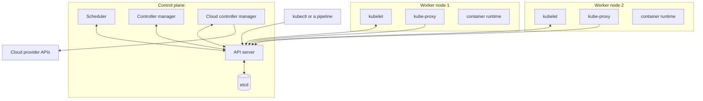
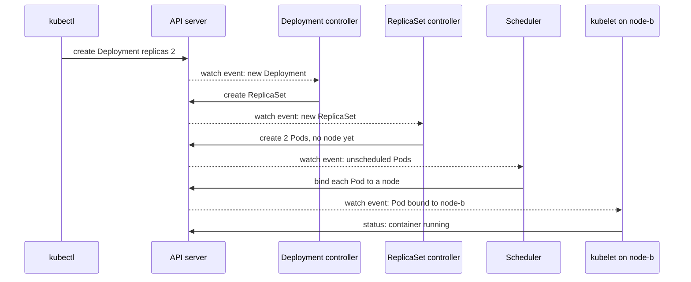

# The control plane: API server, etcd, scheduler and controllers

## In plain words

A Kubernetes cluster has two kinds of machines. **Worker nodes** run your applications. The **control plane** is the set of programs that makes decisions for the whole cluster: it stores what you asked for, decides where things should run, and notices when reality drifts from the plan. Your containers do not run in the control plane, in the same way that passengers do not sit in an airport's control tower.

That airport is a good picture to hold on to. The control tower does not fly aircraft. It keeps the flight plan (what should happen), assigns each aircraft a runway and gate (where things go), and watches radar to react when something deviates. Pilots, the workers, do the flying and report back. If the tower goes quiet, aircraft already in the air keep flying, but nothing new can be arranged. A cluster behaves the same way: if the control plane stops, running Pods keep running, but nothing can be changed, scheduled or healed until it returns.

Why this matters for a job: "Explain the Kubernetes architecture" is one of the most common interview questions, and in daily work the architecture tells you where to look when something is stuck. A Pod that never gets a node points at the scheduler. A Deployment that never creates Pods points at a controller. A command that hangs points at the API server.

> **Before this lesson:** read [What orchestration solves](#/lesson/kubernetes/what-orchestration-solves) for desired state and reconciliation, and [History and the data-centre OS](#/lesson/kubernetes/history-cloud-os) for the idea of scheduling and the word millicore.

## The whole picture first



Notice one thing before any detail: every arrow goes to or from the **API server**. The scheduler does not talk to the kubelet. Controllers do not talk to etcd. Each component reads and writes objects through the API server and reacts to what the others have written. This "hub and spoke" shape is the single most useful fact about the architecture.

The five control plane components are, in order of the sections below: the API server, etcd, the scheduler, the controller manager and the cloud controller manager.

## The API server: the front door

The **API server** (the program is named `kube-apiserver`) is the only component that everything else talks to. An **API**, application programming interface, is a defined way for programs to make requests of another program. The Kubernetes API is an HTTP API: clients send web requests such as "create this Deployment" or "list the Pods in this namespace", with the object written as JSON or YAML in the request.

When you run `kubectl apply`, the tool turns your YAML into an HTTPS request to the API server. For each request the API server does four things in order:

1. **Authentication**: who is asking? It checks a certificate or token.
2. **Authorisation**: is this identity allowed to do this action on this kind of object?
3. **Admission**: do extra policy checks pass, and should defaults be filled in?
4. **Validation and storage**: is the object well formed? If so, write it to etcd.

Steps 1 to 3 are the subject of the [API security module](#/lesson/kubernetes/authentication). For now, remember that the API server is a gatekeeper as well as a front door.

The API server also offers **watches**. A watch is a long-lived request that says "tell me every time an object of this kind changes". The scheduler keeps a watch on Pods, controllers keep watches on the objects they manage, and each kubelet keeps a watch on Pods assigned to its node. Watches are how components react within moments without constantly asking "anything new?".

The API server keeps no state of its own; it is described as **stateless**. Everything it knows is in etcd. That makes it easy to run several copies behind a load balancer for availability.

## etcd: the cluster's memory

**etcd** (said "et-see-dee") is a **key-value store**: a database that stores values under keys, like a dictionary. It holds every object in the cluster: every Deployment, Pod record, Secret and node registration. If the API server is the front desk, etcd is the filing cabinet behind it, and only the front desk has the key. No other component reads or writes etcd directly.

Two properties make etcd suitable for this job.

**It is consistent.** When the API server reads a value, it gets the latest committed value, never a stale one. Cluster decisions depend on that.

**It is distributed and tolerates failures.** In production, etcd runs as several members (usually three or five) on different machines. They agree on every write using a consensus algorithm called **Raft**. A write is accepted only when a **majority** of members, called a **quorum**, has recorded it.

The majority rule explains why member counts are odd:

| Members | Majority needed | Failures tolerated |
|---|---|---|
| 1 | 1 | 0 |
| 2 | 2 | 0 |
| 3 | 2 | 1 |
| 4 | 3 | 1 |
| 5 | 3 | 2 |

Four members tolerate no more failures than three, so the fourth adds cost and no safety. If the network splits a three-member cluster into a group of two and a group of one, the group of two still has a majority and keeps accepting writes; the lone member knows it is in the minority and refuses writes. This prevents **split brain**, a situation where two halves both believe they are in charge and record conflicting data.

> [!WARNING]
> etcd is the one part of a cluster that cannot be rebuilt from anything else. If etcd's data is lost and there is no backup, the cluster's desired state is gone, even though containers may still be running on nodes. Self-managed clusters need regular etcd snapshots stored off the cluster. Secrets are also stored in etcd, by default only base64-encoded and not encrypted, which the [Secrets lesson](#/lesson/kubernetes/secrets) returns to.

## The scheduler: choosing a node

When a Pod is first created it has no node; its `spec.nodeName` field is empty. The **scheduler** (`kube-scheduler`) watches for such Pods and, for each one, chooses a node and records the choice. Recording the choice is called **binding**. The scheduler does not start the container. It only writes "this Pod belongs on node-b" through the API server. The kubelet on node-b sees that and does the rest.

The scheduler decides in two phases.

**Filtering** removes nodes that cannot run the Pod at all. Reasons a node is filtered out include: not enough unreserved CPU or memory for the Pod's requests; the Pod demands a node label the node lacks; the node has a **taint** (a "keep away" marker) that the Pod does not tolerate; a port or volume the Pod needs is unavailable there.

**Scoring** ranks the nodes that survived. Each scoring rule gives every node a number, the numbers are combined with weights, and the highest total wins. Rules prefer, for example, nodes with a balanced use of CPU and memory, nodes that already hold the Pod's image, and placements that spread a workload's replicas across nodes and zones.

If filtering leaves no nodes, the Pod stays `Pending` and the scheduler records an event explaining why, for example `0/3 nodes are available: 3 Insufficient cpu`.

Here is a toy scheduler with both phases. It is far smaller than the real one, but the structure is faithful. Press Run and read the trace.

```python-run
nodes = [
    {"name": "node-a", "cpu_free": 1500, "mem_free": 2048, "labels": {"disk": "ssd"}, "taints": []},
    {"name": "node-b", "cpu_free": 3000, "mem_free": 8192, "labels": {"disk": "hdd"}, "taints": []},
    {"name": "node-c", "cpu_free": 4000, "mem_free": 8192, "labels": {"disk": "ssd"}, "taints": ["gpu-only"]},
]

def filter_node(pod, node):
    """Return None if the node is feasible, else the reason it is not."""
    if node["cpu_free"] < pod["cpu"]:
        return "Insufficient cpu"
    if node["mem_free"] < pod["mem"]:
        return "Insufficient memory"
    for key, value in pod.get("node_selector", {}).items():
        if node["labels"].get(key) != value:
            return "node selector mismatch"
    for taint in node["taints"]:
        if taint not in pod.get("tolerations", []):
            return f"untolerated taint {taint}"
    return None

def score_node(pod, node):
    """Higher is better: prefer the node left with the most free share."""
    cpu_left = (node["cpu_free"] - pod["cpu"]) / 4000
    mem_left = (node["mem_free"] - pod["mem"]) / 8192
    return round(50 * cpu_left + 50 * mem_left)

def schedule(pod):
    print(f"\nPod {pod['name']} (cpu {pod['cpu']}m, mem {pod['mem']}Mi)")
    feasible = []
    for node in nodes:
        reason = filter_node(pod, node)
        if reason:
            print(f"  filter: {node['name']} rejected: {reason}")
        else:
            feasible.append(node)
    if not feasible:
        print("  result: Pending, 0 nodes available")
        return
    scored = [(score_node(pod, n), n["name"], n) for n in feasible]
    for s, name, _ in scored:
        print(f"  score:  {name} = {s}")
    # highest score wins; the node name breaks ties so the result is repeatable
    best = sorted(scored, key=lambda t: (-t[0], t[1]))[0][2]
    best["cpu_free"] -= pod["cpu"]
    best["mem_free"] -= pod["mem"]
    print(f"  result: bound to {best['name']}")

schedule({"name": "orders-api", "cpu": 500, "mem": 512})
schedule({"name": "cache", "cpu": 1000, "mem": 1024, "node_selector": {"disk": "ssd"}})
schedule({"name": "trainer", "cpu": 3500, "mem": 4096, "tolerations": ["gpu-only"]})
schedule({"name": "big-report", "cpu": 3500, "mem": 4096})
```

The first Pod fits on two nodes, and scoring picks the roomier one. The second insists on an SSD label, which removes node-b; node-c is removed by its taint; only node-a is left. The third tolerates the taint and so can use node-c. The fourth has the same size but no toleration, and nothing else is big enough, so it is Pending. Later lessons on [steering the scheduler](#/lesson/kubernetes/scheduling-controls) cover selectors, taints and tolerations properly.

> [!TIP]
> The scheduler places Pods by their declared **requests**, not by what the containers are really using at that moment. A node can look idle in a monitoring graph and still be "full" as far as the scheduler is concerned, because existing Pods have reserved its capacity.

## The controller manager: many small loops

A **controller** is a program that watches one kind of object and works to make reality match it. The reconciliation loop from the first lesson is what every controller runs. Kubernetes has dozens of controllers, and for convenience most of them are compiled into a single program, the **controller manager** (`kube-controller-manager`).

Some of the controllers inside it:

| Controller | Watches | Acts by |
|---|---|---|
| Deployment controller | Deployments | Creating and scaling ReplicaSets |
| ReplicaSet controller | ReplicaSets | Creating and deleting Pods |
| Node controller | Node heartbeats | Marking nodes not ready, evicting their Pods |
| Job controller | Jobs | Creating Pods until enough have succeeded |
| EndpointSlice controller | Services and Pods | Keeping the list of ready Pod addresses per Service |
| ServiceAccount controller | Namespaces | Creating a default ServiceAccount in each |
| Namespace controller | Namespaces being deleted | Removing everything inside |

Controllers are layered. You create a Deployment. The Deployment controller reacts by creating a ReplicaSet. The ReplicaSet controller reacts to *that* by creating Pods. The scheduler reacts to the unscheduled Pods by binding them. Each kubelet reacts to Pods bound to its node by starting containers. No component gives orders to another; each one reacts to objects appearing or changing in the API. This design is called **level-triggered**: controllers act on the current state they observe, not on a remembered sequence of events, so a controller that restarts loses nothing. It looks at the world and carries on.



## The cloud controller manager: talking to the provider

When a cluster runs on a cloud, some tasks need the cloud's own interface: creating an external load balancer, attaching node records to virtual machines, setting up network routes. The **cloud controller manager** holds the controllers that do this. It is the only control plane component that calls the cloud provider's API.

For example, when you create a Service of type `LoadBalancer`, a controller in the cloud controller manager asks the provider to create a load balancer and writes the resulting public address back into the Service. On a cluster with no cloud behind it (your laptop, or a rack of your own servers) this component is absent, and such a Service shows its external address as `<pending>` unless you install a substitute.

## High availability

**High availability (HA)** means the control plane survives the loss of a machine. A production control plane typically runs on three machines in different failure zones. The pieces behave differently:

- **API server**: all copies are active at once, behind a load balancer.
- **etcd**: all members participate; one is the Raft leader for writes; a majority must be up.
- **Scheduler and controller manager**: several copies run, but only one of each is active at a time. They use **leader election**: each copy tries to hold a lock object (a **Lease**) in the API, and only the holder acts. If the leader stops renewing the lease, another copy takes over. Having two schedulers act at once would produce conflicting decisions.

With a managed service such as EKS, GKE or AKS, the provider runs all of this for you and you never see the control plane machines.

> [!INTERVIEW]
> **"What happens to running applications if the control plane goes down?"** Existing Pods keep running, and traffic between them keeps flowing, because kubelets, container runtimes and kube-proxy rules on the nodes continue working with their last known state. What stops is change: no new Pods are scheduled, failed Pods are not replaced by controllers, scaling and rollouts stall, and `kubectl` fails. A kubelet will still restart a crashed container on its own node, because that is local. If a whole node dies during the outage, its Pods are not rescheduled until the control plane is back.

## Inspecting the control plane

On many clusters the control plane components run as Pods in a namespace called `kube-system`. A session on a local cluster:

```bash
$ kubectl get pods -n kube-system
NAME                                        READY   STATUS    RESTARTS   AGE
coredns-7c65d6cfc9-4tq8m                    1/1     Running   0          3d
coredns-7c65d6cfc9-mz2vh                    1/1     Running   0          3d
etcd-cafe-control-plane                     1/1     Running   0          3d
kube-apiserver-cafe-control-plane           1/1     Running   0          3d
kube-controller-manager-cafe-control-plane  1/1     Running   0          3d
kube-proxy-9x7lw                            1/1     Running   0          3d
kube-scheduler-cafe-control-plane           1/1     Running   0          3d

$ kubectl get --raw='/readyz?verbose' | tail -3
[+]poststarthook/apiservice-discovery-controller ok
[+]shutdown ok
readyz check passed

$ kubectl get lease -n kube-system
NAME                      HOLDER                                         AGE
kube-controller-manager   cafe-control-plane_5f0c7f1c-2a51-4c0e-9d1a     3d
kube-scheduler            cafe-control-plane_b8e1a2d4-77c3-49af-8e02     3d
```

Line by line: `-n kube-system` selects the namespace where system components live. The list shows the four core control plane programs, each suffixed with the node name, plus CoreDNS (cluster DNS) and kube-proxy, which later lessons cover. `kubectl get --raw='/readyz?verbose'` calls the API server's readiness endpoint directly and prints each internal check; `tail -3` keeps the last three lines. `kubectl get lease` shows the leader-election locks and which copy currently holds each. On a managed service you will not see the API server, etcd, scheduler or controller manager in this list, because the provider runs them outside your view.

## Common pitfalls

- **Imagining a chain of command.** Components do not call one another. They all read and write through the API server and react to changes.
- **Running an even number of etcd members.** It costs more and tolerates no more failures.
- **No etcd backup on a self-managed cluster.** Everything else can be recreated; etcd's contents cannot.
- **Running applications on control plane nodes.** A runaway workload can starve the API server. Control plane nodes carry a taint that keeps ordinary Pods away for this reason.
- **Reading "the scheduler starts Pods".** It only assigns a node. The kubelet starts containers.

## Cheat sheet

| Component | Program | Job | If it stops |
|---|---|---|---|
| API server | kube-apiserver | Front door; authenticates, authorises, admits, validates, stores | Nothing can be read or changed |
| etcd | etcd | Stores all cluster objects | API server cannot read or write; data loss if no backup |
| Scheduler | kube-scheduler | Assigns nodes to new Pods (filter, then score) | New Pods stay Pending |
| Controller manager | kube-controller-manager | Runs built-in reconciliation loops | No healing, scaling or rollouts |
| Cloud controller manager | cloud-controller-manager | Calls cloud APIs for load balancers, nodes, routes | No new cloud load balancers; node lifecycle not synced |

## Summary

The control plane is the decision-making half of a cluster. The API server is the single hub: it authenticates, authorises, admits and validates every request and is the only component that touches etcd, the consistent, replicated key-value store holding all cluster state. The scheduler gives each new Pod a node by filtering out infeasible nodes and scoring the rest. The controller manager runs the many reconciliation loops that turn high-level objects into lower-level ones, and the cloud controller manager connects the cluster to a provider's infrastructure. Components coordinate only through the API, by watching objects and reacting. Next comes the other half: the worker nodes where containers run.

## Glossary

- **Control plane**: the components that store state and make cluster-wide decisions.
- **API server**: the HTTP front end through which all cluster reads and writes pass.
- **Watch**: a long-lived request that streams changes to objects.
- **Stateless**: keeping no data of its own between requests.
- **etcd**: the distributed key-value store holding all cluster objects.
- **Key-value store**: a database that saves values under lookup keys.
- **Raft**: the consensus algorithm etcd members use to agree on writes.
- **Quorum**: a majority of members; required to accept a write.
- **Split brain**: two partitions both acting as the authority; prevented by quorum.
- **Scheduler**: the component that binds Pods to nodes.
- **Binding**: recording the node chosen for a Pod.
- **Filtering / scoring**: removing infeasible nodes, then ranking the rest.
- **Taint**: a marker on a node that repels Pods lacking a matching toleration.
- **Controller**: a loop that drives actual state towards desired state for one object kind.
- **Controller manager**: one program containing most built-in controllers.
- **Level-triggered**: acting on current observed state instead of on individual events.
- **Cloud controller manager**: the controllers that call the cloud provider's API.
- **Leader election / Lease**: the lock mechanism ensuring only one copy of a component is active.
- **High availability**: continuing to work after a machine fails.

```quiz
[
  {"q": "Which component is the only one that reads and writes etcd directly?",
   "options": ["The scheduler", "The API server", "The controller manager", "The kubelet"],
   "answer": 1,
   "explain": "Every other component goes through the API server, which validates requests and persists objects in etcd."},
  {"q": "A new Pod has been created but shows Pending with an empty node name for several minutes. Which component's job has not happened?",
   "options": ["kube-proxy programming rules", "The scheduler binding the Pod to a node", "The kubelet pulling the image", "etcd electing a leader"],
   "answer": 1,
   "explain": "An empty node name means the Pod has not been bound. Either the scheduler is not running or no node passed filtering; kubectl describe pod shows the reason in events."},
  {"q": "An etcd cluster has 5 members. How many can fail while writes are still accepted?",
   "options": ["1", "2", "3", "4"],
   "answer": 1,
   "explain": "A majority of 5 is 3, so up to 2 members can be lost. With 3 lost, the remaining 2 are not a quorum."},
  {"q": "The whole control plane becomes unreachable for ten minutes. What happens to Pods that were already running?",
   "options": ["They are all stopped immediately", "They keep running, but nothing new can be scheduled or changed", "They restart every minute until the control plane returns", "They are moved to the control plane nodes"],
   "answer": 1,
   "explain": "Kubelets and runtimes keep existing containers running. Scheduling, healing by controllers, scaling and kubectl operations pause."},
  {"q": "What does the scheduler write when it has chosen a node?",
   "options": ["A command sent directly to the kubelet", "A binding that sets the Pod's node, through the API server", "A new container in the runtime", "A record in etcd, bypassing the API server"],
   "answer": 1,
   "explain": "The scheduler only records the decision via the API. The kubelet on that node watches for Pods assigned to it and starts them."},
  {"q": "You create a Service of type LoadBalancer on a laptop cluster and its external IP stays pending. Why?",
   "options": ["The scheduler is overloaded", "etcd has lost quorum", "No cloud controller exists to create a real load balancer", "The Service needs more replicas"],
   "answer": 2,
   "explain": "Provisioning an external load balancer is done by a controller that calls a cloud provider API. Without one, nothing fulfils the request."},
  {"q": "Why do the scheduler and controller manager use leader election in a highly available control plane?",
   "options": ["To encrypt their traffic", "So only one copy acts at a time and decisions do not conflict", "To reduce etcd disk usage", "Because the API server allows only one connection"],
   "answer": 1,
   "explain": "Several copies run for resilience, but two active schedulers or controllers would make conflicting changes, so a Lease decides which one is active."},
  {"q": "You apply a Deployment and no ReplicaSet or Pods ever appear, although kubectl apply succeeded. Which component should you suspect first?",
   "options": ["The controller manager", "The container runtime", "kube-proxy", "The cloud controller manager"],
   "answer": 0,
   "explain": "The API server stored the Deployment, so it works. Creating the ReplicaSet is the Deployment controller's job, inside the controller manager."}
]
```

> **Source:** Poulton, *The Kubernetes Book*, ch. 2 (topic coverage only). Official docs: https://kubernetes.io/docs/concepts/architecture/ , https://kubernetes.io/docs/concepts/scheduling-eviction/kube-scheduler/ , https://kubernetes.io/docs/concepts/architecture/controller/
