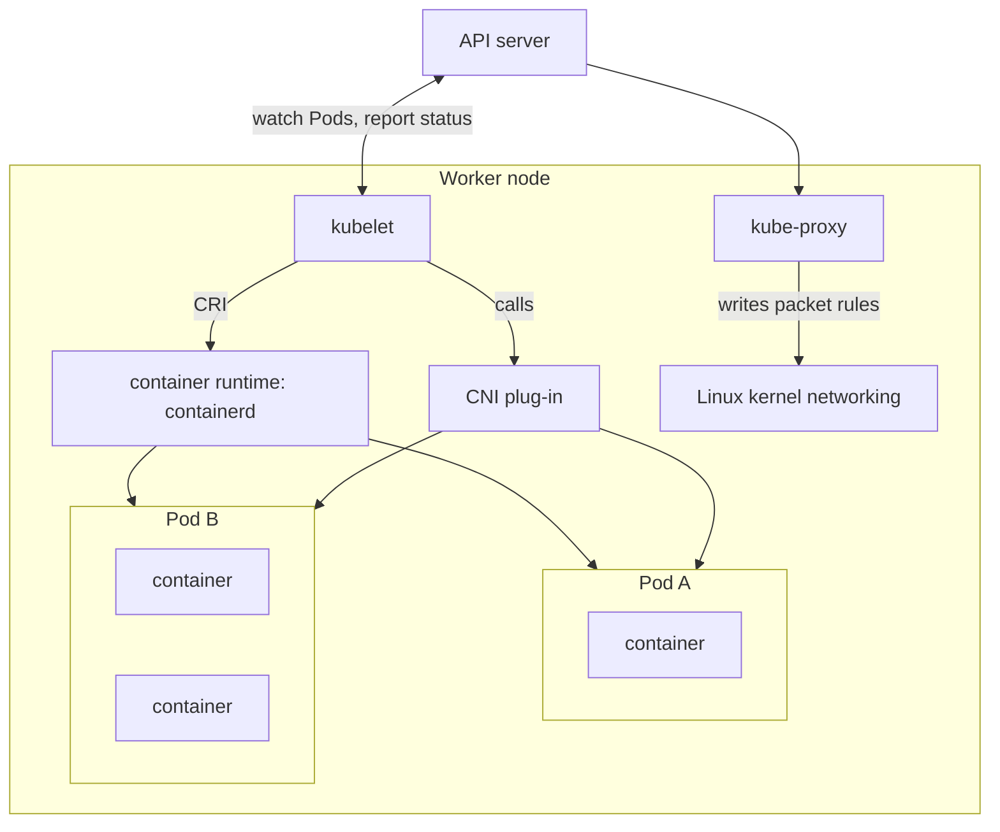

# Worker nodes: kubelet, container runtime and kube-proxy

## In plain words

The control plane decides. **Worker nodes** do. A worker node is a machine, physical or virtual, whose job is to run your containers. Each one carries three pieces of Kubernetes software: an agent that takes instructions and reports back (the **kubelet**), a program that pulls images and runs containers (the **container runtime**), and a networking helper that makes Service addresses work (**kube-proxy**).

Go back to the restaurant from the first lesson. The manager's office is the control plane. Each kitchen station is a worker node. At every station there is a station chef who reads the order tickets for that station, makes sure the dishes are being cooked, and shouts status back to the pass: that is the kubelet. The ovens and pans that do the cooking are the container runtime. The runner who knows which counter currently has each dish, and carries requests to the right one, is kube-proxy.

Why this matters for a job: when a Pod misbehaves, the evidence is on a node. Messages such as `ImagePullBackOff`, `NodeNotReady`, `Evicted` and `OOMKilled` all come from node components. Knowing which component says what turns a confusing status into a short list of things to check.

> **Before this lesson:** read [The control plane](#/lesson/kubernetes/control-plane). You need to know that all components communicate through the API server, and that the scheduler only writes which node a Pod belongs on.

## What is on a node



Under all of this sits an ordinary operating system, almost always Linux (Windows worker nodes exist for Windows containers). Kubernetes does not replace it. The kubelet and the runtime are normal programs started by the operating system's service manager.

## The kubelet: the node's agent

The **kubelet** is the main Kubernetes program on every node. It has four duties.

**1. Register the node.** When a kubelet starts, it tells the API server "I exist", creating a **Node object** that records the machine's name, labels, addresses and capacity: how many CPU cores, how much memory, how many Pods it may hold. The scheduler uses this record.

**2. Run the Pods assigned to it.** The kubelet keeps a watch on the API server for Pods whose `spec.nodeName` equals its own node. For each one it asks the container runtime to pull images and start containers, asks the network plug-in to give the Pod an address, and mounts any volumes. It does not manage containers that Kubernetes did not create.

**3. Keep them healthy.** The kubelet runs the health checks, called **probes**, that you declare, and restarts containers that crash or fail their liveness check according to the Pod's restart policy. This restart is local: the kubelet does it without asking the control plane.

**4. Report status.** It continually writes each Pod's state back to the API server (container running, waiting, terminated; exit codes; restart counts) and sends a **heartbeat** saying the node is alive.

### Heartbeats and what happens when they stop

Every ten seconds or so, each kubelet renews a small **Lease** object in a namespace called `kube-node-lease`. The node controller in the control plane watches these. If a node's lease is not renewed for a grace period of roughly 40 to 50 seconds, depending on version and configuration, the controller sets the node's `Ready` condition to `Unknown` and adds a taint named `node.kubernetes.io/unreachable`.

Pods automatically carry a toleration for that taint lasting 300 seconds. If the node is still unreachable when those five minutes run out, its Pods are marked for deletion and, if a controller such as a Deployment owns them, replacements are created on other nodes. That is why recovering from a dead node takes around five to six minutes by default, not a few seconds. The delay is deliberate: a brief network blip should not cause every Pod on a node to be recreated elsewhere.

```python-run
# A timeline of node failure with default settings (seconds are approximate).
GRACE = 40          # heartbeats missed before the node is marked Unknown
TOLERATION = 300    # default time Pods tolerate an unreachable node

def timeline(outage_seconds):
    print(f"\nNode unreachable for {outage_seconds}s")
    print("  t=0     last heartbeat renewed")
    if outage_seconds <= GRACE:
        print(f"  t={outage_seconds:<5} heartbeats resume; node never left Ready; nothing happens")
        return
    print(f"  t={GRACE:<5} node controller marks Ready=Unknown, adds 'unreachable' taint")
    evict_at = GRACE + TOLERATION
    if outage_seconds <= evict_at:
        print(f"  t={outage_seconds:<5} heartbeats resume; taint removed; Pods stay where they are")
        return
    print(f"  t={evict_at:<5} tolerations expire; Pods marked for deletion")
    print(f"  t={evict_at + 5:<5} owning controllers create replacement Pods on healthy nodes")

for outage in (20, 120, 900):
    timeline(outage)
```

Three cases: a 20 second blip changes nothing; a two-minute outage marks the node unknown but the Pods wait and survive; a 15 minute outage leads to replacement. You can shorten the wait for a specific workload by setting its own `tolerationSeconds`, covered in the [scheduling controls lesson](#/lesson/kubernetes/scheduling-controls).

> [!WARNING]
> During the five minutes before eviction, the Pods on a dead node are still listed as `Running`, because no kubelet is reporting otherwise. A Service stops sending them traffic sooner, since the node controller marks their Pods not ready when the node becomes unreachable. Do not trust a `Running` status on a node that is `NotReady`.

### Static Pods

A kubelet can also run Pods from manifest files placed in a directory on the node (commonly `/etc/kubernetes/manifests`), with no API server involved. These are called **static Pods**. This is how many self-managed clusters start their own control plane: the kubelet on a control plane machine launches the API server, etcd, the scheduler and the controller manager as static Pods. It solves a chicken-and-egg problem, since something has to start the API server before the API exists.

## The container runtime

The kubelet does not know how to pull an image or create a container. It delegates to a **container runtime** through the **Container Runtime Interface (CRI)**, a standard set of calls such as "pull this image", "create a sandbox for this Pod" and "start this container". The two widely used runtimes are **containerd** and **CRI-O**. The [history lesson](#/lesson/kubernetes/history-cloud-os) explained why Docker Engine is no longer in this position while Docker-built images still work.

The runtime itself has layers. containerd is the **high-level runtime**: it manages images, storage and the lifecycle of containers. To create the isolated process it calls a **low-level runtime**, by default `runc`, which sets up the Linux namespaces and control groups you met in the Docker track. Swapping the low-level runtime gives stronger isolation without changing anything else: **gVisor** intercepts system calls in a user-space kernel, and **Kata Containers** runs each Pod in a lightweight virtual machine.

You choose between runtimes per Pod with a **RuntimeClass**:

```yaml
apiVersion: node.k8s.io/v1
kind: RuntimeClass
metadata:
  name: sandboxed
handler: runsc
---
apiVersion: v1
kind: Pod
metadata:
  name: untrusted-report
spec:
  runtimeClassName: sandboxed
  containers:
    - name: render
      image: ghcr.io/harbour-coffee/report-renderer:2.3.0
```

The file holds two objects separated by `---`, which is YAML's document separator. The first defines a RuntimeClass named `sandboxed` whose `handler` is `runsc`, the name the node's containerd configuration gives to gVisor. The second is a Pod that opts in with `runtimeClassName: sandboxed`. A Pod that does not set the field uses the node's default, `runc`. The handler must have been installed and configured on the nodes by an administrator; the object only selects it.

### What the runtime does when a Pod starts

1. The kubelet asks the runtime to create a **Pod sandbox**: the shared environment for the Pod's containers, including its own network namespace. A tiny placeholder container, often called the **pause container**, holds that namespace open.
2. The kubelet calls the **CNI plug-in**, which gives the sandbox a network interface and an IP address.
3. For each container, the runtime pulls the image if needed (subject to the `imagePullPolicy`), then creates and starts the container inside the sandbox.

If step 3 cannot pull the image, the container waits with reason `ErrImagePull`, and after repeated failures `ImagePullBackOff`, which means "I failed and am waiting longer before trying again".

On a node you can look at the runtime's view with `crictl`, a command-line tool that speaks CRI:

```bash
$ sudo crictl pods --name menu-api
POD ID          CREATED       STATE   NAME                        NAMESPACE   ATTEMPT   RUNTIME
8f1c2a77d3e4b   2 hours ago   Ready   menu-api-6c9d7b5f48-9hvtn   cafe        0         (default)

$ sudo crictl ps --pod 8f1c2a77d3e4b
CONTAINER       IMAGE           CREATED       STATE     NAME       ATTEMPT   POD ID
c41d09be55a02   3b7e9f0c1a2d4   2 hours ago   Running   menu-api   0         8f1c2a77d3e4b
```

`crictl pods` lists Pod sandboxes; `--name` filters by name. `crictl ps --pod` lists the containers inside one sandbox. `ATTEMPT` counts restarts of that container. You need this tool rarely, mainly when the API server is unavailable or a node is misbehaving, because `kubectl` normally shows the same information.

## kube-proxy: making Services reachable

Pods come and go, so other Pods reach them through a **Service**, an object with a stable virtual IP address (the **ClusterIP**) that stands in front of a changing set of Pods. A virtual address means no machine owns it; nothing listens on it. So how does a packet sent to it arrive anywhere?

That is the job of **kube-proxy**, which runs on every node. It watches the API server for Services and for **EndpointSlices** (the lists of ready Pod addresses behind each Service) and programs the node's Linux kernel with rules that say, in effect: "a packet addressed to Service IP 10.96.14.20 port 80 should be rewritten to go to one of these Pod addresses". Despite its name, in normal operation kube-proxy does not carry traffic itself. It writes rules, and the kernel applies them to each new connection.

There are three rule back ends, called **modes**:

| Mode | How it works | Notes |
|---|---|---|
| iptables | One chain of packet-filter rules per Service | Long-time default; rule updates slow down with tens of thousands of Services |
| IPVS | The kernel's built-in load balancer | Scales better; being phased out in favour of nftables |
| nftables | The successor to iptables | Stable since v1.33; efficient updates; the direction of travel |

Some network plug-ins, notably Cilium, can replace kube-proxy completely using a kernel technology called eBPF. The idea is unchanged: something on each node keeps kernel rules in step with the Services and endpoints in the API.

```python-run
import random
random.seed(7)

# What kube-proxy learns from the API server:
services = {("10.96.14.20", 80): "menu-api"}
endpoints = {"menu-api": [("10.244.1.5", 8080), ("10.244.2.9", 8080), ("10.244.2.11", 8080)]}

def kernel_rule(dst_ip, dst_port):
    """The kind of decision the kernel makes for each new connection."""
    name = services.get((dst_ip, dst_port))
    if name is None:
        return (dst_ip, dst_port), "not a Service address, routed normally"
    backends = endpoints[name]
    if not backends:
        return None, f"{name} has no ready endpoints, connection refused"
    return random.choice(backends), f"rewritten to a {name} Pod"

for _ in range(4):
    print(kernel_rule("10.96.14.20", 80))
print(kernel_rule("10.244.1.5", 8080))

endpoints["menu-api"] = []          # every Pod fails its readiness check
print(kernel_rule("10.96.14.20", 80))
```

The first four connections to the Service address land on different Pods chosen at random. A connection sent straight to a Pod address is not touched. When the endpoint list is empty, connections to the Service are refused: a Service with no ready Pods is a common cause of "connection refused" inside a cluster. The [Services module](#/lesson/kubernetes/services-clusterip) explains the objects involved, and the [packet path lesson](#/lesson/kubernetes/packet-path-troubleshooting) follows a real request end to end.

## The network plug-in

Kubernetes sets three rules for Pod networking: every Pod gets its own IP address; every Pod can reach every other Pod without address translation; and agents on a node can reach the Pods on that node. Kubernetes does not implement those rules. A **CNI plug-in** does. Its tasks are to give each new Pod an address from a range and to make sure packets between Pods on different nodes arrive, either by wrapping them inside other packets (an **overlay network**) or by programming real routes. Many plug-ins also enforce **NetworkPolicies**, the firewall rules covered in the [security module](#/lesson/kubernetes/network-policies-auditing).

A node whose CNI plug-in is missing or broken reports `NotReady` with a message mentioning that the network plug-in is not ready, and Pods scheduled there sit in `ContainerCreating`.

## Node conditions, capacity and eviction

Look at a node the way the cluster sees it:

```bash
$ kubectl get nodes -o wide
NAME            STATUS   ROLES           AGE   VERSION   INTERNAL-IP   OS-IMAGE             CONTAINER-RUNTIME
cafe-cp-1       Ready    control-plane   12d   v1.37.1   10.0.0.10     Ubuntu 24.04.2 LTS   containerd://2.1.4
cafe-worker-1   Ready    <none>          12d   v1.37.1   10.0.0.21     Ubuntu 24.04.2 LTS   containerd://2.1.4
cafe-worker-2   Ready    <none>          12d   v1.37.1   10.0.0.22     Ubuntu 24.04.2 LTS   containerd://2.1.4

$ kubectl describe node cafe-worker-1 | sed -n '/Conditions/,/Allocated/p'
Conditions:
  Type             Status  Reason                       Message
  MemoryPressure   False   KubeletHasSufficientMemory   kubelet has sufficient memory available
  DiskPressure     False   KubeletHasNoDiskPressure     kubelet has no disk pressure
  PIDPressure      False   KubeletHasSufficientPID      kubelet has sufficient PID available
  Ready            True    KubeletReady                 kubelet is posting ready status
Capacity:
  cpu:                4
  memory:             16374500Ki
  pods:               110
Allocatable:
  cpu:                3800m
  memory:             15221348Ki
  pods:               110
```

`-o wide` adds columns, including the runtime in use. `kubectl describe node` prints a long report; the `sed` expression keeps the part between the words Conditions and Allocated.

- **Conditions** are the node's health flags. `Ready: True` is the one that matters most. `MemoryPressure`, `DiskPressure` and `PIDPressure` turn `True` when the node is running low on memory, disk space or process IDs.
- **Capacity** is what the machine has. **Allocatable** is what is left for Pods after reserving some for the operating system and the Kubernetes components. The scheduler works with allocatable, which is why a 4-core node offers only 3800 millicores here.
- `pods: 110` is the default maximum number of Pods per node.

When a pressure condition becomes true, the kubelet protects the node with **node-pressure eviction**: it stops Pods to free resources, starting with those using the most beyond what they requested. Evicted Pods show status `Evicted`, and their controllers create replacements, ideally on another node. Declaring accurate memory requests, covered in the [Pod lifecycle lesson](#/lesson/kubernetes/pod-lifecycle-resources), is what keeps your Pods from being first in line.

### Taking a node out of service

Before maintenance you move workloads off a node deliberately:

```bash
$ kubectl cordon cafe-worker-2
node/cafe-worker-2 cordoned

$ kubectl drain cafe-worker-2 --ignore-daemonsets --delete-emptydir-data
evicting pod cafe/menu-api-6c9d7b5f48-wd4mz
evicting pod cafe/orders-api-75b8c9d6f4-kq2hn
node/cafe-worker-2 drained

$ kubectl uncordon cafe-worker-2
node/cafe-worker-2 uncordoned
```

`cordon` marks the node unschedulable: existing Pods stay, new ones are not placed there. `drain` cordons and then evicts the Pods, which their controllers recreate elsewhere. `--ignore-daemonsets` is needed because DaemonSet Pods are meant to live on every node and would be recreated at once; `--delete-emptydir-data` acknowledges that scratch volumes on the node will be lost. `uncordon` makes the node schedulable again. Draining respects PodDisruptionBudgets, which limit how many replicas of an application may be down at once.

> [!TIP]
> If a node is `NotReady`, check in this order: is the machine up, is the kubelet service running (`systemctl status kubelet` on the node), can the node reach the API server, and is the CNI plug-in's Pod on that node healthy. Those four cover the large majority of cases.

> [!INTERVIEW]
> **"Name the components on a worker node and what each does."** The kubelet registers the node, watches the API server for Pods bound to it, drives the container runtime through the CRI to run them, executes probes, restarts containers per the restart policy and reports status and heartbeats. The container runtime, usually containerd, pulls images and runs containers, delegating process creation to a low-level runtime such as runc. kube-proxy watches Services and EndpointSlices and programs kernel rules (iptables, IPVS or nftables) so that Service virtual IPs reach ready Pods. A CNI plug-in gives Pods their IP addresses and connectivity. A follow-up worth offering: kube-proxy is not in the data path; the kernel is.

## Common pitfalls

- **Looking for Docker on a node.** Use `kubectl` first, and `crictl` when you need the runtime's view.
- **Assuming a dead node's Pods are replaced at once.** The default wait is around five minutes after the node is marked unreachable.
- **Confusing capacity with allocatable.** Size workloads against allocatable.
- **Forgetting that the kubelet restarts containers, while controllers replace Pods.** A container restart keeps the same Pod, name and IP. A replacement is a new Pod.
- **Draining without thinking about single-replica applications.** With one replica, the application is down while its replacement starts.

## Cheat sheet

| Item | What to remember |
|---|---|
| kubelet | Node agent: registers node, runs Pods, probes, restarts, reports |
| Container runtime | containerd or CRI-O via CRI; runc underneath |
| RuntimeClass | Chooses an alternative runtime handler per Pod |
| kube-proxy | Programs kernel rules for Services; modes iptables, IPVS, nftables |
| CNI plug-in | Assigns Pod IPs and connects Pods across nodes |
| Heartbeat | Lease renewed about every 10 s in `kube-node-lease` |
| Unreachable node | Marked after about 40 to 50 s; Pods evicted after a further 300 s by default |
| Allocatable | Capacity minus system reservations; what the scheduler uses |
| `kubectl cordon / drain / uncordon` | Stop scheduling / evict Pods / resume |
| `crictl pods`, `crictl ps` | Runtime-level view on the node |

## Summary

Each worker node runs three Kubernetes components on top of a normal operating system. The kubelet is the agent: it registers the node, runs the Pods bound to it by calling the container runtime through the CRI, checks their health, restarts failed containers and reports back. The runtime pulls images and creates containers, and can be swapped per Pod with a RuntimeClass for stronger isolation. kube-proxy turns Services into kernel rules so that a virtual address reaches a real, ready Pod, and a CNI plug-in supplies Pod addresses and connectivity. Node health is tracked through heartbeats and conditions, with deliberate delays before Pods on a silent node are replaced. With both halves of the cluster in view, the next lesson examines the idea that connects them: the declarative model.

## Glossary

- **Worker node**: a machine that runs application Pods.
- **kubelet**: the per-node agent that runs and monitors Pods.
- **Node object**: the API record describing a node and its capacity.
- **Probe**: a health check the kubelet runs against a container.
- **Heartbeat / Lease**: the periodic signal that a node is alive, stored as a Lease object.
- **Static Pod**: a Pod started by the kubelet from a local file, without the API server.
- **Container runtime**: software that pulls images and runs containers.
- **CRI**: the interface between kubelet and runtime.
- **High-level / low-level runtime**: containerd or CRI-O manage lifecycle; runc creates the process.
- **RuntimeClass**: an object selecting which runtime handler a Pod uses.
- **Pod sandbox / pause container**: the shared environment of a Pod and the placeholder that holds it.
- **kube-proxy**: the component that programs Service routing rules on each node.
- **ClusterIP**: a Service's stable virtual IP address.
- **EndpointSlice**: a list of ready Pod addresses behind a Service.
- **CNI plug-in**: the software providing Pod networking.
- **Overlay network**: Pod traffic carried inside other packets between nodes.
- **Capacity / allocatable**: total resources of a node, and the part available to Pods.
- **Node-pressure eviction**: the kubelet stopping Pods to relieve a resource shortage.
- **Cordon / drain**: mark a node unschedulable; evict its Pods.

```quiz
[
  {"q": "A node loses power. Its Pods belong to a Deployment. With default settings, roughly when are replacement Pods created?",
   "options": ["Within one second", "After about 10 seconds", "After roughly five to six minutes", "Never, until the node returns"],
   "answer": 2,
   "explain": "The node is marked unreachable after the heartbeat grace period, then Pods tolerate that for 300 seconds by default before being deleted and replaced."},
  {"q": "Which component rewrites packets addressed to a Service's ClusterIP so they reach a Pod?",
   "options": ["The kube-proxy process handles each packet itself", "The Linux kernel, using rules that kube-proxy programmed", "The scheduler", "The API server"],
   "answer": 1,
   "explain": "kube-proxy writes iptables, IPVS or nftables rules. The kernel applies them to traffic; kube-proxy is not in the data path."},
  {"q": "A container in a Pod crashes. The Pod's restart policy is Always. What happens next?",
   "options": ["The scheduler moves the Pod to a new node", "The Deployment controller creates a new Pod", "The kubelet on the same node restarts the container in the same Pod", "Nothing until someone runs kubectl apply"],
   "answer": 2,
   "explain": "Container restarts are a local kubelet action. The Pod keeps its name, node and IP; only the restart count increases."},
  {"q": "A node has capacity of 4 CPUs but allocatable of 3800m. Why the difference?",
   "options": ["200m is lost to rounding", "Part is reserved for the operating system and Kubernetes components", "Other Pods are using 200m", "The scheduler keeps 5% in reserve for itself"],
   "answer": 1,
   "explain": "Allocatable equals capacity minus system and kubelet reservations and eviction thresholds. It is independent of what Pods currently run."},
  {"q": "A Pod is stuck in ContainerCreating and the node shows NotReady with a message that the network plug-in is not ready. What is the most likely cause?",
   "options": ["The image tag is wrong", "The CNI plug-in is missing or unhealthy on that node", "The Pod requested too much memory", "etcd has no quorum"],
   "answer": 1,
   "explain": "Without a working CNI plug-in the kubelet cannot give the Pod sandbox a network, so containers are never started and the node reports not ready."},
  {"q": "What does kubectl cordon do to Pods already running on the node?",
   "options": ["Evicts them immediately", "Nothing; it only prevents new Pods from being scheduled there", "Restarts them", "Moves them to the control plane"],
   "answer": 1,
   "explain": "Cordon sets the node unschedulable. Existing Pods continue. Drain is the command that evicts them."},
  {"q": "Why might a team set runtimeClassName on a Pod that processes files uploaded by strangers?",
   "options": ["To pull images faster", "To run it with a more strongly isolated runtime such as gVisor or Kata", "To give it a static IP address", "To skip the scheduler"],
   "answer": 1,
   "explain": "A RuntimeClass selects an alternative low-level runtime. Sandboxed runtimes reduce the risk that a compromised container reaches the host kernel."},
  {"q": "A node is NotReady but kubectl still lists its Pods as Running. Why?",
   "options": ["The Pods are definitely healthy", "No kubelet is reporting, so the last known status remains until eviction", "kubectl caches results for an hour", "Running means scheduled, not started"],
   "answer": 1,
   "explain": "Pod status is written by the kubelet. With the kubelet silent, the stored status is stale until the node controller evicts the Pods."}
]
```

> **Source:** Poulton, *The Kubernetes Book*, ch. 2 (topic coverage only). Official docs: https://kubernetes.io/docs/concepts/architecture/nodes/ , https://kubernetes.io/docs/reference/command-line-tools-reference/kube-proxy/ , https://kubernetes.io/docs/concepts/containers/runtime-class/ , https://kubernetes.io/docs/concepts/scheduling-eviction/node-pressure-eviction/
