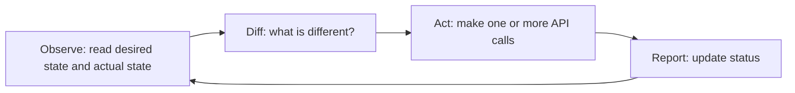

# The declarative model and reconciliation loops

## In plain words

Kubernetes works by a principle that is worth stating once, slowly, because everything else follows from it: **you write down how things should be, and software keeps making them that way.** You do not issue instructions such as "start a container on machine 4". You record a statement such as "three copies of this program should exist", and a controller keeps checking whether that is true and corrects it when it is not.

The classic everyday example is a thermostat. You set it to 20°C. That number is the **desired state**. The thermostat reads the room temperature, the **actual state**, over and over. If the room is colder than 20, it turns the heating on. If the room is warm enough, it does nothing. You never tell it "run the boiler for eleven minutes"; it works that out by measuring. Open a window and it compensates without being told. A Kubernetes controller is a thermostat for some kind of object.

Why this matters for a job: this model explains behaviour that otherwise looks like magic or like a bug. Why did the Pod I deleted come back? Why did my manual change disappear? Why is my object stuck in "Terminating"? It also shapes how teams work: manifests live in Git, changes are reviewed like code, and the cluster is expected to match the repository.

> **Before this lesson:** read [The control plane](#/lesson/kubernetes/control-plane) and [Worker nodes](#/lesson/kubernetes/worker-nodes). You should know what the API server, etcd, a controller and the kubelet are.

## Imperative versus declarative

There are two ways to get three copies of `menu-api` running.

**Imperative**: give commands.

```bash
kubectl create deployment menu-api --image=ghcr.io/harbour-coffee/menu-api:1.0.0
kubectl scale deployment menu-api --replicas=3
kubectl set image deployment/menu-api menu-api=ghcr.io/harbour-coffee/menu-api:1.1.0
```

The first command creates a Deployment with one replica. The second changes the count to three. The third changes the image. Each command is an action performed now.

**Declarative**: write the end result in a file and apply it.

```bash
kubectl apply -f menu-api.yaml
```

The difference shows when you run things twice or come back later.

| Question | Imperative commands | Declarative file |
|---|---|---|
| What should be running? | Reconstruct it from shell history | Read the file |
| Run it a second time | `create` fails with "already exists" | `apply` reports "unchanged" |
| Review a change before it happens | Hard | A normal code review of a diff |
| Undo | Remember the old values | Revert the commit and apply |
| Rebuild in a new cluster | Replay commands in the right order | Apply the same files |

An operation that gives the same result whether you do it once or many times is called **idempotent**. `kubectl apply` is idempotent; that property is what makes automation safe. Imperative commands remain handy for experiments and emergencies, and for generating a starting file: adding `--dry-run=client -o yaml` to a `kubectl create` command prints the YAML it would have sent, without sending it.

## Spec and status: the two halves of an object

Almost every Kubernetes object has two main sections.

- **`spec`** is written by you (or by a controller acting on your behalf). It is the desired state.
- **`status`** is written by the system. It is the most recently observed actual state.

Look at both for a Deployment:

```bash
$ kubectl get deployment menu-api -o yaml
```

```yaml
apiVersion: apps/v1
kind: Deployment
metadata:
  name: menu-api
  namespace: cafe
  generation: 3
  resourceVersion: "48211"
  uid: 0c1f7a52-6e1b-4f0e-9a0d-0d5b0e3d2a11
spec:
  replicas: 3
  selector:
    matchLabels:
      app: menu-api
  template:
    metadata:
      labels:
        app: menu-api
    spec:
      containers:
        - name: menu-api
          image: ghcr.io/harbour-coffee/menu-api:1.1.0
status:
  observedGeneration: 3
  replicas: 3
  updatedReplicas: 3
  readyReplicas: 2
  availableReplicas: 2
  unavailableReplicas: 1
  conditions:
    - type: Available
      status: "True"
      reason: MinimumReplicasAvailable
    - type: Progressing
      status: "True"
      reason: ReplicaSetUpdated
```

`-o yaml` asks for the full stored object in YAML. The parts you have not seen before:

- `metadata.generation: 3` is a counter the API server increases every time the `spec` changes. This object's spec has been written three times.
- `metadata.resourceVersion` changes on every write of any part of the object. It is used to detect conflicting updates: if two clients edit the same object, the second write is rejected because the version it started from is no longer current. This approach is called **optimistic concurrency**.
- `metadata.uid` is a unique identifier that is never reused, even if you delete the object and create another with the same name.
- `status.observedGeneration: 3` is the controller saying "I have seen and acted on generation 3". If it were lower than `generation`, the controller would not yet have processed your latest change.
- `status.replicas`, `updatedReplicas`, `readyReplicas` and `availableReplicas` count Pods at each stage. Here three exist and all three run the new template, but only two are ready. One is still starting.
- `conditions` are named true-or-false summaries with a reason attached.

Reading `spec` against `status` is the most basic diagnostic skill in Kubernetes. The spec says 3; the status says 2 ready. Something about the third Pod needs looking at.

## The reconciliation loop

Every controller repeats the same cycle, called a **reconciliation loop** or control loop:



1. **Observe.** Read the object's spec, and read the real things it describes.
2. **Diff.** Work out the difference.
3. **Act.** Make API calls that reduce the difference.
4. **Report.** Write what was observed into `status`.

Then do it again, whenever a watch reports a change and also periodically as a safety net.

Two properties of this design deserve names.

**Level-triggered, not edge-triggered.** A controller does not think "a Pod was deleted, therefore create one". It thinks "there are two, there should be three". The first style depends on never missing an event. The second works even if the controller was restarting when the deletion happened, because it looks at the current level, not at the change.

**Eventual consistency.** After you change the spec, the cluster is briefly out of step. Controllers converge on the new state over seconds or minutes. `kubectl apply` returning successfully means "the desired state was recorded", not "the work is finished".

> [!WARNING]
> A successful `kubectl apply` does not mean your application is running. It means the API server accepted and stored the object. Pipelines should follow the apply with a wait such as `kubectl rollout status deployment/menu-api --timeout=120s`, which blocks until the rollout completes and fails if it does not.

## A controller you can run

The program below models a ReplicaSet-style controller. Pods are small dictionaries with labels. The controller finds "its" Pods with a **label selector**, compares the count with the desired number, and creates or deletes. Press Run and follow the trace.

```python-run
import itertools
seq = itertools.count(1)

def matches(selector, labels):
    """Equality-based selector: every key in the selector must equal the label."""
    return all(labels.get(k) == v for k, v in selector.items())

cluster_pods = []      # this list plays the part of the API server

def make_pod(template_labels, image):
    return {"name": f"pod-{next(seq)}", "labels": dict(template_labels), "image": image, "phase": "Running"}

def reconcile(rs):
    # 1. observe
    mine = [p for p in cluster_pods if matches(rs["selector"], p["labels"]) and p["phase"] == "Running"]
    # 2. diff
    diff = rs["replicas"] - len(mine)
    # 3. act
    if diff > 0:
        for _ in range(diff):
            pod = make_pod(rs["template_labels"], rs["image"])
            cluster_pods.append(pod)
            print(f"    create {pod['name']}")
    elif diff < 0:
        for pod in sorted(mine, key=lambda p: p["name"], reverse=True)[:-diff]:
            cluster_pods.remove(pod)
            print(f"    delete {pod['name']} (newest first)")
    else:
        print("    nothing to do")
    # 4. report
    rs["status"] = len([p for p in cluster_pods if matches(rs["selector"], p["labels"])])

rs = {"replicas": 3, "selector": {"app": "menu-api"},
      "template_labels": {"app": "menu-api", "tier": "backend"},
      "image": "menu-api:1.1.0", "status": 0}

def step(title):
    print(f"\n{title}")
    reconcile(rs)
    print(f"    status.replicas = {rs['status']}, pods = {[p['name'] for p in cluster_pods]}")

step("1. First reconcile after the object is created")
step("2. Reconcile again with no change (idempotent)")

cluster_pods[0]["phase"] = "Failed"
step("3. A Pod fails")

cluster_pods.append({"name": "stray", "labels": {"app": "menu-api"}, "image": "menu-api:0.9", "phase": "Running"})
step("4. Somebody creates a Pod by hand with a matching label")

cluster_pods[1]["labels"]["app"] = "quarantine"
step("5. Somebody relabels a Pod so it no longer matches")
```

Read each step:

1. No matching Pods, so three are created.
2. Running the loop again changes nothing. That is idempotence in action.
3. A failed Pod no longer counts, so one more is created.
4. A hand-made Pod carries a matching label. Now there are four matching Pods, one too many, and the controller deletes one. Labels, not names, decide ownership.
5. Changing a Pod's label removes it from the controller's view. The controller creates a replacement, and the relabelled Pod keeps running, unmanaged. This is a real debugging technique: relabel a misbehaving Pod to take it out of service while keeping it alive for inspection.

> [!TIP]
> To quarantine a suspect Pod without killing it, change the label its controller and Service select on: `kubectl label pod menu-api-6c9d7b5f48-9hvtn app=quarantine --overwrite`. The controller starts a fresh replica, the Service stops sending traffic to the old one, and you can examine it at leisure. Delete it when you are done.

## Labels and selectors

A **label** is a key and value attached to an object's metadata, such as `app: menu-api` or `env: prod`. Labels mean nothing to Kubernetes itself; they are for grouping. A **selector** is a query over labels. Controllers, Services and many other objects use selectors to say "the Pods I care about are the ones with these labels".

There are two forms of selector.

**Equality-based**: every listed key must have exactly the listed value.

```yaml
selector:
  matchLabels:
    app: menu-api
    env: prod
```

**Set-based**: richer conditions written as expressions.

```yaml
selector:
  matchExpressions:
    - key: env
      operator: In
      values: [prod, staging]
    - key: canary
      operator: DoesNotExist
```

The operators are `In` (the label's value is one of the list), `NotIn` (the value is none of the list, which also matches objects lacking the key), `Exists` (the key is present with any value) and `DoesNotExist` (the key is absent). When `matchLabels` and `matchExpressions` are both present, an object must satisfy all of them. An empty selector matches everything in scope.

The same queries work on the command line with `-l`:

```bash
$ kubectl get pods -l app=menu-api,env=prod
$ kubectl get pods -l 'env in (prod,staging),!canary'
$ kubectl get pods --show-labels
```

The first lists Pods with both labels. The second uses the set-based syntax; `!canary` means the key must be absent. The third prints each Pod's labels in an extra column.

**Annotations** look similar (key and value in metadata) but are not used for selection. They hold descriptive or tool-specific data, such as a link to a runbook or a setting read by an ingress controller.

## Ownership and garbage collection

When the ReplicaSet controller creates a Pod, it stamps the Pod with an **owner reference**: a pointer in the Pod's metadata to the ReplicaSet that owns it.

```yaml
metadata:
  name: menu-api-6c9d7b5f48-9hvtn
  ownerReferences:
    - apiVersion: apps/v1
      kind: ReplicaSet
      name: menu-api-6c9d7b5f48
      uid: 7d6f0a3c-51c2-4f3c-8a7e-9d2a6c1b4e55
      controller: true
```

`controller: true` marks the managing owner. The ReplicaSet in turn has an owner reference to its Deployment. These references form a chain: Deployment, ReplicaSet, Pod.

The chain is how deletion cascades. When you delete the Deployment, a control plane component called the **garbage collector** finds objects whose owner no longer exists and deletes them too. By default this happens in the background: the Deployment vanishes at once and its dependents are cleaned up shortly after. With `kubectl delete deployment menu-api --cascade=orphan` the dependents are left running and ownerless.

### Finalizers, and objects stuck in Terminating

Sometimes cleanup must happen *before* an object disappears, for instance releasing a cloud disk. A **finalizer** is a string in `metadata.finalizers` that says "do not remove this object until the named controller has done its cleanup". When you delete such an object, the API server does not remove it; it sets `metadata.deletionTimestamp` and the object shows as `Terminating`. The responsible controller does its work, removes its finalizer, and only when the list is empty is the object deleted for real.

If that controller is gone or broken, the object stays in `Terminating` indefinitely. This is the usual explanation for a namespace or volume that will not go away. The fix is to find out which finalizer remains and why its controller is not acting, not to delete the finalizer blindly, since that skips the cleanup it was protecting.

## How apply merges changes

Controllers and people both write to the same objects. The autoscaler changes `replicas`; you change the image. What stops your next `kubectl apply` from undoing the autoscaler's work?

Modern Kubernetes records **field ownership**: for each field of an object, which client last set it. The record lives in `metadata.managedFields`. With **server-side apply** (`kubectl apply --server-side`), the API server merges your file into the stored object field by field. Fields you include become yours. Fields you leave out are left alone. If your file sets a field that another manager owns to a different value, you get a **conflict** error instead of a silent overwrite, and you decide whether to force it.

The practical rule that falls out: **do not put a field in your manifest if another controller is meant to manage it.** If a HorizontalPodAutoscaler controls a Deployment's replica count, leave `replicas` out of the Deployment manifest.

Before applying, you can ask the server what would change:

```bash
$ kubectl diff -f menu-api.yaml
-  generation: 3
+  generation: 4
-        image: ghcr.io/harbour-coffee/menu-api:1.1.0
+        image: ghcr.io/harbour-coffee/menu-api:1.2.0

$ kubectl apply -f menu-api.yaml --dry-run=server
deployment.apps/menu-api configured (server dry run)
```

`kubectl diff` prints the differences between the live object and your file; lines starting with `-` are current, `+` are proposed. `--dry-run=server` sends the request through authentication, admission and validation but does not store it, so it catches errors a local check would miss.

## Drift, and why manual changes vanish

**Drift** is any difference between what your files say and what the cluster holds. It appears when someone runs `kubectl edit` or `kubectl scale` by hand. There are two layers to think about:

- Between the *object* and the *Pods*: controllers remove this drift constantly. Delete a Pod and it returns.
- Between your *files* and the *object*: nothing in core Kubernetes removes this. The next `apply` from the pipeline overwrites the manual change, perhaps weeks later and to someone's surprise.

**GitOps** closes the second gap by running a controller, such as Argo CD, whose desired state is a Git repository. It applies the repository to the cluster continuously and can revert manual edits within minutes. The [GitOps lesson](#/lesson/kubernetes/gitops-argo-cd) covers it. It is the same reconciliation idea applied one level higher.

> [!INTERVIEW]
> **"Explain desired state and reconciliation in Kubernetes."** Objects have a spec, the desired state supplied by users, and a status, the observed state reported by the system. Controllers watch objects through the API server and run a loop: observe, compare, act, update status. The loop is level-triggered, so it converges from any starting point and survives restarts and missed events, and the system is eventually consistent, so a successful apply only means the intent was stored. Mention `generation` versus `observedGeneration` as the way to tell whether a controller has caught up, and owner references plus garbage collection as the way dependent objects are tracked and cleaned up.

## Common pitfalls

- **Selector and template labels that do not match.** A Deployment whose `selector.matchLabels` is not satisfied by its template labels is rejected by the API server. A Service with a mistyped selector is accepted and silently selects nothing.
- **Overlapping selectors.** Two controllers selecting the same Pods will fight. Give each workload a distinct label value.
- **Treating apply as completion.** Wait for the rollout.
- **Editing live objects as a habit.** The change is unrecorded and will be overwritten.
- **Managing the same field from two places.** A manifest that pins `replicas` while an autoscaler adjusts it causes a tug of war on every deploy.
- **Removing finalizers to make an object disappear.** You may leak the external resource the finalizer was guarding.

## Cheat sheet

| Concept | Where to see it | Meaning |
|---|---|---|
| Desired state | `.spec` | What you asked for |
| Observed state | `.status` | What the system last saw |
| Spec change counter | `.metadata.generation` | Increases on each spec write |
| Controller caught up? | `.status.observedGeneration` equals generation | Yes when equal |
| Concurrency token | `.metadata.resourceVersion` | Changes on every write |
| Ownership | `.metadata.ownerReferences` | Parent object; drives cascading delete |
| Blocked deletion | `.metadata.finalizers`, `deletionTimestamp` | Cleanup pending |
| Field ownership | `.metadata.managedFields` | Who set which field |
| `kubectl apply -f` | | Idempotent create-or-update |
| `kubectl diff -f` | | Preview changes |
| `kubectl apply --dry-run=server` | | Validate without storing |
| `kubectl rollout status` | | Wait for convergence |
| `kubectl get pods -l key=value` | | Select by label |

## Summary

Kubernetes is declarative: objects carry a spec you write and a status the system writes, and controllers run reconciliation loops that observe both, compute the difference, act and report. Because the loops are level-triggered, they recover from crashes and missed events, and because they take time, the cluster is eventually consistent. Labels and selectors define which objects belong together, owner references record which object created which, the garbage collector removes orphans, and finalizers delay deletion until cleanup is done. Server-side apply merges changes field by field so that people and controllers can share objects. With these ideas you can predict what a cluster will do. The next module gets you a cluster to try them on.

## Glossary

- **Imperative / declarative**: commanding steps versus describing the result.
- **Idempotent**: producing the same result however many times it is applied.
- **Spec**: the desired state section of an object.
- **Status**: the observed state section, written by controllers.
- **Generation / observedGeneration**: the spec's change counter, and the latest value a controller has processed.
- **resourceVersion**: a token that changes on every write, used to detect conflicts.
- **Optimistic concurrency**: allowing parallel edits and rejecting a write based on a stale version.
- **Reconciliation loop**: observe, diff, act, report, repeated.
- **Level-triggered**: acting on current state, not on individual change events.
- **Eventual consistency**: the system converges on the desired state after a delay.
- **Label**: a key and value on an object used for grouping.
- **Selector**: a query over labels, equality-based or set-based.
- **Annotation**: non-identifying metadata, not used for selection.
- **Owner reference**: a pointer from a dependent object to its owner.
- **Garbage collector**: the component that deletes objects whose owners are gone.
- **Finalizer**: a marker that blocks deletion until cleanup has run.
- **Server-side apply / field ownership**: field-by-field merging by the API server, tracking who manages each field.
- **Drift**: a difference between declared configuration and the live cluster.
- **GitOps**: keeping the cluster in step with a Git repository by continuous reconciliation.

```quiz
[
  {"q": "A Deployment shows metadata.generation: 7 and status.observedGeneration: 6. What does this tell you?",
   "options": ["The Deployment has 7 replicas, 6 ready", "The controller has not yet processed the latest spec change", "The object is corrupt", "Six rollbacks have been performed"],
   "answer": 1,
   "explain": "generation rises with each spec write; observedGeneration is the last one the controller acted on. A lower value means the controller is behind."},
  {"q": "A ReplicaSet wants 3 Pods with label app=web. Three exist. You manually create a fourth Pod with label app=web. What happens next?",
   "options": ["The new Pod is ignored", "The ReplicaSet scales itself to 4", "The controller deletes one matching Pod to return to 3", "The API server rejects the Pod"],
   "answer": 2,
   "explain": "Selection is by label. Four Pods match, one more than desired, so the controller removes one."},
  {"q": "You change a running Pod's label from app=web to app=debug. The ReplicaSet selects app=web. What happens next?",
   "options": ["The Pod is deleted", "The Pod keeps running unmanaged and the ReplicaSet creates a replacement", "The ReplicaSet's selector changes to match", "Nothing changes"],
   "answer": 1,
   "explain": "The Pod no longer matches the selector, so the controller sees one too few and creates another. The relabelled Pod is left alone."},
  {"q": "Which selector matches a Pod with labels {env: prod} and no other labels?",
   "options": ["matchLabels: {env: prod, tier: web}", "matchExpressions: env In [staging]", "matchExpressions: env In [prod, staging] and canary DoesNotExist", "matchExpressions: canary Exists"],
   "answer": 2,
   "explain": "env is prod, which is in the list, and the canary key is absent, so both expressions hold. The others require a missing label or a different value."},
  {"q": "kubectl apply returns 'configured' and exits with success. What is guaranteed?",
   "options": ["All new Pods are running and ready", "The API server stored the new desired state", "The old Pods have been deleted", "The rollout cannot fail"],
   "answer": 1,
   "explain": "Apply records intent. Convergence happens afterwards; use kubectl rollout status to wait for it and detect failure."},
  {"q": "A namespace has shown Terminating for an hour. What is the most likely reason?",
   "options": ["The scheduler is busy", "An object inside still has a finalizer whose controller has not completed cleanup", "kubectl is using an old version", "Namespaces take an hour to delete by design"],
   "answer": 1,
   "explain": "Finalizers block deletion until removed by their controller. A missing or failing controller leaves objects, and the namespace, stuck in Terminating."},
  {"q": "A HorizontalPodAutoscaler manages a Deployment's replica count. The Deployment manifest in Git also sets replicas: 2. What problem does this cause?",
   "options": ["None", "Each apply resets the count to 2, fighting the autoscaler", "The autoscaler is deleted", "The Deployment cannot be applied"],
   "answer": 1,
   "explain": "Two managers set the same field. Leave replicas out of the manifest so the autoscaler is the only owner of that field."},
  {"q": "What is the default effect on Pods of deleting the Deployment that owns them?",
   "options": ["They keep running as orphans", "The garbage collector deletes the ReplicaSets and Pods through the owner reference chain", "They are converted to static Pods", "They are paused"],
   "answer": 1,
   "explain": "Owner references link Pod to ReplicaSet to Deployment. Deleting the owner causes dependents to be garbage collected unless --cascade=orphan is used."}
]
```

> **Source:** Poulton, *The Kubernetes Book*, ch. 2 (topic coverage only). Official docs: https://kubernetes.io/docs/concepts/overview/working-with-objects/ , https://kubernetes.io/docs/concepts/architecture/controller/ , https://kubernetes.io/docs/concepts/overview/working-with-objects/labels/ , https://kubernetes.io/docs/reference/using-api/server-side-apply/ , https://kubernetes.io/docs/concepts/architecture/garbage-collection/
