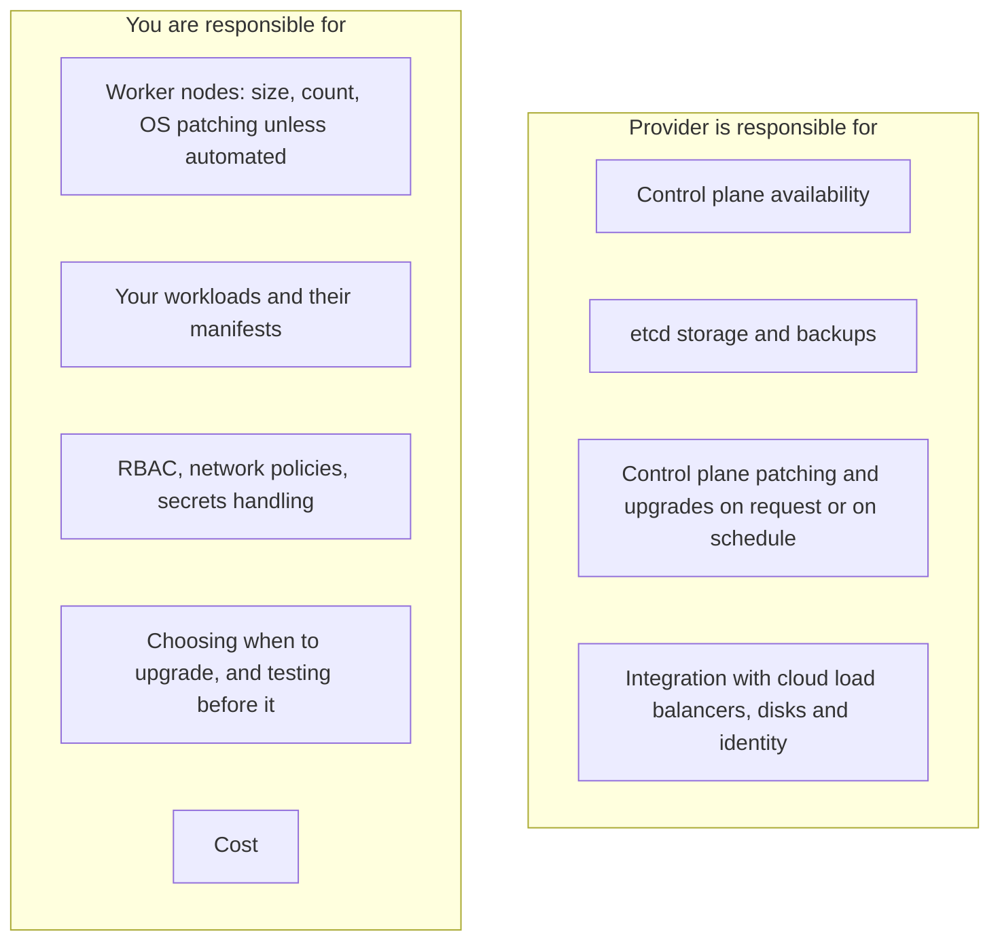

# Local clusters and managed services

## In plain words

To learn Kubernetes you need a cluster to practise on, and to run a product you need a cluster you can depend on. Those are different needs with different answers. For learning, the best cluster is a small one on your own laptop that you can create in a minute and throw away without cost. For production, most companies rent a cluster from a cloud provider, who looks after the hard parts.

Think about learning to drive. You do not start by buying a lorry and hiring a mechanic. You start in a small car in a quiet car park (a local cluster). Later, a company that needs deliveries leases a fleet with a maintenance contract (a managed service). A few companies with special requirements build and maintain their own vehicles (a self-managed cluster), and they need a workshop full of specialists to do it.

Why this matters for a job: you will be expected to spin up a local cluster to test your manifests before they reach a shared environment, and in interviews you will be asked what a managed service does for you and what remains your responsibility.

> **Before this lesson:** read [The control plane](#/lesson/kubernetes/control-plane) and [Worker nodes](#/lesson/kubernetes/worker-nodes), so the words control plane, node, kubelet and CNI plug-in are familiar. You need Docker installed for the local options ([Running containers](#/lesson/docker/running-containers)).

## The three families

| Family | Who runs the control plane | Who runs the nodes | Typical use |
|---|---|---|---|
| Local | A tool on your laptop | The same tool | Learning, development, CI tests |
| Managed | The cloud provider | You, or the provider in "serverless" modes | Most production clusters |
| Self-managed | You | You | Regulated or on-premises environments, special hardware |

There are also free browser-based **playgrounds** that give you a temporary cluster for an hour or so. They are fine for a first look but too short-lived and too limited for steady practice.

## Local option 1: kind

**kind** stands for "Kubernetes in Docker". It runs each cluster node as a Docker container on your machine. Inside that container are a kubelet and containerd, so you get a real, conformant cluster, including several nodes if you want, using only Docker. It starts quickly and is the usual choice for automated tests in pipelines.

A cluster is described by a small configuration file:

```yaml
kind: Cluster
apiVersion: kind.x-k8s.io/v1alpha4
name: cafe
nodes:
  - role: control-plane
    extraPortMappings:
      - containerPort: 30080
        hostPort: 8080
        protocol: TCP
  - role: worker
  - role: worker
```

Line by line:

- `kind: Cluster` and `apiVersion: kind.x-k8s.io/v1alpha4` identify this as a configuration file for the kind tool. It is not a Kubernetes object and is never sent to an API server.
- `name: cafe` names the cluster.
- `nodes:` lists the machines to simulate: one with the `control-plane` role and two with the `worker` role.
- `extraPortMappings` forwards port 8080 on your laptop to port 30080 inside the control plane container. Without it, a port opened on a node is reachable only from inside Docker's network. This matters when you try NodePort Services later.

Create, check and delete it:

```bash
$ kind create cluster --config cafe-cluster.yaml
Creating cluster "cafe" ...
 ✓ Ensuring node image (kindest/node:v1.37.0)
 ✓ Preparing nodes
 ✓ Writing configuration
 ✓ Starting control-plane
 ✓ Installing CNI
 ✓ Installing StorageClass
 ✓ Joining worker nodes
Set kubectl context to "kind-cafe"

$ kubectl get nodes
NAME                 STATUS   ROLES           AGE   VERSION
cafe-control-plane   Ready    control-plane   60s   v1.37.0
cafe-worker          Ready    <none>          40s   v1.37.0
cafe-worker2         Ready    <none>          40s   v1.37.0

$ kind delete cluster --name cafe
Deleting cluster "cafe" ...
```

The create command prints each step: it downloads a node image containing Kubernetes, starts the containers, initialises the control plane, installs a network plug-in and a default storage class, joins the workers, and finally points `kubectl` at the new cluster. `kubectl get nodes` confirms three nodes in `Ready` state. `kind delete cluster` removes everything.

One kind-specific habit to learn: your laptop's Docker images are not visible inside the node containers. To test an image you built locally without pushing it to a registry, load it into the cluster:

```bash
$ docker build -t menu-api:dev .
$ kind load docker-image menu-api:dev --name cafe
Image: "menu-api:dev" with ID "sha256:5c1e..." not yet present on node "cafe-worker", loading...
```

Then reference `menu-api:dev` in a manifest with `imagePullPolicy: IfNotPresent`, so the kubelet uses the loaded copy instead of trying to download it.

## Local option 2: minikube

**minikube** is the oldest local option. It can run the cluster in a Docker container, as kind does, or in a virtual machine using a hypervisor on your laptop. Its strength is convenience features called **add-ons**: one command enables an ingress controller, a metrics server or a dashboard.

```bash
$ minikube start --nodes 2 --kubernetes-version=v1.37.0 --driver=docker
😄  minikube v1.38.0 on Ubuntu 24.04
✨  Using the docker driver based on user configuration
🔥  Creating docker container (CPUs=2, Memory=4000MB) ...
🐳  Preparing Kubernetes v1.37.0 on containerd ...
🏄  Done! kubectl is now configured to use "minikube" cluster

$ minikube addons enable metrics-server
🌟  The 'metrics-server' addon is enabled

$ minikube service web --url
http://127.0.0.1:51234

$ minikube stop
```

`--nodes 2` asks for two nodes, `--kubernetes-version` pins the version and `--driver=docker` chooses containers over a virtual machine. `minikube addons enable metrics-server` installs the component that `kubectl top` and autoscaling need. `minikube service web --url` opens a tunnel to a Service named `web` and prints an address you can paste into a browser, which saves you from thinking about port mappings. `minikube stop` halts the cluster but keeps its state; `minikube delete` removes it.

## Local option 3: Docker Desktop

If you already use Docker Desktop on Windows or macOS, it has a built-in Kubernetes that you enable with a checkbox in its settings. It gives a single-node cluster by default, with a newer option to run a multi-node cluster using kind underneath. Its convenience is that images you build with `docker build` are immediately usable by the cluster, and Services of type `LoadBalancer` are reachable on `localhost`. Its limits are less control over version and configuration.

Other small distributions you may meet are **k3s** and **k3d** (a lightweight Kubernetes and a tool for running it in Docker), **MicroK8s** and **Rancher Desktop**.

### Choosing a local option

| Need | Good choice |
|---|---|
| I already have Docker Desktop and want the least effort | Docker Desktop |
| Multi-node cluster, quick to create and destroy, used in CI | kind |
| One-command add-ons and easy access to Services | minikube |
| Very low memory use, edge or Raspberry Pi | k3s / k3d |

Any of them will do for this track. The examples use a kind cluster named `cafe`.

> [!TIP]
> Give a local cluster at least 4 GB of memory and 2 CPUs in Docker's resource settings. A cluster starved of memory produces confusing symptoms, such as Pods restarting or the API server timing out, that have nothing to do with your manifests.

## Managed services

A **managed Kubernetes service** is a cloud product where the provider operates the control plane: the API server, etcd, the scheduler and the controllers. They keep it available across failure zones, back up etcd, patch it and offer upgrades. You get an API endpoint and credentials. The three largest are:

| Provider | Service | Abbreviation |
|---|---|---|
| Amazon Web Services | Elastic Kubernetes Service | EKS |
| Google Cloud | Google Kubernetes Engine | GKE |
| Microsoft Azure | Azure Kubernetes Service | AKS |

Most other clouds have an equivalent. What the provider handles and what you still own is called the **shared responsibility model**:



Worker nodes come in groups, called **node groups** on EKS and **node pools** on GKE and AKS: sets of identical virtual machines that can grow and shrink. Each service also has a mode in which you do not manage nodes at all and pay per Pod: **GKE Autopilot**, **EKS Auto Mode** and **Fargate**, and AKS **Automatic**. You give up some control (for example over node configuration and privileged workloads) in exchange for less operations work.

Creating a cluster is one command with each provider's command-line tool. The shapes are similar; here is GKE's as an example:

```bash
$ gcloud container clusters create cafe-prod \
    --region europe-west2 \
    --num-nodes 1 \
    --machine-type e2-standard-4 \
    --release-channel regular

$ gcloud container clusters get-credentials cafe-prod --region europe-west2
Fetching cluster endpoint and auth data.
kubeconfig entry generated for cafe-prod.
```

The backslash at the end of a line continues the command on the next line. `--region europe-west2` creates a **regional** cluster, with control plane and nodes spread over the three zones of that region. `--num-nodes 1` means one node *per zone*, so three in total. `--machine-type` picks the virtual machine size. `--release-channel regular` subscribes the cluster to automatic version upgrades at a moderate pace. The second command writes connection details into your kubeconfig file, which the [next lesson](#/lesson/kubernetes/kubectl-kubeconfig) explains. The equivalents on the other clouds are `eksctl create cluster` or `aws eks update-kubeconfig`, and `az aks create` or `az aks get-credentials`.

> [!WARNING]
> Cloud clusters cost money from the moment they exist, whether or not you use them: a control plane fee on most services, the node virtual machines, load balancers and disks. Delete practice clusters when you finish, and check the provider's console for leftover load balancers and volumes, which can survive the cluster and keep billing.

### How the managed services differ

The Kubernetes API is the same on all of them. The differences are in what surrounds it.

| Area | Where they differ |
|---|---|
| Identity | Each maps its own cloud identities to Kubernetes users, and has its own way to give Pods cloud permissions (workload identity) |
| Networking | Each has a default CNI plug-in that draws Pod addresses from the cloud network in its own way |
| Load balancers | Annotations on Services and Ingress objects are provider-specific |
| Storage | Different CSI drivers and StorageClass names |
| Upgrades | Different channels, defaults and maintenance windows |
| Pricing | Control plane fees and free tiers vary |

This is where the portability warning from the [history lesson](#/lesson/kubernetes/history-cloud-os) becomes concrete. Keep these provider-specific details isolated in your configuration.

## Self-managed clusters

Running everything yourself makes sense when you cannot use a public cloud (regulation, data location, disconnected sites), when you need unusual hardware, or when you run at a scale where owning the machines is cheaper. The standard installer is **kubeadm**, the official tool that turns prepared Linux machines into a cluster. The outline:

1. On every machine, install a container runtime, the kubelet and kubeadm.
2. On the first control plane machine, run `kubeadm init`. It generates certificates, writes static Pod manifests for the API server, etcd, scheduler and controller manager, and prints a join command.
3. Install a CNI plug-in. Until you do, nodes stay `NotReady`.
4. On each other machine, run the printed `kubeadm join` command with its token.

What kubeadm leaves to you is everything that makes a cluster production-ready: a load balancer in front of several API servers, etcd backups, certificate renewal, operating system patching, upgrades three times a year, storage, monitoring and security hardening. Tools such as Cluster API, Kubespray and distributions such as OpenShift, Rancher and Talos automate parts of this. The CKA certification exam tests kubeadm skills directly, which is one good reason to try it once on a few virtual machines even if you never run it at work.

## What is inside a fresh cluster

Whatever option you chose, a new cluster already runs several things. Looking at them is a good first exercise:

```bash
$ kubectl get namespaces
NAME                 STATUS   AGE
default              Active   5m
kube-node-lease      Active   5m
kube-public          Active   5m
kube-system          Active   5m
local-path-storage   Active   5m

$ kubectl get pods -A
NAMESPACE            NAME                                         READY   STATUS    RESTARTS   AGE
kube-system          coredns-7c65d6cfc9-4tq8m                     1/1     Running   0          5m
kube-system          coredns-7c65d6cfc9-mz2vh                     1/1     Running   0          5m
kube-system          etcd-cafe-control-plane                      1/1     Running   0          5m
kube-system          kindnet-5hx2p                                1/1     Running   0          5m
kube-system          kindnet-b9tqd                                1/1     Running   0          5m
kube-system          kindnet-zr4kc                                1/1     Running   0          5m
kube-system          kube-apiserver-cafe-control-plane            1/1     Running   0          5m
kube-system          kube-controller-manager-cafe-control-plane   1/1     Running   0          5m
kube-system          kube-proxy-9x7lw                             1/1     Running   0          5m
kube-system          kube-proxy-j2m8s                             1/1     Running   0          5m
kube-system          kube-proxy-tq6dn                             1/1     Running   0          5m
kube-system          kube-scheduler-cafe-control-plane            1/1     Running   0          5m
local-path-storage   local-path-provisioner-57c5987fd4-xk7cv      1/1     Running   0          5m
```

`kubectl get namespaces` lists the built-in areas of the cluster (the [namespaces lesson](#/lesson/kubernetes/namespaces) explains them). `-A` is short for `--all-namespaces`. Map the list back to the architecture lessons: the four control plane components, each named after the control plane node; two CoreDNS Pods providing cluster DNS; one `kindnet` Pod per node, which is kind's CNI plug-in; one `kube-proxy` Pod per node; and a storage provisioner. There are three `kindnet` and three `kube-proxy` Pods because there are three nodes.

## A sizing exercise

Choosing how many nodes of what size is an early design decision. Larger nodes waste less on per-node overhead but hurt more when one fails. The model below estimates how many nodes a set of workloads needs, allowing for system reservations and for losing one node. Change the numbers and press Run.

```python-run
import math

workloads = [            # (name, replicas, cpu request in millicores, memory request in MiB)
    ("web",        4,  250,  256),
    ("menu-api",   3,  250,  256),
    ("orders-api", 6,  500,  512),
    ("worker",     2, 1000, 2048),
]

def nodes_needed(node_cpu_m, node_mem_mi, reserved_fraction=0.10, spare_nodes=1):
    usable_cpu = node_cpu_m * (1 - reserved_fraction)
    usable_mem = node_mem_mi * (1 - reserved_fraction)
    total_cpu = sum(r * c for _, r, c, _ in workloads)
    total_mem = sum(r * m for _, r, _, m in workloads)
    by_cpu = math.ceil(total_cpu / usable_cpu)
    by_mem = math.ceil(total_mem / usable_mem)
    base = max(by_cpu, by_mem)
    return total_cpu, total_mem, by_cpu, by_mem, base + spare_nodes

for label, cpu, mem in [("2 vCPU / 8 GiB", 2000, 8192), ("4 vCPU / 16 GiB", 4000, 16384), ("8 vCPU / 32 GiB", 8000, 32768)]:
    total_cpu, total_mem, by_cpu, by_mem, n = nodes_needed(cpu, mem)
    limiting = "CPU" if by_cpu >= by_mem else "memory"
    share_lost = 100 / n
    print(f"{label:16} -> {n} nodes (limited by {limiting}); losing one node removes {share_lost:.0f}% of capacity")

print(f"\nTotal requests: {total_cpu}m CPU, {total_mem} MiB memory")
```

The output shows the trade-off in numbers. With small nodes you need more of them, but one failure removes a small share of capacity. With large nodes you need few, and one failure removes a large share, so the spare has to be a whole large node. This estimate ignores the fact that a Pod must fit entirely on one node, so real clusters need a little more headroom than the arithmetic suggests. In practice an autoscaler adjusts node count for you, as the [autoscaling lesson](#/lesson/kubernetes/autoscaling) explains.

> [!INTERVIEW]
> **"What does a managed Kubernetes service manage, and what is still yours?"** The provider runs and scales the control plane, including etcd and its backups, keeps it available across zones, and offers version upgrades. It also integrates the cluster with cloud load balancers, disks and identity. You remain responsible for worker nodes unless you choose a nodeless mode, for everything you deploy, for access control, network policy, secrets, resource requests, cost, and for scheduling and testing upgrades. A good closing remark: the Kubernetes API is the same everywhere, but identity, networking, storage classes and load balancer annotations are provider-specific.

## Common pitfalls

- **Testing only on a single-node local cluster.** Problems with scheduling, spread across nodes and node failure never appear. Use at least two workers when testing those behaviours.
- **Forgetting to load local images into kind.** The Pod reports `ErrImagePull` because the node cannot see your laptop's image store.
- **Using the `latest` tag locally.** The kubelet's default for `latest` is to pull every time, which fails for an image that exists only locally. Tag with a version.
- **Leaving cloud clusters running.** Set a reminder or use a budget alert.
- **Assuming a local cluster matches production.** Storage classes, load balancers and network policy support differ. Test provider-specific behaviour in a real environment.
- **Skipping versions when upgrading.** Control planes must be upgraded one minor version at a time.

## Cheat sheet

| Task | kind | minikube |
|---|---|---|
| Create | `kind create cluster --name cafe` | `minikube start` |
| Multi-node | `nodes:` list in a config file | `minikube start --nodes 3` |
| Use a local image | `kind load docker-image img:tag` | `minikube image load img:tag` |
| Reach a Service | `extraPortMappings` or `kubectl port-forward` | `minikube service NAME --url` |
| Delete | `kind delete cluster --name cafe` | `minikube delete` |

| Managed service | Get credentials |
|---|---|
| GKE | `gcloud container clusters get-credentials NAME --region REGION` |
| EKS | `aws eks update-kubeconfig --name NAME --region REGION` |
| AKS | `az aks get-credentials --name NAME --resource-group GROUP` |

## Summary

There are three ways to get a cluster. Local tools such as kind, minikube and Docker Desktop give you a real, disposable cluster on your own machine and are the right place to learn and to test manifests. Managed services such as EKS, GKE and AKS run the control plane for you and are how most production clusters exist; you still own the nodes, the workloads, access control and upgrades. Self-managed clusters, usually built with kubeadm, give full control at the price of doing all the operations work. The API is the same across all three, and the surroundings (identity, networking, storage, load balancers) are where they differ. With a cluster running, the next lesson looks closely at the tool you will use to talk to it.

## Glossary

- **Local cluster**: a cluster running on a developer's own machine.
- **kind**: a tool that runs cluster nodes as Docker containers.
- **minikube**: a local cluster tool with add-ons, using containers or a virtual machine.
- **Add-on**: an optional component installed into a cluster, such as a metrics server.
- **Managed service**: a cloud product in which the provider operates the control plane.
- **EKS / GKE / AKS**: the managed services of AWS, Google Cloud and Azure.
- **Shared responsibility model**: the division of duties between provider and customer.
- **Node group / node pool**: a set of identical worker machines managed together.
- **Regional cluster**: a cluster spread over several zones of one region.
- **Release channel**: a subscription to automatic upgrades at a chosen pace.
- **Self-managed cluster**: a cluster whose control plane you install and operate.
- **kubeadm**: the official tool for bootstrapping a cluster on prepared machines.
- **Playground**: a temporary cluster in a browser.

```quiz
[
  {"q": "You build an image called menu-api:dev on your laptop and reference it in a Pod on a kind cluster. The Pod shows ErrImagePull. What is the most likely reason?",
   "options": ["kind cannot run custom images", "The image exists in your laptop's Docker but not inside the kind node containers", "The Pod needs more memory", "The scheduler rejected the image"],
   "answer": 1,
   "explain": "kind nodes are containers with their own image store. Use kind load docker-image to copy the image in, and avoid a pull policy of Always."},
  {"q": "On a managed service such as GKE, EKS or AKS, who is responsible for backing up etcd?",
   "options": ["You, with a scheduled job", "The cloud provider", "Nobody; etcd is not used", "The kubelet"],
   "answer": 1,
   "explain": "The provider operates the control plane, including etcd storage, availability and backups."},
  {"q": "Which task remains your responsibility on a standard managed cluster?",
   "options": ["Keeping the API server available across zones", "Patching the scheduler", "Defining RBAC rules and network policies for your workloads", "Running etcd"],
   "answer": 2,
   "explain": "Access control, network policy, workloads and usually worker nodes are the customer's side of the shared responsibility model."},
  {"q": "After kubeadm init and joining two workers, every node shows NotReady. What step was probably skipped?",
   "options": ["Installing a CNI plug-in", "Creating a Deployment", "Installing Helm", "Enabling the dashboard"],
   "answer": 0,
   "explain": "Nodes report NotReady until a network plug-in is installed, because Pod networking is not available."},
  {"q": "A team wants a throwaway multi-node cluster created inside a CI job to test manifests. Which tool fits best?",
   "options": ["A regional GKE cluster", "kind", "kubeadm on three physical servers", "Docker Compose"],
   "answer": 1,
   "explain": "kind creates multi-node clusters as containers in seconds and needs only Docker, which suits pipelines."},
  {"q": "A gcloud command creates a regional cluster with --num-nodes 2 in a region with three zones. How many worker nodes are created?",
   "options": ["2", "3", "6", "1"],
   "answer": 2,
   "explain": "In a regional cluster the node count applies per zone, so 2 nodes in each of 3 zones gives 6."},
  {"q": "You delete a practice cloud cluster but next month's bill still has charges linked to it. What is a likely cause?",
   "options": ["Kubernetes charges a cancellation fee", "Load balancers or disks created by the cluster were left behind", "kubectl was still installed", "The kubeconfig entry was not removed"],
   "answer": 1,
   "explain": "Cloud resources created on the cluster's behalf, such as load balancers and persistent disks, can outlive it and continue to bill."}
]
```

> **Source:** Poulton, *The Kubernetes Book*, ch. 3 (topic coverage only). Official docs: https://kubernetes.io/docs/setup/ , https://kind.sigs.k8s.io/docs/user/quick-start/ , https://minikube.sigs.k8s.io/docs/start/ , https://kubernetes.io/docs/setup/production-environment/tools/kubeadm/create-cluster-kubeadm/
