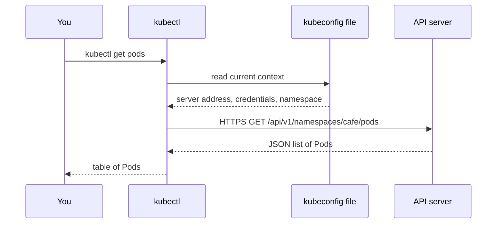

# kubectl and kubeconfig

## In plain words

`kubectl` is the command-line program you use to talk to a Kubernetes cluster. Every time you type a `kubectl` command, the tool converts it into a web request, sends it to the cluster's API server, and prints the answer in a readable form. It is a remote control: it holds no cluster state itself.

A remote control has to know which television it is pointed at and has to be paired with it. For `kubectl` that information lives in a file called the **kubeconfig**. It lists the clusters you know about, the identities you can use, and which pairing is currently selected. A useful comparison is the address book and key ring you carry: the address book says where each building is, the key ring holds a key for each, and a sticky note on the front says "today I am going to the office". Most accidents with `kubectl`, including the famous one of deleting things in production while believing you were in a test cluster, are sticky-note mistakes.

Why this matters for a job: you will use `kubectl` every working day on a Kubernetes team. Being quick and safe with it, especially knowing at all times which cluster and namespace you are pointing at, is a basic professional skill. The certification exams are also entirely `kubectl` at a terminal.

> **Before this lesson:** have a cluster available, as described in [Local clusters and managed services](#/lesson/kubernetes/getting-a-cluster). You should know from [The control plane](#/lesson/kubernetes/control-plane) that all requests go through the API server.

## What kubectl does on every command



1. `kubectl` reads the kubeconfig to learn the server address, how to prove who you are, and the default namespace.
2. It builds an HTTPS request. `kubectl get pods` becomes a `GET` request for a path such as `/api/v1/namespaces/cafe/pods`.
3. The API server authenticates and authorises the request and returns data in JSON, a text format for structured data.
4. `kubectl` formats the JSON as a table.

You can watch this happen by raising the verbosity. `-v=6` prints each request line:

```bash
$ kubectl get pods -v=6 2>&1 | grep "GET"
I1121 09:14:02.118 round_trippers.go:560] GET https://127.0.0.1:43211/api/v1/namespaces/cafe/pods?limit=500 200 OK in 9 milliseconds
```

`2>&1` merges the diagnostic output into the normal output so that `grep` can filter it. The line shows the method, the full address, the response code `200 OK` and the time taken. Knowing that every command is an HTTP call removes a lot of mystery: an error from `kubectl` is nearly always the API server refusing or failing a request, and the error text says which.

`kubectl` should be within one minor version of the cluster's API server (one older or one newer). A larger gap usually works for common commands but is unsupported. `kubectl version` prints both.

## The kubeconfig file

By default the file is `~/.kube/config` (on Windows, `%USERPROFILE%\.kube\config`). It is YAML with three lists and one pointer. Here is a complete example with a local cluster and a production cluster:

```yaml
apiVersion: v1
kind: Config
clusters:
  - name: kind-cafe
    cluster:
      server: https://127.0.0.1:43211
      certificate-authority-data: LS0tLS1CRUdJTi...
  - name: cafe-prod
    cluster:
      server: https://34.105.200.17
      certificate-authority-data: LS0tLS1CRUdJTi...
users:
  - name: kind-cafe-admin
    user:
      client-certificate-data: LS0tLS1CRUdJTi...
      client-key-data: LS0tLS1CRUdJTi...
  - name: amara-prod
    user:
      exec:
        apiVersion: client.authentication.k8s.io/v1
        command: gke-gcloud-auth-plugin
        provideClusterInfo: true
contexts:
  - name: local
    context:
      cluster: kind-cafe
      user: kind-cafe-admin
      namespace: cafe
  - name: prod
    context:
      cluster: cafe-prod
      user: amara-prod
      namespace: cafe
current-context: local
```

Section by section:

- `apiVersion: v1` and `kind: Config` mark the file type. This is a local client file, not an object stored in a cluster.
- **`clusters`** is the address book. Each entry has a `name` you choose, the API server's `server` address, and `certificate-authority-data`: the certificate of the authority that signed the server's certificate, encoded as base64 text. `kubectl` uses it to check that it is talking to the real server and not an impostor.
- **`users`** is the key ring. Each entry is a way to authenticate. The first uses a client certificate and private key embedded in the file. The second uses an `exec` plug-in: `kubectl` runs the named helper program, which obtains a short-lived token from the cloud provider. Managed services use this method, so no long-lived secret sits in the file.
- **`contexts`** tie the two together. A context is a named triple: which cluster, as which user, and with which default namespace.
- **`current-context`** is the sticky note: the context used when you do not specify one.

### Resolving a context

The lookup `kubectl` performs is mechanical, and it is worth doing by hand once. The program below does it for a kubeconfig expressed as a Python dictionary, including the fallback rules: a namespace missing from the context means `default`, and command-line flags override the file.

```python-run
kubeconfig = {
    "clusters": {"kind-cafe": "https://127.0.0.1:43211", "cafe-prod": "https://34.105.200.17"},
    "users": {"kind-cafe-admin": "client certificate", "amara-prod": "exec plug-in token"},
    "contexts": {
        "local":   {"cluster": "kind-cafe", "user": "kind-cafe-admin", "namespace": "cafe"},
        "prod":    {"cluster": "cafe-prod", "user": "amara-prod"},
        "broken":  {"cluster": "old-cluster", "user": "amara-prod"},
    },
    "current-context": "local",
}

def resolve(cfg, context_flag=None, namespace_flag=None):
    name = context_flag or cfg.get("current-context")
    if not name:
        return "error: no current context is set"
    ctx = cfg["contexts"].get(name)
    if ctx is None:
        return f"error: context '{name}' does not exist"
    server = cfg["clusters"].get(ctx["cluster"])
    if server is None:
        return f"error: cluster '{ctx['cluster']}' not found in kubeconfig"
    auth = cfg["users"].get(ctx["user"])
    if auth is None:
        return f"error: user '{ctx['user']}' not found in kubeconfig"
    namespace = namespace_flag or ctx.get("namespace") or "default"
    return f"server={server}  auth={auth}  namespace={namespace}"

print("kubectl get pods                         ->", resolve(kubeconfig))
print("kubectl get pods -n kube-system          ->", resolve(kubeconfig, namespace_flag="kube-system"))
print("kubectl --context prod get pods          ->", resolve(kubeconfig, context_flag="prod"))
print("kubectl --context broken get pods        ->", resolve(kubeconfig, context_flag="broken"))
print("kubectl --context staging get pods       ->", resolve(kubeconfig, context_flag="staging"))
```

Observe the third line: the `prod` context has no namespace, so the command would act on `default`, probably not what the operator intended. Setting a namespace in every context avoids that.

### Working with contexts

```bash
$ kubectl config get-contexts
CURRENT   NAME    CLUSTER     AUTHINFO          NAMESPACE
*         local   kind-cafe   kind-cafe-admin   cafe
          prod    cafe-prod   amara-prod        cafe

$ kubectl config current-context
local

$ kubectl config use-context prod
Switched to context "prod".

$ kubectl config set-context --current --namespace=orders
Context "prod" modified.

$ kubectl --context local -n cafe get pods
```

`get-contexts` lists them, with `*` marking the current one. `current-context` prints the name alone. `use-context` moves the sticky note. `set-context --current --namespace=orders` changes the default namespace of the current context. The last command shows the safest habit: passing `--context` and `-n` explicitly on a command overrides the file for that command only and leaves nothing to chance.

Several files can be combined. The `KUBECONFIG` environment variable accepts a list of paths (separated by `:` on Linux and macOS, `;` on Windows) and `kubectl` merges them, with the first file winning when a name appears twice. `kubectl config view --minify` prints only the parts used by the current context, which is the quickest way to see where you are pointing.

> [!WARNING]
> A kubeconfig containing an embedded client certificate or token is a credential. Anyone with a copy can act as you. Do not commit it to Git, paste it into chat, or bake it into an image. Restrict the file's permissions, prefer short-lived credentials from an exec plug-in, and give pipelines their own narrowly scoped identity.

> [!TIP]
> Show the current context and namespace in your shell prompt (tools such as `kube-ps1` or Starship do this), and colour production red. Many teams also keep production credentials in a separate kubeconfig file that must be chosen deliberately with `KUBECONFIG`, so that it cannot be the default by accident.

## The grammar of kubectl

Nearly every command has the same shape:

```
kubectl  <verb>  <resource type>  [name]  [flags]
```

For example `kubectl get pods menu-api-6c9d7b5f48-9hvtn -n cafe -o wide`.

Resource types have a plural name, a singular name and usually a short name; all three are accepted. `kubectl api-resources` lists them:

```bash
$ kubectl api-resources | head -8
NAME                    SHORTNAMES   APIVERSION   NAMESPACED   KIND
configmaps              cm           v1           true         ConfigMap
endpoints               ep           v1           true         Endpoints
events                  ev           v1           true         Event
namespaces              ns           v1           false        Namespace
nodes                   no           v1           false        Node
persistentvolumeclaims  pvc          v1           true         PersistentVolumeClaim
pods                    po           v1           true         Pod
```

The `NAMESPACED` column says whether objects of that type live inside a namespace (Pods do) or are cluster-wide (nodes are). `head -8` shows the first eight lines.

### Reading: get, describe, logs

```bash
$ kubectl get deploy,svc -n cafe
NAME                         READY   UP-TO-DATE   AVAILABLE   AGE
deployment.apps/menu-api     3/3     3            3           2d
deployment.apps/orders-api   2/2     2            2           2d

NAME                 TYPE        CLUSTER-IP     EXTERNAL-IP   PORT(S)   AGE
service/menu-api     ClusterIP   10.96.14.20    <none>        80/TCP    2d
service/orders-api   ClusterIP   10.96.201.7    <none>        80/TCP    2d

$ kubectl describe pod menu-api-6c9d7b5f48-9hvtn -n cafe | tail -6
Events:
  Type    Reason     Age   From               Message
  ----    ------     ----  ----               -------
  Normal  Scheduled  2m    default-scheduler  Successfully assigned cafe/menu-api-6c9d7b5f48-9hvtn to cafe-worker
  Normal  Pulled     2m    kubelet            Container image "ghcr.io/harbour-coffee/menu-api:1.1.0" already present on machine
  Normal  Started    2m    kubelet            Started container menu-api

$ kubectl logs deploy/menu-api -n cafe --tail=2
2026-11-21T09:20:11Z INFO  listening on :8080
2026-11-21T09:20:14Z INFO  GET /menu 200 3ms
```

- `get` prints one line per object. Several types can be listed together, separated by commas; `deploy` and `svc` are short names.
- `describe` prints a detailed, human-oriented report. Its final section, **Events**, is a timeline of what the cluster did to the object, with the component responsible in the `From` column. When something is wrong, the reason is usually written there.
- `logs` prints what a container wrote to its standard output. `deploy/menu-api` picks one Pod of that Deployment for you; `--tail=2` limits it to the last two lines. Add `-f` to follow new lines, `--previous` to see the logs of the container's previous run after a crash, and `-c NAME` to pick a container in a multi-container Pod.

### Output formats

`-o` changes how results are printed:

```bash
$ kubectl get pods -n cafe -o wide
$ kubectl get pod menu-api-6c9d7b5f48-9hvtn -n cafe -o yaml
$ kubectl get pods -n cafe -o jsonpath='{range .items[*]}{.metadata.name}{"\t"}{.status.podIP}{"\n"}{end}'
menu-api-6c9d7b5f48-9hvtn	10.244.1.5
menu-api-6c9d7b5f48-wd4mz	10.244.2.9
$ kubectl get pods -n cafe -o custom-columns=NAME:.metadata.name,NODE:.spec.nodeName,IMAGE:.spec.containers[0].image
$ kubectl get pods -A --field-selector=status.phase!=Running
$ kubectl get pods -n cafe --sort-by=.status.startTime
```

`-o wide` adds columns such as node and IP. `-o yaml` (or `-o json`) prints the full object. `-o jsonpath` extracts chosen fields using a path expression: here it loops over `.items`, printing each name, a tab, the Pod IP and a newline. `-o custom-columns` builds your own table from field paths. `--field-selector` filters on certain object fields, in this case every Pod in any namespace that is not Running, a handy health sweep. `--sort-by` orders the rows by a field.

### Changing: apply, delete, edit, scale

```bash
$ kubectl apply -f k8s/                 # every manifest in a directory
$ kubectl apply -f menu-api.yaml --dry-run=server
$ kubectl diff -f menu-api.yaml
$ kubectl delete -f menu-api.yaml       # delete what the file describes
$ kubectl scale deployment menu-api --replicas=5 -n cafe
$ kubectl rollout status deployment/menu-api -n cafe
$ kubectl rollout restart deployment/menu-api -n cafe
```

`apply -f` accepts a file, a directory or a URL. `delete -f` removes exactly the objects named in the file, which is safer than deleting by a hand-typed name. `rollout restart` replaces every Pod of a Deployment gradually without changing the image, useful after a configuration change that Pods only read at start-up. The [declarative model lesson](#/lesson/kubernetes/declarative-reconciliation) explained `diff`, dry runs and why `scale` by hand causes drift.

### Reaching inside: exec, port-forward, cp

```bash
$ kubectl exec -it deploy/menu-api -n cafe -- sh
/app $ wget -qO- http://orders-api/healthz
ok
/app $ exit

$ kubectl port-forward svc/menu-api 8080:80 -n cafe
Forwarding from 127.0.0.1:8080 -> 8080

$ kubectl cp cafe/menu-api-6c9d7b5f48-9hvtn:/tmp/heap.dump ./heap.dump
```

`exec` runs a command inside a running container. `-it` attaches your keyboard and screen; everything after `--` is the command to run, here a shell. From inside, the example calls another Service by name. `port-forward` opens a tunnel from a port on your machine to a Service or Pod, so `http://localhost:8080` reaches `menu-api` without exposing it publicly; it runs until you press Ctrl+C. `cp` copies files out of or into a container.

### Learning: explain

`kubectl explain` is built-in documentation for every field, taken from the cluster's own API definitions, so it always matches your cluster's version:

```bash
$ kubectl explain deployment.spec.strategy.rollingUpdate
GROUP:      apps
KIND:       Deployment
VERSION:    v1

FIELD: rollingUpdate <RollingUpdateDeployment>

DESCRIPTION:
    Rolling update config params. Present only if DeploymentStrategyType = RollingUpdate.

FIELDS:
  maxSurge	<IntOrString>
    The maximum number of pods that can be scheduled above the desired number of pods...
  maxUnavailable	<IntOrString>
    The maximum number of pods that can be unavailable during the update...
```

You give a dotted path of field names and get the type and description of that field and its children. In the certification exams this is allowed and faster than searching the website.

## Generating manifests instead of typing them

Writing YAML from a blank page is slow and error-prone. Let `kubectl` produce a skeleton:

```bash
$ kubectl create deployment menu-api --image=ghcr.io/harbour-coffee/menu-api:1.1.0 \
    --replicas=3 --port=8080 --dry-run=client -o yaml > menu-api.yaml

$ kubectl expose deployment menu-api --port=80 --target-port=8080 \
    --dry-run=client -o yaml > menu-api-svc.yaml
```

`--dry-run=client` stops the command from contacting the server, and `-o yaml` prints the object it would have created. The `>` sends that output into a file, which you then edit and apply. This is the standard exam technique and a sensible everyday one.

## Productivity and safety habits

- **Alias and completion.** Most people shorten the command with `alias k=kubectl` and enable tab completion with `source <(kubectl completion bash)` (or the `zsh` and PowerShell equivalents), which completes resource types and even object names.
- **Always know your context.** Run `kubectl config current-context` before anything destructive, or pass `--context` explicitly.
- **Preview deletions.** `kubectl delete pods -l app=menu-api --dry-run=client` lists what would go.
- **Never run `kubectl delete` with `--all` and without `-n`** until you have read the command twice.
- **Check your own permissions** with `kubectl auth can-i delete pods -n cafe`; it answers yes or no.
- **Plug-ins.** Any program on your path named `kubectl-something` becomes `kubectl something`. The `krew` plug-in manager installs community ones; `kubectx` and `kubens` for switching context and namespace are popular.

> [!INTERVIEW]
> **"What is in a kubeconfig file, and how does kubectl decide which cluster to talk to?"** It has three lists and a pointer: clusters (API server address plus the CA certificate used to verify it), users (credentials: a client certificate, a token, or an exec plug-in that fetches short-lived tokens), contexts (a named combination of cluster, user and default namespace) and current-context. `kubectl` takes the context from `--context` if given, otherwise current-context; looks up its cluster and user; and uses the context's namespace unless `-n` overrides it, falling back to `default`. Files listed in the `KUBECONFIG` variable are merged. Finish with a safety point: kubeconfigs are credentials, and explicit contexts prevent wrong-cluster mistakes.

## Common pitfalls

- **Acting on the wrong cluster or namespace.** The most costly `kubectl` mistake. Make the context visible and explicit.
- **Forgetting `-n`.** "No resources found in default namespace" usually means the objects are in another namespace, not that they are missing.
- **Forgetting `--` before the command in `exec`.** Without it, `kubectl` tries to interpret the command's flags as its own.
- **Using `kubectl edit` in production.** It works, and it leaves no record. Change the manifest and apply.
- **Leaving `port-forward` as a way to serve users.** It is a debugging tunnel tied to your terminal session.
- **Trusting `kubectl get all`.** Despite the name it lists only a handful of common types, not ConfigMaps, Secrets, Ingresses or custom resources.

## Cheat sheet

| Goal | Command |
|---|---|
| Which cluster am I on? | `kubectl config current-context` |
| Switch context | `kubectl config use-context NAME` |
| Set default namespace | `kubectl config set-context --current --namespace=NS` |
| List objects | `kubectl get TYPE [-n NS] [-A] [-o wide]` |
| Full object | `kubectl get TYPE NAME -o yaml` |
| Details and events | `kubectl describe TYPE NAME` |
| Logs | `kubectl logs POD [-c CTR] [-f] [--previous]` |
| Shell inside | `kubectl exec -it POD -- sh` |
| Local tunnel | `kubectl port-forward svc/NAME LOCAL:REMOTE` |
| Create or update | `kubectl apply -f FILE_OR_DIR` |
| Preview | `kubectl diff -f FILE` |
| Remove | `kubectl delete -f FILE` |
| Field documentation | `kubectl explain TYPE.path.to.field` |
| Skeleton YAML | `kubectl create ... --dry-run=client -o yaml` |
| Can I? | `kubectl auth can-i VERB TYPE -n NS` |
| List types | `kubectl api-resources` |

## Summary

`kubectl` is a client that turns commands into HTTPS requests to the API server. The kubeconfig file tells it where the servers are, how to authenticate, and which combination of cluster, user and namespace, called a context, is active. Commands follow a verb, type, name pattern. `get`, `describe` and `logs` read; `apply`, `delete` and `scale` change; `exec`, `port-forward` and `cp` reach inside; `explain` documents; and client-side dry runs generate manifests. Speed with these commands comes with practice, and safety comes from always knowing your context. You now have the tools to explore the first workload object: the Pod.

## Glossary

- **kubectl**: the command-line client for the Kubernetes API.
- **kubeconfig**: the client file listing clusters, users and contexts.
- **Cluster entry**: an API server address and the CA certificate used to verify it.
- **User entry**: credentials or a method of obtaining them.
- **Context**: a named combination of cluster, user and default namespace.
- **current-context**: the context used when none is specified.
- **Exec plug-in**: a helper program kubectl runs to obtain short-lived credentials.
- **Certificate authority (CA)**: the issuer whose certificate lets a client verify a server's identity.
- **JSON**: a text format for structured data, used by the API.
- **JSONPath**: an expression language for picking fields out of JSON.
- **Field selector**: a filter on object fields such as `status.phase`.
- **Short name**: an abbreviation for a resource type, such as `po` or `svc`.
- **Client-side dry run**: generating the request without sending it.
- **Port-forward**: a temporary tunnel from your machine into the cluster.
- **Plug-in**: an executable named `kubectl-NAME` that adds a subcommand.

```quiz
[
  {"q": "A context named 'prod' has a cluster and a user but no namespace field. You run kubectl --context prod get pods. Which namespace is queried?",
   "options": ["kube-system", "The namespace of the previous context", "default", "All namespaces"],
   "answer": 2,
   "explain": "With no namespace in the context and no -n flag, kubectl uses the namespace called default."},
  {"q": "What does a context in a kubeconfig file combine?",
   "options": ["A Pod, a node and a volume", "A cluster, a user and an optional default namespace", "A token and a password", "An image and a registry"],
   "answer": 1,
   "explain": "A context names which cluster to contact, which credentials to use and which namespace to default to."},
  {"q": "You run kubectl get pods and see 'No resources found in default namespace', but a colleague sees the Pods. What is the most likely explanation?",
   "options": ["The Pods crashed", "Your command is looking at a different namespace or context", "kubectl is the wrong version", "The Pods are hidden from non-admins"],
   "answer": 1,
   "explain": "Objects are namespaced. Check kubectl config current-context and add -n with the right namespace."},
  {"q": "Which command shows the timeline of what the scheduler and kubelet did to a Pod?",
   "options": ["kubectl logs POD", "kubectl describe pod POD", "kubectl explain pod", "kubectl config view"],
   "answer": 1,
   "explain": "describe ends with the Events section. logs shows the application's own output, which may not exist if the container never started."},
  {"q": "A container crashed and restarted. Which command shows the output of the run that crashed?",
   "options": ["kubectl logs POD --previous", "kubectl logs POD -f", "kubectl describe node", "kubectl exec POD -- cat /var/log"],
   "answer": 0,
   "explain": "--previous prints the logs of the previous instance of the container, which usually contains the crash message."},
  {"q": "What does kubectl create deployment web --image=web:1.0 --dry-run=client -o yaml do?",
   "options": ["Creates the Deployment and prints it", "Prints the manifest it would send, without contacting the server", "Validates the manifest on the server without storing it", "Deletes the Deployment"],
   "answer": 1,
   "explain": "A client-side dry run builds the object locally and prints it. It is the standard way to generate a starting manifest."},
  {"q": "Why is a kubeconfig file with an embedded client certificate and key sensitive?",
   "options": ["It contains the cluster's etcd data", "Anyone holding it can authenticate to the cluster as that user", "It lists all Secrets", "It cannot be regenerated"],
   "answer": 1,
   "explain": "The certificate and key are credentials. A copied file grants the same access as its owner until the credential is revoked or expires."},
  {"q": "You want to open menu-api in your browser for a quick check without exposing it outside the cluster. Which command fits?",
   "options": ["kubectl expose deployment menu-api --type=LoadBalancer", "kubectl port-forward svc/menu-api 8080:80", "kubectl cp menu-api:/ .", "kubectl scale deployment menu-api --replicas=0"],
   "answer": 1,
   "explain": "port-forward creates a temporary tunnel from localhost to the Service through the API server, with no change to the cluster's exposure."}
]
```

> **Source:** Poulton, *The Kubernetes Book*, ch. 3 (topic coverage only). Official docs: https://kubernetes.io/docs/reference/kubectl/ , https://kubernetes.io/docs/concepts/configuration/organize-cluster-access-kubeconfig/ , https://kubernetes.io/docs/reference/kubectl/quick-reference/
