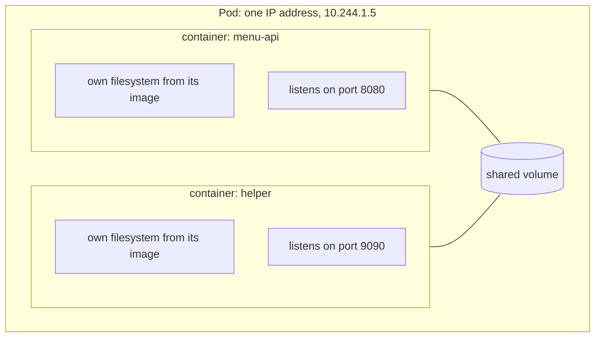
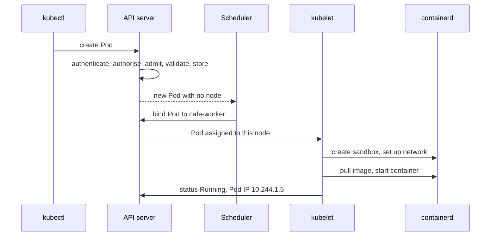

# The Pod as the atomic unit

## In plain words

Kubernetes does not run containers directly. It runs **Pods**. A Pod is a small wrapper around one or more containers that should live, move and die together. Most Pods hold a single container, so for a first approximation "a Pod is a container that Kubernetes manages". The wrapper adds the things Kubernetes needs: a network address, shared storage, labels, and rules about restarts and resources.

A picture that helps: a Pod is a flat, and containers are the people living in it. Flatmates share one street address (the Pod's IP address), one front door, and whatever rooms are declared as shared (volumes). Each still has a private bedroom (their own filesystem). The council (the scheduler) allocates whole flats to buildings (nodes); it never puts one flatmate in one building and another across town. When the flat is demolished, everyone moves out together.

The word "atomic" in the title means "cannot be split". A Pod is the smallest thing Kubernetes can schedule, scale or replace. You cannot place half a Pod on one node, and you scale by adding whole Pods, never by adding containers to an existing Pod.

Why this matters for a job: every other workload object you will use (Deployment, StatefulSet, Job, DaemonSet) is a recipe for making Pods. If you can read a Pod specification and a Pod's status, you can read all of them.

> **Before this lesson:** you should be comfortable with `kubectl get`, `describe`, `logs` and `apply` from [kubectl and kubeconfig](#/lesson/kubernetes/kubectl-kubeconfig), and know what the kubelet and scheduler do from the [principles module](#/lesson/kubernetes/worker-nodes).

## Why not schedule containers directly?

Three reasons explain the extra layer.

**Some programs need a close helper.** A web server may need a companion that fetches fresh content, or a program that forwards its logs. Those helpers must share files or talk over `localhost` with the main program and must always be on the same machine. The Pod is the unit that guarantees this. The [next lesson](#/lesson/kubernetes/multi-container-pods) covers these patterns.

**Kubernetes needs a place to hang its own settings.** Restart rules, resource reservations, node placement hints, security settings and labels belong to something. Attaching them to the wrapper keeps the container image itself unaware of Kubernetes.

**It keeps Kubernetes independent of any one container technology.** The Pod is an abstraction: the runtime underneath could use ordinary containers, sandboxed containers or small virtual machines, and the Pod definition stays the same.

## What a Pod shares, and what it does not



Containers in the same Pod share:

- **The network namespace.** They have one IP address and one set of ports between them. They reach each other on `localhost`. Two containers in a Pod therefore cannot both listen on port 8080.
- **Volumes**, when each container chooses to mount them.
- **The same node and the same lifetime.**
- Optionally the process list, if `shareProcessNamespace: true` is set.

Containers in the same Pod do **not** share their root filesystems. Each starts from its own image. A file written by one is invisible to the other unless it is written to a shared volume. They also have separate resource limits.

Across Pods, nothing is shared: every Pod has its own IP, and Pods talk to each other over the cluster network as if they were separate machines.

## A minimal Pod, line by line

```yaml
apiVersion: v1
kind: Pod
metadata:
  name: menu-api
  namespace: cafe
  labels:
    app: menu-api
    tier: backend
spec:
  containers:
    - name: menu-api
      image: ghcr.io/harbour-coffee/menu-api:1.1.0
      ports:
        - name: http
          containerPort: 8080
      env:
        - name: LOG_LEVEL
          value: info
```

- `apiVersion: v1` — Pods belong to the original "core" group of the API, whose version string is written without a group name.
- `kind: Pod` — the object type.
- `metadata.name` — the Pod's name, unique within its namespace. `metadata.namespace` — the named area of the cluster it lives in; if omitted, the one from your context.
- `metadata.labels` — two tags that selectors can match on.
- `spec.containers` — a list; this Pod has one entry.
  - `name` — the container's name inside the Pod, used with `kubectl logs -c` and `kubectl exec -c`.
  - `image` — the image reference, including a version tag.
  - `ports` — documents that the program listens on 8080 and gives that port the name `http`. This list is informational: a container can be reached on any port it listens on, listed or not. Naming a port is useful because Services and probes can refer to it by name.
  - `env` — environment variables given to the process. Here `LOG_LEVEL=info`.

Create it and look:

```bash
$ kubectl apply -f menu-api-pod.yaml
pod/menu-api created

$ kubectl get pod menu-api -n cafe -o wide
NAME       READY   STATUS    RESTARTS   AGE   IP           NODE          NOMINATED NODE   READINESS GATES
menu-api   1/1     Running   0          15s   10.244.1.5   cafe-worker   <none>           <none>
```

The columns: `READY 1/1` means one of one containers is passing its readiness condition. `STATUS` is a summary of the Pod's state. `RESTARTS` counts container restarts inside this Pod. `IP` is the Pod's address on the cluster network, and `NODE` is where the scheduler placed it.

## How a Pod comes to life

Tracing the journey from `kubectl apply` to a running process ties together the architecture lessons.



The same story is written in the Pod's events:

```bash
$ kubectl describe pod menu-api -n cafe | sed -n '/Events/,$p'
Events:
  Type    Reason     Age   From               Message
  ----    ------     ----  ----               -------
  Normal  Scheduled  30s   default-scheduler  Successfully assigned cafe/menu-api to cafe-worker
  Normal  Pulling    29s   kubelet            Pulling image "ghcr.io/harbour-coffee/menu-api:1.1.0"
  Normal  Pulled     24s   kubelet            Successfully pulled image in 4.8s
  Normal  Created    24s   kubelet            Created container menu-api
  Normal  Started    24s   kubelet            Started container menu-api
```

Five events, five steps: scheduled by the scheduler, then pulling, pulled, created and started by the kubelet. When a Pod is not running, reading down this list and finding where it stops tells you which stage failed.

## Pods are mortal and immutable

Two words describe how Kubernetes treats Pods.

**Mortal** (or ephemeral, meaning short-lived). A Pod is created, runs on one node for its whole life, and ends. It is never moved to another node and never brought back after it is deleted. What looks like "moving" is deleting one Pod and creating another, with a new unique identifier and a new IP.

**Immutable.** Most of a Pod's specification cannot be changed after creation. You cannot change the container list, ports, volumes or environment of a running Pod. To change them you create a new Pod. A small set of fields can be edited in place: the container `image`, `activeDeadlineSeconds`, added tolerations, and, in current versions, CPU and memory resources through a dedicated resize mechanism.

Together these explain why you almost never create bare Pods in real work. A Pod created directly, as above, is called a **bare Pod** or unmanaged Pod. If its node fails, it is gone and nothing replaces it. You cannot scale it or update it gradually. Higher-level controllers add those abilities by creating and replacing Pods for you:

| Controller | Use it for | Covered in |
|---|---|---|
| Deployment | Stateless services that can be freely replaced | [Deployments](#/lesson/kubernetes/deployments-replicasets) |
| StatefulSet | Databases and other apps needing stable names and storage | [StatefulSets](#/lesson/kubernetes/statefulset-theory) |
| DaemonSet | One Pod on every node, such as a log collector | [DaemonSets, Jobs and CronJobs](#/lesson/kubernetes/daemonsets-jobs-cronjobs) |
| Job / CronJob | Work that runs to completion, once or on a schedule | Same lesson |

Each of these contains a **Pod template**: a Pod definition without a name, from which Pods are stamped. Everything in this lesson and the next two applies unchanged inside a template.

> [!WARNING]
> Do not run production workloads as bare Pods. A single `kubectl delete pod`, a node drain during maintenance or a node failure removes the Pod permanently. Bare Pods are for learning and for short debugging sessions.

## Scheduling is all-or-nothing

A Pod is placed as a unit on one node. The scheduler adds up the resource requests of every container in the Pod and looks for a node with that much free. A Pod with two containers needing 500 millicores each needs a node with 1000 millicores unreserved, even if two other nodes each have 600 free.

The same atomicity applies to readiness. A Pod counts as ready, and receives traffic from a Service, only when *all* its containers are ready. `READY 1/2` means one container is not, and the Pod as a whole is held out of service.

The short program below shows both rules. Press Run.

```python-run
nodes = {"cafe-worker": 600, "cafe-worker2": 600, "cafe-worker3": 1200}   # free CPU millicores

def place(pod_name, containers):
    total = sum(containers.values())
    print(f"\n{pod_name}: containers {containers} -> Pod needs {total}m on ONE node")
    for node in sorted(nodes):
        if nodes[node] >= total:
            nodes[node] -= total
            print(f"  scheduled on {node}; free now {nodes}")
            return
    print(f"  Pending: no single node has {total}m free, even though the cluster has {sum(nodes.values())}m in total")

place("web", {"nginx": 300, "content-sync": 200})
place("orders", {"orders-api": 500, "log-forwarder": 500})
place("reports", {"renderer": 700, "uploader": 400})

def pod_ready(container_ready):
    ready = sum(container_ready.values())
    state = "Ready, receives traffic" if ready == len(container_ready) else "NOT ready, removed from Service endpoints"
    return f"{ready}/{len(container_ready)} -> {state}"

print()
print("web   ", pod_ready({"nginx": True, "content-sync": True}))
print("orders", pod_ready({"orders-api": True, "log-forwarder": False}))
```

The third Pod needs 1100 millicores. The cluster has more than that in total, but spread over nodes, and a Pod cannot be split, so it waits. This is one argument for keeping Pods small.

## One container or several? The scaling test

Beginners sometimes put the whole application in one Pod: web server, API and database as three containers. That is nearly always a mistake, because the Pod is the unit of scaling. If the web tier needs five copies, you would get five databases too.

A dependable rule: **put containers in the same Pod only if they must run on the same machine, must start and stop together, and scale in the same ratio.** A web server and the helper that refreshes its files pass this test. A web server and a database fail it: they scale differently, are updated at different times, and can run on different machines.

| Situation | Same Pod? |
|---|---|
| `web` and `orders-api` | No. Separate Pods, connected by a Service |
| `orders-api` and its PostgreSQL database | No |
| `orders-api` and a proxy that encrypts its traffic | Yes: a sidecar |
| A web server and a process that pulls new static files into a shared folder | Yes |
| A one-time database migration that must finish before the app starts | Yes: an init container |

## Pod networking in one page

Every Pod receives its own IP address from a range managed by the CNI plug-in, and any Pod can reach any other Pod's IP directly, on any node, with no address translation. This flat model is one of Kubernetes' founding rules.

Inside a Pod, containers use `localhost`. Between Pods, a client uses the other Pod's IP, or far better, the name of a Service in front of it. Pod IPs are not stable, so never write one into configuration.

```bash
$ kubectl get pods -n cafe -o custom-columns=NAME:.metadata.name,IP:.status.podIP,NODE:.spec.nodeName
NAME         IP            NODE
menu-api     10.244.1.5    cafe-worker
orders-api   10.244.2.9    cafe-worker2

$ kubectl exec orders-api -n cafe -- wget -qO- http://10.244.1.5:8080/healthz
ok
```

The first command prints each Pod's IP and node. The second runs `wget` inside the `orders-api` Pod and fetches a URL on the `menu-api` Pod's IP. It works across nodes with no port mapping, unlike `docker run -p` on a single host. The result `ok` is the response body. This is only a demonstration; real applications call `http://menu-api` through a Service, as the [Services lesson](#/lesson/kubernetes/services-clusterip) shows.

## Useful Pod spec fields you will meet early

A realistic Pod spec adds a few more fields. Here is one, with only the new lines explained.

```yaml
apiVersion: v1
kind: Pod
metadata:
  name: orders-api
  namespace: cafe
  labels:
    app: orders-api
spec:
  restartPolicy: Always
  terminationGracePeriodSeconds: 30
  nodeSelector:
    kubernetes.io/os: linux
  imagePullSecrets:
    - name: ghcr-credentials
  containers:
    - name: orders-api
      image: ghcr.io/harbour-coffee/orders-api:2.0.3
      imagePullPolicy: IfNotPresent
      command: ["/app/orders"]
      args: ["--listen", ":8080"]
      workingDir: /app
      ports:
        - name: http
          containerPort: 8080
      resources:
        requests:
          cpu: 250m
          memory: 256Mi
        limits:
          memory: 512Mi
```

- `restartPolicy: Always` — restart a container whenever it exits. This is the default. The [lifecycle lesson](#/lesson/kubernetes/pod-lifecycle-resources) covers the other values.
- `terminationGracePeriodSeconds: 30` — on deletion, the container gets a polite stop signal and up to 30 seconds to finish before being killed.
- `nodeSelector` — only nodes carrying this label are eligible. Every node has the built-in label `kubernetes.io/os`.
- `imagePullSecrets` — the name of a Secret holding registry credentials, needed for private images.
- `imagePullPolicy: IfNotPresent` — use a copy of the image already on the node if there is one. The alternatives are `Always` (contact the registry every time the container starts) and `Never`. The default is `Always` when the tag is `latest` or missing, and `IfNotPresent` for any other tag.
- `command` and `args` — override the image's start command. `command` replaces the Dockerfile `ENTRYPOINT`; `args` replaces `CMD`. If you set neither, the image's own values are used.
- `workingDir` — the directory the process starts in.
- `resources` — what the container is guaranteed (`requests`) and the most it may use (`limits`). Explained in depth in the lifecycle lesson.

> [!TIP]
> Give every image an explicit version tag or, better, a digest. With `latest`, two Pods of the same Deployment can end up running different code depending on when each node pulled, and a rollback has nothing to roll back to. See [Registries, tags and digests](#/lesson/docker/registries-tags-digests) in the Docker track.

## Working with a running Pod

```bash
$ kubectl logs orders-api -n cafe --tail=3
2026-11-21T10:02:11Z INFO  connected to database
2026-11-21T10:02:11Z INFO  listening on :8080
2026-11-21T10:02:40Z INFO  POST /orders 201 12ms

$ kubectl exec -it orders-api -n cafe -- sh
/app $ env | grep KUBERNETES_SERVICE
KUBERNETES_SERVICE_HOST=10.96.0.1
KUBERNETES_SERVICE_PORT=443
/app $ cat /etc/hostname
orders-api
/app $ exit

$ kubectl delete pod orders-api -n cafe
pod "orders-api" deleted
```

Inside the container, the hostname equals the Pod name, and Kubernetes has injected environment variables pointing at the API server. Deleting the Pod takes up to the grace period, because the kubelet first sends the stop signal and waits.

> [!INTERVIEW]
> **"What is a Pod, and why does Kubernetes use Pods instead of containers?"** A Pod is the smallest deployable and schedulable unit: one or more containers that share a network namespace (one IP, one port space, `localhost` between them), can share volumes, and are placed together on one node with a common lifecycle. The extra layer lets tightly coupled helpers run beside a main container, gives Kubernetes a place to attach scheduling, security, restart and resource settings, and keeps the system independent of the container runtime. Then add the operational points: Pods are ephemeral and largely immutable, so they are created through controllers such as Deployments, and the Pod, not the container, is the unit of scaling.

## Common pitfalls

- **Two containers in one Pod using the same port.** They share a network namespace, so the second fails to bind.
- **Packing unrelated services into one Pod.** They are forced to scale, deploy and fail together.
- **Expecting a Pod's IP or name to persist.** Both change on replacement.
- **Editing a running Pod and getting "field is immutable".** Change the controller's template instead; it will create new Pods.
- **Confusing `command`/`args` with Docker's terms.** Kubernetes `command` is Docker's `ENTRYPOINT`; Kubernetes `args` is Docker's `CMD`.
- **Believing `containerPort` opens a port.** It is documentation. The program inside decides what it listens on.
- **Creating bare Pods for real workloads.** Nothing heals them.

## Cheat sheet

| Fact | Detail |
|---|---|
| What a Pod is | One or more containers with shared network and optional shared volumes |
| Shared | IP address, port space, `localhost`, volumes, node, lifetime |
| Not shared | Each container's root filesystem and resource limits |
| Atomic | Scheduled, scaled, made ready and deleted as a whole |
| Mortal | Never moved or resurrected; replaced by a new Pod |
| Immutable | Most spec fields cannot change after creation |
| `READY x/y` | x of y containers ready; traffic only when x equals y |
| `command` / `args` | Override `ENTRYPOINT` / `CMD` |
| `imagePullPolicy` default | `Always` for `latest`, otherwise `IfNotPresent` |
| `kubectl get pod -o wide` | Shows IP and node |
| `kubectl describe pod` | Events: Scheduled, Pulling, Pulled, Created, Started |

## Summary

The Pod is the unit Kubernetes schedules and manages. It wraps one or more containers that share a network identity and, optionally, volumes, and that always run together on one node. Pods are atomic (handled as a whole), mortal (replaced, never repaired or moved) and mostly immutable (changed by replacement). Because of that, real workloads are run through controllers that stamp Pods from a template, and other programs find Pods through labels and Services, never by name or address. A Pod should contain a single main container unless helpers truly must share its machine and lifetime. The next lesson looks at those cases: init containers, sidecars and adapters.

## Glossary

- **Pod**: the smallest deployable unit; a group of one or more containers with shared context.
- **Atomic unit**: something handled only as a whole.
- **Network namespace**: an isolated network stack; shared by all containers in a Pod.
- **Pod IP**: the address assigned to a Pod on the cluster network.
- **Ephemeral / mortal**: short-lived and not restored after deletion.
- **Immutable**: not changeable after creation.
- **Bare Pod**: a Pod created directly, with no controller managing it.
- **Pod template**: the Pod definition embedded in a controller, used to create Pods.
- **containerPort**: a documented port a container listens on.
- **imagePullPolicy**: when the kubelet contacts the registry for an image.
- **imagePullSecrets**: Secrets holding credentials for private registries.
- **command / args**: overrides for the image's entrypoint and default arguments.
- **terminationGracePeriodSeconds**: how long a container gets to stop cleanly.
- **nodeSelector**: labels a node must have for the Pod to be placed there.

```quiz
[
  {"q": "Two containers in the same Pod both try to listen on port 8080. What happens?",
   "options": ["Both work, because each container has its own IP", "The second one fails to bind, because they share one network namespace", "Kubernetes remaps one of them automatically", "The Pod is rejected by the API server"],
   "answer": 1,
   "explain": "Containers in a Pod share an IP and port space. Only one process can bind a given port. The API server does not check for this; the failure shows at runtime."},
  {"q": "A bare Pod (no controller) is running on a node that fails permanently. What happens next?",
   "options": ["The scheduler moves it to another node", "A replacement is created after five minutes", "The Pod is lost and nothing recreates it", "The kubelet on another node adopts it"],
   "answer": 2,
   "explain": "Pods are never moved, and only a controller creates replacements. A bare Pod has no controller."},
  {"q": "A Pod has two containers requesting 400m CPU each. Nodes have 500m, 500m and 700m free. Why is this Pod not running?",
   "options": ["The total free CPU is too low", "No single node has 800m free, and a Pod cannot be split across nodes", "Two-container Pods need a special scheduler", "CPU requests cannot be fractions"],
   "answer": 1,
   "explain": "The scheduler sums the containers' requests and needs one node with that much free. The Pod stays Pending."},
  {"q": "kubectl get pods shows READY 1/2 for a Pod behind a Service. Does it receive traffic from the Service?",
   "options": ["Yes, half the traffic", "Yes, all traffic goes to the ready container", "No, a Pod is ready only when all its containers are ready", "Only on port 8080"],
   "answer": 2,
   "explain": "Readiness is evaluated for the whole Pod. With one container not ready, the Pod is removed from the Service's endpoints."},
  {"q": "Which pairing belongs together in one Pod?",
   "options": ["A web front end and its PostgreSQL database", "An API server and a proxy container that handles its TLS", "Two unrelated microservices to save IP addresses", "A front end and a back end that scale independently"],
   "answer": 1,
   "explain": "A TLS proxy must sit on the same host as the app, share its lifetime and scale one-to-one with it. The others scale and deploy independently."},
  {"q": "In a Pod spec, what does the command field replace?",
   "options": ["The image's CMD", "The image's ENTRYPOINT", "The image tag", "The container name"],
   "answer": 1,
   "explain": "Kubernetes command overrides the Dockerfile ENTRYPOINT, and args overrides CMD."},
  {"q": "A container image is referenced as ghcr.io/harbour-coffee/web with no tag and no imagePullPolicy. What policy applies?",
   "options": ["Never", "IfNotPresent", "Always", "The Pod is rejected"],
   "answer": 2,
   "explain": "A missing tag means latest, and for latest the default pull policy is Always, so the registry is contacted on every container start."},
  {"q": "You try to add a second container to a running Pod with kubectl edit and receive an error. Why?",
   "options": ["Your kubeconfig is wrong", "The containers list of an existing Pod is immutable", "Pods can only have one container", "The node is full"],
   "answer": 1,
   "explain": "Most of a Pod's spec cannot change after creation. Change the controller's Pod template so new Pods are created with both containers."}
]
```

> **Source:** Poulton, *The Kubernetes Book*, ch. 4 (topic coverage only). Official docs: https://kubernetes.io/docs/concepts/workloads/pods/ , https://kubernetes.io/docs/concepts/containers/images/ , https://kubernetes.io/docs/tasks/inject-data-application/define-command-argument-container/
