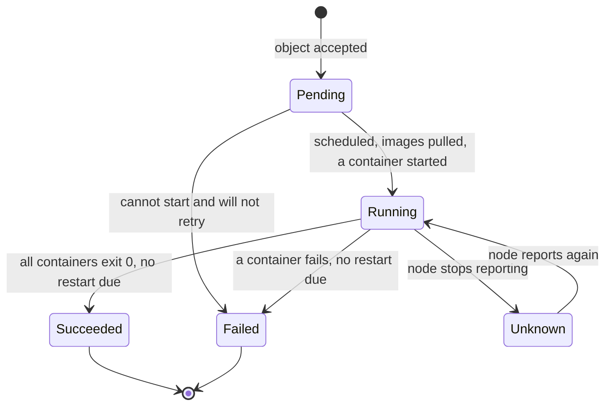

# Lifecycle, restart policies, probes, requests and limits

## In plain words

A Pod has a life story. It is accepted by the cluster, waits for a node, starts its containers, runs, and eventually ends. Along the way Kubernetes needs answers to three questions that it cannot guess: *Is this program still working, or should I restart it? Is it ready to take requests yet? How much processor and memory does it need, and how much is it allowed to take?* You answer them with **probes** (health checks) and **resources** (requests and limits).

Picture a new employee. Their status moves through stages: hired but not yet at a desk, working, finished or dismissed. A manager checks on them in different ways. "Are you conscious?" is a very different question from "Are you ready to take customers?". Someone can be fine but not ready, because they are still setting up their till. And every employee is promised a desk (a guaranteed share) while being told they may not spread across the whole office (a ceiling). Kubernetes treats containers the same way.

Why this matters for a job: the settings in this lesson decide whether your service survives deployments and load. Missing or wrong probes are a leading cause of dropped requests during rollouts. Missing or wrong requests and limits are a leading cause of Pods being killed (`OOMKilled`), running slowly (CPU throttling) or refusing to schedule (`Pending`). Interviewers ask about all of them.

> **Before this lesson:** read [The Pod as the atomic unit](#/lesson/kubernetes/pod-basics) and [Multi-container Pods](#/lesson/kubernetes/multi-container-pods). The Docker track's [Health checks](#/lesson/docker/health-checks) lesson introduces the same idea on a single machine.

## Pod phases

A Pod's `status.phase` is a coarse summary with five possible values.

| Phase | Meaning |
|---|---|
| `Pending` | Accepted by the API server, but not all containers are running yet. Includes waiting for a node, pulling images and running init containers |
| `Running` | Bound to a node and at least one container is running, starting or restarting |
| `Succeeded` | All containers exited with code 0 and will not be restarted |
| `Failed` | All containers have stopped and at least one exited with an error, with no restart due |
| `Unknown` | The node stopped reporting, so the state cannot be determined |



The `STATUS` column of `kubectl get pods` is *not* the phase. It is a more helpful string that `kubectl` computes from the phase plus container details, which is why you see values such as `CrashLoopBackOff`, `ImagePullBackOff`, `Init:0/2`, `Terminating`, `Completed` and `OOMKilled` that are not phases at all. A Pod in `CrashLoopBackOff` has phase `Running`.

### Container states

Each container inside the Pod is in one of three states:

- **Waiting**: not running yet. A `reason` says why: `ContainerCreating`, `ImagePullBackOff`, `CrashLoopBackOff`.
- **Running**: the process is executing.
- **Terminated**: the process ended. An `exitCode` and `reason` (`Completed`, `Error`, `OOMKilled`) say how.

```bash
$ kubectl get pod orders-api -n cafe -o jsonpath='{.status.containerStatuses[0].state}{"\n"}{.status.containerStatuses[0].lastState}{"\n"}'
{"waiting":{"reason":"CrashLoopBackOff","message":"back-off 40s restarting failed container"}}
{"terminated":{"exitCode":1,"reason":"Error","startedAt":"2026-11-21T10:02:11Z","finishedAt":"2026-11-21T10:02:12Z"}}
```

`state` is now; `lastState` is the previous run. Here the container is waiting to be restarted, and its last run exited with code 1 after one second. Exit code 0 means success. Any other value is a failure. Code 137 means the process was killed with the KILL signal (128 + 9), which is what an out-of-memory kill looks like; 143 means it ended after the polite TERM signal (128 + 15).

## Restart policies and back-off

The Pod-level field `restartPolicy` tells the kubelet what to do when a container exits.

| Policy | Restart when | Used by |
|---|---|---|
| `Always` (default) | The container exits for any reason, even success | Deployments, StatefulSets, DaemonSets |
| `OnFailure` | The exit code is not 0 | Jobs |
| `Never` | Never | Jobs that must not retry in place |

Restarts happen in the same Pod on the same node. To avoid hammering a broken program, the kubelet waits before each restart, and the wait doubles each time: 10 seconds, 20, 40, 80, 160, and then a ceiling of 300 seconds (five minutes). While waiting, the container state is `CrashLoopBackOff`. That name is not an error of its own; it means "this container keeps exiting, and I am pausing before the next attempt". If a container then runs without problems for ten minutes, the delay resets to the start.

```python-run
def restart_schedule(crashes, base=10, cap=300):
    """Seconds waited before each restart, and the running clock."""
    t, rows = 0, []
    for n in range(1, crashes + 1):
        delay = min(base * 2 ** (n - 1), cap)
        t += delay
        rows.append((n, delay, t))
    return rows

print("restart  wait(s)  elapsed since first crash")
for n, delay, t in restart_schedule(8):
    print(f"{n:>7}  {delay:>7}  {t // 60}m {t % 60:02d}s")
```

After the sixth crash every attempt is five minutes apart. This is why a Pod that has been crash-looping for an hour appears to "do nothing" for long stretches: it is waiting. Recent Kubernetes versions let cluster administrators lower the ceiling, so treat these numbers as the defaults.

## Probes: three questions about health

A **probe** is a check the kubelet runs against a container on a timer. There are three kinds, and they answer different questions with different consequences.

| Probe | Question | If it fails |
|---|---|---|
| **Startup** | Has the program finished starting? | Keep waiting; after too many failures, restart the container. Other probes are paused until it succeeds |
| **Liveness** | Is the program still working, or is it stuck? | Restart the container |
| **Readiness** | Can it handle requests right now? | Remove the Pod from Service endpoints; do **not** restart |

A probe can check in four ways: `httpGet` (an HTTP request; any status from 200 to 399 passes), `tcpSocket` (can a connection be opened?), `grpc` (the standard gRPC health protocol) and `exec` (run a command inside the container; exit code 0 passes).

Timing is controlled by five settings, shown with their defaults:

| Setting | Default | Meaning |
|---|---|---|
| `initialDelaySeconds` | 0 | Wait this long after the container starts before the first check |
| `periodSeconds` | 10 | Time between checks |
| `timeoutSeconds` | 1 | A check taking longer than this counts as a failure |
| `failureThreshold` | 3 | Consecutive failures needed to act |
| `successThreshold` | 1 | Consecutive successes needed to count as passing (must be 1 for liveness and startup) |

A full example:

```yaml
apiVersion: v1
kind: Pod
metadata:
  name: orders-api
  namespace: cafe
  labels:
    app: orders-api
spec:
  terminationGracePeriodSeconds: 40
  containers:
    - name: orders-api
      image: ghcr.io/harbour-coffee/orders-api:2.0.3
      ports:
        - name: http
          containerPort: 8080
      startupProbe:
        httpGet:
          path: /healthz
          port: http
        periodSeconds: 5
        failureThreshold: 24
      livenessProbe:
        httpGet:
          path: /healthz
          port: http
        periodSeconds: 10
        timeoutSeconds: 2
        failureThreshold: 3
      readinessProbe:
        httpGet:
          path: /ready
          port: http
        periodSeconds: 5
        failureThreshold: 2
        successThreshold: 1
      lifecycle:
        preStop:
          sleep:
            seconds: 10
```

- `startupProbe` calls `GET /healthz` on the port named `http` every 5 seconds and tolerates 24 failures, so the program has up to 120 seconds to start. Until it passes once, liveness and readiness are not run.
- `livenessProbe` then calls the same path every 10 seconds; each call must answer within 2 seconds. Three failures in a row, about 30 seconds of being stuck, cause a restart.
- `readinessProbe` calls a *different* path, `/ready`, every 5 seconds. Two failures in a row remove the Pod from Service endpoints; one success puts it back.
- `lifecycle.preStop` is a hook that runs when the Pod is being shut down, before the stop signal is sent. Here it sleeps for 10 seconds. The reason is explained under graceful shutdown below.

### What each endpoint should check

This is where most mistakes are made.

- **Liveness (`/healthz`)** should answer "is this process itself able to work?". It should be cheap and must **not** depend on other services. If the liveness check calls the database and the database has a short outage, every replica fails liveness at once, all are restarted, and a small problem becomes a full outage.
- **Readiness (`/ready`)** should answer "would a request sent to me now succeed?". It may include essential dependencies and warm-up state. Failing readiness is gentle: traffic goes elsewhere and the Pod stays up.

### A probe state machine you can run

The model below applies thresholds to a series of probe results and reports the actions taken.

```python-run
def run_probes(results, failure_threshold=3, success_threshold=1, kind="readiness"):
    """results: string of P (pass) and F (fail), one per period."""
    ready = False if kind == "readiness" else True
    fails = passes = restarts = 0
    out = []
    for r in results:
        if r == "P":
            passes += 1; fails = 0
            if kind == "readiness" and not ready and passes >= success_threshold:
                ready = True; out.append("P->READY")
            else:
                out.append("P")
        else:
            fails += 1; passes = 0
            if fails >= failure_threshold:
                if kind == "readiness":
                    if ready:
                        ready = False; out.append("F->NOT READY")
                    else:
                        out.append("F")
                else:
                    restarts += 1; fails = 0; out.append("F->RESTART")
            else:
                out.append("F")
    return out, restarts

seq = "PPFFPFFFPPFFFFFF"
for kind in ("readiness", "liveness"):
    actions, restarts = run_probes(seq, kind=kind)
    print(kind)
    print("  results:", " ".join(seq))
    print("  actions:", " ".join(actions))
    if kind == "liveness":
        print("  restarts:", restarts)
```

Look at the two early failures followed by a pass: nothing happens, because the count of consecutive failures resets. Thresholds exist so that a single slow response does not cause action. Only three in a row trigger a change. For readiness, the Pod leaves the endpoints and returns on the next pass. For liveness, each run of three failures costs a restart.

> [!WARNING]
> An aggressive liveness probe causes more outages than it prevents. If your program pauses under load and the probe times out after one second, Kubernetes restarts it exactly when it is busiest, shifting the load to the others, which then fail too. Use generous timeouts for liveness, never check dependencies in it, and use a startup probe instead of a long `initialDelaySeconds` for slow starters.

## Graceful shutdown

When a Pod is deleted (by you, a rollout, a drain or a scale-down), this sequence runs:

1. The API server marks the Pod as terminating. At the same time, two things begin in parallel: the Pod is removed from Service endpoints, and the kubelet starts shutting it down.
2. The kubelet runs the `preStop` hook, if any.
3. The kubelet sends the **TERM** signal to the main process. A well-behaved program stops accepting new work, finishes requests in progress and exits.
4. If the process is still running when `terminationGracePeriodSeconds` (default 30, counted from step 1) runs out, it gets the **KILL** signal and stops immediately.

Because endpoint removal and shutdown happen in parallel, for a second or two some nodes may still send new requests to a Pod that has already begun to stop. The short `preStop` sleep gives the network time to catch up before the program receives TERM. It is a small setting that removes a whole class of "errors during every deploy".

## Requests and limits

Each container can declare two numbers for CPU and two for memory.

- A **request** is what the container is guaranteed. The scheduler uses requests, and only requests, to decide whether a Pod fits on a node.
- A **limit** is the most the container may use. The node enforces it.

Units: CPU is measured in cores, written as a decimal (`0.5`) or in millicores (`500m`). Memory is in bytes with suffixes; `Mi` and `Gi` are powers of two (1 Mi = 1,048,576 bytes), while `M` and `G` are powers of ten.

```yaml
resources:
  requests:
    cpu: 250m
    memory: 256Mi
  limits:
    cpu: "1"
    memory: 512Mi
```

This container is guaranteed a quarter of a core and 256 MiB. It may burst to one core and may never exceed 512 MiB.

The two resources behave very differently when the limit is reached, because CPU can be shared out over time and memory cannot.

| | CPU | Memory |
|---|---|---|
| Kind of resource | Compressible | Incompressible |
| At the limit | **Throttled**: the process is paused for the rest of each 100 ms period | **Killed**: the kernel's out-of-memory killer ends the process; status `OOMKilled`, exit code 137 |
| Visible effect | Slower responses, timeouts | Container restart |

```python-run
def cpu_outcome(usage_m, request_m, limit_m):
    if limit_m is not None and usage_m > limit_m:
        return f"throttled to {limit_m}m (wants {usage_m}m): slow, not killed"
    if usage_m > request_m:
        return "bursting above request: fine while the node has spare CPU"
    return "within request: guaranteed"

def memory_outcome(usage_mi, request_mi, limit_mi):
    if limit_mi is not None and usage_mi > limit_mi:
        return f"OOMKilled (exit 137): {usage_mi}Mi exceeds limit {limit_mi}Mi"
    if usage_mi > request_mi:
        return "above request: first in line for eviction if the node runs short"
    return "within request: safe from eviction"

cases = [("idle",        120,  200),
         ("normal load", 600,  300),
         ("traffic peak", 1400, 480),
         ("memory leak",  300,  530)]
for name, cpu, mem in cases:
    print(f"{name:13} cpu={cpu:>4}m  -> {cpu_outcome(cpu, 250, 1000)}")
    print(f"{'':13} mem={mem:>4}Mi -> {memory_outcome(mem, 256, 512)}")
```

Four situations for the container above. At the traffic peak the program wants 1.4 cores and is held to 1: it slows down but lives. With the memory leak it crosses 512 MiB and is killed.

### What happens if you leave them out

- **No request**: the scheduler treats the container as needing nothing and may pack it onto a full node. (If you set a limit but no request, the request is set equal to the limit.)
- **No limit**: the container may use everything free on the node, affecting its neighbours.

### Quality of Service classes

From the requests and limits of all its containers, Kubernetes assigns each Pod a **Quality of Service (QoS) class**. The class decides who suffers first when a node runs out of memory.

| QoS class | Rule | Under memory pressure |
|---|---|---|
| `Guaranteed` | Every container has CPU and memory requests **and** limits, and each request equals its limit | Last to be evicted |
| `Burstable` | At least one container has a request or limit, but the Guaranteed rule is not met | Evicted after BestEffort, those furthest over their requests first |
| `BestEffort` | No container has any request or limit | First to be evicted |

```bash
$ kubectl get pod orders-api -n cafe -o jsonpath='{.status.qosClass}{"\n"}'
Burstable
```

The earlier example has requests lower than limits, so it is `Burstable`.

### Practical guidance

- **Always set a memory request and a memory limit**, and for most services make them equal. Memory is not reclaimable, so a request lower than the limit is a promise the node may be unable to keep.
- **Always set a CPU request** based on measured typical use. It is what the scheduler and the autoscaler work from.
- **Be cautious with CPU limits.** Many teams omit them for latency-sensitive services, because throttling can slow a program even when the node has idle cores; the CPU request still guarantees its share under contention. Others require them for predictability. Know which your team does and why.
- **Measure, do not guess.** `kubectl top pod` shows current use; the [autoscaling lesson](#/lesson/kubernetes/autoscaling) covers tools that recommend values.

```bash
$ kubectl top pod -n cafe --containers
POD                          NAME         CPU(cores)   MEMORY(bytes)
menu-api-6c9d7b5f48-9hvtn    menu-api     14m          61Mi
orders-api-75b8c9d6f4-kq2hn  orders-api   212m         301Mi

$ kubectl describe node cafe-worker | sed -n '/Allocated resources/,/Events/p'
Allocated resources:
  Resource           Requests      Limits
  --------           --------      ------
  cpu                1850m (48%)   3 (78%)
  memory             2304Mi (15%)  4608Mi (30%)
```

`kubectl top` needs the metrics-server add-on. `--containers` splits the figures per container. The node description sums the requests and limits of all Pods on that node against its allocatable capacity; the scheduler stops placing Pods when requests would exceed 100%. Limits can add up to more than 100%, which is called **overcommitment**.

Since version 1.35, CPU and memory of a running Pod can be changed without recreating it (**in-place resize**), through `kubectl patch ... --subresource resize`. It is useful for stateful Pods that are expensive to restart.

> [!TIP]
> Reading `kubectl describe pod` after a restart: `Last State: Terminated, Reason: OOMKilled, Exit Code: 137` means the memory limit was exceeded, so raise the limit or fix the leak. `Reason: Error` with exit code 1 or 2 means the program itself failed, so read `kubectl logs --previous`. A liveness failure appears in Events as `Liveness probe failed` followed by `Container ... failed liveness probe, will be restarted`.

> [!INTERVIEW]
> **"Explain liveness, readiness and startup probes."** Liveness asks whether the container is still functioning; failure makes the kubelet restart it. Readiness asks whether it can serve traffic now; failure removes the Pod from Service endpoints without restarting. Startup protects slow-starting containers: until it succeeds the other two are suspended, and it restarts the container only after its own generous threshold. Then show judgement: liveness must not check external dependencies, or one dependency outage restarts the whole fleet; readiness may; and thresholds and timeouts exist to ignore single slow responses.
>
> **"What is the difference between requests and limits?"** Requests are guarantees used by the scheduler for placement; limits are ceilings enforced on the node. Exceeding a CPU limit throttles the container; exceeding a memory limit gets it OOM-killed with exit code 137. Together they determine the QoS class (Guaranteed, Burstable, BestEffort), which sets eviction order under node memory pressure.

## Common pitfalls

- **Same endpoint for liveness and readiness, checking the database.** A dependency blip restarts every Pod.
- **No readiness probe.** A Pod receives traffic the moment its process starts, before it can serve, causing errors during every rollout.
- **Long `initialDelaySeconds` instead of a startup probe.** It delays detection for the container's whole life and still fails on a slow day.
- **Memory limit below real usage.** An endless `OOMKilled` restart loop.
- **Limits without understanding throttling.** Unexplained latency with apparently idle nodes.
- **No requests at all.** BestEffort Pods are evicted first and scheduled blindly.
- **Program ignores TERM.** Every shutdown takes the full grace period and ends with a forced kill, cutting off requests in progress.
- **Reading STATUS as the phase.** `CrashLoopBackOff` is a waiting reason on a container in a Pod whose phase is `Running`.

## Cheat sheet

| Topic | Key facts |
|---|---|
| Phases | Pending, Running, Succeeded, Failed, Unknown |
| Container states | Waiting, Running, Terminated |
| Restart policy | Always (default), OnFailure, Never |
| Back-off | 10 s, 20 s, 40 s, ... capped at 300 s; reset after 10 min of running |
| Startup probe | Gates the others; failure restarts after its threshold |
| Liveness probe | Failure restarts the container |
| Readiness probe | Failure removes from endpoints, no restart |
| Probe defaults | period 10 s, timeout 1 s, failureThreshold 3, successThreshold 1 |
| Shutdown | preStop hook, TERM, wait up to grace period (30 s), KILL |
| Request | Guaranteed amount; used for scheduling |
| Limit | Ceiling; CPU throttles, memory OOM-kills (137) |
| QoS | Guaranteed (requests equal limits everywhere), Burstable, BestEffort |

## Summary

A Pod moves through phases from Pending to Running to Succeeded or Failed, while each container is Waiting, Running or Terminated. The restart policy decides whether an exited container is started again, with waits that double up to five minutes. Probes give Kubernetes knowledge of your program: startup probes cover slow starts, liveness probes restart stuck containers, and readiness probes control traffic. Shutdown is a negotiated sequence of hook, TERM signal and grace period. Requests reserve capacity and drive scheduling; limits cap usage, throttling CPU and killing on memory; and the combination sets the QoS class. Getting these settings right is most of what separates a manifest that works in a demo from one that works under load. The next module moves from single Pods to organising a whole cluster with namespaces.

## Glossary

- **Phase**: the high-level stage of a Pod's life.
- **Container state**: Waiting, Running or Terminated, with a reason.
- **Exit code**: the number a process returns on ending; 0 is success.
- **Restart policy**: when the kubelet restarts exited containers.
- **CrashLoopBackOff**: a container repeatedly exiting, with a growing delay between restarts.
- **Probe**: a periodic health check run by the kubelet.
- **Startup / liveness / readiness probe**: checks for "started", "still working" and "able to serve".
- **failureThreshold / periodSeconds / timeoutSeconds**: how many failures, how often, and how long each check may take.
- **preStop hook**: an action run before a container receives the stop signal.
- **TERM / KILL**: the polite stop signal, and the forced one.
- **Grace period**: time allowed between the two.
- **Request**: the guaranteed amount of a resource; used for scheduling.
- **Limit**: the maximum amount a container may use.
- **Throttling**: pausing a process that has used its CPU allowance for the period.
- **OOMKilled**: terminated by the kernel for exceeding its memory limit.
- **Compressible / incompressible**: resources that can or cannot be shared out by slowing down.
- **QoS class**: Guaranteed, Burstable or BestEffort; sets eviction priority.
- **Overcommitment**: the sum of limits on a node exceeding its capacity.
- **In-place resize**: changing a running Pod's resources without recreating it.

```quiz
[
  {"q": "A container's readiness probe has failed four times in a row with failureThreshold 3. What happens next?",
   "options": ["The container is restarted", "The Pod is deleted and recreated", "The Pod is removed from Service endpoints but keeps running", "Nothing, readiness is only informational"],
   "answer": 2,
   "explain": "Readiness failure stops traffic to the Pod. It does not restart anything. When the probe passes again the Pod is added back."},
  {"q": "kubectl describe pod shows Last State: Terminated, Reason: OOMKilled, Exit Code: 137. Why did the container stop?",
   "options": ["It exceeded its CPU limit", "It exceeded its memory limit and the kernel killed it", "Its liveness probe failed", "The image could not be pulled"],
   "answer": 1,
   "explain": "Memory cannot be throttled. Crossing the memory limit triggers the out-of-memory killer, shown as OOMKilled with exit code 137 (128 + signal 9)."},
  {"q": "A container uses more CPU than its CPU limit. What happens?",
   "options": ["It is killed with exit code 137", "It is throttled and runs slower", "The Pod is evicted to another node", "The limit is raised automatically"],
   "answer": 1,
   "explain": "CPU is compressible. The container is paused for the remainder of each scheduling period once its quota is used, which shows up as latency."},
  {"q": "A Pod's only container sets requests cpu 500m, memory 256Mi and limits cpu 500m, memory 256Mi. What is its QoS class?",
   "options": ["BestEffort", "Burstable", "Guaranteed", "Critical"],
   "answer": 2,
   "explain": "Every container has both requests and limits for CPU and memory, and each request equals its limit, which is the definition of Guaranteed."},
  {"q": "All 10 replicas of a service are restarted at the same moment during a 40 second database outage. Which misconfiguration is the likely cause?",
   "options": ["The readiness probe checks the database", "The liveness probe checks the database", "No startup probe is defined", "The memory limit is too high"],
   "answer": 1,
   "explain": "A liveness probe that depends on an external system fails everywhere at once when that system is down, and liveness failure means restart. Dependencies belong in readiness, if anywhere."},
  {"q": "A container has crashed five times in a row. With default settings, how long does the kubelet wait before the next restart attempt?",
   "options": ["10 seconds", "50 seconds", "160 seconds", "300 seconds"],
   "answer": 2,
   "explain": "The delays are 10, 20, 40, 80, 160 and then 300 seconds. The fifth wait is 160 seconds."},
  {"q": "A Pod stays Pending with the event '0/3 nodes are available: 3 Insufficient memory', yet monitoring shows nodes using only 30% of memory. Why is this Pod not running?",
   "options": ["Monitoring is wrong", "The scheduler works from memory requests already reserved, not from current usage", "The Pod needs a liveness probe", "The memory limit is missing"],
   "answer": 1,
   "explain": "Scheduling compares the Pod's requests with allocatable minus the requests of existing Pods. Reserved but unused memory still counts as taken."},
  {"q": "A program takes up to 90 seconds to start. Which configuration protects it without weakening failure detection later?",
   "options": ["livenessProbe with initialDelaySeconds: 300", "A startupProbe with periodSeconds 5 and failureThreshold 24, plus a normal livenessProbe", "No probes", "readinessProbe with failureThreshold 1"],
   "answer": 1,
   "explain": "The startup probe allows up to 120 seconds for start-up and suspends liveness meanwhile. Once it passes, liveness runs with its normal, tighter settings."}
]
```

> **Source:** Poulton, *The Kubernetes Book*, ch. 4 (topic coverage only). Official docs: https://kubernetes.io/docs/concepts/workloads/pods/pod-lifecycle/ , https://kubernetes.io/docs/tasks/configure-pod-container/configure-liveness-readiness-startup-probes/ , https://kubernetes.io/docs/concepts/configuration/manage-resources-containers/ , https://kubernetes.io/docs/concepts/workloads/pods/pod-qos/
