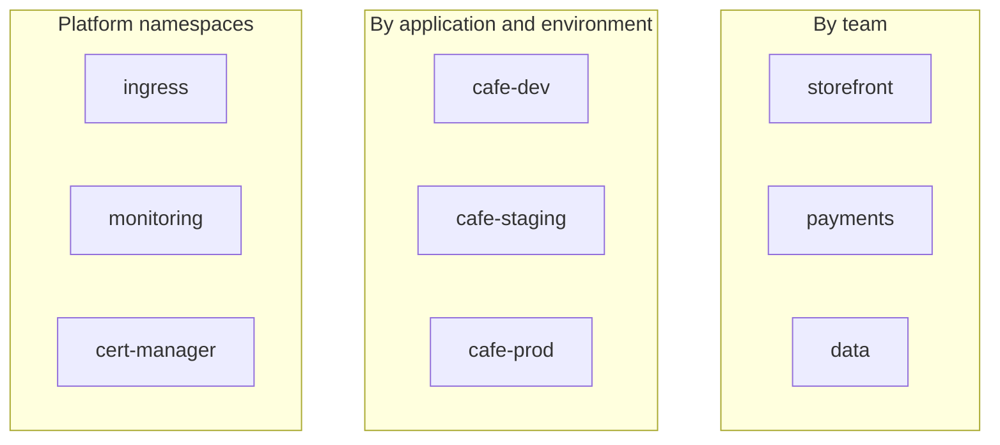

# Namespaces: virtual clusters inside one cluster

## In plain words

A **namespace** is a named area inside a cluster. Objects such as Pods, Deployments and Services are created *in* a namespace, and their names only have to be unique within it. Namespaces let several teams, applications or environments share one cluster without tripping over each other, and they give administrators a place to attach rules: who may do what here, how much may be consumed here, which network traffic is allowed here.

An office building is a fair comparison. One building (the cluster) has shared foundations, lifts and power (the nodes and the control plane). Inside, it is divided into rented floors (namespaces). Two companies can each have a "Meeting Room 1" because the floor makes the full address different. Each floor has its own door-entry list and its own electricity budget. But the walls between floors are thin: by default anyone can walk from one floor to another, and a fire on one floor is still a fire in the same building. Remember that last sentence; it is the limit of what namespaces provide.

Why this matters for a job: every `kubectl` command you run targets a namespace, whether you say so or not. Access rules, quotas and network policies are nearly always written per namespace, so the namespace layout is the shape of a cluster's organisation. "How would you separate teams or environments in Kubernetes?" is a common design question.

> **Before this lesson:** you should be able to use contexts and the `-n` flag from [kubectl and kubeconfig](#/lesson/kubernetes/kubectl-kubeconfig) and know what Pods and labels are from [The Pod as the atomic unit](#/lesson/kubernetes/pod-basics).

## What a namespace does and does not do

It helps to separate four things people expect from namespaces.

| Purpose | Provided by a namespace alone? |
|---|---|
| Separate names: two teams can each have a Deployment called `api` | Yes |
| A scope for access rules (RBAC) | Yes, once you write the rules |
| A scope for quotas and default resource settings | Yes, once you create them |
| A scope for network rules | Yes, once you create NetworkPolicies and the CNI plug-in enforces them |
| Network isolation by default | **No.** Any Pod can reach any Pod in any namespace |
| Protection from a hostile workload | **No.** All namespaces share nodes, the kernel and the control plane |

The technical term for what namespaces offer is **soft multi-tenancy**. A **tenant** is a user or group sharing a system. "Soft" means the separation suits tenants who trust one another, such as teams in one company. Running workloads from mutually distrustful parties needs **hard multi-tenancy**: separate clusters, or strongly sandboxed nodes and runtimes.

> [!WARNING]
> A namespace is an organisational boundary, not a security boundary. Creating a `payments` namespace does not stop a Pod in `marketing` from connecting to the payments database. Isolation requires NetworkPolicies ([covered here](#/lesson/kubernetes/network-policies-auditing)), RBAC ([covered here](#/lesson/kubernetes/rbac-admission)) and Pod Security settings applied to that namespace.

## The namespaces every cluster starts with

```bash
$ kubectl get namespaces
NAME              STATUS   AGE
default           Active   12d
kube-node-lease   Active   12d
kube-public       Active   12d
kube-system       Active   12d
```

- **`default`** is where objects go when you name no namespace. It is convenient for experiments and a poor home for real workloads, since nothing distinguishes one team's objects from another's.
- **`kube-system`** holds the cluster's own components: DNS, kube-proxy, the CNI plug-in and, on self-managed clusters, the control plane. Do not deploy applications here, and be careful changing anything in it.
- **`kube-public`** is readable by everyone, including unauthenticated clients. It holds a small amount of cluster information and is rarely used directly.
- **`kube-node-lease`** holds the Lease objects that kubelets renew as heartbeats, as described in the [worker nodes lesson](#/lesson/kubernetes/worker-nodes).

`kubectl get ns` is the short form.

## Namespaced and cluster-scoped objects

Not everything lives in a namespace. Things that belong to the whole cluster are **cluster-scoped**.

```bash
$ kubectl api-resources --namespaced=true | head -6
NAME                    SHORTNAMES   APIVERSION   NAMESPACED   KIND
configmaps              cm           v1           true         ConfigMap
endpoints               ep           v1           true         Endpoints
events                  ev           v1           true         Event
persistentvolumeclaims  pvc          v1           true         PersistentVolumeClaim
pods                    po           v1           true         Pod

$ kubectl api-resources --namespaced=false | head -6
NAME                    SHORTNAMES   APIVERSION                   NAMESPACED   KIND
namespaces              ns           v1                           false        Namespace
nodes                   no           v1                           false        Node
persistentvolumes       pv           v1                           false        PersistentVolume
clusterroles                         rbac.authorization.k8s.io/v1 false        ClusterRole
storageclasses          sc           storage.k8s.io/v1            false        StorageClass
```

The flag filters the list of resource types by scope. A rule of thumb: things that workloads *use* day to day are namespaced (Pods, Deployments, Services, ConfigMaps, Secrets, PersistentVolumeClaims, Roles). Things that describe the cluster's infrastructure are cluster-scoped (Nodes, PersistentVolumes, StorageClasses, ClusterRoles, CustomResourceDefinitions, and Namespaces themselves).

A consequence: a namespaced object can only refer to certain other objects in the *same* namespace. A Pod can mount only ConfigMaps and Secrets from its own namespace, and use only ServiceAccounts and PersistentVolumeClaims from its own namespace. Network access across namespaces is a different matter and is allowed by default.

## Creating a namespace

Imperatively:

```bash
$ kubectl create namespace cafe
namespace/cafe created
```

Declaratively, which is the form to keep in Git:

```yaml
apiVersion: v1
kind: Namespace
metadata:
  name: cafe
  labels:
    team: storefront
    environment: dev
    pod-security.kubernetes.io/enforce: baseline
```

- `kind: Namespace` in the core `v1` API.
- `name: cafe`. Names must be lowercase letters, digits and hyphens, at most 63 characters, because they become part of DNS names.
- `labels` on a namespace do real work. NetworkPolicies select namespaces by label, and the label `pod-security.kubernetes.io/enforce: baseline` switches on a built-in safety check that rejects Pods asking for dangerous privileges in this namespace. Every namespace also automatically carries the label `kubernetes.io/metadata.name` equal to its name.

Note that a Namespace manifest has no `namespace` field of its own: namespaces are cluster-scoped.

## Putting objects into a namespace

There are three ways, and it matters which one wins.

**1. In the manifest.** Set `metadata.namespace`:

```yaml
apiVersion: apps/v1
kind: Deployment
metadata:
  name: menu-api
  namespace: cafe
spec:
  replicas: 2
  selector:
    matchLabels:
      app: menu-api
  template:
    metadata:
      labels:
        app: menu-api
    spec:
      containers:
        - name: menu-api
          image: ghcr.io/harbour-coffee/menu-api:1.1.0
```

Only the Deployment's own metadata carries the namespace. The Pods created from the template are placed in the same namespace automatically; a template cannot choose a different one.

**2. On the command line.** `kubectl apply -f menu-api.yaml -n cafe`. If the manifest also names a namespace and the two differ, `kubectl` refuses with an error instead of guessing.

**3. From the context.** If neither of the above is given, the namespace recorded in your current kubeconfig context is used, and if that is empty, `default`.

Teams differ on which to prefer. Writing the namespace in the manifest makes each file say exactly where it goes. Leaving it out lets the same file be applied to `cafe-dev` and `cafe-prod` by changing only the `-n` flag, which is what tools such as Kustomize and Helm automate.

```bash
$ kubectl apply -f menu-api.yaml
deployment.apps/menu-api created

$ kubectl get deploy
No resources found in default namespace.

$ kubectl get deploy -n cafe
NAME       READY   UP-TO-DATE   AVAILABLE   AGE
menu-api   2/2     2            2           20s

$ kubectl get deploy -A
NAMESPACE     NAME       READY   UP-TO-DATE   AVAILABLE   AGE
cafe          menu-api   2/2     2            2           25s
kube-system   coredns    2/2     2            2           12d
```

The middle command is the mistake everyone makes once: the Deployment exists, but the question was asked of the wrong namespace. `-A` searches all namespaces.

## Names, DNS and reaching across namespaces

Within a namespace, a Service is reached by its short name. From another namespace you add the namespace to the name. The cluster's DNS gives every Service a full name of this form:

```
<service>.<namespace>.svc.cluster.local
```

So if `orders-api` in namespace `cafe` needs the `ledger` Service in namespace `finance`:

```bash
$ kubectl exec -n cafe deploy/orders-api -- wget -qO- http://ledger/healthz
wget: bad address 'ledger'

$ kubectl exec -n cafe deploy/orders-api -- wget -qO- http://ledger.finance/healthz
ok

$ kubectl exec -n cafe deploy/orders-api -- wget -qO- http://ledger.finance.svc.cluster.local/healthz
ok
```

The short name fails because there is no `ledger` in `cafe`. Adding `.finance` works, and so does the complete name. The call succeeds because nothing blocks traffic between namespaces by default.

The small resolver below mimics how a Pod's DNS settings expand a name. Each Pod has a **search list**: suffixes that are tried in order when a name is not complete.

```python-run
services = {("cafe", "menu-api"), ("cafe", "orders-api"), ("finance", "ledger"), ("default", "kubernetes")}

def resolve(name, pod_namespace, cluster_domain="cluster.local"):
    search = [f"{pod_namespace}.svc.{cluster_domain}", f"svc.{cluster_domain}", cluster_domain]
    candidates = [name + "." + suffix for suffix in search] + [name]
    for fqdn in candidates:
        parts = fqdn.split(".")
        if len(parts) == 5 and parts[2:] == ["svc"] + cluster_domain.split("."):
            if (parts[1], parts[0]) in services:
                return f"{name!r:44} from {pod_namespace:8} -> {fqdn}"
    return f"{name!r:44} from {pod_namespace:8} -> NXDOMAIN (no such name)"

print(resolve("menu-api", "cafe"))
print(resolve("ledger", "cafe"))
print(resolve("ledger.finance", "cafe"))
print(resolve("ledger.finance.svc.cluster.local", "cafe"))
print(resolve("menu-api", "finance"))
print(resolve("menu-api.cafe", "finance"))
```

Follow `ledger.finance` from a Pod in `cafe`: the first candidate, `ledger.finance.cafe.svc.cluster.local`, does not exist; the second, `ledger.finance.svc.cluster.local`, does. This is why `service.namespace` is enough in practice. The [service discovery module](#/lesson/kubernetes/service-registration-dns) goes deeper.

## Common layouts

How should a cluster be divided? Three patterns are common.



- **By team**: each team owns one or more namespaces and has edit rights only there.
- **By application and environment**: `cafe-dev`, `cafe-staging`, `cafe-prod`. Simple, and it allows the same manifests in each.
- **Platform namespaces**: shared infrastructure such as the ingress controller and monitoring, managed by the platform team.

Many organisations go further and put production in a **separate cluster** from development. The reasons are the limits listed earlier: all namespaces share one control plane, one Kubernetes version, one set of cluster-scoped objects, and the same nodes. A bad upgrade, a broken admission webhook or a node-level exploit affects every namespace at once. A reasonable default is: separate clusters for production and non-production, and namespaces within each for teams and applications.

## Deleting a namespace

Deleting a namespace deletes **everything inside it**: Deployments, Pods, Services, ConfigMaps, Secrets and PersistentVolumeClaims.

```bash
$ kubectl delete namespace cafe-dev
namespace "cafe-dev" deleted

$ kubectl get ns cafe-dev
NAME       STATUS        AGE
cafe-dev   Terminating   3d
```

The namespace controller works through the contents; meanwhile the status is `Terminating`. If it stays that way, some object inside has a finalizer that is not being cleared, as explained in the [declarative model lesson](#/lesson/kubernetes/declarative-reconciliation). Find the leftovers with:

```bash
$ kubectl api-resources --verbs=list --namespaced -o name \
    | xargs -n 1 kubectl get -n cafe-dev --ignore-not-found --show-kind
```

This lists every namespaced resource type and asks for objects of each type in the namespace, so whatever remains is printed.

This is also a tidy way to clean up after practice: create a throwaway namespace, work in it, then delete it and everything goes at once.

> [!TIP]
> Set your working namespace once per session instead of typing `-n` on every command: `kubectl config set-context --current --namespace=cafe`. Check it with `kubectl config view --minify -o jsonpath='{..namespace}'`. For production, prefer typing `-n` explicitly anyway.

> [!INTERVIEW]
> **"What are namespaces for, and are they a security boundary?"** Namespaces partition a cluster into named scopes. They provide name uniqueness per scope and are the unit to which RBAC, ResourceQuotas, LimitRanges, NetworkPolicies and Pod Security admission are applied. By themselves they isolate nothing: Pods in different namespaces can talk to each other, and all namespaces share nodes and the control plane. They give soft multi-tenancy for trusted teams. For untrusted tenants or strict production isolation, use separate clusters, or add strong controls: default-deny NetworkPolicies, least-privilege RBAC, restricted Pod Security, dedicated nodes or sandboxed runtimes. Also mention that some objects (Nodes, PersistentVolumes, StorageClasses, ClusterRoles) are cluster-scoped.

## Common pitfalls

- **Working in `default`.** Objects from every experiment pile up together with no owner.
- **Assuming isolation.** Without NetworkPolicies, everything can reach everything.
- **Looking in the wrong namespace.** "No resources found" is usually a missing `-n`.
- **Referencing a Secret or ConfigMap from another namespace.** A Pod cannot mount them across namespaces; copy or synchronise the object.
- **Deleting a namespace to remove one thing.** Everything in it goes, including claims on persistent data.
- **Forgetting the namespace in cross-namespace DNS names.** Use `service.namespace`.
- **Using namespaces for versions of the same app** (`cafe-v1`, `cafe-v2`). Labels and Deployments handle versions better.

## Cheat sheet

| Task | Command |
|---|---|
| List namespaces | `kubectl get ns` |
| Create | `kubectl create ns NAME` or apply a Namespace manifest |
| Use for one command | `kubectl ... -n NAME` |
| Use for the session | `kubectl config set-context --current --namespace=NAME` |
| All namespaces | `kubectl get pods -A` |
| Which types are namespaced | `kubectl api-resources --namespaced=true` |
| Delete with contents | `kubectl delete ns NAME` |
| Cross-namespace Service name | `SERVICE.NAMESPACE` or `SERVICE.NAMESPACE.svc.cluster.local` |

| Built-in namespace | Holds |
|---|---|
| `default` | Objects created with no namespace specified |
| `kube-system` | Cluster components |
| `kube-public` | Publicly readable cluster information |
| `kube-node-lease` | Node heartbeat Leases |

## Summary

Namespaces divide one cluster into named scopes. They make names unique per scope and are where access control, quotas, default resource settings, network rules and Pod security levels are attached. Most workload objects are namespaced; infrastructure objects such as Nodes and PersistentVolumes are cluster-scoped. Services are reachable across namespaces by adding the namespace to the DNS name, and nothing blocks that traffic unless you add policies. Namespaces provide soft multi-tenancy for teams that trust each other; stronger separation needs additional controls or separate clusters. The next lesson shows how to make a namespace a fair share of the cluster with ResourceQuotas and LimitRanges.

## Glossary

- **Namespace**: a named scope for objects within a cluster.
- **Namespaced / cluster-scoped**: whether a resource type lives inside a namespace or belongs to the whole cluster.
- **Tenant**: a user or group sharing the cluster.
- **Soft multi-tenancy**: separation suitable for tenants that trust each other.
- **Hard multi-tenancy**: separation strong enough for tenants that do not.
- **default / kube-system / kube-public / kube-node-lease**: the built-in namespaces.
- **Fully qualified domain name (FQDN)**: a complete DNS name, such as `ledger.finance.svc.cluster.local`.
- **Search list**: DNS suffixes tried in turn when a short name is looked up.
- **Terminating**: the state of a namespace or object whose deletion is in progress.

```quiz
[
  {"q": "A Pod in namespace marketing tries to open a connection to a database Pod in namespace payments. No NetworkPolicies exist. What happens?",
   "options": ["The connection is blocked because namespaces isolate network traffic", "The connection succeeds, because Pods can reach each other across namespaces by default", "The API server rejects the request", "It works only if both namespaces have the same labels"],
   "answer": 1,
   "explain": "Namespaces do not restrict network traffic. Isolation requires NetworkPolicies enforced by the CNI plug-in."},
  {"q": "You apply a Deployment whose manifest has no namespace field, with no -n flag. Your context has namespace: cafe. Where is it created?",
   "options": ["default", "cafe", "kube-system", "It is rejected"],
   "answer": 1,
   "explain": "Without a namespace in the manifest or on the command line, kubectl uses the namespace from the current context, falling back to default only if none is set."},
  {"q": "Which of these is cluster-scoped, not namespaced?",
   "options": ["ConfigMap", "Service", "PersistentVolume", "Deployment"],
   "answer": 2,
   "explain": "PersistentVolumes describe cluster storage and are cluster-scoped. PersistentVolumeClaims, which request them, are namespaced."},
  {"q": "From a Pod in namespace cafe, which name reaches the Service ledger in namespace finance?",
   "options": ["ledger", "finance.ledger", "ledger.finance", "ledger-finance"],
   "answer": 2,
   "explain": "The DNS form is service.namespace (optionally followed by .svc.cluster.local). The short name alone resolves only within the same namespace."},
  {"q": "You run kubectl delete namespace cafe-staging. What happens to the Deployments, Services and Secrets inside?",
   "options": ["They move to the default namespace", "They are all deleted", "They keep running without a namespace", "Only Pods are deleted"],
   "answer": 1,
   "explain": "Deleting a namespace removes every namespaced object in it. The namespace shows Terminating until that is complete."},
  {"q": "A Pod in namespace cafe references a Secret that exists only in namespace shared. Why is this Pod not running?",
   "options": ["Secrets cannot be used by Pods", "A Pod can only reference Secrets in its own namespace, so the Secret is not found", "The Secret is too large", "The scheduler has no nodes"],
   "answer": 1,
   "explain": "Secret and ConfigMap references are resolved in the Pod's namespace. The container stays in CreateContainerConfigError until a Secret with that name exists there."},
  {"q": "Why do many organisations use a separate cluster for production instead of a prod namespace?",
   "options": ["Namespaces cannot hold more than 100 Pods", "All namespaces share the control plane, version, cluster-scoped objects and nodes, so one failure or exploit can affect them all", "DNS does not work across namespaces", "kubectl cannot switch namespaces"],
   "answer": 1,
   "explain": "Namespaces give soft multi-tenancy. A separate cluster removes the shared control plane and nodes from the blast radius."}
]
```

> **Source:** Poulton, *The Kubernetes Book*, ch. 5 (topic coverage only). Official docs: https://kubernetes.io/docs/concepts/overview/working-with-objects/namespaces/ , https://kubernetes.io/docs/concepts/security/multi-tenancy/ , https://kubernetes.io/docs/concepts/services-networking/dns-pod-service/
