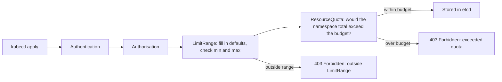

# ResourceQuotas and LimitRanges

## In plain words

When several teams share one cluster, somebody will eventually deploy something greedy: a hundred replicas by accident, or a container with no memory limit and a leak. Without rules, that one mistake uses up the nodes and every other team's Pods stop scheduling. Kubernetes gives administrators two objects, both attached to a namespace, to prevent this.

A **ResourceQuota** is a budget for the whole namespace: "everything in here, added together, may reserve at most 8 CPU cores and 16 GiB of memory, and may contain at most 30 Pods". A **LimitRange** is a set of rules for each individual Pod or container: "if you do not say how much you need, you get this default; nobody may ask for more than this or less than that".

Think of a shared office kitchen with a monthly grocery budget per team. The budget (ResourceQuota) caps what a team can take in total. Separately there is a per-person rule (LimitRange): one portion by default, and no single person may take more than three. The two rules solve different problems. The budget stops one team emptying the fridge. The per-person rule stops one person using the whole team's budget, and it gives a sensible portion to people who forget to ask.

Why this matters for a job: on any shared cluster you will meet these as error messages before you meet them as concepts. `exceeded quota` and `must specify limits.memory` are common first-week obstacles. On the platform side, setting them is one of the first tasks when onboarding a team.

> **Before this lesson:** read [Namespaces](#/lesson/kubernetes/namespaces) and the requests and limits section of [Lifecycle, probes, requests and limits](#/lesson/kubernetes/pod-lifecycle-resources). You need to know what a CPU request and a memory limit are.

## Where these rules are enforced

Both objects are enforced at **admission**: the stage inside the API server, after authentication and authorisation, where a request to create or change an object can be modified or rejected before it is stored.



Two things follow from enforcement at admission:

1. **They affect new and changed objects only.** Creating a quota does not stop or shrink Pods that already exist, even if those Pods already exceed it. It only blocks further creation.
2. **The order matters.** LimitRange defaults are applied first, so by the time the quota is checked, a Pod that said nothing about resources already has numbers.

## ResourceQuota

Here is a quota for the `cafe` namespace:

```yaml
apiVersion: v1
kind: ResourceQuota
metadata:
  name: cafe-budget
  namespace: cafe
spec:
  hard:
    requests.cpu: "4"
    requests.memory: 8Gi
    limits.cpu: "8"
    limits.memory: 16Gi
    pods: "20"
    services: "10"
    services.loadbalancers: "1"
    persistentvolumeclaims: "5"
    requests.storage: 50Gi
    configmaps: "30"
    secrets: "30"
```

- `kind: ResourceQuota`, in the core `v1` API, placed in namespace `cafe`.
- `spec.hard` is a map of resource name to the maximum allowed. "Hard" means the value is a firm cap.
- `requests.cpu: "4"` — the CPU requests of all Pods in the namespace, added together, may not exceed 4 cores. The quotes make YAML treat the value as text, which the API expects for quantities.
- `requests.memory: 8Gi` — the same for memory requests.
- `limits.cpu` and `limits.memory` — caps on the sum of limits.
- `pods: "20"` — at most 20 Pods that are not in a finished state.
- `services`, `services.loadbalancers` — at most 10 Services, of which at most 1 may be of type LoadBalancer, which matters because cloud load balancers cost money.
- `persistentvolumeclaims` and `requests.storage` — at most 5 storage claims, totalling at most 50 GiB.
- `configmaps`, `secrets` — object count caps.

Quotas fall into three families: **compute** (CPU, memory, and extended resources such as GPUs), **storage** (claims and their total size, optionally per storage class) and **object counts** (how many objects of a type). The general form for counting any type is `count/<resource>.<group>`, for example `count/deployments.apps: "15"`.

Apply it and inspect usage:

```bash
$ kubectl apply -f cafe-budget.yaml
resourcequota/cafe-budget created

$ kubectl describe resourcequota cafe-budget -n cafe
Name:                   cafe-budget
Namespace:              cafe
Resource                Used    Hard
--------                ----    ----
configmaps              3       30
limits.cpu              2500m   8
limits.memory           3072Mi  16Gi
persistentvolumeclaims  1       5
pods                    7       20
requests.cpu            1750m   4
requests.memory         2304Mi  8Gi
requests.storage        10Gi    50Gi
secrets                 4       30
services                3       10
services.loadbalancers  0       1
```

`describe` prints a table of current usage against each cap. The `Used` column is kept up to date by a controller. This table is the first place to look when a deployment is refused.

### An important side effect

Once a namespace has a quota on `requests.cpu`, `requests.memory`, `limits.cpu` or `limits.memory`, **every new Pod must state that value**. The API server cannot count a Pod against a budget if the Pod does not say how much it takes, so it rejects it:

```bash
$ kubectl run scratch --image=busybox:1.37 -n cafe -- sleep 3600
Error from server (Forbidden): pods "scratch" is forbidden: failed quota: cafe-budget:
must specify limits.cpu for: scratch; limits.memory for: scratch; requests.cpu for: scratch; requests.memory for: scratch
```

`kubectl run` creates a single bare Pod; everything after `--` is the command for the container. The error names the quota and the missing fields. This is where LimitRange earns its place: it can supply those values automatically.

### Where quota failures show up

When you create a bare Pod, a quota rejection is immediate and visible, as above. When a Deployment creates Pods, it is quieter, because the Deployment object itself is accepted; the failure happens later when its ReplicaSet tries to create Pods.

```bash
$ kubectl scale deployment orders-api --replicas=12 -n cafe
deployment.apps/orders-api scaled

$ kubectl get deployment orders-api -n cafe
NAME         READY   UP-TO-DATE   AVAILABLE   AGE
orders-api   6/12    6            6           3d

$ kubectl describe replicaset -n cafe -l app=orders-api | tail -3
Events:
  Type     Reason        Age   From                   Message
  Warning  FailedCreate  20s   replicaset-controller  Error creating: pods "orders-api-75b8c9d6f4-x2x9p" is forbidden: exceeded quota: cafe-budget, requested: requests.cpu=500m, used: requests.cpu=3750m, limited: requests.cpu=4
```

The scale command succeeds. The Deployment then sits at 6 of 12 with no Pods in `Pending`: the missing six were never created. The explanation is in the **ReplicaSet's** events, not the Deployment's and not any Pod's. The message gives the arithmetic: the new Pod requested 500m, 3750m was already used, and the cap is 4 cores, so 4250m would exceed it.

> [!TIP]
> If a Deployment has fewer Pods than replicas and there are no Pending Pods to describe, check the ReplicaSet events (`kubectl describe rs -l app=NAME`) and the namespace events (`kubectl get events -n NS --sort-by=.lastTimestamp`). A quota or admission rejection leaves no Pod behind to inspect.

## LimitRange

A LimitRange sets per-object rules in a namespace.

```yaml
apiVersion: v1
kind: LimitRange
metadata:
  name: cafe-container-rules
  namespace: cafe
spec:
  limits:
    - type: Container
      defaultRequest:
        cpu: 100m
        memory: 128Mi
      default:
        cpu: 500m
        memory: 256Mi
      min:
        cpu: 50m
        memory: 64Mi
      max:
        cpu: "2"
        memory: 2Gi
      maxLimitRequestRatio:
        cpu: "4"
    - type: PersistentVolumeClaim
      min:
        storage: 1Gi
      max:
        storage: 20Gi
```

- `spec.limits` is a list of rule sets, each for a `type`: `Container`, `Pod` or `PersistentVolumeClaim`.
- `defaultRequest` is the request given to a container that does not state one: 100m CPU and 128 MiB.
- `default` is the **limit** given to a container that does not state one: 500m CPU and 256 MiB. The field name is easy to misread; `default` means default limit.
- `min` and `max` bound what any container may ask for. A container requesting 10m CPU, or a limit of 4 cores, is rejected.
- `maxLimitRequestRatio: cpu: "4"` says a container's CPU limit may be at most 4 times its CPU request, which restrains overcommitment.
- The second item bounds the size of each storage claim to between 1 and 20 GiB.

With this in place, the earlier `kubectl run scratch` succeeds, because admission fills in the four missing values before the quota check. You can see what was injected:

```bash
$ kubectl run scratch --image=busybox:1.37 -n cafe -- sleep 3600
pod/scratch created

$ kubectl get pod scratch -n cafe -o jsonpath='{.spec.containers[0].resources}{"\n"}'
{"limits":{"cpu":"500m","memory":"256Mi"},"requests":{"cpu":"100m","memory":"128Mi"}}

$ kubectl get pod scratch -n cafe -o jsonpath='{.metadata.annotations}{"\n"}'
{"kubernetes.io/limit-ranger":"LimitRanger plugin set: cpu, memory request for container scratch; cpu, memory limit for container scratch"}
```

The stored Pod has resources even though the command gave none, and an annotation records that the LimitRanger admission plug-in added them.

> [!WARNING]
> LimitRange defaults are a safety net, not a sizing strategy. A default of 256 MiB applied to a program that needs 1 GiB produces an `OOMKilled` loop that looks mysterious, because the limit appears nowhere in the team's manifest. Always set explicit requests and limits in your own manifests, and look at the live Pod (`kubectl get pod -o yaml`) when a value surprises you.

## How the two work together, simulated

The model below runs the admission sequence for a namespace with both objects. It applies LimitRange defaults, checks the range, then checks the quota. Change the requests and press Run.

```python-run
limit_range = {
    "default_request": {"cpu": 100, "memory": 128},
    "default_limit":   {"cpu": 500, "memory": 256},
    "min":             {"cpu": 50,  "memory": 64},
    "max":             {"cpu": 2000, "memory": 2048},
}
quota_hard = {"requests.cpu": 1000, "requests.memory": 1024, "pods": 4}
used = {"requests.cpu": 0, "requests.memory": 0, "pods": 0}

def admit(name, requests=None, limits=None):
    requests = dict(requests or {}); limits = dict(limits or {})
    for res in ("cpu", "memory"):
        # a limit with no request: the request is set equal to the limit
        if res not in requests and res in limits:
            requests[res] = limits[res]
        requests.setdefault(res, limit_range["default_request"][res])
        limits.setdefault(res, limit_range["default_limit"][res])
    for res in ("cpu", "memory"):
        if requests[res] < limit_range["min"][res]:
            return f"{name:10} REJECTED by LimitRange: {res} request {requests[res]} below min {limit_range['min'][res]}"
        if limits[res] > limit_range["max"][res]:
            return f"{name:10} REJECTED by LimitRange: {res} limit {limits[res]} above max {limit_range['max'][res]}"
        if requests[res] > limits[res]:
            return f"{name:10} REJECTED: {res} request {requests[res]} is greater than limit {limits[res]}"
    want = {"requests.cpu": requests["cpu"], "requests.memory": requests["memory"], "pods": 1}
    for key, amount in want.items():
        if used[key] + amount > quota_hard[key]:
            return (f"{name:10} REJECTED by quota: requested {key}={amount}, "
                    f"used {used[key]}, limited {quota_hard[key]}")
    for key, amount in want.items():
        used[key] += amount
    return f"{name:10} admitted with requests={requests} limits={limits}; used now {used}"

print(admit("web-1", {"cpu": 250, "memory": 256}, {"cpu": 500, "memory": 256}))
print(admit("scratch"))                                   # nothing specified
print(admit("tiny", {"cpu": 10}))                         # below min
print(admit("huge", {"cpu": 500}, {"cpu": 4000}))         # above max
print(admit("api-1", {"cpu": 500, "memory": 512}))        # defaults fill the limits
print(admit("api-2", {"cpu": 500, "memory": 512}, {"cpu": 600, "memory": 512}))
print(admit("limit-only", limits={"cpu": 150, "memory": 100}))
```

Read the last three lines carefully. `api-1` sets a memory request of 512 with no limit; the default limit of 256 is filled in, and since a request may not exceed its limit, the Pod is rejected. This catches people out on real clusters: a default limit lower than an explicit request is an error. `api-2` states both and is checked against the quota, where CPU requests of 250 + 100 + 500 = 850 are within 1000 and it is admitted. `limit-only` has limits but no requests, so requests are copied from limits, and then the quota arithmetic decides.

## Scopes and priority classes

A quota can be restricted to a subset of Pods with **scopes**. Useful ones:

| Scope | Counts only |
|---|---|
| `BestEffort` | Pods with no requests or limits at all |
| `NotBestEffort` | Pods with at least one request or limit |
| `Terminating` | Pods with `activeDeadlineSeconds` set, such as time-boxed Jobs |
| `NotTerminating` | Long-running Pods |
| `PriorityClass` (via `scopeSelector`) | Pods of the named priority classes |

For example, to forbid BestEffort Pods entirely in a namespace:

```yaml
apiVersion: v1
kind: ResourceQuota
metadata:
  name: no-best-effort
  namespace: cafe
spec:
  hard:
    pods: "0"
  scopes:
    - BestEffort
```

The quota counts only BestEffort Pods and allows zero of them. Pods with requests are unaffected. A namespace may hold several ResourceQuota objects; a Pod must satisfy all of them.

## Designing quotas sensibly

- **Quota requests, not only limits.** Requests are what reserve node capacity, so the sum of all namespaces' request quotas, compared with cluster capacity, tells you how overcommitted the cluster is.
- **Leave headroom for rollouts.** A rolling update temporarily runs extra Pods. A namespace at exactly 100% of its Pod or CPU quota cannot deploy. Size quotas for peak replicas plus the surge.
- **Pair every compute quota with a LimitRange** so that Pods without explicit values are not rejected outright.
- **Count the expensive objects.** LoadBalancer Services and storage are where surprise cloud bills come from.
- **Review usage regularly.** A team at 95% needs a conversation before their next release fails.

> [!INTERVIEW]
> **"How do you stop one team from consuming a whole shared cluster?"** Give each team a namespace and attach a ResourceQuota that caps the sum of CPU and memory requests and limits, the number of Pods, and costly objects such as LoadBalancer Services and storage. Add a LimitRange that supplies default requests and limits and enforces per-container minimums and maximums, because a compute quota makes those fields mandatory. Both are enforced at admission, so they apply to new Pods, and failures for Deployment-managed Pods surface as `FailedCreate` events on the ReplicaSet. Mention the difference in a sentence: quota is an aggregate budget for the namespace; LimitRange is a per-object constraint and defaulter.

## Common pitfalls

- **Quota without LimitRange.** Every Pod lacking resource fields is rejected with "must specify".
- **Looking for Pending Pods that do not exist.** Quota failures prevent creation; check ReplicaSet events.
- **Default limit below a workload's explicit request.** The Pod is invalid.
- **Expecting a new quota to reduce current usage.** It only blocks further creation.
- **No surge headroom.** Rollouts stall half-way.
- **Confusing `default` with `defaultRequest`.** `default` is the default *limit*.
- **Forgetting init containers and sidecars.** Their resources count towards the quota too.

## Cheat sheet

| | ResourceQuota | LimitRange |
|---|---|---|
| Applies to | The namespace as a whole | Each Pod, container or claim |
| Does | Caps totals and object counts | Sets defaults, min, max, ratio |
| Enforced | At admission | At admission, before quota |
| Typical error | `exceeded quota: ...` | `maximum cpu usage per Container is ...` |
| Inspect | `kubectl describe quota -n NS` | `kubectl describe limitrange -n NS` |

| Quota key | Caps |
|---|---|
| `requests.cpu`, `requests.memory` | Sum of requests |
| `limits.cpu`, `limits.memory` | Sum of limits |
| `pods` | Non-terminal Pods |
| `requests.storage`, `persistentvolumeclaims` | Storage size and claim count |
| `services.loadbalancers`, `services.nodeports` | Services of those types |
| `count/<resource>.<group>` | Any object type |

## Summary

ResourceQuota and LimitRange make a namespace a bounded share of the cluster. A ResourceQuota caps the totals: the sum of requests and limits, the number of Pods and other objects, and storage. A LimitRange governs individual containers and claims: it injects default requests and limits and rejects values outside a minimum and maximum. Both act at admission, LimitRange first, and neither touches objects that already exist. A compute quota makes resource fields compulsory, which is why the two are deployed together. Failures for Pods created by controllers appear as events on the ReplicaSet, not as Pending Pods. With clusters organised and bounded, the next module turns to the object you will use most: the Deployment.

## Glossary

- **ResourceQuota**: a namespace-wide cap on resource totals and object counts.
- **LimitRange**: per-object defaults and bounds for resources in a namespace.
- **Admission**: the API server stage where requests can be modified or rejected before storage.
- **hard**: the map of firm caps in a ResourceQuota.
- **Compute / storage / object-count quota**: caps on CPU and memory, on storage, and on numbers of objects.
- **defaultRequest / default**: the request, and the limit, injected when a container omits them.
- **min / max**: the bounds a container's values must fall within.
- **maxLimitRequestRatio**: the largest allowed ratio of limit to request.
- **Scope**: a filter restricting a quota to certain Pods.
- **FailedCreate**: the ReplicaSet event recorded when a Pod cannot be created.
- **Headroom**: spare quota kept for rollouts and bursts.

```quiz
[
  {"q": "A namespace has a ResourceQuota on requests.memory but no LimitRange. You create a Pod with no resources section. What happens?",
   "options": ["The Pod is created as BestEffort", "The Pod is rejected: it must specify requests.memory", "The Pod is created and counted as zero", "The quota is deleted"],
   "answer": 1,
   "explain": "A compute quota cannot account for a Pod with no stated request, so admission rejects it. A LimitRange with defaults avoids this."},
  {"q": "You scale a Deployment from 4 to 10 replicas. It stays at 6/10 and there are no Pending Pods. Where is the explanation most likely to be found?",
   "options": ["In the logs of one of the running Pods", "In the events of the Deployment's ReplicaSet", "In the node's kubelet logs", "In the kubeconfig file"],
   "answer": 1,
   "explain": "When quota blocks Pod creation, no Pod object exists. The ReplicaSet controller records FailedCreate events with the quota message."},
  {"q": "A ResourceQuota of pods: 10 is created in a namespace that already runs 14 Pods. What happens next?",
   "options": ["Four Pods are deleted immediately", "Existing Pods stay; new Pods are rejected until the count is below 10", "The quota creation fails", "All Pods are restarted"],
   "answer": 1,
   "explain": "Quotas are enforced at admission of new objects. Existing objects are not removed, but nothing new is admitted while usage is at or above the cap."},
  {"q": "In a LimitRange, what does the field named default set?",
   "options": ["The default request", "The default limit", "The default namespace", "The default number of replicas"],
   "answer": 1,
   "explain": "default is the limit applied when a container omits one. defaultRequest is the request applied when omitted."},
  {"q": "A LimitRange sets a default memory limit of 256Mi. A container specifies only requests.memory: 512Mi. What is the result?",
   "options": ["Admitted with limit 512Mi", "Admitted with limit 256Mi and request 512Mi", "Rejected, because the request would exceed the injected limit", "Admitted with no limit"],
   "answer": 2,
   "explain": "The missing limit is filled with 256Mi, and a request greater than its limit is invalid. Specify the limit explicitly."},
  {"q": "A namespace is at 100% of its requests.cpu quota. A rolling update is started with maxSurge 1 and maxUnavailable 0. What happens?",
   "options": ["It completes normally", "It stalls, because the extra surge Pod cannot be created", "The quota is raised automatically", "Old Pods are deleted first to make room"],
   "answer": 1,
   "explain": "With maxUnavailable 0 the update must create a new Pod before removing an old one, and the quota blocks that creation. Leave headroom for surge."},
  {"q": "Which statement distinguishes the two objects correctly?",
   "options": ["ResourceQuota limits each container; LimitRange limits the namespace total", "ResourceQuota caps namespace totals; LimitRange sets per-container defaults and bounds", "Both do the same thing at different API versions", "LimitRange applies to nodes; ResourceQuota applies to Pods"],
   "answer": 1,
   "explain": "Quota is an aggregate budget. LimitRange is a per-object defaulter and validator."}
]
```

> **Source:** Poulton, *The Kubernetes Book*, ch. 5 (topic coverage only; the book's chapter introduces namespaces, and this lesson extends it with the official material). Official docs: https://kubernetes.io/docs/concepts/policy/resource-quotas/ , https://kubernetes.io/docs/concepts/policy/limit-range/ , https://kubernetes.io/docs/tasks/administer-cluster/manage-resources/
