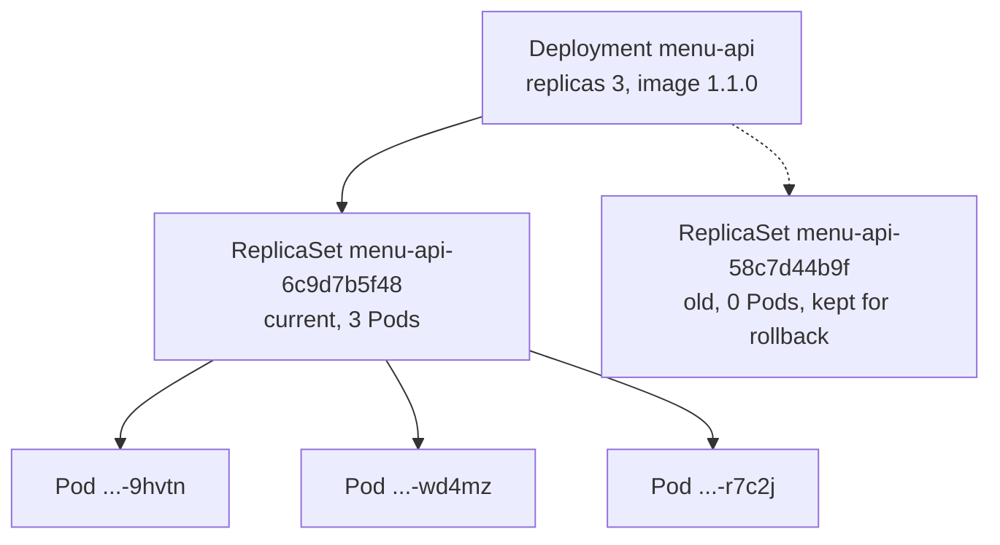

# Deployments, ReplicaSets, self-healing and scaling

## In plain words

A **Deployment** is the object you use to run a stateless application on Kubernetes. You tell it which container image to run and how many copies you want. It makes sure that many copies exist, replaces any that die, lets you change the number, and manages the move from one version of your program to the next.

A Deployment does not create Pods itself. It delegates to a simpler object called a **ReplicaSet**, whose only job is "keep exactly N Pods matching this template alive". The Deployment sits above, creating a new ReplicaSet for each version of your program and shifting Pods from the old one to the new one during an update.

Think of a coffee shop chain. Head office (the Deployment) decides: "we sell menu version 5, and we want four baristas on shift". For each menu version there is a shift supervisor (a ReplicaSet) holding a rota for that menu. The supervisor's whole job is to keep the right number of baristas (Pods) on the floor; if one goes home ill, the supervisor calls in another. When head office introduces menu version 6, it appoints a new supervisor for the new menu, who gradually brings in trained baristas while the old supervisor sends theirs home. The old supervisor stays on the payroll with an empty rota, in case the new menu flops and head office wants to switch back.

Why this matters for a job: the Deployment is the most used workload object in Kubernetes. Almost every service you ship will be one. Reading its status, scaling it and understanding how it relates to ReplicaSets and Pods is daily work, and "Deployment versus ReplicaSet versus Pod" is among the most frequent interview questions.

> **Before this lesson:** you need Pods ([The Pod as the atomic unit](#/lesson/kubernetes/pod-basics)), labels, selectors and owner references ([The declarative model](#/lesson/kubernetes/declarative-reconciliation)), and readiness probes ([Lifecycle, probes, requests and limits](#/lesson/kubernetes/pod-lifecycle-resources)).

## What "stateless" means

A **stateless** application keeps no data of its own that must survive a restart. Every copy is interchangeable: any replica can handle any request, and replacing a replica loses nothing. Web servers and API services that store their data in a separate database are stateless. The database itself is **stateful**: each instance holds data that matters, so instances are not interchangeable.

Deployments are designed for stateless workloads. They create Pods with random name suffixes, start and stop them in any order, and treat them as identical. Stateful workloads use StatefulSets, covered in [their own module](#/lesson/kubernetes/statefulset-theory).

## Three layers



| Layer | Adds | You manage it directly? |
|---|---|---|
| Pod | Runs containers | Rarely |
| ReplicaSet | Keeps N identical Pods alive; scaling | Almost never |
| Deployment | Versions, rolling updates, rollbacks, pause and resume | Yes |

The division of labour is strict. Self-healing and scaling are the ReplicaSet controller's work. Version changes are the Deployment controller's work. You create and edit only the Deployment; the lower objects are produced for you.

## A Deployment manifest, line by line

```yaml
apiVersion: apps/v1
kind: Deployment
metadata:
  name: menu-api
  namespace: cafe
  labels:
    app: menu-api
spec:
  replicas: 3
  revisionHistoryLimit: 5
  selector:
    matchLabels:
      app: menu-api
  template:
    metadata:
      labels:
        app: menu-api
        tier: backend
    spec:
      containers:
        - name: menu-api
          image: ghcr.io/harbour-coffee/menu-api:1.1.0
          ports:
            - name: http
              containerPort: 8080
          readinessProbe:
            httpGet:
              path: /ready
              port: http
            periodSeconds: 5
          resources:
            requests:
              cpu: 100m
              memory: 128Mi
            limits:
              memory: 128Mi
```

- `apiVersion: apps/v1`, `kind: Deployment` — Deployments are in the `apps` API group.
- `metadata` — the Deployment's own name, namespace and labels. These labels describe the Deployment object; they are not what selects Pods.
- `spec.replicas: 3` — the desired number of Pods. If omitted, the default is 1.
- `spec.revisionHistoryLimit: 5` — how many old ReplicaSets to keep for rollback. The default is 10.
- `spec.selector.matchLabels` — the label query identifying Pods that belong to this Deployment. **It is immutable**: you cannot change it after creation.
- `spec.template` — the Pod template. Everything under it is a Pod definition without a name.
  - `template.metadata.labels` — the labels each Pod receives. They **must** satisfy the selector, or the API server rejects the Deployment. Extra labels such as `tier` are fine.
  - `template.spec` — an ordinary Pod spec: one container with a readiness probe and resources.

Apply and look at all three layers:

```bash
$ kubectl apply -f menu-api.yaml
deployment.apps/menu-api created

$ kubectl get deploy,rs,pods -n cafe -l app=menu-api
NAME                       READY   UP-TO-DATE   AVAILABLE   AGE
deployment.apps/menu-api   3/3     3            3           30s

NAME                                  DESIRED   CURRENT   READY   AGE
replicaset.apps/menu-api-6c9d7b5f48   3         3         3       30s

NAME                            READY   STATUS    RESTARTS   AGE
pod/menu-api-6c9d7b5f48-9hvtn   1/1     Running   0          30s
pod/menu-api-6c9d7b5f48-r7c2j   1/1     Running   0          30s
pod/menu-api-6c9d7b5f48-wd4mz   1/1     Running   0          30s
```

The names reveal the structure. The ReplicaSet is named after the Deployment plus a hash, `6c9d7b5f48`. Each Pod is named after its ReplicaSet plus five random characters.

The Deployment's columns mean:

| Column | Meaning |
|---|---|
| `READY 3/3` | Ready Pods out of desired |
| `UP-TO-DATE` | Pods running the current template |
| `AVAILABLE` | Pods that have been ready for at least `minReadySeconds` (default 0) |

During an update these three diverge, which is how you read progress.

### The pod-template-hash

Where does `6c9d7b5f48` come from? The Deployment controller computes a hash of the Pod template and uses it in three places: the ReplicaSet's name, a label `pod-template-hash=6c9d7b5f48` added to every Pod, and the ReplicaSet's selector.

```bash
$ kubectl get pods -n cafe -l app=menu-api --show-labels
NAME                        READY   STATUS    LABELS
menu-api-6c9d7b5f48-9hvtn   1/1     Running   app=menu-api,pod-template-hash=6c9d7b5f48,tier=backend

$ kubectl get rs menu-api-6c9d7b5f48 -n cafe -o jsonpath='{.spec.selector.matchLabels}{"\n"}'
{"app":"menu-api","pod-template-hash":"6c9d7b5f48"}
```

This extra label is what lets two ReplicaSets of the same Deployment coexist during an update without fighting over each other's Pods: the Deployment's selector (`app=menu-api`) matches the Pods of both, while each ReplicaSet's selector also demands its own hash.

It also tells you exactly when a new ReplicaSet is created: **whenever anything under `spec.template` changes**, because the hash changes. Changing the image, an environment variable, a label in the template or a resource value all trigger a rollout. Changing `spec.replicas` does not, because that field is outside the template.

## Ownership

Each layer records its parent in `metadata.ownerReferences`:

```bash
$ kubectl get pod menu-api-6c9d7b5f48-9hvtn -n cafe \
    -o jsonpath='{.metadata.ownerReferences[0].kind}/{.metadata.ownerReferences[0].name}{"\n"}'
ReplicaSet/menu-api-6c9d7b5f48

$ kubectl get rs menu-api-6c9d7b5f48 -n cafe \
    -o jsonpath='{.metadata.ownerReferences[0].kind}/{.metadata.ownerReferences[0].name}{"\n"}'
Deployment/menu-api
```

Walking the chain upward answers "what created this Pod?". The small function below does that for a set of objects, including the cases of a bare Pod and an orphan whose owner has been deleted.

```python-run
objects = {
    ("Deployment", "menu-api"): None,
    ("ReplicaSet", "menu-api-6c9d7b5f48"): ("Deployment", "menu-api"),
    ("ReplicaSet", "menu-api-58c7d44b9f"): ("Deployment", "menu-api"),
    ("Pod", "menu-api-6c9d7b5f48-9hvtn"): ("ReplicaSet", "menu-api-6c9d7b5f48"),
    ("Pod", "debug-shell"): None,
    ("Pod", "old-worker-abc12"): ("ReplicaSet", "old-worker-7d9f"),      # owner no longer exists
    ("Job", "nightly-report-2907"): ("CronJob", "nightly-report"),
    ("CronJob", "nightly-report"): None,
    ("Pod", "nightly-report-2907-x8k2p"): ("Job", "nightly-report-2907"),
}

def owner_chain(kind, name):
    chain = [f"{kind}/{name}"]
    key = (kind, name)
    while True:
        owner = objects.get(key)
        if owner is None:
            return chain
        if owner not in objects:
            chain.append(f"{owner[0]}/{owner[1]} (missing: orphan, will be garbage collected)")
            return chain
        chain.append(f"{owner[0]}/{owner[1]}")
        key = owner

for pod in ["menu-api-6c9d7b5f48-9hvtn", "debug-shell", "old-worker-abc12", "nightly-report-2907-x8k2p"]:
    print(" -> ".join(owner_chain("Pod", pod)))
```

The first Pod traces to its Deployment through the ReplicaSet. The second is a bare Pod with no owner. The third points at an owner that no longer exists. The fourth shows that the same pattern holds for other controllers: a CronJob owns Jobs, which own Pods.

## Self-healing

Self-healing is the ReplicaSet controller's reconciliation loop, which you ran in miniature in the [declarative model lesson](#/lesson/kubernetes/declarative-reconciliation). Watch it for real:

```bash
$ kubectl delete pod menu-api-6c9d7b5f48-9hvtn -n cafe
pod "menu-api-6c9d7b5f48-9hvtn" deleted

$ kubectl get pods -n cafe -l app=menu-api
NAME                        READY   STATUS    RESTARTS   AGE
menu-api-6c9d7b5f48-r7c2j   1/1     Running   0          6m
menu-api-6c9d7b5f48-wd4mz   1/1     Running   0          6m
menu-api-6c9d7b5f48-tk4bq   1/1     Running   0          3s

$ kubectl describe rs menu-api-6c9d7b5f48 -n cafe | tail -2
  Normal  SuccessfulCreate  6m    replicaset-controller  Created pod: menu-api-6c9d7b5f48-9hvtn
  Normal  SuccessfulCreate  3s    replicaset-controller  Created pod: menu-api-6c9d7b5f48-tk4bq
```

A replacement, `tk4bq`, appears within seconds, and the ReplicaSet's events record that the ReplicaSet controller created it.

There are two different kinds of healing, performed by different components, and mixing them up causes confusion:

| Failure | Who reacts | What happens | Same Pod? |
|---|---|---|---|
| A container crashes | kubelet on that node | Container restarted in place; `RESTARTS` increases | Yes: same name, IP and node |
| A Pod is deleted or evicted | ReplicaSet controller | A new Pod is created | No: new name and IP, maybe another node |
| A node fails | Node controller, then ReplicaSet controller | After the eviction delay, new Pods are created elsewhere | No |

### Manual changes are reverted too

The loop does not care why the count is wrong.

```bash
$ kubectl scale rs menu-api-6c9d7b5f48 --replicas=1 -n cafe
replicaset.apps/menu-api-6c9d7b5f48 scaled

$ kubectl get rs menu-api-6c9d7b5f48 -n cafe
NAME                  DESIRED   CURRENT   READY   AGE
menu-api-6c9d7b5f48   3         3         3       9m
```

Scaling the ReplicaSet directly has no lasting effect: the Deployment controller sees that its ReplicaSet does not have the size the Deployment specifies and sets it back to 3. Always act on the top-level object.

## Scaling

**Scaling** means changing the number of replicas. Adding replicas is scaling **out** (or horizontally); removing them is scaling **in**. The declarative way is to edit `replicas` in the manifest and apply. The imperative way:

```bash
$ kubectl scale deployment menu-api --replicas=6 -n cafe
deployment.apps/menu-api scaled

$ kubectl get deployment menu-api -n cafe
NAME       READY   UP-TO-DATE   AVAILABLE   AGE
menu-api   3/6     6            3           12m

$ kubectl get deployment menu-api -n cafe
NAME       READY   UP-TO-DATE   AVAILABLE   AGE
menu-api   6/6     6            6           12m
```

The first status, a moment after scaling, shows `UP-TO-DATE 6` (six Pods exist with the current template) but `READY 3/6`: the new three are still starting. A few seconds later all six are ready. Scaling does not create a new ReplicaSet; the existing one is told a new number.

When scaling in, the controller chooses which Pods to remove. It prefers, roughly in order: Pods not yet scheduled, Pods that are not ready, Pods on nodes that hold more replicas of this ReplicaSet, and more recently created Pods. You can influence the choice with the annotation `controller.kubernetes.io/pod-deletion-cost`; Pods with a lower cost are removed first.

> [!WARNING]
> If you scale by hand while the manifest in Git still says `replicas: 3`, the next `kubectl apply` puts it back to 3. If a HorizontalPodAutoscaler manages the count, leave `replicas` out of the manifest so that the autoscaler is the only writer of that field. The [autoscaling lesson](#/lesson/kubernetes/autoscaling) covers this.

## Reading a Deployment's status

```bash
$ kubectl describe deployment menu-api -n cafe
Name:                   menu-api
Namespace:              cafe
Selector:               app=menu-api
Replicas:               6 desired | 6 updated | 6 total | 6 available | 0 unavailable
StrategyType:           RollingUpdate
MinReadySeconds:        0
RollingUpdateStrategy:  25% max unavailable, 25% max surge
Pod Template:
  Labels:  app=menu-api
           tier=backend
  Containers:
   menu-api:
    Image:      ghcr.io/harbour-coffee/menu-api:1.1.0
Conditions:
  Type           Status  Reason
  ----           ------  ------
  Available      True    MinimumReplicasAvailable
  Progressing    True    NewReplicaSetAvailable
OldReplicaSets:  <none>
NewReplicaSet:   menu-api-6c9d7b5f48 (6/6 replicas created)
Events:
  Type    Reason             Age   From                   Message
  Normal  ScalingReplicaSet  14m   deployment-controller  Scaled up replica set menu-api-6c9d7b5f48 from 0 to 3
  Normal  ScalingReplicaSet  2m    deployment-controller  Scaled up replica set menu-api-6c9d7b5f48 from 3 to 6
```

The `Replicas` line is the quickest health summary. The two **conditions** are:

- `Available` — true when at least the minimum number of replicas required by the update strategy is available.
- `Progressing` — true while a rollout is moving forward or has completed. It becomes false with reason `ProgressDeadlineExceeded` if a rollout makes no progress for `progressDeadlineSeconds` (default 600), which is how pipelines detect a stuck rollout.

The events at the bottom show the Deployment controller instructing the ReplicaSet to change size.

## When Pods are not becoming ready

A Deployment showing fewer ready Pods than desired is the most common thing you will debug. Work downward through the layers:

1. `kubectl get deployment` — how many are ready, up to date, available?
2. `kubectl get rs -l app=NAME` — does the ReplicaSet have the desired number of Pods (`CURRENT`)? If `CURRENT` is below `DESIRED`, Pods are not being created: read the ReplicaSet's events (quota or admission problems).
3. `kubectl get pods -l app=NAME` — if Pods exist, what is their status? `Pending` points to scheduling; `ImagePullBackOff` to the image; `CrashLoopBackOff` to the program; `Running` with `0/1` ready to the readiness probe.
4. `kubectl describe pod` and `kubectl logs` on one failing Pod.

The [troubleshooting lesson](#/lesson/kubernetes/troubleshooting-pods) expands each branch.

> [!TIP]
> Put a readiness probe on every Deployment. Without one, a Pod is considered ready the moment its container starts, so `READY 3/3` tells you nothing about whether the application works, and rolling updates will send traffic to Pods that are not yet able to serve.

> [!INTERVIEW]
> **"What is the relationship between a Deployment, a ReplicaSet and a Pod?"** A Deployment manages ReplicaSets, and a ReplicaSet manages Pods. The ReplicaSet controller keeps the number of Pods matching its selector equal to `replicas`, which gives self-healing and scaling. The Deployment controller creates one ReplicaSet per version of the Pod template, identified by the `pod-template-hash` label, and performs updates by scaling a new ReplicaSet up and the old one down, keeping old ReplicaSets at zero replicas so that it can roll back. Ownership is recorded in `ownerReferences`. In practice you only ever edit the Deployment. A good extra: changing anything in `spec.template` triggers a rollout; changing `replicas` does not.

## Common pitfalls

- **Selector not matching template labels.** The API server rejects the Deployment with `selector does not match template labels`.
- **Trying to change the selector later.** It is immutable. Delete and recreate, or create a new Deployment.
- **Two Deployments with the same selector.** Their ReplicaSets differ by hash so they do not steal Pods, but a Service selecting on the shared label sends traffic to both, and humans are confused. Keep selectors unique.
- **Editing a ReplicaSet or Pod directly.** The change is reverted, or lost at the next rollout.
- **Using a mutable image tag.** Re-pushing `1.1.0` or using `latest` does not change the template, so no rollout happens and nodes may run different code.
- **Expecting replicas across nodes automatically.** The scheduler spreads on a best-effort basis only. For guarantees, use topology spread constraints ([scheduling controls](#/lesson/kubernetes/scheduling-controls)).
- **Running a single replica** of something that must stay up. Any node drain or crash is an outage.

## Cheat sheet

| Task | Command |
|---|---|
| Create or update | `kubectl apply -f deploy.yaml` |
| See all three layers | `kubectl get deploy,rs,pods -l app=NAME` |
| Scale | `kubectl scale deployment NAME --replicas=N` |
| Status and events | `kubectl describe deployment NAME` |
| Who owns this Pod | `kubectl get pod POD -o jsonpath='{.metadata.ownerReferences[0].name}'` |
| Wait for readiness | `kubectl rollout status deployment/NAME` |
| Delete with Pods | `kubectl delete deployment NAME` |

| Field | Default | Notes |
|---|---|---|
| `replicas` | 1 | Outside the template; changing it does not cause a rollout |
| `selector` | required | Immutable; must match template labels |
| `revisionHistoryLimit` | 10 | Old ReplicaSets kept |
| `minReadySeconds` | 0 | How long ready before counting as available |
| `progressDeadlineSeconds` | 600 | Time without progress before a rollout is marked failed |

## Summary

A Deployment runs a stateless application as a set of identical Pods. It owns ReplicaSets, one per version of its Pod template, and each ReplicaSet owns Pods. The ReplicaSet controller provides self-healing and scaling by keeping the number of matching Pods equal to the desired count; the Deployment controller provides versioned updates on top. The `pod-template-hash` label ties each Pod to the ReplicaSet for its template version, and any change under `spec.template` produces a new ReplicaSet. You operate on the Deployment only; changes made lower down are reverted. The next lesson follows what happens when the template changes: rolling updates, rollbacks and deployment strategies.

## Glossary

- **Deployment**: the controller object for stateless applications, managing ReplicaSets and updates.
- **ReplicaSet**: the controller that keeps a set number of matching Pods running.
- **Stateless / stateful**: without, or with, per-instance data that must survive replacement.
- **Replica**: one Pod among several identical ones.
- **Selector**: the label query defining which Pods a controller manages.
- **Pod template**: the Pod definition inside a controller.
- **pod-template-hash**: a label derived from the template that distinguishes ReplicaSets of one Deployment.
- **Owner reference**: metadata naming the object that created and manages this one.
- **Self-healing**: automatic replacement of missing Pods.
- **Scaling out / in**: adding or removing replicas.
- **Up-to-date**: running the current template.
- **Available**: ready for at least `minReadySeconds`.
- **Condition**: a named true-or-false summary in an object's status.
- **revisionHistoryLimit**: how many old ReplicaSets are kept.

```quiz
[
  {"q": "You change spec.replicas of a Deployment from 3 to 5 and apply. What happens next?",
   "options": ["A new ReplicaSet is created with 5 Pods", "The existing ReplicaSet is scaled to 5; no new ReplicaSet", "All Pods are restarted", "Nothing until you run rollout restart"],
   "answer": 1,
   "explain": "replicas is outside the Pod template, so the template hash is unchanged. The current ReplicaSet is told the new count and creates two Pods."},
  {"q": "Which change to a Deployment creates a new ReplicaSet?",
   "options": ["Changing spec.replicas", "Changing an environment variable in spec.template", "Adding a label to the Deployment's own metadata", "Changing revisionHistoryLimit"],
   "answer": 1,
   "explain": "Any change inside spec.template alters the pod-template-hash, which means a new ReplicaSet and a rollout."},
  {"q": "A container in a Deployment's Pod exits with an error. The Pod's restartPolicy is Always. Who reacts first, and how?",
   "options": ["The ReplicaSet controller creates a new Pod", "The kubelet restarts the container inside the same Pod", "The Deployment controller creates a new ReplicaSet", "The scheduler moves the Pod"],
   "answer": 1,
   "explain": "A container exit is handled locally by the kubelet. The Pod still exists, so the ReplicaSet sees nothing missing. Only the RESTARTS count changes."},
  {"q": "You run kubectl scale rs menu-api-6c9d7b5f48 --replicas=1 on a ReplicaSet owned by a Deployment with replicas: 3. What do you see a few seconds later?",
   "options": ["1 Pod", "3 Pods, because the Deployment controller restores its ReplicaSet's size", "0 Pods", "4 Pods"],
   "answer": 1,
   "explain": "The Deployment controller reconciles its ReplicaSet to the size the Deployment specifies. Manual edits to lower layers are undone."},
  {"q": "A Deployment's manifest has selector app: menu and template labels app: menu-api. What happens on apply?",
   "options": ["It is created but manages no Pods", "The API server rejects it because the selector does not match the template labels", "It creates Pods endlessly", "The selector is corrected automatically"],
   "answer": 1,
   "explain": "Validation requires template labels to satisfy the selector. The error is 'selector does not match template labels'."},
  {"q": "kubectl get deployment shows READY 2/4, UP-TO-DATE 4, AVAILABLE 2, and all four Pods are Running with 0 restarts. Why is the Deployment not fully ready?",
   "options": ["Two Pods are Pending", "Two Pods exist and run but are failing or have not yet passed their readiness probe", "The quota is exceeded", "The image cannot be pulled"],
   "answer": 1,
   "explain": "Four Pods exist with the current template, but only two count as ready. Running containers that are not ready point at the readiness probe or slow start-up."},
  {"q": "What is the purpose of the pod-template-hash label?",
   "options": ["To encrypt the Pod template", "To let ReplicaSets of the same Deployment each select only their own Pods", "To choose the node", "To record the image digest"],
   "answer": 1,
   "explain": "Old and new ReplicaSets share the Deployment's labels. The hash label added to each ReplicaSet's selector and Pods keeps them from claiming each other's Pods."},
  {"q": "Why is a Deployment a poor fit for a three-node database cluster?",
   "options": ["Deployments cannot run more than two replicas", "Its Pods are interchangeable with random names and no stable per-replica storage or ordering", "Databases cannot run in containers", "Deployments do not support probes"],
   "answer": 1,
   "explain": "Database members need stable identity, their own persistent volume and ordered operations, which StatefulSets provide."}
]
```

> **Source:** Poulton, *The Kubernetes Book*, ch. 6 (topic coverage only). Official docs: https://kubernetes.io/docs/concepts/workloads/controllers/deployment/ , https://kubernetes.io/docs/concepts/workloads/controllers/replicaset/
