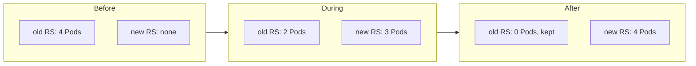

# Rolling updates, rollbacks and strategies

## In plain words

Shipping a new version of a program that people are using is like replacing the tyres on a moving bus. Stop everything and swap, and the passengers notice. The alternative is to change one wheel at a time, checking each new wheel holds before touching the next, so the bus never stops.

A **rolling update** is Kubernetes doing exactly that with Pods. When you change a Deployment's Pod template, for example to a new image version, Kubernetes starts a few Pods of the new version, waits until they report ready, removes a few of the old ones, and repeats until only new Pods remain. Capacity stays close to normal throughout. If the new version turns out to be bad, a **rollback** runs the same process in reverse, back to the previous version.

Why this matters for a job: releasing software is what teams do most often with Kubernetes, and a badly configured rollout is a common source of incidents. You will be asked to configure `maxSurge` and `maxUnavailable`, to explain why a rollout is stuck, and to roll one back under pressure. In interviews, "how does a rolling update work?" and "how would you do a zero-downtime deployment?" come up constantly.

> **Before this lesson:** read [Deployments, ReplicaSets, self-healing and scaling](#/lesson/kubernetes/deployments-replicasets). You must know that a Deployment owns one ReplicaSet per template version and what the `pod-template-hash` is. Readiness probes from [Lifecycle, probes, requests and limits](#/lesson/kubernetes/pod-lifecycle-resources) are essential here.

## What triggers a rollout

A **rollout** begins whenever the Deployment's `spec.template` changes. The Deployment controller notices that no existing ReplicaSet matches the new template hash, creates a new ReplicaSet with zero replicas, and then moves replicas from old to new according to the **strategy**.



There are two built-in strategies.

| Strategy | Behaviour | Downtime | Use when |
|---|---|---|---|
| `RollingUpdate` (default) | Replace gradually; old and new run side by side | None, if configured well | Almost always |
| `Recreate` | Delete all old Pods, then create new ones | Yes | Old and new versions must never run at the same time |

## The two dials: maxSurge and maxUnavailable

A rolling update is governed by two settings.

- **`maxSurge`**: how many Pods *above* the desired count may exist during the update. It lets new Pods start before old ones stop.
- **`maxUnavailable`**: how many Pods *below* the desired count may be unavailable during the update. It lets old Pods stop before new ones are ready.

Each can be a number or a percentage of `replicas`. The default for both is 25%. Percentages are converted with different rounding: **`maxSurge` rounds up, `maxUnavailable` rounds down.** The rounding leans towards safety: you may get a little more surge, never more unavailability than you asked for. They cannot both be zero, because then no Pod could be added or removed and the update could never move.

From them come two bounds that the controller respects at every moment:

$$\text{total Pods} \le \text{replicas} + \text{maxSurge} \qquad \text{available Pods} \ge \text{replicas} - \text{maxUnavailable}$$

For `replicas: 10` with the defaults: `maxSurge` is 25% of 10 = 2.5, rounded up to 3; `maxUnavailable` is 2.5 rounded down to 2. So there are never more than 13 Pods and never fewer than 8 available.

```yaml
apiVersion: apps/v1
kind: Deployment
metadata:
  name: orders-api
  namespace: cafe
spec:
  replicas: 4
  minReadySeconds: 10
  progressDeadlineSeconds: 300
  revisionHistoryLimit: 5
  strategy:
    type: RollingUpdate
    rollingUpdate:
      maxSurge: 1
      maxUnavailable: 0
  selector:
    matchLabels:
      app: orders-api
  template:
    metadata:
      labels:
        app: orders-api
    spec:
      terminationGracePeriodSeconds: 40
      containers:
        - name: orders-api
          image: ghcr.io/harbour-coffee/orders-api:2.0.3
          ports:
            - name: http
              containerPort: 8080
          readinessProbe:
            httpGet:
              path: /ready
              port: http
            periodSeconds: 5
            failureThreshold: 2
          lifecycle:
            preStop:
              sleep:
                seconds: 10
          resources:
            requests:
              cpu: 250m
              memory: 256Mi
            limits:
              memory: 256Mi
```

The lines that shape the rollout:

- `strategy.type: RollingUpdate` with `maxSurge: 1` and `maxUnavailable: 0` — add one new Pod at a time, and never drop below 4 available. This is the conservative setting for a service that cannot lose capacity.
- `minReadySeconds: 10` — a new Pod must stay ready for 10 seconds before it counts as **available**. This slows the rollout and catches Pods that start, pass one readiness check and then crash.
- `progressDeadlineSeconds: 300` — if the rollout makes no progress for five minutes, mark it as failed.
- `readinessProbe` — the signal the rollout waits for. Without it, a Pod is "ready" the instant its container starts, and the rollout races ahead whether or not the new version works.
- `preStop` sleep and `terminationGracePeriodSeconds` — let old Pods drain requests in progress, as explained in the lifecycle lesson.

### Choosing values

| Goal | maxSurge | maxUnavailable | Trade-off |
|---|---|---|---|
| Never lose capacity | 1 or 25% | 0 | Needs spare room on nodes; slower |
| Fastest rollout | 100% | 0 | Doubles resource use briefly |
| No spare capacity available | 0 | 1 | Capacity dips during the update |
| Balanced default | 25% | 25% | Small dip, small surge |

## A rolling update, step by step

The simulation below follows the controller's rules. At each step the controller scales the new ReplicaSet up as far as the surge bound allows, new Pods become ready, and the old ReplicaSet is scaled down as far as the availability bound allows. Change the numbers and press Run.

```python-run
import math

def to_count(value, replicas, round_up):
    if isinstance(value, str) and value.endswith("%"):
        x = replicas * int(value[:-1]) / 100
        return math.ceil(x) if round_up else math.floor(x)
    return int(value)

def rolling_update(replicas, max_surge, max_unavailable):
    surge = to_count(max_surge, replicas, round_up=True)
    unavail = to_count(max_unavailable, replicas, round_up=False)
    if surge == 0 and unavail == 0:
        print("invalid: maxSurge and maxUnavailable cannot both be 0"); return
    print(f"replicas={replicas} maxSurge={max_surge}->{surge} maxUnavailable={max_unavailable}->{unavail}")
    print(f"  bounds: total <= {replicas + surge}, available >= {replicas - unavail}")
    old, new_ready, new_starting, step = replicas, 0, 0, 0
    print(f"  step {step}: old={old} new_ready={new_ready} new_starting={new_starting}")
    while old > 0 or new_ready < replicas:
        step += 1
        # 1. scale the new ReplicaSet up within the surge bound
        room = (replicas + surge) - (old + new_ready + new_starting)
        add = max(0, min(room, replicas - new_ready - new_starting))
        new_starting += add
        # 2. scale the old ReplicaSet down within the availability bound
        available = old + new_ready
        remove = max(0, min(old, available - (replicas - unavail)))
        old -= remove
        print(f"  step {step}: +{add} new, -{remove} old -> old={old} new_ready={new_ready} "
              f"new_starting={new_starting} total={old + new_ready + new_starting} available={old + new_ready}")
        # 3. time passes: starting Pods pass their readiness probe
        new_ready += new_starting
        new_starting = 0
    print(f"  done: old=0 new_ready={new_ready}\n")

rolling_update(4, 1, 0)
rolling_update(10, "25%", "25%")
rolling_update(4, 0, 1)
```

Read the first run (`maxSurge 1`, `maxUnavailable 0`). At every line, `available` is 4 or more and `total` is 5 or less. One new Pod starts; only when it is ready is one old Pod removed. The second run shows the defaults at ten replicas: five Pods move at a time (three surge plus two unavailable) and it finishes in few steps. The third run cannot surge at all, so it must remove an old Pod first, and availability dips to 3.

Now do it on a cluster. Change the image and watch:

```bash
$ kubectl set image deployment/orders-api orders-api=ghcr.io/harbour-coffee/orders-api:2.1.0 -n cafe
deployment.apps/orders-api image updated

$ kubectl rollout status deployment/orders-api -n cafe
Waiting for deployment "orders-api" rollout to finish: 1 out of 4 new replicas have been updated...
Waiting for deployment "orders-api" rollout to finish: 2 out of 4 new replicas have been updated...
Waiting for deployment "orders-api" rollout to finish: 3 out of 4 new replicas have been updated...
Waiting for deployment "orders-api" rollout to finish: 1 old replicas are pending termination...
deployment "orders-api" successfully rolled out

$ kubectl get rs -n cafe -l app=orders-api
NAME                    DESIRED   CURRENT   READY   AGE
orders-api-5d8f7c6b9d   4         4         4       2m
orders-api-75b8c9d6f4   0         0         0       3d
```

`kubectl set image` is the imperative way to change one container's image; in a pipeline you would change the manifest and apply. `kubectl rollout status` blocks until the rollout completes, printing progress, and exits with an error if the deadline passes: use it as the gate in automation. Afterwards, the new ReplicaSet holds all four Pods and the old one remains at zero.

The Deployment's events show the interleaving:

```bash
$ kubectl describe deployment orders-api -n cafe | grep ScalingReplicaSet
  Normal  ScalingReplicaSet  2m10s  deployment-controller  Scaled up replica set orders-api-5d8f7c6b9d from 0 to 1
  Normal  ScalingReplicaSet  1m50s  deployment-controller  Scaled down replica set orders-api-75b8c9d6f4 from 4 to 3
  Normal  ScalingReplicaSet  1m50s  deployment-controller  Scaled up replica set orders-api-5d8f7c6b9d from 1 to 2
  Normal  ScalingReplicaSet  1m30s  deployment-controller  Scaled down replica set orders-api-75b8c9d6f4 from 3 to 2
```

Up one, down one, up one, down one: the pattern from the simulation.

## When a rollout goes wrong

Suppose version 2.2.0 has a bug and never becomes ready.

```bash
$ kubectl set image deployment/orders-api orders-api=ghcr.io/harbour-coffee/orders-api:2.2.0 -n cafe

$ kubectl get pods -n cafe -l app=orders-api
NAME                          READY   STATUS             RESTARTS      AGE
orders-api-5d8f7c6b9d-4mzkq   1/1     Running            0             20m
orders-api-5d8f7c6b9d-8xw2c   1/1     Running            0             20m
orders-api-5d8f7c6b9d-hq7pn   1/1     Running            0             20m
orders-api-5d8f7c6b9d-vd9tl   1/1     Running            0             20m
orders-api-7bb9c6f5d8-n2k4x   0/1     CrashLoopBackOff   4 (30s ago)   3m

$ kubectl rollout status deployment/orders-api -n cafe --timeout=60s
Waiting for deployment "orders-api" rollout to finish: 1 out of 4 new replicas have been updated...
error: timed out waiting for the condition
```

This is the rolling update protecting you. With `maxUnavailable: 0`, no old Pod may be removed until a new one is available, and the new one never is. The rollout **stalls** with all four old Pods still serving. Users notice nothing. After `progressDeadlineSeconds`, the Deployment's `Progressing` condition turns `False` with reason `ProgressDeadlineExceeded`.

Kubernetes does **not** roll back automatically. A stalled rollout stays stalled until someone, or some tool, acts.

> [!WARNING]
> The safety of a rolling update depends entirely on the readiness probe. If the new version starts its process but returns errors on every request, and there is no readiness probe (or the probe checks something trivial), every new Pod is "ready", the rollout completes, and all traffic goes to a broken version. A rollout can only be as careful as the probe that judges it.

## Rollbacks

Each ReplicaSet belonging to a Deployment is a **revision**, numbered in an annotation `deployment.kubernetes.io/revision`. The old ReplicaSets are kept, scaled to zero, up to `revisionHistoryLimit`.

```bash
$ kubectl rollout history deployment/orders-api -n cafe
deployment.apps/orders-api
REVISION  CHANGE-CAUSE
1         initial release 2.0.3
2         upgrade to 2.1.0
3         upgrade to 2.2.0

$ kubectl rollout history deployment/orders-api -n cafe --revision=2
deployment.apps/orders-api with revision #2
Pod Template:
  Labels:	app=orders-api
	pod-template-hash=5d8f7c6b9d
  Containers:
   orders-api:
    Image:	ghcr.io/harbour-coffee/orders-api:2.1.0

$ kubectl rollout undo deployment/orders-api -n cafe
deployment.apps/orders-api rolled back

$ kubectl rollout history deployment/orders-api -n cafe
REVISION  CHANGE-CAUSE
1         initial release 2.0.3
3         upgrade to 2.2.0
4         upgrade to 2.1.0
```

- `rollout history` lists revisions. The `CHANGE-CAUSE` column comes from the annotation `kubernetes.io/change-cause` on the Deployment, which you set yourself (for example with `kubectl annotate`); if you never set it, the column shows `<none>`.
- `--revision=2` prints the Pod template stored for that revision.
- `rollout undo` reverts to the previous revision. `--to-revision=1` picks a specific one.

Look closely at the final history. Revision 2 has disappeared and revision 4 has appeared. A rollback does not rewind the counter: the Deployment's template is set back to revision 2's template, the matching existing ReplicaSet is reused, and it is **renumbered** as the newest revision. A rollback is itself a rollout, performed with the same strategy and bounds.

The target-selection rule is worth being able to state: `undo` with no argument goes to the revision with the highest number below the current one; `--to-revision=N` goes to N if it still exists in history. The program below applies that rule.

```python-run
def rollback(history, current, to_revision=None):
    """history: dict revision -> image. Returns the new history and current revision."""
    if to_revision is None:
        older = [r for r in history if r < current]
        if not older:
            return history, current, "error: no rollout history found; nothing to roll back to"
        target = max(older)
    else:
        if to_revision not in history:
            return history, current, f"error: unable to find specified revision {to_revision} in history"
        if to_revision == current:
            return history, current, "skipped: already at that revision"
        target = to_revision
    new_rev = max(history) + 1
    new_history = {r: img for r, img in history.items() if r != target}
    new_history[new_rev] = history[target]
    return new_history, new_rev, f"rolled back to template of revision {target}, now revision {new_rev}"

h, cur = {1: "2.0.3", 2: "2.1.0", 3: "2.2.0"}, 3
for arg in (None, None, 1, 7):
    h, cur, msg = rollback(h, cur, arg)
    label = "undo" if arg is None else f"undo --to-revision={arg}"
    print(f"{label:24} -> {msg}\n{'':27}history={h}")
```

The second plain `undo` is instructive: after rolling back from 2.2.0 to 2.1.0, another `undo` returns to 2.2.0. Two undos in a row toggle between the last two versions; they do not walk further back in time.

> [!TIP]
> In a GitOps setup, do not use `kubectl rollout undo` as the fix. It changes the cluster but not Git, so the next sync re-applies the bad version. Revert the commit and let the pipeline roll forward to the old image. Use `undo` for emergencies, then make Git agree.

## Pausing, resuming and restarting

```bash
$ kubectl rollout pause deployment/orders-api -n cafe
$ kubectl set image deployment/orders-api orders-api=ghcr.io/harbour-coffee/orders-api:2.3.0 -n cafe
$ kubectl set resources deployment/orders-api -c orders-api --requests=cpu=300m -n cafe
$ kubectl rollout resume deployment/orders-api -n cafe

$ kubectl rollout restart deployment/orders-api -n cafe
```

While **paused**, template changes are recorded but no rollout starts, so several changes can be batched into one rollout on `resume`. Pausing mid-rollout freezes it in a mixed state, which some teams use as a crude canary. `rollout restart` replaces every Pod gradually without changing the image; it works by adding a timestamp annotation to the template, which changes the hash. Use it to pick up a changed ConfigMap or Secret.

## The Recreate strategy

```yaml
spec:
  strategy:
    type: Recreate
```

All old Pods are terminated; only when they are gone are new ones created. There is a gap with zero Pods. Choose it when two versions cannot coexist: for example a single-instance application that holds an exclusive lock on a volume, or a schema change that the old version cannot tolerate.

## Beyond the built-ins: blue-green and canary

Two release patterns are not Deployment strategies but are built from Deployments, labels and Services.

**Blue-green.** Run the new version (green) as a second, complete Deployment next to the old (blue). Test green privately. Then switch all traffic at once by changing the Service's selector from `version: blue` to `version: green`. Rollback is switching the selector back. It costs double the resources during the switch and changes all users at the same moment.

**Canary.** Send a small share of real traffic to the new version first, watch error rates and latency, and increase gradually. The simplest form uses two Deployments sharing a label the Service selects on, with replica counts in the wanted ratio: 9 old and 1 new gives roughly 10%. For precise percentages independent of replica counts, traffic splitting is done at the routing layer, with the [Gateway API](#/lesson/kubernetes/gateway-api) or a service mesh. Tools such as Argo Rollouts and Flagger automate canaries, including automatic rollback when metrics worsen. The CI/CD track's [release strategies lesson](#/lesson/cicd/release-strategies) compares these patterns in more depth.

| Pattern | Old and new together? | Traffic shift | Rollback speed | Extra cost |
|---|---|---|---|---|
| Rolling update | Yes, briefly | Gradual, by Pod count | A reverse rollout | Small surge |
| Recreate | No | Hard cut with downtime | Another recreate | None |
| Blue-green | Yes, but only one receives traffic | Instant switch | Instant | Double |
| Canary | Yes | Gradual, by percentage | Fast | Small |

## Zero-downtime checklist

A rolling update gives zero downtime only when all of these hold:

1. At least two replicas.
2. A readiness probe that reflects real ability to serve.
3. `maxUnavailable: 0`, or a value your capacity tolerates.
4. Graceful shutdown: the app handles TERM, plus a short `preStop` delay.
5. **Version compatibility**: old and new Pods serve traffic at the same time, so both must work with the same database schema and the same API contracts. Make database changes in backward-compatible steps (see [schema migrations](#/lesson/cicd/schema-migrations) in the CI/CD track).
6. Enough spare node capacity and namespace quota for the surge Pods.

> [!INTERVIEW]
> **"Walk me through a rolling update."** Changing the Pod template gives a new template hash, so the Deployment controller creates a new ReplicaSet at zero. It then alternates: scale the new ReplicaSet up without exceeding `replicas + maxSurge` total Pods, wait for new Pods to become ready (and available after `minReadySeconds`), and scale the old ReplicaSet down without letting available Pods fall below `replicas - maxUnavailable`. Percentages round up for surge and down for unavailable; defaults are 25% each. Readiness probes gate every step, so a broken version stalls the rollout instead of replacing healthy Pods, and `progressDeadlineSeconds` flags the stall. The old ReplicaSet is kept at zero as a revision, and `kubectl rollout undo` re-activates it by performing a rollout in the other direction. Kubernetes does not roll back by itself.

## Common pitfalls

- **No readiness probe.** The rollout cannot tell good from bad.
- **Single replica with default settings.** 25% of 1 rounds to `maxUnavailable` 0 and `maxSurge` 1, which works, but any node event is still an outage.
- **`maxUnavailable: 0` with no room to surge.** If nodes or quota cannot fit one extra Pod, the rollout hangs with the new Pod `Pending`.
- **Assuming automatic rollback.** A stalled rollout waits for you.
- **Incompatible versions running side by side.** Breaking schema or API changes cause errors mid-rollout even when every Pod is healthy.
- **`revisionHistoryLimit: 0`.** No old ReplicaSets are kept, so `rollout undo` has nothing to use.
- **Re-using an image tag.** The template does not change, so nothing rolls out.
- **Forgetting that a rollback is renumbered.** History after an undo confuses people who expect revision numbers to match versions.

## Cheat sheet

| Task | Command |
|---|---|
| Change image | `kubectl set image deployment/NAME CONTAINER=IMAGE` |
| Watch / gate | `kubectl rollout status deployment/NAME --timeout=120s` |
| History | `kubectl rollout history deployment/NAME [--revision=N]` |
| Roll back | `kubectl rollout undo deployment/NAME [--to-revision=N]` |
| Pause / resume | `kubectl rollout pause deployment/NAME`, then `resume` |
| Restart all Pods | `kubectl rollout restart deployment/NAME` |

| Setting | Default | Rounding |
|---|---|---|
| `maxSurge` | 25% | Up |
| `maxUnavailable` | 25% | Down |
| `minReadySeconds` | 0 | |
| `progressDeadlineSeconds` | 600 | |
| `revisionHistoryLimit` | 10 | |

## Summary

A rollout starts when a Deployment's Pod template changes. With the default RollingUpdate strategy, a new ReplicaSet is scaled up while the old one is scaled down, within two bounds: total Pods never exceed `replicas + maxSurge`, and available Pods never fall below `replicas - maxUnavailable`. Readiness probes gate each step, so a failing version stalls the rollout and leaves the old Pods serving. Old ReplicaSets are kept as numbered revisions, and a rollback is a rollout back to one of them, renumbered as the newest. Recreate trades downtime for never mixing versions, and blue-green and canary releases are patterns built on top with labels, Services and routing. Zero downtime also needs graceful shutdown and versions that can run side by side. Pods now come and go constantly, which raises the question the next module answers: how does anything find them?

## Glossary

- **Rollout**: the process of moving a Deployment from one Pod template to another.
- **Strategy**: the method of replacement, RollingUpdate or Recreate.
- **maxSurge**: extra Pods allowed above the desired count during an update.
- **maxUnavailable**: Pods allowed to be unavailable below the desired count.
- **minReadySeconds**: time a Pod must stay ready before counting as available.
- **progressDeadlineSeconds**: time without progress after which a rollout is reported as failed.
- **Revision**: a numbered version of the Pod template, stored as a ReplicaSet.
- **Rollback**: returning to an earlier revision.
- **Change cause**: an annotation describing why a revision was created.
- **Pause / resume**: stopping and restarting the processing of template changes.
- **Recreate**: a strategy that removes all old Pods before creating new ones.
- **Blue-green**: two full versions side by side with an instant traffic switch.
- **Canary**: exposing a small share of traffic to a new version first.
- **Backward compatible**: a change the previous version can still work with.

```quiz
[
  {"q": "A Deployment has replicas: 10 and the default strategy settings. What are the maximum total Pods and minimum available Pods during a rolling update?",
   "options": ["12 total, 8 available", "13 total, 8 available", "13 total, 7 available", "12 total, 7 available"],
   "answer": 1,
   "explain": "25% of 10 is 2.5. maxSurge rounds up to 3, so at most 13 Pods. maxUnavailable rounds down to 2, so at least 8 available."},
  {"q": "A rollout uses maxSurge 1 and maxUnavailable 0. The first new Pod never becomes ready. What happens next?",
   "options": ["Old Pods are removed anyway after 30 seconds", "The rollout stalls with all old Pods still serving", "Kubernetes automatically rolls back", "The Deployment is deleted"],
   "answer": 1,
   "explain": "No old Pod can be removed until a new one is available. The rollout waits, and after progressDeadlineSeconds it is marked as not progressing. There is no automatic rollback."},
  {"q": "History shows revisions 1, 2 and 3, with 3 current. You run kubectl rollout undo. What does the history show afterwards?",
   "options": ["1, 2", "1, 2, 3 with 2 current", "1, 3, 4", "2, 3, 4"],
   "answer": 2,
   "explain": "The template of revision 2 becomes current and its ReplicaSet is renumbered as revision 4. Revision 2 no longer appears."},
  {"q": "After that undo, you run kubectl rollout undo again. Which version is running?",
   "options": ["The version from revision 1", "The version that was revision 3", "The same as now; nothing changes", "No version; the Deployment scales to 0"],
   "answer": 1,
   "explain": "Undo goes to the previous revision in history, which is now revision 3. Repeated undos alternate between the two most recent versions."},
  {"q": "A new version starts its process correctly but returns HTTP 500 on every request. The Deployment has no readiness probe. What happens when it is rolled out?",
   "options": ["The rollout stalls on the first Pod", "The rollout completes and all traffic reaches the broken version", "The kubelet rejects the image", "The Service removes the Pods"],
   "answer": 1,
   "explain": "Without a readiness probe a Pod counts as ready once its container is running, so the rollout proceeds and replaces every healthy Pod."},
  {"q": "Which situation calls for the Recreate strategy?",
   "options": ["A stateless API with 10 replicas", "An application where the old and new versions must never run at the same time", "A service that needs zero downtime", "A canary release"],
   "answer": 1,
   "explain": "Recreate stops all old Pods before starting new ones, accepting downtime so that versions never overlap."},
  {"q": "A rollout with maxUnavailable 0 and maxSurge 1 shows one new Pod Pending and nothing else changing. The namespace is at its CPU quota and nodes are full. Why is this Pod not running?",
   "options": ["The readiness probe is failing", "There is no capacity or quota for the extra surge Pod, so it cannot be scheduled or created", "The image tag is wrong", "The old ReplicaSet is paused"],
   "answer": 1,
   "explain": "Surging needs room for one Pod beyond the normal count. With none, the update cannot take its first step. Free capacity, raise quota or allow maxUnavailable 1."},
  {"q": "During a rolling update, old and new Pods serve requests at the same time. What does that require of a database schema change shipped with the new version?",
   "options": ["Nothing special", "It must be backward compatible so that the old version keeps working", "It must run after all old Pods are gone", "It must be applied by an init container in every Pod"],
   "answer": 1,
   "explain": "Both versions use the same database during the rollout, and after a rollback the old version runs alone. Changes must be made in compatible steps."}
]
```

> **Source:** Poulton, *The Kubernetes Book*, ch. 6 (topic coverage only). Official docs: https://kubernetes.io/docs/concepts/workloads/controllers/deployment/#updating-a-deployment , https://kubernetes.io/docs/reference/kubectl/generated/kubectl_rollout/
