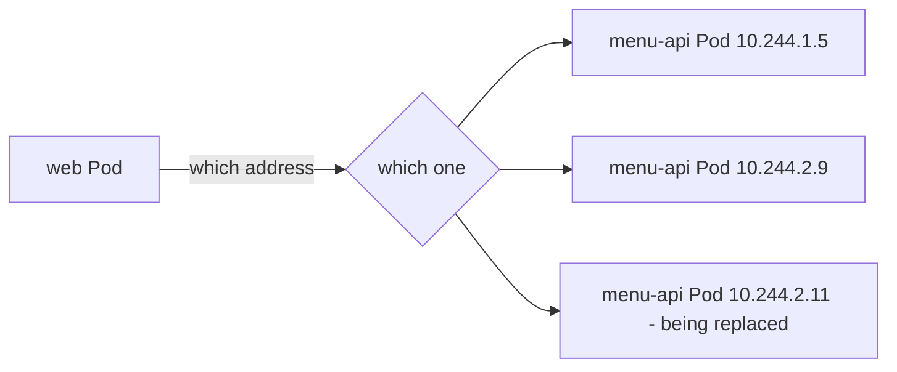
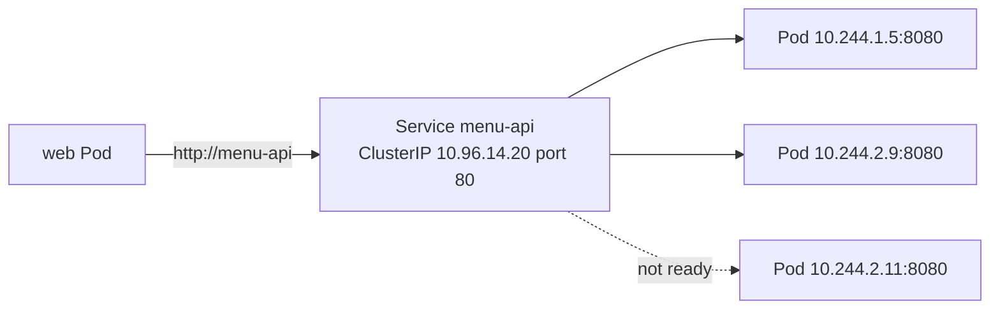

# Services, selectors, ClusterIP and EndpointSlices

## In plain words

Pods are disposable. Each time one is replaced it gets a new name and a new IP address, and a Deployment may have three Pods now and eight in an hour. So how can one program reliably call another? It cannot keep a list of Pod addresses; the list would be wrong within minutes.

A **Service** solves this. A Service is a stable name and a stable address that stands in front of a changing group of Pods. Callers use the Service; Kubernetes keeps track of which Pods are behind it right now and spreads the requests across the healthy ones.

Consider the phone number of a pizza shop. You call the same number every time. You do not know or care which employee picks up, how many are on shift tonight, or that last week's staff have all been replaced. The number is stable; the people answering change. A Service is that phone number, and the Pods are whoever is on shift.

Why this matters for a job: every application with more than one component uses Services. "The Service has no endpoints" is one of the most common causes of "connection refused" you will debug, and the explanation of how a Service finds its Pods is a staple interview question.

> **Before this lesson:** you need labels and selectors from [The declarative model](#/lesson/kubernetes/declarative-reconciliation), readiness probes from [Lifecycle, probes, requests and limits](#/lesson/kubernetes/pod-lifecycle-resources) and Deployments from [Deployments, ReplicaSets, self-healing and scaling](#/lesson/kubernetes/deployments-replicasets).

## The problem in one picture



`web` must call `menu-api`. Three Pods exist, one is about to be replaced, and tomorrow there may be six. A Service puts one fixed thing in the middle:



A Service gives you three things:

1. **A stable virtual IP address**, called the **ClusterIP**, which never changes for the life of the Service.
2. **A stable DNS name**, equal to the Service's name, which resolves to that IP.
3. **Load balancing** across the Pods that are currently ready.

## A Service manifest, line by line

```yaml
apiVersion: v1
kind: Service
metadata:
  name: menu-api
  namespace: cafe
  labels:
    app: menu-api
spec:
  type: ClusterIP
  selector:
    app: menu-api
  ports:
    - name: http
      protocol: TCP
      port: 80
      targetPort: http
```

- `apiVersion: v1`, `kind: Service` — Services are in the core API group.
- `metadata.name: menu-api` — this becomes the DNS name. Callers in the same namespace use `http://menu-api`.
- `spec.type: ClusterIP` — the Service is reachable only from inside the cluster. This is the default type; the [next lesson](#/lesson/kubernetes/nodeport-loadbalancer) covers the types that accept outside traffic.
- `spec.selector` — the label query. Every Pod **in the same namespace** with the label `app: menu-api` is a candidate back end. A Service selector is always equality-based: a plain map of keys and values, all of which must match. Note that the selector points at **Pods by label**, not at a Deployment by name. The Service does not know Deployments exist.
- `spec.ports` — a list, because a Service can expose several ports.
  - `name: http` — a label for this port entry; required when there is more than one.
  - `protocol: TCP` — the default; UDP and SCTP are also possible.
  - `port: 80` — the port the **Service** listens on. Callers connect to `menu-api:80`.
  - `targetPort: http` — the port on the **Pod** that traffic is sent to. Here it is given by name, referring to the container port named `http` in the Pod template (8080). It could also be the number `8080`. If omitted, it defaults to the same value as `port`.

Using a port *name* for `targetPort` is a good habit: if the next version of the app listens on 9090, you change the Pod template only, and the Service follows.

```bash
$ kubectl apply -f menu-api-svc.yaml
service/menu-api created

$ kubectl get service menu-api -n cafe
NAME       TYPE        CLUSTER-IP    EXTERNAL-IP   PORT(S)   AGE
menu-api   ClusterIP   10.96.14.20   <none>        80/TCP    5s

$ kubectl exec -n cafe deploy/web -- wget -qO- http://menu-api/menu
[{"name":"flat white","price":3.4},{"name":"espresso","price":2.2}]
```

The Service received the ClusterIP `10.96.14.20` from a range reserved for Services, which is separate from the Pod address range. `EXTERNAL-IP <none>` confirms it is internal only. The last command runs `wget` inside a `web` Pod and calls the Service by name: no port number is needed because 80 is the HTTP default, and the Service forwards to 8080 on a Pod.

## How a Service knows its Pods: EndpointSlices

The Service object itself holds only the selector and ports. The list of actual Pod addresses lives in separate objects called **EndpointSlices**, maintained by the EndpointSlice controller in the control plane. That controller watches Services and Pods, and for each Service it writes down the IP and port of every matching Pod, along with whether that Pod is ready.

```bash
$ kubectl get endpointslices -n cafe -l kubernetes.io/service-name=menu-api
NAME             ADDRESSTYPE   PORTS   ENDPOINTS                             AGE
menu-api-x7k2p   IPv4          8080    10.244.1.5,10.244.2.9,10.244.2.11     2m

$ kubectl get endpointslice menu-api-x7k2p -n cafe -o yaml
```

```yaml
apiVersion: discovery.k8s.io/v1
kind: EndpointSlice
metadata:
  name: menu-api-x7k2p
  namespace: cafe
  labels:
    kubernetes.io/service-name: menu-api
addressType: IPv4
ports:
  - name: http
    protocol: TCP
    port: 8080
endpoints:
  - addresses: ["10.244.1.5"]
    conditions:
      ready: true
      serving: true
      terminating: false
    nodeName: cafe-worker
    targetRef:
      kind: Pod
      name: menu-api-6c9d7b5f48-9hvtn
  - addresses: ["10.244.2.11"]
    conditions:
      ready: false
      serving: false
      terminating: false
    nodeName: cafe-worker2
    targetRef:
      kind: Pod
      name: menu-api-6c9d7b5f48-tk4bq
```

The first command finds the slices for a Service using the label `kubernetes.io/service-name`. In the YAML (shortened to two endpoints):

- `ports` holds the resolved target port, 8080: the name `http` has been looked up.
- `endpoints` has one entry per Pod, with its address, the node it runs on, a reference to the Pod, and three **conditions**.
  - `ready: true` means the Pod passes its readiness probe and should receive traffic.
  - `serving` reports readiness even while the Pod is terminating; `terminating` is true once deletion has begun.

kube-proxy on every node watches these slices and programs the kernel to send Service traffic only to endpoints that are ready. That is the whole chain: **readiness probe → Pod Ready condition → EndpointSlice `ready` → kube-proxy rules**.

Why "slices"? An older API, **Endpoints**, stored every address of a Service in one object. A Service with thousands of Pods meant one huge object rewritten and sent to every node on each change. EndpointSlices split the list into chunks of up to 100 endpoints, so a change touches one small object. The old Endpoints API has been deprecated since version 1.33; you will still see `kubectl get endpoints` in older tutorials, and it still works, but new tooling reads EndpointSlices.

## Selecting Pods, simulated

The program below does what the EndpointSlice controller does: given Pods and a Service, compute the endpoints. Press Run, then try changing labels, readiness or namespaces.

```python-run
pods = [
    {"name": "menu-api-9hvtn", "ns": "cafe", "labels": {"app": "menu-api", "tier": "backend"},
     "ip": "10.244.1.5", "ports": {"http": 8080}, "ready": True, "phase": "Running"},
    {"name": "menu-api-wd4mz", "ns": "cafe", "labels": {"app": "menu-api", "tier": "backend"},
     "ip": "10.244.2.9", "ports": {"http": 8080}, "ready": True, "phase": "Running"},
    {"name": "menu-api-tk4bq", "ns": "cafe", "labels": {"app": "menu-api", "tier": "backend"},
     "ip": "10.244.2.11", "ports": {"http": 8080}, "ready": False, "phase": "Running"},
    {"name": "orders-api-kq2hn", "ns": "cafe", "labels": {"app": "orders-api", "tier": "backend"},
     "ip": "10.244.1.7", "ports": {"http": 8080}, "ready": True, "phase": "Running"},
    {"name": "menu-api-zz111", "ns": "staging", "labels": {"app": "menu-api"},
     "ip": "10.244.3.4", "ports": {"http": 8080}, "ready": True, "phase": "Running"},
    {"name": "menu-api-old", "ns": "cafe", "labels": {"app": "menu-api"},
     "ip": None, "ports": {"http": 8080}, "ready": False, "phase": "Pending"},
]

def endpoints(service):
    out = []
    if not service["selector"]:
        return out                      # no selector: endpoints are managed by hand
    for p in pods:
        if p["ns"] != service["ns"]:
            continue                    # a Service only sees Pods in its own namespace
        if any(p["labels"].get(k) != v for k, v in service["selector"].items()):
            continue
        if p["ip"] is None:
            continue                    # not scheduled or not started yet
        port = service["targetPort"]
        if isinstance(port, str):
            port = p["ports"].get(port)
            if port is None:
                continue                # the Pod has no port with that name
        out.append((f"{p['ip']}:{port}", "ready" if p["ready"] else "NOT ready", p["name"]))
    return out

def show(service):
    eps = endpoints(service)
    ready = [e[0] for e in eps if e[1] == "ready"]
    print(f"\nService {service['ns']}/{service['name']} selector={service['selector']}")
    for e in eps:
        print("   ", e)
    print("    traffic goes to:", ready if ready else "NOTHING - connection refused")

show({"name": "menu-api", "ns": "cafe", "selector": {"app": "menu-api"}, "targetPort": "http"})
show({"name": "backend",  "ns": "cafe", "selector": {"tier": "backend"}, "targetPort": 8080})
show({"name": "typo",     "ns": "cafe", "selector": {"app": "menu_api"}, "targetPort": "http"})
show({"name": "wrongport", "ns": "cafe", "selector": {"app": "menu-api"}, "targetPort": "web"})
```

Four results worth studying:

- `menu-api` selects three Pods in `cafe` with addresses; the `staging` Pod is ignored (wrong namespace) and the Pending Pod has no IP. Of the three, only two are ready, so only two receive traffic.
- `backend` selects on `tier`, which matches Pods from two different Deployments. A selector that is too broad silently mixes applications.
- `typo` uses an underscore where the label has a hyphen. It matches nothing. The API server accepts this Service without complaint, because an empty match is valid.
- `wrongport` matches Pods but names a port they do not have, so again there are no usable endpoints.

> [!WARNING]
> A Service whose selector matches no Pods is not an error to Kubernetes. It is created, gets a ClusterIP and a DNS name, and every connection to it is refused. Always check `kubectl get endpointslices -l kubernetes.io/service-name=NAME` (or `kubectl describe service NAME`, which prints an `Endpoints:` line) after creating a Service.

## How the load balancing behaves

With the standard kube-proxy, the choice of Pod happens **once per connection**, at the moment the connection is opened, and is effectively random among the ready endpoints. Three consequences:

- It works at the TCP level (**layer 4** of the networking model). It does not understand HTTP, so it cannot route by URL path or host name. That is the job of [Ingress and the Gateway API](#/lesson/kubernetes/ingress).
- A **long-lived connection sticks to one Pod**. Clients that keep connections open and reuse them, such as gRPC and HTTP/2 clients or database connection pools, send every request over the same connection to the same Pod, so load is not spread per request. If you scale from 2 to 10 Pods, existing clients keep using the original 2. Remedies include client-side load balancing, periodic reconnection, or a proxy that balances per request (a service mesh or a layer 7 gateway).
- There are no retries and no awareness of how busy a Pod is.

You can ask for a client's connections to keep going to the same Pod with `sessionAffinity: ClientIP`, which chooses by the client's IP address for a configurable time (three hours by default):

```yaml
spec:
  sessionAffinity: ClientIP
  sessionAffinityConfig:
    clientIP:
      timeoutSeconds: 1800
```

Prefer designing applications that do not need it, by keeping session data in a shared store such as Redis.

Two newer fields refine where traffic goes. `spec.trafficDistribution: PreferSameZone` asks that traffic stay within the caller's availability zone when a ready endpoint exists there, reducing latency and cross-zone network charges. `spec.internalTrafficPolicy: Local` restricts traffic from Pods to endpoints on the *same node*, which is used for per-node agents.

## Multiple ports

```yaml
apiVersion: v1
kind: Service
metadata:
  name: orders-api
  namespace: cafe
spec:
  selector:
    app: orders-api
  ports:
    - name: http
      port: 80
      targetPort: 8080
    - name: metrics
      port: 9102
      targetPort: metrics
```

One Service, two ports. Callers use `orders-api:80` for the application and `orders-api:9102` for metrics. With more than one port, each entry needs a unique `name`.

## Headless Services

Sometimes a caller needs the addresses of the individual Pods, not one virtual IP: a database client that must find the primary, or a clustered application whose members talk to each other. Setting `clusterIP: None` creates a **headless Service**. It gets no virtual IP and no load balancing. Instead, a DNS lookup of its name returns the IP addresses of all its ready Pods.

```yaml
apiVersion: v1
kind: Service
metadata:
  name: orders-db
  namespace: cafe
spec:
  clusterIP: None
  selector:
    app: orders-db
  ports:
    - name: postgres
      port: 5432
```

```bash
$ kubectl exec -n cafe deploy/web -- nslookup orders-db
Name:      orders-db.cafe.svc.cluster.local
Address 1: 10.244.1.21
Address 2: 10.244.2.33
```

`nslookup` asks DNS for a name. A normal Service would return one address, its ClusterIP. The headless one returns one address per ready Pod. Headless Services are what give [StatefulSet](#/lesson/kubernetes/statefulset-theory) Pods their individual stable names.

## Services without selectors, and ExternalName

A Service can also point at things that are not Pods.

**No selector.** Omit `spec.selector`, and no EndpointSlices are created automatically. You create one by hand listing any addresses you like: for example a database running on a virtual machine outside the cluster. In-cluster clients use a normal Service name, and the day the database moves into the cluster you add a selector and delete the manual slice.

**ExternalName.** A Service of `type: ExternalName` is a DNS alias and nothing more:

```yaml
apiVersion: v1
kind: Service
metadata:
  name: payments
  namespace: cafe
spec:
  type: ExternalName
  externalName: api.payments-provider.example
```

A lookup of `payments` inside the cluster returns a DNS record (a **CNAME**) pointing at `api.payments-provider.example`. There is no ClusterIP and no proxying. It gives code a stable in-cluster name for an outside dependency. One caveat: HTTPS clients check the certificate against the name they dialled, so calling `https://payments` fails certificate verification unless the client is configured for the real host name.

## Debugging a Service in four steps

```bash
$ kubectl describe service menu-api -n cafe
Name:              menu-api
Namespace:         cafe
Selector:          app=menu-api
Type:              ClusterIP
IP:                10.96.14.20
Port:              http  80/TCP
TargetPort:        http/TCP
Endpoints:         10.244.1.5:8080,10.244.2.9:8080
Session Affinity:  None

$ kubectl get pods -n cafe -l app=menu-api -o wide
$ kubectl exec -n cafe deploy/web -- wget -qO- -T 2 http://10.244.1.5:8080/menu
$ kubectl exec -n cafe deploy/web -- nslookup menu-api
```

1. **Endpoints line.** If it says `<none>`, the problem is selection or readiness, not networking.
2. **Do Pods carry the selector's labels, in the same namespace, and are they `READY`?** Compare the `Selector:` line with `kubectl get pods --show-labels`.
3. **Call a Pod IP directly on the target port.** If this fails, the application is not listening on that port, or listens only on `127.0.0.1` instead of all interfaces (`0.0.0.0`).
4. **Does the name resolve?** If not, the caller is in another namespace and needs `menu-api.cafe`, or cluster DNS has a problem.

> [!TIP]
> A program inside a container must listen on `0.0.0.0` (all network interfaces), not on `127.0.0.1` (the loopback interface only). An app bound to `127.0.0.1` answers `kubectl port-forward` and its own health checks via `exec`, yet is unreachable through the Service, which is a confusing combination.

> [!INTERVIEW]
> **"How does a Service route traffic to Pods?"** A Service has a label selector and a stable virtual ClusterIP with a DNS name. The EndpointSlice controller watches Pods matching the selector in the Service's namespace and records their IPs, target ports and readiness in EndpointSlice objects. kube-proxy on each node watches Services and EndpointSlices and programs kernel rules (iptables, IPVS or nftables) that rewrite the destination of connections to the ClusterIP to one of the ready Pod IPs. Balancing is per connection at layer 4. Pods failing readiness are dropped from the ready set, which is how rollouts and failures avoid sending traffic to Pods that cannot serve. Mention `port` versus `targetPort`, and headless Services returning Pod IPs directly through DNS.

## Common pitfalls

- **Selector typo.** No endpoints, no error.
- **Confusing `port` and `targetPort`.** `port` is what callers use; `targetPort` is what the container listens on.
- **Selecting on a label shared by several applications.** Traffic is mixed between them.
- **Expecting per-request balancing with HTTP/2 or gRPC.** Connections are balanced, not requests.
- **Pods running but not ready.** They are deliberately left out. Fix the readiness probe or the app.
- **Calling a Service in another namespace by short name.** Add the namespace.
- **Trying to ping a ClusterIP.** In iptables mode a ClusterIP answers only on the Service's ports; `ping` uses a different protocol (ICMP) and may fail even when the Service works. Test with a real request.

## Cheat sheet

| Field | Meaning |
|---|---|
| `spec.selector` | Labels a Pod must have (same namespace) to be a back end |
| `spec.ports[].port` | Port on the Service |
| `spec.ports[].targetPort` | Port on the Pod; number or port name; defaults to `port` |
| `spec.type` | `ClusterIP` (default), `NodePort`, `LoadBalancer`, `ExternalName` |
| `spec.clusterIP: None` | Headless: DNS returns Pod IPs |
| `spec.sessionAffinity` | `None` (default) or `ClientIP` |

| Task | Command |
|---|---|
| Create from a Deployment | `kubectl expose deployment NAME --port=80 --target-port=8080` |
| List | `kubectl get svc` |
| See back ends | `kubectl get endpointslices -l kubernetes.io/service-name=NAME` |
| Details | `kubectl describe svc NAME` |
| Test from inside | `kubectl exec deploy/OTHER -- wget -qO- http://NAME` |

## Summary

A Service gives a changing set of Pods one stable virtual IP and DNS name. Its selector picks Pods by label within its namespace; the EndpointSlice controller records the matching Pod addresses and their readiness; and kube-proxy turns that into kernel rules that send each new connection to a ready Pod. `port` is the Service's side and `targetPort` the Pod's side. Balancing is per connection at layer 4. A Service with no ready endpoints is valid but refuses connections, so the endpoints are the first thing to check. Headless Services expose Pod IPs directly through DNS, and selector-less and ExternalName Services give in-cluster names to outside systems. Everything so far is internal to the cluster; the next lesson opens Services to the outside world.

## Glossary

- **Service**: a stable name and virtual IP in front of a set of Pods.
- **ClusterIP**: the Service's virtual IP, reachable only inside the cluster; also the default Service type.
- **Selector**: the labels that determine which Pods back a Service.
- **port / targetPort**: the Service's port, and the Pod port traffic is forwarded to.
- **EndpointSlice**: an object listing Pod addresses, ports and readiness for a Service.
- **Endpoints**: the older, deprecated single-object form of the same list.
- **Load balancing**: distributing connections across back ends.
- **Layer 4 / layer 7**: the transport level (TCP, UDP) versus the application level (HTTP).
- **Session affinity**: sending a client's connections to the same Pod.
- **Headless Service**: a Service with `clusterIP: None`; DNS returns Pod IPs.
- **ExternalName**: a Service that is a DNS alias for an outside host name.
- **CNAME**: a DNS record that points one name at another.
- **Traffic distribution**: a preference for endpoints topologically close to the caller.

```quiz
[
  {"q": "A Service has selector app: menu-api. Its Pods are labelled app: menu_api (underscore). What happens when the Service is created?",
   "options": ["The API server rejects it", "It is created with no endpoints, and connections to it are refused", "The label is corrected automatically", "It selects all Pods in the namespace"],
   "answer": 1,
   "explain": "A selector matching nothing is valid. The Service exists with a ClusterIP but an empty endpoint list, so nothing answers."},
  {"q": "A Service defines port: 80 and targetPort: 8080. Which statement is correct?",
   "options": ["Callers connect to the Service on 8080 and the container listens on 80", "Callers connect to the Service on 80 and traffic is forwarded to 8080 on the Pod", "Both the Service and the container use 80", "The node listens on 8080"],
   "answer": 1,
   "explain": "port is the Service side, targetPort is the Pod side."},
  {"q": "One of three Pods behind a Service starts failing its readiness probe. What happens next?",
   "options": ["The Service is deleted", "The Pod is restarted by the Service", "Its endpoint is marked not ready and new connections go only to the other two", "A third of requests fail until someone intervenes"],
   "answer": 2,
   "explain": "The EndpointSlice controller sets ready to false for that endpoint, and kube-proxy stops choosing it. Readiness failure does not restart the Pod."},
  {"q": "A gRPC client keeps one long-lived connection to a Service backed by 5 Pods. How are its requests distributed?",
   "options": ["Evenly across 5 Pods", "All to the one Pod chosen when the connection opened", "Randomly per request", "To the least busy Pod"],
   "answer": 1,
   "explain": "kube-proxy balances connections, not requests. A reused connection stays with one Pod; per-request balancing needs client-side logic or a layer 7 proxy."},
  {"q": "What does a DNS lookup return for a headless Service (clusterIP: None) with three ready Pods?",
   "options": ["One virtual IP", "The three Pod IP addresses", "The node IP addresses", "Nothing"],
   "answer": 1,
   "explain": "A headless Service has no virtual IP. DNS returns an address record for each ready Pod."},
  {"q": "kubectl describe service shows 'Endpoints: <none>' although three matching Pods are Running. kubectl get pods shows READY 0/1 for all of them. Why does the Service have no endpoints?",
   "options": ["The Service type is wrong", "The Pods are not ready, so none are listed as usable back ends", "kube-proxy has crashed", "The ClusterIP range is exhausted"],
   "answer": 1,
   "explain": "Only ready Pods are shown as endpoints. Running but not ready points at the readiness probe or application start-up."},
  {"q": "A Service in namespace cafe has selector app: web. A Pod labelled app: web exists in namespace staging. Is it a back end of the Service?",
   "options": ["Yes, selectors are cluster-wide", "No, a Service selects only Pods in its own namespace", "Only if both namespaces share a label", "Only for headless Services"],
   "answer": 1,
   "explain": "Service selectors are scoped to the Service's namespace."},
  {"q": "Why were EndpointSlices introduced to replace the Endpoints API?",
   "options": ["To support HTTP routing", "To split large endpoint lists into small objects so updates are cheap at scale", "To encrypt Pod IPs", "To remove the need for kube-proxy"],
   "answer": 1,
   "explain": "One Endpoints object per Service became very large and was resent to every node on each change. Slices of up to 100 endpoints make updates small."}
]
```

> **Source:** Poulton, *The Kubernetes Book*, ch. 7 (topic coverage only). Official docs: https://kubernetes.io/docs/concepts/services-networking/service/ , https://kubernetes.io/docs/concepts/services-networking/endpoint-slices/ , https://kubernetes.io/docs/reference/networking/virtual-ips/
