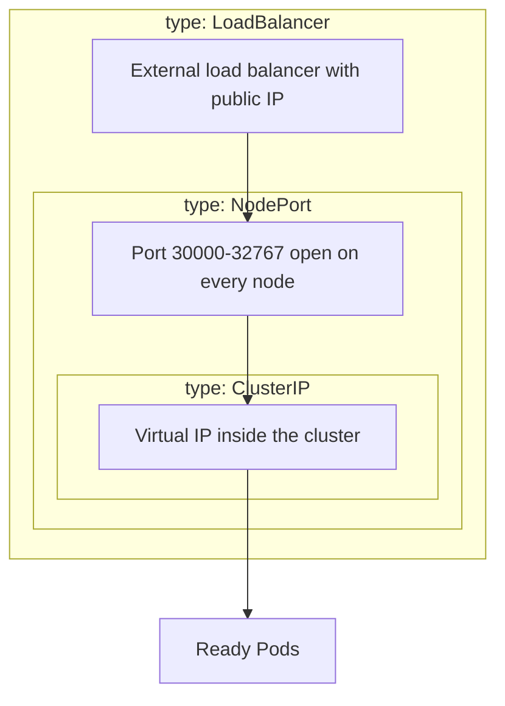
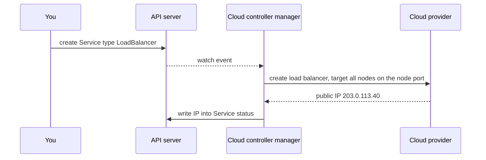
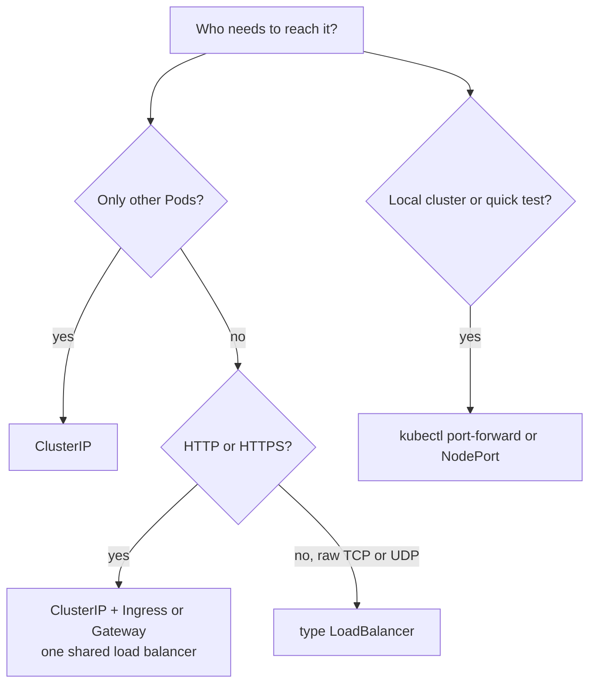

# NodePort, LoadBalancer and other Service types

## In plain words

A ClusterIP Service, from the previous lesson, is reachable only from inside the cluster. That is right for a database or an internal API, and useless for a website your customers must open from their phones. To accept traffic from outside, Kubernetes offers two further Service types that build on ClusterIP like layers of an onion.

A **NodePort** Service opens the same port number on every node of the cluster. Anything that can reach a node's IP address on that port reaches your Pods. A **LoadBalancer** Service goes one step further: it asks the cloud provider to create a real load balancer with a public IP address and to point it at those node ports.

Picture an office building again. A ClusterIP is an internal extension number: it works from any desk phone inside and from nowhere else. A NodePort is like fitting the same numbered side door to every wall of the building: anyone who walks up to any wall and knows the door number can get in. A LoadBalancer is the proper front entrance with a reception desk and a street address printed on the business card: visitors come to one well-known place and reception directs them inside.

Why this matters for a job: exposing an application is where Kubernetes meets real networks, firewalls and cloud bills. Choosing the wrong type leads to services that cannot be reached, or to one paid cloud load balancer per microservice. "Explain ClusterIP, NodePort and LoadBalancer" is a guaranteed interview question.

> **Before this lesson:** read [Services, selectors, ClusterIP and EndpointSlices](#/lesson/kubernetes/services-clusterip). You should also remember kube-proxy from [Worker nodes](#/lesson/kubernetes/worker-nodes) and the cloud controller manager from [The control plane](#/lesson/kubernetes/control-plane).

## The types build on each other



| Type | Reachable from | Adds |
|---|---|---|
| `ClusterIP` | Inside the cluster | Virtual IP and DNS name |
| `NodePort` | Anything that can reach a node IP | A port on every node, **plus** a ClusterIP |
| `LoadBalancer` | The internet or a private network | An external load balancer, **plus** node ports, **plus** a ClusterIP |
| `ExternalName` | Inside the cluster | Only a DNS alias to an outside name |

A LoadBalancer Service is therefore also a NodePort Service and also a ClusterIP Service. Inside the cluster you can still call it by name.

## NodePort

```yaml
apiVersion: v1
kind: Service
metadata:
  name: web
  namespace: cafe
spec:
  type: NodePort
  selector:
    app: web
  ports:
    - name: http
      port: 80
      targetPort: 8080
      nodePort: 30080
```

Compared with a ClusterIP Service, two things changed:

- `type: NodePort`.
- `nodePort: 30080` — the port to open on every node. It must lie within the cluster's node port range, **30000 to 32767** by default. If you leave the field out, Kubernetes picks a free port from the range for you, which is usually the better choice because fixed numbers can collide.

There are now three port numbers in one Service, and telling them apart is the heart of this topic:

| Field | Where it is | Who uses it |
|---|---|---|
| `nodePort` (30080) | On every node's IP | Clients outside the cluster |
| `port` (80) | On the Service's ClusterIP | Clients inside the cluster |
| `targetPort` (8080) | On the Pod | The container listens here |

```bash
$ kubectl apply -f web-nodeport.yaml
service/web created

$ kubectl get service web -n cafe
NAME   TYPE       CLUSTER-IP      EXTERNAL-IP   PORT(S)        AGE
web    NodePort   10.96.77.140    <none>        80:30080/TCP   6s

$ kubectl get nodes -o wide
NAME            STATUS   ROLES    INTERNAL-IP
cafe-worker     Ready    <none>   10.0.0.21
cafe-worker2    Ready    <none>   10.0.0.22

$ curl -s http://10.0.0.21:30080/ | head -1
<!doctype html>
$ curl -s http://10.0.0.22:30080/ | head -1
<!doctype html>
```

`PORT(S) 80:30080/TCP` reads as "Service port 80, node port 30080". The two `curl` commands fetch the page through two different nodes. Both work, **including through a node that runs no `web` Pod**: kube-proxy on every node knows the Service's endpoints and forwards to a Pod wherever it is.

### The route a NodePort request takes

1. A client connects to `10.0.0.22:30080`.
2. kube-proxy's rules on that node recognise the node port and choose a ready Pod, perhaps on another node.
3. The packet's destination is rewritten to the Pod's IP and target port. If the Pod is on a different node, the packet makes a second hop, and its source address is rewritten to the first node's address so that the reply comes back the same way. This rewriting is called **source NAT**; a side effect is that the Pod sees a node's IP as the client address, not the real client's.

### Why NodePort is rarely the final answer

- The port numbers are ugly and high. Users expect 80 and 443.
- Clients need to know node IP addresses, and nodes come and go.
- If a client is given one node's address and that node dies, the client is stuck, even though the Pods are healthy elsewhere.
- Every node becomes an entry point, which widens what your firewall must allow.

NodePort is fine for local clusters and demos, and it is the building block that load balancers use. Something stable should sit in front of it.

## LoadBalancer

```yaml
apiVersion: v1
kind: Service
metadata:
  name: web
  namespace: cafe
spec:
  type: LoadBalancer
  selector:
    app: web
  ports:
    - name: http
      port: 80
      targetPort: 8080
```

Only the type changed. Here is what happens after you apply it on a cloud cluster:



```bash
$ kubectl get service web -n cafe --watch
NAME   TYPE           CLUSTER-IP     EXTERNAL-IP    PORT(S)        AGE
web    LoadBalancer   10.96.77.140   <pending>      80:31544/TCP   3s
web    LoadBalancer   10.96.77.140   203.0.113.40   80:31544/TCP   48s

$ curl -s http://203.0.113.40/ | head -1
<!doctype html>
```

At first `EXTERNAL-IP` is `<pending>` while the cloud provisions the load balancer, which can take from a few seconds to a few minutes. Then a public address appears. A node port, 31544, was allocated automatically. Users now reach the site on a normal port at one stable address, and the cloud load balancer health-checks the nodes and stops sending traffic to failed ones.

On a cluster with **no cloud integration**, such as kind or bare-metal servers, nothing fulfils the request and the address stays `<pending>` indefinitely. Local tools paper over this in different ways (Docker Desktop maps it to `localhost`; minikube has `minikube tunnel`; kind has a companion program, `cloud-provider-kind`), and on bare metal a project such as **MetalLB** plays the cloud's part by handing out addresses from a pool you own.

### Provider-specific settings

The Service API is standard; the load balancer behind it is not. Each provider reads **annotations** on the Service to control its own product. For example, to get a load balancer with a private address only:

```yaml
metadata:
  annotations:
    networking.gke.io/load-balancer-type: "Internal"                       # Google
    # service.beta.kubernetes.io/aws-load-balancer-scheme: "internal"      # AWS
    # service.beta.kubernetes.io/azure-load-balancer-internal: "true"      # Azure
```

A line beginning with `#` is a YAML comment and is ignored; the example shows the three spellings side by side. These annotations are exactly the provider-specific details that the [history lesson](#/lesson/kubernetes/history-cloud-os) warned are not portable. Other common fields are `spec.loadBalancerSourceRanges`, a list of client address ranges allowed to connect, and `spec.loadBalancerClass`, which selects which load balancer implementation should handle the Service when a cluster has several.

> [!WARNING]
> Each `type: LoadBalancer` Service normally creates a separate cloud load balancer, and each one is billed by the hour and may hold a public IP address. Ten microservices exposed this way are ten bills and ten public entry points. For HTTP applications, expose **one** load balancer for an ingress or gateway controller and route to many Services behind it, as the [Ingress lesson](#/lesson/kubernetes/ingress) explains. Also remember that deleting a cluster without first deleting its Services can leave load balancers running.

## externalTrafficPolicy: keeping the client's address

By default, `externalTrafficPolicy` is `Cluster`: a request arriving at any node may be forwarded to a Pod on any node. That spreads load evenly but costs an extra hop and hides the client's IP behind source NAT.

Setting it to `Local` changes the rule: a node forwards only to Pods **on that same node**.

```yaml
spec:
  type: LoadBalancer
  externalTrafficPolicy: Local
```

| | `Cluster` (default) | `Local` |
|---|---|---|
| Node without a Pod of this Service | Forwards to another node | Drops the traffic; fails the load balancer's health check |
| Client IP seen by the Pod | A node's IP | The real client IP |
| Extra hop | Possible | Never |
| Load spread | Even across Pods | Even across *nodes with Pods*, so uneven if Pods are unevenly placed |

With `Local`, Kubernetes allocates a `healthCheckNodePort` that the cloud load balancer probes, so it sends traffic only to nodes that have a ready Pod. Use `Local` when the application needs the true client address, for logging, rate limiting or allow-lists, and spread the Pods evenly across nodes.

## Resolving ports, simulated

The function below takes a Service definition and a description of where a request arrives, and works out which Pod port it reaches, or why it fails. It encodes the rules from this lesson and the previous one.

```python-run
def resolve(service, via, dest_port, pod_ports, node_has_local_pod=True):
    """via: 'cluster' (ClusterIP from inside), 'node' (node IP), 'lb' (external load balancer)."""
    stype = service["type"]
    if stype == "ExternalName":
        return "DNS alias only: no ports are proxied"
    allowed = {"ClusterIP": {"cluster"}, "NodePort": {"cluster", "node"},
               "LoadBalancer": {"cluster", "node", "lb"}}[stype]
    if via not in allowed:
        return f"unreachable: a {stype} Service is not exposed via {via}"
    for p in service["ports"]:
        listen = p.get("nodePort") if via == "node" else p["port"]
        if listen != dest_port:
            continue
        if via in ("node", "lb") and service.get("externalTrafficPolicy") == "Local" and not node_has_local_pod:
            return "dropped: externalTrafficPolicy Local and this node has no ready Pod of the Service"
        target = p.get("targetPort", p["port"])
        if isinstance(target, str):
            if target not in pod_ports:
                return f"no endpoints: Pods have no container port named '{target}'"
            target = pod_ports[target]
        return f"forwarded to Pod port {target}"
    return f"connection refused: nothing listens on port {dest_port} via {via}"

web = {"type": "LoadBalancer", "externalTrafficPolicy": "Local",
       "ports": [{"name": "http", "port": 80, "targetPort": "http", "nodePort": 31544},
                 {"name": "https", "port": 443, "targetPort": 8443, "nodePort": 31545}]}
menu = {"type": "ClusterIP", "ports": [{"port": 80, "targetPort": "http"}]}
admin = {"type": "NodePort", "ports": [{"port": 9000, "nodePort": 30900}]}
pod_ports = {"http": 8080}

tests = [
    ("web via load balancer :80", web, "lb", 80, True),
    ("web via load balancer :443", web, "lb", 443, True),
    ("web via node :31544, node has a Pod", web, "node", 31544, True),
    ("web via node :31544, node has NO Pod", web, "node", 31544, False),
    ("web via node :80 (not the nodePort)", web, "node", 80, True),
    ("web from inside the cluster :80", web, "cluster", 80, True),
    ("menu from inside :80", menu, "cluster", 80, True),
    ("menu via node :80", menu, "node", 80, True),
    ("admin via node :30900 (no targetPort)", admin, "node", 30900, True),
]
for label, svc, via, port, local in tests:
    print(f"{label:40} -> {resolve(svc, via, port, pod_ports, local)}")
```

Check each result against the rules. A node listens on the `nodePort`, not on `port`, so `node:80` is refused. A ClusterIP Service cannot be reached through a node at all. With no `targetPort`, traffic goes to the same number as `port`. And with `Local`, a node lacking a Pod drops the traffic.

## Choosing how to expose an application



- Internal services: **ClusterIP**. This is most Services.
- Public HTTP services: a **ClusterIP** Service behind an **Ingress or Gateway**, with a single LoadBalancer Service for the controller.
- Public non-HTTP services (a game server on UDP, a message broker on TCP): **LoadBalancer**.
- Development and demos: **port-forward** or **NodePort**.

## Checking and debugging

```bash
$ kubectl describe service web -n cafe
Name:                     web
Type:                     LoadBalancer
IP:                       10.96.77.140
LoadBalancer Ingress:     203.0.113.40
Port:                     http  80/TCP
TargetPort:               8080/TCP
NodePort:                 http  31544/TCP
Endpoints:                10.244.1.12:8080,10.244.2.18:8080
External Traffic Policy:  Local
HealthCheck NodePort:     32211
Events:
  Type    Reason                Age   From                Message
  Normal  EnsuringLoadBalancer  2m    service-controller  Ensuring load balancer
  Normal  EnsuredLoadBalancer   90s   service-controller  Ensured load balancer
```

Every number from this lesson is in one report: ClusterIP, external address, the three ports, the endpoints, the traffic policy and its health check port. The events show the cloud controller creating the load balancer; if provisioning fails (a quota on public IPs, a missing permission, a bad annotation), the error appears there as a `Warning`.

Work from the inside outwards when external access fails:

1. Does the Service have endpoints? If not, fix selection and readiness first.
2. Does it work from inside the cluster by name?
3. Does `curl NODE_IP:NODEPORT` work from a machine on the nodes' network? If not, suspect a firewall or security group blocking the node port range.
4. Does the external IP exist, and do the provider's health checks pass?

> [!TIP]
> On a local cluster, `kubectl port-forward svc/web 8080:80` is usually quicker than any Service type change, and it leaves the manifest identical to what you will deploy to the cloud.

> [!INTERVIEW]
> **"What are the Service types and when do you use each?"** ClusterIP gives a virtual IP reachable only inside the cluster and is the default for internal communication. NodePort additionally opens a port in the 30000 to 32767 range on every node, forwarding to the Service; it is used for development and as a building block. LoadBalancer additionally asks the cloud provider, through the cloud controller manager, to provision an external load balancer targeting the node ports, giving one stable public address; it is used for non-HTTP public services and for the ingress or gateway controller itself. ExternalName is a DNS alias to an outside name. Each type includes the previous one. Add the cost point (one cloud load balancer per LoadBalancer Service, so use Ingress or Gateway for HTTP) and `externalTrafficPolicy: Local` for preserving the client IP.

## Common pitfalls

- **Connecting to a node on `port` instead of `nodePort`.** Nodes listen only on the node port.
- **Firewall or security group blocking 30000 to 32767.** The Service is correct but unreachable.
- **`<pending>` external IP on a cluster with no load balancer implementation.** Install one or use another method.
- **One LoadBalancer per microservice.** Expensive and hard to secure.
- **`externalTrafficPolicy: Local` with unevenly placed Pods.** A node with one Pod receives as much traffic as a node with five.
- **Expecting the client's real IP with the default policy.** The Pod sees a node address.
- **Hard-coding `nodePort` values.** They collide between teams; let Kubernetes allocate.
- **Leaving LoadBalancer Services behind when deleting a cluster.** The cloud resources may survive.

## Cheat sheet

| Type | Internal name and ClusterIP | Port on every node | External load balancer |
|---|---|---|---|
| ClusterIP | Yes | No | No |
| NodePort | Yes | Yes (30000-32767) | No |
| LoadBalancer | Yes | Yes | Yes |
| ExternalName | DNS alias only | No | No |

| Field | Meaning |
|---|---|
| `nodePort` | Port on each node; auto-allocated if omitted |
| `port` | Port on the ClusterIP and on the external load balancer |
| `targetPort` | Port on the Pod |
| `externalTrafficPolicy` | `Cluster` (any Pod, client IP hidden) or `Local` (same-node Pods, client IP kept) |
| `loadBalancerSourceRanges` | Client ranges allowed through the load balancer |
| `loadBalancerClass` | Which load balancer implementation handles the Service |

## Summary

Service types are layers. ClusterIP gives an internal virtual IP. NodePort adds a high-numbered port on every node, reachable from outside if the network allows. LoadBalancer adds a cloud load balancer in front of those node ports, created by the cloud controller manager, with a stable external address. Three port numbers are involved: `nodePort` on the node, `port` on the Service and `targetPort` on the Pod. `externalTrafficPolicy: Local` keeps the client's address and avoids an extra hop at the price of only using same-node Pods. Because each LoadBalancer Service is a separately billed cloud resource that understands only TCP and UDP, HTTP applications are better exposed through one shared entry point that routes by host name and path, which is the subject of the next module.

## Glossary

- **NodePort**: a Service type that opens the same port on every node.
- **Node port range**: the allowed ports for NodePort Services, 30000 to 32767 by default.
- **LoadBalancer**: a Service type that provisions an external load balancer.
- **External IP**: the address clients outside the cluster use to reach a LoadBalancer Service.
- **Annotation**: metadata used here to pass provider-specific settings.
- **Source NAT**: rewriting a packet's source address, which hides the original client.
- **externalTrafficPolicy**: whether external traffic may be forwarded to Pods on other nodes.
- **healthCheckNodePort**: a port the load balancer probes to learn whether a node has local Pods.
- **MetalLB**: a load balancer implementation for clusters without a cloud provider.
- **loadBalancerSourceRanges**: allowed client address ranges for a LoadBalancer Service.
- **ExternalName**: a Service type that is only a DNS alias.

```quiz
[
  {"q": "A NodePort Service has port: 80, targetPort: 8080, nodePort: 30080. From outside the cluster, which address reaches the application?",
   "options": ["NODE_IP:80", "NODE_IP:8080", "NODE_IP:30080", "CLUSTER_IP:30080"],
   "answer": 2,
   "explain": "Nodes listen on the nodePort. port is on the ClusterIP for in-cluster callers; targetPort is on the Pod."},
  {"q": "A cluster has three nodes; the web Pods run only on node 1. With the default externalTrafficPolicy, a client connects to node 3 on the NodePort. What happens?",
   "options": ["Connection refused, node 3 has no Pod", "kube-proxy on node 3 forwards the connection to a Pod on node 1", "The request waits until a Pod is scheduled on node 3", "The node port is closed on nodes without Pods"],
   "answer": 1,
   "explain": "With policy Cluster every node accepts traffic on the node port and forwards to any ready Pod, wherever it runs."},
  {"q": "Same cluster, but externalTrafficPolicy: Local. A request arrives at node 3 on the NodePort. What happens next?",
   "options": ["It is forwarded to node 1", "It is dropped, because node 3 has no local Pod for the Service", "A Pod is started on node 3", "The policy is ignored for NodePort"],
   "answer": 1,
   "explain": "Local means only same-node Pods are used. Nodes without one fail the health check so a load balancer avoids them, and direct traffic to them is dropped."},
  {"q": "You create a type: LoadBalancer Service on a kind cluster with nothing extra installed. EXTERNAL-IP stays pending. Why?",
   "options": ["The selector is wrong", "No component exists to provision a load balancer and assign an address", "LoadBalancer Services need an Ingress first", "The node port range is full"],
   "answer": 1,
   "explain": "Provisioning is done by a cloud controller or an add-on such as MetalLB or cloud-provider-kind. Without one the request is never fulfilled."},
  {"q": "A team exposes 12 HTTP microservices, each with its own type: LoadBalancer Service. What is the main drawback?",
   "options": ["Kubernetes allows at most 10", "Each creates a separately billed cloud load balancer and a separate public entry point", "They cannot have readiness probes", "ClusterIP stops working"],
   "answer": 1,
   "explain": "One cloud load balancer per Service multiplies cost and attack surface. HTTP services should share one entry point through Ingress or Gateway."},
  {"q": "Which statement about a LoadBalancer Service is true?",
   "options": ["It has no ClusterIP", "It also has a ClusterIP and node ports", "It cannot be reached from inside the cluster", "It replaces kube-proxy"],
   "answer": 1,
   "explain": "The types are layered: LoadBalancer includes NodePort, which includes ClusterIP."},
  {"q": "An application must log each visitor's real IP address, but logs show only node addresses. Which change addresses this?",
   "options": ["Set sessionAffinity: ClientIP", "Set externalTrafficPolicy: Local", "Change type to ClusterIP", "Increase replicas"],
   "answer": 1,
   "explain": "With policy Cluster, traffic forwarded between nodes is source-NATed. Local avoids the extra hop and preserves the client's address."},
  {"q": "A NodePort Service works from another machine in the same network as the nodes, but not from the internet. The Service has endpoints. What should you check first?",
   "options": ["The readiness probe", "Firewall or security group rules for the node port range, and whether nodes have public addresses", "The image tag", "The Deployment's revision history"],
   "answer": 1,
   "explain": "The Service functions. The remaining gap is network reachability to the nodes on that port from outside."}
]
```

> **Source:** Poulton, *The Kubernetes Book*, ch. 7 (topic coverage only). Official docs: https://kubernetes.io/docs/concepts/services-networking/service/#publishing-services-service-types , https://kubernetes.io/docs/tasks/access-application-cluster/create-external-load-balancer/ , https://kubernetes.io/docs/reference/networking/virtual-ips/#external-traffic-policy
