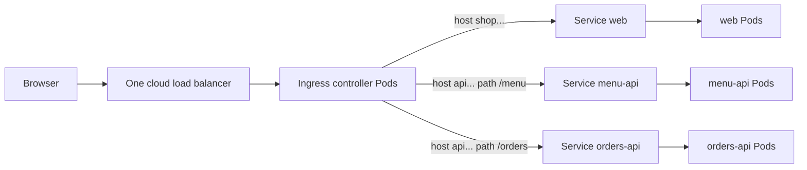

# Ingress: host and path routing

## In plain words

Harbour Coffee has several web-facing services: the shop pages, the menu API, the orders API, an admin panel. Giving each its own cloud load balancer would mean four bills, four public addresses and four certificates to manage. What the company really wants is **one** front door that looks at each incoming web request and sends it to the right service: `shop.harbour-coffee.example` to the shop, `api.harbour-coffee.example/menu` to the menu API, `api.harbour-coffee.example/orders` to the orders API.

**Ingress** is the Kubernetes object that describes those routing rules. An Ingress says "requests for this host name and this URL path go to that Service". A separate program, called an **ingress controller**, reads the rules and does the real work of receiving and forwarding requests.

A hotel switchboard is a good picture. The hotel has one published phone number. The operator answers, asks who you want, and connects you to the right room. The list of extensions pinned beside the switchboard is the Ingress: it is only a list. The operator is the ingress controller. Without an operator, the list does nothing.

Why this matters for a job: nearly every web application on Kubernetes is exposed through Ingress or its successor, the Gateway API. You will write these rules, debug 404 and 503 responses that come from them, and attach TLS certificates to them. Interviewers ask how Ingress differs from a LoadBalancer Service.

> **Before this lesson:** read both Service lessons, [ClusterIP and EndpointSlices](#/lesson/kubernetes/services-clusterip) and [NodePort and LoadBalancer](#/lesson/kubernetes/nodeport-loadbalancer). Basic HTTP vocabulary (host, path, status codes) is assumed; the networking track's HTTP lessons cover it.

## Layer 4 and layer 7

Network engineers describe communication in numbered layers. Two matter here.

- **Layer 4** is the transport level: TCP and UDP connections identified by IP address and port. A Service works here. It sees "a connection to port 80" and nothing of what is inside.
- **Layer 7** is the application level: for the web, HTTP. At this level the router can read the request itself: the **host** the browser asked for (`api.harbour-coffee.example`), the **path** (`/orders/42`), headers and cookies.

Ingress is a layer 7 router for HTTP and HTTPS. Because it can read the host and path, one entry point can serve many Services.



Read it left to right. One LoadBalancer Service exposes the ingress controller. The controller is itself a Deployment of proxy Pods running inside the cluster. It inspects each request and forwards it to a ClusterIP Service, which carries it to a Pod. The application Services stay internal; only the controller is exposed.

## Two parts: the object and the controller

This split confuses nearly every newcomer, so it is worth stating plainly.

1. An **Ingress object** is a set of rules stored in the API. Creating one does not start any software.
2. An **ingress controller** is a program you install in the cluster. It watches Ingress objects and configures a proxy to implement them. Kubernetes does **not** ship one; the cluster administrator chooses and installs it.

If you create an Ingress on a cluster with no controller, nothing happens: no error, no address, no routing. That is the most common first-time problem.

Controllers come from many projects and vendors: Traefik, HAProxy, Contour, Kong, NGINX-based controllers from F5, Envoy-based gateways, and cloud-specific controllers that configure the provider's own HTTP load balancer (on GKE, AWS and Azure). A cluster can run more than one. An **IngressClass** object names each, and an Ingress picks one with `spec.ingressClassName`:

```yaml
apiVersion: networking.k8s.io/v1
kind: IngressClass
metadata:
  name: traefik
  annotations:
    ingressclass.kubernetes.io/is-default-class: "true"
spec:
  controller: traefik.io/ingress-controller
```

`spec.controller` is an identifier that the controller software recognises as its own. The annotation marks this class as the default for Ingress objects that name no class. The controller's installer usually creates this object for you.

> [!WARNING]
> Two facts about the state of Ingress in 2026. First, the Ingress API is **frozen**: it remains supported and is not being removed, but it receives no new features, and the Kubernetes project recommends the [Gateway API](#/lesson/kubernetes/gateway-api) for new work. Second, the community-maintained **ingress-nginx** controller, for years the most common choice in tutorials, was retired: maintenance ended in March 2026 and it no longer receives security fixes. If you find it in a cluster or a guide, plan a migration to another controller or to the Gateway API. Existing Ingress objects themselves keep working with any conforming controller.

## A first Ingress, line by line

```yaml
apiVersion: networking.k8s.io/v1
kind: Ingress
metadata:
  name: shop
  namespace: cafe
spec:
  ingressClassName: traefik
  rules:
    - host: shop.harbour-coffee.example
      http:
        paths:
          - path: /
            pathType: Prefix
            backend:
              service:
                name: web
                port:
                  number: 80
```

- `apiVersion: networking.k8s.io/v1`, `kind: Ingress` — the stable Ingress API.
- `metadata.namespace: cafe` — an Ingress is namespaced, and it can route **only to Services in its own namespace**.
- `spec.ingressClassName: traefik` — which controller should implement this Ingress.
- `spec.rules` — a list of routing rules.
  - `host` — the host name the rule applies to. It is compared with the `Host` header the browser sends. If omitted, the rule applies to every host.
  - `http.paths` — a list of path matches for that host.
    - `path: /` with `pathType: Prefix` — match any path beginning with `/`, which is every path.
    - `backend.service.name` and `port.number` — where matching requests go: the `web` Service on its port 80. The port may instead be given as `port.name`.

```bash
$ kubectl apply -f shop-ingress.yaml
ingress.networking.k8s.io/shop created

$ kubectl get ingress -n cafe
NAME   CLASS     HOSTS                         ADDRESS        PORTS   AGE
shop   traefik   shop.harbour-coffee.example   203.0.113.40   80      25s

$ curl -s -H "Host: shop.harbour-coffee.example" http://203.0.113.40/ | head -1
<!doctype html>
```

`ADDRESS` is the external address of the controller's load balancer, filled in by the controller once it has accepted the Ingress. The `curl` command uses `-H` to set the `Host` header by hand, which lets you test before any DNS record exists. In production you create a DNS record pointing the host name at that address.

## Path types

Each path needs a `pathType`. There are three.

| pathType | Matches | Example: path `/orders` |
|---|---|---|
| `Exact` | The URL path exactly, case-sensitive | `/orders` only. Not `/orders/` and not `/orders/42` |
| `Prefix` | The path, split into elements at each `/`; the request must start with the same elements | `/orders`, `/orders/`, `/orders/42`. **Not** `/ordersummary` |
| `ImplementationSpecific` | Whatever the controller decides | Depends on the controller; avoid when you want portability |

The detail that trips people is that `Prefix` works on whole path elements, not on characters. `/orders` is a prefix of `/orders/42` because the first element, `orders`, matches. It is not a prefix of `/ordersummary`, whose first element is `ordersummary`.

## Several hosts and paths, and which rule wins

```yaml
apiVersion: networking.k8s.io/v1
kind: Ingress
metadata:
  name: cafe-routes
  namespace: cafe
spec:
  ingressClassName: traefik
  defaultBackend:
    service:
      name: not-found
      port:
        number: 80
  rules:
    - host: shop.harbour-coffee.example
      http:
        paths:
          - path: /
            pathType: Prefix
            backend:
              service: {name: web, port: {number: 80}}
    - host: api.harbour-coffee.example
      http:
        paths:
          - path: /menu
            pathType: Prefix
            backend:
              service: {name: menu-api, port: {number: 80}}
          - path: /orders
            pathType: Prefix
            backend:
              service: {name: orders-api, port: {number: 80}}
          - path: /orders/export
            pathType: Exact
            backend:
              service: {name: report-api, port: {number: 80}}
    - host: "*.partners.harbour-coffee.example"
      http:
        paths:
          - path: /
            pathType: Prefix
            backend:
              service: {name: partner-portal, port: {number: 80}}
```

New here:

- `{name: web, port: {number: 80}}` is YAML's compact "flow" style for the same nested structure as before, used to keep the example short.
- `defaultBackend` receives requests that match no rule. Without one, the controller answers with its own 404 page.
- Two paths under one host is called **fan-out**: one host name spread over several Services.
- The host `*.partners.harbour-coffee.example` is a **wildcard**. The `*` stands for exactly one DNS label: it matches `acme.partners.harbour-coffee.example`, but neither `partners.harbour-coffee.example` (no label) nor `a.b.partners.harbour-coffee.example` (two labels). It is quoted because a value starting with `*` has a special meaning in YAML.

When several paths match one request, the rules of precedence are:

1. Only rules whose host matches are considered. A precise host is preferred over a wildcard host.
2. Among matching paths, the **longest** path wins.
3. If two matching paths are equally long, **`Exact` beats `Prefix`**.

So `GET api.harbour-coffee.example/orders/export` matches both `/orders` (Prefix) and `/orders/export` (Exact); the longer one wins and the request goes to `report-api`. `GET .../orders/export/2026` no longer matches the Exact rule, so it falls to `/orders` and reaches `orders-api`.

### A matcher you can run

```python-run
rules = [
    ("shop.harbour-coffee.example", "/", "Prefix", "web"),
    ("api.harbour-coffee.example", "/menu", "Prefix", "menu-api"),
    ("api.harbour-coffee.example", "/orders", "Prefix", "orders-api"),
    ("api.harbour-coffee.example", "/orders/export", "Exact", "report-api"),
    ("*.partners.harbour-coffee.example", "/", "Prefix", "partner-portal"),
]
DEFAULT = "not-found (default backend)"

def host_matches(rule_host, host):
    if rule_host is None:
        return True
    if rule_host.startswith("*."):
        suffix = rule_host[1:]                      # ".partners.harbour-coffee.example"
        if not host.endswith(suffix):
            return False
        first = host[: -len(suffix)]
        return first != "" and "." not in first     # the * covers exactly one label
    return rule_host == host

def path_matches(rule_path, path_type, path):
    if path_type == "Exact":
        return path == rule_path
    want = [e for e in rule_path.split("/") if e]   # Prefix: compare element by element
    have = [e for e in path.split("/") if e]
    return have[: len(want)] == want

def route(host, path):
    best = None
    for rule_host, rule_path, path_type, service in rules:
        if host_matches(rule_host, host) and path_matches(rule_path, path_type, path):
            key = (not (rule_host or "").startswith("*."), len(rule_path), path_type == "Exact")
            if best is None or key > best[0]:
                best = (key, service)
    return best[1] if best else DEFAULT

requests = [
    ("shop.harbour-coffee.example", "/cart"),
    ("api.harbour-coffee.example", "/menu/drinks"),
    ("api.harbour-coffee.example", "/orders"),
    ("api.harbour-coffee.example", "/orders/42"),
    ("api.harbour-coffee.example", "/orders/export"),
    ("api.harbour-coffee.example", "/orders/export/2026"),
    ("api.harbour-coffee.example", "/ordersummary"),
    ("acme.partners.harbour-coffee.example", "/login"),
    ("a.b.partners.harbour-coffee.example", "/login"),
    ("unknown.example", "/"),
]
for host, path in requests:
    print(f"{host:38} {path:22} -> {route(host, path)}")
```

Check the three subtle cases in the output: `/ordersummary` matches nothing under the API host and goes to the default backend; `/orders/export` goes to `report-api` while `/orders/export/2026` goes to `orders-api`; and the two-label partner host is not covered by the wildcard.

## TLS: serving HTTPS

**TLS** (Transport Layer Security) is the encryption behind HTTPS. To serve HTTPS, the controller needs a **certificate**, which proves the site's identity, and the matching **private key**. In Kubernetes these are stored in a Secret of type `kubernetes.io/tls`, and the Ingress refers to it.

```bash
$ kubectl create secret tls shop-tls -n cafe --cert=shop.crt --key=shop.key
secret/shop-tls created
```

```yaml
apiVersion: networking.k8s.io/v1
kind: Ingress
metadata:
  name: shop
  namespace: cafe
spec:
  ingressClassName: traefik
  tls:
    - hosts:
        - shop.harbour-coffee.example
      secretName: shop-tls
  rules:
    - host: shop.harbour-coffee.example
      http:
        paths:
          - path: /
            pathType: Prefix
            backend:
              service:
                name: web
                port:
                  number: 80
```

- The `kubectl create secret tls` command builds a Secret from a certificate file and a key file.
- `spec.tls` lists host names and the Secret that holds their certificate. The Secret must be in the same namespace as the Ingress.

The controller now accepts HTTPS on port 443, decrypts it, and forwards plain HTTP to the `web` Service. Ending the encrypted connection at the proxy is called **TLS termination**. The traffic from controller to Pod is unencrypted unless you add more, such as a service mesh.

Nobody manages certificates by hand in practice. The widely used add-on **cert-manager** watches Ingress objects, obtains certificates from an authority such as Let's Encrypt, stores them in Secrets and renews them before they expire. You typically add one annotation naming the issuer, and the Secret appears.

## Annotations: where portability ends

The Ingress specification covers hosts, paths, back ends and TLS, and little else. Everything beyond that (redirects, URL rewriting, timeouts, request size limits, rate limiting, authentication) is configured through **annotations** that are specific to each controller:

```yaml
metadata:
  annotations:
    traefik.ingress.kubernetes.io/router.entrypoints: websecure
    traefik.ingress.kubernetes.io/router.middlewares: cafe-strip-api@kubernetescrd
```

These two lines mean something only to Traefik. Another controller ignores them and has its own spelling for the same ideas. An Ingress that relies on annotations therefore cannot move between controllers unchanged. This limitation, more than anything else, is why the Gateway API was created: it turns those features into proper, typed fields.

## Debugging an Ingress

Requests that fail at an Ingress produce a small set of symptoms.

| Symptom | Likely cause |
|---|---|
| `ADDRESS` column empty | No controller installed, or wrong or missing `ingressClassName` |
| 404 from the controller | No rule matches the host or path; often the `Host` header or a path type |
| 503 Service Unavailable | The rule matched, but the Service has no ready endpoints |
| 502 Bad Gateway | The controller reached a Pod that answered wrongly: wrong port, app crashed, or the app expects HTTPS |
| Certificate warning | Secret missing, in another namespace, or certificate does not cover the host |
| Works with `curl -H Host:` but not in a browser | DNS does not point at the controller's address |

```bash
$ kubectl describe ingress cafe-routes -n cafe
Name:             cafe-routes
Namespace:        cafe
Address:          203.0.113.40
Ingress Class:    traefik
Default backend:  not-found:80 (10.244.1.30:8080)
Rules:
  Host                         Path  Backends
  ----                         ----  --------
  api.harbour-coffee.example
                               /menu           menu-api:80 (10.244.1.5:8080,10.244.2.9:8080)
                               /orders         orders-api:80 (<none>)
                               /orders/export  report-api:80 (<error: services "report-api" not found>)
```

`describe` resolves every back end down to Pod addresses, which makes two faults visible at once: `orders-api` has no endpoints (requests would get 503), and `report-api` does not exist as a Service in this namespace. After that, read the controller's own logs with `kubectl logs` in the namespace where it is installed; it reports each Ingress it accepts or rejects.

> [!TIP]
> Debug from the inside out. First confirm the Service answers from within the cluster (`kubectl exec ... -- wget -qO- http://orders-api`). Then test the controller with an explicit `Host` header against its address. Only then look at DNS and certificates. Each step removes one layer from suspicion.

> [!INTERVIEW]
> **"What is the difference between a LoadBalancer Service and an Ingress?"** A LoadBalancer Service is layer 4: it exposes one Service on an IP and port through a cloud load balancer, with no knowledge of HTTP, and each one costs a separate load balancer. An Ingress is a set of layer 7 HTTP routing rules, by host and path, with TLS termination, implemented by an ingress controller running in the cluster. Many Services share the controller's single entry point, which is itself usually exposed by one LoadBalancer Service. The Ingress object alone does nothing without a controller, and features beyond host, path and TLS depend on controller-specific annotations. Finish with currency: the Ingress API is frozen and the Gateway API is the recommended successor.

## Common pitfalls

- **No ingress controller installed.** The object is accepted and ignored.
- **Missing or wrong `ingressClassName`** when no default class exists.
- **Back end Service in a different namespace.** Ingress can only reference Services in its own namespace.
- **Assuming `Prefix` is a character prefix.** It compares whole path elements.
- **The application does not expect the path prefix.** The Ingress sends `/menu/drinks` to `menu-api` unchanged; if the app serves `/drinks`, you need a rewrite, which is controller-specific.
- **TLS Secret in another namespace or with the wrong type.**
- **Relying on annotations and then switching controller.** The behaviour silently disappears.
- **Still running the retired ingress-nginx controller.** It receives no security fixes.

## Cheat sheet

| Field | Purpose |
|---|---|
| `spec.ingressClassName` | Which controller implements this Ingress |
| `spec.rules[].host` | Host name to match; optional; `*.` wildcard covers one label |
| `spec.rules[].http.paths[].path` | URL path to match |
| `pathType` | `Exact`, `Prefix` (by path element), `ImplementationSpecific` |
| `backend.service.name` / `port` | Destination Service (same namespace) and port |
| `spec.defaultBackend` | Where unmatched requests go |
| `spec.tls[]` | Hosts and the `kubernetes.io/tls` Secret with their certificate |

| Precedence | Rule |
|---|---|
| 1 | Host must match; precise host before wildcard |
| 2 | Longest matching path wins |
| 3 | On equal length, `Exact` wins over `Prefix` |

## Summary

Ingress provides layer 7 routing for HTTP and HTTPS: rules that map host names and URL paths to Services, with optional TLS termination. The rules are only data; an ingress controller that you install watches them and runs the proxy that implements them, usually behind a single LoadBalancer Service shared by every application. Path types determine how paths match, and the longest match wins with `Exact` ahead of `Prefix`. Anything beyond the small standard specification lives in controller-specific annotations, which limits portability. The API is frozen and its most familiar community controller has been retired, which leads directly to the next lesson on its successor, the Gateway API.

## Glossary

- **Ingress**: an object holding HTTP routing rules from hosts and paths to Services.
- **Ingress controller**: the software that implements Ingress rules with a proxy.
- **IngressClass**: an object naming a controller so that an Ingress can select it.
- **Layer 4 / layer 7**: transport-level versus application-level (HTTP) networking.
- **Host**: the domain name a request is addressed to.
- **Path**: the part of a URL after the host.
- **pathType**: how a path rule is compared with the request path.
- **Fan-out**: routing one host to several Services by path.
- **Wildcard host**: a host beginning with `*.` that matches one extra DNS label.
- **Default backend**: the destination for requests no rule matches.
- **TLS**: the encryption protocol used by HTTPS.
- **TLS termination**: decrypting HTTPS at the proxy and forwarding plain HTTP.
- **Certificate**: a signed document proving a site's identity, paired with a private key.
- **cert-manager**: an add-on that obtains and renews certificates automatically.
- **Annotation**: metadata used here for controller-specific settings.

```quiz
[
  {"q": "You create an Ingress on a new cluster. kubectl get ingress shows an empty ADDRESS, and requests do not reach your Service. No errors are reported. What is the most likely cause?",
   "options": ["The Service has no endpoints", "No ingress controller is installed, or the Ingress names a class no controller handles", "The path type is wrong", "The cluster needs a restart"],
   "answer": 1,
   "explain": "An Ingress is only a set of rules. Without a controller that claims it, nothing implements it and no address is assigned."},
  {"q": "An Ingress has path /orders with pathType Prefix. Which request path does NOT match?",
   "options": ["/orders", "/orders/", "/orders/42/items", "/ordersummary"],
   "answer": 3,
   "explain": "Prefix matching is by path element. The first element of /ordersummary is 'ordersummary', which is not 'orders'."},
  {"q": "Rules for one host: /orders (Prefix) to orders-api and /orders/export (Exact) to report-api. Where does GET /orders/export/2026 go?",
   "options": ["report-api", "orders-api", "The default backend", "Both, alternating"],
   "answer": 1,
   "explain": "The Exact rule requires the path to equal /orders/export, so it does not match. The Prefix rule /orders does."},
  {"q": "A request through an Ingress returns 503 Service Unavailable. The same host and path worked yesterday. What should you check first?",
   "options": ["Whether the back end Service has any ready endpoints", "Whether DNS points at the controller", "Whether the IngressClass exists", "Whether the path type is Exact"],
   "answer": 0,
   "explain": "A 503 from the controller usually means the rule matched but there is no ready Pod behind the Service. A 404 would suggest a routing mismatch."},
  {"q": "An Ingress in namespace cafe lists a back end Service that exists only in namespace finance. What happens?",
   "options": ["It works, Ingress is cluster-wide", "The back end cannot be resolved, because an Ingress can only use Services in its own namespace", "The Service is copied into cafe", "The controller creates an ExternalName automatically"],
   "answer": 1,
   "explain": "Back end references are namespace-local. kubectl describe ingress shows the Service as not found."},
  {"q": "Which host is matched by the rule host *.partners.harbour-coffee.example?",
   "options": ["partners.harbour-coffee.example", "acme.partners.harbour-coffee.example", "a.b.partners.harbour-coffee.example", "harbour-coffee.example"],
   "answer": 1,
   "explain": "The wildcard stands for exactly one DNS label, so one extra label matches, zero or two do not."},
  {"q": "Why do Ingress manifests often fail to work unchanged after switching to a different ingress controller?",
   "options": ["The apiVersion differs per controller", "Features such as rewrites and timeouts are set with controller-specific annotations", "Hosts must be re-registered", "Services must be recreated"],
   "answer": 1,
   "explain": "Only hosts, paths, back ends and TLS are standard. Everything else is annotation-based and each controller has its own."},
  {"q": "With TLS configured on an Ingress, where is HTTPS decrypted by default?",
   "options": ["In the application Pod", "At the ingress controller, which forwards plain HTTP to the Service", "At the kubelet", "In etcd"],
   "answer": 1,
   "explain": "This is TLS termination at the proxy. Traffic from the controller to Pods is unencrypted unless further measures are added."}
]
```

> **Source:** Poulton, *The Kubernetes Book*, ch. 8 (topic coverage only). Official docs: https://kubernetes.io/docs/concepts/services-networking/ingress/ , https://kubernetes.io/docs/concepts/services-networking/ingress-controllers/ , https://kubernetes.io/blog/2025/11/11/ingress-nginx-retirement/
