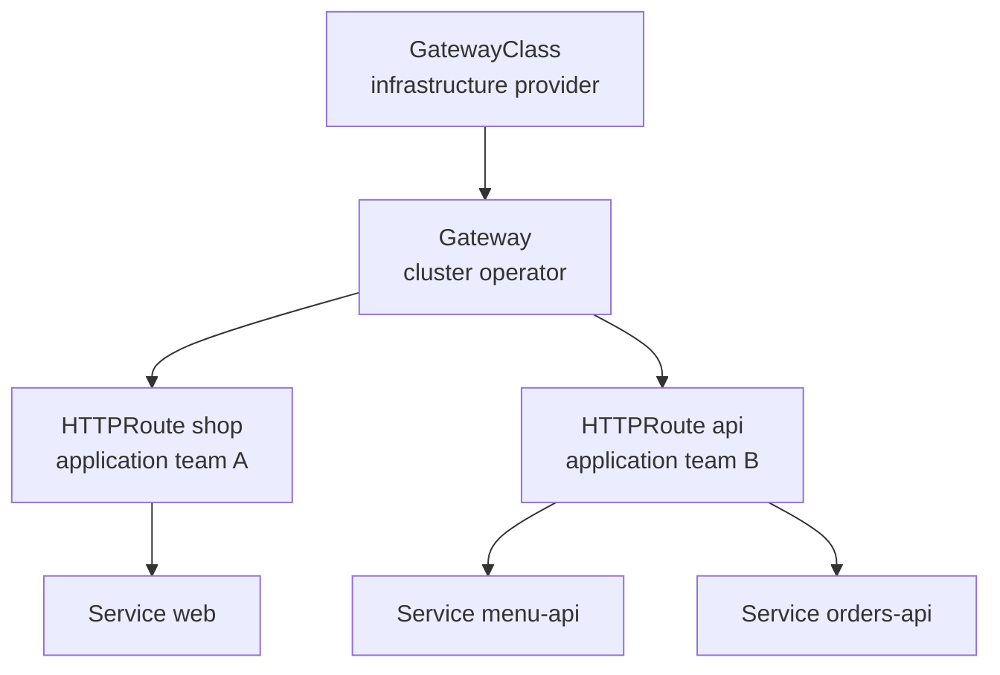

# The Gateway API

## In plain words

The **Gateway API** is the modern way to describe how traffic enters a Kubernetes cluster and gets routed to Services. It does the same job as Ingress, and it was designed by the same community to fix what Ingress got wrong. Where Ingress squeezed everything into one object plus a pile of vendor-specific annotations, the Gateway API splits the job into several objects, each owned by the person whose job it matches, and turns common features such as traffic splitting, redirects and header matching into proper fields.

Go back to the office building. With Ingress, every tenant company wrote its own instructions on one shared sheet taped to the reception desk, and each receptionist understood different scribbles in the margin. With the Gateway API the responsibilities are separate. The building owner decides which *kinds* of entrance exist (a **GatewayClass**). The facilities manager installs a specific entrance with specific doors and opening rules (a **Gateway**). Each tenant company then writes its own directions from that entrance to its own offices (an **HTTPRoute**), without being able to touch the doors or another tenant's directions.

Why this matters for a job: the Kubernetes project now recommends the Gateway API over Ingress for new work, the Ingress API is frozen, and the long-popular ingress-nginx controller was retired in March 2026. Teams are migrating, so you will see both for years and must be able to read and write both. Canary releases by traffic percentage, which interviewers like to ask about, are a built-in feature here.

> **Before this lesson:** read [Ingress: host and path routing](#/lesson/kubernetes/ingress). The ideas of layer 7 routing, a controller that implements rules, hosts, paths and TLS termination all carry over.

## What was wrong with Ingress

| Limitation of Ingress | How the Gateway API answers it |
|---|---|
| One object mixes infrastructure settings and application routing | Separate objects for infrastructure (Gateway) and routing (Routes) |
| Advanced features only through controller-specific annotations | Typed, standard fields for header matching, redirects, rewrites, weights, timeouts, mirroring |
| HTTP and HTTPS only | Routes for HTTP, gRPC, TLS, TCP and UDP |
| A route can only use Services in its own namespace | Cross-namespace attachment, with explicit permission on both sides |
| No standard status reporting | Every object reports **conditions** saying whether it was accepted and why |
| Frozen | Actively developed, with versioned release channels |

## The objects and who owns them



| Object | Scope | Written by | Says |
|---|---|---|---|
| **GatewayClass** | Cluster | Infrastructure provider or platform team | "This type of gateway is implemented by controller X" |
| **Gateway** | Namespace | Cluster operator | "Create an entry point of that class, listening on these ports and host names, and allow routes from these namespaces" |
| **HTTPRoute** (and other Routes) | Namespace | Application developer | "For requests arriving at that Gateway matching these conditions, send them to these Services" |

This division is called the **role-oriented** design. It maps onto Kubernetes access control: a developer can be allowed to create HTTPRoutes in their namespace without having any right to change the shared Gateway.

Like Ingress, the Gateway API needs an implementation: a **gateway controller** that you install. Many exist, including Envoy Gateway, Cilium, Istio, Traefik, NGINX Gateway Fabric, Kong, and the managed controllers of GKE, AWS and Azure. The Gateway API objects are not built into the core API server; they are added as CustomResourceDefinitions (explained in the [CRDs lesson](#/lesson/kubernetes/crds-operators)), usually by the controller's installer. GatewayClass, Gateway, HTTPRoute and GRPCRoute are stable, with `apiVersion: gateway.networking.k8s.io/v1`.

## GatewayClass

```yaml
apiVersion: gateway.networking.k8s.io/v1
kind: GatewayClass
metadata:
  name: envoy
spec:
  controllerName: gateway.envoyproxy.io/gatewayclass-controller
```

- GatewayClass is cluster-scoped, so it has no namespace.
- `spec.controllerName` is the identifier of the controller that will act on Gateways of this class. Each implementation documents its own value.

You will rarely write one; installing a controller normally creates it. Its role is the same as IngressClass.

## Gateway

```yaml
apiVersion: gateway.networking.k8s.io/v1
kind: Gateway
metadata:
  name: public
  namespace: infra
spec:
  gatewayClassName: envoy
  listeners:
    - name: http
      protocol: HTTP
      port: 80
      allowedRoutes:
        namespaces:
          from: All
    - name: https
      protocol: HTTPS
      port: 443
      hostname: "*.harbour-coffee.example"
      tls:
        mode: Terminate
        certificateRefs:
          - kind: Secret
            name: wildcard-harbour-coffee-tls
      allowedRoutes:
        namespaces:
          from: Selector
          selector:
            matchLabels:
              gateway-access: public
```

- `metadata.namespace: infra` — the Gateway lives in a namespace owned by the platform team.
- `spec.gatewayClassName: envoy` — which class, and therefore which controller, should build it.
- `spec.listeners` — the entry points. A **listener** is a combination of port, protocol and, optionally, host name.
  - The first listens for plain HTTP on port 80.
  - The second listens for HTTPS on 443, only for host names matching `*.harbour-coffee.example`. `tls.mode: Terminate` means the gateway decrypts the traffic; `certificateRefs` names the Secret holding the certificate, which lives in the Gateway's namespace.
  - `allowedRoutes` controls which namespaces may attach routes to this listener. `from: Same` (the default) allows only the Gateway's own namespace. `from: All` allows any. `from: Selector` allows namespaces whose labels match: here, those labelled `gateway-access: public`.

Notice what moved compared with Ingress. The certificate is attached once, at the Gateway, by the operator. Application teams no longer need access to the TLS private key.

When you apply a Gateway, the controller provisions real infrastructure for it: typically a Deployment of proxy Pods plus a LoadBalancer Service, or a cloud load balancer.

```bash
$ kubectl get gateway -n infra
NAME     CLASS   ADDRESS        PROGRAMMED   AGE
public   envoy   203.0.113.60   True         70s
```

`ADDRESS` is the external address. `PROGRAMMED True` is a condition meaning the controller has configured the data plane for this Gateway.

## HTTPRoute

```yaml
apiVersion: gateway.networking.k8s.io/v1
kind: HTTPRoute
metadata:
  name: api
  namespace: cafe
spec:
  parentRefs:
    - name: public
      namespace: infra
      sectionName: https
  hostnames:
    - api.harbour-coffee.example
  rules:
    - matches:
        - path:
            type: PathPrefix
            value: /menu
      backendRefs:
        - name: menu-api
          port: 80
    - matches:
        - path:
            type: PathPrefix
            value: /orders
          method: POST
        - path:
            type: Exact
            value: /orders/export
          headers:
            - name: X-Report-Format
              value: csv
      backendRefs:
        - name: orders-api
          port: 80
```

- `metadata.namespace: cafe` — the route lives with the application.
- `spec.parentRefs` — which Gateway this route attaches to. `name` and `namespace` identify the Gateway; `sectionName: https` narrows it to one listener by name. Attachment succeeds only if that listener's `allowedRoutes` admits the `cafe` namespace.
- `spec.hostnames` — the hosts this route handles. They must fit within the listener's host name, here the wildcard.
- `spec.rules` — a list. Each rule has `matches` (conditions) and `backendRefs` (destinations).
  - The first rule sends any path beginning with `/menu` to `menu-api` port 80.
  - The second rule has **two** matches. Items in the `matches` list are alternatives: the rule applies if *any one* of them matches. *Within* one item, all conditions must hold. So this rule applies to "`POST` requests under `/orders`" **or** "requests for exactly `/orders/export` carrying the header `X-Report-Format: csv`".

Path match types are `PathPrefix` (by path element, like Ingress `Prefix`), `Exact` and `RegularExpression` (support varies by implementation). Besides path, a match can test `method`, `headers` and `queryParams`.

```bash
$ kubectl get httproute -n cafe
NAME   HOSTNAMES                          AGE
api    ["api.harbour-coffee.example"]     40s

$ kubectl get httproute api -n cafe -o jsonpath='{range .status.parents[0].conditions[*]}{.type}={.status} ({.reason}){"\n"}{end}'
Accepted=True (Accepted)
ResolvedRefs=True (ResolvedRefs)
```

The second command prints the route's status conditions as reported by the Gateway it attached to. `Accepted=True` means the Gateway took the route. `ResolvedRefs=True` means every backend it names exists and may be used. This explicit feedback is one of the biggest practical improvements over Ingress, where a rejected rule was often visible only in the controller's logs.

## Traffic splitting: canary by weight

Each entry in `backendRefs` may carry a `weight`. Requests are divided in proportion to the weights.

```yaml
apiVersion: gateway.networking.k8s.io/v1
kind: HTTPRoute
metadata:
  name: orders-canary
  namespace: cafe
spec:
  parentRefs:
    - name: public
      namespace: infra
  hostnames:
    - api.harbour-coffee.example
  rules:
    - matches:
        - path:
            type: PathPrefix
            value: /orders
      backendRefs:
        - name: orders-api-stable
          port: 80
          weight: 90
        - name: orders-api-canary
          port: 80
          weight: 10
```

Ninety per cent of requests go to the stable Service and ten per cent to the canary, **regardless of how many Pods each has**. Compare that with the replica-ratio canary from the [rolling updates lesson](#/lesson/kubernetes/rolling-updates-rollbacks), where 10% required one canary Pod for every nine stable ones. To advance the canary you edit two numbers. A weight of 0 sends no traffic to that backend. The default weight is 1.

```python-run
import random
from collections import Counter
random.seed(11)

def pick_backend(backend_refs):
    """Weighted random choice, the way a gateway splits traffic."""
    total = sum(w for _, w in backend_refs)
    if total == 0:
        return "HTTP 500 (no backend has weight)"
    r = random.uniform(0, total)
    upto = 0
    for name, weight in backend_refs:
        upto += weight
        if r <= upto and weight > 0:
            return name
    return backend_refs[-1][0]

for stage, refs in [("start", [("stable", 100), ("canary", 0)]),
                    ("canary 10%", [("stable", 90), ("canary", 10)]),
                    ("canary 50%", [("stable", 50), ("canary", 50)]),
                    ("promoted", [("stable", 0), ("canary", 100)])]:
    counts = Counter(pick_backend(refs) for _ in range(10000))
    shares = {k: f"{v / 100:.1f}%" for k, v in sorted(counts.items())}
    print(f"{stage:11} weights={dict(refs)} -> observed {shares}")
```

The observed shares hover around the configured weights, as expected of a random split. Each request is decided independently, so a single user may hit the stable version and then the canary on consecutive requests unless you also route by a header or cookie.

## Filters: changing requests on the way through

A rule can carry **filters** that modify the request or response. These replace the most common Ingress annotations.

```yaml
apiVersion: gateway.networking.k8s.io/v1
kind: HTTPRoute
metadata:
  name: shop
  namespace: cafe
spec:
  parentRefs:
    - name: public
      namespace: infra
      sectionName: http
    - name: public
      namespace: infra
      sectionName: https
  hostnames:
    - shop.harbour-coffee.example
  rules:
    - matches:
        - path: {type: PathPrefix, value: /old-menu}
      filters:
        - type: RequestRedirect
          requestRedirect:
            path:
              type: ReplaceFullPath
              replaceFullPath: /menu
            statusCode: 301
    - matches:
        - path: {type: PathPrefix, value: /api/menu}
      filters:
        - type: URLRewrite
          urlRewrite:
            path:
              type: ReplacePrefixMatch
              replacePrefixMatch: /
        - type: RequestHeaderModifier
          requestHeaderModifier:
            add:
              - name: X-Forwarded-Prefix
                value: /api/menu
      backendRefs:
        - name: menu-api
          port: 80
      timeouts:
        request: 10s
    - backendRefs:
        - name: web
          port: 80
```

- This route attaches to two listeners of the same Gateway, HTTP and HTTPS.
- Rule 1 answers `/old-menu` with a permanent redirect (status 301) to `/menu`. A redirect rule needs no backend.
- Rule 2 rewrites the path before forwarding: the matched prefix `/api/menu` is replaced with `/`, so the app receives `/drinks` for a request to `/api/menu/drinks`. It also adds a header telling the app what was removed, and sets a 10 second request timeout.
- Rule 3 has no `matches`, which means "everything else", and sends it to `web`.

Standard filter types are `RequestRedirect`, `URLRewrite`, `RequestHeaderModifier`, `ResponseHeaderModifier` and `RequestMirror` (send a copy of each request to a second backend for testing, ignoring its responses).

When several rules could match one request, the most specific wins: an exact path before a prefix, a longer prefix before a shorter one, then matches with more header conditions. A rule's position in the file is the last tie-breaker only.

## Crossing namespaces safely: ReferenceGrant

A route may send traffic to a Service in a *different* namespace, but only if the owner of that namespace agrees. Agreement is a **ReferenceGrant** created in the target namespace:

```yaml
apiVersion: gateway.networking.k8s.io/v1beta1
kind: ReferenceGrant
metadata:
  name: allow-cafe-routes
  namespace: finance
spec:
  from:
    - group: gateway.networking.k8s.io
      kind: HTTPRoute
      namespace: cafe
  to:
    - group: ""
      kind: Service
      name: ledger
```

Read it as: "HTTPRoutes in namespace `cafe` may reference the Service named `ledger` in this namespace (`finance`)". The empty `group: ""` denotes the core API group that Services belong to. Without the grant, the route's `ResolvedRefs` condition is `False` with reason `RefNotPermitted`.

So cross-namespace use needs a handshake in each direction: the Gateway's `allowedRoutes` lets routes *in*, and a ReferenceGrant lets references *out* to another namespace's objects. Neither side can be used without its owner's consent.

## Ingress and Gateway API side by side

| Concept | Ingress | Gateway API |
|---|---|---|
| Which controller | IngressClass | GatewayClass |
| Entry point, ports, TLS | Implicit in the controller; TLS on each Ingress | Gateway listeners |
| Routing rules | Ingress `rules` | HTTPRoute, GRPCRoute, and others |
| Match on | Host, path | Host, path, method, headers, query parameters |
| Traffic split | Annotation, if supported | `backendRefs[].weight` |
| Redirect, rewrite, header changes | Annotations | Filters |
| Cross-namespace backends | No | Yes, with ReferenceGrant |
| Non-HTTP protocols | No | TCP, UDP, TLS routes (experimental channel in part) |
| Status feedback | Minimal | Conditions on every object |

Migrating is mostly mechanical: one Gateway replaces the shared controller entry point, and each Ingress becomes an HTTPRoute. The `ingress2gateway` tool converts manifests, including many controller-specific annotations, as a starting point.

The Gateway API is also used *inside* clusters. Service meshes use the same HTTPRoute objects, attached to a Service instead of a Gateway, to control traffic between Pods. The same skill then covers traffic entering the cluster and traffic within it.

> [!TIP]
> When a route does nothing, read its status before anything else: `kubectl describe httproute NAME`. The `Parents` section shows, for each Gateway, whether the route was `Accepted` and whether its references resolved, with a reason such as `NotAllowedByListeners`, `NoMatchingListenerHostname`, `BackendNotFound` or `RefNotPermitted`. Each reason points to one specific fix.

> [!WARNING]
> Gateway API features are grouped into **conformance levels**: Core (every implementation supports it), Extended (optional, but behaves identically where supported) and Implementation-specific. Check your controller's conformance report before relying on an Extended feature such as request mirroring or timeouts. Portability is far better than with Ingress annotations but not absolute.

> [!INTERVIEW]
> **"What is the Gateway API and why does it replace Ingress?"** It is a set of role-oriented resources for traffic routing. A GatewayClass, owned by the infrastructure provider, names a controller. A Gateway, owned by the cluster operator, declares listeners (port, protocol, host name, TLS) and which namespaces may attach routes. HTTPRoutes and other Routes, owned by application teams, attach to a Gateway through `parentRefs` and define matches, filters and weighted backends. Compared with Ingress it separates infrastructure from routing so that permissions match responsibilities, standardises features that used to be annotations (header matching, redirects, rewrites, traffic splitting, timeouts), supports more protocols, permits controlled cross-namespace references through `allowedRoutes` and ReferenceGrant, and reports status conditions. Ingress is frozen, which is why new work targets the Gateway API.

## Common pitfalls

- **CRDs or controller not installed.** `kubectl apply` fails with "no matches for kind Gateway", or objects are accepted and nothing implements them.
- **Route not allowed by the listener.** The default `allowedRoutes` is `Same` namespace; a route elsewhere is rejected with `NotAllowedByListeners`.
- **Host name outside the listener's host name.** The route attaches to nothing.
- **Missing ReferenceGrant** for a backend in another namespace.
- **Misreading `matches`.** List items are alternatives (OR); fields within one item are combined (AND).
- **Assuming weights follow Pod counts.** They are independent of replicas; a 50% canary with one Pod receives half of all traffic.
- **Expecting sticky users in a weighted split.** Each request is routed independently.
- **Using an Extended feature the controller does not support.** Check the route's conditions.

## Cheat sheet

| Object | Key fields |
|---|---|
| GatewayClass | `spec.controllerName` |
| Gateway | `spec.gatewayClassName`, `listeners[].{name,port,protocol,hostname,tls,allowedRoutes}` |
| HTTPRoute | `parentRefs[]`, `hostnames[]`, `rules[].matches[]`, `rules[].filters[]`, `rules[].backendRefs[].{name,port,weight}` |
| ReferenceGrant | `from[]` (who may reference), `to[]` (what may be referenced), created in the target namespace |

| Task | Command |
|---|---|
| List gateways and addresses | `kubectl get gateway -A` |
| Check a route was accepted | `kubectl describe httproute NAME` |
| See installed classes | `kubectl get gatewayclass` |
| Convert Ingress manifests | `ingress2gateway print` |

## Summary

The Gateway API replaces the single Ingress object with a small family of resources that match real responsibilities. A GatewayClass identifies the implementing controller, a Gateway defines listeners, TLS and which namespaces may attach, and Routes owned by application teams attach to Gateways and express matching, filters and weighted backends in standard fields. Cross-namespace use requires consent from both sides, and every object reports conditions that say whether it is working and why not. With Ingress frozen and its best-known controller retired, the Gateway API is where new routing work belongs. The next module looks beneath all of this, at how names are turned into addresses and how a packet finds its Pod.

## Glossary

- **Gateway API**: the role-oriented successor to Ingress for traffic routing.
- **GatewayClass**: a cluster-scoped object naming the controller for a kind of gateway.
- **Gateway**: an entry point with listeners, created by a cluster operator.
- **Listener**: a port, protocol and optional host name on a Gateway.
- **HTTPRoute**: HTTP routing rules attached to a Gateway.
- **parentRefs**: the Gateways (and listeners) a route attaches to.
- **allowedRoutes**: which namespaces may attach routes to a listener.
- **backendRefs**: the Services a rule forwards to, optionally weighted.
- **Weight**: a backend's proportional share of traffic.
- **Filter**: a step that redirects, rewrites or modifies a request or response.
- **ReferenceGrant**: permission, granted in the target namespace, for cross-namespace references.
- **Condition**: a status entry such as `Accepted` or `ResolvedRefs` with a reason.
- **Conformance level**: Core, Extended or Implementation-specific support for a feature.
- **Role-oriented**: designed so that each object matches one job role's responsibility.

```quiz
[
  {"q": "In the Gateway API, which object does an application developer normally create?",
   "options": ["GatewayClass", "Gateway", "HTTPRoute", "IngressClass"],
   "answer": 2,
   "explain": "Routes belong to application teams. The Gateway is managed by the cluster operator and the GatewayClass by the infrastructure provider."},
  {"q": "An HTTPRoute in namespace cafe references a Gateway in namespace infra whose listener has the default allowedRoutes. What happens?",
   "options": ["The route attaches normally", "The route is not accepted, because the default only allows routes from the Gateway's own namespace", "The Gateway is moved to cafe", "The route is deleted"],
   "answer": 1,
   "explain": "allowedRoutes.namespaces.from defaults to Same. The route's status shows Accepted False with reason NotAllowedByListeners until the operator allows the namespace."},
  {"q": "A rule lists backendRefs stable (weight 90) and canary (weight 10). The canary has 1 Pod and stable has 20. Roughly what share of requests reaches the canary?",
   "options": ["About 5%", "About 10%", "About 50%", "None until it has 2 Pods"],
   "answer": 1,
   "explain": "Weights set the split independently of replica counts. The single canary Pod receives about one request in ten."},
  {"q": "An HTTPRoute rule has two entries in matches: one with path prefix /orders and method POST, another with exact path /orders/export. When does the rule apply?",
   "options": ["Only when both entries match at once", "When either entry matches; within an entry all its conditions must hold", "Only for the first entry", "Never, two matches are invalid"],
   "answer": 1,
   "explain": "Entries in matches are alternatives. Conditions inside one entry are combined, so the first needs both the prefix and the POST method."},
  {"q": "An HTTPRoute in cafe lists a backend Service in namespace finance. Its status shows ResolvedRefs False, reason RefNotPermitted. What is missing?",
   "options": ["A second Gateway", "A ReferenceGrant in the finance namespace allowing HTTPRoutes from cafe to reference that Service", "An IngressClass", "A NodePort on the Service"],
   "answer": 1,
   "explain": "Cross-namespace references need consent from the namespace that owns the target, expressed as a ReferenceGrant created there."},
  {"q": "Where is the TLS certificate for HTTPS normally configured in the Gateway API?",
   "options": ["On each HTTPRoute", "On the Gateway listener, through certificateRefs", "On the GatewayClass", "On each Service"],
   "answer": 1,
   "explain": "The operator attaches certificates to listeners. Application teams writing routes do not need access to the private key."},
  {"q": "kubectl apply of a Gateway manifest fails with 'no matches for kind \"Gateway\" in version \"gateway.networking.k8s.io/v1\"'. Why?",
   "options": ["The YAML indentation is wrong", "The Gateway API CustomResourceDefinitions are not installed in the cluster", "Gateways require a NodePort", "The namespace does not exist"],
   "answer": 1,
   "explain": "Gateway API kinds are added to a cluster as CRDs, usually with a gateway controller. Until then the API server does not know the kind."},
  {"q": "Which Ingress weakness do Gateway API filters address most directly?",
   "options": ["The lack of DNS", "Redirects, rewrites and header changes needing controller-specific annotations", "The need for Services", "Pod scheduling"],
   "answer": 1,
   "explain": "Filters make these behaviours typed, standard fields instead of annotations whose meaning varied by controller."}
]
```

> **Source:** Poulton, *The Kubernetes Book*, ch. 8 (topic coverage only; the Gateway API material follows the official documentation). Official docs: https://kubernetes.io/docs/concepts/services-networking/gateway/ , https://gateway-api.sigs.k8s.io/ , https://gateway-api.sigs.k8s.io/api-types/httproute/ , https://gateway-api.sigs.k8s.io/api-types/referencegrant/
