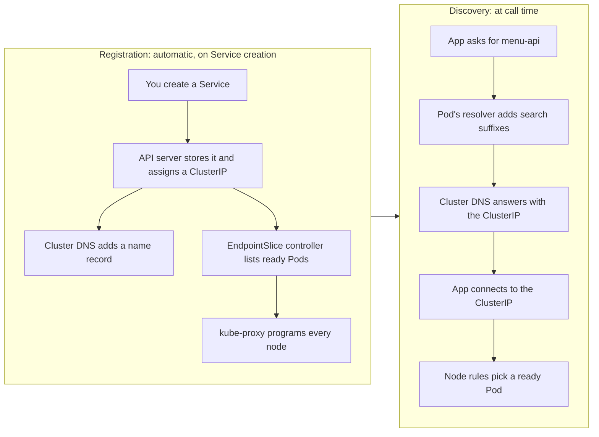

# Service registration and cluster DNS

## In plain words

When `web` calls `http://menu-api`, two separate things have to be true. First, somebody must have written down "there is a thing called `menu-api`, and here is where it lives". That is **service registration**. Second, the caller must be able to look that record up. That is **service discovery**. Together they are how programs in a cluster find each other by name, without anyone configuring an address.

A mobile phone's contact list is the everyday version. Registration is saving "Dentist: 020 7946 0000" once. Discovery is typing "Dentist" and letting the phone find the number. You never memorise the number, and if the dentist changes it, one update to the contact fixes every future call. In Kubernetes the contact list is the cluster's **DNS** (Domain Name System, the internet's standard way of turning names into addresses), and entries are added and removed automatically as Services are created and deleted.

Why this matters for a job: "it works with the IP but not with the name" and "it resolves in one namespace but not another" are everyday tickets. Understanding the name format, the search list and where DNS runs lets you solve them in minutes. Interviewers often ask you to trace what happens when one Pod calls another by name.

> **Before this lesson:** read [Services, selectors, ClusterIP and EndpointSlices](#/lesson/kubernetes/services-clusterip) and [Namespaces](#/lesson/kubernetes/namespaces). General DNS background (records, resolvers) is covered in the networking track.

## Two halves



Both halves are covered here, and the last steps of each (what the node does with the packet) are the subject of the [next lesson](#/lesson/kubernetes/packet-path-troubleshooting).

## Registration: what happens when a Service is created

You apply a Service manifest. Without any further action from you:

1. The **API server** validates it, allocates a ClusterIP from the Service address range, and stores it.
2. The **cluster DNS** server, which keeps a watch on Services through the API, creates DNS records mapping the Service's name to that ClusterIP.
3. The **EndpointSlice controller** finds the Pods matching the selector and writes their addresses into EndpointSlices.
4. **kube-proxy** on every node sees the Service and its slices and updates the kernel's forwarding rules.

Within a second or two, the name works from every Pod in the cluster. Registration is entirely a side effect of creating the Service; there is no separate "register" step and nothing for the application to do.

## The cluster DNS: CoreDNS

Every cluster runs an internal DNS server. In nearly all clusters it is **CoreDNS**, running as a Deployment in `kube-system` and exposed through a Service that is, for historical reasons, still named `kube-dns`.

```bash
$ kubectl get deploy,svc -n kube-system -l k8s-app=kube-dns
NAME                      READY   UP-TO-DATE   AVAILABLE   AGE
deployment.apps/coredns   2/2     2            2           12d

NAME               TYPE        CLUSTER-IP   EXTERNAL-IP   PORT(S)                  AGE
service/kube-dns   ClusterIP   10.96.0.10   <none>        53/UDP,53/TCP,9153/TCP   12d
```

Two CoreDNS Pods run behind a Service with the well-known ClusterIP `10.96.0.10` (the exact address depends on the cluster's Service range). Port 53 is the standard DNS port, for both UDP and TCP. Notice the neat self-reference: the DNS server is itself reached through a Service, but by IP address, since you cannot use DNS to find the DNS server.

CoreDNS is configured by a file called the **Corefile**, stored in a ConfigMap:

```bash
$ kubectl get configmap coredns -n kube-system -o jsonpath='{.data.Corefile}'
.:53 {
    errors
    health
    ready
    kubernetes cluster.local in-addr.arpa ip6.arpa {
       pods insecure
       fallthrough in-addr.arpa ip6.arpa
    }
    prometheus :9153
    forward . /etc/resolv.conf
    cache 30
    loop
    reload
    loadbalance
}
```

Each line enables a plug-in. The ones worth knowing:

- `kubernetes cluster.local ...` answers names ending in `cluster.local` from the cluster's Services and Pods. `cluster.local` is the default **cluster domain**.
- `forward . /etc/resolv.conf` sends every *other* name (such as `github.com`) to the DNS servers the node itself uses. This is how Pods resolve internet names.
- `cache 30` remembers answers for up to 30 seconds.
- `errors`, `health`, `ready` and `prometheus` provide logging, health endpoints and metrics.

## The name format

Every Service gets a **fully qualified domain name (FQDN)**: a complete, unambiguous DNS name.

```
<service-name>.<namespace>.svc.<cluster-domain>
menu-api      .cafe       .svc.cluster.local
```

DNS stores different kinds of **records**. For Services the relevant ones are:

| Service kind | Record created | A lookup returns |
|---|---|---|
| Normal (has a ClusterIP) | `A` record (`AAAA` for IPv6) | The ClusterIP |
| Headless (`clusterIP: None`) | One `A` record per ready Pod | The Pod IPs |
| ExternalName | `CNAME` record | The external host name, which is then resolved |
| Any Service with named ports | `SRV` record per port | Port number and target name |

An **A record** maps a name to an IPv4 address. A **CNAME** maps a name to another name. An **SRV record** carries a port number as well as a host, under a name of the form `_<port-name>._<protocol>.<service>.<namespace>.svc.cluster.local`, for example `_http._tcp.menu-api.cafe.svc.cluster.local`. SRV records let a client discover the port as well as the address, though most applications take the port from configuration.

Pods can have DNS names too:

- With a headless Service and a Pod `hostname` (which StatefulSets set automatically), each Pod gets `<hostname>.<service>.<namespace>.svc.cluster.local`, for example `orders-db-0.orders-db.cafe.svc.cluster.local`. This is the stable per-Pod name that the [StatefulSet lessons](#/lesson/kubernetes/statefulset-theory) rely on.
- Every Pod also has an IP-based name with the dots replaced by dashes: `10-244-1-5.cafe.pod.cluster.local`. It is rarely useful.

## Discovery: how a Pod resolves a name

How does a container know to ask CoreDNS? When the kubelet starts a Pod, it writes a file called `/etc/resolv.conf` into each container. This file is the standard Linux configuration for name lookups.

```bash
$ kubectl exec -n cafe deploy/web -- cat /etc/resolv.conf
search cafe.svc.cluster.local svc.cluster.local cluster.local
nameserver 10.96.0.10
options ndots:5
```

Three lines, each important:

- `nameserver 10.96.0.10` — send DNS questions to this address, the `kube-dns` Service.
- `search ...` — the **search list**. When a name is not fully qualified, the resolver tries appending each of these suffixes in turn. The first suffix contains the Pod's own namespace, which is why a short name finds a Service in the same namespace.
- `options ndots:5` — the rule for deciding whether a name is "complete enough" to try first as written. If the name has **fewer than five dots**, the search suffixes are tried first and the name as written is tried last. If it has five or more, or ends with a dot, it is tried as written first.

Follow the lookup of `menu-api` from a Pod in `cafe`:

1. `menu-api` has zero dots, fewer than five, so apply the search list.
2. Try `menu-api.cafe.svc.cluster.local`. CoreDNS has that record and returns `10.96.14.20`. Done.

And the lookup of `ledger.finance` (a Service in another namespace):

1. One dot, so apply the search list.
2. Try `ledger.finance.cafe.svc.cluster.local`: no such name.
3. Try `ledger.finance.svc.cluster.local`: found.

### The cost of ndots for outside names

Now look up `api.github.com` from a Pod. It has two dots, fewer than five, so the search list is tried **first**:

1. `api.github.com.cafe.svc.cluster.local` — no.
2. `api.github.com.svc.cluster.local` — no.
3. `api.github.com.cluster.local` — no.
4. `api.github.com` — yes, forwarded to the upstream DNS.

Three wasted questions, and often six, because lookups for IPv4 and IPv6 addresses are sent separately. For a service making thousands of outbound calls a second, this is measurable load on CoreDNS and added latency. The simulator below shows the sequence for any name.

```python-run
cluster_records = {
    "menu-api.cafe.svc.cluster.local": "10.96.14.20",
    "orders-api.cafe.svc.cluster.local": "10.96.201.7",
    "ledger.finance.svc.cluster.local": "10.96.88.3",
    "orders-db-0.orders-db.cafe.svc.cluster.local": "10.244.1.21",
}
internet = {"api.github.com": "140.82.121.6"}

def lookup(name, namespace, ndots=5, domain="cluster.local"):
    search = [f"{namespace}.svc.{domain}", f"svc.{domain}", domain]
    if name.endswith("."):
        candidates = [name[:-1]]                      # trailing dot: fully qualified
    elif name.count(".") >= ndots:
        candidates = [name] + [f"{name}.{s}" for s in search]
    else:
        candidates = [f"{name}.{s}" for s in search] + [name]
    for i, q in enumerate(candidates, 1):
        answer = cluster_records.get(q) or internet.get(q)
        if answer:
            return f"{name:46} -> {answer:13} after {i} quer{'y' if i == 1 else 'ies'} ({q})"
    return f"{name:46} -> NXDOMAIN after {len(candidates)} queries"

for name in ["menu-api", "ledger", "ledger.finance", "menu-api.cafe.svc.cluster.local",
             "orders-db-0.orders-db", "api.github.com", "api.github.com."]:
    print(lookup(name, "cafe"))
```

Compare the last two lines. `api.github.com` takes four queries; `api.github.com.` with a trailing dot takes one, because the dot declares the name complete. The same trick, or lowering `ndots` for a particular Pod, removes the waste:

```yaml
spec:
  dnsConfig:
    options:
      - name: ndots
        value: "2"
```

`dnsConfig` adds or overrides resolver options for one Pod. With `ndots: 2`, names with two or more dots are tried as written first. Short in-cluster names still work. Many clusters also run **NodeLocal DNSCache**, a small DNS cache on every node, so that most questions never leave the node.

> [!TIP]
> For in-cluster calls across namespaces, use `service.namespace`. For calls to outside hosts from a busy service, consider a trailing dot in configuration (`api.github.com.`) or a lower `ndots`. Avoid the full `...svc.cluster.local` form in application config unless you must; it ties the config to the cluster domain, which can differ between clusters.

## DNS policy

The Pod field `dnsPolicy` chooses how `/etc/resolv.conf` is built.

| dnsPolicy | Behaviour |
|---|---|
| `ClusterFirst` (default) | Use cluster DNS; non-cluster names are forwarded upstream |
| `Default` | Inherit the node's own DNS settings; cluster Service names will **not** resolve |
| `ClusterFirstWithHostNet` | For Pods using the node's network (`hostNetwork: true`) that still need cluster DNS |
| `None` | Use only what `dnsConfig` specifies |

The naming is unfortunate: the policy called `Default` is not the default. A Pod with `hostNetwork: true` and no explicit policy falls back to the node's DNS, a common reason an agent on the host network cannot resolve Service names.

## Environment variables: the older mechanism

Before DNS was standard in clusters, Kubernetes advertised Services through environment variables, and it still does. When a container starts, the kubelet injects variables for every Service that exists **in the Pod's namespace at that moment**:

```bash
$ kubectl exec -n cafe deploy/web -- env | grep MENU_API
MENU_API_SERVICE_HOST=10.96.14.20
MENU_API_SERVICE_PORT=80
MENU_API_PORT_80_TCP=tcp://10.96.14.20:80
```

The Service name is upper-cased with hyphens turned into underscores. The weakness is in the phrase "at that moment": a Service created after the Pod started is not in the Pod's environment, and a Service that is recreated with a new ClusterIP leaves stale values behind. DNS has neither problem. Use DNS; treat these variables as a curiosity you may see in `env` output. A Pod can opt out with `enableServiceLinks: false`, which also avoids clutter in namespaces with very many Services.

## Looking things up by hand

A short-lived Pod with DNS tools is the standard way to test discovery:

```bash
$ kubectl run dns-test -n cafe --rm -it --image=busybox:1.37 --restart=Never -- nslookup menu-api
Server:    10.96.0.10
Address:   10.96.0.10:53

Name:      menu-api.cafe.svc.cluster.local
Address:   10.96.14.20

pod "dns-test" deleted

$ kubectl run dns-test -n cafe --rm -it --image=busybox:1.37 --restart=Never -- nslookup orders-db
Name:      orders-db.cafe.svc.cluster.local
Address:   10.244.1.21
Name:      orders-db.cafe.svc.cluster.local
Address:   10.244.2.33
```

`kubectl run` creates a Pod. `--rm` deletes it when the command ends, `-it` connects your terminal, `--restart=Never` makes it a one-off Pod, and everything after `--` is the command. The first lookup shows which server answered (`10.96.0.10`), the full name the search list produced, and the ClusterIP. The second, against a headless Service, returns Pod IPs.

A registration check from the other direction, confirming that all the pieces exist for a Service:

```bash
$ kubectl get svc menu-api -n cafe -o jsonpath='{.spec.clusterIP}{"\n"}'
10.96.14.20
$ kubectl get endpointslices -n cafe -l kubernetes.io/service-name=menu-api -o jsonpath='{range .items[*].endpoints[*]}{.addresses[0]} ready={.conditions.ready}{"\n"}{end}'
10.244.1.5 ready=true
10.244.2.9 ready=true
```

If the name resolves to the first address and the second list has ready entries, registration is complete.

> [!WARNING]
> DNS answers are cached at several levels: by CoreDNS (30 seconds by default), sometimes by a node-local cache, and often by the application's own runtime, which in some languages and configurations caches for a very long time. For normal Services this does not matter, because the ClusterIP never changes. For **headless** Services the answer is a list of Pod IPs that changes on every rollout, so a client that caches DNS indefinitely will keep calling Pods that no longer exist. Make such clients re-resolve regularly.

> [!INTERVIEW]
> **"How does service discovery work in Kubernetes?"** Registration is automatic: creating a Service makes the API server assign a ClusterIP, CoreDNS (watching the API) publishes an A record `service.namespace.svc.cluster.local` for it, the EndpointSlice controller records the ready Pod IPs, and kube-proxy programs each node. Discovery uses DNS: the kubelet writes `/etc/resolv.conf` in every container with the cluster DNS Service's IP as nameserver, a search list starting with the Pod's namespace, and `ndots:5`. A short name is expanded with the search list, CoreDNS returns the ClusterIP, and the kernel rules send the connection to a ready Pod. Names in other namespaces need `service.namespace`. Headless Services return Pod IPs, and Services are also exposed as environment variables, which are static and best ignored. Mention the `ndots` cost for external names as a sign of real experience.

## Common pitfalls

- **Short name across namespaces.** `ledger` does not resolve from `cafe`; `ledger.finance` does.
- **`dnsPolicy: Default` or host networking without `ClusterFirstWithHostNet`.** Cluster names do not resolve.
- **Relying on Service environment variables.** They are fixed at container start.
- **CoreDNS overloaded or down.** Everything that uses names fails at once while connections by IP still work. Check the CoreDNS Pods and logs first when "DNS is broken".
- **NetworkPolicies that block DNS.** A default-deny egress policy must explicitly allow UDP and TCP port 53 to the DNS Pods, or every lookup times out.
- **Long DNS caching in clients of headless Services.**
- **Hard-coding `cluster.local`.** The cluster domain is configurable.

## Cheat sheet

| Name | Resolves to |
|---|---|
| `svc` | The Service in the caller's own namespace |
| `svc.ns` | The Service in namespace `ns` |
| `svc.ns.svc.cluster.local` | The same, fully qualified |
| `pod-0.svc.ns.svc.cluster.local` | One Pod behind a headless Service |
| `_http._tcp.svc.ns.svc.cluster.local` | SRV record for the port named `http` |

| File / object | Role |
|---|---|
| `/etc/resolv.conf` in the container | `nameserver`, `search`, `options ndots:5` |
| `kube-dns` Service in `kube-system` | Stable IP of the cluster DNS |
| `coredns` Deployment and ConfigMap | The DNS server and its Corefile |
| Pod `dnsPolicy` / `dnsConfig` | How the resolver file is built |

## Summary

Service discovery has two halves. Registration happens automatically when a Service is created: a ClusterIP is assigned, CoreDNS publishes a record for `service.namespace.svc.cluster.local`, EndpointSlices list the ready Pods and kube-proxy programs the nodes. Discovery happens in each Pod through `/etc/resolv.conf`, which points at the cluster DNS Service and supplies a search list that makes short names resolve within the Pod's namespace. The `ndots:5` option makes in-cluster short names convenient at the price of extra lookups for outside names. Headless Services publish Pod IPs, ExternalName Services publish aliases, and the old environment-variable mechanism remains but should not be relied on. A resolved name is still only an IP address; the next lesson follows the packet from there to a container.

## Glossary

- **Service registration**: recording a Service's name and address so others can find it.
- **Service discovery**: looking up that record at call time.
- **DNS**: the system that translates names into addresses.
- **CoreDNS**: the DNS server used inside most clusters.
- **Corefile**: CoreDNS's configuration, stored in a ConfigMap.
- **Cluster domain**: the DNS suffix for cluster names, `cluster.local` by default.
- **FQDN**: fully qualified domain name; a complete DNS name.
- **A / AAAA record**: a name mapped to an IPv4 / IPv6 address.
- **CNAME record**: a name mapped to another name.
- **SRV record**: a record holding a port and a target host.
- **/etc/resolv.conf**: the resolver configuration file in each container.
- **Search list**: suffixes appended to incomplete names during lookup.
- **ndots**: the dot-count threshold below which search suffixes are tried first.
- **dnsPolicy / dnsConfig**: Pod fields controlling the resolver configuration.
- **NodeLocal DNSCache**: a per-node DNS cache that reduces load on CoreDNS.
- **NXDOMAIN**: the DNS reply meaning "no such name".

```quiz
[
  {"q": "A Pod in namespace cafe looks up the name 'ledger'. A Service called ledger exists only in namespace finance. What is the result?",
   "options": ["It resolves to the finance Service", "NXDOMAIN, because the search list only adds the Pod's own namespace", "It resolves to the first Service found in any namespace", "The lookup is forwarded to the internet and succeeds"],
   "answer": 1,
   "explain": "The search list tries ledger.cafe.svc.cluster.local, ledger.svc.cluster.local and ledger.cluster.local, none of which exist. ledger.finance is needed."},
  {"q": "Who writes /etc/resolv.conf inside a container, and what nameserver does it normally contain?",
   "options": ["The image author; 8.8.8.8", "The kubelet; the ClusterIP of the cluster DNS Service", "CoreDNS; the node's IP", "kube-proxy; the API server's IP"],
   "answer": 1,
   "explain": "The kubelet generates the file for each Pod according to its dnsPolicy, pointing at the kube-dns Service."},
  {"q": "With options ndots:5, how many DNS queries does a lookup of api.github.com typically need from a Pod before it succeeds?",
   "options": ["1", "2", "4", "5"],
   "answer": 2,
   "explain": "The name has fewer than five dots, so the three search suffixes are tried first and fail, then the name as written succeeds."},
  {"q": "What does a DNS lookup of a normal (non-headless) Service name return?",
   "options": ["All Pod IPs", "The Service's ClusterIP", "The node IP", "A CNAME to the Deployment"],
   "answer": 1,
   "explain": "A normal Service has an A record for its stable virtual IP. Only headless Services return Pod IPs."},
  {"q": "A Pod was started at 09:00. A new Service 'reports' is created in the same namespace at 09:05. Which discovery method will the existing Pod be able to use for it?",
   "options": ["Environment variables only", "DNS only", "Both", "Neither until the Pod restarts"],
   "answer": 1,
   "explain": "Service environment variables are injected only at container start. DNS reflects the new Service within seconds."},
  {"q": "All name lookups in a cluster start timing out, but calling Services by ClusterIP still works. What should you check first?",
   "options": ["The scheduler", "The CoreDNS Pods and the kube-dns Service in kube-system", "The ingress controller", "The image registry"],
   "answer": 1,
   "explain": "Connectivity by IP proves kube-proxy and the network are fine. The failure is in name resolution, which CoreDNS provides."},
  {"q": "A monitoring agent runs with hostNetwork: true and cannot resolve menu-api.cafe. Other Pods can. Why is this Pod different?",
   "options": ["Host network Pods cannot use Services", "Without dnsPolicy ClusterFirstWithHostNet it uses the node's DNS settings, which do not know cluster names", "Its namespace is wrong", "It needs a NodePort"],
   "answer": 1,
   "explain": "Host-network Pods default to the node's resolver configuration. Setting ClusterFirstWithHostNet makes them use cluster DNS."},
  {"q": "After applying a default-deny egress NetworkPolicy to a namespace, every Pod there fails with 'bad address' for all names. What is the most likely cause?",
   "options": ["CoreDNS was deleted", "The policy blocks traffic to the DNS Pods on port 53", "The Services lost their ClusterIPs", "ndots was changed"],
   "answer": 1,
   "explain": "Lookups are ordinary network traffic to CoreDNS. A deny-all egress policy needs an explicit rule allowing UDP and TCP 53 to cluster DNS."}
]
```

> **Source:** Poulton, *The Kubernetes Book*, ch. 9 (topic coverage only). Official docs: https://kubernetes.io/docs/concepts/services-networking/dns-pod-service/ , https://kubernetes.io/docs/tasks/administer-cluster/dns-custom-nameservers/ , https://kubernetes.io/docs/tasks/administer-cluster/dns-debugging-resolution/
