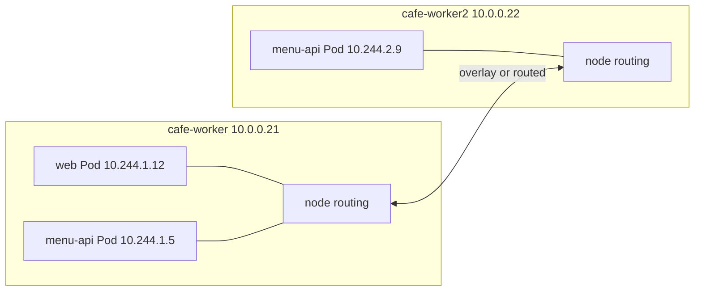
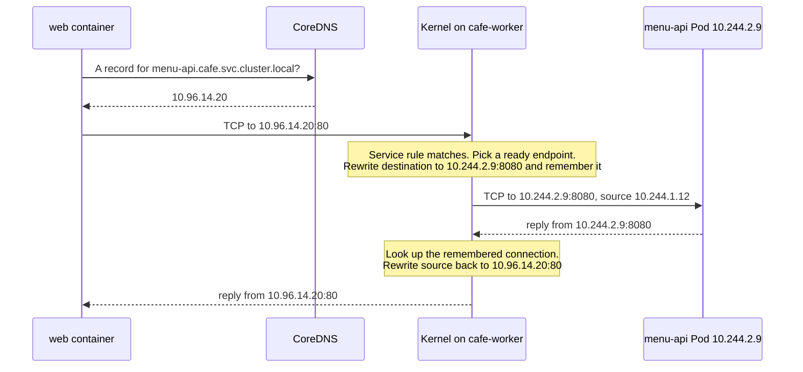
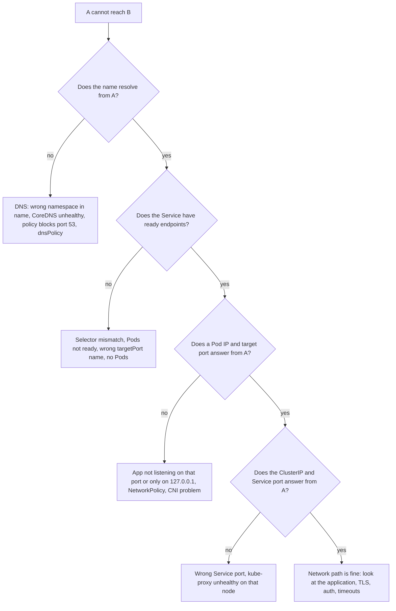

# From name to Pod: the packet path and troubleshooting discovery

## In plain words

The previous lesson ended with an application holding an IP address: DNS turned `menu-api` into `10.96.14.20`. But that address is a **virtual IP**. No network card anywhere owns it, no machine listens on it, and no router knows a route to it. So how does a packet sent to it end up inside a container?

The answer is that each node quietly rewrites the destination before the packet leaves. It is like a company mailroom. You address an envelope to "Accounts Department", which is not a real desk. The mailroom clerk in your building looks at a list, sees that three people handle accounts today, crosses out "Accounts Department", writes "Priya, floor 2, desk 14" and sends it on. When Priya's reply comes back through the mailroom, the clerk changes the sender line back to "Accounts Department" so you never notice. On a Kubernetes node, the Linux kernel is the clerk, and kube-proxy is the person who keeps the clerk's list up to date.

Why this matters for a job: when a call between services fails, you need to cut the problem in half quickly: is it the name, the Service, the endpoints, the network, a policy, or the application? This lesson gives you the path a packet takes and a fixed sequence of checks that follows it. Interviewers ask "explain how Pod-to-Pod and Pod-to-Service networking works" to see whether you have this picture.

> **Before this lesson:** read [Service registration and cluster DNS](#/lesson/kubernetes/service-registration-dns), [Services, selectors, ClusterIP and EndpointSlices](#/lesson/kubernetes/services-clusterip) and the kube-proxy section of [Worker nodes](#/lesson/kubernetes/worker-nodes).

## Three address ranges

A cluster uses three separate ranges of IP addresses. Keeping them apart in your head prevents most confusion. A range is written in **CIDR notation**, such as `10.244.0.0/16`: the number after the slash says how many leading bits are fixed, so `/16` fixes the first two numbers and leaves about 65,000 addresses.

| Range | Example | Assigned by | Real or virtual |
|---|---|---|---|
| Node network | `10.0.0.0/24` | Your cloud or data centre | Real: each node's network card |
| Pod network | `10.244.0.0/16` | The CNI plug-in, usually one sub-range per node | Real: each Pod has an interface with this address |
| Service network | `10.96.0.0/12` | The API server | Virtual: exists only as forwarding rules |

```bash
$ kubectl get nodes -o custom-columns=NAME:.metadata.name,NODE-IP:.status.addresses[0].address,POD-CIDR:.spec.podCIDR
NAME            NODE-IP     POD-CIDR
cafe-worker     10.0.0.21   10.244.1.0/24
cafe-worker2    10.0.0.22   10.244.2.0/24

$ kubectl cluster-info dump | grep -m1 service-cluster-ip-range
        "--service-cluster-ip-range=10.96.0.0/12",
```

The first command prints each node's own address and the slice of the Pod network it hands out: Pods on `cafe-worker` get `10.244.1.x`. The second searches the cluster's configuration dump for the Service range (`-m1` stops at the first match). With these three ranges you can tell what kind of thing any IP address in a log refers to.

## Pod-to-Pod: the flat network

The networking rules from earlier lessons bear repeating: every Pod has its own IP, and any Pod can reach any other Pod's IP directly, with no address translation, whichever nodes they are on.

**Same node.** Each Pod has a virtual network cable (a **veth pair**): one end inside the Pod, the other end on the node, attached to a virtual switch (a bridge) or handled by routing rules. A packet between two Pods on one node goes up one cable, across the node, and down the other.

**Different nodes.** The packet leaves the first Pod, reaches its node, and must cross to the other node. The CNI plug-in arranges that in one of two ways:

- **Overlay**: the whole packet is wrapped inside another packet addressed from node to node (using a protocol such as VXLAN or Geneve), sent across the ordinary network, and unwrapped on arrival. It works on any network at a small cost in overhead.
- **Native routing**: the network itself is taught where each Pod range lives, by adding routes or advertising them with the BGP routing protocol, or, on clouds, by giving Pods addresses directly from the cloud network. No wrapping, better performance, more demands on the underlying network.



In both cases the Pods see each other's real Pod IPs as source and destination.

## Pod-to-Service: the rewrite

Now the full journey of one request: `web` (10.244.1.12, on `cafe-worker`) calls `http://menu-api/menu`.



Step by step:

1. **Resolve.** The app asks DNS and receives the ClusterIP, `10.96.14.20`.
2. **Send.** The app opens a TCP connection to `10.96.14.20:80`. The packet leaves the Pod and enters the node's kernel.
3. **Match and choose.** Rules installed by kube-proxy recognise the destination as a Service and pick one of its ready endpoints, say `10.244.2.9:8080`.
4. **Rewrite the destination.** The kernel changes the packet's destination from the ClusterIP and port to the chosen Pod IP and port. This is **destination NAT (DNAT)**; NAT stands for network address translation. The kernel records the choice in its **connection tracking** table (often called **conntrack**), so that every later packet of the same connection goes to the same Pod.
5. **Deliver.** The packet is now an ordinary Pod-to-Pod packet and travels as described above.
6. **Reply.** The Pod answers to `10.244.1.12`. When the reply passes back through the first node, connection tracking reverses the rewrite, so the app sees the reply coming from `10.96.14.20:80`, the address it called.

Three consequences are worth remembering.

- **The translation happens on the caller's node**, before the packet leaves it. The ClusterIP never appears on the network between nodes.
- **The choice is made once per connection.** This is the reason, mentioned in the Services lesson, that long-lived connections do not rebalance.
- **A ClusterIP has no existence outside the rules.** A machine that is not a cluster node has no such rules and cannot reach a ClusterIP.

### A model of the node's rules

```python-run
import random
random.seed(3)

service_rules = {("10.96.14.20", 80): [("10.244.1.5", 8080), ("10.244.2.9", 8080)]}
conntrack = {}      # (src, sport, dst, dport) -> chosen backend

def send(src, sport, dst, dport):
    key = (src, sport, dst, dport)
    if key in conntrack:
        backend = conntrack[key]
        return f"existing connection, DNAT to {backend[0]}:{backend[1]} (remembered)"
    backends = service_rules.get((dst, dport))
    if backends is None:
        return f"not a Service address, routed unchanged to {dst}:{dport}"
    if not backends:
        return "Service has no ready endpoints: REJECT, the client sees 'connection refused'"
    backend = random.choice(backends)
    conntrack[key] = backend
    return f"new connection, DNAT to {backend[0]}:{backend[1]}"

def reply(src, sport, client, cport):
    for (c, cp, vip, vport), backend in conntrack.items():
        if backend == (src, sport) and (c, cp) == (client, cport):
            return f"reply from {src}:{sport} rewritten to appear from {vip}:{vport}"
    return "no tracked connection: reply passed unchanged"

print("1.", send("10.244.1.12", 40001, "10.96.14.20", 80))
print("2.", send("10.244.1.12", 40001, "10.96.14.20", 80))
print("3.", send("10.244.1.12", 40002, "10.96.14.20", 80))
print("4.", send("10.244.1.12", 40003, "10.244.2.9", 8080))
chosen = conntrack[("10.244.1.12", 40001, "10.96.14.20", 80)]
print("5.", reply(chosen[0], chosen[1], "10.244.1.12", 40001))
service_rules[("10.96.14.20", 80)] = []
print("6.", send("10.244.1.12", 40004, "10.96.14.20", 80))
print("7.", send("10.244.1.12", 40001, "10.96.14.20", 80))
```

Lines 1 and 2 are two packets of one connection: the second reuses the remembered choice. Line 3 is a new connection (a different source port) and gets a fresh random choice. Line 4 goes straight to a Pod IP and is not touched. Line 5 shows the reverse rewrite. Then the endpoints vanish: a new connection is refused (line 6), but line 7, an *existing* connection, still follows its old tracking entry. That last behaviour is real, and it is why connections can linger to a Pod that has left the endpoint list until the Pod closes them, which is the purpose of graceful shutdown.

### Seeing the real rules

You rarely need to, but looking once makes it concrete. On a node using the iptables mode:

```bash
$ sudo iptables -t nat -L KUBE-SERVICES -n | grep menu-api
KUBE-SVC-7QFZKM2XJ4C5T3LB  tcp  --  0.0.0.0/0  10.96.14.20  /* cafe/menu-api:http cluster IP */ tcp dpt:80

$ sudo iptables -t nat -L KUBE-SVC-7QFZKM2XJ4C5T3LB -n
Chain KUBE-SVC-7QFZKM2XJ4C5T3LB (1 references)
target                     prot  source     destination
KUBE-SEP-4R6YH2QKXW7NDZTE  all   0.0.0.0/0  0.0.0.0/0   /* cafe/menu-api:http -> 10.244.1.5:8080 */ statistic mode random probability 0.50000000000
KUBE-SEP-J5T3QWMZ8B2VN7KC  all   0.0.0.0/0  0.0.0.0/0   /* cafe/menu-api:http -> 10.244.2.9:8080 */
```

`iptables -t nat -L CHAIN -n` lists the rules of one chain in the address-translation table without resolving names. The first output shows a rule matching the ClusterIP and port and jumping to a per-Service chain. That chain has one rule per endpoint: the first is taken with probability 0.5, otherwise the second. Each `KUBE-SEP` (service endpoint) chain performs the DNAT to one Pod. With three endpoints you would see probabilities 0.333, 0.5 and then a final unconditional rule, which works out to a third each. On nodes using the nftables mode the equivalent command is `nft list table ip kube-proxy`, and with a kube-proxy replacement such as Cilium the rules live in eBPF maps instead.

## External traffic in one paragraph

A request from the internet adds layers in front of the same mechanism: the cloud load balancer forwards to a node port; the node's rules DNAT to a Pod, possibly on another node, in which case the source is also rewritten (source NAT) unless `externalTrafficPolicy: Local` is set; and an ingress or gateway controller, if used, is the Pod that receives it and makes a second, in-cluster call to the application's Service. Whatever the entry path, the last hop is always "a packet addressed to a Pod IP and port".

## A troubleshooting sequence that follows the path

When "service A cannot reach service B", work through the layers in order. Each check either finds the fault or rules a layer out. Run the tests **from the caller's Pod**, because that is where the path starts; a test from your laptop proves little.



Here is the sequence as commands. If the application image has no tools, use `kubectl debug` to attach a container that does (see [Multi-container Pods](#/lesson/kubernetes/multi-container-pods)).

```bash
# 1. Name resolution, from the caller
$ kubectl exec -n cafe deploy/web -- nslookup menu-api
Name:      menu-api.cafe.svc.cluster.local
Address:   10.96.14.20

# 2. Endpoints
$ kubectl get endpointslices -n cafe -l kubernetes.io/service-name=menu-api
NAME             ADDRESSTYPE   PORTS   ENDPOINTS               AGE
menu-api-x7k2p   IPv4          8080    10.244.1.5,10.244.2.9   3d

# 3. Straight to a Pod
$ kubectl exec -n cafe deploy/web -- wget -qO- -T 3 http://10.244.1.5:8080/healthz
ok

# 4. Through the Service IP, then the name
$ kubectl exec -n cafe deploy/web -- wget -qO- -T 3 http://10.96.14.20:80/healthz
ok
$ kubectl exec -n cafe deploy/web -- wget -qO- -T 3 http://menu-api/healthz
ok
```

`-T 3` gives each attempt a three second timeout so that a blocked connection fails quickly instead of hanging.

### Reading the type of failure

The *way* a connection fails is evidence.

| What the client reports | Meaning | Usual causes |
|---|---|---|
| `bad address` / `could not resolve host` / NXDOMAIN | The name does not exist | Typo, missing namespace, Service not created |
| DNS **timeout** | No answer from DNS at all | CoreDNS down, NetworkPolicy blocking port 53 |
| `connection refused` (immediate) | Something answered "nobody is listening" | Service with no endpoints; app not listening on that port |
| `connection timed out` (slow) | Packets are being dropped silently | NetworkPolicy, firewall, CNI or routing fault, Pod on a dead node |
| `connection reset` | Connected, then cut off | App crashed mid-request, protocol mismatch such as HTTP to an HTTPS port |
| HTTP 502 / 503 / 504 from a proxy | The proxy could not get a good answer | Backend down, no endpoints, backend too slow |

The single most useful distinction is **refused versus timed out**. Refused is fast and means the packet arrived and was rejected. Timed out is slow and means the packet disappeared, which points at a policy or the network.

### Checking the infrastructure pieces

If steps 1 to 4 point below the application, look at the components themselves:

```bash
$ kubectl get pods -n kube-system -l k8s-app=kube-dns -o wide
$ kubectl logs -n kube-system -l k8s-app=kube-dns --tail=20
$ kubectl get pods -n kube-system -l k8s-app=kube-proxy -o wide
$ kubectl logs -n kube-system -l k8s-app=kube-proxy --tail=20
$ kubectl get networkpolicy -n cafe
$ kubectl get pods -n kube-system -o wide | grep -i -E "cilium|calico|flannel|kindnet"
```

In order: are the DNS Pods running, and what do they log; is there a healthy kube-proxy Pod **on the node where the caller runs**; are there NetworkPolicies in the namespace that could be dropping the traffic; and is the CNI plug-in's Pod healthy on both nodes involved. A problem confined to Pods on one node nearly always traces to that node's kube-proxy or CNI agent.

> [!TIP]
> Keep a debugging image in mind that has `curl`, `dig`, `nc` and `tcpdump`, such as `nicolaka/netshoot`, and launch it in the caller's namespace: `kubectl run tmp --rm -it --image=nicolaka/netshoot -n cafe -- bash`. `dig +search menu-api` shows exactly which names were tried, and `nc -zv menu-api 80` tests a TCP connection without needing an HTTP client.

> [!WARNING]
> Do not conclude "the network is broken" from a failed `ping` to a ClusterIP. A ClusterIP is defined only for the Service's ports and protocol; depending on the kube-proxy mode it may not answer ICMP at all while working perfectly for TCP. Always test with the real protocol and port.

## Worked example

`orders-api` logs `dial tcp: lookup payments-gateway: no such host`. Applying the sequence:

1. `nslookup payments-gateway` from an `orders-api` Pod fails with NXDOMAIN. So this is a naming problem, and the later steps can wait.
2. `kubectl get svc -A | grep payments-gateway` shows the Service exists in namespace `payments`.
3. The caller is in `cafe`. The short name only searches `cafe`. `nslookup payments-gateway.payments` succeeds.
4. Fix: change the configured address to `payments-gateway.payments`. Then repeat step 4 of the sequence, which now times out instead: a NetworkPolicy in `payments` admits traffic only from namespaces carrying a certain label. That is a second, separate fault, exposed only once the first was cleared.

The lesson of the example is that failures can stack. Fix one layer, then test again from the top.

> [!INTERVIEW]
> **"Explain how a request from one Pod reaches another through a Service."** The client resolves the Service name through CoreDNS, using the search list in its `/etc/resolv.conf`, and gets the ClusterIP. It opens a connection to that virtual IP. On the client's own node, kernel rules programmed by kube-proxy (iptables, IPVS, nftables, or eBPF with a replacement) match the ClusterIP and port, select one ready endpoint from the Service's EndpointSlices, and DNAT the packet to that Pod IP and target port, recording the mapping in conntrack so the whole connection sticks to it. The packet then travels over the Pod network, direct on the same node or via overlay or routing across nodes, courtesy of the CNI plug-in. Replies are un-NATed on the way back so the client sees the ClusterIP. Selection is per connection and limited to ready endpoints. Offer the debugging order as a closer: DNS, endpoints, Pod IP, ClusterIP, then policies and the application.

## Common pitfalls

- **Testing from the wrong place.** Results from your laptop or from another namespace do not describe the caller's path.
- **Skipping the endpoints check.** An empty endpoint list explains most "connection refused" cases in seconds.
- **Treating refused and timed out as the same.** They point at different layers.
- **Stopping after the first fix.** Re-run the whole sequence.
- **App bound to `127.0.0.1`.** It answers inside its own container and nowhere else.
- **Overlapping address ranges.** A Pod or Service range that collides with the node network or a connected corporate network causes baffling, partial failures; choose ranges carefully when creating a cluster.
- **Assuming kube-proxy exists.** Some clusters replace it; look for the CNI's agent instead.

## Cheat sheet

| Layer | Check | Command |
|---|---|---|
| Name | Resolves from caller? | `kubectl exec CALLER -- nslookup SVC` |
| Service | Exists, right port? | `kubectl get svc SVC -o wide` |
| Endpoints | Any ready? | `kubectl get endpointslices -l kubernetes.io/service-name=SVC` |
| Pod | Listening on target port? | `kubectl exec CALLER -- wget -qO- -T 3 http://POD_IP:PORT` |
| Service path | ClusterIP works? | `kubectl exec CALLER -- wget -qO- -T 3 http://CLUSTER_IP:PORT` |
| Policy | Anything restricting? | `kubectl get networkpolicy -n NS` |
| DNS server | Healthy? | `kubectl get pods -n kube-system -l k8s-app=kube-dns` |
| Node agents | kube-proxy and CNI healthy on that node? | `kubectl get pods -n kube-system -o wide` |

## Summary

A ClusterIP is a virtual address made real by rewriting. After DNS returns it, the kernel on the caller's node, following rules kept current by kube-proxy, picks a ready endpoint, rewrites the packet's destination to that Pod and remembers the choice for the life of the connection; the reply is rewritten back. The rewritten packet then crosses the flat Pod network that the CNI plug-in provides, directly, through an overlay or by routing. Because the path is a fixed chain of name, Service, endpoints, Pod and network, troubleshooting is a fixed chain of checks run from the caller, and the kind of failure, especially refused versus timed out, tells you which link to examine. That completes the networking story. The next module turns to the other thing Pods lack by default: storage that outlives them.

## Glossary

- **Virtual IP**: an address not assigned to any interface, implemented by forwarding rules.
- **CIDR notation**: a way of writing an address range, such as `10.244.0.0/16`.
- **Node / Pod / Service network**: the three address ranges used in a cluster.
- **veth pair**: a virtual network cable connecting a Pod to its node.
- **Overlay network**: Pod packets wrapped inside node-to-node packets.
- **Native routing**: Pod ranges made reachable by ordinary network routes.
- **VXLAN / Geneve**: common overlay encapsulation protocols.
- **BGP**: a routing protocol some CNI plug-ins use to advertise Pod ranges.
- **NAT**: network address translation, rewriting addresses in packets.
- **DNAT / SNAT**: rewriting the destination, or the source, address.
- **Connection tracking (conntrack)**: the kernel's memory of active connections and their rewrites.
- **eBPF**: a kernel technology some CNI plug-ins use in place of iptables-style rules.
- **Connection refused / timed out**: an active rejection versus silence.

```quiz
[
  {"q": "A Pod connects to a Service's ClusterIP. Where is the destination address rewritten to a Pod IP?",
   "options": ["In CoreDNS", "In the kernel of the node where the client Pod runs", "In the API server", "On the destination Pod's node only"],
   "answer": 1,
   "explain": "Rules programmed by kube-proxy on the caller's node perform DNAT before the packet leaves. The ClusterIP never travels between nodes."},
  {"q": "A client gets 'connection refused' immediately when calling a Service by name. The name resolves. What is the most likely cause?",
   "options": ["A NetworkPolicy is dropping packets", "The Service has no ready endpoints, or nothing listens on the target port", "CoreDNS is down", "The node is out of memory"],
   "answer": 1,
   "explain": "An immediate refusal means the packet was actively rejected. Dropped packets, as with a policy, produce a slow timeout instead."},
  {"q": "A call from Pod A to Service B hangs and fails after 30 seconds with a timeout. Calling Pod B's IP directly from A also times out, but B answers its own health checks. What should you suspect first?",
   "options": ["The Service selector", "A NetworkPolicy or network fault dropping traffic between A and B", "The DNS search list", "The Service port mapping"],
   "answer": 1,
   "explain": "A direct Pod-to-Pod test bypasses the Service and DNS, so those are ruled out. Silent drops point to policy or the CNI path."},
  {"q": "Why does a long-lived TCP connection keep reaching the same Pod even after more replicas are added?",
   "options": ["DNS caches the Pod IP", "The backend is chosen once per connection and recorded in connection tracking", "The Service has session affinity enabled by default", "kube-proxy only knows one endpoint"],
   "answer": 1,
   "explain": "Selection happens when the connection is opened; conntrack keeps every later packet on the same mapping."},
  {"q": "The Pod network is 10.244.0.0/16 and the Service network is 10.96.0.0/12. A log shows a connection from 10.244.2.9 to 10.96.14.20. What are these two addresses?",
   "options": ["Two nodes", "A Pod calling a Service ClusterIP", "A Service calling a Pod", "Two Services"],
   "answer": 1,
   "explain": "10.244.2.9 falls in the Pod range and 10.96.14.20 in the Service range."},
  {"q": "Lookups succeed and the Service has two ready endpoints. From the caller, a Pod IP on port 8080 answers, but the ClusterIP on port 80 does not. Which is the most likely fault?",
   "options": ["The application is not listening", "The Service's port or targetPort is wrong, or kube-proxy on the caller's node is unhealthy", "CoreDNS", "The readiness probe"],
   "answer": 1,
   "explain": "The Pod and network work. What remains is the Service-to-Pod mapping or the node rules that implement it."},
  {"q": "A program in a container listens on 127.0.0.1:8080. Its Service has ready endpoints, yet calls through the Service are refused. Why?",
   "options": ["The Service type is wrong", "It only accepts connections from inside its own Pod; it must listen on 0.0.0.0", "The port number is too low", "The Pod needs a NodePort"],
   "answer": 1,
   "explain": "Traffic from other Pods arrives on the Pod's network interface, not the loopback interface. Binding to all interfaces fixes it."},
  {"q": "After you fix a wrong Service name, the call no longer fails with 'no such host' but now times out. What does this tell you?",
   "options": ["The fix did not work", "A second, separate problem further along the path has been uncovered", "DNS is caching the old error", "The Service was deleted"],
   "answer": 1,
   "explain": "Failures can stack. With the name fixed, the request gets further and meets the next obstacle, so run the checks again from the top."}
]
```

> **Source:** Poulton, *The Kubernetes Book*, ch. 9 (topic coverage only). Official docs: https://kubernetes.io/docs/concepts/cluster-administration/networking/ , https://kubernetes.io/docs/reference/networking/virtual-ips/ , https://kubernetes.io/docs/tasks/debug/debug-application/debug-service/
