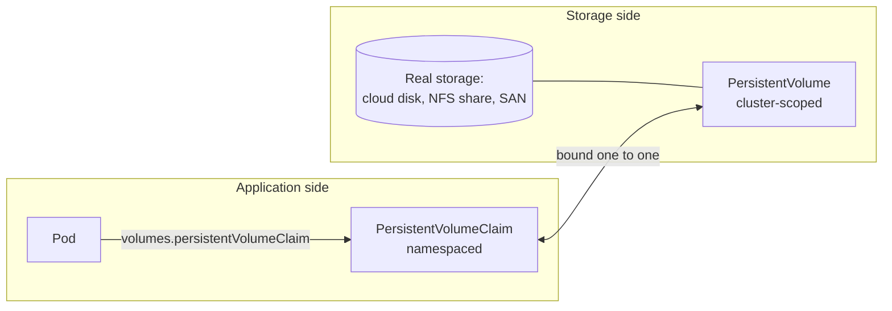
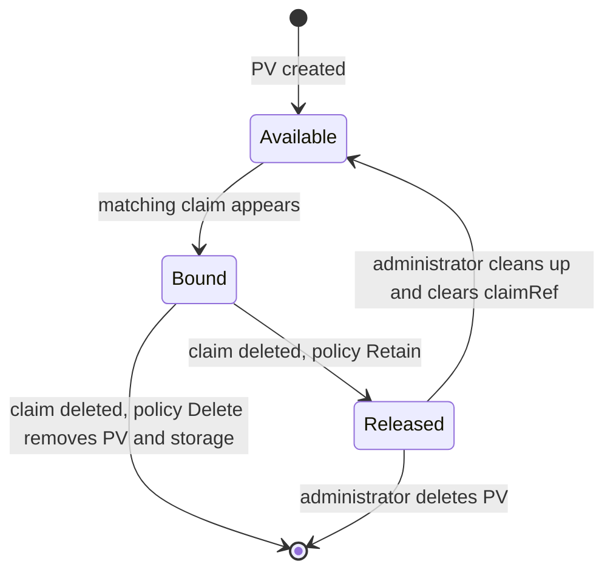

# Volumes, PersistentVolumes and PersistentVolumeClaims

## In plain words

A container's filesystem is temporary. Whatever a program writes there disappears when the container is restarted or the Pod is replaced, and Kubernetes replaces Pods all the time. That is fine for a stateless web server. It is a disaster for a database, an upload folder or anything else whose data must outlive the Pod.

Kubernetes separates storage into two questions. *Where does the storage really come from?* A cloud disk, a network file share, a storage array in a data centre. *Who needs storage, and how much?* An application that asks for "10 GiB that I can read and write". The first is described by a **PersistentVolume (PV)**. The second is described by a **PersistentVolumeClaim (PVC)**. Kubernetes matches claims to volumes, and a Pod mounts its claim as a directory.

Think of a railway station's left-luggage lockers. The lockers are the PersistentVolumes: real, physical, installed by the station. A traveller does not care which locker they get; they ask at the desk for "a medium locker" and receive a ticket. The ticket is the PersistentVolumeClaim. The ticket binds one traveller to one locker, the traveller can go away and come back (the Pod can be replaced), and the luggage is still there for whoever holds the ticket.

Why this matters for a job: any stateful system you run on Kubernetes, from PostgreSQL to a model cache, depends on this machinery. A Pod stuck in `Pending` because its claim is unbound is a routine problem, and losing data through a misunderstood reclaim policy is an expensive one. Interviewers ask for the difference between a volume, a PV and a PVC.

> **Before this lesson:** read [The Pod as the atomic unit](#/lesson/kubernetes/pod-basics) and [Multi-container Pods](#/lesson/kubernetes/multi-container-pods), where the `emptyDir` volume first appeared. The Docker track's [Volumes and bind mounts](#/lesson/docker/volumes-bind-mounts) covers the single-machine version of the same problem.

## Volumes: storage attached to a Pod

A **volume** is a directory made available to the containers of a Pod. It is declared in two steps, which you have seen once already: list the volume under the Pod's `spec.volumes`, then mount it in each container under `volumeMounts`.

Volumes come in many types. They fall into two groups by lifetime.

| Group | Lifetime | Examples |
|---|---|---|
| **Ephemeral** | Created and destroyed with the Pod | `emptyDir`, `configMap`, `secret`, `downwardAPI`, `projected` |
| **Persistent** | Exists independently of any Pod | `persistentVolumeClaim` |

### emptyDir: scratch space

```yaml
apiVersion: v1
kind: Pod
metadata:
  name: thumbnailer
  namespace: cafe
spec:
  volumes:
    - name: scratch
      emptyDir:
        sizeLimit: 500Mi
    - name: fast-cache
      emptyDir:
        medium: Memory
        sizeLimit: 64Mi
  containers:
    - name: thumbnailer
      image: ghcr.io/harbour-coffee/thumbnailer:0.9.1
      volumeMounts:
        - name: scratch
          mountPath: /work
        - name: fast-cache
          mountPath: /cache
```

- `scratch` is an `emptyDir` on the node's disk, capped at 500 MiB. If the Pod writes more, it is evicted.
- `fast-cache` uses `medium: Memory`: a filesystem held in RAM. It is fast, and its contents count towards the container's memory limit.
- Each is mounted at a path inside the container.

An `emptyDir` survives container restarts, because it belongs to the Pod and not to the container. It does not survive the Pod. When the Pod is deleted or moved, the data is gone.

### hostPath: avoid

A `hostPath` volume mounts a directory from the node's own filesystem into the Pod. It appears to offer persistence, but the data stays on that one node (a replacement Pod on another node sees nothing), and it gives a container access to the host's files, which is a serious security risk. It is used by a few system components and should not be used by applications. The [Pod Security Standards](#/lesson/kubernetes/threat-model-disclosure-dos-privilege) forbid it at the baseline level.

## The persistent volume subsystem

For real persistence, three objects work together.



- A **PersistentVolume (PV)** represents one piece of real storage. It is cluster-scoped, records capacity and capabilities, and holds the details needed to attach the storage.
- A **PersistentVolumeClaim (PVC)** is a request: a size, an access mode and optionally a class of storage. It is namespaced and belongs to the application.
- A **Pod** refers to a PVC by name. It never refers to a PV directly.

Why the indirection? It separates roles and keeps manifests portable. The application's files say "I need 10 GiB, read-write". They do not say "attach disk `vol-0a1b2c` in zone `eu-west-2a`". The same Deployment and PVC work on a laptop and on any cloud; only the storage side differs.

There are two ways PVs come to exist. In **static provisioning** an administrator creates PVs by hand in advance. In **dynamic provisioning** a PV is created automatically at the moment a claim asks for one, using a StorageClass. Dynamic provisioning is what nearly everyone uses, and the [next lesson](#/lesson/kubernetes/storageclasses-csi) covers it. This lesson uses static provisioning because it shows every moving part.

## A PersistentVolume, line by line

```yaml
apiVersion: v1
kind: PersistentVolume
metadata:
  name: nfs-reports-01
spec:
  capacity:
    storage: 20Gi
  volumeMode: Filesystem
  accessModes:
    - ReadWriteMany
  persistentVolumeReclaimPolicy: Retain
  storageClassName: shared-nfs
  mountOptions:
    - nfsvers=4.1
  nfs:
    server: 10.0.5.20
    path: /exports/reports
```

- `kind: PersistentVolume` — cluster-scoped, so no namespace.
- `capacity.storage: 20Gi` — the size of the volume.
- `volumeMode: Filesystem` — the volume is formatted with a filesystem and mounted as a directory. The alternative, `Block`, hands the container a raw disk device, used by some databases.
- `accessModes` — how the volume may be mounted, explained below.
- `persistentVolumeReclaimPolicy: Retain` — what happens to the volume when its claim is deleted, explained below.
- `storageClassName: shared-nfs` — a label used for matching; only claims asking for the same class can bind to this PV.
- `mountOptions` — options passed to the mount command.
- `nfs` — the back end: an NFS (Network File System) share at a server address and path. Each storage type has its own block here; today most use `csi`.

## Access modes

An **access mode** states how many nodes may mount the volume, and whether for writing.

| Mode | Short | Meaning |
|---|---|---|
| `ReadWriteOnce` | RWO | Mounted read-write by a **single node**. Several Pods on that same node can share it |
| `ReadOnlyMany` | ROX | Mounted read-only by many nodes |
| `ReadWriteMany` | RWX | Mounted read-write by many nodes |
| `ReadWriteOncePod` | RWOP | Mounted read-write by a **single Pod** in the whole cluster |

Two points cause frequent mistakes.

**RWO is per node, not per Pod.** Two Pods on the same node can both write to an RWO volume. If you need a hard guarantee of one writer, such as for a database, use `ReadWriteOncePod`.

**The storage must be capable of the mode.** Access modes describe what the underlying storage can do; Kubernetes does not add the ability. Block storage such as a cloud disk attaches to one machine at a time, so it supports RWO (and RWOP) only. File storage such as NFS or a cloud file service supports RWX. Asking for RWX from a class backed by cloud disks leaves the claim unbound.

## A PersistentVolumeClaim, line by line

```yaml
apiVersion: v1
kind: PersistentVolumeClaim
metadata:
  name: reports-data
  namespace: cafe
spec:
  accessModes:
    - ReadWriteMany
  storageClassName: shared-nfs
  resources:
    requests:
      storage: 10Gi
```

- `kind: PersistentVolumeClaim` — namespaced; it lives with the application.
- `accessModes` — the mode the application needs.
- `storageClassName: shared-nfs` — which class of storage. Omitting the field means "use the cluster's default class". Setting it to the empty string `""` means "no class: bind only to a pre-created PV that also has no class".
- `resources.requests.storage: 10Gi` — the minimum size required.

### How binding works

A control plane controller looks for a PV that satisfies the claim. A PV matches when **all** of these hold:

1. it is `Available` (not already bound),
2. its `storageClassName` equals the claim's,
3. its capacity is **at least** the requested size,
4. its access modes include every mode the claim asks for,
5. its `volumeMode` matches, and any label selector on the claim is satisfied.

Among matching PVs, the controller chooses the **smallest** one that fits, to waste as little as possible. Binding is **one to one and exclusive**: a bound PV serves that claim alone, even if the claim asked for 10 GiB and the PV holds 20. The claimant gets the whole volume.

```bash
$ kubectl apply -f nfs-reports-01.yaml -f reports-data-pvc.yaml
persistentvolume/nfs-reports-01 created
persistentvolumeclaim/reports-data created

$ kubectl get pv
NAME             CAPACITY   ACCESS MODES   RECLAIM POLICY   STATUS   CLAIM               STORAGECLASS
nfs-reports-01   20Gi       RWX            Retain           Bound    cafe/reports-data   shared-nfs

$ kubectl get pvc -n cafe
NAME           STATUS   VOLUME           CAPACITY   ACCESS MODES   STORAGECLASS
reports-data   Bound    nfs-reports-01   20Gi       RWX            shared-nfs
```

Both show `Bound`. The PV's `CLAIM` column names the namespace and claim; the PVC's `VOLUME` column names the PV. Note that the claim's `CAPACITY` is 20Gi, the real size of the volume, not the 10Gi requested.

The matching rules, as a program you can experiment with:

```python-run
pvs = [
    {"name": "pv-a", "size": 5,  "modes": {"RWO"},        "cls": "fast",       "status": "Available"},
    {"name": "pv-b", "size": 20, "modes": {"RWO"},        "cls": "fast",       "status": "Available"},
    {"name": "pv-c", "size": 12, "modes": {"RWO", "ROX"}, "cls": "fast",       "status": "Available"},
    {"name": "pv-d", "size": 50, "modes": {"RWX", "RWO"}, "cls": "shared-nfs", "status": "Available"},
    {"name": "pv-e", "size": 10, "modes": {"RWO"},        "cls": "fast",       "status": "Bound"},
]

def bind(claim):
    reasons, candidates = [], []
    for pv in pvs:
        if pv["status"] != "Available":
            reasons.append(f"{pv['name']}: already bound")
        elif pv["cls"] != claim["cls"]:
            reasons.append(f"{pv['name']}: class {pv['cls']} != {claim['cls']}")
        elif pv["size"] < claim["size"]:
            reasons.append(f"{pv['name']}: {pv['size']}Gi < {claim['size']}Gi")
        elif not claim["modes"] <= pv["modes"]:
            reasons.append(f"{pv['name']}: lacks mode {sorted(claim['modes'] - pv['modes'])}")
        else:
            candidates.append(pv)
    print(f"\nclaim {claim['name']}: {claim['size']}Gi {sorted(claim['modes'])} class={claim['cls']}")
    for r in reasons:
        print("   skip", r)
    if not candidates:
        print("   -> Pending: no matching PersistentVolume")
        return
    best = min(candidates, key=lambda pv: (pv["size"], pv["name"]))   # smallest that fits
    best["status"] = "Bound"
    print(f"   -> Bound to {best['name']} ({best['size']}Gi; the claim gets all of it)")

bind({"name": "orders-db",  "size": 10, "modes": {"RWO"}, "cls": "fast"})
bind({"name": "cache",      "size": 10, "modes": {"RWO"}, "cls": "fast"})
bind({"name": "uploads",    "size": 10, "modes": {"RWX"}, "cls": "fast"})
bind({"name": "reports",    "size": 10, "modes": {"RWX"}, "cls": "shared-nfs"})
bind({"name": "tiny",       "size": 1,  "modes": {"RWO"}, "cls": "fast"})
```

The first claim skips `pv-a` (too small) and `pv-e` (taken) and chooses `pv-c`, the smallest that fits, over `pv-b`. The second then gets `pv-b`, 20 GiB for a 10 GiB request. The third asks for RWX from the `fast` class, which no volume of that class supports, so it stays Pending. The fifth takes the 5 GiB volume.

## Using the claim in a Pod

```yaml
apiVersion: apps/v1
kind: Deployment
metadata:
  name: report-api
  namespace: cafe
spec:
  replicas: 2
  selector:
    matchLabels:
      app: report-api
  template:
    metadata:
      labels:
        app: report-api
    spec:
      securityContext:
        fsGroup: 2000
      volumes:
        - name: data
          persistentVolumeClaim:
            claimName: reports-data
      containers:
        - name: report-api
          image: ghcr.io/harbour-coffee/report-api:1.3.0
          volumeMounts:
            - name: data
              mountPath: /var/lib/reports
            - name: data
              mountPath: /var/lib/reports-archive
              subPath: archive
              readOnly: true
```

- `volumes[].persistentVolumeClaim.claimName` connects the Pod's volume named `data` to the claim. The claim must be in the Pod's namespace.
- The first mount exposes the whole volume at `/var/lib/reports`.
- The second mounts only the `archive` sub-directory of the same volume, read-only, at another path. `subPath` lets one volume serve several purposes.
- `securityContext.fsGroup: 2000` makes the volume's files group-owned by group ID 2000, so a container running as a non-root user can write to them. A "permission denied" on a freshly mounted volume is very often a missing `fsGroup`.

Both replicas mount the same claim, which works here because the volume is RWX. With an RWO volume, the second replica would only start if scheduled to the same node as the first. A Deployment of several replicas sharing one RWO claim is a common design error; workloads needing one volume *per replica* use a [StatefulSet](#/lesson/kubernetes/statefulset-theory).

```bash
$ kubectl exec -n cafe deploy/report-api -- sh -c 'echo "q3 totals" > /var/lib/reports/q3.txt'
$ kubectl rollout restart deployment/report-api -n cafe
$ kubectl exec -n cafe deploy/report-api -- cat /var/lib/reports/q3.txt
q3 totals
```

A file is written, every Pod is replaced, and the new Pods still see the file. That is persistence.

## Lifecycle and reclaim policies

A PV moves through phases:



What happens when the claim is deleted depends on the PV's **reclaim policy**:

| Policy | On claim deletion | Typical use |
|---|---|---|
| `Retain` | The PV becomes `Released`. Its data is untouched, and it is **not** available to new claims until an administrator intervenes | Data you cannot afford to lose |
| `Delete` | The PV object **and the underlying storage** are deleted | The default for dynamically provisioned volumes |

A `Released` PV still holds the previous owner's data and still records its old claim in `spec.claimRef`. Kubernetes will not hand it to someone else automatically, since that would leak data. To reuse it, an administrator backs up or wipes the data and removes the `claimRef` field, after which the PV is `Available` again.

> [!WARNING]
> With the `Delete` policy, `kubectl delete pvc` destroys the data permanently: the cloud disk itself is removed. Deleting a namespace deletes its PVCs. Many production data losses on Kubernetes come from exactly this. For important data, use a class with `reclaimPolicy: Retain`, take snapshots or backups, and treat `kubectl delete pvc` with the same care as dropping a database.

Two safety mechanisms help. A PVC in use by a running Pod is not removed immediately when deleted; a finalizer (`kubernetes.io/pvc-protection`) holds it in `Terminating` until no Pod uses it. And you can change an existing PV's policy before removing a claim:

```bash
$ kubectl patch pv nfs-reports-01 -p '{"spec":{"persistentVolumeReclaimPolicy":"Retain"}}'
persistentvolume/nfs-reports-01 patched
```

`kubectl patch` changes one field of a live object; `-p` supplies the change as JSON.

## When a claim stays Pending

```bash
$ kubectl get pvc -n cafe
NAME      STATUS    VOLUME   CAPACITY   ACCESS MODES   STORAGECLASS   AGE
uploads   Pending                                      fast           4m

$ kubectl describe pvc uploads -n cafe | tail -4
Events:
  Type     Reason              Age   From                         Message
  Warning  ProvisioningFailed  30s   persistentvolume-controller  no persistent volumes available for this claim and no storage class is set
```

A Pod that uses a Pending claim is itself `Pending`, with an event such as `pod has unbound immediate PersistentVolumeClaims`. Always read the claim's events. The usual causes:

- no PV matches on class, size or access mode, and there is no dynamic provisioner for that class;
- the `storageClassName` is misspelt or does not exist;
- the class uses delayed binding and no Pod has asked for the claim yet, which is normal and covered in the next lesson;
- the cloud refused to create the disk (quota, zone, permissions).

> [!TIP]
> Trace storage problems along the same chain every time: **Pod → PVC → PV → real storage**. `kubectl describe pod` tells you which claim is the problem. `kubectl describe pvc` tells you why it is unbound. `kubectl describe pv` shows the real back end. Do not start at the storage system and work inward.

> [!INTERVIEW]
> **"What is the difference between a volume, a PersistentVolume and a PersistentVolumeClaim?"** A volume is a directory attached to a Pod, declared in the Pod spec; ephemeral types such as `emptyDir` live and die with the Pod. A PersistentVolume is a cluster-scoped object representing real storage with a capacity, access modes, a class and a reclaim policy, existing independently of any Pod. A PersistentVolumeClaim is a namespaced request for storage by size, access mode and class; the control plane binds it one-to-one to a matching PV, picking the smallest that fits, and a Pod mounts the claim as a volume. The separation lets applications ask for storage abstractly while administrators or provisioners decide how it is supplied. Then cover access modes (RWO is per node; RWOP is per Pod; RWX needs file storage) and reclaim policies (Retain keeps data, Delete destroys it).

## Common pitfalls

- **Writing important data to the container filesystem or an `emptyDir`.** It disappears with the Pod.
- **Believing RWO means one Pod.** It means one node.
- **Several Deployment replicas sharing one RWO claim.** Extra replicas on other nodes cannot attach it and hang in `ContainerCreating` with a multi-attach error.
- **Requesting RWX from block storage.** The claim never binds.
- **Deleting a PVC with the `Delete` reclaim policy.** The data is gone.
- **Expecting a `Released` volume to be reused.** It waits for an administrator.
- **Class name mismatch between PV and PVC.** They never bind, including the subtle case of a missing field versus an empty string.
- **Permission errors as a non-root user.** Set `fsGroup`.

## Cheat sheet

| Object | Scope | Key fields |
|---|---|---|
| Volume | In the Pod spec | `volumes[]`, `volumeMounts[]`, `mountPath`, `subPath`, `readOnly` |
| PersistentVolume | Cluster | `capacity`, `accessModes`, `storageClassName`, `persistentVolumeReclaimPolicy`, back end |
| PersistentVolumeClaim | Namespace | `accessModes`, `storageClassName`, `resources.requests.storage` |

| Access mode | Who may mount |
|---|---|
| RWO | One node, read-write |
| ROX | Many nodes, read-only |
| RWX | Many nodes, read-write |
| RWOP | One Pod, read-write |

| PV phase | Meaning |
|---|---|
| Available | Free to be claimed |
| Bound | Tied to a claim |
| Released | Claim deleted, data still present, not reusable yet |
| Failed | Automatic reclamation failed |

## Summary

Container filesystems and `emptyDir` volumes are temporary. Persistent data needs the persistent volume subsystem: a PersistentVolume represents real storage, a PersistentVolumeClaim requests storage by size, access mode and class, and the control plane binds each claim exclusively to the smallest volume that satisfies it. Pods mount claims, never volumes directly, which keeps application manifests independent of the storage back end. Access modes describe what the storage can do, with RWO meaning one node, and the reclaim policy decides whether data survives the deletion of its claim. Creating volumes by hand does not scale, so the next lesson shows how StorageClasses and CSI drivers create them on demand.

## Glossary

- **Volume**: a directory provided to a Pod's containers.
- **Ephemeral volume**: a volume whose lifetime equals the Pod's.
- **emptyDir**: an empty scratch volume created with the Pod.
- **hostPath**: a volume exposing a directory of the node; discouraged.
- **PersistentVolume (PV)**: a cluster-scoped object representing a piece of real storage.
- **PersistentVolumeClaim (PVC)**: a namespaced request for storage.
- **Binding**: the exclusive one-to-one association of a claim with a volume.
- **Static / dynamic provisioning**: creating PVs by hand in advance, or automatically on demand.
- **Access mode**: RWO, ROX, RWX or RWOP; how a volume may be mounted.
- **Block storage / file storage**: a raw disk attachable to one machine, versus a shared filesystem.
- **volumeMode**: `Filesystem` or `Block`.
- **Reclaim policy**: `Retain` or `Delete`; the fate of a volume when its claim is deleted.
- **Released**: the phase of a retained PV after its claim is gone.
- **fsGroup**: a group ID applied to a volume's files so non-root containers can use it.
- **subPath**: mounting a sub-directory of a volume.
- **NFS**: Network File System, a common shared file storage protocol.

```quiz
[
  {"q": "A claim requests 10Gi, ReadWriteOnce, class fast. Available PVs of class fast: 5Gi RWO, 12Gi RWO, 50Gi RWO. Which one is bound, and how much space does the application get?",
   "options": ["5Gi PV, 5Gi", "12Gi PV, 10Gi", "12Gi PV, 12Gi", "50Gi PV, 50Gi"],
   "answer": 2,
   "explain": "The smallest PV that satisfies the request is chosen, and binding is exclusive, so the claim receives the whole 12Gi volume."},
  {"q": "A Deployment with 3 replicas mounts one ReadWriteOnce claim backed by a cloud disk. One Pod runs; two on other nodes are stuck in ContainerCreating. Why are those Pods not running?",
   "options": ["The claim is too small", "RWO allows the volume to be attached to only one node, so the other nodes cannot attach it", "Deployments cannot use PVCs", "The reclaim policy is Retain"],
   "answer": 1,
   "explain": "A block device attaches to one node at a time. Pods on other nodes fail with a multi-attach error. Use RWX storage or one volume per replica with a StatefulSet."},
  {"q": "A PVC bound to a PV with reclaim policy Delete is deleted. What happens next?",
   "options": ["The PV becomes Available for another claim", "The PV becomes Released and keeps its data", "The PV object and the underlying storage are deleted", "Nothing until the Pod is deleted too"],
   "answer": 2,
   "explain": "Delete removes both the PV and the real storage, destroying the data. Retain would keep the volume as Released."},
  {"q": "A PV shows status Released. A new claim with matching class, size and mode is created. Does it bind to that PV?",
   "options": ["Yes, immediately", "No, a Released PV keeps its old claimRef and data and must be cleaned up by an administrator first", "Yes, after 5 minutes", "Only if the claim has the same name"],
   "answer": 1,
   "explain": "Released volumes are not reused automatically, which protects the previous owner's data. Clearing claimRef makes the PV Available again."},
  {"q": "Which statement about ReadWriteOnce is correct?",
   "options": ["Only one Pod in the cluster may mount the volume", "The volume may be mounted read-write by a single node, and several Pods on that node can share it", "Many nodes may mount it read-write", "It makes the volume read-only"],
   "answer": 1,
   "explain": "RWO is a per-node restriction. ReadWriteOncePod is the mode that restricts to a single Pod."},
  {"q": "A Pod is Pending with the event 'pod has unbound immediate PersistentVolumeClaims'. What should you look at next?",
   "options": ["The node's kubelet logs", "kubectl describe pvc for the claim the Pod references", "The Service's endpoints", "The image pull secrets"],
   "answer": 1,
   "explain": "The Pod cannot be scheduled until its claim binds. The claim's events explain why no volume matched or could be provisioned."},
  {"q": "An application writes uploads to /tmp/uploads, backed by an emptyDir. The Pod is evicted and recreated on another node. What happens to the uploads?",
   "options": ["They follow the Pod to the new node", "They are lost, because an emptyDir is deleted with its Pod", "They are archived to etcd", "They remain and are remounted"],
   "answer": 1,
   "explain": "emptyDir survives container restarts but not the Pod. Data that must persist needs a PersistentVolumeClaim."},
  {"q": "A container running as user 1000 gets 'permission denied' writing to a newly mounted persistent volume. Which Pod setting commonly resolves this?",
   "options": ["hostNetwork: true", "securityContext.fsGroup", "restartPolicy: Never", "terminationGracePeriodSeconds"],
   "answer": 1,
   "explain": "fsGroup sets group ownership on the volume and adds that group to the container's process, allowing a non-root user to write."}
]
```

> **Source:** Poulton, *The Kubernetes Book*, ch. 10 (topic coverage only). Official docs: https://kubernetes.io/docs/concepts/storage/volumes/ , https://kubernetes.io/docs/concepts/storage/persistent-volumes/ , https://kubernetes.io/docs/tasks/configure-pod-container/configure-persistent-volume-storage/
