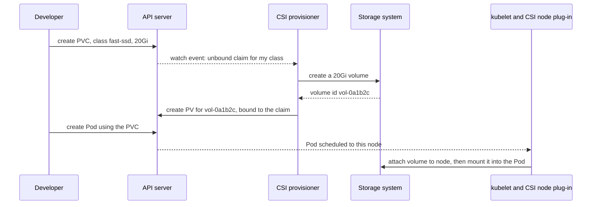
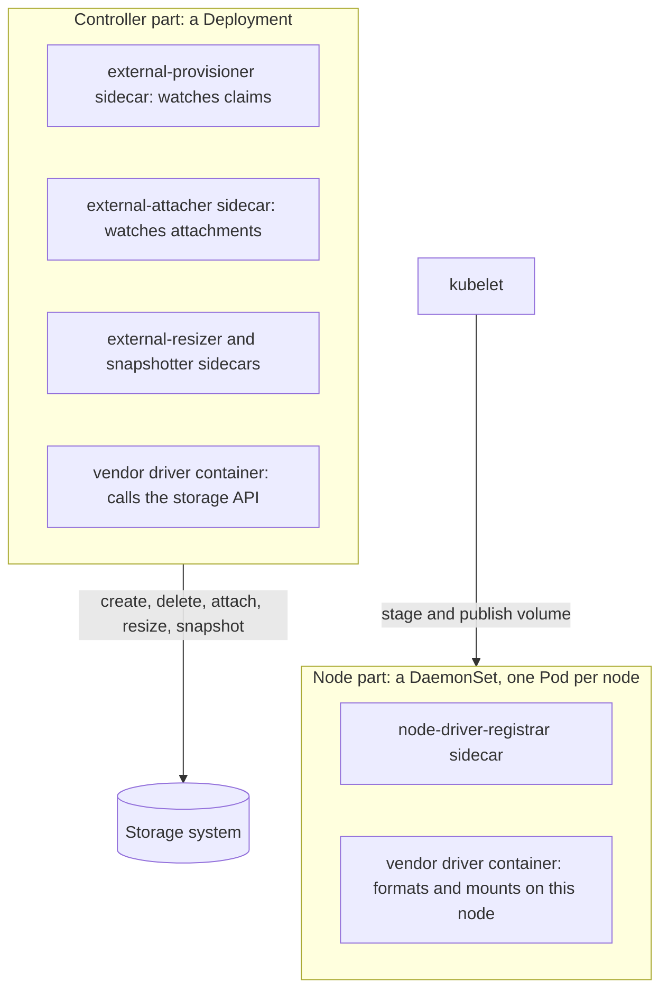

# StorageClasses, dynamic provisioning and CSI

## In plain words

In the previous lesson an administrator created each PersistentVolume by hand before anyone could claim it. On a cluster with hundreds of applications that would be a full-time job, and volumes would always be the wrong size. **Dynamic provisioning** removes the manual step: when an application submits a claim, the right storage is created automatically, at the requested size, and a matching PersistentVolume appears a few seconds later.

Two things make this possible. A **StorageClass** is a named recipe for storage: "fast SSD, encrypted, in this cloud, keep the data when the claim is deleted". A **CSI driver** is the piece of software that knows how to talk to one particular storage system and carry out the recipe.

Compare buying furniture from a showroom with ordering from a catalogue. Static provisioning is the showroom: only what is already on the floor is available, and you take the piece nearest to what you wanted. Dynamic provisioning is the catalogue: each entry (a StorageClass) describes a kind of item, you order one in your size (a claim), and the workshop (the CSI driver) builds it to order.

Why this matters for a job: on any managed cluster, dynamic provisioning is how all storage is obtained. You will choose a StorageClass for every stateful workload, and the choice decides performance, cost, and whether data survives a mistaken deletion. Expanding a full volume, taking a snapshot and understanding why a claim says `WaitForFirstConsumer` are routine operational tasks.

> **Before this lesson:** read [Volumes, PersistentVolumes and PersistentVolumeClaims](#/lesson/kubernetes/volumes-pv-pvc). Binding rules, access modes and reclaim policies are assumed here.

## The flow of dynamic provisioning



The developer writes only a claim and a Pod. Everything else is automation: the provisioner creates the real volume and a PV object for it, and when a Pod uses the claim, the volume is attached to the Pod's node and mounted.

## A StorageClass, line by line

```yaml
apiVersion: storage.k8s.io/v1
kind: StorageClass
metadata:
  name: fast-ssd
  annotations:
    storageclass.kubernetes.io/is-default-class: "false"
provisioner: pd.csi.storage.gke.io
parameters:
  type: pd-ssd
  csi.storage.k8s.io/fstype: ext4
reclaimPolicy: Retain
volumeBindingMode: WaitForFirstConsumer
allowVolumeExpansion: true
mountOptions:
  - noatime
```

- `apiVersion: storage.k8s.io/v1`, `kind: StorageClass` — cluster-scoped, so it has no namespace. Notice that a StorageClass has no `spec` section; its fields sit at the top level.
- `metadata.name: fast-ssd` — the name claims refer to in `storageClassName`.
- The annotation marks whether this is the cluster's **default class**, used by claims that do not name one. Exactly one class should be the default.
- `provisioner` — the name of the CSI driver that creates volumes of this class. This example is Google Cloud's persistent disk driver. Amazon's is `ebs.csi.aws.com` and Azure's is `disk.csi.azure.com`.
- `parameters` — settings passed to the driver without interpretation by Kubernetes. Their meaning is defined entirely by the driver: here, the disk type and the filesystem to format it with. On AWS you would write `type: gp3` and perhaps `iops` and `encrypted`.
- `reclaimPolicy: Retain` — copied onto each PV created from this class. If omitted, the default is `Delete`.
- `volumeBindingMode: WaitForFirstConsumer` — when to create and bind the volume, explained below.
- `allowVolumeExpansion: true` — claims of this class may be enlarged later.
- `mountOptions` — passed to the mount command; `noatime` stops the filesystem recording read times, a common performance setting.

A StorageClass is effectively **immutable**: its provisioner, parameters, reclaim policy and binding mode cannot be changed after creation. To change them, create a new class. Existing volumes keep the settings they were created with.

```bash
$ kubectl get storageclass
NAME                 PROVISIONER             RECLAIMPOLICY   VOLUMEBINDINGMODE      ALLOWVOLUMEEXPANSION   AGE
fast-ssd             pd.csi.storage.gke.io   Retain          WaitForFirstConsumer   true                   10s
standard (default)   pd.csi.storage.gke.io   Delete          WaitForFirstConsumer   true                   12d
```

`kubectl get sc` is the short form. The class marked `(default)` is used by claims that omit `storageClassName`. Teams usually define a handful of classes that express tiers: for example a cheap default, a fast one for databases, and a shared file class for RWX.

## Volume binding mode and why it matters

There are two binding modes.

| Mode | When the volume is created | Risk |
|---|---|---|
| `Immediate` | As soon as the claim is created | The volume may be created in a zone where the Pod cannot run |
| `WaitForFirstConsumer` | When the first Pod using the claim is being scheduled | None; the claim shows `Pending` until then |

The problem `WaitForFirstConsumer` solves is **zones**. A cloud region is divided into availability zones, which are separate data centres. A cloud disk exists in exactly one zone and can attach only to machines in that zone. With `Immediate` binding, the provisioner picks a zone without knowing where the Pod will go. If the scheduler then finds that the only nodes with enough free CPU are in another zone, the Pod can never start: its disk is somewhere it cannot reach. The error reads `0/6 nodes are available: 3 node(s) had volume node affinity conflict, 3 Insufficient cpu`.

With `WaitForFirstConsumer`, the order is reversed. The scheduler first picks a node for the Pod, considering everything it needs. Only then is the volume created, in that node's zone. The created PV records its location in a `nodeAffinity` field, and from then on the scheduler will only place Pods using that claim onto nodes in the same zone.

```python-run
nodes = [
    {"name": "node-a1", "zone": "zone-a", "cpu_free": 200},
    {"name": "node-a2", "zone": "zone-a", "cpu_free": 300},
    {"name": "node-b1", "zone": "zone-b", "cpu_free": 2000},
    {"name": "node-c1", "zone": "zone-c", "cpu_free": 1500},
]
pod_cpu = 1000

def schedule(volume_zone=None):
    fits = [n for n in nodes if n["cpu_free"] >= pod_cpu and (volume_zone is None or n["zone"] == volume_zone)]
    return sorted(fits, key=lambda n: (-n["cpu_free"], n["name"]))[0] if fits else None

print("Immediate binding:")
volume_zone = "zone-a"                      # provisioner chose without knowing about the Pod
print(f"  1. claim created -> disk provisioned in {volume_zone}")
node = schedule(volume_zone)
print(f"  2. schedule Pod needing {pod_cpu}m in {volume_zone} ->",
      node["name"] if node else "Pending: volume node affinity conflict / Insufficient cpu")

print("\nWaitForFirstConsumer:")
print("  1. claim created -> stays Pending (waiting for first consumer)")
node = schedule()
print(f"  2. scheduler picks {node['name']} in {node['zone']} for the Pod")
print(f"  3. disk provisioned in {node['zone']} and bound; Pod starts")
print(f"  4. later replacement Pods for this claim are restricted to {node['zone']}")
```

The first scenario strands the Pod. The second works. This is why nearly every cloud StorageClass uses `WaitForFirstConsumer`, and why a freshly created claim that says `Pending` with the event `waiting for first consumer to be created before binding` is healthy, not broken.

Step 4 has an operational consequence worth knowing: a workload with a zonal disk is tied to that zone. If the zone runs out of capacity or fails, its Pod cannot be started elsewhere with the same data. Databases cope by running replicas in several zones, each with its own disk.

## A claim against a class

```yaml
apiVersion: v1
kind: PersistentVolumeClaim
metadata:
  name: orders-db-data
  namespace: cafe
spec:
  accessModes:
    - ReadWriteOnce
  storageClassName: fast-ssd
  resources:
    requests:
      storage: 20Gi
```

The same claim shape as before, naming `fast-ssd`. Watch what appears:

```bash
$ kubectl apply -f orders-db-pvc.yaml
persistentvolumeclaim/orders-db-data created

$ kubectl get pvc orders-db-data -n cafe
NAME             STATUS    VOLUME   CAPACITY   ACCESS MODES   STORAGECLASS   AGE
orders-db-data   Pending                                      fast-ssd       8s

$ kubectl describe pvc orders-db-data -n cafe | tail -2
  Normal  WaitForFirstConsumer  9s  persistentvolume-controller  waiting for first consumer to be created before binding

$ kubectl apply -f orders-db.yaml       # a Pod that mounts the claim
$ kubectl get pvc orders-db-data -n cafe
NAME             STATUS   VOLUME                                     CAPACITY   ACCESS MODES   STORAGECLASS
orders-db-data   Bound    pvc-3f6e2a10-9c4b-4d55-8a2e-7b1f0c9d6e21   20Gi       RWO            fast-ssd

$ kubectl get pv
NAME                                       CAPACITY   ACCESS MODES   RECLAIM POLICY   STATUS   CLAIM                 STORAGECLASS
pvc-3f6e2a10-9c4b-4d55-8a2e-7b1f0c9d6e21   20Gi       RWO            Retain           Bound    cafe/orders-db-data   fast-ssd
```

The claim waits until a Pod needs it. Then a PV with a generated name (`pvc-` followed by the claim's unique ID) appears, exactly 20 GiB, already bound, carrying the class's `Retain` policy. Nobody created that PV by hand.

## CSI: how storage systems plug in

Kubernetes once contained code for each storage system, compiled into its own programs. Adding or fixing a storage back end meant waiting for a Kubernetes release. The **Container Storage Interface (CSI)** replaced that with a standard plug-in interface: a storage vendor ships a **CSI driver** that runs as ordinary Pods in the cluster, and Kubernetes talks to it through a fixed set of calls. The old built-in ("in-tree") plug-ins have been removed or redirected to CSI drivers.

A driver has two parts:



- The **controller part** runs once (or as a small replicated Deployment). It talks to the storage system's management API to create, delete, attach, resize and snapshot volumes. Standard helper containers supplied by the Kubernetes project watch the API server and translate objects such as PVCs into CSI calls, so the vendor writes only the storage-specific code.
- The **node part** runs on every node as a DaemonSet. The kubelet calls it to format the device and mount it into the Pod's directory.

Three operations, in order, get a volume into a Pod:

1. **Provision**: create the volume in the storage system.
2. **Attach**: connect the volume to the node, like plugging in a disk. This is recorded in a `VolumeAttachment` object.
3. **Mount**: format if needed and mount the filesystem into the Pod.

You can see which drivers a cluster has and where they run:

```bash
$ kubectl get csidrivers
NAME                    ATTACHREQUIRED   PODINFOONMOUNT   STORAGECAPACITY   MODES        AGE
pd.csi.storage.gke.io   true             false            false             Persistent   12d

$ kubectl get volumeattachments
NAME                 ATTACHER                PV                                         NODE          ATTACHED   AGE
csi-8a1f3e...        pd.csi.storage.gke.io   pvc-3f6e2a10-9c4b-4d55-8a2e-7b1f0c9d6e21   cafe-worker   true       2m
```

`CSIDriver` objects list installed drivers. A `VolumeAttachment` shows one volume connected to one node. When a Pod with an RWO volume moves to another node, the old attachment must be removed before the new one can be made; if the old node died without detaching, the new Pod waits several minutes with a `Multi-Attach error` event until the control plane forces the detach.

## Expanding a volume

If a class has `allowVolumeExpansion: true`, growing a volume is one edit: raise the claim's request.

```bash
$ kubectl patch pvc orders-db-data -n cafe -p '{"spec":{"resources":{"requests":{"storage":"40Gi"}}}}'
persistentvolumeclaim/orders-db-data patched

$ kubectl get pvc orders-db-data -n cafe -o jsonpath='{.status.capacity.storage}{"  "}{.status.conditions[*].type}{"\n"}'
20Gi  FileSystemResizePending

$ kubectl get pvc orders-db-data -n cafe -o jsonpath='{.status.capacity.storage}{"\n"}'
40Gi
```

The patch changes the requested size. The driver enlarges the disk, and then the filesystem on it is grown; for a short time the status shows the old capacity with a `FileSystemResizePending` condition. Most drivers do all of this while the Pod keeps running. Two limits apply: volumes can **only grow**, never shrink, and the request must be changed on the claim, not on the PV.

## Snapshots and clones

CSI also standardises point-in-time copies. A **VolumeSnapshot** is to a snapshot what a PVC is to a volume: a namespaced request. A **VolumeSnapshotClass** plays the role of StorageClass.

```yaml
apiVersion: snapshot.storage.k8s.io/v1
kind: VolumeSnapshot
metadata:
  name: orders-db-before-migration
  namespace: cafe
spec:
  volumeSnapshotClassName: disk-snapshots
  source:
    persistentVolumeClaimName: orders-db-data
---
apiVersion: v1
kind: PersistentVolumeClaim
metadata:
  name: orders-db-restore
  namespace: cafe
spec:
  storageClassName: fast-ssd
  accessModes: [ReadWriteOnce]
  resources:
    requests:
      storage: 40Gi
  dataSource:
    apiGroup: snapshot.storage.k8s.io
    kind: VolumeSnapshot
    name: orders-db-before-migration
```

The first object asks for a snapshot of the claim `orders-db-data`. The second is a new claim whose `dataSource` points at that snapshot, so the volume it gets is created already filled with the snapshot's contents. Using another PVC as the `dataSource` instead makes a **clone**. Snapshot support needs a driver that implements it and the snapshot CRDs and controller installed, which managed clusters usually provide.

> [!WARNING]
> A snapshot is not a backup strategy by itself. Snapshots usually live in the same storage system and account as the original, and a snapshot of a running database's disk may capture it mid-write unless the database is told to flush first. For real protection use a backup tool that coordinates with the application and copies data elsewhere, and practise restoring.

## Ephemeral volumes from a class

Occasionally a Pod needs a large scratch disk with the performance of a real volume, but no persistence. A **generic ephemeral volume** is declared inside the Pod and creates a PVC that lives and dies with that Pod:

```yaml
spec:
  volumes:
    - name: build-cache
      ephemeral:
        volumeClaimTemplate:
          spec:
            accessModes: [ReadWriteOnce]
            storageClassName: fast-ssd
            resources:
              requests:
                storage: 100Gi
```

The claim is created with the Pod and deleted with it. This gives build jobs and data-processing Pods a dedicated disk larger than a node's local `emptyDir` space allows.

## Choosing storage for a workload

| Workload | Access mode | Kind of storage | Class settings to consider |
|---|---|---|---|
| Single-instance database | RWO or RWOP | Block (cloud disk) | SSD type, `Retain`, expansion on |
| Replicated database (StatefulSet) | RWO, one volume per replica | Block | Same, plus zone spread |
| Shared uploads read by many Pods | RWX | File (NFS, cloud file service) | Throughput tier |
| Build or batch scratch space | RWO, ephemeral | Block or local SSD | `Delete`; generic ephemeral volume |
| Large static assets, models | ROX or object storage | File, or keep in object storage and download | Often better outside PVs |

A general rule: block storage is faster and cheaper but belongs to one node at a time; file storage can be shared but is slower and costs more; and data that is written once and read many times, such as ML model files, often belongs in object storage outside the volume system altogether.

> [!TIP]
> Create a non-default class with `reclaimPolicy: Retain` for anything that would hurt to lose, and make teams choose it deliberately for databases. A deleted claim then leaves a `Released` PV and an intact disk, and recovery is a matter of re-binding, not of restoring from last night's backup.

> [!INTERVIEW]
> **"What is a StorageClass and how does dynamic provisioning work?"** A StorageClass is a cluster-scoped template naming a provisioner, a CSI driver, plus driver-specific parameters, a reclaim policy, a volume binding mode and whether expansion is allowed. When a PVC references the class, the driver's provisioner creates a volume of the requested size in the storage system and a PersistentVolume bound to the claim; on Pod start the volume is attached to the node and mounted by the driver's node plug-in. With `WaitForFirstConsumer`, provisioning is delayed until the Pod is scheduled so the volume is created in the same zone as the node, avoiding volume-node affinity conflicts. CSI is the standard interface that lets storage vendors ship drivers as Pods outside the Kubernetes release cycle. Mention the default class, expansion being grow-only, and snapshots.

## Common pitfalls

- **Mistaking a `WaitForFirstConsumer` claim for a broken one.** It binds when a Pod uses it.
- **`Immediate` binding in a multi-zone cluster.** Volumes land in zones where Pods cannot run.
- **Forgetting that the default reclaim policy is `Delete`.**
- **No default StorageClass, or two of them.** Claims without a class stay Pending, or pick unpredictably.
- **Trying to edit a StorageClass.** Create a new one.
- **Trying to shrink a volume.** Not supported; create a smaller volume and copy the data.
- **Expecting a zonal volume to follow a Pod to another zone.** It cannot.
- **Asking for RWX from a block-storage class.** Use a file-storage class.
- **Assuming snapshots are backups.**

## Cheat sheet

| StorageClass field | Meaning | Default |
|---|---|---|
| `provisioner` | CSI driver that creates volumes | required |
| `parameters` | Driver-specific settings | none |
| `reclaimPolicy` | `Delete` or `Retain` for created PVs | `Delete` |
| `volumeBindingMode` | `Immediate` or `WaitForFirstConsumer` | `Immediate` |
| `allowVolumeExpansion` | Whether claims may grow | `false` |

| Task | Command |
|---|---|
| List classes | `kubectl get sc` |
| Why is the claim pending? | `kubectl describe pvc NAME` |
| Grow a volume | `kubectl patch pvc NAME -p '{"spec":{"resources":{"requests":{"storage":"40Gi"}}}}'` |
| Installed drivers | `kubectl get csidrivers` |
| Volume attached where? | `kubectl get volumeattachments` |
| Snapshots | `kubectl get volumesnapshots` |

## Summary

A StorageClass describes a kind of storage and names the CSI driver that supplies it. A claim that references a class triggers dynamic provisioning: the driver creates a real volume of the requested size and a bound PersistentVolume, and the volume is attached and mounted when a Pod needs it. `WaitForFirstConsumer` delays creation until the Pod has a node, so that zonal disks end up where the Pod runs. The class also fixes the reclaim policy and whether volumes can be expanded. CSI keeps storage vendors' code outside Kubernetes itself and adds snapshots, clones and resizing through the same interface. Storage gives Pods durable data; the next module covers the other things kept outside the image: configuration and secrets.

## Glossary

- **Dynamic provisioning**: automatic creation of a volume and PV when a claim is made.
- **StorageClass**: a named template for provisioning storage.
- **Provisioner**: the driver responsible for creating volumes of a class.
- **Default StorageClass**: the class used by claims that name none.
- **volumeBindingMode**: when provisioning and binding occur.
- **WaitForFirstConsumer**: delay provisioning until a Pod using the claim is scheduled.
- **Availability zone**: an isolated data centre within a cloud region.
- **Volume node affinity**: a PV's record of which nodes can reach it.
- **CSI**: Container Storage Interface, the standard plug-in interface for storage.
- **CSI driver**: a vendor's implementation, with a controller part and a per-node part.
- **Provision / attach / mount**: create the volume, connect it to a node, expose it in the Pod.
- **VolumeAttachment**: the object recording a volume attached to a node.
- **Volume expansion**: enlarging a claim's volume.
- **VolumeSnapshot**: a request for a point-in-time copy of a claim's volume.
- **Clone**: a new volume pre-filled from an existing claim.
- **Generic ephemeral volume**: a class-provisioned volume whose lifetime equals a Pod's.

```quiz
[
  {"q": "A new PVC using a class with volumeBindingMode: WaitForFirstConsumer shows Pending with the event 'waiting for first consumer to be created before binding'. What should you do?",
   "options": ["Create a PV by hand", "Nothing is wrong; create a Pod that uses the claim and it will bind", "Delete and recreate the StorageClass", "Change the access mode to RWX"],
   "answer": 1,
   "explain": "Delayed binding provisions the volume only once a consuming Pod has been scheduled, so the volume lands in that node's zone."},
  {"q": "A cluster spans three zones and uses a class with Immediate binding. A Pod is Pending with 'volume node affinity conflict'. What happened?",
   "options": ["The claim is too small", "The disk was created in a zone where no suitable node is available for the Pod", "The CSI driver is not installed", "The reclaim policy is wrong"],
   "answer": 1,
   "explain": "With Immediate binding the zone is chosen before scheduling. A zonal disk can only attach to nodes in its own zone."},
  {"q": "A StorageClass omits reclaimPolicy. A developer deletes a PVC created from it. What happens to the data?",
   "options": ["It is retained", "The PV and the underlying disk are deleted", "It is moved to another class", "It is snapshotted first"],
   "answer": 1,
   "explain": "The default reclaim policy for dynamically provisioned volumes is Delete."},
  {"q": "You patch a PVC from 20Gi to 40Gi and get an error that the claim cannot be resized. What is the most likely reason?",
   "options": ["Volumes can only be shrunk", "The StorageClass does not have allowVolumeExpansion: true", "The Pod must be deleted first in all cases", "The PV must be edited instead"],
   "answer": 1,
   "explain": "Expansion must be permitted by the class and supported by the driver. The size is changed on the claim."},
  {"q": "What is the role of a CSI driver's node plug-in?",
   "options": ["Creating volumes in the storage system", "Formatting and mounting volumes on the node where the Pod runs", "Scheduling Pods", "Storing snapshots"],
   "answer": 1,
   "explain": "The controller part handles create, delete, attach and resize through the storage API. The node part, a DaemonSet, performs the mount on each node."},
  {"q": "A claim omits storageClassName entirely, and the cluster has a default class. What happens?",
   "options": ["The claim stays Pending forever", "The default StorageClass is used", "It binds only to a PV with no class", "The API server rejects it"],
   "answer": 1,
   "explain": "A missing field means the default class. An explicitly empty string means no class, binding only to class-less PVs."},
  {"q": "A Pod with an RWO cloud disk ran on a node that crashed. The replacement Pod on another node shows a Multi-Attach error for several minutes. Why?",
   "options": ["The disk is full", "The volume is still recorded as attached to the dead node and must be detached first", "RWO volumes cannot move between nodes at all", "The StorageClass was deleted"],
   "answer": 1,
   "explain": "A block volume attaches to one node at a time. Until the old VolumeAttachment is removed, by the node or forcibly by the control plane after a timeout, the new attach waits."},
  {"q": "Why can a StorageClass's parameters differ completely between clouds?",
   "options": ["Kubernetes validates them per cloud", "They are opaque to Kubernetes and interpreted only by the named CSI driver", "They are ignored", "They are set by the scheduler"],
   "answer": 1,
   "explain": "Kubernetes passes parameters through unchanged. Each driver defines its own keys, such as disk type, IOPS or encryption."}
]
```

> **Source:** Poulton, *The Kubernetes Book*, ch. 10 (topic coverage only). Official docs: https://kubernetes.io/docs/concepts/storage/storage-classes/ , https://kubernetes.io/docs/concepts/storage/dynamic-provisioning/ , https://kubernetes.io/docs/concepts/storage/volume-snapshots/ , https://kubernetes-csi.github.io/docs/
