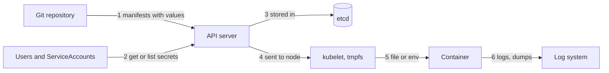

# Secrets

## In plain words

Some configuration must not be seen by everyone: a database password, an API token for a payment provider, the private key for a website's certificate. A **Secret** is the Kubernetes object for that kind of value. It works almost exactly like a ConfigMap, with the same two ways of handing values to a container, but Kubernetes treats it with more care: it can be given tighter access rules, it is sent only to the nodes that need it, and it is kept in memory on those nodes instead of being written to their disks.

Be clear from the start about what a Secret is *not*. By default a Secret is **not encrypted**. Its values are stored in an encoding called base64, which is a way of writing arbitrary bytes as plain letters and digits. Base64 is as secret as writing a word backwards: anyone can reverse it instantly. The safety of a Secret comes from *who is allowed to read it* and from extra protections you switch on, not from the object's name.

Think of a hotel. A ConfigMap is the notice board in the lobby. A Secret is the envelope kept behind the reception desk. The envelope is not a safe. What protects it is that reception only hands it to the right guest, that staff access is controlled, and, if the hotel is careful, that the back office where envelopes are stored is locked as well.

Why this matters for a job: leaked credentials are one of the most common causes of security incidents, and Kubernetes Secrets are frequently misunderstood. You are expected to know what protection they do and do not give, how to keep them out of Git, and how to consume them safely. "Are Kubernetes Secrets secure?" is an interview question designed to catch people who assume the name means encryption.

> **Before this lesson:** read [ConfigMaps](#/lesson/kubernetes/configmaps). The consumption mechanisms (environment variables, `envFrom`, volumes, update behaviour, `immutable`) are the same and are not repeated in full here.

## Base64 is encoding, not encryption

An **encoding** changes how data is written without hiding it; anyone can decode it with no key. **Encryption** scrambles data so that only someone with the right key can recover it. A Secret's `data` field uses base64 so that it can hold binary content such as certificates, not to protect anything.

```python-run
import base64

password = "s3cr3t-Flat-White!"
encoded = base64.b64encode(password.encode()).decode()
print("original :", password)
print("encoded  :", encoded)
print("decoded  :", base64.b64decode(encoded).decode())
print()
print("No key was needed to decode. Base64 is a spelling, not a lock.")

# The classic mistake: encoding a value that includes a trailing newline
with_newline = base64.b64encode((password + "\n").encode()).decode()
print()
print("with stray newline:", with_newline)
print("same as correct?  :", with_newline == encoded)
```

The second half of the output shows a bug you will meet in real life. Running `echo "value" | base64` in a shell includes a newline at the end, so the stored password has an invisible extra character and authentication fails mysteriously. Use `echo -n` (no newline) or `printf`, or avoid hand-encoding altogether with `stringData`, shown below.

## A Secret, line by line

```yaml
apiVersion: v1
kind: Secret
metadata:
  name: orders-db-credentials
  namespace: cafe
type: Opaque
stringData:
  username: orders_app
  password: s3cr3t-Flat-White!
```

- `apiVersion: v1`, `kind: Secret` — a core, namespaced object.
- `type: Opaque` — the general-purpose type for arbitrary keys and values. It is the default.
- `stringData` — a write-only convenience field in which you write values as plain text. When the object is stored, the API server base64-encodes them and moves them into `data`. Reading the Secret back shows only `data`.

The equivalent using `data` directly:

```yaml
data:
  username: b3JkZXJzX2FwcA==
  password: czNjcjN0LUZsYXQtV2hpdGUh
```

Creating one from the command line avoids writing the value into a file:

```bash
$ kubectl create secret generic orders-db-credentials -n cafe \
    --from-literal=username=orders_app \
    --from-literal=password='s3cr3t-Flat-White!'
secret/orders-db-credentials created

$ kubectl get secret orders-db-credentials -n cafe
NAME                    TYPE     DATA   AGE
orders-db-credentials   Opaque   2      5s

$ kubectl describe secret orders-db-credentials -n cafe
Name:         orders-db-credentials
Type:         Opaque
Data
====
password:  18 bytes
username:  10 bytes

$ kubectl get secret orders-db-credentials -n cafe -o jsonpath='{.data.password}' | base64 -d
s3cr3t-Flat-White!
```

`generic` creates an Opaque Secret. Single quotes stop the shell interpreting the `!`. `describe` shows only the size of each value, a small courtesy against people reading over your shoulder. The last command prints the encoded value and pipes it through `base64 -d` to decode it: anyone allowed to `get` the Secret can do this. That one line is the whole case for controlling access to Secrets.

### Secret types

The `type` field tells Kubernetes and tools what shape to expect.

| Type | Holds | Required keys |
|---|---|---|
| `Opaque` | Anything | None |
| `kubernetes.io/tls` | A TLS certificate and private key | `tls.crt`, `tls.key` |
| `kubernetes.io/dockerconfigjson` | Credentials for an image registry | `.dockerconfigjson` |
| `kubernetes.io/basic-auth` | A username and password | `username`, `password` |
| `kubernetes.io/ssh-auth` | An SSH private key | `ssh-privatekey` |
| `kubernetes.io/service-account-token` | A long-lived ServiceAccount token (legacy; avoid) | Managed by the control plane |

Two are created with their own commands:

```bash
$ kubectl create secret tls shop-tls -n cafe --cert=shop.crt --key=shop.key
$ kubectl create secret docker-registry ghcr-credentials -n cafe \
    --docker-server=ghcr.io --docker-username=harbour-bot --docker-password="$GHCR_TOKEN"
```

The first is what an [Ingress](#/lesson/kubernetes/ingress) or Gateway refers to for HTTPS. The second is referenced from a Pod's `imagePullSecrets` so that the kubelet can pull private images; `"$GHCR_TOKEN"` reads the token from an environment variable so that it does not appear in your shell history.

## Consuming a Secret

The mechanisms mirror ConfigMaps, with `secretKeyRef`, `secretRef` and a `secret` volume.

```yaml
apiVersion: apps/v1
kind: Deployment
metadata:
  name: orders-api
  namespace: cafe
spec:
  replicas: 2
  selector:
    matchLabels:
      app: orders-api
  template:
    metadata:
      labels:
        app: orders-api
    spec:
      imagePullSecrets:
        - name: ghcr-credentials
      volumes:
        - name: db-credentials
          secret:
            secretName: orders-db-credentials
            defaultMode: 0400
      containers:
        - name: orders-api
          image: ghcr.io/harbour-coffee/orders-api:2.1.0
          env:
            - name: PAYMENTS_API_TOKEN
              valueFrom:
                secretKeyRef:
                  name: payments-token
                  key: token
          volumeMounts:
            - name: db-credentials
              mountPath: /var/run/secrets/orders-db
              readOnly: true
```

- `imagePullSecrets` names the registry credential Secret.
- The volume of type `secret` projects each key as a file. Note the field is `secretName`, where the ConfigMap volume used `name`. `defaultMode: 0400` makes the files readable only by their owner.
- The environment variable `PAYMENTS_API_TOKEN` is filled from the key `token` of another Secret.
- The mount gives the program two files: `/var/run/secrets/orders-db/username` and `/var/run/secrets/orders-db/password`, each containing the **decoded** value. Applications never see base64.

```bash
$ kubectl exec -n cafe deploy/orders-api -- ls -l /var/run/secrets/orders-db
lrwxrwxrwx 1 root root 15 Nov 21 12:10 password -> ..data/password
lrwxrwxrwx 1 root root 15 Nov 21 12:10 username -> ..data/username

$ kubectl exec -n cafe deploy/orders-api -- df -h /var/run/secrets/orders-db
Filesystem      Size  Used Avail Use% Mounted on
tmpfs           512M  8.0K  512M   1% /run/secrets/orders-db
```

The filesystem type is `tmpfs`, a filesystem held in memory. Secret volumes are never written to the node's disk, so a stolen or discarded disk does not contain them.

### Files or environment variables?

For Secrets, prefer **files**.

| Concern | Environment variable | Mounted file |
|---|---|---|
| Visible in `kubectl describe pod` | The reference, not the value | The reference, not the value |
| Leaks through crash dumps, debug pages, `env` output, child processes | Common: environments are inherited and often logged | Much less likely |
| Updated when the Secret changes | No | Yes (except `subPath`) |
| Permissions | None | File mode and ownership |

Environment variables are copied to every child process and tend to be printed by diagnostic tooling. A file with restrictive permissions is read only by code that opens it. Many applications also accept a `*_FILE` variable pointing at a file for this reason.

Everything from the ConfigMap lesson about updates and precedence applies unchanged: environment values are fixed at container start, mounted files refresh, `subPath` mounts do not, `env` beats `envFrom`, a missing Secret gives `CreateContainerConfigError`, and `immutable: true` is available.

## Where the weak points are



Each numbered arrow is a place a secret can leak. The defences match one to one.

**1. Do not commit Secrets to Git.** A base64 value in a repository is a plaintext password visible to everyone with read access, permanently, since history keeps it. Three sound alternatives exist:

- **Sealed Secrets**: you encrypt the Secret with a public key into a `SealedSecret` object that is safe to commit; a controller in the cluster holds the private key and turns it back into a real Secret.
- **SOPS**: a tool that encrypts the values inside a YAML file using a cloud key service or age keys; the encrypted file is committed and decrypted at deploy time.
- **An external secret manager** (HashiCorp Vault, AWS Secrets Manager, Google Secret Manager, Azure Key Vault): Git holds only a *reference*. The **External Secrets Operator** reads the real value from the manager and creates the Kubernetes Secret, or the **Secrets Store CSI Driver** mounts it straight into the Pod as a file without creating a Secret at all.

```yaml
apiVersion: external-secrets.io/v1
kind: ExternalSecret
metadata:
  name: orders-db-credentials
  namespace: cafe
spec:
  refreshInterval: 1h
  secretStoreRef:
    kind: ClusterSecretStore
    name: company-vault
  target:
    name: orders-db-credentials
  data:
    - secretKey: password
      remoteRef:
        key: cafe/orders-db
        property: password
```

This object contains no secret value, so it is safe in Git. It says: every hour, read the `password` property of the entry `cafe/orders-db` from the store named `company-vault`, and keep a Kubernetes Secret called `orders-db-credentials` in step with it. The application consumes that Secret in the usual way.

**2. Restrict who can read Secrets.** With role-based access control ([RBAC](#/lesson/kubernetes/rbac-admission)), grant `get` on Secrets only where necessary, and name the specific Secrets where possible. Be aware of two indirect routes: `list` and `watch` on Secrets return the full contents, and anyone who can **create a Pod** in a namespace can mount any Secret in that namespace and read it from inside. Namespace boundaries are therefore the real unit of secret isolation.

**3. Encrypt Secrets in etcd.** By default, etcd holds Secrets base64-encoded, so anyone with access to etcd's files or backups has every credential in the cluster. **Encryption at rest** makes the API server encrypt Secrets before writing them. The best form uses a **KMS provider**: the encryption keys live in an external key management service, outside the cluster. Managed services such as GKE, EKS and AKS either do this by default or offer it as a setting. On self-managed clusters you configure it with an `EncryptionConfiguration` file passed to the API server:

```yaml
apiVersion: apiserver.config.k8s.io/v1
kind: EncryptionConfiguration
resources:
  - resources: ["secrets"]
    providers:
      - kms:
          apiVersion: v2
          name: cloud-kms
          endpoint: unix:///var/run/kmsplugin/socket.sock
      - identity: {}
```

The list of `providers` is tried in order: new writes use the first (the KMS plug-in), and `identity`, meaning "not encrypted", remains so that Secrets written before encryption was enabled can still be read until they are rewritten.

**4. Protect the path to the node.** The API server sends a Secret only to kubelets running a Pod that uses it, over TLS, and the kubelet keeps it in memory. Node authorisation rules stop a kubelet reading Secrets for Pods it does not host.

**5. Limit exposure in the container.** Mount files read-only with tight permissions, and mount only the keys a container needs using `items`.

**6. Keep secrets out of logs.** No Kubernetes feature can stop an application printing a password. That is a code-review and testing matter.

> [!WARNING]
> Three statements to remember. A Secret's `data` is base64, which is **not** encryption. A Secret manifest committed to Git is a leaked credential. And anyone who can create Pods in a namespace can read every Secret in it. If any of these surprises a colleague, the team's secrets are at risk.

## ServiceAccount tokens and projected volumes

Every Pod automatically gets one credential you did not create: a token that identifies it to the Kubernetes API. In current versions this is not stored as a Secret. The kubelet requests a short-lived token for each Pod and mounts it through a **projected volume**, a volume type that combines several sources in one directory:

```bash
$ kubectl exec -n cafe deploy/orders-api -- ls /var/run/secrets/kubernetes.io/serviceaccount
ca.crt  namespace  token
```

`token` is valid for about an hour and is replaced before it expires; it is bound to this Pod and becomes invalid when the Pod is deleted. `ca.crt` lets the program verify the API server, and `namespace` holds the Pod's namespace. Pods that never call the Kubernetes API should switch the mount off with `automountServiceAccountToken: false`, removing a credential an attacker could use. The [authentication lesson](#/lesson/kubernetes/authentication) covers these tokens properly.

You can build your own projected volume to combine a Secret, a ConfigMap and Pod metadata under one mount path:

```yaml
      volumes:
        - name: app-config
          projected:
            sources:
              - configMap:
                  name: orders-config
                  items:
                    - key: app.toml
                      path: app.toml
              - secret:
                  name: orders-db-credentials
                  items:
                    - key: password
                      path: db-password
              - downwardAPI:
                  items:
                    - path: pod-name
                      fieldRef:
                        fieldPath: metadata.name
```

The container sees one directory containing `app.toml`, `db-password` and `pod-name`, drawn from three different sources.

## Rotation

A secret that never changes is a secret that will eventually be known by people who have left. **Rotation** means replacing a credential on a schedule or after exposure. A workable procedure on Kubernetes:

1. Create the new credential at its source (database, provider) while the old one still works.
2. Update the Secret, ideally through the external secret manager.
3. Roll the workloads (`kubectl rollout restart`, or automatically with a controller that watches for Secret changes).
4. Revoke the old credential once every Pod has the new one.

Better still is to avoid long-lived secrets. Cloud **workload identity** lets a Pod's ServiceAccount token be exchanged for short-lived cloud credentials, so no cloud key is ever stored in the cluster. Secret managers can issue database credentials that expire after hours.

> [!TIP]
> To check whether a mounted secret has the value you expect without printing it, compare hashes: `kubectl exec POD -- sha256sum /var/run/secrets/orders-db/password` and the same command on the expected value locally. The terminal scrollback and any session recording then contain only a hash.

> [!INTERVIEW]
> **"Are Kubernetes Secrets secure?"** Not by default in the sense people assume. Secret values are base64-encoded, not encrypted, and are stored that way in etcd unless encryption at rest is configured. Their protections are: RBAC can restrict them separately from other objects; they are sent only to nodes whose Pods need them; they are mounted on tmpfs, not disk; and `describe` hides values. To make them properly safe you enable etcd encryption with a KMS provider, apply least-privilege RBAC (remembering that Pod-create rights in a namespace imply access to its Secrets), never commit them to Git, using Sealed Secrets, SOPS or an external manager with the External Secrets Operator or the Secrets Store CSI driver, prefer file mounts over environment variables, rotate them, and prefer short-lived identity-based credentials where possible.

## Common pitfalls

- **Treating base64 as protection.**
- **Committing Secret manifests to Git**, including in "private" repositories.
- **Trailing newline in a hand-encoded value.** Use `echo -n`, `printf` or `stringData`.
- **Secrets as environment variables that end up in logs or crash reports.**
- **Granting `list` on Secrets "for convenience".** It exposes every value in the namespace.
- **Forgetting that Pod creation rights expose Secrets.**
- **Secret in another namespace.** A Pod can use only Secrets in its own.
- **Updating a Secret and expecting environment variables to change.** Roll the Pods.
- **Assuming a managed cluster encrypts etcd with your own key.** Check the setting.

## Cheat sheet

| Task | Command |
|---|---|
| Create generic | `kubectl create secret generic NAME --from-literal=k=v` |
| Create from a file | `kubectl create secret generic NAME --from-file=key=path` |
| Create TLS | `kubectl create secret tls NAME --cert=c.crt --key=c.key` |
| Create registry | `kubectl create secret docker-registry NAME --docker-server=... ` |
| Decode one key | `kubectl get secret NAME -o jsonpath='{.data.KEY}' \| base64 -d` |
| Who can read Secrets | `kubectl auth can-i get secrets -n NS --as USER` |

| In a Pod spec | Field |
|---|---|
| One variable | `env[].valueFrom.secretKeyRef` |
| All keys as variables | `envFrom[].secretRef` |
| Files | `volumes[].secret.secretName` |
| Private registry | `imagePullSecrets[]` |
| Combined sources | `volumes[].projected.sources[]` |
| No API token | `automountServiceAccountToken: false` |

## Summary

A Secret holds sensitive values and is consumed like a ConfigMap, as environment variables or, preferably, as files on an in-memory filesystem. Its `data` is base64-encoded, which protects nothing; real protection comes from access control, encryption of etcd at rest with keys held in a KMS, keeping manifests out of Git by using sealed or externally managed secrets, and limiting what each container can see. Anyone who can read Secrets or create Pods in a namespace can obtain its Secrets, so namespaces and RBAC are the true boundary. Tokens for the Kubernetes API are short-lived and projected automatically. Rotate credentials, and prefer short-lived identities over stored secrets. With configuration and storage in place, the next module brings them together for workloads that need both a stable identity and their own data: StatefulSets.

## Glossary

- **Secret**: an object holding sensitive data, base64-encoded.
- **Encoding**: a reversible representation that needs no key.
- **Encryption**: scrambling that needs a key to reverse.
- **base64**: an encoding that writes bytes as letters and digits.
- **stringData**: a write-only field for supplying Secret values as plain text.
- **Opaque**: the generic Secret type.
- **imagePullSecrets**: Secrets holding registry credentials used by the kubelet.
- **tmpfs**: an in-memory filesystem, used for Secret volumes.
- **Encryption at rest**: encrypting stored data, here Secrets in etcd.
- **KMS provider**: a plug-in that keeps the encryption keys in an external key management service.
- **Sealed Secrets / SOPS**: tools for committing encrypted secrets to Git.
- **External Secrets Operator**: a controller that syncs Secrets from an external manager.
- **Secrets Store CSI Driver**: a driver that mounts secrets from an external manager as files.
- **Projected volume**: a volume combining several sources in one directory.
- **Rotation**: replacing a credential periodically or after exposure.
- **Workload identity**: exchanging a Pod's identity for short-lived cloud credentials.

```quiz
[
  {"q": "A colleague says: 'It is fine to commit this Secret manifest to Git, the password is encrypted in the data field.' What is wrong?",
   "options": ["Nothing, data is encrypted with the cluster key", "The data field is only base64-encoded, which anyone can decode without a key", "Git cannot store YAML", "Secrets cannot be created from manifests"],
   "answer": 1,
   "explain": "Base64 is an encoding. A committed Secret manifest exposes the plaintext to everyone with repository access, including through history."},
  {"q": "A user has no permission to read Secrets in namespace cafe but may create Pods there. Can they obtain the database password stored in a Secret in that namespace?",
   "options": ["No, RBAC blocks it", "Yes, by creating a Pod that mounts the Secret and reading the file", "Only with cluster-admin", "Only if the Secret is immutable"],
   "answer": 1,
   "explain": "Pod creation rights let a user mount any Secret in the namespace. That is why the namespace is the real isolation boundary for Secrets."},
  {"q": "Where is a Secret volume stored on the node while a Pod uses it?",
   "options": ["On the node's root disk", "In a tmpfs, an in-memory filesystem", "In the container image", "In a PersistentVolume"],
   "answer": 1,
   "explain": "The kubelet mounts Secret volumes on tmpfs so the values are not written to the node's disk."},
  {"q": "A Secret was created with echo 'hunter2' | base64. The application's login to the database fails although the password looks right. What is the likely cause?",
   "options": ["Base64 is not supported for passwords", "echo added a trailing newline, which became part of the stored password", "The Secret type must be basic-auth", "Secrets cannot contain digits"],
   "answer": 1,
   "explain": "Without -n, echo appends a newline that is encoded along with the value. Use echo -n, printf or stringData."},
  {"q": "What does enabling encryption at rest with a KMS provider protect against?",
   "options": ["Applications logging their passwords", "Someone reading Secrets from etcd's storage or backups", "Users with RBAC get access", "Weak passwords"],
   "answer": 1,
   "explain": "It encrypts Secrets before they are written to etcd, with keys held outside the cluster. Access through the API by authorised users is unaffected."},
  {"q": "Why are mounted files generally preferred over environment variables for Secrets?",
   "options": ["Files are encrypted on tmpfs", "Environment variables are inherited by child processes and often appear in dumps and logs; files have permissions and also update on change", "Environment variables cannot hold long values", "Files are faster"],
   "answer": 1,
   "explain": "Environments leak easily through diagnostics and inheritance. Files are read only by code that opens them and refresh when the Secret changes."},
  {"q": "A Pod references a Secret named payments-token that does not exist in its namespace, through secretKeyRef. What is the Pod's status?",
   "options": ["Running with an empty variable", "CreateContainerConfigError until the Secret exists", "ImagePullBackOff", "Completed"],
   "answer": 1,
   "explain": "The kubelet cannot build the container's environment. It retries, so creating the Secret in that namespace lets the Pod start."},
  {"q": "An ExternalSecret object is committed to Git. Why is that safe?",
   "options": ["It is encrypted with base64", "It contains only a reference to a value in an external secret manager, not the value", "Git encrypts it", "It is ignored by kubectl"],
   "answer": 1,
   "explain": "The operator reads the real value from the manager at runtime and creates the Kubernetes Secret. The repository holds only the pointer."}
]
```

> **Source:** Poulton, *The Kubernetes Book*, ch. 11 (topic coverage only). Official docs: https://kubernetes.io/docs/concepts/configuration/secret/ , https://kubernetes.io/docs/tasks/administer-cluster/encrypt-data/ , https://kubernetes.io/docs/concepts/security/secrets-good-practices/ , https://kubernetes.io/docs/concepts/storage/projected-volumes/ , https://external-secrets.io/
