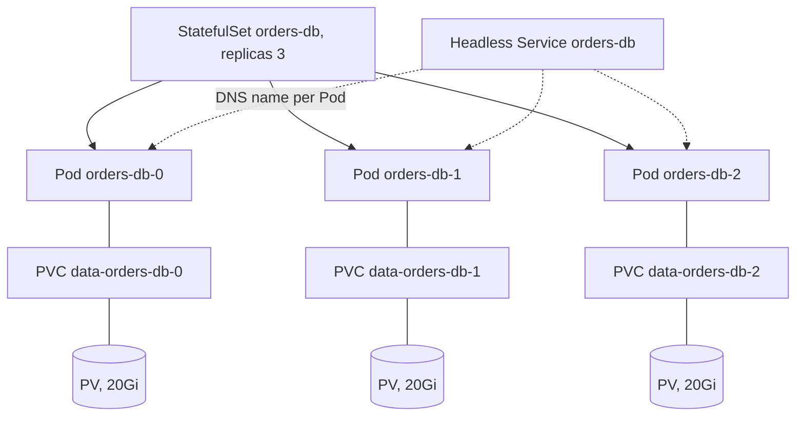

# StatefulSets: identity, order and storage

## In plain words

A Deployment treats its Pods as interchangeable. They get random names, start in any order, and if one is replaced the newcomer is a stranger with a new name and address. That is perfect for a web server and wrong for a database cluster, where each member is an individual: one is the primary that accepts writes, the others are replicas that copy from it, and each holds its own copy of the data on its own disk.

A **StatefulSet** is the controller for that kind of application. It gives each Pod three things a Deployment does not: a **stable name** that survives replacement (`orders-db-0`, `orders-db-1`, ...), a **stable network identity** so that others can address a specific member, and its **own persistent volume** that follows it across restarts. It also creates, updates and removes Pods in a defined **order**.

Compare two kinds of staff. Supermarket checkout operators are a Deployment: any operator on any till will do, and if one leaves, anyone can take over. The players of a football team are a StatefulSet: each has a shirt number, a fixed position and their own locker. If the number 1 is injured, the substitute plays *as* number 1, in goal, and opens the same locker. The individual changed; the identity and its belongings did not.

Why this matters for a job: databases, message brokers, search clusters and many ML feature stores run as StatefulSets, usually installed through a chart or an operator. When one misbehaves you must understand why `orders-db-1` is waiting for `orders-db-0`, where its data lives, and why scaling down did not free any disks. Interviewers reliably ask "Deployment versus StatefulSet".

> **Before this lesson:** you need Deployments ([Deployments and ReplicaSets](#/lesson/kubernetes/deployments-replicasets)), headless Services ([Services and ClusterIP](#/lesson/kubernetes/services-clusterip)), and claims and StorageClasses ([Volumes, PVs and PVCs](#/lesson/kubernetes/volumes-pv-pvc), [StorageClasses and CSI](#/lesson/kubernetes/storageclasses-csi)).

## Why a Deployment is not enough

Suppose Harbour Coffee runs PostgreSQL with one primary and two read replicas. Try it with a Deployment of three replicas and list what goes wrong.

| Requirement of a database cluster | What a Deployment gives |
|---|---|
| Replicas must know the primary's address | Pod names and IPs change on every replacement |
| Each member needs its own disk | All replicas share the one claim named in the template |
| A restarted member must get *its* data back | A new Pod has no link to any particular volume |
| The primary must be up before replicas start copying from it | All Pods start at once |
| Shut down replicas before the primary | Pods are removed in no particular order |

A StatefulSet addresses each row.

## The three guarantees

### 1. Stable, predictable names

Pods are named `<statefulset-name>-<ordinal>`, where the **ordinal** is an integer index starting at 0. A StatefulSet named `orders-db` with three replicas has `orders-db-0`, `orders-db-1` and `orders-db-2`. If `orders-db-1` is deleted, or its node fails, the replacement is again called `orders-db-1`. The name is a slot, not a particular Pod.

Each Pod also carries two labels set by the controller: `statefulset.kubernetes.io/pod-name` with its own name and `apps.kubernetes.io/pod-index` with its ordinal. They are handy for selecting one specific member.

### 2. Stable network identity

A StatefulSet is paired with a **headless Service** (one with `clusterIP: None`), named in the StatefulSet's `serviceName` field. Through it, every Pod gets its own DNS name:

```
<pod-name>.<service-name>.<namespace>.svc.cluster.local
orders-db-0.orders-db.cafe.svc.cluster.local
```

The Pod's IP address still changes when it is replaced. The DNS name does not, and it always resolves to whichever Pod currently fills that slot. Members and clients address each other by these names.

### 3. Stable storage

A StatefulSet has **`volumeClaimTemplates`**: a template for a PersistentVolumeClaim, from which the controller creates one claim **per Pod**, named `<template-name>-<pod-name>`. For a template called `data` you get `data-orders-db-0`, `data-orders-db-1`, `data-orders-db-2`, each bound to its own volume.

The claim belongs to the slot, not to the Pod object. When `orders-db-1` is replaced, the new `orders-db-1` mounts `data-orders-db-1` again and finds its data.



Note one difference from a Deployment in the picture: there is no ReplicaSet in between. A StatefulSet manages its Pods directly.

## A StatefulSet manifest, line by line

A StatefulSet needs its headless Service, so the two are usually written together.

```yaml
apiVersion: v1
kind: Service
metadata:
  name: orders-db
  namespace: cafe
  labels:
    app: orders-db
spec:
  clusterIP: None
  selector:
    app: orders-db
  ports:
    - name: postgres
      port: 5432
---
apiVersion: apps/v1
kind: StatefulSet
metadata:
  name: orders-db
  namespace: cafe
spec:
  serviceName: orders-db
  replicas: 3
  selector:
    matchLabels:
      app: orders-db
  template:
    metadata:
      labels:
        app: orders-db
    spec:
      terminationGracePeriodSeconds: 60
      securityContext:
        fsGroup: 999
      containers:
        - name: postgres
          image: postgres:17.4
          ports:
            - name: postgres
              containerPort: 5432
          env:
            - name: POSTGRES_PASSWORD
              valueFrom:
                secretKeyRef:
                  name: orders-db-credentials
                  key: password
            - name: PGDATA
              value: /var/lib/postgresql/data/pgdata
          readinessProbe:
            exec:
              command: ["pg_isready", "-U", "postgres"]
            periodSeconds: 5
          volumeMounts:
            - name: data
              mountPath: /var/lib/postgresql/data
          resources:
            requests:
              cpu: 500m
              memory: 1Gi
            limits:
              memory: 1Gi
  volumeClaimTemplates:
    - metadata:
        name: data
      spec:
        accessModes: ["ReadWriteOnce"]
        storageClassName: fast-ssd
        resources:
          requests:
            storage: 20Gi
```

The Service:

- `clusterIP: None` makes it headless: no virtual IP, and DNS returns the Pods' own addresses.
- The `selector` and port are ordinary.

The StatefulSet:

- `apiVersion: apps/v1`, `kind: StatefulSet`.
- `serviceName: orders-db` — the headless Service that governs the Pods' DNS names. It should exist before the StatefulSet. Without it, the per-Pod names do not resolve.
- `replicas`, `selector` and `template` behave as in a Deployment. The selector is immutable.
- In the Pod template: a 60 second grace period so the database can shut down cleanly; `fsGroup: 999` so the non-root `postgres` user can write to the volume; the password from a Secret; `PGDATA` pointing at a sub-directory of the mount (a PostgreSQL requirement when the mount point is the root of a volume); an `exec` readiness probe running PostgreSQL's own check; and a volume mount named `data`.
- `volumeClaimTemplates` — a list of claim templates. This one is named `data`, matching the `volumeMounts` name, and asks for 20 GiB of `fast-ssd`, ReadWriteOnce. There is no `volumes` entry in the Pod template for it; the controller adds one for each Pod pointing at that Pod's own claim.

> [!WARNING]
> This manifest starts three **independent** PostgreSQL servers that happen to share a name prefix. A StatefulSet provides identity, ordering and storage. It does **not** configure replication, elect a primary or perform failover; that logic belongs to the database software or to an operator built for it. Running a production database on Kubernetes normally means using such an operator (see [CRDs and operators](#/lesson/kubernetes/crds-operators)), not a hand-written StatefulSet.

## Ordered creation

Apply it and watch:

```bash
$ kubectl apply -f orders-db.yaml
service/orders-db created
statefulset.apps/orders-db created

$ kubectl get pods -n cafe -l app=orders-db --watch
NAME          READY   STATUS              RESTARTS   AGE
orders-db-0   0/1     Pending             0          0s
orders-db-0   0/1     ContainerCreating   0          3s
orders-db-0   1/1     Running             0          21s
orders-db-1   0/1     Pending             0          0s
orders-db-1   0/1     ContainerCreating   0          4s
orders-db-1   1/1     Running             0          24s
orders-db-2   0/1     Pending             0          0s
orders-db-2   1/1     Running             0          22s
```

The Pods appear **one at a time, in order**. `orders-db-1` is not created until `orders-db-0` is Running **and Ready**. This default behaviour is the `OrderedReady` pod management policy. It lets member 0 initialise itself before the others join.

The consequence to remember: **if a Pod never becomes ready, everything after it waits.** A broken `orders-db-0` means `orders-db-1` and `orders-db-2` are never created.

```bash
$ kubectl get pvc -n cafe
NAME               STATUS   VOLUME                                     CAPACITY   ACCESS MODES   STORAGECLASS
data-orders-db-0   Bound    pvc-1c5e8a40-0d3b-4f6e-9a17-2b7d5e8c9f01   20Gi       RWO            fast-ssd
data-orders-db-1   Bound    pvc-7a2d9b13-6f4c-4e21-b8d0-3c9e1f5a7b62   20Gi       RWO            fast-ssd
data-orders-db-2   Bound    pvc-e4b8c2d7-3a19-4c05-8f6b-9d2e7a1c4f33   20Gi       RWO            fast-ssd

$ kubectl run dns-test -n cafe --rm -it --image=busybox:1.37 --restart=Never -- nslookup orders-db-1.orders-db
Name:      orders-db-1.orders-db.cafe.svc.cluster.local
Address:   10.244.2.33
```

Three claims, named after the template and each Pod. And the per-Pod DNS name resolves to that one Pod's address.

## Identity survives replacement

```bash
$ kubectl exec -n cafe orders-db-1 -- sh -c 'echo "I am replica one" > /var/lib/postgresql/data/marker.txt'

$ kubectl get pod orders-db-1 -n cafe -o jsonpath='{.status.podIP} {.metadata.uid}{"\n"}'
10.244.2.33 6c1e7a9d-41b2-4f0a-9c55-8e2d3b7f1a04

$ kubectl delete pod orders-db-1 -n cafe
pod "orders-db-1" deleted

$ kubectl get pod orders-db-1 -n cafe -o jsonpath='{.status.podIP} {.metadata.uid}{"\n"}'
10.244.1.48 d9f3b2c6-7e15-4a80-b6d4-1c8a5e0f9b27

$ kubectl exec -n cafe orders-db-1 -- cat /var/lib/postgresql/data/marker.txt
I am replica one
```

Walk through it. A marker file is written into the volume of `orders-db-1`. The Pod's IP and unique ID are noted. The Pod is deleted; the controller recreates it. The new Pod has a **different IP and a different UID**: it is a new Pod. It has the **same name**, the **same DNS name** and the **same volume**: the marker file is there. Only the ordinal's Pod is recreated; the others are untouched.

## The mapping, as code

The naming rules are deterministic, which is what makes StatefulSets predictable. The function below generates everything for a StatefulSet, including the optional starting ordinal.

```python-run
def statefulset_layout(name, service, namespace, replicas, claim_templates, start=0, domain="cluster.local"):
    rows = []
    for ordinal in range(start, start + replicas):
        pod = f"{name}-{ordinal}"
        rows.append({
            "pod": pod,
            "dns": f"{pod}.{service}.{namespace}.svc.{domain}",
            "claims": [f"{t}-{pod}" for t in claim_templates],
        })
    return rows

for row in statefulset_layout("orders-db", "orders-db", "cafe", 3, ["data", "wal"]):
    print(row["pod"])
    print("   dns   :", row["dns"])
    print("   claims:", ", ".join(row["claims"]))

def creation_order(name, replicas, ready, policy="OrderedReady"):
    """ready: set of ordinals that will become Ready. Returns which Pods get created."""
    if policy == "Parallel":
        return [f"{name}-{i}" for i in range(replicas)], None
    created = []
    for i in range(replicas):
        created.append(f"{name}-{i}")
        if i not in ready:
            return created, f"{name}-{i} is not Ready, so later ordinals are not created"
    return created, None

print()
print("all healthy          :", creation_order("orders-db", 3, {0, 1, 2}))
print("ordinal 1 not ready  :", creation_order("orders-db", 3, {0, 2}))
print("same, Parallel policy:", creation_order("orders-db", 3, {0, 2}, policy="Parallel"))
```

The first part prints the name, DNS name and claims of each member; with two claim templates, each Pod gets two volumes. The second part shows the ordering rule: with `OrderedReady`, an unready ordinal 1 blocks ordinal 2 from ever being created, while the `Parallel` policy creates all of them at once.

## Reaching the members

A StatefulSet is usually served by more than one Service, each for a purpose.

| Need | Use | Example |
|---|---|---|
| Address one specific member | Per-Pod DNS through the headless Service | `orders-db-0.orders-db` for writes to the primary |
| Any healthy member, load balanced | An ordinary ClusterIP Service with the same selector | `orders-db-read` for read queries |
| Discover all members | DNS lookup of the headless Service name | Returns every ready Pod's IP |

```yaml
apiVersion: v1
kind: Service
metadata:
  name: orders-db-read
  namespace: cafe
spec:
  selector:
    app: orders-db
  ports:
    - name: postgres
      port: 5432
```

This second Service has a normal ClusterIP and spreads read connections over all ready members. To target one member with a Service of its own, select on the per-Pod label, for example `statefulset.kubernetes.io/pod-name: orders-db-0`.

The headless Service by default lists only **ready** Pods in DNS. Some clustered applications need to find their peers before they are ready, in order to form the cluster in the first place. Setting `publishNotReadyAddresses: true` on the headless Service makes it publish all Pods regardless of readiness.

## Deployment and StatefulSet compared

| Aspect | Deployment | StatefulSet |
|---|---|---|
| Pod names | Random suffix | `name-0`, `name-1`, ... |
| Identity after replacement | New | Same name, same DNS name |
| Storage | All Pods share the claims in the template | One claim per Pod from `volumeClaimTemplates` |
| Creation order | All at once | In ordinal order, each waiting for the previous to be Ready |
| Removal order | Any | Highest ordinal first |
| Updates | New ReplicaSet, surge allowed | In place, highest ordinal first, one at a time |
| Intermediate object | ReplicaSet | None |
| Needs a headless Service | No | Yes, named in `serviceName` |
| Typical workloads | Stateless APIs, web front ends | Databases, brokers, clustered systems |

Not everything with a disk needs a StatefulSet. A single-replica application with one claim works fine as a Deployment with the `Recreate` strategy. Choose a StatefulSet when you need **several replicas that each have their own identity or storage**, or ordered start-up and shutdown.

> [!TIP]
> When a StatefulSet seems stuck part-way through starting, look at the lowest ordinal that is not Ready. With the default policy nothing after it is created, so there is always exactly one Pod to investigate: `kubectl describe pod NAME-N` and `kubectl logs NAME-N`.

> [!INTERVIEW]
> **"What is the difference between a Deployment and a StatefulSet?"** A Deployment manages interchangeable Pods through ReplicaSets: random names, parallel creation, shared storage if any. A StatefulSet manages Pods with a persistent identity. Each Pod has a stable ordinal name, a stable DNS name through a headless Service (`pod.service.namespace.svc.cluster.local`), and its own PersistentVolumeClaim created from `volumeClaimTemplates`, which is re-attached when the Pod is recreated. Pods are created in order from 0, each waiting for the previous to be Ready, removed in reverse order, and updated one at a time from the highest ordinal. It suits clustered stateful software such as databases and brokers. A senior answer adds that a StatefulSet does not provide replication or failover, which is the application's or an operator's job, and that its claims are not deleted when it is scaled down or removed.

## Common pitfalls

- **Expecting replication.** A StatefulSet runs N separate instances; the application must cluster itself.
- **Missing or mismatched headless Service.** `serviceName` must name an existing headless Service with a matching selector, or per-Pod DNS fails.
- **A failing first Pod blocks the rest.** Fix ordinal 0 before wondering where the others are.
- **Using a StatefulSet for a stateless app** "to get nice names". You inherit slow, ordered rollouts for no benefit.
- **Clients connecting by Pod IP.** The IP changes; use the DNS name.
- **Zonal volumes pinning Pods.** `orders-db-1` can only ever run in the zone where `data-orders-db-1` lives.
- **Assuming the same name means the same Pod.** The UID and IP differ after replacement.

## Cheat sheet

| Thing | Pattern | Example |
|---|---|---|
| Pod name | `<sts>-<ordinal>` | `orders-db-2` |
| Pod DNS | `<pod>.<service>.<ns>.svc.cluster.local` | `orders-db-2.orders-db.cafe.svc.cluster.local` |
| Claim name | `<template>-<pod>` | `data-orders-db-2` |
| Create order | 0, 1, 2, ... each Ready first | |
| Delete order | N-1, ..., 1, 0 | |

| Field | Purpose |
|---|---|
| `serviceName` | The governing headless Service |
| `volumeClaimTemplates` | One claim per Pod |
| `podManagementPolicy` | `OrderedReady` (default) or `Parallel` |
| `replicas`, `selector`, `template` | As in a Deployment |

## Summary

A StatefulSet runs Pods that are individuals. Each has a stable name built from an ordinal, a stable DNS name supplied through a headless Service, and its own PersistentVolumeClaim generated from a template and re-attached whenever the Pod in that slot is recreated. Pods are created in order, each waiting for the one before to be Ready, so a failing early member blocks the rest. The replacement for a lost Pod is a new Pod with a new IP and UID that takes over the old name, DNS name and data. The StatefulSet supplies this scaffolding only; replication and failover remain the application's responsibility. The next lesson covers operating one: scaling, updates, what happens to the volumes, and failure handling.

## Glossary

- **StatefulSet**: a controller for Pods needing stable identity, ordering and per-Pod storage.
- **Ordinal**: the integer index in a StatefulSet Pod's name.
- **Stable network identity**: a DNS name that stays the same across Pod replacements.
- **Headless Service**: a Service with no ClusterIP whose DNS returns Pod addresses.
- **serviceName**: the StatefulSet field naming its governing headless Service.
- **volumeClaimTemplates**: templates from which one claim per Pod is created.
- **OrderedReady**: the default policy: create and delete Pods one at a time in order.
- **Parallel**: the policy that creates and deletes Pods simultaneously.
- **Primary / replica**: the database member that accepts writes, and members that copy from it.
- **publishNotReadyAddresses**: a Service field that publishes Pods in DNS before they are ready.
- **Operator**: software that automates running a complex application, covered later.

```quiz
[
  {"q": "A StatefulSet named kafka has 3 replicas. Pod kafka-1 is deleted. What is the replacement called, and which volume does it mount?",
   "options": ["kafka-3, with a new empty volume", "kafka-1, with the same claim that kafka-1 used before", "A random name, with a shared volume", "kafka-1, with a new empty volume"],
   "answer": 1,
   "explain": "The ordinal slot keeps its name and its PersistentVolumeClaim. The new Pod has a new UID and IP but the same identity and data."},
  {"q": "A new StatefulSet with replicas: 3 and the default policy shows only web-0, stuck at 0/1 Running. Why are web-1 and web-2 not running?",
   "options": ["The quota is exceeded", "With OrderedReady, the next Pod is created only after the previous one is Running and Ready", "StatefulSets start in reverse order", "The headless Service is missing a port"],
   "answer": 1,
   "explain": "web-0 has not become ready, so the controller does not proceed. Fix web-0's readiness and the rest follow."},
  {"q": "What is the full DNS name of Pod cache-2 of StatefulSet cache, governed by headless Service cache-hs, in namespace shop?",
   "options": ["cache-2.shop.svc.cluster.local", "cache-hs-2.shop.svc.cluster.local", "cache-2.cache-hs.shop.svc.cluster.local", "cache-2.cache.shop.pod.cluster.local"],
   "answer": 2,
   "explain": "The pattern is pod-name.service-name.namespace.svc.cluster-domain."},
  {"q": "A StatefulSet named db has volumeClaimTemplates named data and logs, with 2 replicas. Which claims exist?",
   "options": ["data, logs", "data-db-0, data-db-1, logs-db-0, logs-db-1", "db-data-0, db-logs-0", "data-0, data-1"],
   "answer": 1,
   "explain": "One claim per template per Pod, named template-podname."},
  {"q": "You deploy three PostgreSQL Pods with a plain StatefulSet and no other configuration. What do you have?",
   "options": ["A replicated cluster with automatic failover", "Three independent database servers with stable names and separate volumes", "One database with three connections", "A read replica set managed by Kubernetes"],
   "answer": 1,
   "explain": "A StatefulSet provides identity, ordering and storage only. Replication and failover must come from the database or an operator."},
  {"q": "After a StatefulSet Pod is recreated, which of these has changed?",
   "options": ["Its name", "Its DNS name", "Its IP address", "Its PersistentVolumeClaim"],
   "answer": 2,
   "explain": "The new Pod gets a new IP and UID. The name, DNS name and claim are stable, which is why clients must use the DNS name."},
  {"q": "Which workload is the best fit for a StatefulSet?",
   "options": ["A stateless REST API with 10 replicas", "A three-member message broker cluster where each member stores its own log", "A nightly batch job", "A log collector on every node"],
   "answer": 1,
   "explain": "Members need individual identities and their own storage. The others are a Deployment, a CronJob and a DaemonSet."},
  {"q": "Per-Pod DNS names of a StatefulSet do not resolve, although the Pods are Running. What is the most likely cause?",
   "options": ["The Pods lack resource limits", "serviceName does not refer to an existing headless Service that selects the Pods", "volumeClaimTemplates is empty", "The StatefulSet has too many replicas"],
   "answer": 1,
   "explain": "The per-Pod records are published under the governing headless Service. If it is missing, not headless, or selects nothing, the names do not exist."}
]
```

> **Source:** Poulton, *The Kubernetes Book*, ch. 12 (topic coverage only). Official docs: https://kubernetes.io/docs/concepts/workloads/controllers/statefulset/ , https://kubernetes.io/docs/tutorials/stateful-application/basic-stateful-set/
