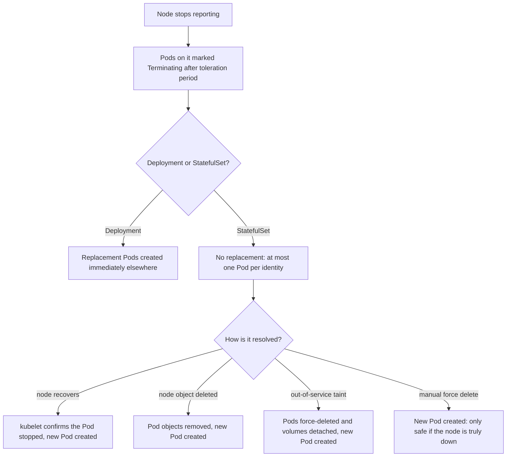

# Operating StatefulSets: scaling, updates and failures

## In plain words

Creating a StatefulSet is the easy part. Living with one means scaling it up and down, upgrading the software inside it, and coping when a member or a whole node fails, all without losing data. A StatefulSet behaves differently from a Deployment in each of these situations, and the differences are deliberate: wherever a Deployment would hurry, a StatefulSet is careful, because the Pods hold data.

Think about replacing the crew of a ship at sea, one sailor at a time, compared with swapping waiters in a restaurant. A waiter can be swapped in seconds. A sailor has a post, a handover to complete and a bunk full of belongings. You change them in a set order, you wait for each newcomer to report "at my post and ready" before relieving the next, and you do not throw away a departing sailor's locker in case they return. A StatefulSet follows those three rules: defined order, wait for readiness, keep the storage.

Why this matters for a job: operational mistakes with stateful workloads are the expensive kind. Knowing that volumes outlive a scale-down, that an update can stall on one unready Pod, and that a Pod on a dead node is deliberately not replaced automatically, is the difference between a calm maintenance window and a data incident.

> **Before this lesson:** read [StatefulSets: identity, order and storage](#/lesson/kubernetes/statefulset-theory). You should also know rolling updates for Deployments from [Rolling updates, rollbacks and strategies](#/lesson/kubernetes/rolling-updates-rollbacks) and node failure handling from [Worker nodes](#/lesson/kubernetes/worker-nodes).

## Scaling

### Scaling up

```bash
$ kubectl scale statefulset orders-db --replicas=5 -n cafe
statefulset.apps/orders-db scaled

$ kubectl get pods -n cafe -l app=orders-db
NAME          READY   STATUS    RESTARTS   AGE
orders-db-0   1/1     Running   0          2h
orders-db-1   1/1     Running   0          2h
orders-db-2   1/1     Running   0          2h
orders-db-3   1/1     Running   0          40s
orders-db-4   0/1     Running   0          8s
```

New Pods take the next ordinals, 3 and then 4, one at a time, each waiting for the previous one to be Ready. For each, a new claim (`data-orders-db-3`, `data-orders-db-4`) is created and a volume provisioned.

With the default `OrderedReady` policy there is a precondition that surprises people: **all existing Pods must be Running and Ready before a scaling step proceeds**. If `orders-db-1` is unhealthy, scaling from 3 to 5 does nothing until it recovers.

### Scaling down

```bash
$ kubectl scale statefulset orders-db --replicas=3 -n cafe
statefulset.apps/orders-db scaled

$ kubectl get pods -n cafe -l app=orders-db
NAME          READY   STATUS    RESTARTS   AGE
orders-db-0   1/1     Running   0          2h
orders-db-1   1/1     Running   0          2h
orders-db-2   1/1     Running   0          2h

$ kubectl get pvc -n cafe
NAME               STATUS   VOLUME                                     CAPACITY   STORAGECLASS
data-orders-db-0   Bound    pvc-1c5e8a40-...                           20Gi       fast-ssd
data-orders-db-1   Bound    pvc-7a2d9b13-...                           20Gi       fast-ssd
data-orders-db-2   Bound    pvc-e4b8c2d7-...                           20Gi       fast-ssd
data-orders-db-3   Bound    pvc-0b6f3e92-...                           20Gi       fast-ssd
data-orders-db-4   Bound    pvc-a57c1d08-...                           20Gi       fast-ssd
```

Pods are removed **highest ordinal first**: 4, then 3, each fully terminated before the next. Now look at the claims. **All five are still there.** By default, scaling down a StatefulSet, and even deleting it, does not delete its PersistentVolumeClaims.

This is the safe default: a mistaken scale-down costs you nothing, because scaling back up re-attaches `data-orders-db-3` and `data-orders-db-4` with their old contents. It has two consequences you must keep in mind:

- **You keep paying for the volumes** until you delete the claims yourself.
- **A scaled-up Pod may come back with stale data.** If `orders-db-4` rejoins weeks later with a weeks-old copy of the database, the application must be able to resynchronise it, or you must delete the old claim first.

### Choosing what happens to the claims

The field `persistentVolumeClaimRetentionPolicy` makes the behaviour explicit.

```yaml
spec:
  persistentVolumeClaimRetentionPolicy:
    whenScaled: Delete
    whenDeleted: Retain
```

- `whenScaled` — what to do with a Pod's claim when the StatefulSet is scaled down past that Pod. `Retain` (the default) keeps it; `Delete` removes it once the Pod has terminated.
- `whenDeleted` — what to do with all the claims when the StatefulSet object itself is deleted. `Retain` (the default) keeps them; `Delete` removes them.

The example deletes the volumes of members removed by scaling but keeps everything if someone deletes the StatefulSet by mistake. Whether a deleted claim's *data* is destroyed then depends on the volume's reclaim policy, as described in the [storage lesson](#/lesson/kubernetes/volumes-pv-pvc).

> [!WARNING]
> Removing a member from a clustered data system is more than deleting its Pod. Many systems must be told that a member is leaving (drained of data, removed from the membership list) *before* its Pod stops, or the remaining members wait for it or consider the cluster degraded. Scaling a database or broker StatefulSet down with `kubectl scale` alone can damage the cluster. Follow the application's procedure, or let its operator do it.

## Updates

### RollingUpdate, the default

Changing the Pod template (a new image, for example) starts a rolling update, but not the Deployment kind. There is no second ReplicaSet and no surge. The controller works **in place, from the highest ordinal to the lowest**, one Pod at a time:

1. Delete `orders-db-2`.
2. Recreate `orders-db-2` from the new template, attached to the same claim.
3. Wait until it is Running and Ready.
4. Move on to `orders-db-1`, then `orders-db-0`.

```bash
$ kubectl set image statefulset/orders-db postgres=postgres:17.5 -n cafe
statefulset.apps/orders-db image updated

$ kubectl rollout status statefulset/orders-db -n cafe
Waiting for 1 pods to be ready...
partitioned roll out complete: 1 new pods have been updated...
Waiting for 1 pods to be ready...
statefulset rolling update complete 3 pods at revision orders-db-6b8f9d7c54...
```

Why highest first? By convention ordinal 0 is the most important member (often the initial primary), so it is touched last, after the new version has been proven on the others.

Because each Pod is deleted before its replacement starts, **capacity drops by one member during the update**. A three-member cluster runs on two while each member restarts. The application must tolerate that.

And as with ordered creation: **if an updated Pod does not become Ready, the update stops there.** It does not continue to lower ordinals, and it does not roll back by itself. Worse, correcting the template alone may not rescue it, because the controller is waiting for the broken Pod to become Ready before doing anything else. The documented remedy is to fix the template and then delete the stuck Pod by hand, so that it is recreated from the corrected template.

### Partitions: staged and canary updates

The `partition` setting lets you update only part of a StatefulSet.

```yaml
spec:
  updateStrategy:
    type: RollingUpdate
    rollingUpdate:
      partition: 2
      maxUnavailable: 1
```

- `partition: 2` — only Pods with an ordinal **greater than or equal to 2** are updated when the template changes. Pods 0 and 1 stay on the old version, even if they are deleted and recreated.
- `maxUnavailable: 1` — how many Pods may be down at once during the update. The default is 1.

That gives a canary for stateful workloads: set the partition to 2, change the image, and only `orders-db-2` gets the new version. Check it. Lower the partition to 1, then to 0, to carry the update through. The simulation below plays out the sequence.

```python-run
def update_plan(replicas, partition=0, becomes_ready=None):
    """Which Pods are updated, in order, and where a failure stops the rollout."""
    becomes_ready = set(range(replicas)) if becomes_ready is None else becomes_ready
    steps = []
    for ordinal in range(replicas - 1, -1, -1):          # highest ordinal first
        if ordinal < partition:
            steps.append(f"db-{ordinal}: below partition {partition}, stays on the old version")
            continue
        if ordinal in becomes_ready:
            steps.append(f"db-{ordinal}: deleted, recreated on the new version, Ready -> continue")
        else:
            steps.append(f"db-{ordinal}: recreated on the new version, NOT Ready -> rollout stops here")
            remaining = [f"db-{i}" for i in range(ordinal - 1, -1, -1) if i >= partition]
            if remaining:
                steps.append(f"   never reached: {', '.join(remaining)} (still old version)")
            break
    return steps

for title, kwargs in [
    ("Full update of 4 replicas", dict(replicas=4)),
    ("Canary with partition=3", dict(replicas=4, partition=3)),
    ("Stage two: partition=1", dict(replicas=4, partition=1)),
    ("New version is broken on db-2", dict(replicas=4, becomes_ready={0, 1, 3})),
]:
    print(title)
    for s in update_plan(**kwargs):
        print("  ", s)
    print()
```

The last scenario shows the stall: `db-3` updates successfully, `db-2` never becomes ready, and `db-1` and `db-0` are never touched. The cluster is left running mixed versions, which is safer than pressing on, and it waits for you.

### OnDelete

```yaml
spec:
  updateStrategy:
    type: OnDelete
```

With `OnDelete`, changing the template does nothing by itself. A Pod picks up the new template only when **you** delete it. This hands full control of timing and order to a person or an operator. It is used for systems where each member's upgrade needs a manual check or an application-level step first, such as moving the primary role away from a member before restarting it.

### History and rollback

StatefulSets keep revisions in objects called **ControllerRevisions**, and the familiar commands work:

```bash
$ kubectl rollout history statefulset/orders-db -n cafe
REVISION  CHANGE-CAUSE
1         <none>
2         <none>

$ kubectl rollout undo statefulset/orders-db -n cafe
statefulset.apps/orders-db rolled back
```

`undo` restores the previous Pod template, which starts another ordered update. Two cautions. If a Pod is stuck unready, the undo also needs that Pod deleted by hand before it proceeds. And rolling back the *image* does not roll back the *data*: if the newer version has already changed the on-disk format, the older version may refuse to start. Read the software's downgrade notes before relying on rollback, and take a snapshot before a major upgrade.

## Failures

### A container crashes

The kubelet restarts it in place, as for any Pod. Name, IP and volume are unchanged.

### A Pod is deleted or evicted

The controller creates a new Pod with the same name and re-attaches the claim. If the claim's volume is zonal, the new Pod can only be scheduled in that zone; if no node there has room, it stays Pending.

### A node fails

This is where StatefulSets differ most from Deployments, and it is worth understanding properly.

When a node stops responding, its Pods are marked for deletion after the usual toleration period. For a Deployment, the ReplicaSet creates replacements at once on other nodes. A StatefulSet does **not**. The Pod `orders-db-1` on the dead node sits in `Terminating` (or `Unknown`), and **no replacement is created** until that Pod object is fully gone.

```bash
$ kubectl get pods -n cafe -l app=orders-db -o wide
NAME          READY   STATUS        RESTARTS   AGE   NODE
orders-db-0   1/1     Running       0          3d    cafe-worker
orders-db-1   1/1     Terminating   0          3d    cafe-worker2
orders-db-2   1/1     Running       0          3d    cafe-worker3

$ kubectl get nodes
NAME            STATUS     ROLES    AGE
cafe-worker     Ready      <none>   30d
cafe-worker2    NotReady   <none>   30d
cafe-worker3    Ready      <none>   30d
```

The reason is a safety guarantee called **at most one**: there must never be two Pods with the same identity running at the same time. The control plane cannot tell whether `cafe-worker2` has really died or has only lost its network connection. If it is merely cut off, `orders-db-1` may still be running there, still writing to its volume. Starting a second `orders-db-1` elsewhere could mean two writers on the same data, or two members claiming the same identity, which corrupts clustered systems. So Kubernetes waits for confirmation that the old one is gone. The kubelet on the dead node would normally give that confirmation, and it cannot.



There are four ways out:

1. **The node comes back.** The kubelet reports, the old Pod is confirmed stopped and removed, and a new one is created.
2. **The Node object is deleted**, by you or by a cloud controller that has seen the virtual machine disappear. Its Pods are then cleaned up.
3. **Mark the node as out of service**, once you are sure it is powered off:
   ```bash
   $ kubectl taint nodes cafe-worker2 node.kubernetes.io/out-of-service=nodeshutdown:NoExecute
   ```
   This taint tells the control plane the node is definitely down, so it force-deletes the Pods there and detaches their volumes, letting replacements start elsewhere.
4. **Force-delete the Pod**:
   ```bash
   $ kubectl delete pod orders-db-1 -n cafe --grace-period=0 --force
   ```
   This removes the Pod object without waiting for confirmation.

> [!WARNING]
> Force-deleting a StatefulSet Pod is a promise from you to Kubernetes that the old Pod is not running. If the node was only partitioned from the network and the container is still alive, you now have two members with the same identity, and possibly two writers on one volume. Confirm the machine is powered off or the process is dead before using `--force` or the out-of-service taint. This is one of the few `kubectl` commands that can directly corrupt data.

## Deleting a StatefulSet

```bash
$ kubectl delete statefulset orders-db -n cafe
statefulset.apps "orders-db" deleted
```

The Pods are terminated, but **not in any guaranteed order**, and the claims remain (unless `whenDeleted: Delete`). For an orderly shutdown from the highest ordinal down, scale to zero first and then delete:

```bash
$ kubectl scale statefulset orders-db --replicas=0 -n cafe
$ kubectl delete statefulset orders-db -n cafe
$ kubectl delete pvc -n cafe -l app=orders-db      # only when the data is no longer needed
```

The headless Service is a separate object and must be deleted separately. To delete the controller while leaving its Pods running (for example, to recreate it with a changed immutable field), use `--cascade=orphan`; a new StatefulSet with the same selector then adopts the Pods.

Most fields of a StatefulSet's spec are immutable once created: only `replicas`, `template`, `updateStrategy`, `persistentVolumeClaimRetentionPolicy`, `minReadySeconds` and, recently, limited parts of the claim templates can be changed. In particular you cannot grow volumes by editing `volumeClaimTemplates` on older versions; you patch each PVC individually, as shown in the [StorageClasses lesson](#/lesson/kubernetes/storageclasses-csi).

## Protecting availability during maintenance

A node drain evicts Pods. For a three-member database that needs two members to keep working, evicting two at once is an outage. A **PodDisruptionBudget** tells Kubernetes the limit:

```yaml
apiVersion: policy/v1
kind: PodDisruptionBudget
metadata:
  name: orders-db
  namespace: cafe
spec:
  maxUnavailable: 1
  selector:
    matchLabels:
      app: orders-db
```

With this, `kubectl drain` and cluster upgrades evict at most one `orders-db` Pod at a time and wait for it to be Ready again elsewhere before evicting another. The [scheduling controls lesson](#/lesson/kubernetes/scheduling-controls) covers budgets in detail, together with the anti-affinity and topology spread rules that keep members on different nodes and zones in the first place.

> [!TIP]
> Before any change to a stateful workload, answer three questions: *Is there a recent backup or snapshot, and has a restore been tested? How many members can be down at once without losing service or data? What does the application need to be told before a member leaves?* If you cannot answer all three, you are not ready to run the command.

> [!INTERVIEW]
> **"How do scaling and updates work in a StatefulSet, and what happens when a node dies?"** Scaling up creates Pods at the next ordinals one at a time, each after the previous is Ready, with a new claim each. Scaling down removes the highest ordinal first and, by default, keeps the claims, so data and cost remain; `persistentVolumeClaimRetentionPolicy` can change that. A rolling update replaces Pods in place from the highest ordinal down, one at a time, waiting for readiness, with no surge; `partition` limits the update to ordinals at or above a value for canaries, and `OnDelete` leaves the timing to the operator. A Pod that fails to become Ready halts the rollout and usually needs manual deletion after the template is fixed. On node failure the StatefulSet does not create a replacement until the old Pod is confirmed gone, to guarantee at most one Pod per identity; you resolve it by recovering or deleting the node, applying the out-of-service taint, or force-deleting the Pod once you are certain the node is down.

## Common pitfalls

- **Assuming scale-down frees storage.** The claims and their cost remain.
- **Scaling back up into stale data.** The old volume is re-attached as it was.
- **Scaling a data cluster down without telling the application.**
- **Expecting a rollout to continue past an unready Pod, or to roll back automatically.**
- **Force-deleting Pods on a node that may still be alive.**
- **Deleting the StatefulSet and expecting ordered shutdown.** Scale to zero first.
- **No PodDisruptionBudget.** A routine node upgrade takes out quorum.
- **Rolling back an image after the data format changed.**
- **Forgetting capacity drops during updates.** There is no surge; a member is down at each step.

## Cheat sheet

| Operation | Order | Waits for readiness | Claims |
|---|---|---|---|
| Create / scale up | 0 → N-1 | Yes | Created per Pod |
| Scale down | N-1 → 0 | Each fully terminated | Kept by default |
| Rolling update | N-1 → 0, in place | Yes; stops on failure | Reused |
| Delete StatefulSet | No guarantee | No | Kept by default |

| Field | Values | Meaning |
|---|---|---|
| `updateStrategy.type` | `RollingUpdate`, `OnDelete` | Automatic ordered update, or update only on manual Pod deletion |
| `rollingUpdate.partition` | integer, default 0 | Update only ordinals ≥ partition |
| `rollingUpdate.maxUnavailable` | default 1 | Pods that may be down during an update |
| `podManagementPolicy` | `OrderedReady`, `Parallel` | Applies to creation, scaling and deletion, not to updates |
| `persistentVolumeClaimRetentionPolicy` | `whenScaled`, `whenDeleted`: `Retain` or `Delete` | Fate of claims |

| Task | Command |
|---|---|
| Scale | `kubectl scale sts NAME --replicas=N` |
| Update status | `kubectl rollout status sts/NAME` |
| Undo | `kubectl rollout undo sts/NAME` |
| Unstick a failed update | Fix the template, then `kubectl delete pod NAME-N` |
| Node confirmed dead | `kubectl taint nodes NODE node.kubernetes.io/out-of-service=nodeshutdown:NoExecute` |

## Summary

StatefulSets do everything in order and wait for readiness at each step. Scaling up adds ordinals one at a time; scaling down removes the highest first and keeps the claims unless a retention policy says otherwise. Updates replace Pods in place from the highest ordinal down with no surge, can be staged with a partition or left entirely to manual deletion with `OnDelete`, and stop at the first Pod that fails to become Ready. When a node dies, a StatefulSet refuses to create a duplicate identity until the old Pod is confirmed gone, a safeguard you may override only when you are certain. Stateful operations need backups, disruption budgets and awareness of what the application itself requires. That completes the workload objects from the book; the next module turns to who is allowed to do any of this.

## Glossary

- **Scale up / scale down**: add Pods at higher ordinals, or remove the highest ordinals.
- **persistentVolumeClaimRetentionPolicy**: whether claims are kept or deleted on scale-down and on deletion.
- **RollingUpdate (StatefulSet)**: in-place replacement from the highest ordinal down.
- **Partition**: the ordinal threshold at or above which Pods are updated.
- **OnDelete**: an update strategy applied only when a Pod is manually deleted.
- **ControllerRevision**: the object storing a revision of a StatefulSet's template.
- **At most one**: the guarantee that no two Pods share one identity at the same time.
- **Network partition**: a node cut off from the control plane while possibly still running.
- **Force delete**: removing a Pod object without confirmation from its node.
- **Out-of-service taint**: a marker stating a node is definitely down, allowing its Pods and volumes to be released.
- **PodDisruptionBudget**: a limit on voluntary evictions of an application's Pods.
- **Quorum**: the minimum number of members a clustered system needs to operate.
- **Stale data**: an old copy of data on a re-attached volume.

```quiz
[
  {"q": "A StatefulSet is scaled from 5 replicas to 3. Which Pods are removed and what happens to their PersistentVolumeClaims by default?",
   "options": ["Pods 0 and 1; claims deleted", "Pods 3 and 4; claims kept", "Two random Pods; claims kept", "Pods 3 and 4; claims deleted"],
   "answer": 1,
   "explain": "Scale-down removes the highest ordinals first, 4 then 3, and the default retention policy keeps their claims."},
  {"q": "A StatefulSet with 4 replicas has updateStrategy.rollingUpdate.partition: 3. You change the image. Which Pods get the new image?",
   "options": ["All four", "Only the Pod with ordinal 3", "Ordinals 0, 1 and 2", "None until partition is removed"],
   "answer": 1,
   "explain": "Only ordinals greater than or equal to the partition are updated. Lowering the partition continues the rollout."},
  {"q": "During a StatefulSet rolling update, the updated Pod db-2 never becomes Ready. What happens next?",
   "options": ["The controller continues with db-1 and db-0", "The update stops; db-1 and db-0 stay on the old version until someone intervenes", "The StatefulSet rolls back automatically", "db-2 is replaced by db-3"],
   "answer": 1,
   "explain": "Updates proceed one Pod at a time and wait for readiness. There is no automatic rollback; fix the template and delete the stuck Pod."},
  {"q": "The node hosting db-1 loses power. Twenty minutes later db-1 shows Terminating and no replacement exists. Why is this Pod not running elsewhere?",
   "options": ["The scheduler has crashed", "The StatefulSet guarantees at most one Pod per identity and cannot confirm the old one has stopped", "The claim was deleted", "StatefulSets never reschedule Pods"],
   "answer": 1,
   "explain": "Without confirmation from the node, creating a second db-1 risks two Pods with one identity and volume. An operator must recover or remove the node, apply the out-of-service taint, or force-delete the Pod."},
  {"q": "When is kubectl delete pod db-1 --grace-period=0 --force safe for a StatefulSet Pod?",
   "options": ["Always", "Only when you are certain the old Pod is no longer running, for example the machine is powered off", "Only when the Pod is Ready", "Never; the command is rejected"],
   "answer": 1,
   "explain": "Force deletion skips confirmation. If the container is still alive on a partitioned node, two members share an identity and possibly a volume."},
  {"q": "A StatefulSet is scaled from 3 to 2 and, a month later, back to 3. What does db-2 find on its volume?",
   "options": ["An empty volume", "The data it had a month ago, since the old claim was retained and re-attached", "A copy of db-0's current data", "Nothing; the Pod fails to start"],
   "answer": 1,
   "explain": "With the default retention policy the claim survives and is reused, so the member returns with stale data that the application must resynchronise."},
  {"q": "With updateStrategy.type: OnDelete, you change the Pod template's image. What happens?",
   "options": ["All Pods update immediately", "Nothing until a Pod is deleted manually; that Pod is then recreated with the new template", "Only ordinal 0 updates", "The StatefulSet is recreated"],
   "answer": 1,
   "explain": "OnDelete leaves timing and order entirely to the operator."},
  {"q": "A three-member database needs two members for quorum. A cluster upgrade drains nodes one after another. What protects the database from losing two members at once?",
   "options": ["The headless Service", "A PodDisruptionBudget with maxUnavailable: 1", "The partition field", "revisionHistoryLimit"],
   "answer": 1,
   "explain": "A PodDisruptionBudget makes the eviction API refuse to remove a second Pod while one is already unavailable, so drains wait."}
]
```

> **Source:** Poulton, *The Kubernetes Book*, ch. 12 (topic coverage only). Official docs: https://kubernetes.io/docs/concepts/workloads/controllers/statefulset/ , https://kubernetes.io/docs/tasks/run-application/force-delete-stateful-set-pod/ , https://kubernetes.io/docs/concepts/cluster-administration/node-shutdown/ , https://kubernetes.io/docs/tasks/run-application/scale-stateful-set/
