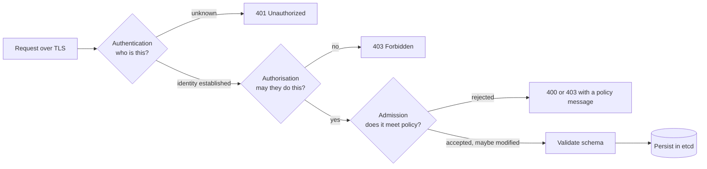

# Authentication and ServiceAccounts

## In plain words

Everything in a cluster happens through requests to the API server: creating a Deployment, reading a Secret, a kubelet reporting that a Pod is running. Before the API server acts on any request, it asks three questions in order. *Who are you?* That is **authentication**. *Are you allowed to do this?* That is **authorisation**. *Does this request satisfy our policies?* That is **admission control**. This lesson covers the first question and the next lesson covers the other two.

Picture the entrance to an office building. At the front desk a guard checks your badge to establish who you are: authentication. The badge then determines which floors the lift will take you to: authorisation. Finally, a second check at the lab door confirms you are wearing the required safety glasses, whoever you are: admission. Being recognised is not the same as being permitted, and being permitted does not excuse you from the rules.

One fact surprises most newcomers: **Kubernetes has no user accounts for people.** There is no `kubectl create user`, no user database, no passwords stored in the cluster. Kubernetes trusts identity information that comes from outside: a certificate signed by an authority it trusts, or a token issued by an identity provider it has been told to trust. For programs running inside the cluster there *is* a built-in identity object, the **ServiceAccount**.

Why this matters for a job: getting access to a cluster, giving a pipeline access, and letting a Pod call the Kubernetes API or a cloud service are all authentication tasks you will perform or debug. `Unauthorized` (HTTP 401) and `Forbidden` (HTTP 403) are different errors with different fixes, and telling them apart is the first step.

> **Before this lesson:** read [The control plane](#/lesson/kubernetes/control-plane) for the API server's role, [kubectl and kubeconfig](#/lesson/kubernetes/kubectl-kubeconfig) for how credentials are stored on the client, and [Secrets](#/lesson/kubernetes/secrets) for projected tokens. The web-security track explains TLS certificates and JSON Web Tokens in depth.

## The three gates



Every request travels over **TLS**, so it is encrypted and the client can verify it is talking to the real API server. Then the gates apply in order. A failure at the first gate returns `401 Unauthorized`: "I do not know who you are". A failure at the second returns `403 Forbidden`: "I know who you are, and you may not do this". The distinction is the most useful debugging fact in this module:

| Error | Gate | Typical cause | Where to look |
|---|---|---|---|
| `401 Unauthorized` | Authentication | Expired or missing token, wrong or expired certificate | Your kubeconfig, your login session |
| `403 Forbidden` | Authorisation | No Role or binding grants the action | RBAC objects |
| Rejected with a policy message | Admission | Pod violates a security policy, quota exceeded, webhook denied | The message names the policy |

## Two kinds of identity

| | Human users | ServiceAccounts |
|---|---|---|
| Meant for | People, and tools outside the cluster | Programs running in Pods |
| Is it a Kubernetes object? | **No** | **Yes**, namespaced |
| Created by | Your identity provider or certificate authority | `kubectl create serviceaccount`, or automatically |
| Credential | Certificate, or token from an identity provider | Short-lived token issued by the API server |
| Name as seen by the API server | Whatever the credential says, e.g. `amara@harbour-coffee.example` | `system:serviceaccount:<namespace>:<name>` |

Whatever the method, successful authentication yields the same result: a **username**, a list of **groups**, and sometimes extra attributes. Authorisation then works only with that username and those groups. Groups matter a great deal, because permissions are normally granted to groups, not to individuals. Some groups are built in: every authenticated identity is in `system:authenticated`, every ServiceAccount is in `system:serviceaccounts` and in `system:serviceaccounts:<namespace>`.

## How people authenticate

The API server can be configured with several authentication methods at once. It tries each; the first to recognise the credential wins. If none does, the request is treated as the user `system:anonymous`, and, on a sensibly configured cluster, is denied.

### Client certificates

A **certificate** is a digitally signed document stating an identity. The API server is configured to trust one **certificate authority (CA)**; any certificate signed by that CA is accepted. The identity is read from two fields of the certificate's subject:

- the **Common Name (CN)** becomes the username,
- each **Organisation (O)** becomes a group.

```bash
$ kubectl config view --minify --raw -o jsonpath='{.users[0].user.client-certificate-data}' \
    | base64 -d | openssl x509 -noout -subject -enddate
subject=O = system:masters, CN = kubernetes-admin
notAfter=Nov 14 09:02:11 2027 GMT
```

This pulls the certificate out of the current kubeconfig, decodes it and asks `openssl` to print its subject and expiry date. The holder is the user `kubernetes-admin` in the group `system:masters`.

Certificates are how cluster components (kubelets, the scheduler, the controller manager) authenticate, and how the first administrator of a self-managed cluster gets in. For ordinary human users they have serious drawbacks: **a certificate cannot be revoked** by Kubernetes, so a leaked one is valid until it expires; group membership is fixed inside it; and issuing them is manual.

> [!WARNING]
> The group `system:masters` is hard-wired to full, unrestricted access to everything, bypassing RBAC entirely. A certificate carrying that group cannot be limited or revoked. Keep the administrator kubeconfig that a cluster installer produces for emergencies only, stored securely, and give everyday users identities from an identity provider instead.

### OIDC: logging in through an identity provider

The usual method for people is **OpenID Connect (OIDC)**, a standard built on OAuth 2.0 in which an **identity provider** (your company's Entra ID, Google Workspace, Okta, Keycloak and so on) authenticates the person and issues a signed **ID token**. The API server is configured to trust that provider. The flow:

1. `kubectl` (through an exec plug-in) sends you to the provider's login page.
2. You sign in there, with whatever the company requires, including multi-factor authentication.
3. The provider returns an ID token: a **JSON Web Token (JWT)**, a signed text containing claims such as your email and groups.
4. `kubectl` sends the token with each request. The API server checks the provider's signature and reads the username and groups from the configured claims.

The benefits are the reverse of certificates' flaws: tokens are short-lived, a person who leaves the company is disabled centrally, and group membership is managed where the rest of the company's access is managed. Managed services do the same with their own cloud identities: on EKS, GKE and AKS you authenticate as your cloud user, and the service maps that to a Kubernetes identity.

Current versions configure this, and other token-based methods, through a structured `AuthenticationConfiguration` file, which also allows several providers at once.

### Methods to avoid

A static file of tokens or passwords loaded by the API server is supported for historical reasons. Entries never expire and changing them needs an API server restart. Do not use it outside experiments.

## ServiceAccounts: identity for Pods

A **ServiceAccount** is a namespaced object that gives a Pod an identity for talking to the API server. Most application Pods never call the Kubernetes API. Some do: controllers and operators, CI runners that deploy, monitoring agents that list Pods, and applications that read their own ConfigMaps.

Every namespace gets a ServiceAccount named `default` automatically. A Pod that names no ServiceAccount runs as that one.

```yaml
apiVersion: v1
kind: ServiceAccount
metadata:
  name: order-reporter
  namespace: cafe
automountServiceAccountToken: true
---
apiVersion: apps/v1
kind: Deployment
metadata:
  name: order-reporter
  namespace: cafe
spec:
  replicas: 1
  selector:
    matchLabels:
      app: order-reporter
  template:
    metadata:
      labels:
        app: order-reporter
    spec:
      serviceAccountName: order-reporter
      containers:
        - name: reporter
          image: ghcr.io/harbour-coffee/order-reporter:0.6.0
```

- The first object creates a ServiceAccount called `order-reporter`. It has no `spec`; the object's existence is the identity.
- `automountServiceAccountToken: true` (the default) means Pods using it get a token mounted.
- In the Pod template, `serviceAccountName: order-reporter` makes the Pod run as that identity. The ServiceAccount must be in the Pod's namespace.

To the API server this Pod is the user `system:serviceaccount:cafe:order-reporter`.

### The token a Pod receives

When the Pod starts, the kubelet asks the API server for a token for this ServiceAccount, bound to this specific Pod, and mounts it through a projected volume:

```bash
$ kubectl exec -n cafe deploy/order-reporter -- ls /var/run/secrets/kubernetes.io/serviceaccount
ca.crt  namespace  token

$ kubectl exec -n cafe deploy/order-reporter -- sh -c \
    'cut -d. -f2 /var/run/secrets/kubernetes.io/serviceaccount/token | base64 -d 2>/dev/null'
{"aud":["https://kubernetes.default.svc.cluster.local"],"exp":1795349100,"iat":1795345500,
 "iss":"https://kubernetes.default.svc.cluster.local",
 "kubernetes.io":{"namespace":"cafe","pod":{"name":"order-reporter-7c9d8b6f5-x2k9q","uid":"..."},
                  "serviceaccount":{"name":"order-reporter","uid":"..."}},
 "sub":"system:serviceaccount:cafe:order-reporter"}
```

The first command shows the three files: the token, the CA certificate for verifying the API server, and the namespace name. The second splits the token (a JWT has three parts separated by dots) and decodes the middle part, the claims. Reading them:

- `sub` (subject) — the identity: `system:serviceaccount:cafe:order-reporter`.
- `aud` (audience) — who the token is for. The API server accepts it; a token issued for another audience would be rejected, which stops a token meant for one system being replayed against another.
- `iat` and `exp` — issued-at and expiry times, as seconds since 1970. The difference here is 3600: one hour.
- `kubernetes.io.pod` — the token is **bound** to this Pod. When the Pod is deleted the token stops being valid, even if it has not expired.

The kubelet replaces the file before expiry, so a well-written client re-reads it periodically; the official client libraries do. These are called **bound service account tokens**.

The older design created a Secret holding a token that never expired for every ServiceAccount. Since version 1.24 that no longer happens automatically. You can still create such a Secret by hand for a system that cannot refresh tokens, but treat it as a last resort: a non-expiring credential is exactly what attackers hope to find.

```bash
$ kubectl create token order-reporter -n cafe --duration=15m
eyJhbGciOiJSUzI1NiIsImtpZCI6Ij...
```

`kubectl create token` asks the API server for a short-lived token for a ServiceAccount, useful for testing or for a pipeline step.

### A token check, simulated

The API server's handling of a ServiceAccount token can be modelled in a few lines. The signature check is assumed to have passed.

```python-run
def authenticate(token, now, expected_audience, live_pods, service_accounts):
    """Return ('ok', username, groups) or ('401', reason)."""
    if token is None:
        return ("401", "no credentials: treated as system:anonymous and denied")
    if token["exp"] <= now:
        return ("401", "token has expired")
    if expected_audience not in token["aud"]:
        return ("401", f"token audience {token['aud']} does not include {expected_audience}")
    ns, sa = token["namespace"], token["serviceaccount"]
    if (ns, sa) not in service_accounts:
        return ("401", f"service account {ns}/{sa} no longer exists")
    pod = token.get("pod")
    if pod is not None and (ns, pod) not in live_pods:
        return ("401", f"token is bound to pod {pod}, which has been deleted")
    username = f"system:serviceaccount:{ns}:{sa}"
    groups = ["system:serviceaccounts", f"system:serviceaccounts:{ns}", "system:authenticated"]
    return ("ok", username, groups)

API = "https://kubernetes.default.svc"
live_pods = {("cafe", "order-reporter-x2k9q")}
accounts = {("cafe", "order-reporter"), ("cafe", "default")}
base = {"aud": [API], "namespace": "cafe", "serviceaccount": "order-reporter", "pod": "order-reporter-x2k9q", "exp": 4600}

cases = {
    "valid token": base,
    "no token": None,
    "expired token": {**base, "exp": 900},
    "token for another audience": {**base, "aud": ["vault"]},
    "token from a deleted pod": {**base, "pod": "order-reporter-old77"},
    "service account deleted": {**base, "serviceaccount": "retired-bot"},
}
for name, tok in cases.items():
    print(f"{name:28} -> {authenticate(tok, now=1000, expected_audience=API, live_pods=live_pods, service_accounts=accounts)}")
```

Only the first passes. Each failure is a `401`, because in every case the server could not establish a trustworthy identity. Note the fifth case: a token copied out of a Pod stops working when that Pod goes away, which limits the damage of a leak.

## Turning the token off

A Pod that never calls the Kubernetes API has no use for a token, and a credential that is not present cannot be stolen.

```yaml
apiVersion: v1
kind: ServiceAccount
metadata:
  name: web
  namespace: cafe
automountServiceAccountToken: false
```

Set on a ServiceAccount, this applies to every Pod using it. The same field on a Pod spec overrides it for that Pod. A good default is to create a dedicated ServiceAccount per application with the token mount disabled, and enable it only for workloads that need API access.

> [!TIP]
> Never give permissions to the `default` ServiceAccount. Every Pod in the namespace that does not name another account runs as `default`, so a permission granted to it is granted to all of them, including ones deployed later by someone unaware of it. Create a named ServiceAccount per workload.

## From a Pod to a cloud API: workload identity

Applications often need cloud services: reading from object storage, publishing to a queue. The old way was to create a cloud access key and store it in a Secret. The modern way, **workload identity**, removes the stored key entirely.

It relies on the fact that a ServiceAccount token is a standard OIDC token signed by the cluster. The cloud provider is told to trust the cluster as an identity issuer, and a cloud role is linked to a specific ServiceAccount. The Pod presents its projected token, with the cloud's audience, and receives short-lived cloud credentials in exchange.

```yaml
apiVersion: v1
kind: ServiceAccount
metadata:
  name: order-reporter
  namespace: cafe
  annotations:
    iam.gke.io/gcp-service-account: order-reporter@harbour-coffee.iam.gserviceaccount.com
    # eks.amazonaws.com/role-arn: arn:aws:iam::123456789012:role/order-reporter      (AWS)
    # azure.workload.identity/client-id: 4f1c2b7a-...                                 (Azure)
```

The annotation, different on each cloud, names the cloud identity this ServiceAccount may act as. Nothing secret is stored anywhere, credentials last minutes to hours, and access is granted per workload instead of per node.

## Authentication from the client side

A few commands answer "who does the cluster think I am?".

```bash
$ kubectl auth whoami
ATTRIBUTE   VALUE
Username    amara@harbour-coffee.example
Groups      [platform-team cafe-developers system:authenticated]

$ kubectl auth whoami --as=system:serviceaccount:cafe:order-reporter
ATTRIBUTE   VALUE
Username    system:serviceaccount:cafe:order-reporter
Groups      [system:serviceaccounts system:serviceaccounts:cafe system:authenticated]

$ kubectl get pods --token=expired-or-wrong
error: You must be logged in to the server (Unauthorized)
```

`kubectl auth whoami` returns the username and groups the API server derived from your credential, which is exactly what RBAC will evaluate. `--as` uses **impersonation**: acting as another identity, if you have been granted permission to do so. It is invaluable for testing what a ServiceAccount or colleague can do. The last command shows the wording of an authentication failure.

A program inside a Pod that uses an official client library needs no configuration at all: the library finds the API server through the `KUBERNETES_SERVICE_HOST` environment variable or the name `kubernetes.default.svc`, reads the mounted token and CA file, and authenticates.

> [!INTERVIEW]
> **"How does authentication work in Kubernetes?"** Every request to the API server passes authentication, then authorisation, then admission. Kubernetes has no user objects: humans are authenticated by external means, mainly X.509 client certificates (CN is the username, O fields are groups; not revocable) or OIDC tokens from an identity provider, and on managed services the cloud's IAM. Workloads use ServiceAccounts, namespaced objects whose identity is `system:serviceaccount:<namespace>:<name>`. Pods receive a short-lived, audience-scoped token bound to the Pod's lifetime through a projected volume, refreshed by the kubelet; long-lived token Secrets are no longer created by default. Authentication yields a username and groups, which authorisation then evaluates. Failed authentication is 401, failed authorisation 403. Good additions: disable token automounting where unused, do not grant rights to the `default` ServiceAccount, and use workload identity for cloud access instead of stored keys.

## Common pitfalls

- **Looking for a user object.** There is none; users exist only as names inside credentials.
- **Confusing 401 and 403.** 401 is about identity; 403 is about permission.
- **Using the installer's admin certificate for daily work or in pipelines.** It is irrevocable and all-powerful.
- **Granting permissions to the `default` ServiceAccount.**
- **Leaving tokens mounted in Pods that do not need them.**
- **Creating long-lived token Secrets out of habit.** Use `kubectl create token` or projected tokens.
- **Client code that reads the token once and caches it forever.** It fails after an hour; re-read the file.
- **Storing cloud keys in Secrets when workload identity is available.**
- **Expecting a ServiceAccount from another namespace to be usable by a Pod.** It must be in the Pod's namespace.

## Cheat sheet

| Question | Answer |
|---|---|
| Order of checks | Authentication → authorisation → admission |
| Human identity | External: certificate or OIDC token; no object |
| Certificate mapping | CN = username, O = groups |
| Workload identity | ServiceAccount object |
| ServiceAccount username | `system:serviceaccount:NS:NAME` |
| ServiceAccount groups | `system:serviceaccounts`, `system:serviceaccounts:NS`, `system:authenticated` |
| Token location in Pod | `/var/run/secrets/kubernetes.io/serviceaccount/token` |
| Token lifetime | About 1 hour, auto-refreshed, bound to the Pod |
| Disable the token | `automountServiceAccountToken: false` |

| Task | Command |
|---|---|
| Who am I? | `kubectl auth whoami` |
| Create a ServiceAccount | `kubectl create serviceaccount NAME -n NS` |
| Short-lived token | `kubectl create token NAME -n NS --duration=15m` |
| Act as another identity | `kubectl ... --as=USER --as-group=GROUP` |

## Summary

The API server establishes who is making each request before anything else. People are authenticated through external credentials, client certificates or, preferably, OIDC tokens from an identity provider, and exist in Kubernetes only as a username and groups. Workloads are authenticated through ServiceAccounts, receiving short-lived tokens bound to the Pod and scoped to an audience. An unrecognised credential produces 401. Good practice is one ServiceAccount per workload, no permissions on `default`, no token where none is needed, and workload identity instead of stored cloud keys. Knowing who is asking is only the first gate; the next lesson covers what they are allowed to do and which policies their requests must pass.

## Glossary

- **Authentication**: establishing the identity behind a request.
- **Authorisation**: deciding whether that identity may perform the action.
- **Admission control**: policy checks and modifications applied before a request is stored.
- **401 Unauthorized / 403 Forbidden**: identity not established; identity known but not permitted.
- **Certificate authority (CA)**: an issuer whose signature makes a certificate trusted.
- **Client certificate**: a certificate a client presents to prove its identity.
- **Common Name / Organisation**: certificate fields used as username and groups.
- **OIDC**: OpenID Connect, a standard for obtaining identity tokens from a provider.
- **Identity provider**: the system that authenticates people and issues tokens.
- **JWT**: JSON Web Token, a signed token carrying claims.
- **Claim**: a statement inside a token, such as subject, audience or expiry.
- **ServiceAccount**: a namespaced identity for workloads.
- **Bound token**: a ServiceAccount token tied to a specific Pod and audience with an expiry.
- **Audience**: the intended recipient of a token.
- **Impersonation**: making a request as another identity, with permission.
- **Workload identity**: exchanging a ServiceAccount token for short-lived cloud credentials.
- **system:masters**: a built-in group with unrestricted access.

```quiz
[
  {"q": "A kubectl command fails with 'error: You must be logged in to the server (Unauthorized)'. Which gate rejected the request?",
   "options": ["Authorisation", "Authentication", "Admission", "Scheduling"],
   "answer": 1,
   "explain": "Unauthorized is HTTP 401: the API server could not establish who you are. Check the token or certificate, not RBAC."},
  {"q": "How do you create a human user named amara in Kubernetes?",
   "options": ["kubectl create user amara", "Apply a User manifest", "You cannot; users come from external credentials such as certificates or OIDC tokens", "Edit the users ConfigMap in kube-system"],
   "answer": 2,
   "explain": "There is no user object. The username is whatever the presented credential asserts, provided the cluster trusts its issuer."},
  {"q": "A client certificate has subject 'O = cafe-developers, O = auditors, CN = lena'. What identity does the API server derive?",
   "options": ["User cafe-developers in group lena", "User lena in groups cafe-developers and auditors", "User auditors with no groups", "ServiceAccount lena"],
   "answer": 1,
   "explain": "The Common Name is the username and each Organisation field is a group."},
  {"q": "What username does the API server see for a Pod running with ServiceAccount billing in namespace finance?",
   "options": ["billing", "finance/billing", "system:serviceaccount:finance:billing", "serviceaccount-billing@finance"],
   "answer": 2,
   "explain": "ServiceAccount usernames have the fixed form system:serviceaccount:namespace:name."},
  {"q": "An attacker copies the ServiceAccount token file out of a Pod. The Pod is deleted five minutes later. What happens when the attacker uses the token afterwards?",
   "options": ["It works for a year", "It is rejected, because bound tokens become invalid when their Pod is deleted", "It works until the namespace is deleted", "It works but only for read requests"],
   "answer": 1,
   "explain": "Projected tokens are bound to the Pod object. Deleting the Pod invalidates them, and they also expire after about an hour."},
  {"q": "A Deployment's Pods never call the Kubernetes API. Which setting reduces risk at no cost?",
   "options": ["hostNetwork: true", "automountServiceAccountToken: false", "restartPolicy: Never", "serviceAccountName: default"],
   "answer": 1,
   "explain": "Without the mounted token there is no API credential in the container for an attacker to take."},
  {"q": "Why is granting permissions to a namespace's default ServiceAccount discouraged?",
   "options": ["It is deleted every hour", "Every Pod in the namespace that names no ServiceAccount runs as it, so all of them gain the permission", "It cannot be bound to Roles", "It has no token"],
   "answer": 1,
   "explain": "default is the fallback identity. Permissions on it spread to every current and future Pod that does not specify another account."},
  {"q": "What is the main weakness of client certificates for authenticating human users?",
   "options": ["They are slow", "Kubernetes cannot revoke them, so a leaked certificate is valid until it expires", "They cannot carry groups", "They require OIDC"],
   "answer": 1,
   "explain": "There is no revocation check. OIDC tokens are short-lived and the account can be disabled at the identity provider."}
]
```

> **Source:** Poulton, *The Kubernetes Book*, ch. 13 (topic coverage only). Official docs: https://kubernetes.io/docs/reference/access-authn-authz/authentication/ , https://kubernetes.io/docs/concepts/security/service-accounts/ , https://kubernetes.io/docs/tasks/configure-pod-container/configure-service-account/ , https://kubernetes.io/docs/concepts/security/controlling-access/
