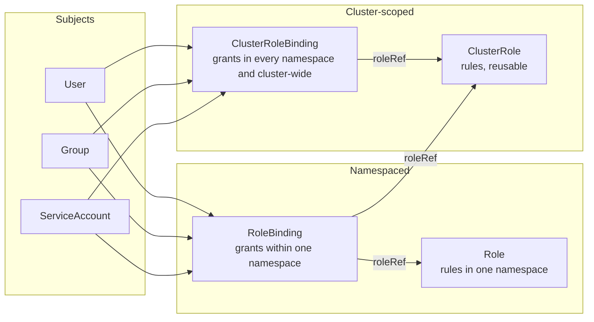
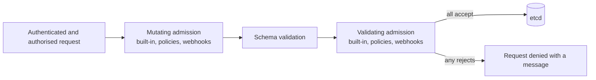

# RBAC authorisation and admission control

## In plain words

The previous lesson answered "who is making this request?". This one covers the two gates that follow. **Authorisation** answers "is this identity allowed to do this?". **Admission control** answers "regardless of who is asking, is this request acceptable under our rules, and should anything in it be adjusted?".

Kubernetes authorises requests with **role-based access control (RBAC)**. The idea is simple: you write down sets of permissions called **roles** ("may read Pods and their logs"), and you attach roles to identities with **bindings** ("the cafe developers group has that role in the cafe namespace"). Nobody has any permission unless a binding gives it to them.

A hospital makes a good comparison. A role is a job description: "nurse on ward 3 may read and update patient charts on ward 3". A binding is the staff rota that assigns a real person to that job. The person has no access because of who they are; they have it because the rota links them to a role. And there are rules that apply to everyone no matter what their role is, such as "nobody enters theatre without scrubbing in". Those blanket rules are admission control.

Why this matters for a job: `Error from server (Forbidden)` is one of the most common messages you will see on a shared cluster, and fixing it means reading or writing RBAC objects. Over-generous permissions, especially `cluster-admin` handed to pipelines and tools, are a top cause of serious Kubernetes security incidents. Interviewers ask you to explain Role, ClusterRole and the two kinds of binding, and what admission controllers do.

> **Before this lesson:** read [Authentication and ServiceAccounts](#/lesson/kubernetes/authentication). You need to know that authentication produces a username and groups, and what a ServiceAccount is. [Namespaces](#/lesson/kubernetes/namespaces) and [ResourceQuotas and LimitRanges](#/lesson/kubernetes/namespace-quotas) are also assumed.

## The shape of an authorisation question

Every request is reduced to a small set of attributes before it is judged:

| Attribute | Example |
|---|---|
| Who | user `amara@harbour-coffee.example`, groups `cafe-developers`, `system:authenticated` |
| Verb | `get`, `list`, `watch`, `create`, `update`, `patch`, `delete`, `deletecollection` |
| API group | `""` (core), `apps`, `batch`, `networking.k8s.io` |
| Resource | `pods`, `deployments`, `secrets` |
| Subresource | `pods/log`, `pods/exec`, `deployments/scale` |
| Namespace | `cafe`, or none for cluster-scoped resources |
| Resource name | `orders-db-credentials`, optional |

So `kubectl logs menu-api-abc -n cafe` becomes: *may this user `get` the resource `pods/log` in API group `""` in namespace `cafe`?* RBAC answers yes if some rule, reachable through some binding, covers every one of those attributes.

Three properties define RBAC's behaviour:

1. **Deny by default.** With no matching rule, the answer is no.
2. **Purely additive.** Rules only grant. There is **no "deny" rule** in RBAC. You cannot give someone broad access and then carve out an exception; you must grant only what is needed.
3. **Union of everything.** A user's effective permissions are the sum of all rules from all roles bound to them or to any of their groups.

## The four objects



| Object | Scope | Contains |
|---|---|---|
| **Role** | One namespace | Rules about namespaced resources in that namespace |
| **ClusterRole** | Cluster | Rules; can cover cluster-scoped resources and non-resource URLs; reusable |
| **RoleBinding** | One namespace | Links subjects to a Role **or a ClusterRole**, with effect in that namespace only |
| **ClusterRoleBinding** | Cluster | Links subjects to a ClusterRole, with effect everywhere |

The arrows in the diagram contain the detail people most often miss: **a RoleBinding may refer to a ClusterRole**. When it does, the ClusterRole's rules apply only inside the RoleBinding's namespace. This lets you define a set of permissions once, as a ClusterRole, and hand it out namespace by namespace.

## A Role and RoleBinding, line by line

```yaml
apiVersion: rbac.authorization.k8s.io/v1
kind: Role
metadata:
  name: app-troubleshooter
  namespace: cafe
rules:
  - apiGroups: [""]
    resources: ["pods", "pods/log", "services", "configmaps", "events"]
    verbs: ["get", "list", "watch"]
  - apiGroups: ["apps"]
    resources: ["deployments", "replicasets"]
    verbs: ["get", "list", "watch"]
  - apiGroups: ["apps"]
    resources: ["deployments/scale"]
    verbs: ["patch", "update"]
  - apiGroups: [""]
    resources: ["secrets"]
    resourceNames: ["orders-feature-flags"]
    verbs: ["get"]
```

- `apiVersion: rbac.authorization.k8s.io/v1`, `kind: Role`, in namespace `cafe`.
- `rules` is a list. Each rule combines API groups, resources and verbs; a request is allowed by a rule only if all three match.
- Rule 1: in the core group (written as the empty string `""`), read access to Pods, Pod logs, Services, ConfigMaps and events. `pods/log` is a **subresource**, written `resource/subresource`; permission on `pods` does not include it.
- Rule 2: read access to Deployments and ReplicaSets, which are in the `apps` group. Getting the API group wrong is the most common reason a rule does not work.
- Rule 3: permission to change the `scale` subresource of Deployments. This allows `kubectl scale` without allowing any other edit to the Deployment.
- Rule 4: `get` on one named Secret only. `resourceNames` restricts a rule to specific objects. Note that it cannot restrict `list`, because a list request names no object.

```yaml
apiVersion: rbac.authorization.k8s.io/v1
kind: RoleBinding
metadata:
  name: cafe-developers-troubleshoot
  namespace: cafe
subjects:
  - kind: Group
    name: cafe-developers
    apiGroup: rbac.authorization.k8s.io
  - kind: ServiceAccount
    name: order-reporter
    namespace: cafe
roleRef:
  kind: Role
  name: app-troubleshooter
  apiGroup: rbac.authorization.k8s.io
```

- `subjects` lists who receives the permissions. There are three kinds: `User`, `Group` and `ServiceAccount`. Users and groups are names only (there are no objects behind them) and carry `apiGroup: rbac.authorization.k8s.io`. A ServiceAccount subject needs its `namespace`.
- `roleRef` names the role being granted. It is **immutable**: to point a binding at a different role you delete and recreate it.

```bash
$ kubectl apply -f troubleshooter.yaml
role.rbac.authorization.k8s.io/app-troubleshooter created
rolebinding.rbac.authorization.k8s.io/cafe-developers-troubleshoot created

$ kubectl auth can-i list pods -n cafe --as=lena --as-group=cafe-developers
yes
$ kubectl auth can-i delete pods -n cafe --as=lena --as-group=cafe-developers
no
$ kubectl auth can-i list pods -n finance --as=lena --as-group=cafe-developers
no
$ kubectl auth can-i get secret/orders-feature-flags -n cafe --as=lena --as-group=cafe-developers
yes
$ kubectl auth can-i get secret/orders-db-credentials -n cafe --as=lena --as-group=cafe-developers
no

$ kubectl auth can-i --list -n cafe --as=system:serviceaccount:cafe:order-reporter | head -5
Resources              Non-Resource URLs   Resource Names           Verbs
pods                   []                  []                       [get list watch]
pods/log               []                  []                       [get list watch]
deployments.apps/scale []                  []                       [patch update]
secrets                []                  [orders-feature-flags]   [get]
```

`kubectl auth can-i VERB RESOURCE` asks the API server the authorisation question directly and prints yes or no. `--as` and `--as-group` impersonate an identity, so you can test someone else's access. The five answers trace the rules: listing Pods in `cafe` is granted; deleting is not; another namespace is not; one named Secret is readable and the other is not. `--list` prints everything an identity may do in a namespace.

## ClusterRoles and their three uses

A ClusterRole has the same `rules` format with no namespace.

```yaml
apiVersion: rbac.authorization.k8s.io/v1
kind: ClusterRole
metadata:
  name: node-viewer
rules:
  - apiGroups: [""]
    resources: ["nodes", "persistentvolumes", "namespaces"]
    verbs: ["get", "list", "watch"]
  - apiGroups: ["storage.k8s.io"]
    resources: ["storageclasses"]
    verbs: ["get", "list", "watch"]
  - nonResourceURLs: ["/healthz", "/version"]
    verbs: ["get"]
```

It is used in three ways:

1. **For cluster-scoped resources** such as nodes and PersistentVolumes, and for non-resource URLs such as `/healthz`. These need a ClusterRole bound with a ClusterRoleBinding.
2. **For namespaced resources in every namespace**, when bound with a ClusterRoleBinding: "may read Pods everywhere".
3. **As a reusable template**, bound with a RoleBinding in individual namespaces.

Kubernetes ships with ClusterRoles intended for the third use:

| Built-in ClusterRole | Grants |
|---|---|
| `view` | Read most namespaced objects. **Not** Secrets |
| `edit` | Read and write most namespaced objects, including Secrets. Not Roles or RoleBindings |
| `admin` | Everything in `edit`, plus managing Roles and RoleBindings in the namespace |
| `cluster-admin` | Everything, everywhere |

```yaml
apiVersion: rbac.authorization.k8s.io/v1
kind: RoleBinding
metadata:
  name: storefront-team-edit
  namespace: cafe
subjects:
  - kind: Group
    name: storefront-team
    apiGroup: rbac.authorization.k8s.io
roleRef:
  kind: ClusterRole
  name: edit
  apiGroup: rbac.authorization.k8s.io
```

The group gets the `edit` permissions **in `cafe` only**, because the binding is a RoleBinding. The same ClusterRole bound with a ClusterRoleBinding would grant edit rights in every namespace.

## An RBAC evaluator you can run

The logic of the authoriser fits in a short program. It handles Roles, ClusterRoles, both kinds of binding, wildcards and resource names.

```python-run
roles = {   # (kind, namespace or None, name) -> rules
    ("Role", "cafe", "app-troubleshooter"): [
        {"groups": [""], "resources": ["pods", "pods/log"], "verbs": ["get", "list", "watch"]},
        {"groups": ["apps"], "resources": ["deployments/scale"], "verbs": ["patch", "update"]},
        {"groups": [""], "resources": ["secrets"], "names": ["orders-feature-flags"], "verbs": ["get"]},
    ],
    ("ClusterRole", None, "edit"): [
        {"groups": ["", "apps"], "resources": ["*"], "verbs": ["*"]},
    ],
    ("ClusterRole", None, "node-viewer"): [
        {"groups": [""], "resources": ["nodes"], "verbs": ["get", "list"]},
    ],
}
bindings = [
    {"kind": "RoleBinding", "ns": "cafe", "role": ("Role", "cafe", "app-troubleshooter"),
     "subjects": [("Group", "cafe-developers")]},
    {"kind": "RoleBinding", "ns": "cafe", "role": ("ClusterRole", None, "edit"),
     "subjects": [("Group", "storefront-team")]},
    {"kind": "ClusterRoleBinding", "ns": None, "role": ("ClusterRole", None, "node-viewer"),
     "subjects": [("Group", "system:authenticated")]},
    {"kind": "RoleBinding", "ns": "finance", "role": ("ClusterRole", None, "node-viewer"),
     "subjects": [("User", "lena")]},
]

def rule_allows(rule, verb, group, resource, name):
    ok = lambda want, have: "*" in have or want in have
    if not (ok(verb, rule["verbs"]) and ok(group, rule["groups"]) and ok(resource, rule["resources"])):
        return False
    if "names" in rule:                       # resourceNames: the request must name one of them
        return name is not None and name in rule["names"]
    return True

def can_i(user, groups, verb, group, resource, namespace=None, name=None):
    identities = {("User", user)} | {("Group", g) for g in groups}
    for b in bindings:
        if not identities & set(b["subjects"]):
            continue
        if b["kind"] == "RoleBinding" and b["ns"] != namespace:
            continue                          # a RoleBinding only works inside its own namespace
        for rule in roles.get(b["role"], []):
            if rule_allows(rule, verb, group, resource, name):
                return f"yes  (via {b['kind']} -> {b['role'][0]} {b['role'][2]})"
    return "no   (no rule matches: denied by default)"

A = ["system:authenticated"]
checks = [
    ("lena lists pods in cafe",            ("lena", ["cafe-developers"] + A, "list", "", "pods", "cafe")),
    ("lena deletes a pod in cafe",         ("lena", ["cafe-developers"] + A, "delete", "", "pods", "cafe")),
    ("lena lists pods in finance",         ("lena", ["cafe-developers"] + A, "list", "", "pods", "finance")),
    ("lena gets the flags secret",         ("lena", ["cafe-developers"] + A, "get", "", "secrets", "cafe", "orders-feature-flags")),
    ("lena lists secrets in cafe",         ("lena", ["cafe-developers"] + A, "list", "", "secrets", "cafe")),
    ("omar deletes a deployment in cafe",  ("omar", ["storefront-team"] + A, "delete", "apps", "deployments", "cafe")),
    ("omar deletes a deployment in shop",  ("omar", ["storefront-team"] + A, "delete", "apps", "deployments", "shop")),
    ("omar lists nodes (cluster-scoped)",  ("omar", ["storefront-team"] + A, "list", "", "nodes", None)),
    ("omar deletes a node",                ("omar", ["storefront-team"] + A, "delete", "", "nodes", None)),
]
for label, args in checks:
    print(f"{label:36} -> {can_i(*args)}")
```

Several results teach something specific. `lena lists secrets` is denied even though she can `get` one named Secret, because a rule with `resourceNames` cannot match a request that names no object. `omar deletes a deployment in shop` is denied, since `edit` was bound with a RoleBinding in `cafe` only. Listing nodes succeeds for anyone authenticated, through the ClusterRoleBinding. And the last binding in the table, a RoleBinding in `finance` to `node-viewer`, grants nothing useful at all: nodes are cluster-scoped, and a RoleBinding can never grant access to cluster-scoped resources.

## Dangerous permissions

Some permissions amount to far more than they appear to. Granting any of these should make you stop and think.

| Permission | Why it is dangerous |
|---|---|
| `*` on `*` (as in `cluster-admin`) | Everything |
| `get`, `list` or `watch` on `secrets` | Reads every credential in scope; `list` returns full contents |
| `create` on `pods` (or on Deployments, Jobs, and so on) | Can mount any Secret and use any ServiceAccount in the namespace |
| `create` on `pods/exec` | A shell inside any Pod, with that Pod's secrets and identity |
| `escalate` or `bind` on roles; `create` on rolebindings with a powerful role | Can grant oneself more |
| `impersonate` on users, groups or serviceaccounts | Can act as anyone, including administrators |
| `create` on `serviceaccounts/token` | Can mint tokens for other identities |
| Write access to nodes, or to admission webhook configurations | Can take over the cluster |

Kubernetes has one built-in protection against climbing: **you cannot create or update a Role that contains permissions you do not hold yourself**, and you cannot bind a role whose permissions you lack, unless you have been given the special `escalate` or `bind` verbs. A user with `admin` in one namespace can therefore delegate what they have and no more.

> [!WARNING]
> The most common serious RBAC mistake is a ClusterRoleBinding of `cluster-admin` to a CI/CD pipeline's ServiceAccount or to a third-party tool "to make it work". That identity can then read every Secret, run anything on any node and delete the cluster's contents. If its token leaks, the cluster is lost. Give automation a Role in the namespaces it deploys to, with only the resources and verbs it uses.

### The principle of least privilege

**Least privilege** means granting each identity the minimum it needs for its task. In practice:

- Bind to **groups**, not individuals, so that joining and leaving a team is managed at the identity provider.
- Prefer **RoleBindings** to ClusterRoleBindings.
- Avoid wildcards (`*`) in verbs and resources; they silently include resources added in future versions.
- Use the built-in `view`, `edit` and `admin` roles per namespace before inventing your own.
- One ServiceAccount per workload; nothing on `default`.
- Review regularly: `kubectl get clusterrolebindings -o wide` shows who holds cluster-wide roles.

## Other authorisers

RBAC is one of several authorisation modules that the API server consults in a configured order; the first to say "allow" or "deny" decides. Two others are worth knowing by name. The **Node authoriser** restricts each kubelet to the objects related to Pods on its own node, so that a compromised node cannot read every Secret in the cluster. **Webhook** authorisation delegates decisions to an external service, which is how some managed services integrate cloud IAM.

## Admission control

A request that is authenticated and authorised still passes through **admission controllers** before being stored. An admission controller is code in the API server's request path that can **modify** the object (**mutating** admission) or **accept or reject** it (**validating** admission). Admission applies only to requests that change something: create, update, delete and connect (for example `exec`). Read requests skip it.



Mutation runs first, so that validation sees the final object. If any validating controller rejects, the whole request fails.

### Built-in controllers you have already met

| Controller | Kind | What it does |
|---|---|---|
| `NamespaceLifecycle` | Validating | Blocks creating objects in a namespace that is being deleted or does not exist |
| `LimitRanger` | Mutating and validating | Applies LimitRange defaults and bounds |
| `ResourceQuota` | Validating | Enforces namespace quotas |
| `ServiceAccount` | Mutating | Sets the `default` ServiceAccount on Pods and adds the token volume |
| `DefaultStorageClass` | Mutating | Sets the default class on claims that name none |
| `PodSecurity` | Validating | Enforces the Pod Security Standards per namespace |
| `NodeRestriction` | Validating | Limits what a kubelet may change on its own Node and Pods |

The quota and LimitRange behaviour from the [namespace quotas lesson](#/lesson/kubernetes/namespace-quotas) was admission control all along.

### Extending admission: policies and webhooks

Organisations have their own rules: images must come from the company registry, every Deployment must carry an `owner` label, no Service of type LoadBalancer in development namespaces. There are two ways to add such rules.

**ValidatingAdmissionPolicy** is the built-in, declarative way. You write the rule as an expression in **CEL** (Common Expression Language, a small expression language used across Kubernetes), and the API server evaluates it itself. Nothing extra to run.

```yaml
apiVersion: admissionregistration.k8s.io/v1
kind: ValidatingAdmissionPolicy
metadata:
  name: require-company-registry
spec:
  failurePolicy: Fail
  matchConstraints:
    resourceRules:
      - apiGroups: ["apps"]
        apiVersions: ["v1"]
        operations: ["CREATE", "UPDATE"]
        resources: ["deployments"]
  validations:
    - expression: "object.spec.template.spec.containers.all(c, c.image.startsWith('ghcr.io/harbour-coffee/'))"
      message: "all container images must come from ghcr.io/harbour-coffee/"
---
apiVersion: admissionregistration.k8s.io/v1
kind: ValidatingAdmissionPolicyBinding
metadata:
  name: require-company-registry-everywhere
spec:
  policyName: require-company-registry
  validationActions: ["Deny"]
  matchResources:
    namespaceSelector:
      matchExpressions:
        - key: kubernetes.io/metadata.name
          operator: NotIn
          values: ["kube-system"]
```

- The policy says which requests it examines (`matchConstraints`: creating or updating Deployments) and gives a CEL `expression` that must be true. `object` is the incoming object; `.all(c, ...)` requires the condition for every container.
- `failurePolicy: Fail` means that if the expression cannot be evaluated, the request is rejected.
- The policy does nothing until a **binding** activates it. The binding says where it applies (all namespaces except `kube-system`) and what to do on violation: `Deny`, or the softer `Warn` and `Audit` for trying a rule out first.

```bash
$ kubectl create deployment test --image=docker.io/library/nginx:1.29 -n cafe
error: failed to create deployment: deployments.apps "test" is forbidden: ValidatingAdmissionPolicy
'require-company-registry' with binding 'require-company-registry-everywhere' denied request:
all container images must come from ghcr.io/harbour-coffee/
```

The rejection message names the policy and prints the message you wrote.

**Admission webhooks** are the older and more flexible mechanism. The API server sends the object to an HTTPS service you run, which answers allow or deny (a `ValidatingWebhookConfiguration`) or returns changes to apply (a `MutatingWebhookConfiguration`). Policy engines such as **Kyverno** and **OPA Gatekeeper** are built on webhooks, as are service meshes that inject sidecar containers into Pods. Webhooks can do anything, including calling other systems, but they are software in the critical path: each has a `failurePolicy`, and a webhook set to `Fail` that is down blocks every matching request. A broken webhook is a classic cause of "nothing can be created in the cluster".

> [!TIP]
> When a request is rejected, read the whole message. Authorisation failures say `forbidden: User "x" cannot <verb> resource "<r>" in API group "<g>" in the namespace "<ns>"`, which tells you exactly which rule to add. Admission failures name the controller, policy or webhook that refused. They look similar at a glance and have completely different fixes.

> [!INTERVIEW]
> **"Explain RBAC in Kubernetes."** RBAC is deny-by-default and additive: there are no deny rules. A Role holds rules (API groups, resources, verbs, optionally resource names) for one namespace; a ClusterRole holds rules cluster-wide, including for cluster-scoped resources. A RoleBinding grants a Role, or a ClusterRole, to subjects (users, groups, ServiceAccounts) within one namespace; a ClusterRoleBinding grants a ClusterRole everywhere. Binding a ClusterRole with a RoleBinding is the standard way to reuse permission sets per namespace, as with the built-in `view`, `edit` and `admin`. Effective permissions are the union across all bindings. Then show security sense: least privilege, bind to groups, avoid `cluster-admin` and wildcards, and recognise escalation paths such as Secret read access, Pod creation, `pods/exec`, `bind`, `escalate` and `impersonate`.
>
> **"What is an admission controller?"** Code in the API server that intercepts write requests after authentication and authorisation. Mutating controllers may change the object; validating controllers accept or reject it; mutation runs first. Built-ins implement quotas, LimitRanges, default ServiceAccounts and Pod Security; custom rules are added with ValidatingAdmissionPolicy using CEL, or with webhooks as used by Kyverno and Gatekeeper.

## Common pitfalls

- **Wrong API group in a rule.** Deployments are in `apps`, not the core group `""`.
- **Forgetting subresources.** `pods` does not cover `pods/log` or `pods/exec`.
- **Expecting a deny rule.** There is none; restructure the grants.
- **ClusterRoleBinding where a RoleBinding was intended.** The grant becomes cluster-wide.
- **RoleBinding to grant access to nodes or other cluster-scoped resources.** It has no effect.
- **`resourceNames` with `list` or `create`.** It cannot restrict them.
- **Trying to edit `roleRef`.** Delete and recreate the binding.
- **ServiceAccount subject without a namespace.**
- **`cluster-admin` for convenience.**
- **A failing admission webhook with `failurePolicy: Fail`** blocking the whole cluster, including the Pods that would fix it.

## Cheat sheet

| | Role | ClusterRole |
|---|---|---|
| Bound by RoleBinding | Rules apply in that namespace | Rules apply in that namespace only |
| Bound by ClusterRoleBinding | Not possible | Rules apply in all namespaces and to cluster-scoped resources |

| Task | Command |
|---|---|
| Can I? | `kubectl auth can-i VERB RESOURCE -n NS` |
| Can they? | `kubectl auth can-i VERB RESOURCE -n NS --as=USER --as-group=GROUP` |
| Everything allowed | `kubectl auth can-i --list -n NS` |
| Create a Role | `kubectl create role NAME --verb=get,list --resource=pods -n NS` |
| Bind it | `kubectl create rolebinding NAME --role=ROLE --group=GROUP -n NS` |
| Bind a ClusterRole in a namespace | `kubectl create rolebinding NAME --clusterrole=view --serviceaccount=NS:SA -n NS` |
| Who has cluster-wide roles | `kubectl get clusterrolebindings -o wide` |
| Installed admission policies | `kubectl get validatingadmissionpolicies,validatingwebhookconfigurations,mutatingwebhookconfigurations` |

## Summary

Authorisation in Kubernetes is RBAC: deny by default, additive, with no deny rules. Roles and ClusterRoles hold rules made of API groups, resources and verbs; RoleBindings and ClusterRoleBindings attach them to users, groups and ServiceAccounts, with the binding's kind determining where the grant applies. A ClusterRole bound by a RoleBinding is the standard way to reuse a permission set in one namespace. Certain permissions, such as reading Secrets, creating Pods, `exec`, `bind`, `escalate` and `impersonate`, are routes to far more power than they seem, so least privilege is the working rule. After authorisation, admission controllers mutate and then validate every write, enforcing built-in behaviour such as quotas and Pod Security and your own rules through ValidatingAdmissionPolicy or webhooks. With the three gates understood, the next module examines the API they protect.

## Glossary

- **RBAC**: role-based access control; permissions grouped in roles and granted through bindings.
- **Verb**: the action in a request, such as `get`, `list`, `create` or `delete`.
- **Resource / subresource**: the kind of object addressed, and a part of it such as `pods/log`.
- **Role**: a namespaced set of permission rules.
- **ClusterRole**: a cluster-scoped set of permission rules.
- **RoleBinding**: a grant of a Role or ClusterRole to subjects within one namespace.
- **ClusterRoleBinding**: a grant of a ClusterRole to subjects across the cluster.
- **Subject**: a user, group or ServiceAccount named in a binding.
- **roleRef**: the role a binding points to; immutable.
- **resourceNames**: a restriction of a rule to named objects.
- **Least privilege**: granting only the minimum access required.
- **Privilege escalation**: gaining permissions beyond those intended.
- **Admission controller**: code that intercepts write requests to mutate or validate them.
- **Mutating / validating admission**: changing the object, or accepting or rejecting it.
- **ValidatingAdmissionPolicy**: a built-in policy object using CEL expressions.
- **CEL**: Common Expression Language, used for policy expressions.
- **Admission webhook**: an external HTTPS service consulted during admission.
- **failurePolicy**: whether a request is allowed or rejected when a policy or webhook cannot be evaluated.

```quiz
[
  {"q": "A ClusterRole named 'edit' is bound to group storefront-team with a RoleBinding in namespace cafe. What can the group do?",
   "options": ["Edit resources in every namespace", "Edit resources in namespace cafe only", "Nothing; a RoleBinding cannot reference a ClusterRole", "Edit cluster-scoped resources only"],
   "answer": 1,
   "explain": "A RoleBinding scopes whatever role it references, including a ClusterRole, to its own namespace."},
  {"q": "A Role grants get, list on resources ['pods'] in apiGroups ['']. The user runs kubectl logs on a Pod and gets Forbidden. Why?",
   "options": ["Logs require cluster-admin", "pods/log is a separate subresource that the rule does not include", "The API group should be apps", "The Pod is not ready"],
   "answer": 1,
   "explain": "Subresources must be listed explicitly. Add pods/log with the get verb."},
  {"q": "You want a user to have the edit role in a namespace but be unable to delete Secrets. Can you add a deny rule for that?",
   "options": ["Yes, with verbs: ['!delete']", "Yes, with a DenyRole object", "No; RBAC is additive only, so you must grant a narrower role instead", "Yes, by ordering the rules"],
   "answer": 2,
   "explain": "RBAC has no deny rules. Permissions are the union of grants, so the answer is to grant less."},
  {"q": "A Role in namespace cafe has a rule for deployments with apiGroups [''] and verbs ['get','list']. kubectl get deployments -n cafe is Forbidden. What is wrong?",
   "options": ["Deployments need a ClusterRole", "Deployments are in the apps API group, not the core group", "list is not a valid verb", "The RoleBinding must be a ClusterRoleBinding"],
   "answer": 1,
   "explain": "The rule must match the API group as well as the resource and verb. Deployments live in apps."},
  {"q": "A RoleBinding in namespace finance grants a ClusterRole that allows list on nodes. Can the subject list nodes?",
   "options": ["Yes, in finance", "Yes, cluster-wide", "No, nodes are cluster-scoped and a RoleBinding cannot grant access to cluster-scoped resources", "Only nodes labelled finance"],
   "answer": 2,
   "explain": "Cluster-scoped resources need a ClusterRoleBinding. A RoleBinding only grants within a namespace."},
  {"q": "A pipeline's ServiceAccount may create Pods in namespace prod but has no rule for Secrets. Why is this still a risk for the Secrets in prod?",
   "options": ["It is not a risk", "It can create a Pod that mounts any Secret in the namespace and read it from inside", "Pod creation implies cluster-admin", "It can edit RBAC"],
   "answer": 1,
   "explain": "Workload-creation rights are an indirect path to every Secret and ServiceAccount in the namespace."},
  {"q": "In which order do the admission phases run for a create request?",
   "options": ["Validating, then mutating", "Mutating, then schema validation, then validating", "Only one of the two runs", "Validating, then authentication"],
   "answer": 1,
   "explain": "Mutation happens first so that validators check the final form of the object."},
  {"q": "No Pods can be created anywhere in a cluster. The error mentions 'failed calling webhook ... connection refused'. What has most likely happened?",
   "options": ["RBAC was deleted", "An admission webhook with failurePolicy Fail is unreachable, so matching requests are rejected", "etcd is full", "The scheduler is down"],
   "answer": 1,
   "explain": "A webhook in the write path that cannot be reached blocks requests when its failure policy is Fail. Restore the webhook service or temporarily remove its configuration."}
]
```

> **Source:** Poulton, *The Kubernetes Book*, ch. 13 (topic coverage only). Official docs: https://kubernetes.io/docs/reference/access-authn-authz/rbac/ , https://kubernetes.io/docs/concepts/security/rbac-good-practices/ , https://kubernetes.io/docs/reference/access-authn-authz/admission-controllers/ , https://kubernetes.io/docs/reference/access-authn-authz/validating-admission-policy/
