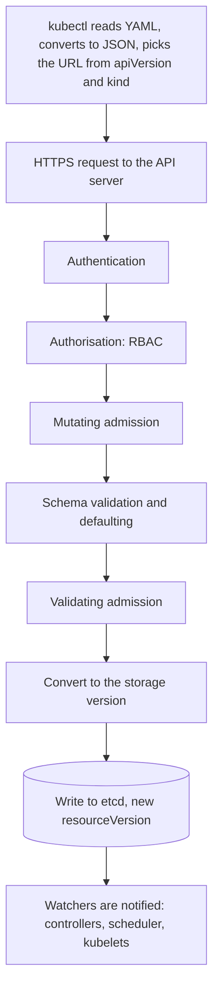

# Resources, groups and versions

## In plain words

Everything you have done in this track, creating a Deployment, listing Pods, reading a Secret, was a request to the **Kubernetes API**. The API is the cluster's single front door: a set of web addresses (URLs) where each kind of thing lives, and a small set of standard actions you can perform on them. `kubectl` is one client of it. Controllers, kubelets, dashboards and your own scripts are others.

This lesson explains how that API is organised. The two lines at the top of every manifest, `apiVersion` and `kind`, are not ceremony: together they say exactly which part of the API the object belongs to and therefore which URL it is sent to.

A large library is a helpful comparison. Books are organised into sections (history, science, law). Each section has editions of its cataloguing rules, because the rules improve over time. To find or shelve a book you need the section, the edition of the rules and the type of item. In Kubernetes the sections are **API groups**, the editions are **versions**, and the item types are **resources**. A librarian who knows the scheme can find anything; a reader who does not is lost.

Why this matters for a job: the first error many people hit after a cluster upgrade is `no matches for kind "X" in version "Y"`, which is an API versioning problem. Writing RBAC rules requires knowing the group a resource lives in. Building automation requires calling the API directly. Interviewers ask about API groups, versions and deprecation to see whether you understand the system or have only memorised YAML.

> **Before this lesson:** read [The control plane](#/lesson/kubernetes/control-plane) for the API server, [The declarative model](#/lesson/kubernetes/declarative-reconciliation) for objects, spec and status, and [RBAC authorisation and admission control](#/lesson/kubernetes/rbac-admission), which used API groups in its rules.

## A RESTful API over HTTPS

The Kubernetes API follows a style called **REST**. In a REST API, every thing has an address (a URL), and you act on it with a small, fixed set of HTTP **methods**. The `kubectl` verbs map directly onto them:

| kubectl / RBAC verb | HTTP method | Acts on |
|---|---|---|
| `get` | `GET` | One object: `/.../pods/web-1` |
| `list` | `GET` | A collection: `/.../pods` |
| `watch` | `GET` with `?watch=true` | A stream of changes to a collection |
| `create` | `POST` | A collection |
| `update` | `PUT` | One object, replaced whole |
| `patch` | `PATCH` | One object, changed in part |
| `delete` | `DELETE` | One object |
| `deletecollection` | `DELETE` | A collection |

Objects travel as **JSON**. You write YAML because it is pleasanter; `kubectl` converts it to JSON before sending. A process of converting an in-memory object into text for sending is called **serialisation**.

## Vocabulary: kind, resource, object

Three words are used loosely in conversation and precisely in the API.

- A **kind** is a type's name in a manifest, singular and capitalised: `Pod`, `Deployment`.
- A **resource** is the lowercase plural used in URLs and RBAC rules: `pods`, `deployments`. It is the API endpoint that serves objects of a kind.
- An **object** is one stored instance: the Deployment named `menu-api` in namespace `cafe`.

`kubectl api-resources` shows the mapping, with each resource's short names, group and version, scope and kind:

```bash
$ kubectl api-resources --sort-by=name | grep -E "NAME|^pods |^deployments|^ingresses|^nodes |^cronjobs"
NAME          SHORTNAMES   APIVERSION             NAMESPACED   KIND
cronjobs      cj           batch/v1               true         CronJob
deployments   deploy       apps/v1                true         Deployment
ingresses     ing          networking.k8s.io/v1   true         Ingress
nodes         no           v1                     false        Node
pods          po           v1                     true         Pod
```

## API groups

Resources are divided into **API groups**: named collections of related resources that are versioned together.

**The core group.** The oldest resources (Pods, Services, ConfigMaps, Secrets, Namespaces, Nodes, PersistentVolumes) live in a group with no name, called the **core group** or legacy group. In a manifest its version is written as a bare `apiVersion: v1`. In RBAC rules it is the empty string `""`. Its URLs begin with `/api/v1`.

**Named groups.** Everything added later lives in a named group. Its `apiVersion` is `<group>/<version>`, and its URLs begin with `/apis/<group>/<version>`.

| Group | Example resources | apiVersion |
|---|---|---|
| core (`""`) | pods, services, configmaps, secrets, nodes | `v1` |
| `apps` | deployments, statefulsets, daemonsets, replicasets | `apps/v1` |
| `batch` | jobs, cronjobs | `batch/v1` |
| `networking.k8s.io` | ingresses, networkpolicies, ingressclasses | `networking.k8s.io/v1` |
| `rbac.authorization.k8s.io` | roles, rolebindings, clusterroles | `rbac.authorization.k8s.io/v1` |
| `storage.k8s.io` | storageclasses, csidrivers, volumeattachments | `storage.k8s.io/v1` |
| `autoscaling` | horizontalpodautoscalers | `autoscaling/v2` |
| `policy` | poddisruptionbudgets | `policy/v1` |
| `gateway.networking.k8s.io` | gateways, httproutes (installed as CRDs) | `gateway.networking.k8s.io/v1` |

Groups exist so that different parts of the API can evolve at their own pace and be owned by different teams, and so that anyone can add their own group without touching the core. Custom groups conventionally use a domain name you control, such as `harbour-coffee.example`, to avoid collisions.

```bash
$ kubectl api-versions | head -8
admissionregistration.k8s.io/v1
apiextensions.k8s.io/v1
apps/v1
authentication.k8s.io/v1
authorization.k8s.io/v1
autoscaling/v1
autoscaling/v2
batch/v1
```

`kubectl api-versions` lists every group and version this cluster serves. If the `apiVersion` in your manifest is not in this list, the cluster cannot accept it.

## URL paths

The location of every object is computed from four facts: its group, its version, its resource name and, if it is namespaced, its namespace.

```
Core group, namespaced:     /api/v1/namespaces/<namespace>/<resource>/<name>
Core group, cluster-scoped: /api/v1/<resource>/<name>
Named group, namespaced:    /apis/<group>/<version>/namespaces/<namespace>/<resource>/<name>
Named group, cluster-scoped:/apis/<group>/<version>/<resource>/<name>
Subresource:                .../<name>/<subresource>
```

Leaving off `/<name>` addresses the collection, which is what `list` and `create` use. The function below builds the path for any object, including the special cases.

```python-run
RESOURCES = {   # kind -> (plural resource, namespaced?)
    "Pod": ("pods", True), "Service": ("services", True), "ConfigMap": ("configmaps", True),
    "Namespace": ("namespaces", False), "Node": ("nodes", False),
    "Deployment": ("deployments", True), "StatefulSet": ("statefulsets", True),
    "CronJob": ("cronjobs", True), "Ingress": ("ingresses", True),
    "ClusterRole": ("clusterroles", False), "StorageClass": ("storageclasses", False),
    "HTTPRoute": ("httproutes", True),
}

def api_path(api_version, kind, name=None, namespace=None, subresource=None):
    if kind not in RESOURCES:
        return f"error: no matches for kind \"{kind}\""
    resource, namespaced = RESOURCES[kind]
    prefix = f"/api/{api_version}" if "/" not in api_version else f"/apis/{api_version}"
    path = prefix
    if namespaced:
        path += f"/namespaces/{namespace or 'default'}"
    path += f"/{resource}"
    if name:
        path += f"/{name}"
        if subresource:
            path += f"/{subresource}"
    return path

examples = [
    ("v1", "Pod", "menu-api-9hvtn", "cafe", None),
    ("v1", "Pod", "menu-api-9hvtn", "cafe", "log"),
    ("v1", "Pod", None, "cafe", None),
    ("v1", "Node", "cafe-worker", None, None),
    ("apps/v1", "Deployment", "menu-api", "cafe", None),
    ("apps/v1", "Deployment", "menu-api", "cafe", "scale"),
    ("batch/v1", "CronJob", "nightly-report", None, None),
    ("rbac.authorization.k8s.io/v1", "ClusterRole", "view", "cafe", None),
    ("gateway.networking.k8s.io/v1", "HTTPRoute", "api", "cafe", None),
    ("apps/v1", "Widget", "w1", "cafe", None),
]
for v, k, n, ns, sub in examples:
    print(f"{v:30} {k:12} -> {api_path(v, k, n, ns, sub)}")
```

Points to notice in the output: the core group uses `/api`, everything else `/apis`. A cluster-scoped kind ignores any namespace you supply (the `ClusterRole` line). A namespaced kind with no namespace given goes to `default`. Subresources such as `log` and `scale` hang beneath the object.

### Calling the API yourself

`kubectl get --raw` sends a path to the API server using your credentials and prints the reply unformatted:

```bash
$ kubectl get --raw /api/v1/namespaces/cafe/pods | head -c 150
{"kind":"PodList","apiVersion":"v1","metadata":{"resourceVersion":"918822"},"items":[{"metadata":{"name":"menu-api-6c9d7b5f48-9hvtn","namespace":"cafe",

$ kubectl get --raw "/apis/apps/v1/namespaces/cafe/deployments/menu-api/scale"
{"kind":"Scale","apiVersion":"autoscaling/v1","metadata":{"name":"menu-api","namespace":"cafe"},"spec":{"replicas":3},"status":{"replicas":3,"selector":"app=menu-api"}}

$ kubectl proxy --port=8001 &
Starting to serve on 127.0.0.1:8001
$ curl -s http://127.0.0.1:8001/apis/apps/v1 | grep '"name"' | head -4
      "name": "controllerrevisions",
      "name": "daemonsets",
      "name": "daemonsets/status",
      "name": "deployments",
```

The first call lists Pods; the reply is a `PodList` whose `items` array holds the Pods (`head -c 150` shows the first 150 characters). The second reads a **subresource**: the `scale` view of a Deployment, a small object with only replica counts. `kubectl proxy` opens a local port that forwards to the API server and adds your credentials, so plain `curl` works; the `&` runs it in the background. The last call asks the `apps/v1` group which resources it serves. Asking the API what it offers is called **discovery**, and it is how `kubectl` learns about resource types, including ones added after it was built.

### Subresources

A **subresource** is a narrower endpoint beneath an object, with its own access control. The common ones:

| Subresource | Purpose |
|---|---|
| `status` | The status section, written by controllers separately from the spec |
| `scale` | Replica count only; what `kubectl scale` and autoscalers use |
| `pods/log`, `pods/exec`, `pods/portforward` | Logs, command execution, tunnels |
| `pods/eviction` | Polite removal that respects PodDisruptionBudgets |
| `pods/ephemeralcontainers`, `pods/resize` | Debug containers; in-place resource changes |
| `serviceaccounts/token` | Issuing tokens |

Splitting `status` from `spec` is why a controller can update what it observed without overwriting what you asked for, and why RBAC can give a controller write access to status only.

## Versions and stability levels

Each group has one or more **versions**. The version name tells you how stable that part of the API is.

| Level | Looks like | Meaning | Enabled by default? |
|---|---|---|---|
| **Alpha** | `v1alpha1` | Experimental. May change incompatibly or be removed without notice | No |
| **Beta** | `v1beta1`, `v2beta2` | Well tested, but details may still change. Will be deprecated and removed on a schedule | No, for new beta APIs since v1.24 |
| **Stable (GA)** | `v1`, `v2` | Compatible for the long term | Yes |

A resource usually starts as alpha, graduates to beta, then becomes stable. Once a stable version exists, older beta versions are deprecated and, some releases later, **removed**. The project's deprecation policy guarantees a minimum notice: a beta API version is served for at least nine months or three releases after its deprecation is announced, whichever is longer, and stable versions are kept far longer.

Several versions of one resource are often served at the same time. They are different **views of the same stored objects**: the API server stores each object in one version (the **storage version**) and converts on the fly when a client asks for another. An HPA created as `autoscaling/v2` can be read back as `autoscaling/v1`, with fields the older version cannot express tucked into annotations.

### What an API removal looks like

The standard example is Ingress. It was served as `extensions/v1beta1`, then `networking.k8s.io/v1beta1`, and became stable as `networking.k8s.io/v1`. The beta versions were removed in release 1.22. A manifest still using one fails after the upgrade:

```bash
$ kubectl apply -f old-ingress.yaml
error: resource mapping not found for name: "shop" namespace: "cafe" from "old-ingress.yaml":
no matches for kind "Ingress" in version "extensions/v1beta1"
ensure CRDs are installed first
```

Read the message literally: the cluster does not serve the kind `Ingress` at version `extensions/v1beta1`. The fix is to change `apiVersion`, and often some fields, because the schema usually changes between versions. Three important facts about removals:

- **Objects already in the cluster are not lost.** They are stored in the storage version and remain readable through the versions still served.
- **Your manifests, Helm charts and client code are what break**, the next time they are applied.
- **You can find out in advance.** The API server returns a warning header whenever a deprecated version is used, which `kubectl` prints, and it exposes a metric counting such requests.

```bash
$ kubectl apply -f flow-schema.yaml
Warning: flowcontrol.apiserver.k8s.io/v1beta3 FlowSchema is deprecated in v1.29+, unavailable in v1.32+; use flowcontrol.apiserver.k8s.io/v1 FlowSchema
flowschema.flowcontrol.apiserver.k8s.io/payments created

$ kubectl get --raw /metrics | grep apiserver_requested_deprecated_apis | head -2
apiserver_requested_deprecated_apis{group="flowcontrol.apiserver.k8s.io",removed_release="1.32",resource="flowschemas",version="v1beta3"} 1
```

The warning names the version, when it stops being available and what to use instead. The metric shows which deprecated APIs are still being called by something in the cluster. Tools such as `pluto` and `kubent` scan manifests and Helm releases for the same thing. Checking this before every upgrade is standard practice.

> [!WARNING]
> Kubernetes releases about three minor versions a year and each can remove deprecated API versions. Read the "deprecated API migration guide" in the official documentation before every upgrade, scan your manifests and charts, and fix them **before** upgrading the control plane. An API removal does not fail the upgrade itself; it fails your next deployment, usually at an inconvenient moment.

## What every object has in common

Whatever its kind, a Kubernetes object has the same top-level layout:

```yaml
apiVersion: apps/v1          # group and version
kind: Deployment             # type
metadata:                    # identity and bookkeeping
  name: menu-api
  namespace: cafe
  uid: 0c1f7a52-6e1b-4f0e-9a0d-0d5b0e3d2a11
  resourceVersion: "48211"
  generation: 3
  creationTimestamp: "2026-11-18T09:12:44Z"
  labels: {app: menu-api}
  annotations: {kubernetes.io/change-cause: "upgrade to 1.2.0"}
  ownerReferences: []
  finalizers: []
spec: {}                     # desired state (most kinds)
status: {}                   # observed state (most kinds)
```

`apiVersion` and `kind` together are called the object's **type metadata** (often abbreviated GVK, for group, version, kind). `metadata` is identical across kinds: you met `uid`, `resourceVersion`, `generation`, owner references and finalizers in the [declarative model lesson](#/lesson/kubernetes/declarative-reconciliation). The shapes of `spec` and `status` are what differ. A few kinds (ConfigMap, Secret, Role, StorageClass) have neither and keep their fields at the top level.

The built-in documentation for any field comes straight from the API's published schema:

```bash
$ kubectl explain cronjob.spec --api-version=batch/v1 | head -12
GROUP:      batch
KIND:       CronJob
VERSION:    v1

FIELD: spec <CronJobSpec>

DESCRIPTION:
    Specification of the desired behavior of a cron job, including the schedule.

FIELDS:
  concurrencyPolicy	<string>
    Specifies how to treat concurrent executions of a Job. Valid values are: ...
```

The API server publishes the schema of everything it serves in a format called **OpenAPI**, available at `/openapi/v3`. `kubectl explain`, editor plug-ins that validate YAML as you type, and client library generators all read it.

## How a write is processed

Putting together pieces from several lessons, here is everything that happens to `kubectl apply -f menu-api.yaml`:



**Defaulting** fills in fields you omitted (`replicas: 1`, `strategy: RollingUpdate`), which is why the object you read back is longer than the one you sent. **Validation** rejects impossible objects, with messages such as `spec.replicas: Invalid value: -1: must be greater than or equal to 0`. After the write, every component watching that resource type receives the change, and the reconciliation loops begin.

Two request options are useful in everyday work:

```bash
$ kubectl apply -f menu-api.yaml --dry-run=server
deployment.apps/menu-api configured (server dry run)

$ kubectl apply -f menu-api.yaml --validate=strict
Error from server (BadRequest): error when creating "menu-api.yaml": Deployment in version "v1"
cannot be handled as a Deployment: strict decoding error: unknown field "spec.template.spec.containers[0].imagePullPolcy"
```

A server-side dry run sends the request through every step above except the write to etcd, so it catches admission and validation failures for real. Strict validation rejects unknown or duplicated fields; here it catches a misspelt `imagePullPolicy`, which would otherwise be dropped with only a warning and leave you wondering why the setting had no effect.

## Efficient reads: list, watch, and consistency

Controllers do not poll. They **list** a resource once and then **watch** it: a long-lived HTTP response in which the server sends an event (`ADDED`, `MODIFIED`, `DELETED`) for each change. The `resourceVersion` returned by the list tells the server where to resume the stream.

```bash
$ kubectl get pods -n cafe --watch --output-watch-events
EVENT      NAME                        READY   STATUS    RESTARTS   AGE
ADDED      menu-api-6c9d7b5f48-9hvtn   1/1     Running   0          2d
MODIFIED   menu-api-6c9d7b5f48-9hvtn   1/1     Terminating   0      2d
DELETED    menu-api-6c9d7b5f48-9hvtn   0/1     Terminating   0      2d
ADDED      menu-api-6c9d7b5f48-tk4bq   0/1     Pending   0          0s
```

`--output-watch-events` shows the event type for each line. This is the raw material every controller works from.

`resourceVersion` also protects writes. An update must carry the `resourceVersion` the client last read; if the object has changed since, the server answers `409 Conflict` and the client must re-read and retry. That is **optimistic concurrency**: no locks, and stale writes are refused instead of silently overwriting someone else's change.

Large collections are returned in pages with the `limit` and `continue` parameters (`kubectl` requests 500 objects at a time), and a busy API server protects itself with **API Priority and Fairness**, which queues and, if necessary, rejects excess requests with `429 Too Many Requests` so that a misbehaving client cannot starve the system components.

> [!TIP]
> To write a manifest for a kind you have never used, ask the cluster, not a search engine: `kubectl api-resources | grep -i NAME` for the group and version, `kubectl explain KIND --recursive | less` for the full field tree, and `kubectl create ... --dry-run=client -o yaml` for a skeleton where a generator exists. The answers match your cluster's version exactly.

> [!INTERVIEW]
> **"How is the Kubernetes API organised?"** It is a RESTful HTTPS API in which resources are grouped into API groups and versioned. The core group has no name: `apiVersion: v1`, served under `/api/v1`. Named groups such as `apps`, `batch` and `networking.k8s.io` appear as `group/version` and are served under `/apis/group/version`. Namespaced resources include `/namespaces/<ns>/` in the path; cluster-scoped ones do not. Versions carry a stability level: alpha, beta and stable. Several versions can be served together as conversions of one stored object, and deprecated versions are removed on a published schedule, which breaks manifests and clients that still use them but not objects already stored. Each object has type metadata, common metadata, and usually spec and status, with status and scale exposed as subresources. Every write passes authentication, authorisation, mutating admission, validation, validating admission and is persisted to etcd, after which watchers are notified.

## Common pitfalls

- **Wrong `apiVersion` for the cluster.** Check `kubectl api-versions` and `kubectl api-resources`.
- **Writing `apiVersion: core/v1`.** The core group has no name; it is `v1`.
- **Using `""` versus the group name in RBAC.** Core is `""`; Deployments are `apps`.
- **Upgrading without scanning for removed APIs.**
- **Relying on alpha APIs in production.**
- **Assuming a typo in a field name is an error.** Without strict validation it is silently dropped.
- **Polling the API in a loop from your own tooling.** Use a watch, or a client library's informer.
- **Editing `status` by hand.** It is a subresource owned by controllers and will be overwritten.

## Cheat sheet

| Question | Command |
|---|---|
| Which resources exist, and in which group? | `kubectl api-resources` |
| Which group/versions are served? | `kubectl api-versions` |
| Fields of a kind | `kubectl explain KIND.field.subfield` |
| Raw API call | `kubectl get --raw PATH` |
| See the HTTP requests kubectl makes | `kubectl ... -v=6` |
| Validate against the real server | `kubectl apply --dry-run=server -f FILE` |
| Catch misspelt fields | `kubectl apply --validate=strict -f FILE` |
| Deprecated API usage | `kubectl get --raw /metrics \| grep apiserver_requested_deprecated_apis` |

| Path pattern | For |
|---|---|
| `/api/v1/namespaces/NS/RESOURCE/NAME` | Core, namespaced |
| `/api/v1/RESOURCE/NAME` | Core, cluster-scoped |
| `/apis/GROUP/VERSION/namespaces/NS/RESOURCE/NAME` | Named group, namespaced |
| `/apis/GROUP/VERSION/RESOURCE/NAME` | Named group, cluster-scoped |

## Summary

The Kubernetes API is a REST API in which every object has a URL determined by its group, version, resource and namespace. The core group is unnamed and served under `/api/v1`; all other groups are served under `/apis`. Versions signal stability, from alpha through beta to stable, and deprecated versions are removed on a schedule that you must track before upgrades. All objects share type metadata and common metadata, most have a spec and a status, and narrow subresources such as `status`, `scale` and `log` have their own access control. A write is authenticated, authorised, mutated, validated, converted and stored, and then announced to watchers, which is how the whole system stays in motion. The API is also extensible: the next lesson shows how to add your own kinds and the controllers that give them behaviour.

## Glossary

- **API**: a defined interface through which programs make requests of another program.
- **REST**: a style of API in which resources have URLs and are acted on with standard HTTP methods.
- **Kind**: the type name of an object, such as `Deployment`.
- **Resource**: the lowercase plural endpoint serving a kind, such as `deployments`.
- **Object**: a single stored instance of a kind.
- **API group**: a named, separately versioned collection of related resources.
- **Core group**: the unnamed original group, written `v1`.
- **Version**: an edition of a group's API, carrying a stability level.
- **Alpha / beta / stable (GA)**: experimental, pre-release and long-term compatible levels.
- **Deprecation**: an announcement that a version will be removed in a future release.
- **Storage version**: the version in which objects of a resource are persisted in etcd.
- **Subresource**: a narrower endpoint beneath an object, such as `status` or `scale`.
- **Discovery**: asking the API which groups, versions and resources it serves.
- **OpenAPI**: the published schema describing every resource and field.
- **Serialisation**: converting an object to a transmittable format such as JSON.
- **Defaulting**: filling in omitted fields with default values.
- **Watch**: a streaming request delivering change events.
- **Optimistic concurrency**: rejecting writes based on a stale `resourceVersion`.
- **API Priority and Fairness**: the API server's request queuing and overload protection.

```quiz
[
  {"q": "Which URL path addresses the Deployment 'web' in namespace 'shop'?",
   "options": ["/api/v1/namespaces/shop/deployments/web", "/apis/apps/v1/namespaces/shop/deployments/web", "/apis/v1/apps/shop/deployments/web", "/api/apps/v1/deployments/shop/web"],
   "answer": 1,
   "explain": "Deployments are in the named group apps, so the path starts with /apis/apps/v1, followed by the namespace segment, the plural resource and the name."},
  {"q": "What apiVersion does a Service manifest use, and why does it have no group prefix?",
   "options": ["core/v1, because core is the default", "v1, because Services belong to the unnamed core group", "networking.k8s.io/v1, because Services are networking objects", "apps/v1, like Deployments"],
   "answer": 1,
   "explain": "The core (legacy) group has no name. Its resources use the bare version v1 and are served under /api/v1."},
  {"q": "After a cluster upgrade, kubectl apply fails with 'no matches for kind \"Ingress\" in version \"extensions/v1beta1\"'. What happened?",
   "options": ["The Ingress controller is down", "That API version was removed; the manifest must be migrated to networking.k8s.io/v1", "The namespace was deleted", "RBAC denies Ingress access"],
   "answer": 1,
   "explain": "The cluster no longer serves that group and version. Update apiVersion and any changed fields. Existing stored objects are unaffected."},
  {"q": "An API version named v1beta2 is deprecated in favour of v1. What will happen to objects already created through v1beta2 when it is removed?",
   "options": ["They are deleted", "They remain stored and are readable through the versions still served", "They are frozen and unreadable", "They must be exported and re-imported"],
   "answer": 1,
   "explain": "Objects are persisted in a storage version and converted on read. Removal affects clients and manifests that request the old version, not the stored data."},
  {"q": "A manifest contains the misspelt field 'imagePullPolcy'. With default kubectl behaviour, what happens on apply?",
   "options": ["The object is rejected", "The unknown field is dropped with a warning and the default policy applies", "kubectl corrects the spelling", "The Pod fails to schedule"],
   "answer": 1,
   "explain": "Unknown fields are ignored unless strict validation is requested. --validate=strict turns this into an error."},
  {"q": "Why are 'status' and 'scale' exposed as subresources?",
   "options": ["To make URLs longer", "So they can be read and written separately from the spec, with their own RBAC permissions", "Because they are stored in a different database", "They are only for alpha features"],
   "answer": 1,
   "explain": "A controller can be allowed to update status only, and an autoscaler to change replicas only, without the right to edit the rest of the object."},
  {"q": "Two clients read the same ConfigMap. Client A updates it. Client B then sends an update based on its older copy. What happens?",
   "options": ["B's update silently overwrites A's", "The server rejects B's update with a 409 Conflict because its resourceVersion is stale", "Both updates are merged", "The ConfigMap is locked for an hour"],
   "answer": 1,
   "explain": "Optimistic concurrency: an update must carry the current resourceVersion. B must re-read and retry."},
  {"q": "How do controllers learn about changes to the objects they manage?",
   "options": ["They poll the API every second", "They list once and then hold a watch, receiving ADDED, MODIFIED and DELETED events", "etcd sends them emails", "kubectl notifies them"],
   "answer": 1,
   "explain": "List-then-watch gives controllers a current view and a stream of changes without repeated polling."}
]
```

> **Source:** Poulton, *The Kubernetes Book*, ch. 14 (topic coverage only). Official docs: https://kubernetes.io/docs/concepts/overview/kubernetes-api/ , https://kubernetes.io/docs/reference/using-api/api-concepts/ , https://kubernetes.io/docs/reference/using-api/deprecation-policy/ , https://kubernetes.io/docs/reference/using-api/deprecation-guide/
