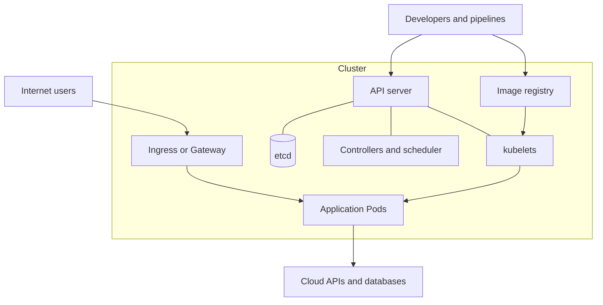

# Threat modelling I: spoofing, tampering and repudiation

## In plain words

Security work that begins with "let us switch on every setting we can find" tends to produce a long, random list and a false sense of safety. **Threat modelling** starts from the other end. You ask: what are we protecting, who might attack it, how could they do it, and what would stop them? The answers give you a prioritised list of defences, each tied to a real risk.

To avoid staring at a blank page, people use a checklist of attack categories. A widely used one is **STRIDE**, a word made from six initials:

| Letter | Threat | The attacker... | Property being protected |
|---|---|---|---|
| **S** | Spoofing | pretends to be someone or something else | Authenticity |
| **T** | Tampering | changes something they should not | Integrity |
| **R** | Repudiation | does something and denies it, with no proof either way | Accountability |
| **I** | Information disclosure | reads something they should not | Confidentiality |
| **D** | Denial of service | stops the system working for others | Availability |
| **E** | Elevation of privilege | gains more power than they were given | Authorisation |

Think about securing a bank branch. Spoofing is someone in a fake uniform claiming to be the cash courier. Tampering is altering the figures in the ledger. Repudiation is a clerk moving money and later saying "that was not me", with no record to settle it. Disclosure is reading customers' statements. Denial of service is jamming the doors so nobody can enter. Elevation of privilege is a cleaner obtaining the vault manager's keys. Different attacks, different defences, and a good plan considers each.

This lesson applies the first three categories to a Kubernetes cluster. The [next lesson](#/lesson/kubernetes/threat-model-disclosure-dos-privilege) covers the other three.

Why this matters for a job: security reviews, compliance audits and incident post-mortems all use this kind of structured thinking. Interviewers for platform and DevOps roles ask "how would you secure a Kubernetes cluster?", and an answer organised by threat is far stronger than a list of tools.

> **Before this lesson:** you need the control plane and node components ([The control plane](#/lesson/kubernetes/control-plane), [Worker nodes](#/lesson/kubernetes/worker-nodes)), authentication and RBAC ([Authentication](#/lesson/kubernetes/authentication), [RBAC and admission](#/lesson/kubernetes/rbac-admission)) and [Secrets](#/lesson/kubernetes/secrets). The web-security track covers TLS and general attack types.

## What we are protecting, and from where

Start with a map. An **attack surface** is every point where an attacker can try to get in or cause harm. For a cluster:



Seven places stand out: the API server (the front door to everything), etcd (all state and all Secrets), the kubelets and nodes, the Pods and their containers, the network between them, the image supply chain feeding it all, and the people and pipelines holding credentials.

Security people also think in layers, sometimes called the **4 Cs**: **Code** runs in a **Container**, which runs in a **Cluster**, which runs in a **Cloud** or data centre. Each layer relies on the one outside it. Perfect application code does not help if the cluster hands out admin tokens, and a hardened cluster does not help if the cloud account's password is `admin123`. The principle that follows is **defence in depth**: use several independent layers of protection, so that one failure is not a breach.

## Spoofing: pretending to be someone else

Spoofing attacks target identity. In a cluster, identities belong to people, to workloads and to the cluster's own components, and each can be impersonated.

### Spoofing a component: mutual TLS

The API server, etcd, the kubelets, the scheduler and the controller manager talk to each other constantly. If an attacker on the network could pose as the API server to a kubelet, they could instruct it to run anything. If they could pose as a kubelet, they could receive the Secrets for its Pods.

The defence is **mutual TLS (mTLS)**. Ordinary TLS, as used by websites, has the server prove its identity with a certificate. In mutual TLS both sides present certificates, each signed by a **certificate authority (CA)** the other trusts, so each end knows who it is talking to and the traffic is encrypted. A cluster's internal communication is built on this, with certificates issued by cluster CAs.

```bash
$ sudo kubeadm certs check-expiration
CERTIFICATE                EXPIRES                  RESIDUAL TIME   CERTIFICATE AUTHORITY
apiserver                  Nov 14, 2027 09:02 UTC   358d            ca
apiserver-etcd-client      Nov 14, 2027 09:02 UTC   358d            etcd-ca
apiserver-kubelet-client   Nov 14, 2027 09:02 UTC   358d            ca
etcd-peer                  Nov 14, 2027 09:02 UTC   358d            etcd-ca
etcd-server                Nov 14, 2027 09:02 UTC   358d            etcd-ca
front-proxy-client         Nov 14, 2027 09:02 UTC   358d            front-proxy-ca
```

On a kubeadm cluster this lists the component certificates and when they expire. Two things to notice. There is more than one CA: etcd has its own, so that a certificate valid for talking to the API server is not automatically valid for talking to etcd. And certificates expire: on self-managed clusters, renewing them before they lapse is a maintenance task, and a cluster whose certificates expired overnight is a classic outage. Managed services handle this for you.

Good practice for cluster CAs:

- Keep the CA private keys off the nodes where possible, and never in images or repositories.
- Use separate CAs for separate trust domains (cluster, etcd, front proxy).
- Do not use the cluster CA to issue certificates for ordinary applications. A certificate signed by it may be accepted as a cluster identity.
- Enable kubelet certificate rotation, so node credentials are short-lived.

### Spoofing a user

Covered in the [authentication lesson](#/lesson/kubernetes/authentication), restated as defences: authenticate people through an identity provider with multi-factor authentication and short-lived tokens; do not share the installer's admin certificate; disable anonymous access where it is not required; and protect kubeconfig files, since a copied kubeconfig *is* a spoofed identity.

### Spoofing a workload

Every Pod has a ServiceAccount identity. An attacker who takes over a container can read the mounted token and call the API server as that workload. The defences limit what that is worth:

```yaml
apiVersion: v1
kind: ServiceAccount
metadata:
  name: web
  namespace: cafe
automountServiceAccountToken: false
---
apiVersion: apps/v1
kind: Deployment
metadata:
  name: web
  namespace: cafe
spec:
  replicas: 3
  selector:
    matchLabels:
      app: web
  template:
    metadata:
      labels:
        app: web
    spec:
      serviceAccountName: web
      automountServiceAccountToken: false
      containers:
        - name: web
          image: ghcr.io/harbour-coffee/web@sha256:5b1e7c0a9d4f3e2b8a6c1d0f9e8b7a6c5d4e3f2a1b0c9d8e7f6a5b4c3d2e1f00
```

- A dedicated ServiceAccount per workload, so that one compromise exposes one identity.
- `automountServiceAccountToken: false` on both the ServiceAccount and the Pod: no token in the container at all.
- Where a token is needed, it is the short-lived, audience-bound, Pod-bound kind described earlier, with minimal RBAC.

**Between Pods**, the plain Pod network offers no proof of identity: any Pod can connect to any other and claim to be anything. Two measures help. NetworkPolicies restrict which Pods may connect at all. A **service mesh** (Istio, Linkerd, Cilium's mesh) gives every workload a certificate tied to its ServiceAccount and applies mutual TLS to traffic between Pods automatically, so that `orders-api` can verify that a caller really is `web`.

### Spoofing an image

The last line of the Deployment above pins the image by **digest**: a cryptographic hash of the image's contents, written after `@sha256:`. A tag such as `web:1.4` is a movable label; whoever controls the registry entry can point it at different contents tomorrow. A digest cannot be redirected, because changing the contents changes the hash. Combined with **image signing**, where the publisher signs the digest and the cluster verifies the signature before running the image, this stops an attacker substituting a look-alike image. The [supply-chain lesson](#/lesson/kubernetes/supply-chain-security) builds this out.

## Tampering: changing what should not be changed

Tampering attacks target integrity. Things an attacker would like to alter in a cluster: data in transit, the contents of etcd, configuration and binaries on nodes, container images, and files inside running containers.

### In transit

TLS protects every connection between components: it both encrypts and detects modification. For application traffic, TLS at the ingress or gateway protects the path from users, and a service mesh or application-level TLS protects traffic between Pods, which is otherwise plain text on the Pod network.

### etcd

Whoever can write to etcd controls the cluster without ever passing the API server's authentication, authorisation or admission. Defences: etcd reachable only from the API servers, mutual TLS with its own CA, encryption of Secrets at rest, restricted access to the machines and to backups, and backups themselves encrypted.

### Nodes

Anyone with root on a node can change the kubelet's configuration, read every Secret mounted there and interfere with every container on it. Defences: minimal, hardened operating system images; no interactive logins in normal operation; file integrity monitoring; and treating nodes as **immutable infrastructure**, which means never patching a node in place but replacing it with a fresh one built from a known image. A tampered node is then erased at the next rotation.

### Images

Covered above and in the supply-chain lesson: pin by digest, sign, scan, and restrict which registries the cluster may pull from using an admission policy.

### Inside the running container

Suppose an attacker exploits a bug in your web application. Their next steps are usually to download tools, modify the application's files, or plant a web shell. A **read-only root filesystem** blocks most of that: the container's own filesystem cannot be written to, and only explicitly mounted volumes are writable.

```yaml
apiVersion: apps/v1
kind: Deployment
metadata:
  name: menu-api
  namespace: cafe
spec:
  replicas: 3
  selector:
    matchLabels:
      app: menu-api
  template:
    metadata:
      labels:
        app: menu-api
    spec:
      securityContext:
        runAsNonRoot: true
        runAsUser: 10001
        runAsGroup: 10001
        fsGroup: 10001
        seccompProfile:
          type: RuntimeDefault
      volumes:
        - name: tmp
          emptyDir:
            sizeLimit: 64Mi
      containers:
        - name: menu-api
          image: ghcr.io/harbour-coffee/menu-api@sha256:9f2c1ab47d5e6f80a1b2c3d4e5f60718293a4b5c6d7e8f90a1b2c3d4e5f60718
          securityContext:
            readOnlyRootFilesystem: true
            allowPrivilegeEscalation: false
            capabilities:
              drop: ["ALL"]
          volumeMounts:
            - name: tmp
              mountPath: /tmp
```

The settings live in **security contexts**, at Pod level (applying to all containers) and at container level.

- `runAsNonRoot: true` — the kubelet refuses to start a container whose process would run as the root user (user ID 0).
- `runAsUser` / `runAsGroup` — the user and group IDs the process runs as.
- `fsGroup` — group ownership applied to mounted volumes so the non-root user can write to them.
- `seccompProfile: RuntimeDefault` — applies the runtime's default **seccomp** filter, which blocks system calls that ordinary applications never need.
- `readOnlyRootFilesystem: true` — the container's filesystem is read-only.
- `allowPrivilegeEscalation: false` — a process cannot gain more privileges than its parent, which disables tricks based on set-user-ID programs.
- `capabilities.drop: ["ALL"]` — **capabilities** are slices of root's power (binding low ports, changing file ownership, raw network access). Dropping all of them leaves a process with none.
- The `emptyDir` mounted at `/tmp` gives the application the one writable place it needs.

```bash
$ kubectl exec -n cafe deploy/menu-api -- sh -c 'echo hacked > /app/index.html'
sh: can't create /app/index.html: Read-only file system

$ kubectl exec -n cafe deploy/menu-api -- sh -c 'echo ok > /tmp/scratch && cat /tmp/scratch'
ok

$ kubectl exec -n cafe deploy/menu-api -- id
uid=10001 gid=10001 groups=10001
```

Writing to the application directory fails; writing to the mounted scratch space works; and `id` confirms the process is not root.

### Tampering with cluster configuration

An attacker, or a well-meaning colleague, with write access to the API can change a Deployment's image or add a privileged container. Defences: least-privilege RBAC so that few identities can write; admission policies that reject dangerous changes regardless of who makes them; and **GitOps**, in which the desired state lives in a Git repository with reviews and history, and a controller continuously reverts the cluster to match it. A manual change then shows up as drift and is undone.

## Repudiation: no record of who did what

Repudiation is the least intuitive category. The threat is not an action; it is the *absence of evidence* about an action. If someone deletes a production namespace and no log shows who, when and from where, you cannot investigate, cannot prove what happened, and cannot be sure it will not happen again. The property you want is **non-repudiation**: actions are attributable to an identity, in a record that cannot be quietly altered.

### API server audit logs

The API server can record every request it receives: who made it, from which address, what verb on what resource, and the outcome. This is the **audit log**, and it is controlled by an **audit policy** file given to the API server.

```yaml
apiVersion: audit.k8s.io/v1
kind: Policy
omitStages:
  - RequestReceived
rules:
  - level: None
    users: ["system:kube-proxy"]
    verbs: ["watch"]
    resources:
      - group: ""
        resources: ["endpoints", "services"]
  - level: Metadata
    resources:
      - group: ""
        resources: ["secrets", "configmaps"]
  - level: RequestResponse
    verbs: ["create", "update", "patch", "delete"]
    resources:
      - group: "rbac.authorization.k8s.io"
        resources: ["roles", "rolebindings", "clusterroles", "clusterrolebindings"]
  - level: Request
    verbs: ["create", "update", "patch", "delete", "deletecollection"]
  - level: Metadata
```

Rules are evaluated top to bottom, and **the first rule that matches a request decides its level**. The four levels:

| Level | Records |
|---|---|
| `None` | Nothing |
| `Metadata` | Who, when, verb, resource, response code. **No request or response bodies** |
| `Request` | Metadata plus the request body |
| `RequestResponse` | Metadata plus request and response bodies |

Reading this policy:

- `omitStages: [RequestReceived]` skips logging the moment a request arrives, keeping only its completion, which halves the volume.
- Rule 1 ignores a very noisy, harmless stream: kube-proxy watching Services.
- Rule 2 logs access to Secrets and ConfigMaps at `Metadata` only. This is deliberate and important: at `Request` level the log would contain the Secret values themselves, turning the audit log into a leak.
- Rule 3 logs changes to RBAC objects in full, because who granted what to whom is exactly what an investigator needs.
- Rule 4 logs the body of every other write.
- Rule 5, the catch-all, logs everything else (mainly reads) at `Metadata`.

Each audit event is a JSON record:

```json
{
  "kind": "Event", "apiVersion": "audit.k8s.io/v1", "level": "Metadata",
  "auditID": "c2f1a7d0-93be-4c1e-a2f4-7d0c1e5b9a13", "stage": "ResponseComplete",
  "requestURI": "/api/v1/namespaces/cafe/secrets/orders-db-credentials",
  "verb": "get",
  "user": {"username": "lena@harbour-coffee.example", "groups": ["cafe-developers", "system:authenticated"]},
  "sourceIPs": ["198.51.100.23"],
  "userAgent": "kubectl/v1.37.1 (linux/amd64)",
  "objectRef": {"resource": "secrets", "namespace": "cafe", "name": "orders-db-credentials", "apiVersion": "v1"},
  "responseStatus": {"code": 200},
  "requestReceivedTimestamp": "2026-11-21T14:02:11.412Z"
}
```

It answers who (`user`), what (`verb`, `objectRef`), when, from where (`sourceIPs`), with what tool (`userAgent`) and with what result (`responseStatus`). If the request was made through impersonation, an `impersonatedUser` field records both identities.

### An audit policy evaluator

"First match wins" trips people up when writing policies. The function below applies the rule order to sample requests.

```python-run
policy = [
    {"level": "None", "users": ["system:kube-proxy"], "verbs": ["watch"], "resources": ["endpoints", "services"]},
    {"level": "Metadata", "resources": ["secrets", "configmaps"]},
    {"level": "RequestResponse", "verbs": ["create", "update", "patch", "delete"],
     "resources": ["roles", "rolebindings", "clusterroles", "clusterrolebindings"]},
    {"level": "Request", "verbs": ["create", "update", "patch", "delete", "deletecollection"]},
    {"level": "Metadata"},
]

def audit_level(user, verb, resource):
    for i, rule in enumerate(policy, 1):
        if "users" in rule and user not in rule["users"]:
            continue
        if "verbs" in rule and verb not in rule["verbs"]:
            continue
        if "resources" in rule and resource not in rule["resources"]:
            continue
        return rule["level"], i          # the first matching rule decides
    return "None", None

requests = [
    ("system:kube-proxy", "watch", "services"),
    ("lena", "get", "secrets"),
    ("pipeline", "update", "secrets"),
    ("omar", "create", "rolebindings"),
    ("omar", "delete", "deployments"),
    ("lena", "list", "pods"),
    ("system:kube-proxy", "get", "nodes"),
]
for user, verb, resource in requests:
    level, rule = audit_level(user, verb, resource)
    print(f"{user:18} {verb:7} {resource:13} -> {level:16} (rule {rule})")
```

Look at `pipeline update secrets`. A write to a Secret would match rule 4 (`Request`, which records the body), but rule 2 comes first and holds it at `Metadata`. Had the two rules been written in the other order, every Secret update would be logged with its contents. Rule order is part of the policy.

### Making logs trustworthy

A log an attacker can edit proves nothing. To be useful as evidence:

- **Ship logs off the cluster** promptly, to a separate system with its own access control. Managed services send API audit logs to the cloud's logging service when you enable the option; often it is not on by default.
- **Restrict who can read and delete them**, and prefer write-once storage.
- **Keep them long enough.** Breaches are commonly discovered weeks or months later.
- **Synchronise clocks** on all nodes, so that events from different sources can be put in order.
- **Avoid shared identities.** If five people use one admin kubeconfig, every entry says "admin" and the log attributes nothing. Individual identities are a precondition for accountability.

The API audit log covers the API only. A complete picture also needs logs from containers (application events), from nodes (the kubelet, the runtime, the operating system's own audit facility), and from the cloud provider's control plane. Runtime security tools such as **Falco** add records of suspicious behaviour inside containers, such as a shell being started or an unexpected outbound connection.

> [!WARNING]
> Kubernetes **Events** (what `kubectl get events` and `describe` show) are not an audit log. They are operational hints, they record nothing about who made a request, and they are deleted after about an hour by default. If you need to answer "who deleted this?", only API audit logging, enabled beforehand, can tell you.

> [!TIP]
> After enabling audit logging, test it with a deliberate action and a search: create and delete a throwaway ConfigMap, then find both events by your username. A logging pipeline that has never been queried is frequently one that is not working.

> [!INTERVIEW]
> **"How would you approach securing a Kubernetes cluster?"** A strong answer is structured. Name a framework such as STRIDE, or the 4 Cs with defence in depth, and walk through it. For spoofing: mutual TLS between components with separate CAs and rotation; human access through an identity provider with short-lived credentials; per-workload ServiceAccounts with bound tokens or none; image digests and signatures; optionally a mesh for workload mTLS. For tampering: TLS in transit, locked-down and encrypted etcd, immutable hardened nodes, read-only root filesystems with non-root users and dropped capabilities, admission policies and GitOps to resist configuration drift. For repudiation: API audit logging with a considered policy (Metadata for Secrets), shipped off-cluster, with individual identities. Then continue through disclosure, denial of service and privilege escalation, as the next lesson does.

## Common pitfalls

- **Securing by checklist with no model.** Effort goes to whatever is easy, not what matters.
- **Letting cluster certificates expire** on a self-managed cluster.
- **Using the cluster CA for application certificates.**
- **Mutable image tags in production.** What runs can change without a manifest change.
- **Writable root filesystems and root users by default.** A compromised process can modify itself and its surroundings.
- **Audit logging disabled, or enabled and never shipped off the cluster.**
- **Logging Secrets at `Request` level.** The audit log becomes the breach.
- **Shared admin credentials.** Nothing can be attributed.
- **Confusing Events with audit logs.**

## Cheat sheet

| Threat | Target | Main defences |
|---|---|---|
| Spoofing a component | API server, kubelet, etcd | Mutual TLS, separate CAs, certificate rotation |
| Spoofing a user | kubeconfig, tokens | Identity provider, MFA, short-lived tokens |
| Spoofing a workload | ServiceAccount token | Dedicated accounts, no automount, bound tokens, mesh mTLS |
| Spoofing an image | Tags | Digests, signatures, registry allow-list |
| Tampering in transit | Network | TLS everywhere |
| Tampering with state | etcd | Network isolation, mTLS, encryption at rest, protected backups |
| Tampering with nodes | Host OS | Hardened minimal OS, immutable nodes |
| Tampering in containers | Filesystem | `readOnlyRootFilesystem`, non-root, drop capabilities |
| Tampering with config | API objects | Least-privilege RBAC, admission policy, GitOps |
| Repudiation | Actions via the API | Audit policy, off-cluster log shipping, individual identities |

| securityContext field | Effect |
|---|---|
| `runAsNonRoot: true` | Refuse to run as user 0 |
| `readOnlyRootFilesystem: true` | Container filesystem cannot be written |
| `allowPrivilegeEscalation: false` | No gaining privileges after start |
| `capabilities.drop: ["ALL"]` | Remove all slices of root power |
| `seccompProfile.type: RuntimeDefault` | Block rarely needed system calls |

## Summary

Threat modelling replaces guesswork with a structured walk through what could go wrong. STRIDE supplies six categories. Against spoofing, a cluster relies on mutual TLS between components, strong external authentication for people, narrowly scoped and short-lived workload identities, and digests and signatures for images. Against tampering, it protects data in transit with TLS, guards etcd and the nodes, makes containers hard to modify with read-only filesystems, non-root users and dropped capabilities, and resists configuration changes with RBAC, admission policy and GitOps. Against repudiation, it records every API request under an audit policy and ships those records somewhere an attacker cannot rewrite them. The next lesson completes the model with the three remaining categories and the Pod Security Standards that turn many of these settings into an enforceable baseline.

## Glossary

- **Threat modelling**: a structured analysis of what could go wrong and what to do about it.
- **STRIDE**: spoofing, tampering, repudiation, information disclosure, denial of service, elevation of privilege.
- **Attack surface**: all the points where an attacker can try to interact with a system.
- **4 Cs**: code, container, cluster, cloud; nested layers of security.
- **Defence in depth**: several independent protective layers.
- **Spoofing**: impersonating a user, workload or component.
- **Mutual TLS (mTLS)**: TLS in which both ends authenticate with certificates.
- **Certificate authority (CA)**: the issuer whose signature makes certificates trusted.
- **Digest**: a cryptographic hash identifying exact image contents.
- **Image signing**: attaching a verifiable signature to an image digest.
- **Service mesh**: infrastructure providing identity, mTLS and traffic control between workloads.
- **Tampering**: unauthorised modification.
- **Immutable infrastructure**: replacing machines instead of changing them in place.
- **Security context**: Pod and container settings controlling privileges.
- **Capabilities**: divisible parts of the root user's privileges.
- **seccomp**: a kernel facility for filtering system calls.
- **Repudiation / non-repudiation**: deniability of actions, and the ability to attribute them.
- **Audit log / audit policy**: the record of API requests, and the rules for what is recorded.
- **Falco**: a runtime security tool that detects suspicious behaviour in containers.

```quiz
[
  {"q": "An attacker on the cluster network tries to pose as the API server to a kubelet. Which mechanism defeats this?",
   "options": ["RBAC", "Mutual TLS with certificates signed by the cluster's certificate authority", "A ResourceQuota", "A readiness probe"],
   "answer": 1,
   "explain": "With mutual TLS, each side verifies the other's certificate against a trusted CA. An impostor without a valid certificate is rejected."},
  {"q": "Which STRIDE category does 'someone deleted a namespace and there is no record of who' belong to?",
   "options": ["Spoofing", "Tampering", "Repudiation", "Denial of service"],
   "answer": 2,
   "explain": "Repudiation is the inability to attribute an action. The defence is audit logging tied to individual identities."},
  {"q": "A Deployment references image web:1.4. Why is referencing it by sha256 digest safer against spoofing and tampering?",
   "options": ["Digests pull faster", "A tag can be re-pointed to different contents, while a digest identifies exact contents and cannot be redirected", "Digests are encrypted", "Tags are not supported by containerd"],
   "answer": 1,
   "explain": "The digest is a hash of the image. Different contents produce a different digest, so the reference cannot silently change meaning."},
  {"q": "A container runs with readOnlyRootFilesystem: true and an emptyDir mounted at /tmp. An attacker with code execution tries to overwrite /app/server.js. What happens?",
   "options": ["The write succeeds", "The write fails with a read-only file system error; only /tmp is writable", "The Pod is deleted", "The kubelet restarts the node"],
   "answer": 1,
   "explain": "The root filesystem is mounted read-only. Only explicitly mounted volumes accept writes."},
  {"q": "An audit policy lists a rule 'level: Request for all create/update verbs' BEFORE a rule 'level: Metadata for secrets'. What is the consequence?",
   "options": ["Secrets are never logged", "Secret writes are logged with their request bodies, exposing the values in the audit log", "The API server refuses to start", "Only reads of Secrets are logged"],
   "answer": 1,
   "explain": "The first matching rule decides. Writes to Secrets match the Request rule first, so their contents are recorded. The Metadata rule for Secrets must come earlier."},
  {"q": "Why does a shared admin kubeconfig used by a whole team undermine audit logging?",
   "options": ["Audit logs stop working", "Every action is recorded under the same identity, so nothing can be attributed to a person", "The kubeconfig expires faster", "It disables RBAC"],
   "answer": 1,
   "explain": "Accountability needs individual identities. With one shared credential the log cannot say which person acted."},
  {"q": "Someone asks you to find out who deleted a Deployment yesterday. Audit logging was not enabled. Can kubectl get events answer the question?",
   "options": ["Yes, events record the user", "No; events do not record who made requests and expire after about an hour", "Yes, with --show-users", "Only for Deployments"],
   "answer": 1,
   "explain": "Events are short-lived operational messages from controllers and kubelets. Only the API audit log, enabled in advance, records requesters."},
  {"q": "What does capabilities.drop: [\"ALL\"] achieve for a container?",
   "options": ["It removes all environment variables", "It removes the individual root privileges a process could otherwise use, such as raw network access or changing file ownership", "It stops the container from using CPU", "It disables the liveness probe"],
   "answer": 1,
   "explain": "Linux capabilities split root's power into pieces. Dropping all of them leaves the process with none, limiting what an attacker can do after a compromise."}
]
```

> **Source:** Poulton, *The Kubernetes Book*, ch. 15 (topic coverage only). Official docs: https://kubernetes.io/docs/concepts/security/ , https://kubernetes.io/docs/tasks/debug/debug-cluster/audit/ , https://kubernetes.io/docs/tasks/configure-pod-container/security-context/ , https://kubernetes.io/docs/setup/best-practices/certificates/
