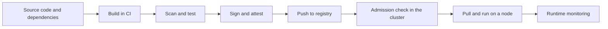

# Image and supply-chain security

## In plain words

Everything that runs in your cluster arrived there by a journey: a developer wrote code, a build system combined it with libraries and a base image, the result was pushed to a registry, and a node pulled it and started it. That journey is the **software supply chain**. If an attacker can interfere at any stage, by slipping a malicious library into the build, replacing an image in the registry, or tricking the cluster into pulling from somewhere else, they get their code running inside your cluster with your application's permissions, and they never have to break through a firewall.

Think of a restaurant's food supply. The chef may be superb and the kitchen spotless, but if a supplier delivers contaminated ingredients, customers still get ill. A careful restaurant buys from known suppliers, checks seals and labels on delivery, keeps a record of where each ingredient came from, and refuses anything that arrives without paperwork. Supply-chain security applies the same four habits to software: **trusted sources, verified integrity, recorded origin, and a gate at the door.**

Why this matters for a job: several of the most damaging security incidents of recent years were supply-chain attacks, and regulators and customers now ask for evidence such as signed images and lists of components. As the person shipping to Kubernetes, you own the pipeline that either provides that evidence or does not. Interviewers ask "how do you make sure only trusted images run in your cluster?".

> **Before this lesson:** read the two threat modelling lessons ([I](#/lesson/kubernetes/threat-model-identity-integrity), [II](#/lesson/kubernetes/threat-model-disclosure-dos-privilege)) and [RBAC and admission control](#/lesson/kubernetes/rbac-admission). From the Docker track you need [registries, tags and digests](#/lesson/docker/registries-tags-digests) and [container security](#/lesson/docker/container-security). The CI/CD track's [security scanning lesson](#/lesson/cicd/security-scanning) covers the pipeline side.

## The chain and where it can break



| Stage | What can go wrong | Control |
|---|---|---|
| Source and dependencies | A compromised or look-alike library; secrets committed to the repository | Pinned dependencies, dependency scanning, secret scanning, code review |
| Base image | An outdated or malicious base | Minimal, trusted, pinned base images |
| Build | A tampered build server injects code | Isolated, short-lived build environments; provenance |
| Registry | Image replaced; tag moved; anonymous push | Access control, immutable tags, private registry |
| Deployment | A manifest references an untrusted image | Admission policies; digests; signature verification |
| Runtime | A new vulnerability is published after deployment; the container is exploited | Continuous scanning, hardened Pods, runtime detection |

No single control covers the chain. The rest of the lesson takes the stages in order.

## Stage 1: what goes into the image

### Start small

Every package in an image is code that might contain a vulnerability and a tool an attacker might use. A typical general-purpose base image contains a shell, a package manager, network utilities and hundreds of libraries your application never calls. Smaller bases reduce both problems.

| Base | Contains | Typical use |
|---|---|---|
| Full distribution (`ubuntu`, `debian`) | Shell, package manager, many libraries | Development, debugging |
| Slim variant (`debian:12-slim`, `python:3.13-slim`) | Fewer packages | A reasonable default |
| `alpine` | A very small distribution with a different C library | Small images; occasional compatibility issues |
| **Distroless** | Only the language runtime and its dependencies; **no shell, no package manager** | Production services |
| `scratch` | Nothing at all | Statically linked binaries, such as Go programs |

A **multi-stage build** makes small images practical: compile and install in a large builder image, then copy only the finished artefacts into a minimal final image.

```dockerfile
FROM golang:1.25 AS build
WORKDIR /src
COPY go.mod go.sum ./
RUN go mod download
COPY . .
RUN CGO_ENABLED=0 go build -o /out/menu-api ./cmd/menu-api

FROM gcr.io/distroless/static-debian12:nonroot
COPY --from=build /out/menu-api /menu-api
USER 65532:65532
ENTRYPOINT ["/menu-api"]
```

The first stage, named `build`, has the full Go toolchain. `CGO_ENABLED=0` produces a self-contained binary. The second stage starts from a distroless image, copies in the single binary, and sets a non-root user by numeric ID. The numeric form matters: Kubernetes' `runAsNonRoot: true` check can verify a number, but cannot verify a user *name* without looking inside the image. The final image contains one executable and no shell, so an attacker who achieves code execution has very little to work with. The Docker track's [multi-stage builds lesson](#/lesson/docker/multi-stage-builds) covers the technique in depth.

When an image has no shell, you debug it with an ephemeral container (`kubectl debug`), as shown in the [multi-container Pods lesson](#/lesson/kubernetes/multi-container-pods), instead of adding tools to the production image.

### Pin what you depend on

Reproducibility is a security property: if you cannot say exactly what went into an image, you cannot say whether it is affected by a newly disclosed vulnerability. Pin the base image by digest (`FROM debian:12-slim@sha256:...`), pin application dependencies with a lock file, and use automated update tools (Dependabot, Renovate) to raise version bumps as reviewable changes instead of pulling "whatever is latest" at build time.

### Keep secrets out

Anything copied into an image layer stays in that layer, even if a later instruction deletes it. A credentials file added during a build and removed at the end is still retrievable by anyone who can pull the image. Use build-time secret mounts for credentials needed during the build, a `.dockerignore` file to keep local files out of the build context, and secret scanning in the pipeline.

## Stage 2: scanning

A **vulnerability scanner** lists the packages in an image and compares them against databases of known vulnerabilities. Each known vulnerability has a **CVE** identifier (Common Vulnerabilities and Exposures), such as `CVE-2026-12345`, and usually a severity score.

```bash
$ trivy image --severity HIGH,CRITICAL --ignore-unfixed ghcr.io/harbour-coffee/orders-api:2.1.0
ghcr.io/harbour-coffee/orders-api:2.1.0 (debian 12.11)

Total: 2 (HIGH: 1, CRITICAL: 1)

┌──────────┬────────────────┬──────────┬───────────────────┬───────────────┬──────────────────────────────┐
│ Library  │ Vulnerability  │ Severity │ Installed Version │ Fixed Version │            Title             │
├──────────┼────────────────┼──────────┼───────────────────┼───────────────┼──────────────────────────────┤
│ libssl3  │ CVE-2026-11871 │ CRITICAL │ 3.0.16-1          │ 3.0.17-1      │ openssl: buffer overflow ... │
│ zlib1g   │ CVE-2026-09342 │ HIGH     │ 1:1.2.13.dfsg-1   │ 1:1.2.13-2    │ zlib: integer overflow ...   │
└──────────┴────────────────┴──────────┴───────────────────┴───────────────┴──────────────────────────────┘

$ trivy image --exit-code 1 --severity CRITICAL ghcr.io/harbour-coffee/orders-api:2.1.0; echo "exit=$?"
exit=1
```

Trivy is one widely used open-source scanner; Grype and commercial tools work similarly. `--severity HIGH,CRITICAL` filters the report. `--ignore-unfixed` hides vulnerabilities for which no fixed version exists yet, since there is nothing you can do about those today. The table shows each affected library, the installed version and the version that fixes it. The second command is the pipeline form: `--exit-code 1` makes the scanner exit with a failure when anything at the chosen severity is found, which stops the build.

Four practical points about scanning:

- **Scan in the pipeline *and* continuously in the registry or cluster.** An image that was clean when built becomes vulnerable the day a new CVE is published. Most registries can rescan stored images; the Trivy Operator rescans what is running.
- **Set a policy people can live with.** "Fail on critical vulnerabilities that have a fix" is enforceable. "Zero vulnerabilities of any kind" is usually not, and a gate that is always red gets bypassed.
- **Fixing normally means rebuilding** on an updated base image, not patching inside a running container. Regular automated rebuilds are a security control.
- **Scanners find known vulnerabilities in known packages.** They do not find bugs in your own code, malicious code that has no CVE, or misconfiguration. They are one layer.

Scanners can also check manifests and Dockerfiles for misconfiguration (`trivy config .`), catching things such as a missing `runAsNonRoot` before review.

## Stage 3: knowing what is inside, and where it came from

### SBOM

A **software bill of materials (SBOM)** is a machine-readable list of every component in an image, with versions: the ingredients label. When a serious vulnerability is announced in some library, an organisation with SBOMs can answer "which of our images contain it?" with a query instead of a week of investigation.

```bash
$ syft ghcr.io/harbour-coffee/orders-api:2.1.0 -o spdx-json > orders-api.spdx.json
$ grep -c '"name"' orders-api.spdx.json
143
$ grype sbom:orders-api.spdx.json --only-fixed | head -3
NAME     INSTALLED         FIXED-IN     TYPE  VULNERABILITY   SEVERITY
libssl3  3.0.16-1          3.0.17-1     deb   CVE-2026-11871  Critical
zlib1g   1:1.2.13.dfsg-1   1:1.2.13-2   deb   CVE-2026-09342  High
```

`syft` generates an SBOM in a standard format (SPDX here; CycloneDX is the other common one). The count shows 143 components in this image. `grype` then scans the SBOM file itself, with no need to pull the image again: an SBOM stored today can be rechecked against tomorrow's vulnerability database.

### Provenance

**Provenance** is a signed statement about how an artefact was built: which source commit, which build system, which steps. It answers a different question from a scan: not "what is in this?" but "did this really come from our pipeline, from the commit we reviewed?". The **SLSA** framework (Supply-chain Levels for Software Artifacts, said "salsa") defines increasing levels of assurance, from "provenance exists" up to "built on a hardened, isolated platform that generated unforgeable provenance". SBOMs and provenance are both kinds of **attestation**: signed metadata attached to an image.

## Stage 4: signing

A **digital signature** lets anyone holding the public key verify two things about an image: who vouched for it, and that it has not changed since. The standard tool is **cosign**, from the Sigstore project.

```bash
$ cosign sign ghcr.io/harbour-coffee/orders-api@sha256:41c7e0f9a3b2d8c6e5f4a1b0c9d8e7f6a5b4c3d2e1f00918273645546372819a
Generating ephemeral keys...
Retrieving signed certificate...
tlog entry created with index: 148320774
Pushing signature to: ghcr.io/harbour-coffee/orders-api

$ cosign verify ghcr.io/harbour-coffee/orders-api@sha256:41c7e0f9a3b2... \
    --certificate-identity "https://github.com/harbour-coffee/orders-api/.github/workflows/release.yaml@refs/heads/main" \
    --certificate-oidc-issuer "https://token.actions.githubusercontent.com"
Verification for ghcr.io/harbour-coffee/orders-api@sha256:41c7e0f9a3b2... --
The following checks were performed on each of these signatures:
  - The cosign claims were validated
  - Existence of the claims in the transparency log was verified offline
  - The code-signing certificate was verified using trusted certificate authority certificates
```

- `cosign sign` signs an image **by digest**, never by tag, because a signature must refer to exact contents.
- This is **keyless signing**: instead of a long-lived private key that could leak, the pipeline proves its identity with its own short-lived OIDC token, receives a certificate valid for minutes, signs, and records the signature in a public, append-only **transparency log**. The signature is stored in the registry next to the image.
- `cosign verify` checks that a signature exists and that it was made by the expected identity, here a specific workflow file on the `main` branch of a specific repository, issued by GitHub's token service. Stating the expected identity is the point of the exercise. A signature from *someone* proves nothing; a signature from *your release workflow* does.

Attestations are attached the same way: `cosign attest --predicate orders-api.spdx.json --type spdxjson IMAGE` signs and attaches the SBOM.

## Stage 5: the registry

The registry is the warehouse between build and cluster.

- **Use a private registry** for your own images, with authentication for both push and pull. Give the pipeline push rights; give clusters pull-only credentials.
- **Make tags immutable** where the registry supports it, so that `orders-api:2.1.0` cannot be overwritten.
- **Mirror public images** you depend on into your own registry. You then control when they change, you can scan them, and your deployments do not fail when a public registry rate-limits you or an upstream image disappears.
- **Enable registry-side scanning** of stored images.

Clusters authenticate to private registries with `imagePullSecrets`, shown in the [Secrets lesson](#/lesson/kubernetes/secrets), or, better, with the node's or workload's cloud identity, so that no registry password is stored anywhere.

## Stage 6: the gate at the cluster door

All the work above is wasted if anyone can still run `kubectl run test --image=some-random/image`. An **admission policy** makes the cluster refuse images that do not meet your rules. There are three levels of strictness.

### Allow-list the registry

The ValidatingAdmissionPolicy from the [admission lesson](#/lesson/kubernetes/rbac-admission) did this for Deployments. A more complete version covers Pods directly and all three container lists:

```yaml
apiVersion: admissionregistration.k8s.io/v1
kind: ValidatingAdmissionPolicy
metadata:
  name: trusted-registries-and-digests
spec:
  failurePolicy: Fail
  matchConstraints:
    resourceRules:
      - apiGroups: [""]
        apiVersions: ["v1"]
        operations: ["CREATE", "UPDATE"]
        resources: ["pods"]
  variables:
    - name: allContainers
      expression: >-
        object.spec.containers
        + (has(object.spec.initContainers) ? object.spec.initContainers : [])
        + (has(object.spec.ephemeralContainers) ? object.spec.ephemeralContainers : [])
  validations:
    - expression: "variables.allContainers.all(c, c.image.startsWith('ghcr.io/harbour-coffee/') || c.image.startsWith('registry.k8s.io/'))"
      message: "images must come from ghcr.io/harbour-coffee/ or registry.k8s.io/"
    - expression: "variables.allContainers.all(c, c.image.contains('@sha256:'))"
      message: "images must be referenced by digest (name@sha256:...)"
```

- It matches every Pod creation and update.
- `variables` defines a reusable value: the three container lists joined together. `has(...)` tests whether an optional field is present, and `? :` chooses between two values. `>-` is YAML for a long string folded onto several lines.
- The first validation requires every image to begin with one of two registry prefixes. The trailing slash in `ghcr.io/harbour-coffee/` matters: without it, `ghcr.io/harbour-coffee-evil/` would also match.
- The second requires a digest in every reference.

Remember the companion `ValidatingAdmissionPolicyBinding`, without which a policy is inert.

### Verify signatures

Checking a signature needs a call to the registry, which CEL policies cannot make, so this uses a policy engine. With Kyverno:

```yaml
apiVersion: kyverno.io/v1
kind: ClusterPolicy
metadata:
  name: verify-harbour-coffee-images
spec:
  validationFailureAction: Enforce
  webhookTimeoutSeconds: 30
  rules:
    - name: require-release-workflow-signature
      match:
        any:
          - resources:
              kinds: ["Pod"]
      verifyImages:
        - imageReferences:
            - "ghcr.io/harbour-coffee/*"
          attestors:
            - entries:
                - keyless:
                    issuer: "https://token.actions.githubusercontent.com"
                    subject: "https://github.com/harbour-coffee/*/.github/workflows/release.yaml@refs/heads/main"
          mutateDigest: true
          required: true
```

For every Pod using an image under `ghcr.io/harbour-coffee/`, Kyverno looks up the image's signatures and admits the Pod only if one was made by a release workflow on a `main` branch in the organisation. `mutateDigest: true` rewrites a tag to the verified digest, so that what was verified is exactly what runs. The Sigstore policy-controller and Gatekeeper with external data offer equivalents.

The whole gate can be modelled in a few lines. The function below evaluates an image reference against the three checks.

```python-run
TRUSTED_PREFIXES = ("ghcr.io/harbour-coffee/", "registry.k8s.io/")
SIGNED_BY_RELEASE = {      # digests with a valid signature from the release workflow
    "ghcr.io/harbour-coffee/orders-api@sha256:41c7",
    "ghcr.io/harbour-coffee/menu-api@sha256:9f2c",
}
CRITICAL_CVES = {"ghcr.io/harbour-coffee/menu-api@sha256:9f2c": 0,
                 "ghcr.io/harbour-coffee/orders-api@sha256:41c7": 0,
                 "ghcr.io/harbour-coffee/report-api@sha256:77aa": 2}

def admit(image):
    reasons = []
    if not image.startswith(TRUSTED_PREFIXES):
        reasons.append("registry is not on the allow-list")
    if "@sha256:" not in image:
        tag = image.rsplit(":", 1)[1] if ":" in image.rsplit("/", 1)[-1] else "latest"
        reasons.append(f"referenced by tag '{tag}', not by digest")
    elif image.startswith("ghcr.io/harbour-coffee/"):
        if image not in SIGNED_BY_RELEASE:
            reasons.append("no valid signature from the release workflow")
        if CRITICAL_CVES.get(image, 0) > 0:
            reasons.append(f"{CRITICAL_CVES[image]} critical vulnerabilities with fixes available")
    return ("ADMIT", []) if not reasons else ("DENY", reasons)

for image in [
    "ghcr.io/harbour-coffee/orders-api@sha256:41c7",
    "ghcr.io/harbour-coffee/orders-api:2.1.0",
    "ghcr.io/harbour-coffee/web",
    "docker.io/library/nginx:1.29",
    "ghcr.io/harbour-coffee-evil/orders-api@sha256:41c7",
    "ghcr.io/harbour-coffee/report-api@sha256:77aa",
    "registry.k8s.io/pause@sha256:7031",
]:
    verdict, reasons = admit(image)
    print(f"{verdict:5} {image}")
    for r in reasons:
        print(f"        - {r}")
```

The look-alike organisation name is rejected because of the trailing slash in the prefix. The image with no tag is treated as `latest`. The `report-api` image has a digest but fails twice: it was never signed by the release workflow, and it has unpatched critical vulnerabilities. One clean, signed, digest-pinned image passes.

> [!WARNING]
> Roll out blocking admission policies carefully. A policy that is too strict, or a policy engine that is down with `failurePolicy: Fail`, stops **all** matching Pods from starting, including replacements for crashed Pods and the system components themselves. Begin in audit or warn mode, exempt system namespaces deliberately, run the policy engine with several replicas and a PodDisruptionBudget, and keep a documented emergency procedure.

## Stage 7: after deployment

- **Rescan what is running.** New CVEs appear daily. The answer to "are we affected?" should come from a dashboard, not a scramble.
- **Rebuild and redeploy regularly**, even with no code change, to pick up patched base images.
- **Retire what is unused.** Old Deployments and CronJobs keep old images alive.
- **Detect at runtime.** Tools such as Falco and Tetragon watch system calls and flag behaviour that no legitimate workload shows: a shell starting in a production container, a write to a system directory, an outbound connection to an unfamiliar address.
- **Limit the blast radius.** The hardened security contexts, Pod Security Standards, least-privilege ServiceAccounts and NetworkPolicies from the surrounding lessons decide how much damage a malicious image could do if one gets through.

## What the pipeline should look like

Bringing it together, a release pipeline for one service:

1. Run tests, dependency scanning and secret scanning on the source.
2. Build with a multi-stage Dockerfile on a pinned, minimal base, in a fresh, isolated build environment.
3. Scan the image; fail on fixable critical vulnerabilities.
4. Generate an SBOM and provenance.
5. Push by digest to a private registry with immutable tags.
6. Sign the digest (keyless) and attach the SBOM and provenance as attestations.
7. Update the manifest in Git to the new **digest**, by pull request.
8. Let the GitOps controller apply it; the cluster's admission policies verify registry, digest and signature.

The CI/CD track's [GitHub Actions lesson](#/lesson/cicd/github-actions-workflow) and the Docker track's [CI pipelines lesson](#/lesson/docker/ci-pipelines) show how such steps are written.

> [!TIP]
> If you can do only three things this quarter: reference production images by digest, restrict the cluster to your own registry with an admission policy, and scan images in the pipeline with a gate on fixable critical vulnerabilities. Those three block the cheapest attacks and prepare the ground for signing.

> [!INTERVIEW]
> **"How do you ensure only trusted images run in your cluster?"** Layered controls along the supply chain. Build: minimal base images (distroless or scratch) through multi-stage builds, pinned dependencies and bases, non-root users, no secrets in layers. Verify: vulnerability scanning in CI with a gate, plus continuous rescanning of stored and running images; generate an SBOM and provenance. Sign: sign image digests with cosign, preferably keyless with the pipeline's identity and a transparency log, and attach attestations. Store: private registry with access control, immutable tags and mirrored public images. Enforce: admission control that restricts registries, requires digests and verifies signatures against the expected signer identity, using ValidatingAdmissionPolicy for static checks and Kyverno, Gatekeeper or the Sigstore policy-controller for signature verification. Contain: Pod Security Standards, hardened security contexts, least-privilege ServiceAccounts, NetworkPolicies and runtime detection, for the case where something slips through.

## Common pitfalls

- **Scanning only at build time.** Yesterday's clean image is today's vulnerable one.
- **A scan gate nobody can pass,** which ends up disabled.
- **Signing tags instead of digests,** or verifying "a signature exists" without checking who made it.
- **Mutable tags in production manifests.**
- **Registry allow-list without the trailing slash.**
- **Forgetting init and ephemeral containers** in admission rules.
- **Debug tools baked into production images** "in case we need them".
- **Secrets in image layers.**
- **A blocking policy engine with one replica.**
- **Trusting public images because they are popular.** Mirror, pin and scan them.

## Cheat sheet

| Goal | Tool or setting |
|---|---|
| Small attack surface | Multi-stage build, distroless or scratch base, non-root numeric `USER` |
| Find known vulnerabilities | `trivy image`, `grype` |
| Fail the pipeline | `trivy image --exit-code 1 --severity CRITICAL --ignore-unfixed IMAGE` |
| List components | `syft IMAGE -o spdx-json` (SBOM) |
| Sign | `cosign sign IMAGE@sha256:...` |
| Verify | `cosign verify --certificate-identity ... --certificate-oidc-issuer ... IMAGE` |
| Exact image reference | `name@sha256:digest` |
| Restrict registries and require digests | ValidatingAdmissionPolicy (CEL) |
| Verify signatures at admission | Kyverno `verifyImages`, Sigstore policy-controller, Gatekeeper |
| Runtime detection | Falco, Tetragon |

## Summary

Supply-chain security treats the route from source code to running container as something to defend at every step. Images are built small, from pinned and trusted inputs, with no secrets in their layers. They are scanned for known vulnerabilities at build time and continuously afterwards, described by an SBOM, and accompanied by provenance. Their digests are signed, ideally without long-lived keys, and stored in a private registry with immutable tags. At the cluster door, admission policies allow only approved registries, digest references and signatures from the expected identity, and after deployment, rescanning, regular rebuilds, runtime detection and hardened Pods limit what a compromise could do. The final lesson of this module turns to the network between Pods and to the monitoring that tells you when something has gone wrong anyway.

## Glossary

- **Software supply chain**: everything involved in producing and delivering software, from source to running artefact.
- **Base image**: the image a Dockerfile starts `FROM`.
- **Distroless**: images containing only a runtime and its dependencies, with no shell or package manager.
- **Multi-stage build**: building in one image and copying the result into a smaller final image.
- **CVE**: Common Vulnerabilities and Exposures; an identifier for a publicly known vulnerability.
- **Vulnerability scanner**: a tool that matches an image's packages against vulnerability databases.
- **SBOM**: software bill of materials; a list of an image's components and versions.
- **SPDX / CycloneDX**: standard SBOM formats.
- **Provenance**: a signed record of how and from what an artefact was built.
- **SLSA**: a framework of supply-chain assurance levels.
- **Attestation**: signed metadata about an artefact, such as an SBOM or provenance.
- **Digital signature**: cryptographic proof of who vouched for data and that it is unchanged.
- **cosign / Sigstore**: tooling and infrastructure for signing container images.
- **Keyless signing**: signing with a short-lived certificate tied to an OIDC identity.
- **Transparency log**: a public append-only record of signatures.
- **Immutable tag**: a registry tag that cannot be overwritten.
- **Admission policy**: a rule evaluated when objects are created or changed.
- **Kyverno / Gatekeeper**: policy engines for Kubernetes.
- **Runtime detection**: monitoring running containers for suspicious behaviour.

```quiz
[
  {"q": "An image passed its vulnerability scan when it was built three months ago and has been running unchanged since. Is it safe to assume it has no known critical vulnerabilities today?",
   "options": ["Yes, a scanned image stays clean", "No; new vulnerabilities are published continuously, so stored and running images must be rescanned", "Yes, if it is signed", "Only if it uses a digest"],
   "answer": 1,
   "explain": "Scan results describe the state of vulnerability databases at scan time. Continuous rescanning and regular rebuilds are needed."},
  {"q": "Why should images be signed and verified by digest instead of by tag?",
   "options": ["Tags are longer", "A tag can be moved to different contents, so a signature on a tag would not identify what actually runs", "Digests are secret", "Registries do not store tags"],
   "answer": 1,
   "explain": "A digest identifies exact contents. A signature must refer to something immutable to be meaningful."},
  {"q": "An admission rule allows images whose name starts with 'ghcr.io/harbour-coffee'. Why is that prefix unsafe?",
   "options": ["It is too long", "Without a trailing slash it also matches look-alike organisations such as ghcr.io/harbour-coffee-evil/", "ghcr.io does not support prefixes", "It blocks init containers"],
   "answer": 1,
   "explain": "A string-prefix check needs the separator. 'ghcr.io/harbour-coffee/' cannot be extended into another organisation's name."},
  {"q": "A cosign verification succeeds with the message that a valid signature exists, but the verifier did not specify an expected identity. What is the weakness?",
   "options": ["None", "Anyone can sign an image; without checking who signed, the signature proves nothing about trust", "The image cannot be pulled", "The transparency log is skipped"],
   "answer": 1,
   "explain": "Verification must state the expected signer, such as a specific release workflow. Otherwise an attacker's own signature would pass."},
  {"q": "What does an SBOM let you do when a serious vulnerability in a common library is announced?",
   "options": ["Patch all containers automatically", "Find which of your images contain the affected library and version by querying stored component lists", "Block the vulnerability at the firewall", "Rotate all Secrets"],
   "answer": 1,
   "explain": "An SBOM is an inventory. It turns 'are we affected?' into a lookup."},
  {"q": "A Dockerfile copies an SSH key, uses it to fetch a private dependency, and deletes the key in a later instruction. Is the key gone from the image?",
   "options": ["Yes", "No; it remains in the earlier layer and can be extracted by anyone who can pull the image", "Only if the image is signed", "Only on distroless images"],
   "answer": 1,
   "explain": "Layers are additive. Deleting in a later layer hides the file but does not remove it. Use build-time secret mounts."},
  {"q": "After a signature-verification policy is enforced, no Pods can start anywhere and errors mention a webhook timeout. What is the most likely cause?",
   "options": ["All images lost their signatures", "The policy engine is unavailable and its failure policy rejects requests it cannot evaluate", "The registry deleted the images", "RBAC changed"],
   "answer": 1,
   "explain": "A blocking webhook in the admission path must be highly available. With failurePolicy Fail and the engine down, matching requests are denied."},
  {"q": "Why does a distroless or scratch base image reduce risk even if the application has a bug that allows code execution?",
   "options": ["It encrypts the application", "There is no shell, package manager or utilities for the attacker to use, and far fewer packages that could contain vulnerabilities", "It disables networking", "It prevents all exploits"],
   "answer": 1,
   "explain": "A smaller image has a smaller attack surface and gives an intruder fewer tools. It does not fix the bug, but it limits what follows."}
]
```

> **Source:** Poulton, *The Kubernetes Book*, ch. 16 (topic coverage only). Official docs: https://kubernetes.io/docs/concepts/security/ , https://kubernetes.io/docs/concepts/containers/images/ , https://kubernetes.io/docs/reference/access-authn-authz/validating-admission-policy/ , https://docs.sigstore.dev/ , https://slsa.dev/ , https://kyverno.io/docs/
