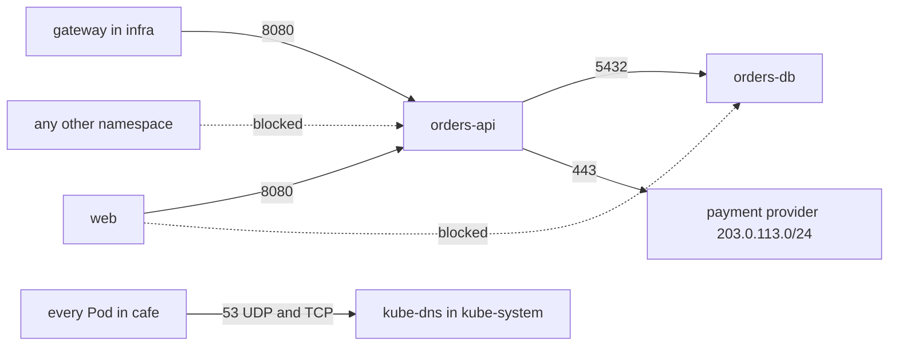

# NetworkPolicies, isolation and auditing

## In plain words

By default a Kubernetes cluster is one big open room. Every Pod can open a connection to every other Pod, in any namespace, on any port. That makes getting started easy, and it means that an attacker who compromises one unimportant container, say a marketing banner service, can walk straight to the payments database and start knocking.

A **NetworkPolicy** is a firewall rule for Pods. It says which Pods may receive connections from where, and which Pods may open connections to where. With policies in place, the open room becomes a building with internal doors: each service can reach only the handful of others it has a reason to talk to.

Think of a hospital. Visitors can enter the lobby and the wards they are visiting. They cannot wander into the pharmacy, the operating theatres or the records room, even though all of those are in the same building. Staff badges open specific doors. If someone does get into a ward they should not be in, they are still far from the pharmacy. Security people call this limiting **lateral movement**: movement sideways from the first foothold to something valuable.

This lesson also completes the security module with the wider practices that surround a cluster: isolating workloads on nodes, managing identity, and auditing and monitoring so that you notice an intrusion.

Why this matters for a job: "default deny" network policies are a baseline expectation in security reviews and compliance frameworks, and writing a correct NetworkPolicy, including the classic mistake of blocking DNS, is a common practical interview task and a CKA exam topic.

> **Before this lesson:** you need labels and selectors ([The declarative model](#/lesson/kubernetes/declarative-reconciliation)), namespaces ([Namespaces](#/lesson/kubernetes/namespaces)), the Pod network and DNS ([The packet path](#/lesson/kubernetes/packet-path-troubleshooting), [Cluster DNS](#/lesson/kubernetes/service-registration-dns)) and the threat modelling lessons ([I](#/lesson/kubernetes/threat-model-identity-integrity), [II](#/lesson/kubernetes/threat-model-disclosure-dos-privilege)).

## How NetworkPolicies work

Four rules explain nearly all NetworkPolicy behaviour. Learn these and the YAML follows.

**Rule 1: the default is allow.** A Pod that no NetworkPolicy selects accepts all incoming connections and may make all outgoing connections.

**Rule 2: selecting a Pod isolates it.** As soon as at least one policy selects a Pod for a direction (ingress or egress), that Pod becomes **isolated** in that direction: everything is denied *except* what policies explicitly allow.

**Rule 3: policies are additive.** If several policies select the same Pod, the allowed traffic is the union of all their rules. There are **no deny rules** and no ordering; one policy cannot take away what another grants.

**Rule 4: both ends must agree.** A connection from Pod A to Pod B is allowed only if A's egress rules permit it (or A is not isolated for egress) **and** B's ingress rules permit it (or B is not isolated for ingress).

Two more facts round this out. Policies are **stateful**: allowing a connection allows its replies, so you write rules for who may *start* a connection, not for return traffic. And policies work at the level of IP addresses and ports (layers 3 and 4); the standard API cannot filter by URL path or host name.

> [!WARNING]
> NetworkPolicies are enforced by the **CNI plug-in**, not by Kubernetes itself. If the cluster's network plug-in does not support them, the API server still accepts your policy objects and **nothing happens**: every connection is still allowed. Calico, Cilium, Antrea and the managed clouds' policy-enabled data planes enforce them; some simple plug-ins do not. Always test that a policy blocks something before relying on it.

## A NetworkPolicy, line by line

```yaml
apiVersion: networking.k8s.io/v1
kind: NetworkPolicy
metadata:
  name: orders-db-ingress
  namespace: cafe
spec:
  podSelector:
    matchLabels:
      app: orders-db
  policyTypes:
    - Ingress
  ingress:
    - from:
        - podSelector:
            matchLabels:
              app: orders-api
      ports:
        - protocol: TCP
          port: 5432
```

- `apiVersion: networking.k8s.io/v1`, `kind: NetworkPolicy` — namespaced.
- `spec.podSelector` — **which Pods this policy applies to**: Pods in the policy's own namespace with the label `app: orders-db`. An empty selector, `{}`, means every Pod in the namespace.
- `policyTypes: [Ingress]` — this policy governs incoming connections to the selected Pods. Outgoing connections from them are not affected by it.
- `ingress` — a list of allow rules. Each rule has `from` (who) and `ports` (which ports).
  - `from` contains one entry: a `podSelector` matching Pods labelled `app: orders-api`. A bare `podSelector` here means Pods **in the same namespace as the policy**.
  - `ports` allows TCP port 5432 only.

In words: *the database Pods accept connections only from `orders-api` Pods in `cafe`, and only on port 5432. Everything else is refused.*

```bash
$ kubectl apply -f orders-db-ingress.yaml
networkpolicy.networking.k8s.io/orders-db-ingress created

$ kubectl exec -n cafe deploy/orders-api -- nc -zv -w 3 orders-db 5432
orders-db (10.96.40.12:5432) open

$ kubectl exec -n cafe deploy/web -- nc -zv -w 3 orders-db 5432
nc: orders-db (10.96.40.12:5432): Operation timed out
command terminated with exit code 1
```

`nc -zv -w 3 HOST PORT` tries to open a TCP connection with a three second timeout and reports the result. From `orders-api` it opens. From `web` it **times out**: blocked traffic is dropped silently, which is why a NetworkPolicy block looks like a timeout, not like "connection refused". That distinction, from the [packet path lesson](#/lesson/kubernetes/packet-path-troubleshooting), is how you recognise a policy at work.

## The three kinds of peer

A `from` (or, for egress, `to`) entry can select peers in three ways.

| Selector | Selects |
|---|---|
| `podSelector` | Pods with these labels, in the **policy's own namespace** |
| `namespaceSelector` | **All Pods** in namespaces with these labels |
| `podSelector` **and** `namespaceSelector` in the same entry | Pods with these labels in namespaces with those labels |
| `ipBlock` | A range of IP addresses, with optional exceptions; for addresses outside the cluster |

### The most important YAML detail in this lesson

Whether two selectors are combined with AND or with OR depends on one hyphen.

```yaml
# A: ONE entry with two selectors -> AND
ingress:
  - from:
      - namespaceSelector:
          matchLabels:
            team: storefront
        podSelector:
          matchLabels:
            app: web
```

```yaml
# B: TWO entries -> OR
ingress:
  - from:
      - namespaceSelector:
          matchLabels:
            team: storefront
      - podSelector:
          matchLabels:
            app: web
```

In version A, `namespaceSelector` and `podSelector` are fields of the **same list item**, so both must hold: Pods labelled `app: web` *in* namespaces labelled `team: storefront`.

In version B, the extra `-` makes them **separate list items**, which are alternatives: *any* Pod in a `team: storefront` namespace, **or** any Pod labelled `app: web` in the policy's own namespace. Version B is far more permissive, and the two differ by a single character. Review NetworkPolicy changes with this in mind.

Namespaces are selected by label. Every namespace automatically carries the label `kubernetes.io/metadata.name` with its own name, which lets you select a namespace by name without adding labels yourself:

```yaml
      - namespaceSelector:
          matchLabels:
            kubernetes.io/metadata.name: monitoring
```

## Default deny: the starting point

The recommended design is **default deny**: block everything in a namespace, then add back the specific connections each workload needs. This is an **allow-list** approach, and it means a new, unreviewed connection path is closed until someone opens it deliberately.

```yaml
apiVersion: networking.k8s.io/v1
kind: NetworkPolicy
metadata:
  name: default-deny-all
  namespace: cafe
spec:
  podSelector: {}
  policyTypes:
    - Ingress
    - Egress
```

- `podSelector: {}` selects every Pod in the namespace.
- Both policy types are listed.
- There are no `ingress` or `egress` rules at all, so nothing is allowed.

Every Pod in `cafe` is now isolated in both directions. And at once, everything breaks, including things you did not think of as "network traffic":

```bash
$ kubectl exec -n cafe deploy/web -- wget -qO- -T 3 http://menu-api/menu
wget: bad address 'menu-api'
```

The error is `bad address`: a **name resolution** failure. Egress is denied, so the Pod cannot reach the cluster DNS server. This is the classic default-deny mistake. DNS must be allowed explicitly:

```yaml
apiVersion: networking.k8s.io/v1
kind: NetworkPolicy
metadata:
  name: allow-dns
  namespace: cafe
spec:
  podSelector: {}
  policyTypes:
    - Egress
  egress:
    - to:
        - namespaceSelector:
            matchLabels:
              kubernetes.io/metadata.name: kube-system
          podSelector:
            matchLabels:
              k8s-app: kube-dns
      ports:
        - protocol: UDP
          port: 53
        - protocol: TCP
          port: 53
```

Every Pod in `cafe` may connect to the DNS Pods (label `k8s-app: kube-dns`) in `kube-system`, on port 53 for both UDP and TCP. Note the AND form: one `to` entry with both selectors. DNS mostly uses UDP, falling back to TCP for large answers, so allow both.

Now add the application's real flows, one policy per workload:

```yaml
apiVersion: networking.k8s.io/v1
kind: NetworkPolicy
metadata:
  name: orders-api
  namespace: cafe
spec:
  podSelector:
    matchLabels:
      app: orders-api
  policyTypes:
    - Ingress
    - Egress
  ingress:
    - from:
        - podSelector:
            matchLabels:
              app: web
        - namespaceSelector:
            matchLabels:
              kubernetes.io/metadata.name: infra
          podSelector:
            matchLabels:
              app.kubernetes.io/name: gateway
      ports:
        - port: 8080
  egress:
    - to:
        - podSelector:
            matchLabels:
              app: orders-db
      ports:
        - port: 5432
    - to:
        - ipBlock:
            cidr: 203.0.113.0/24
      ports:
        - port: 443
```

Reading it as sentences. *Ingress*: `orders-api` accepts connections on port 8080 from `web` Pods in this namespace, or from the gateway Pods in the `infra` namespace. *Egress*: `orders-api` may connect to `orders-db` on 5432, and to the payment provider's address range on 443. Together with the DNS policy, that is everything it can do on the network. `protocol` defaults to TCP when omitted.

The `port` in a NetworkPolicy is the **Pod's port** (the `targetPort`), not the Service's port. Policies are evaluated after the Service address has been translated to a Pod address, so a rule for a Service that maps port 80 to 8080 must name 8080.



## An evaluator you can run

The program below implements the four rules. Given Pods, namespace labels and policies, it decides whether a connection is allowed, and reports which side blocked it.

```python-run
namespaces = {"cafe": {"kubernetes.io/metadata.name": "cafe"},
              "infra": {"kubernetes.io/metadata.name": "infra"},
              "kube-system": {"kubernetes.io/metadata.name": "kube-system"},
              "marketing": {"kubernetes.io/metadata.name": "marketing"}}
pods = {"web": ("cafe", {"app": "web"}), "orders-api": ("cafe", {"app": "orders-api"}),
        "orders-db": ("cafe", {"app": "orders-db"}), "gateway": ("infra", {"app": "gateway"}),
        "coredns": ("kube-system", {"k8s-app": "kube-dns"}), "banner": ("marketing", {"app": "banner"})}

def sel(selector, labels):                      # empty selector matches everything
    return all(labels.get(k) == v for k, v in selector.items())

policies = [
    {"ns": "cafe", "pods": {}, "types": ["Ingress", "Egress"], "ingress": [], "egress": []},      # default deny
    {"ns": "cafe", "pods": {}, "types": ["Egress"],
     "egress": [{"peers": [{"ns_sel": {"kubernetes.io/metadata.name": "kube-system"}, "pod_sel": {"k8s-app": "kube-dns"}}],
                 "ports": [53]}]},
    {"ns": "cafe", "pods": {"app": "orders-api"}, "types": ["Ingress", "Egress"],
     "ingress": [{"peers": [{"pod_sel": {"app": "web"}},
                            {"ns_sel": {"kubernetes.io/metadata.name": "infra"}, "pod_sel": {"app": "gateway"}}],
                  "ports": [8080]}],
     "egress": [{"peers": [{"pod_sel": {"app": "orders-db"}}], "ports": [5432]}]},
    {"ns": "cafe", "pods": {"app": "orders-db"}, "types": ["Ingress"],
     "ingress": [{"peers": [{"pod_sel": {"app": "orders-api"}}], "ports": [5432]}]},
    {"ns": "cafe", "pods": {"app": "web"}, "types": ["Egress"],
     "egress": [{"peers": [{"pod_sel": {"app": "orders-api"}}], "ports": [8080]}]},
]

def peer_matches(peer, policy_ns, other):
    other_ns, other_labels = pods[other]
    if "ns_sel" in peer:
        if not sel(peer["ns_sel"], namespaces[other_ns]):
            return False
    elif other_ns != policy_ns:                 # a bare podSelector means the policy's own namespace
        return False
    return sel(peer.get("pod_sel", {}), other_labels)

def direction_allows(pod, other, port, direction):
    ns, labels = pods[pod]
    selecting = [p for p in policies if p["ns"] == ns and sel(p["pods"], labels) and direction in p["types"]]
    if not selecting:
        return True                             # not isolated in this direction
    key = "ingress" if direction == "Ingress" else "egress"
    return any(port in rule["ports"] and any(peer_matches(peer, p["ns"], other) for peer in rule["peers"])
               for p in selecting for rule in p.get(key, []))

def connect(src, dst, port):
    out = direction_allows(src, dst, port, "Egress")
    inn = direction_allows(dst, src, port, "Ingress")
    if out and inn:
        return "ALLOWED"
    blocked = [side for side, ok in ((f"egress of {src}", out), (f"ingress of {dst}", inn)) if not ok]
    return "BLOCKED by " + " and ".join(blocked)

for src, dst, port in [("web", "orders-api", 8080), ("orders-api", "orders-db", 5432), ("web", "orders-db", 5432),
                       ("gateway", "orders-api", 8080), ("banner", "orders-api", 8080), ("web", "coredns", 53),
                       ("orders-api", "web", 8080), ("banner", "gateway", 443), ("gateway", "web", 8080)]:
    print(f"{src:10} -> {dst:10}:{port:<5} {connect(src, dst, port)}")
```

Study three lines of the output. `web -> orders-db` is blocked at both ends: `web` has no egress rule for it and the database has no ingress rule for `web`. `banner -> gateway` is allowed, because neither Pod is selected by any policy: the `marketing` and `infra` namespaces are still wide open. And `gateway -> web` is blocked at `web`'s ingress, which reveals a gap in the design: the default-deny policy isolated `web` for ingress and nobody wrote a rule letting the gateway reach it. That is the kind of error this approach surfaces, and why policies must be tested.

## Checking and debugging policies

```bash
$ kubectl get networkpolicy -n cafe
NAME                POD-SELECTOR     AGE
allow-dns           <none>           3d
default-deny-all    <none>           3d
orders-api          app=orders-api   3d
orders-db-ingress   app=orders-db    3d

$ kubectl describe networkpolicy orders-db-ingress -n cafe
Name:         orders-db-ingress
Namespace:    cafe
Spec:
  PodSelector:     app=orders-db
  Allowing ingress traffic:
    To Port: 5432/TCP
    From:
      PodSelector: app=orders-api
  Not affecting egress traffic
  Policy Types: Ingress
```

`<none>` in the selector column means an empty selector, that is, all Pods. `describe` rewrites a policy as sentences, which is the fastest way to check that the YAML says what you meant: "Not affecting egress traffic" confirms this policy has no say over outgoing connections.

When a connection fails after policies are introduced:

1. Is it a **timeout**? That suggests a policy. "Refused" or "bad address" suggests something else, although "bad address" is often blocked DNS.
2. Which policies select the **source** for egress? Do any allow this destination and port?
3. Which policies select the **destination** for ingress? Do any allow this source and port?
4. Do the labels in the policy match the real labels on Pods and namespaces? `kubectl get pods --show-labels` and `kubectl get ns --show-labels`.
5. Is the port the Pod's port, not the Service's?
6. Does the CNI plug-in offer visibility? Cilium's Hubble and Calico's flow logs show dropped connections with the reason.

## Limits of the standard API, and what extends it

The built-in NetworkPolicy has gaps:

- no explicit **deny** rules and no priorities,
- no **cluster-wide** policies; each is per namespace, so a namespace owner can write a permissive one,
- no rules by **DNS name** (for example "allow egress to `api.stripe.com`"),
- no **layer 7** rules (HTTP method or path),
- no built-in logging of what was dropped.

Two things fill them. **AdminNetworkPolicy** and **BaselineAdminNetworkPolicy** are newer, cluster-scoped Kubernetes APIs intended for platform administrators: they are evaluated before namespace policies, have priorities, and support explicit `Deny`, `Allow` and `Pass` actions, so an administrator can set guardrails that namespace owners cannot override. And CNI plug-ins have their own richer policy kinds, such as `CiliumNetworkPolicy` and Calico's `GlobalNetworkPolicy`, which add DNS-name and HTTP-level rules at the cost of portability.

Policies also do not encrypt anything. They decide who may connect, not who can read traffic on the wire. Encryption between Pods comes from a service mesh's mutual TLS or from the CNI plug-in's transparent encryption (WireGuard or IPsec).

## Isolating workloads on nodes

Network isolation is one layer. Workloads also share nodes, and a container escape, as discussed in the [previous lesson](#/lesson/kubernetes/threat-model-disclosure-dos-privilege), exposes everything else on the same node. Options, from light to heavy:

| Technique | Isolation gained |
|---|---|
| Namespaces with RBAC, quotas, policies, Pod Security | Organisational separation for trusted teams |
| Dedicated node pools with taints and tolerations | Sensitive workloads do not share a kernel with others |
| Sandboxed runtimes (gVisor, Kata) through RuntimeClass | A stronger barrier between container and host |
| Separate clusters | No shared control plane or nodes at all |

A typical pattern is a dedicated node pool for workloads that handle payment data: nodes are tainted so that nothing else is scheduled there, and the sensitive Pods carry the matching toleration and a node selector. The [scheduling controls lesson](#/lesson/kubernetes/scheduling-controls) shows the mechanics. Keep the nodes themselves boring: a minimal operating system, automatic patching by replacement, no SSH in normal operation, private IP addresses only.

## Identity and access in practice

Pulling together the identity threads from this and earlier modules into a checklist a real organisation would follow:

- **People** authenticate through the company identity provider with multi-factor authentication; access is granted to groups; there are no shared accounts.
- **Privileged access is temporary.** Routine work uses a read-mostly role; elevated rights are requested for a limited time and logged (often called time-limited or "break glass" access).
- **Pipelines** have their own identities with deploy rights to specific namespaces, using short-lived tokens obtained through OIDC federation, not stored long-lived secrets.
- **Workloads** have one ServiceAccount each, no token unless needed, and reach cloud services through workload identity.
- **Reviews** of ClusterRoleBindings and of who can read Secrets or create Pods happen on a schedule.
- **Leavers** lose access at the identity provider, which is only effective if no long-lived certificates or tokens were handed out.

## Auditing and monitoring: noticing the intrusion

Prevention eventually fails somewhere. Detection decides whether you find out in minutes or in months. Four sources of evidence should flow to a central system outside the cluster:

| Source | Tells you | Examples of what to alert on |
|---|---|---|
| API server audit log | Who did what through the API | `exec` into production Pods; Secrets read by an unusual identity; a new ClusterRoleBinding to `cluster-admin`; anonymous requests that succeed |
| Runtime detection (Falco, Tetragon) | What processes do inside containers | A shell in a production container; a package manager run; writes under `/etc`; an outbound connection to an unknown address |
| Network flow logs | Who connected to whom, and what was dropped | A Pod scanning many addresses; traffic to the metadata address; repeated policy drops from one Pod |
| Cloud audit log | Changes to the cluster and account from outside | A node pool changed; firewall rules opened; a new access key created |

A system that collects and correlates such events is called a **SIEM** (security information and event management). The collection pipeline itself is covered in the [metrics and logging lesson](#/lesson/kubernetes/metrics-logging).

Three habits make this useful instead of noise. Alert on a small number of high-signal events first. Decide in advance what happens when an alert fires, in a short written procedure, because the middle of an incident is a poor time to invent one. And test it: perform a harmless version of the suspicious action, such as an `exec` into a test Pod in production, and confirm that the alert arrives.

### If a Pod is compromised

A short procedure worth memorising, because it reuses tools from this track:

1. **Isolate, do not delete.** Deleting the Pod destroys the evidence and the controller recreates it from the same vulnerable image. Instead, relabel the Pod so its Service and controller release it, and apply a NetworkPolicy that denies it all traffic.
2. **Cordon the node** so nothing new lands next to it.
3. **Capture evidence**: logs, the Pod's specification, and if your tooling allows, a snapshot of the container's filesystem.
4. **Revoke what it could reach**: rotate the Secrets it mounted and review what its ServiceAccount could do.
5. **Find the entry point** from the audit and runtime logs, fix it, and rebuild.

> [!TIP]
> Start with ingress policies around your most valuable workloads, typically databases, before attempting namespace-wide default deny. "Only `orders-api` may reach `orders-db`" is one small policy that blocks the most damaging lateral movement and cannot break DNS, because it does not touch egress.

> [!INTERVIEW]
> **"How do NetworkPolicies work, and how would you lock down a namespace?"** By default all Pods can talk to all Pods. A NetworkPolicy selects Pods with `podSelector` and lists allowed ingress and/or egress peers (by `podSelector`, `namespaceSelector`, both combined, or `ipBlock`) and ports. A Pod selected by any policy for a direction is isolated in that direction and may only use what policies allow; policies are additive with no deny rules; a connection needs the source's egress and the destination's ingress to both allow it; reply traffic is implicit. Enforcement is by the CNI plug-in, so it must support policies. To lock down a namespace: a default-deny policy with an empty `podSelector` for both directions, an explicit egress allowance for DNS to kube-dns on UDP and TCP 53, then one allow policy per workload for its real flows, using the Pod's ports. Mention the AND versus OR distinction between one `from` entry with two selectors and two entries, and that policies do not encrypt traffic.

## Common pitfalls

- **Policies with a CNI plug-in that does not enforce them.** Accepted and ignored.
- **Default-deny egress without allowing DNS.** Every name lookup fails.
- **The stray hyphen** that turns AND into OR.
- **Using the Service port instead of the Pod port.**
- **A bare `podSelector` when the peer is in another namespace.** It only matches the policy's own namespace.
- **Forgetting ingress controllers, monitoring scrapers and health checkers.** They are clients too; node-originated health probes are generally permitted, but a Prometheus Pod is not unless allowed.
- **Assuming policies encrypt traffic.**
- **Isolating one namespace and leaving the rest open.**
- **Deleting a compromised Pod immediately.** Evidence is lost and the same image comes back.
- **Collecting logs and never alerting on them.**

## Cheat sheet

| Pattern | Key lines |
|---|---|
| Select all Pods in the namespace | `podSelector: {}` |
| Deny all ingress | `policyTypes: [Ingress]`, no `ingress` rules |
| Deny all egress | `policyTypes: [Egress]`, no `egress` rules |
| Allow from same-namespace Pods | `from: [{podSelector: {matchLabels: {...}}}]` |
| Allow from a namespace by name | `namespaceSelector: {matchLabels: {kubernetes.io/metadata.name: NS}}` |
| Pods AND namespace | Both selectors in one list item |
| Pods OR namespace | Two list items |
| Allow DNS | Egress to `k8s-app: kube-dns` in `kube-system`, UDP and TCP 53 |
| External addresses | `ipBlock: {cidr: ..., except: [...]}` |

| Rule | Statement |
|---|---|
| Default | Unselected Pods allow everything |
| Isolation | A selected Pod allows only what policies permit, in that direction |
| Additive | Union of all matching policies; no deny |
| Both ends | Source egress and destination ingress must both allow |

## Summary

Clusters start with every Pod able to reach every other Pod. NetworkPolicies, enforced by the CNI plug-in, change that: a policy selects Pods and lists the peers and ports they may accept from or connect to, and any Pod selected for a direction is denied everything else in that direction. Policies add up, cannot deny, and require both the sender's egress and the receiver's ingress to agree. The standard design is default deny per namespace, an explicit allowance for DNS, and a small allow policy per workload. Network rules are one layer of isolation alongside dedicated nodes, sandboxed runtimes and separate clusters, and all of it is backed by well-managed identities and by audit, runtime and network logs that are collected off the cluster, alerted on and rehearsed. That concludes the security material drawn from the book. The remaining modules extend the track into the workload types, tooling and operational skills that complete a working knowledge of Kubernetes.

## Glossary

- **NetworkPolicy**: a namespaced object that controls which connections selected Pods may accept or make.
- **Ingress / egress (policy)**: incoming connections to, and outgoing connections from, the selected Pods.
- **Isolated Pod**: a Pod selected by at least one policy for a direction, and therefore denied by default in it.
- **Default deny**: a policy selecting all Pods with no allow rules.
- **Allow-list**: permitting only what is explicitly listed.
- **Lateral movement**: an attacker moving from a first foothold to other systems.
- **Peer**: the other end of a connection, selected by Pod labels, namespace labels or IP range.
- **ipBlock**: a peer defined as an address range in CIDR notation.
- **Stateful**: replies to an allowed connection are allowed automatically.
- **AdminNetworkPolicy**: a cluster-scoped policy API with priorities and explicit deny.
- **Node pool**: a group of nodes with shared configuration, often dedicated to certain workloads.
- **Time-limited access**: elevated permissions granted temporarily on request.
- **Flow log**: a record of network connections, allowed and dropped.
- **SIEM**: a system that collects and correlates security events.
- **Runtime detection**: observing process behaviour in containers to spot attacks.

```quiz
[
  {"q": "A namespace has no NetworkPolicies. A Pod in another namespace connects to a database Pod in it. What happens?",
   "options": ["Blocked, namespaces isolate traffic", "Allowed, because unselected Pods accept all connections", "Blocked unless a Service exists", "Allowed only on port 80"],
   "answer": 1,
   "explain": "The default is allow. A Pod becomes isolated only when at least one policy selects it."},
  {"q": "You apply a default-deny policy for Ingress and Egress to a namespace. Applications now fail with 'bad address' when calling each other by name. What did you forget?",
   "options": ["To restart CoreDNS", "An egress rule allowing DNS to the kube-dns Pods on UDP and TCP port 53", "To create Services", "To label the nodes"],
   "answer": 1,
   "explain": "Name lookups are network traffic to cluster DNS. Deny-all egress blocks them until DNS is explicitly allowed."},
  {"q": "Under ingress.from, one list item contains both a namespaceSelector (team: storefront) and a podSelector (app: web). What does it allow?",
   "options": ["Any Pod in storefront namespaces, or any web Pod in the policy's namespace", "Only Pods labelled app: web that are in namespaces labelled team: storefront", "All Pods everywhere", "Nothing; the combination is invalid"],
   "answer": 1,
   "explain": "Two selectors in the same list item are combined with AND. Writing them as two separate items would mean OR."},
  {"q": "Policy A allows ingress to orders-db from orders-api. Policy B, also selecting orders-db, allows ingress from a backup Pod. Which sources can connect?",
   "options": ["Only orders-api, the first policy wins", "Only the backup Pod, the last policy wins", "Both, because policies are additive", "Neither, the policies conflict"],
   "answer": 2,
   "explain": "The allowed traffic is the union of all policies selecting the Pod. There is no ordering and no deny rule."},
  {"q": "Pod A has an egress policy allowing traffic to Pod B on port 8080. Pod B is selected by an ingress policy that does not list Pod A. What happens when A connects to B?",
   "options": ["Allowed, A's egress permits it", "Blocked, because B's ingress must also allow it", "Allowed for the first packet only", "Allowed if a Service exists"],
   "answer": 1,
   "explain": "A connection needs the source's egress and the destination's ingress to both allow it."},
  {"q": "A Service maps port 80 to targetPort 8080. Which port should a NetworkPolicy allowing traffic to its Pods name?",
   "options": ["80", "8080", "Both are required", "The NodePort"],
   "answer": 1,
   "explain": "Policies apply to Pod IPs and ports after the Service translation, so the Pod's port is the one that matters."},
  {"q": "You create a NetworkPolicy that should block everything, yet all connections still succeed. Labels and namespaces are correct. What is the most likely explanation?",
   "options": ["Policies take an hour to apply", "The cluster's CNI plug-in does not enforce NetworkPolicies", "kube-proxy overrides policies", "Policies only work with Ingress controllers"],
   "answer": 1,
   "explain": "Kubernetes stores the object, but enforcement is the network plug-in's job. A plug-in without policy support ignores it silently."},
  {"q": "A Pod in production appears to be compromised. Why is deleting it immediately a poor first step?",
   "options": ["Deletion is not permitted in production", "It destroys evidence, and its controller starts a new Pod from the same vulnerable image", "It disables audit logging", "It deletes the Secret it used"],
   "answer": 1,
   "explain": "Isolate the Pod by relabelling it and denying its traffic, capture evidence, rotate what it could access, then fix the cause."}
]
```

> **Source:** Poulton, *The Kubernetes Book*, ch. 16 (topic coverage only). Official docs: https://kubernetes.io/docs/concepts/services-networking/network-policies/ , https://kubernetes.io/docs/tasks/administer-cluster/declare-network-policy/ , https://network-policy-api.sigs.k8s.io/ , https://kubernetes.io/docs/concepts/security/security-checklist/ , https://kubernetes.io/docs/tasks/debug/debug-cluster/audit/
