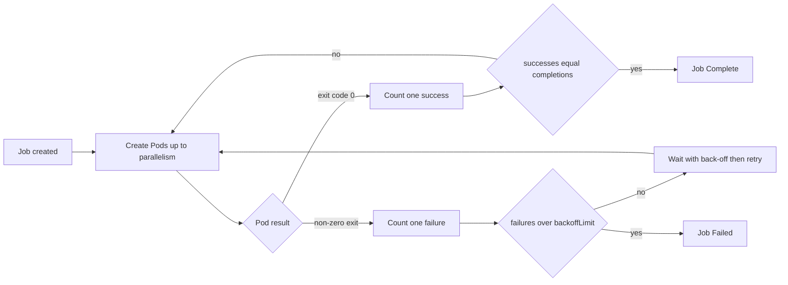

# DaemonSets, Jobs and CronJobs

## In plain words

So far every workload in this track has been a server: a program that starts, stays up and answers requests for as long as you let it. Deployments and StatefulSets exist to keep such programs running. Two other shapes of work are common, and they need different controllers.

The first shape is **one helper per machine**. Think of a block of flats where the rule is "one fire extinguisher on every floor". Nobody asks for "six extinguishers"; the count follows from the number of floors. Add a floor and it gets one. In a cluster, the helpers are things like log collectors and network agents, and the controller that places one on every node is the **DaemonSet**.

The second shape is **an errand that ends**. Posting a parcel is finished once the parcel is posted. Nobody wants the errand restarted the moment it succeeds, which is what a Deployment would do with a program that exits. The controller for work that runs to completion is the **Job**. An errand on a timetable, such as taking the bins out every Thursday night, is a **CronJob**: a recurring calendar entry that creates a fresh Job each time it fires.

Why this matters for a job: nearly every production cluster runs several DaemonSets (logging, monitoring, networking, storage), and nearly every team has batch work: database migrations, nightly reports, data imports, model training. Interviewers like the question "which controller would you use for X, and why?", and the answer for anything that is not a long-running server is in this lesson.

> **Before this lesson:** you need Pods and restart policies ([Lifecycle, restart policies, probes, requests and limits](#/lesson/kubernetes/pod-lifecycle-resources)), controllers and label selectors ([The declarative model and reconciliation loops](#/lesson/kubernetes/declarative-reconciliation)) and Deployments ([Deployments, ReplicaSets, self-healing and scaling](#/lesson/kubernetes/deployments-replicasets)).

## Five controllers, five shapes of work

A **controller** is a program in the control plane that watches objects of one kind and creates, changes or deletes other objects until reality matches what you declared. Each workload controller answers the question "how many Pods, and for how long?" differently.

| Controller | How many Pods | How long they run | Typical use |
|---|---|---|---|
| Deployment | The number in `replicas` | Until you delete them | Stateless web services and APIs |
| StatefulSet | The number in `replicas`, each with a fixed name | Until you delete them | Databases, message brokers |
| DaemonSet | One per eligible node | As long as the node exists | Node agents |
| Job | Enough to reach a number of successful finishes | Until the work is done | Migrations, imports, training runs |
| CronJob | One Job per scheduled time | Each Job until done | Reports, backups, clean-ups |

## DaemonSets

### What a DaemonSet does

A **daemon** is an old Unix word for a background program that serves the machine it runs on. A DaemonSet makes sure a copy of one Pod runs on every node that qualifies. When a node joins the cluster, the DaemonSet controller creates a Pod for it. When a node is removed, its Pod is cleaned up. There is no `replicas` field at all.

Typical DaemonSets:

- **Log collectors** that read every container's log files from the node's disk and ship them elsewhere.
- **Metrics agents** such as node-exporter, which report the node's CPU, memory and disk figures.
- **Network plug-ins** and **kube-proxy**, which program packet-handling rules on each node.
- **Storage drivers**, which mount volumes on the node where a Pod needs them.
- **Security agents** that watch system calls on the node.

All of them share one property: the work is tied to the machine, so running three copies somewhere in the cluster would not do the task.

### A DaemonSet manifest, line by line

```yaml
apiVersion: apps/v1
kind: DaemonSet
metadata:
  name: log-agent
  namespace: logging
spec:
  selector:
    matchLabels:
      app: log-agent
  updateStrategy:
    type: RollingUpdate
    rollingUpdate:
      maxUnavailable: 1
  template:
    metadata:
      labels:
        app: log-agent
    spec:
      tolerations:
        - key: node-role.kubernetes.io/control-plane
          operator: Exists
          effect: NoSchedule
      containers:
        - name: agent
          image: cr.fluentbit.io/fluent/fluent-bit:3.2
          resources:
            requests:
              cpu: 50m
              memory: 64Mi
            limits:
              memory: 128Mi
          volumeMounts:
            - name: varlog
              mountPath: /var/log
              readOnly: true
      volumes:
        - name: varlog
          hostPath:
            path: /var/log
```

- `apiVersion: apps/v1`, `kind: DaemonSet` — the same API group as Deployments.
- `spec.selector` — how the DaemonSet recognises its own Pods. It must match the labels in `template.metadata.labels`, exactly as in a Deployment.
- There is **no `replicas`** line. The count is the number of eligible nodes.
- `updateStrategy` — how a change to the template is rolled out. `RollingUpdate` with `maxUnavailable: 1` replaces the Pod on one node at a time. The other type, `OnDelete`, changes nothing until you delete a Pod by hand, which some teams use for network plug-ins where each node must be handled with care.
- `template` — an ordinary Pod template.
- `tolerations` — a **taint** is a mark on a node that repels Pods, and a **toleration** is a Pod's permission to ignore a particular taint (both are taught fully in [Steering the scheduler](#/lesson/kubernetes/scheduling-controls)). Control-plane nodes usually carry the taint `node-role.kubernetes.io/control-plane:NoSchedule`. Without this toleration the log agent would skip them, and their logs would never be collected.
- `resources` — a node agent's requests are subtracted from *every* node. 50 millicores across 200 nodes is 10 whole CPUs. Keep them small and honest.
- `volumes` with `hostPath` — mounts the node's own `/var/log` directory into the container. A **hostPath volume** exposes part of the node's filesystem to a Pod. It is a security risk in general and is acceptable here because reading node files is the agent's purpose; `readOnly: true` limits the damage.

```bash
$ kubectl get daemonset -n logging
NAME        DESIRED   CURRENT   READY   UP-TO-DATE   AVAILABLE   NODE SELECTOR   AGE
log-agent   5         5         5       5            5           <none>          3d

$ kubectl get pods -n logging -o wide
NAME              READY   STATUS    RESTARTS   AGE   IP            NODE
log-agent-4xk2p   1/1     Running   0          3d    10.244.1.7    worker-1
log-agent-9hbtz   1/1     Running   0          3d    10.244.2.4    worker-2
log-agent-jq7ws   1/1     Running   0          3d    10.244.3.9    worker-3
log-agent-m2c5d   1/1     Running   0          3d    10.244.4.3    worker-4
log-agent-zr8vn   1/1     Running   0          3d    10.244.0.12   cp-1
```

`DESIRED` is the number of eligible nodes, which Kubernetes worked out for you. The `NODE` column shows one Pod on each of the five nodes, including the control-plane node `cp-1`.

### How the Pods reach their nodes

The DaemonSet controller does not place Pods itself. For each eligible node it creates a Pod whose specification contains a **node affinity** rule (a requirement about which node may host the Pod) naming that one node. The normal scheduler then binds it. The controller also adds several tolerations automatically, so that node agents survive conditions that would push ordinary Pods away:

| Automatically tolerated taint | Meaning |
|---|---|
| `node.kubernetes.io/not-ready` and `node.kubernetes.io/unreachable` | The node is unhealthy; the agent stays instead of being evicted |
| `node.kubernetes.io/disk-pressure`, `memory-pressure`, `pid-pressure` | The node is short of a resource |
| `node.kubernetes.io/unschedulable` | The node was cordoned, meaning marked as closed to new Pods |

The last row has a practical consequence: `kubectl cordon` does not stop DaemonSet Pods, and `kubectl drain` needs the flag `--ignore-daemonsets` because it cannot move them anywhere.

### Running on some nodes only

Add a `nodeSelector` (or node affinity) to the Pod template and the DaemonSet covers only matching nodes. A GPU driver installer, for example, belongs only on nodes that have GPUs:

```yaml
    spec:
      nodeSelector:
        accelerator: nvidia
```

Label a node with `accelerator=nvidia` and a Pod appears on it within seconds; remove the label and the Pod is deleted.

### A DaemonSet you can run

The simulation follows the controller's rule: one Pod per eligible node, nothing elsewhere. Nodes join, leave and change labels, and each reconciliation fixes the difference.

```python-run
nodes = {"worker-1": {"labels": {}, "taints": []},
         "worker-2": {"labels": {}, "taints": []},
         "cp-1": {"labels": {}, "taints": ["control-plane"]}}
pods = {}                                  # node name -> pod name
tolerated = {"control-plane"}              # taints the Pod template tolerates
node_selector = {}                         # labels a node must have
counter = 0

def eligible(node):
    info = nodes[node]
    has_labels = all(info["labels"].get(k) == v for k, v in node_selector.items())
    taints_ok = all(t in tolerated for t in info["taints"])
    return has_labels and taints_ok

def reconcile(event):
    global counter
    actions = []
    for node in sorted(nodes):
        if eligible(node) and node not in pods:
            counter += 1
            pods[node] = f"log-agent-{counter}"
            actions.append(f"create {pods[node]} on {node}")
    for node in sorted(pods):
        if node not in nodes or not eligible(node):
            actions.append(f"delete {pods.pop(node)} from {node}")
    print(f"{event:34} -> {', '.join(actions) or 'nothing to do'}   (desired={len(pods)})")

reconcile("DaemonSet created")
nodes["worker-3"] = {"labels": {}, "taints": []}
reconcile("worker-3 joins the cluster")
del nodes["worker-1"]
reconcile("worker-1 is removed")
nodes["worker-2"]["taints"].append("gpu-only")
reconcile("worker-2 gets an untolerated taint")
tolerated.add("gpu-only")
reconcile("template now tolerates gpu-only")
```

Read the last column: the desired count moves with the nodes, and nobody typed a replica number. Try setting `node_selector = {"disk": "ssd"}` before the first call; nothing is created until a node carries that label.

## Jobs

### Run to completion

A **Job** creates one or more Pods and tracks them until a required number have **succeeded**, meaning every container exited with code 0. An **exit code** is the number a program hands back to the operating system when it ends: 0 means success, anything else means failure. When enough Pods have succeeded the Job is complete, and its Pods are not restarted.



### A Job manifest, line by line

```yaml
apiVersion: batch/v1
kind: Job
metadata:
  name: menu-import
  namespace: cafe
spec:
  completions: 1
  parallelism: 1
  backoffLimit: 4
  activeDeadlineSeconds: 600
  ttlSecondsAfterFinished: 3600
  template:
    spec:
      restartPolicy: Never
      containers:
        - name: import
          image: ghcr.io/harbour-coffee/menu-import:1.4.0
          args: ["--file", "menus/2026-11.csv"]
          resources:
            requests:
              cpu: 250m
              memory: 256Mi
            limits:
              memory: 256Mi
```

- `apiVersion: batch/v1` — Jobs and CronJobs live in the `batch` API group.
- `completions: 1` — the Job is done after one successful Pod. This is the default.
- `parallelism: 1` — at most one Pod runs at a time. Also the default.
- `backoffLimit: 4` — how many failures are tolerated before the whole Job is marked `Failed`. The default is 6. Between retries the controller waits with an exponential **back-off**: a delay that doubles each time (10 seconds, 20, 40 and so on, up to a cap of several minutes) so that a broken Job does not hammer the cluster.
- `activeDeadlineSeconds: 600` — a time limit for the whole Job, counted from its start. After ten minutes every running Pod is terminated and the Job fails with the reason `DeadlineExceeded`, regardless of `backoffLimit`.
- `ttlSecondsAfterFinished: 3600` — one hour after finishing (successfully or not), the Job and its Pods are deleted automatically. Without this, finished Jobs stay forever and clutter the namespace. TTL stands for "time to live".
- `template` — the Pod template. A Job needs no `selector`; the controller generates a unique label for you.
- `restartPolicy: Never` — a Job's Pods must use `Never` or `OnFailure`; the default `Always` is rejected because it contradicts "run to completion".

The two allowed restart policies behave differently on failure:

| `restartPolicy` | When the container fails | Evidence left behind |
|---|---|---|
| `Never` | The Pod is marked `Failed` and the Job controller creates a **new Pod** | One failed Pod per attempt, each with its logs |
| `OnFailure` | The kubelet restarts the container **inside the same Pod** | One Pod; earlier attempts are visible only through `kubectl logs --previous` |

`Never` is easier to debug. `OnFailure` avoids rescheduling, which helps when a Pod took a long time to place or to pull its image.

```bash
$ kubectl apply -f menu-import.yaml
job.batch/menu-import created

$ kubectl get jobs -n cafe
NAME          STATUS     COMPLETIONS   DURATION   AGE
menu-import   Complete   1/1           42s        2m

$ kubectl get pods -n cafe -l batch.kubernetes.io/job-name=menu-import
NAME                READY   STATUS      RESTARTS   AGE
menu-import-7d2kq   0/1     Completed   0          2m

$ kubectl logs -n cafe job/menu-import
imported 1840 rows in 39.6s
```

`COMPLETIONS 1/1` means one success out of one required. The Pod's status is `Completed` and `READY` is `0/1`: the container has exited, which for a Job is the goal. The label `batch.kubernetes.io/job-name` is added by the controller, and `kubectl logs job/NAME` picks one of the Job's Pods for you.

### Completions and parallelism

The two numbers combine into three patterns.

| Pattern | `completions` | `parallelism` | Behaviour |
|---|---|---|---|
| Single task | 1 | 1 | One Pod at a time until one succeeds |
| Fixed count | N | P | Up to P Pods at once until N have succeeded |
| Work queue | unset | P | P Pods pull tasks from a shared queue; when one succeeds and the rest exit, the Job is done |

In the fixed-count pattern each Pod is told nothing about *which* piece of work is its own. An **Indexed Job** fixes that. With `completionMode: Indexed`, each Pod receives a number from 0 to `completions - 1` in the environment variable `JOB_COMPLETION_INDEX`, and the Job completes when every index has succeeded once.

```yaml
spec:
  completions: 8
  parallelism: 4
  completionMode: Indexed
```

A program can use the index to pick its slice: "I am worker 3 of 8, so I process the files whose number leaves remainder 3 when divided by 8". This is the basis of distributed training and large data-processing runs on Kubernetes.

### Telling a retryable failure from a hopeless one

By default every failure counts against `backoffLimit`. That wastes time when the failure is permanent (a bug that will fail identically five more times) and is unfair when the failure was not the program's fault (the node was drained). A **Pod failure policy** lets you say which is which.

```yaml
spec:
  backoffLimit: 4
  podFailurePolicy:
    rules:
      - action: FailJob
        onExitCodes:
          containerName: import
          operator: In
          values: [42]
      - action: Ignore
        onPodConditions:
          - type: DisruptionTarget
```

- The first rule: if the `import` container exits with code 42 (which this program uses for "the input file is malformed"), fail the whole Job at once. Retrying cannot help.
- The second rule: if the Pod failed because it was disrupted (evicted, pre-empted or its node was drained), do not count the failure. Start a replacement and carry on.

Failure policies apply to Pods whose `restartPolicy` is `Never`.

### Suspending a Job

Setting `spec.suspend: true` tells the controller to create no Pods (and to delete running ones) until the field is set back to `false`. Queueing systems such as Kueue, covered in [GPU scheduling](#/lesson/kubernetes/gpu-scheduling), create every Job suspended and release each one when quota is available.

### A Job you can run

The simulation runs a fixed-count Job with random failures. The random generator is seeded, so you get the same story each time; change the seed or the numbers and run again.

```python-run
import random

def run_job(completions, parallelism, backoff_limit, fail_chance, seed):
    rng = random.Random(seed)
    succeeded = failed = 0
    tick = 0
    print(f"completions={completions} parallelism={parallelism} backoffLimit={backoff_limit}")
    while succeeded < completions:
        tick += 1
        wanted = min(parallelism, completions - succeeded)     # never start more than still needed
        results = ["fail" if rng.random() < fail_chance else "ok" for _ in range(wanted)]
        succeeded += results.count("ok")
        failed += results.count("fail")
        print(f"  round {tick}: started {wanted} Pods -> {results}   succeeded={succeeded} failed={failed}")
        if failed > backoff_limit:
            print(f"  Job FAILED: {failed} failures exceed backoffLimit\n")
            return
    print(f"  Job COMPLETE after {tick} rounds\n")

run_job(completions=6, parallelism=3, backoff_limit=4, fail_chance=0.2, seed=7)
run_job(completions=6, parallelism=3, backoff_limit=1, fail_chance=0.5, seed=3)
```

Two details are worth noticing. The controller never starts more Pods than the number of successes still missing, so the last round is often smaller than `parallelism`. And the Job fails when the number of failures goes *over* `backoffLimit`: a limit of 1 allows one failure and stops at the second.

## CronJobs

### A Job on a timetable

A **CronJob** holds a schedule and a Job template. At each scheduled time its controller creates a Job from the template, and that Job creates Pods as described above. Three layers: CronJob, then Job, then Pod.

```yaml
apiVersion: batch/v1
kind: CronJob
metadata:
  name: nightly-report
  namespace: cafe
spec:
  schedule: "30 2 * * *"
  timeZone: "Asia/Singapore"
  concurrencyPolicy: Forbid
  startingDeadlineSeconds: 300
  successfulJobsHistoryLimit: 3
  failedJobsHistoryLimit: 1
  jobTemplate:
    spec:
      backoffLimit: 2
      activeDeadlineSeconds: 1800
      template:
        spec:
          restartPolicy: OnFailure
          containers:
            - name: report
              image: ghcr.io/harbour-coffee/sales-report:3.1.0
              args: ["--date", "yesterday"]
```

- `schedule: "30 2 * * *"` — the timetable in **cron syntax**, explained in the next section. This one means 02:30 every day.
- `timeZone: "Asia/Singapore"` — which clock the schedule refers to. Without it, the schedule is read in the time zone of the control plane, which is usually UTC, and 02:30 UTC is 10:30 in Singapore. Always set it.
- `concurrencyPolicy: Forbid` — what to do if the previous run is still going when the next one is due. See the table below.
- `startingDeadlineSeconds: 300` — if the controller could not start a run on time (for example because the control plane was being upgraded), it may still start it up to five minutes late. Beyond that the run is skipped and counted as missed.
- `successfulJobsHistoryLimit: 3` and `failedJobsHistoryLimit: 1` — how many finished Jobs to keep for inspection. These values are the defaults.
- `jobTemplate` — a complete Job `spec`, nested one level down. Notice the depth: `spec.jobTemplate.spec.template.spec.containers`. Indentation mistakes here are the most common CronJob error.

### Reading cron syntax

A cron expression has five fields separated by spaces.

| Field | Allowed values | In `30 2 * * 1-5` |
|---|---|---|
| Minute | 0-59 | 30 |
| Hour | 0-23 | 2 |
| Day of month | 1-31 | `*` (every day) |
| Month | 1-12 | `*` (every month) |
| Day of week | 0-6, Sunday is 0 | 1-5 (Monday to Friday) |

`*` means "every value". `*/15` in the minute field means "every 15 minutes". `1-5` is a range and `1,15` is a list. So `30 2 * * 1-5` reads "at 02:30 on weekdays", and `*/15 9-17 * * *` reads "every 15 minutes from 09:00 to 17:45". Shortcuts such as `@hourly` and `@daily` are accepted as well.

### When runs overlap

| `concurrencyPolicy` | If the last run is still active at the next scheduled time |
|---|---|
| `Allow` (default) | Start the new Job anyway; both run together |
| `Forbid` | Skip the new run; the old one continues |
| `Replace` | Stop the old Job and start the new one |

`Allow` is dangerous for work that must not run twice at once, such as a report that rewrites one table. `Forbid` suits that case. `Replace` suits work where only the latest result matters, such as refreshing a cache.

```python-run
def simulate(policy, every_min, runtimes):
    """A CronJob that fires every `every_min` minutes; runtimes[i] is how long run i would take."""
    active = []                       # (run number, finish time)
    print(f"concurrencyPolicy: {policy}")
    for i, runtime in enumerate(runtimes):
        now = i * every_min
        active = [(n, end) for n, end in active if end > now]          # drop finished runs
        if active and policy == "Forbid":
            print(f"  t={now:3}m  run {i} SKIPPED, run {active[0][0]} still active")
            continue
        if active and policy == "Replace":
            print(f"  t={now:3}m  run {active[0][0]} STOPPED early to make way")
            active = []
        active.append((i, now + runtime))
        print(f"  t={now:3}m  run {i} started, would finish at t={now + runtime}m, running together: {len(active)}")
    print()

runtimes = [4, 25, 4, 4, 4]           # the second run is slow
for policy in ("Allow", "Forbid", "Replace"):
    simulate(policy, every_min=10, runtimes=runtimes)
```

With `Allow`, the slow run 1 is still going when run 2 starts at minute 20 and again when run 3 starts at minute 30, so two copies run together twice. With `Forbid`, runs 2 and 3 never happen. With `Replace`, the slow run is cut short and never completes. None of the three is right for everything; choose with the workload in mind.

### Guarantees and their limits

A CronJob creates a Job *about* once per scheduled time. In unusual conditions, such as a control-plane restart at the wrong moment, a run can be skipped, and in rare cases two Jobs can be created for one time slot. For that reason the work should be **idempotent**: running it twice must leave the same result as running it once. "Set yesterday's total to 4,120" is idempotent. "Add 4,120 to the running total" is not.

Two more controls are useful day to day:

```bash
$ kubectl patch cronjob nightly-report -n cafe -p '{"spec":{"suspend":true}}'
cronjob.batch/nightly-report patched

$ kubectl create job report-manual-1 --from=cronjob/nightly-report -n cafe
job.batch/report-manual-1 created

$ kubectl get cronjob -n cafe
NAME             SCHEDULE     TIMEZONE         SUSPEND   ACTIVE   LAST SCHEDULE   AGE
nightly-report   30 2 * * *   Asia/Singapore   True      0        9h              12d
```

The first command pauses the timetable without deleting anything. The second creates a one-off Job from the CronJob's template right now, which is how you test a CronJob without waiting for 02:30, and how you re-run a night that failed.

> [!TIP]
> Give every Job `activeDeadlineSeconds` and every CronJob `concurrencyPolicy: Forbid` or `Replace` unless you have decided that overlap is safe. A Job that hangs has no natural end, and with the default `Allow` a hung nightly run gains a new stuck sibling every night.

> [!WARNING]
> A CronJob name may be at most 52 characters, because the controller appends a suffix to form each Job's name and Job names are limited to 63 characters.

> [!INTERVIEW]
> **"When would you use a DaemonSet, a Job or a CronJob instead of a Deployment?"** A Deployment keeps a chosen number of identical, long-running Pods alive. A DaemonSet runs one Pod per eligible node with no replica count, for node-level agents such as log collectors, metrics exporters and network plug-ins; it follows nodes as they join and leave, and its Pods tolerate cordoning and node-pressure taints. A Job runs Pods to completion: it tracks successes against `completions`, runs up to `parallelism` at once, retries failures up to `backoffLimit`, and its Pods must use restart policy `Never` or `OnFailure`. A CronJob creates a Job on a cron schedule, with `concurrencyPolicy` deciding what happens when runs overlap. Strong answers add: set `timeZone`, `activeDeadlineSeconds` and `ttlSecondsAfterFinished`, and make scheduled work idempotent because a run can occasionally be skipped or duplicated.

## Common pitfalls

- **Using a Deployment for work that exits.** The container finishes, the Pod is restarted, and you see `CrashLoopBackOff` for a program that did nothing wrong.
- **Forgetting tolerations on a DaemonSet.** Tainted nodes, including control-plane and dedicated GPU nodes, are silently left without the agent.
- **Generous requests on a DaemonSet.** The cost is multiplied by the node count.
- **`restartPolicy: Always` in a Job.** The API server rejects it.
- **No `ttlSecondsAfterFinished`.** Thousands of finished Jobs and Pods pile up and slow down every `kubectl get`.
- **No `timeZone`.** The report runs eight hours away from when the business expected it.
- **`concurrencyPolicy: Allow` with a slow run.** Overlapping copies corrupt shared data or exhaust the database's connections.
- **Non-idempotent scheduled work.** A duplicated run charges customers twice.
- **Expecting `kubectl drain` to move DaemonSet Pods.** It cannot; pass `--ignore-daemonsets`.
- **Reading only the Job's status.** The reason for a failure is in the failed Pods' logs and events, so keep `restartPolicy: Never` while debugging.

## Cheat sheet

| Task | Command |
|---|---|
| List DaemonSets and their coverage | `kubectl get ds -A` |
| Watch a DaemonSet roll out | `kubectl rollout status ds/NAME -n NS` |
| List Jobs | `kubectl get jobs -n NS` |
| Logs of a Job | `kubectl logs job/NAME -n NS` |
| Pods of a Job | `kubectl get pods -l batch.kubernetes.io/job-name=NAME` |
| Run a CronJob now | `kubectl create job RUN --from=cronjob/NAME` |
| Pause a CronJob | `kubectl patch cronjob NAME -p '{"spec":{"suspend":true}}'` |
| Wait for a Job in a script | `kubectl wait --for=condition=complete job/NAME --timeout=600s` |

| Field | Belongs to | Default |
|---|---|---|
| `completions`, `parallelism` | Job | 1 and 1 |
| `backoffLimit` | Job | 6 |
| `activeDeadlineSeconds` | Job | none |
| `ttlSecondsAfterFinished` | Job | none (kept forever) |
| `concurrencyPolicy` | CronJob | `Allow` |
| `successfulJobsHistoryLimit`, `failedJobsHistoryLimit` | CronJob | 3 and 1 |
| `updateStrategy.rollingUpdate.maxUnavailable` | DaemonSet | 1 |

## Summary

Deployments and StatefulSets keep servers running; three other controllers cover the remaining shapes of work. A DaemonSet runs one Pod on every eligible node, follows nodes as they come and go, and is the home of node agents. A Job runs Pods until a required number have exited successfully, with `completions`, `parallelism`, `backoffLimit` and a deadline shaping how, and Indexed Jobs giving each Pod its own number. A CronJob creates Jobs on a cron timetable in a stated time zone, with a concurrency policy for overlapping runs. Because schedules can occasionally skip or repeat, scheduled work should be idempotent. The next lesson turns from *what kind* of workload to *how many* copies, and lets the cluster adjust that number by itself.

## Glossary

- **DaemonSet**: a controller that runs one copy of a Pod on every eligible node.
- **Daemon**: a background program that serves the machine it runs on.
- **hostPath volume**: a volume that exposes a directory of the node's own filesystem to a Pod.
- **Job**: a controller that runs Pods until a set number have succeeded.
- **Exit code**: the number a program returns when it ends; 0 means success.
- **completions**: how many successful Pods a Job needs.
- **parallelism**: how many of a Job's Pods may run at once.
- **backoffLimit**: how many Pod failures a Job tolerates before failing.
- **Back-off**: a waiting time that grows after each failure.
- **Indexed Job**: a Job whose Pods each receive a distinct completion index.
- **Pod failure policy**: rules that decide whether a failure fails the Job, is ignored or is counted.
- **TTL**: time to live; how long a finished Job is kept before automatic deletion.
- **CronJob**: a controller that creates Jobs on a schedule.
- **Cron syntax**: five fields (minute, hour, day of month, month, day of week) describing a timetable.
- **concurrencyPolicy**: what a CronJob does when the previous run has not finished.
- **Idempotent**: giving the same result whether run once or several times.
- **Cordon**: to mark a node as closed to new Pods.

```quiz
[
  {"q": "A cluster grows from 5 to 8 nodes. A DaemonSet has no nodeSelector and tolerates every taint in use. How many of its Pods exist afterwards, and what did you have to change?",
   "options": ["5, until you raise replicas to 8", "8, and nothing had to be changed", "8, after editing the DaemonSet's replicas field", "13, because old Pods are kept"],
   "answer": 1,
   "explain": "A DaemonSet has no replicas field. Its controller creates one Pod for every eligible node, so new nodes receive a Pod automatically."},
  {"q": "A Job has completions: 5, parallelism: 2 and 4 Pods have already succeeded. How many Pods will the controller run next?",
   "options": ["2", "1", "5", "0"],
   "answer": 1,
   "explain": "The controller starts at most the number of successes still missing. One more success is needed, so one Pod is started even though parallelism is 2."},
  {"q": "Why does the API server reject a Job whose Pod template has restartPolicy: Always?",
   "options": ["Always is deprecated everywhere", "A Job must finish, and Always would restart containers even after a successful exit", "Jobs have no Pod template", "Always is only valid in kube-system"],
   "answer": 1,
   "explain": "Jobs run to completion. Only Never and OnFailure are compatible with a container that is supposed to exit and stay exited."},
  {"q": "A CronJob with schedule '0 * * * *' and concurrencyPolicy: Forbid has a run that takes 150 minutes. What happens at the next two scheduled times?",
   "options": ["Two more Jobs start and all three run together", "Both runs are skipped because the first is still active", "The first run is stopped at the next hour", "The CronJob is suspended automatically"],
   "answer": 1,
   "explain": "Forbid skips a scheduled run whenever the previous Job is still active. Allow would overlap them and Replace would stop the old one."},
  {"q": "A CronJob with schedule '30 2 * * *' and no timeZone runs on a control plane set to UTC. When does it fire for a team in Singapore (UTC+8)?",
   "options": ["02:30 Singapore time", "10:30 Singapore time", "18:30 Singapore time", "It does not run without a time zone"],
   "answer": 1,
   "explain": "Without timeZone the schedule follows the control plane's clock. 02:30 UTC is 10:30 in Singapore. Setting timeZone: Asia/Singapore fixes it."},
  {"q": "A Job's Pods use restartPolicy: Never and the container fails three times. What do you see?",
   "options": ["One Pod with RESTARTS 3", "Three failed Pods, each with its own logs, plus any Pod still running", "No Pods, failed Pods are deleted at once", "One Pod in CrashLoopBackOff"],
   "answer": 1,
   "explain": "With Never the kubelet does not restart the container. The Pod becomes Failed and the Job controller creates a replacement Pod, leaving one Pod per attempt."},
  {"q": "You run kubectl drain on a node and it refuses, mentioning DaemonSet-managed Pods. Why, and what is the usual answer?",
   "options": ["DaemonSet Pods are immutable; delete the DaemonSet first", "DaemonSet Pods are bound to their node and tolerate cordoning, so drain cannot relocate them; pass --ignore-daemonsets", "The node is the control plane; drain is not allowed", "The Pods have no owner; pass --force"],
   "answer": 1,
   "explain": "A DaemonSet Pod exists for its node and would be recreated there at once. Drain asks you to acknowledge that with --ignore-daemonsets."},
  {"q": "Why should the work done by a CronJob be idempotent?",
   "options": ["Because CronJobs always run every Job twice", "Because in unusual conditions a scheduled run can be skipped or created twice, and a repeated run must not cause harm", "Because Pods cannot write to databases", "Because concurrencyPolicy requires it"],
   "answer": 1,
   "explain": "The schedule is honoured approximately, not with an exactly-once guarantee. Idempotent work is safe to repeat or to re-run by hand."}
]
```

> **Source:** this lesson extends the track beyond the chapters of Poulton's *The Kubernetes Book*, which introduces these controllers only by name. Official docs: https://kubernetes.io/docs/concepts/workloads/controllers/daemonset/ , https://kubernetes.io/docs/concepts/workloads/controllers/job/ , https://kubernetes.io/docs/concepts/workloads/controllers/cron-jobs/ , https://kubernetes.io/docs/tasks/job/pod-failure-policy/ , https://kubernetes.io/docs/concepts/workloads/controllers/ttlafterfinished/
