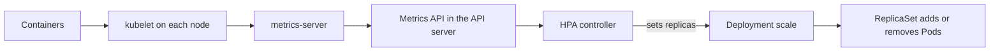
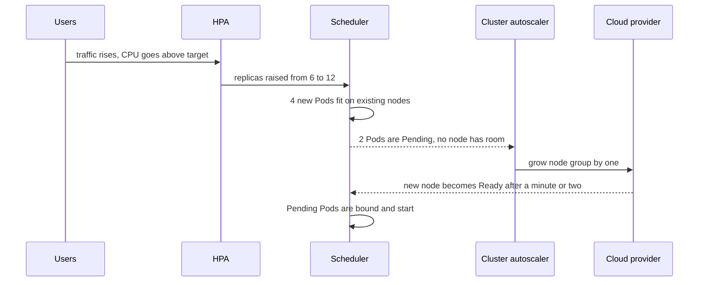

# Autoscaling: HPA, VPA and the cluster autoscaler

## In plain words

Picture a supermarket on a Saturday. When the queues grow, the manager has three different moves. She can **open more tills**, so more shoppers are served at once. She can give each cashier **a faster scanner and a bigger bagging area**, so each till handles more. And if every till the shop owns is already open, she must **build more checkout lanes**, which takes longer but raises the ceiling for everything else. On a quiet Tuesday she reverses all three and stops paying for capacity nobody uses.

Kubernetes has one automatic mechanism for each move:

- The **Horizontal Pod Autoscaler (HPA)** changes *how many* Pods a workload has. More tills.
- The **Vertical Pod Autoscaler (VPA)** changes *how much CPU and memory each Pod asks for*. Bigger tills.
- The **cluster autoscaler** changes *how many nodes* the cluster has. More lanes.

"Horizontal" means adding copies side by side; "vertical" means making one copy bigger. Together they let an application follow its load without a person watching a dashboard at 3 a.m.

Why this matters for a job: autoscaling is where reliability meets the cloud bill, and both get attention from management. You will be asked to configure an HPA, to explain why one is not scaling, and in interviews to compute a replica count by hand and to describe what happens, step by step, when traffic doubles.

> **Before this lesson:** you need requests and limits ([Lifecycle, restart policies, probes, requests and limits](#/lesson/kubernetes/pod-lifecycle-resources)), Deployments and the `replicas` field ([Deployments, ReplicaSets, self-healing and scaling](#/lesson/kubernetes/deployments-replicasets)) and the scheduler's role ([The control plane](#/lesson/kubernetes/control-plane)).

## Three autoscalers at a glance

| | Horizontal Pod Autoscaler | Vertical Pod Autoscaler | Cluster autoscaler |
|---|---|---|---|
| Changes | `replicas` of a workload | `requests` (and limits) of containers | Number of nodes |
| Reacts to | A metric compared with a target | Observed usage over time | Pods that cannot be scheduled |
| Built in? | Yes, API `autoscaling/v2` | No, installed separately | No, installed or provided by the cloud |
| Speed | Seconds to a minute | Minutes to hours | One to several minutes |
| Best for | Stateless services with varying load | Workloads whose right size is unknown | Any cluster in a cloud |

## Requests are the foundation

All three autoscalers depend on **resource requests**, so a short recap is worth the space.

A **request** is the amount of CPU or memory a container asks the cluster to reserve for it. The scheduler places a Pod only on a node with enough unreserved capacity to cover its requests. A **limit** is the most the container may use: going over a CPU limit slows the container down (throttling), and going over a memory limit gets it killed (`OOMKilled`, where OOM stands for "out of memory").

CPU is measured in **millicores**: 1000m is one whole CPU core, so `250m` is a quarter of a core. Memory is measured in bytes with suffixes such as `Mi` (mebibytes, 1024 × 1024 bytes).

How requests relate to limits also decides a Pod's **quality-of-service class** (QoS class), which tells the kubelet which Pods to sacrifice first when a node runs out of memory:

| QoS class | Rule | Evicted |
|---|---|---|
| `Guaranteed` | Every container has requests equal to limits for both CPU and memory | Last |
| `Burstable` | At least one request or limit is set, but the rule above is not met | In between |
| `BestEffort` | No requests or limits at all | First |

Now the connection to autoscaling:

- The HPA's most common metric, **CPU utilisation**, is a percentage *of the request*. A Pod using 150m with a request of 250m is at 60%. No request, no percentage, no scaling.
- The VPA's whole output is a better value for requests.
- The cluster autoscaler adds a node when a Pod's *requests* do not fit anywhere. Actual usage is irrelevant to it.

Wrong requests make all three misbehave, which is why this section comes first.

## Where the numbers come from

The HPA needs measurements. The path they travel:



- The **kubelet** on each node measures the CPU and memory of every container it runs.
- **metrics-server** is a small add-on that collects those figures from every kubelet about every 15 seconds and keeps only the latest values in memory.
- It publishes them through the **Metrics API** (`metrics.k8s.io`), an extension of the Kubernetes API.
- The **HPA controller**, part of the controller manager, reads the Metrics API every 15 seconds, calculates a replica count and writes it to the workload's `scale` subresource, the small part of the object that holds only the replica count.

```bash
$ kubectl top pods -n cafe -l app=orders-api
NAME                          CPU(cores)   MEMORY(bytes)
orders-api-7c9d8f6b5d-4kx2p   148m         181Mi
orders-api-7c9d8f6b5d-9hbtz   162m         176Mi
orders-api-7c9d8f6b5d-jq7ws   139m         190Mi
```

`kubectl top` reads the same Metrics API. If this command fails with `Metrics API not available`, metrics-server is missing and no CPU-based HPA can work. Managed clusters usually install it for you; local clusters often need it added.

## The Horizontal Pod Autoscaler

### An HPA manifest, line by line

```yaml
apiVersion: autoscaling/v2
kind: HorizontalPodAutoscaler
metadata:
  name: orders-api
  namespace: cafe
spec:
  scaleTargetRef:
    apiVersion: apps/v1
    kind: Deployment
    name: orders-api
  minReplicas: 3
  maxReplicas: 20
  metrics:
    - type: Resource
      resource:
        name: cpu
        target:
          type: Utilization
          averageUtilization: 60
```

- `apiVersion: autoscaling/v2` — the current version. The older `autoscaling/v1` supports CPU only.
- `scaleTargetRef` — which object to scale. It must be something with a `scale` subresource: a Deployment, StatefulSet or ReplicaSet. A DaemonSet cannot be the target, because its Pod count follows the nodes.
- `minReplicas: 3` — the floor. The HPA never goes below it, however quiet things are.
- `maxReplicas: 20` — the ceiling. It protects you from a bug, or an attack, that would otherwise scale you into a very large bill.
- `metrics` — a list; this one has a single entry.
  - `type: Resource` with `name: cpu` — use the CPU figure from the Metrics API.
  - `target.type: Utilization` with `averageUtilization: 60` — aim for the Pods to use, on average, 60% of their CPU request.

Once an HPA manages a Deployment, **remove `replicas` from the Deployment's manifest**. Otherwise every `kubectl apply` resets the count to the number in the file, and the HPA and your pipeline fight over it.

### The formula

Every 15 seconds the controller computes:

$$\text{desiredReplicas} = \left\lceil \text{currentReplicas} \times \frac{\text{currentMetricValue}}{\text{targetMetricValue}} \right\rceil$$

The brackets mean "round up to a whole number". Three worked examples with a 60% target:

| Current replicas | Average CPU | Ratio | Calculation | Result |
|---|---|---|---|---|
| 4 | 90% | 1.5 | 4 × 1.5 = 6 | Scale to 6 |
| 6 | 30% | 0.5 | 6 × 0.5 = 3 | Scale to 3 |
| 5 | 63% | 1.05 | within tolerance | Stay at 5 |

The third row shows the **tolerance**: if the ratio is within 10% of 1.0, nothing happens. Without it, a workload hovering around its target would gain and lose a Pod every few seconds. Recent versions let you set a different tolerance per HPA under `behavior`.

Why does the formula work? If 4 Pods are each at 90% of their request, the total work is 4 × 90 = 360 "percent-units". Spread over 6 Pods that is 60 each, which is the target. The formula asks: how many Pods would bring the average back to the target if the total work stayed the same?

Further rules complete the picture:

- The result is clamped between `minReplicas` and `maxReplicas`.
- With **several metrics**, the controller computes a replica count for each and takes the **largest**. Scaling follows whichever resource is under most pressure.
- Pods that are **not yet ready** are set aside while scaling up, so that a Pod still starting, with no load yet, does not drag the average down and hide the need for more.
- If a container has **no CPU request**, utilisation for that Pod is undefined and the HPA takes no action on that metric. `kubectl describe hpa` shows `failed to get cpu utilization: missing request for cpu`.

```python-run
import math

def hpa(current_replicas, current_value, target_value, min_replicas, max_replicas, tolerance=0.10):
    ratio = current_value / target_value
    if abs(ratio - 1.0) <= tolerance:
        return current_replicas, f"ratio {ratio:.2f} is within tolerance, no change"
    desired = math.ceil(current_replicas * ratio)
    clamped = max(min_replicas, min(max_replicas, desired))
    note = f"ratio {ratio:.2f} -> ceil({current_replicas} x {ratio:.2f}) = {desired}"
    if clamped != desired:
        note += f", clamped to {clamped}"
    return clamped, note

cases = [(4, 90, 60), (6, 30, 60), (5, 63, 60), (5, 67, 60), (10, 240, 60), (3, 5, 60)]
for replicas, cpu, target in cases:
    new, why = hpa(replicas, cpu, target, min_replicas=3, max_replicas=20)
    print(f"replicas={replicas:2}  cpu={cpu:3}%  target={target}%  ->  {new:2}   ({why})")
```

Look at the last two lines of output. At 240% the formula asks for 40 Pods and `maxReplicas` holds it at 20. At 5% it asks for 1 and `minReplicas` holds it at 3. Change the target to 80 and run again: a higher target means fewer Pods working harder, with less headroom for a sudden spike.

### Scaling down slowly, on purpose

Load is noisy. If the HPA removed Pods the moment a metric dipped, a brief lull would be followed by a scramble to add them back, a pattern called **flapping** or **thrashing**. Two defaults prevent it:

- **Scale up immediately.** In each 15-second period the HPA may add up to 4 Pods or double the current count, whichever is greater.
- **Scale down after a stabilisation window.** The controller remembers every recommendation from the last 300 seconds and uses the **highest** of them. Pods are removed only once the load has stayed low for five full minutes.

The asymmetry is deliberate: too few Pods cause errors for users, while too many cost a little money for a few minutes. Both sides can be tuned under `behavior`:

```yaml
  behavior:
    scaleUp:
      stabilizationWindowSeconds: 0
      policies:
        - type: Percent
          value: 100
          periodSeconds: 15
    scaleDown:
      stabilizationWindowSeconds: 300
      policies:
        - type: Pods
          value: 2
          periodSeconds: 60
```

- `scaleUp.policies` — add at most 100% of the current count per 15 seconds.
- `scaleDown.stabilizationWindowSeconds: 300` — use the highest recommendation of the last five minutes.
- `scaleDown.policies` — remove at most 2 Pods per minute, so capacity steps down gently.

The simulation shows the window at work. Each step is one minute, and the window is five minutes.

```python-run
import math

TARGET, MIN, MAX, WINDOW = 60, 2, 12, 5
cpu_demand = [120, 120, 120, 480, 480, 480, 480, 150, 150, 520, 150, 150, 150, 150, 150, 150, 150]
# cpu_demand is the total work, in "percent of one Pod's request". 480 means 4.8 Pods' worth of CPU.

replicas = 2
history = []
print("min  demand  avg-cpu  raw-want  used  replicas")
for minute, demand in enumerate(cpu_demand):
    avg = demand / replicas
    ratio = avg / TARGET
    raw = replicas if abs(ratio - 1) <= 0.1 else math.ceil(replicas * ratio)
    raw = max(MIN, min(MAX, raw))
    history.append(raw)
    recent = history[-WINDOW:]
    used = raw if raw > replicas else max(recent)        # scale up at once, scale down by the window's maximum
    print(f"{minute:3}  {demand:6}  {avg:6.0f}%  {raw:8}  {used:4}  {replicas} -> {used}")
    replicas = used
```

Follow minute 7 onwards. Demand drops, and `raw-want` falls to 3 at once, but `replicas` stays at 8 because the window still contains an 8. The short spike at minute 9 is absorbed by Pods that were kept. Only when five consecutive low recommendations have been seen does the count come down. Set `WINDOW = 1` to see the thrashing the window prevents.

### Reading an HPA

```bash
$ kubectl get hpa -n cafe
NAME         REFERENCE               TARGETS        MINPODS   MAXPODS   REPLICAS   AGE
orders-api   Deployment/orders-api   cpu: 42%/60%   3         20        5          6d

$ kubectl describe hpa orders-api -n cafe
...
Conditions:
  Type            Status  Reason              Message
  AbleToScale     True    ReadyForNewScale    recommended size matches current size
  ScalingActive   True    ValidMetricFound    the HPA was able to successfully calculate a replica count from cpu resource utilization
  ScalingLimited  False   DesiredWithinRange  the desired count is within the acceptable range
Events:
  Normal  SuccessfulRescale  12m  horizontal-pod-autoscaler  New size: 5; reason: cpu resource utilization above target
```

`TARGETS` shows current against target. `<unknown>/60%` in that column means the metric could not be read: metrics-server is missing, or a container has no CPU request. The three conditions answer three questions: can the HPA scale at all, is it receiving a usable metric, and is it pinned at its minimum or maximum (`ScalingLimited: True`)?

### Beyond CPU

CPU is a poor signal for many services. A queue worker should scale on the length of its queue; a web service is better scaled on requests per second. The `metrics` list accepts other types:

| `type` | Source | Example |
|---|---|---|
| `Resource` | CPU or memory of the Pods | 60% CPU utilisation |
| `ContainerResource` | One named container's CPU or memory | Ignore a sidecar's usage |
| `Pods` | A custom metric per Pod, averaged | 100 requests per second per Pod |
| `Object` | A metric of another object | Requests per second at an Ingress |
| `External` | A metric from outside the cluster | Messages waiting in a cloud queue |

`Pods` and `Object` metrics come through the custom metrics API, which an adapter (commonly the Prometheus Adapter) must provide. `External` metrics need an adapter too. Many teams use **KEDA** (Kubernetes Event-driven Autoscaling), an add-on that ships dozens of ready-made connectors to queues, databases and cloud services, creates an HPA for you, and can scale a workload down to **zero** Pods when there is nothing to do. The built-in HPA normally stops at one replica; scaling to zero on object or external metrics is available in recent releases behind a feature gate, so check your cluster's version before relying on it.

## The Vertical Pod Autoscaler

### Finding the right size

Choosing requests is guesswork at first. Too high, and you pay for nodes that sit idle. Too low, and Pods are throttled or killed. The VPA watches what containers use and recommends, or applies, better values.

It is not part of core Kubernetes; a cluster administrator installs it. It has three parts:

- the **recommender**, which studies usage history and computes target requests,
- the **updater**, which decides when a running Pod is far enough from the recommendation to be worth changing,
- the **admission controller**, a webhook that rewrites the requests of Pods as they are created.

```yaml
apiVersion: autoscaling.k8s.io/v1
kind: VerticalPodAutoscaler
metadata:
  name: report-worker
  namespace: cafe
spec:
  targetRef:
    apiVersion: apps/v1
    kind: Deployment
    name: report-worker
  updatePolicy:
    updateMode: "Off"
  resourcePolicy:
    containerPolicies:
      - containerName: "*"
        minAllowed:
          cpu: 100m
          memory: 128Mi
        maxAllowed:
          cpu: "2"
          memory: 2Gi
```

- `apiVersion: autoscaling.k8s.io/v1` — a different API group from the HPA, because the VPA is a custom resource.
- `targetRef` — the workload to study.
- `updatePolicy.updateMode` — how far the VPA may go; see the table.
- `resourcePolicy.containerPolicies` — guard rails. `"*"` applies to every container; recommendations are kept between `minAllowed` and `maxAllowed`.

| `updateMode` | Behaviour |
|---|---|
| `Off` | Compute recommendations and store them in the object's status. Change nothing. |
| `Initial` | Set requests when a Pod is created. Never touch a running Pod. |
| `Recreate` | Evict Pods whose requests are far from the recommendation, so replacements start with new values. |
| `InPlaceOrRecreate` | Try to resize the running Pod without a restart; fall back to eviction if that is not possible. |

```bash
$ kubectl describe vpa report-worker -n cafe
...
Recommendation:
  Container Recommendations:
    Container Name:  worker
    Lower Bound:
      Cpu:     180m
      Memory:  410Mi
    Target:
      Cpu:     260m
      Memory:  520Mi
    Upper Bound:
      Cpu:     900m
      Memory:  1100Mi
```

`Target` is the value the VPA would set. The bounds describe the range inside which it would leave a running Pod alone. Starting in `Off` mode and reading these numbers for a week is the safest way to use the VPA: you get evidence for your requests without any automatic change.

For years, changing a running Pod's requests meant deleting it. **In-place Pod resize**, stable in current Kubernetes, lets the kubelet adjust a running container's CPU and memory through the Pod's `resize` subresource, often without a restart. The `InPlaceOrRecreate` mode builds on it.

> [!WARNING]
> Do not let an HPA and a VPA both act on the **same resource metric** for one workload. With both on CPU, the VPA raises the request, which lowers the utilisation percentage, which makes the HPA remove Pods, which raises usage per Pod, and so on in circles. Common safe combinations: HPA on CPU with VPA in `Off` mode for advice, or HPA on a custom metric such as requests per second with VPA managing CPU and memory.

## The cluster autoscaler

### It reacts to Pending Pods, not to busy nodes

The HPA can ask for 20 Pods, but they need somewhere to run. When no node has enough unreserved capacity for a Pod's requests, the Pod stays `Pending` with the event `FailedScheduling`. The **cluster autoscaler** watches for exactly that.

- **Scale up:** for each unschedulable Pod it asks, "if I added a node from one of my node groups, would this Pod fit on it?" A **node group** (or node pool) is a set of identical machines the cloud can grow or shrink. If the answer is yes, it raises the group's size and the cloud starts a machine. It does **not** look at CPU usage. A cluster whose nodes are at 95% usage with no Pending Pods will not grow.
- **Scale down:** when a node's *requested* resources have stayed below a threshold (50% by default) for about ten minutes, and every Pod on it could be placed on other nodes, the autoscaler drains the node and removes it.

Several things block the removal of a node, and they are a common reason for a cluster that never shrinks:

- a Pod with no controller (a bare Pod would be lost for good),
- a **PodDisruptionBudget** that an eviction would violate (budgets are covered in [Steering the scheduler](#/lesson/kubernetes/scheduling-controls)),
- a Pod annotated `cluster-autoscaler.kubernetes.io/safe-to-evict: "false"`,
- Pods whose scheduling rules fit no other node.

**Karpenter** is a widely used alternative. Instead of growing fixed node groups, it looks at the Pending Pods' combined requests and constraints, picks a machine type that fits them well, and later consolidates Pods onto fewer or cheaper nodes. The principle is the same: Pending Pods are the trigger.

### The full chain



Add up the delays: up to 15 seconds for the HPA to notice, one to three minutes for a new node to boot and join, then image pull and application start-up. A cold scale-out can take several minutes. Three techniques shorten it: keep `minReplicas` high enough to absorb a first surge, choose a utilisation target (say 60%) that leaves headroom, and run a few low-priority **placeholder Pods** that reserve spare capacity and are pushed aside the moment real Pods need the room.

```python-run
import math

POD_REQUEST_M = 500           # each Pod requests 500 millicores
NODE_CAPACITY_M = 2000        # each node can host 4 such Pods
NODE_BOOT_STEPS = 2           # a new node takes 2 steps to become Ready
TARGET, MIN_PODS, MAX_PODS = 60, 2, 16

demand_m = [600, 600, 2400, 2400, 2400, 2400, 4200, 4200, 4200, 4200]   # total CPU the users cause
nodes, booting, replicas = 1, [], 2

print("step  demand  want  running  pending  nodes  avg-cpu")
for step, demand in enumerate(demand_m):
    nodes += sum(1 for ready_at in booting if ready_at == step)          # nodes that finished booting
    booting = [r for r in booting if r > step]
    capacity = nodes * (NODE_CAPACITY_M // POD_REQUEST_M)
    running = min(replicas, capacity)
    pending = replicas - running
    avg = demand / running / POD_REQUEST_M * 100
    print(f"{step:4}  {demand:6}  {replicas:4}  {running:7}  {pending:7}  {nodes:5}  {avg:6.0f}%")
    if pending and not booting:                                          # cluster autoscaler: Pending Pods trigger it
        need = math.ceil(pending / (NODE_CAPACITY_M // POD_REQUEST_M))
        booting = [step + NODE_BOOT_STEPS] * need
    ratio = avg / TARGET                                                 # HPA: based on running Pods
    if abs(ratio - 1) > 0.1:
        replicas = max(MIN_PODS, min(MAX_PODS, max(replicas, math.ceil(running * ratio))))
```

At step 2 demand quadruples. The HPA wants more Pods on the next step, but only 4 fit on the single node, so the rest are Pending and average CPU stays far above the target while the new node boots. That gap, visible in the `avg-cpu` column, is the period in which users feel the slowdown. Lower `NODE_BOOT_STEPS` to 0 to see what spare capacity buys.

> [!TIP]
> When an HPA "does nothing", check in this order: `kubectl get hpa` (is `TARGETS` showing `<unknown>`?), `kubectl top pods` (does the Metrics API work?), the Pod template (does every container have a CPU request?), then `kubectl describe hpa` for the conditions and events. When it scales but Pods stay `Pending`, the problem has moved to node capacity.

> [!INTERVIEW]
> **"Traffic to a service doubles. Walk me through what Kubernetes does."** metrics-server reports that the Pods' average CPU is now well above the HPA's target. Within about 15 seconds the HPA computes `ceil(currentReplicas × current / target)`, clamps it between min and max, and updates the Deployment's replica count. The ReplicaSet creates Pods; the scheduler binds those that fit. If some do not fit they stay Pending, the cluster autoscaler sees unschedulable Pods, checks that a node from a node group would fit them and grows the group; after the node joins, the Pods start, pass their readiness probes and receive traffic. When load falls, the HPA waits for its five-minute stabilisation window before removing Pods, and the cluster autoscaler later removes nodes that have been under-requested for about ten minutes, respecting PodDisruptionBudgets. Mention that utilisation is relative to requests, that the cluster autoscaler reacts to Pending Pods and not to CPU usage, and that HPA and VPA must not share a metric.

## Common pitfalls

- **No CPU request on a container.** Utilisation is undefined and the HPA shows `<unknown>`.
- **No metrics-server.** Same symptom, different cause.
- **Leaving `replicas` in the Deployment manifest.** Each deployment resets the HPA's work.
- **`minReplicas: 1` for a service that must stay available.** One Pod is a single point of failure during node maintenance.
- **A target of 90% or more.** There is no headroom while new Pods and nodes start.
- **HPA and VPA on the same metric.** They chase each other.
- **Expecting the cluster autoscaler to react to high CPU.** It reacts to Pods that cannot be scheduled.
- **Requests far above real usage.** Nodes look full to the scheduler while sitting idle, and the cluster grows for nothing.
- **Slow readiness.** New Pods count for nothing until they are ready; long start-up times make scale-out arrive too late.
- **Scaling on memory for an application that never releases memory.** The HPA scales up and never comes back down.

## Cheat sheet

| Task | Command or field |
|---|---|
| Quick HPA from the command line | `kubectl autoscale deployment NAME --cpu-percent=60 --min=3 --max=20` |
| Inspect an HPA | `kubectl get hpa`, `kubectl describe hpa NAME` |
| Current usage | `kubectl top pods`, `kubectl top nodes` |
| Replica formula | `ceil(current × currentMetric / targetMetric)` |
| Tolerance | 10% by default |
| Scale-down window | `behavior.scaleDown.stabilizationWindowSeconds`, default 300 |
| VPA advice only | `updatePolicy.updateMode: "Off"` |
| Why is a Pod Pending? | `kubectl describe pod NAME`, read the `FailedScheduling` event |
| Protect a Pod from node scale-down | annotation `cluster-autoscaler.kubernetes.io/safe-to-evict: "false"` |

## Summary

Three autoscalers act on three different numbers. The Horizontal Pod Autoscaler reads a metric, most often CPU utilisation relative to requests, applies `ceil(current × metric / target)` with a 10% tolerance, and changes the replica count between a floor and a ceiling; it scales up at once and down only after a stabilisation window. The Vertical Pod Autoscaler studies usage and recommends or applies better requests, increasingly through in-place resize. The cluster autoscaler, or Karpenter, adds nodes when Pods are Pending for lack of room and removes nodes whose Pods can live elsewhere. All of it rests on honest resource requests. The next lesson looks at the other half of capacity: controlling *which* nodes Pods land on, and how many may be taken away at once.

## Glossary

- **Horizontal scaling**: changing the number of copies of a workload.
- **Vertical scaling**: changing the resources given to each copy.
- **HorizontalPodAutoscaler (HPA)**: the built-in object that adjusts replicas to hold a metric near a target.
- **Utilisation**: usage expressed as a percentage of the request.
- **Millicore**: one thousandth of a CPU core; written `m`.
- **QoS class**: Guaranteed, Burstable or BestEffort; decides eviction order under memory pressure.
- **metrics-server**: the add-on that serves current CPU and memory figures through the Metrics API.
- **Scale subresource**: the part of a workload object that holds only its replica count.
- **Tolerance**: the band around the target inside which the HPA does nothing.
- **Stabilisation window**: the period whose highest recommendation is used when scaling down.
- **Flapping (thrashing)**: repeatedly scaling up and down in quick succession.
- **KEDA**: an add-on for scaling on external events, including to zero.
- **VerticalPodAutoscaler (VPA)**: an add-on that recommends or sets container requests.
- **In-place resize**: changing a running Pod's resources without recreating it.
- **Cluster autoscaler**: the component that adds and removes nodes based on unschedulable Pods.
- **Node group (node pool)**: a set of identical nodes that can be resized.
- **Karpenter**: a node provisioner that chooses machine types to fit Pending Pods.
- **Placeholder Pod**: a low-priority Pod that reserves spare capacity for fast scale-out.

```quiz
[
  {"q": "An HPA targets 50% CPU utilisation. There are 4 Pods averaging 80%. How many replicas does it want?",
   "options": ["5", "6", "7", "8"],
   "answer": 2,
   "explain": "ceil(4 x 80 / 50) = ceil(6.4) = 7. The result is rounded up to a whole Pod."},
  {"q": "An HPA targets 60% and 10 Pods average 64%. What happens?",
   "options": ["It scales to 11", "Nothing, because the ratio 1.07 is inside the 10% tolerance", "It scales to 12", "It scales down to 9"],
   "answer": 1,
   "explain": "64 / 60 is about 1.07, within 10% of 1.0, so the controller leaves the replica count alone to avoid flapping."},
  {"q": "kubectl get hpa shows TARGETS as <unknown>/60%. Which cause is consistent with that?",
   "options": ["maxReplicas has been reached", "The containers have no CPU request, or the Metrics API is unavailable", "The Deployment has too many replicas", "The stabilisation window has not finished"],
   "answer": 1,
   "explain": "Utilisation is usage divided by request and needs the Metrics API. Without a request or without metrics-server there is no value to show."},
  {"q": "Load on a service drops sharply at 14:00 and stays low. With default settings, when does the HPA start removing Pods?",
   "options": ["Within 15 seconds", "After about five minutes, when the stabilisation window contains only low recommendations", "After ten minutes, with the cluster autoscaler", "Never, scale-down is manual"],
   "answer": 1,
   "explain": "For scale-down the HPA uses the highest recommendation from the last 300 seconds, so it waits until the whole window is low."},
  {"q": "All nodes in a cluster are at 95% CPU usage, and no Pod is Pending. What does the cluster autoscaler do?",
   "options": ["Adds a node", "Nothing, because it reacts to unschedulable Pods and not to usage", "Removes a node", "Raises every Pod's requests"],
   "answer": 1,
   "explain": "The cluster autoscaler's trigger is a Pod that cannot be scheduled because of its requests. High usage alone does not trigger it; an HPA adding Pods would."},
  {"q": "Why is running an HPA and a VPA on CPU for the same Deployment a bad idea?",
   "options": ["The API server rejects the second object", "The VPA changes requests, which changes the utilisation percentage the HPA reads, so they work against each other", "The VPA disables metrics-server", "HPAs cannot target Deployments"],
   "answer": 1,
   "explain": "Utilisation is relative to the request. Changing the request moves the HPA's metric, and the two controllers oscillate."},
  {"q": "Which Pod has the Guaranteed QoS class?",
   "options": ["No requests or limits on any container", "Requests set, no limits", "Every container has CPU and memory requests equal to its limits", "Only a memory limit is set"],
   "answer": 2,
   "explain": "Guaranteed requires requests equal to limits for both CPU and memory in every container. Such Pods are the last to be evicted under node memory pressure."},
  {"q": "A cluster never scales down although several nodes are nearly empty. Which is a plausible reason?",
   "options": ["The HPA's maxReplicas is too high", "A Pod on those nodes has no controller or is protected by a PodDisruptionBudget or a safe-to-evict annotation", "metrics-server is installed", "The nodes have too much memory"],
   "answer": 1,
   "explain": "The cluster autoscaler removes a node only if all its Pods can be evicted and rescheduled. Bare Pods, strict budgets and the safe-to-evict annotation block that."}
]
```

> **Source:** this lesson extends the track beyond the chapters of Poulton's *The Kubernetes Book*. Official docs: https://kubernetes.io/docs/tasks/run-application/horizontal-pod-autoscale/ , https://kubernetes.io/docs/tasks/run-application/horizontal-pod-autoscale-walkthrough/ , https://kubernetes.io/docs/concepts/workloads/autoscaling/vertical-pod-autoscale/ , https://kubernetes.io/docs/tasks/configure-pod-container/resize-container-resources/ , https://kubernetes.io/docs/concepts/cluster-administration/node-autoscaling/ , https://kubernetes.io/docs/concepts/workloads/pods/pod-qos/ , https://keda.sh/docs/ , https://karpenter.sh/docs/
