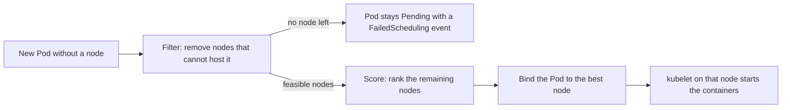

# Steering the scheduler: affinity, taints, spread, priority and disruption budgets

## In plain words

Imagine planning the seating for a large wedding dinner. Most guests can sit anywhere there is a free chair. Some come with requirements: grandmother must be near the door, the two uncles who argue must not share a table, and the top table is reserved for the family unless you hold a special card. You also want each family spread across several tables so that one wobbly table does not ruin the evening for all of them. If the mayor arrives late and the room is full, somebody less important gives up a seat. And the caterer has a rule of her own: never send more than one waiter on a break at a time.

The Kubernetes **scheduler** is the seating planner. It is the control-plane component that chooses a node for every new Pod. Left alone it does a reasonable job: it puts each Pod on some node with enough room. This lesson teaches the instructions you can give it, which map onto the wedding one for one:

| Wedding | Kubernetes |
|---|---|
| "Must sit near the door" | Node selector and node affinity |
| "Not at the same table as him" | Pod anti-affinity |
| "Reserved table, card holders only" | Taints and tolerations |
| "Spread each family across tables" | Topology spread constraints |
| "The mayor gets a seat, someone moves" | Priority and pre-emption |
| "Only one waiter on a break at a time" | PodDisruptionBudget |

Why this matters for a job: these controls decide whether your service survives the loss of a node or a whole data-centre zone, whether costly GPU machines are wasted on web servers, and whether routine node maintenance causes an outage. "My Pod is stuck in Pending, why?" is among the most common support questions, and the answer is usually one of the rules below.

> **Before this lesson:** you need labels and selectors ([The declarative model and reconciliation loops](#/lesson/kubernetes/declarative-reconciliation)), requests ([Lifecycle, restart policies, probes, requests and limits](#/lesson/kubernetes/pod-lifecycle-resources)), the scheduler's place in the control plane ([The control plane](#/lesson/kubernetes/control-plane)) and DaemonSets ([DaemonSets, Jobs and CronJobs](#/lesson/kubernetes/daemonsets-jobs-cronjobs)).

## How the scheduler decides

For each Pod that has no node yet, the scheduler works in two phases.

1. **Filter.** Remove every node that *cannot* run the Pod. A node is removed if it lacks unreserved CPU or memory for the Pod's requests, carries a taint the Pod does not tolerate, fails a required affinity rule, and so on. The nodes that remain are called **feasible**.
2. **Score.** Give each feasible node points according to preferences: more free resources, the image already downloaded, a better spread, preferred affinity rules. The node with the highest total wins, and the scheduler **binds** the Pod to it by writing the node's name into the Pod's `spec.nodeName`.



Two facts follow from this design. **Hard rules are filters and soft rules are scores**: breaking a hard rule leaves a Pod Pending, while a soft rule is a preference that may be ignored. And the scheduler decides **once**, at placement time. It does not move running Pods when conditions change later. Several field names contain the reminder `IgnoredDuringExecution` for that reason.

The scheduler counts **requests**, not usage. A node whose Pods request 3.8 of its 4 CPUs is full to the scheduler even if those Pods are idle.

### A scheduler you can run

```python-run
nodes = [
    {"name": "worker-1", "cpu": 4000, "mem": 8192, "used_cpu": 3500, "used_mem": 4096, "labels": {"disk": "ssd"}, "taints": []},
    {"name": "worker-2", "cpu": 4000, "mem": 8192, "used_cpu": 1000, "used_mem": 6144, "labels": {"disk": "hdd"}, "taints": []},
    {"name": "worker-3", "cpu": 8000, "mem": 16384, "used_cpu": 2000, "used_mem": 4096, "labels": {"disk": "ssd"}, "taints": []},
    {"name": "gpu-1", "cpu": 16000, "mem": 65536, "used_cpu": 0, "used_mem": 0, "labels": {"disk": "ssd"}, "taints": ["dedicated=ml"]},
]

def schedule(pod):
    print(f"Pod {pod['name']}: cpu={pod['cpu']}m mem={pod['mem']}Mi selector={pod.get('selector', {})} tolerates={pod.get('tolerates', [])}")
    feasible = []
    for n in nodes:                                               # phase 1: filter
        if n["cpu"] - n["used_cpu"] < pod["cpu"]:
            reason = "Insufficient cpu"
        elif n["mem"] - n["used_mem"] < pod["mem"]:
            reason = "Insufficient memory"
        elif any(n["labels"].get(k) != v for k, v in pod.get("selector", {}).items()):
            reason = "did not match node selector"
        elif any(t not in pod.get("tolerates", []) for t in n["taints"]):
            reason = "untolerated taint"
        else:
            feasible.append(n)
            continue
        print(f"   filter  {n['name']:9} rejected: {reason}")
    if not feasible:
        print("   result  Pending: 0 nodes are available\n")
        return
    best = None
    for n in feasible:                                            # phase 2: score by free share after placement
        free_cpu = (n["cpu"] - n["used_cpu"] - pod["cpu"]) / n["cpu"]
        free_mem = (n["mem"] - n["used_mem"] - pod["mem"]) / n["mem"]
        score = round(100 * (free_cpu + free_mem) / 2)
        print(f"   score   {n['name']:9} {score}")
        if best is None or score > best[0]:
            best = (score, n)
    best[1]["used_cpu"] += pod["cpu"]
    best[1]["used_mem"] += pod["mem"]
    print(f"   result  bound to {best[1]['name']}\n")

schedule({"name": "web", "cpu": 1000, "mem": 1024})
schedule({"name": "cache", "cpu": 500, "mem": 2048, "selector": {"disk": "ssd"}})
schedule({"name": "trainer", "cpu": 12000, "mem": 32768, "tolerates": ["dedicated=ml"]})
schedule({"name": "picky", "cpu": 2500, "mem": 12000, "selector": {"disk": "ssd"}})
```

The scoring here copies the default idea, called **least allocated**: prefer the node that would have the largest share of its resources still free, which spreads load. Read the `picky` Pod's lines: every node is rejected, some for CPU, some for memory and one for its taint, and the Pod stays Pending. A real `FailedScheduling` event lists those reasons in the same way.

## Choosing nodes: nodeSelector and node affinity

### nodeSelector

The oldest and plainest control. Nodes carry labels; the Pod lists labels a node must have.

```bash
$ kubectl label node worker-3 disk=ssd
node/worker-3 labeled
```

```yaml
spec:
  nodeSelector:
    disk: ssd
```

Every key and value must match (AND). Nodes also carry useful labels set automatically, such as `kubernetes.io/arch` (`amd64` or `arm64`), `kubernetes.io/os`, `topology.kubernetes.io/zone` and `node.kubernetes.io/instance-type`.

### Node affinity

**Node affinity** expresses the same idea with more vocabulary: operators other than "equals", and a soft form.

```yaml
spec:
  affinity:
    nodeAffinity:
      requiredDuringSchedulingIgnoredDuringExecution:
        nodeSelectorTerms:
          - matchExpressions:
              - key: kubernetes.io/arch
                operator: In
                values: ["amd64", "arm64"]
              - key: node-pool
                operator: NotIn
                values: ["batch"]
      preferredDuringSchedulingIgnoredDuringExecution:
        - weight: 80
          preference:
            matchExpressions:
              - key: disk
                operator: In
                values: ["ssd"]
```

- `requiredDuringSchedulingIgnoredDuringExecution` — a **hard** rule, applied in the filter phase. The long name says two things: it is required when scheduling, and it is ignored afterwards (a label removed later does not evict the Pod).
- `nodeSelectorTerms` — a list of alternatives. A node passes if it satisfies **any one** term (OR).
- `matchExpressions` — inside one term, **all** expressions must hold (AND). Here: the architecture is one of two values, and the node is not in the `batch` pool.
- `operator` — one of `In`, `NotIn`, `Exists`, `DoesNotExist`, `Gt` and `Lt` (greater and less than, for numbers).
- `preferredDuringSchedulingIgnoredDuringExecution` — a **soft** rule, used in the score phase. `weight` (1 to 100) is added to a node's score when the preference matches. SSD nodes are favoured; if none has room, the Pod still runs elsewhere.

Prefer soft rules unless a Pod cannot work on other nodes. Every hard rule is one more way to end up Pending.

## Placing Pods relative to other Pods

**Pod affinity** says "put me near Pods with these labels". **Pod anti-affinity** says "keep me away from them". "Near" is defined by a **topology key**: a node label whose value names a group of nodes. With `kubernetes.io/hostname` the group is a single node; with `topology.kubernetes.io/zone` it is a whole availability zone, meaning one of a cloud region's separate data centres.

```yaml
spec:
  affinity:
    podAntiAffinity:
      requiredDuringSchedulingIgnoredDuringExecution:
        - labelSelector:
            matchLabels:
              app: orders-api
          topologyKey: kubernetes.io/hostname
```

Placed in the `orders-api` Pod template, this reads: *do not put me on a node that already runs a Pod labelled `app: orders-api`*. Each replica is forced onto a different node, so one node failure removes at most one replica. The danger is the hard form: with 5 replicas and 4 nodes, the fifth Pod is Pending for ever. The `preferred` form, or a topology spread constraint, is usually the better tool.

Pod *affinity* is rarer. It suits two programs that exchange so much data that sharing a node or zone saves real latency or network cost, such as an application and its cache.

## Taints and tolerations: reserved nodes

Affinity is a Pod choosing nodes. A **taint** works in the other direction: it is a mark on a node that **repels** every Pod unless the Pod has a matching **toleration**.

```bash
$ kubectl taint nodes gpu-1 dedicated=ml:NoSchedule
node/gpu-1 tainted

$ kubectl taint nodes gpu-1 dedicated=ml:NoSchedule-
node/gpu-1 untainted
```

A taint has a key, an optional value and an **effect**. The trailing minus sign in the second command removes the taint.

| Effect | Meaning |
|---|---|
| `NoSchedule` | New Pods without a toleration are not placed here. Running Pods stay. |
| `PreferNoSchedule` | Avoid this node if another will do. A soft version. |
| `NoExecute` | New Pods are kept away **and** running Pods without a toleration are evicted. |

```yaml
spec:
  tolerations:
    - key: dedicated
      operator: Equal
      value: ml
      effect: NoSchedule
```

- `key`, `value`, `effect` — which taint this toleration covers.
- `operator: Equal` — the key and the value must both match. The other operator, `Exists`, matches any value of the key. A toleration with `operator: Exists` and no key tolerates every taint.

One point confuses nearly everyone at first: **a toleration lets a Pod onto a tainted node; it does not send it there.** A Pod that tolerates `dedicated=ml` may still land on an ordinary node. To reserve nodes for a team *and* make that team's Pods use them, you need both halves: a taint with a toleration to keep others out, and a node selector or affinity to pull the right Pods in.

Kubernetes uses taints itself. Control-plane nodes carry `node-role.kubernetes.io/control-plane:NoSchedule`. When a node stops responding, the control plane adds `node.kubernetes.io/unreachable:NoExecute`. Every Pod receives a default toleration for that taint with `tolerationSeconds: 300`, which is why Pods on a dead node are evicted and replaced after about five minutes and not at once: the delay gives a node with a brief network problem time to return.

```python-run
def tolerates(toleration, taint):
    key, op = toleration.get("key", ""), toleration.get("operator", "Equal")
    if key == "":
        if op != "Exists":
            return False                      # an empty key is only valid with Exists
    elif key != taint["key"]:
        return False
    if op == "Equal" and toleration.get("value", "") != taint.get("value", ""):
        return False
    return toleration.get("effect", "") in ("", taint["effect"])

def can_schedule(pod_tolerations, node_taints):
    blocking = [t for t in node_taints
                if t["effect"] in ("NoSchedule", "NoExecute") and not any(tolerates(x, t) for x in pod_tolerations)]
    return (not blocking), blocking

gpu_taint = {"key": "dedicated", "value": "ml", "effect": "NoSchedule"}
cp_taint = {"key": "node-role.kubernetes.io/control-plane", "value": "", "effect": "NoSchedule"}
soft_taint = {"key": "old-hardware", "value": "true", "effect": "PreferNoSchedule"}

tests = [
    ("no tolerations", [], [gpu_taint]),
    ("exact match", [{"key": "dedicated", "operator": "Equal", "value": "ml", "effect": "NoSchedule"}], [gpu_taint]),
    ("wrong value", [{"key": "dedicated", "value": "web"}], [gpu_taint]),
    ("Exists on the key", [{"key": "dedicated", "operator": "Exists"}], [gpu_taint]),
    ("one of two taints", [{"key": "dedicated", "operator": "Exists"}], [gpu_taint, cp_taint]),
    ("tolerate everything", [{"operator": "Exists"}], [gpu_taint, cp_taint]),
    ("soft taint only", [], [soft_taint]),
]
for name, tolerations, taints in tests:
    ok, blocking = can_schedule(tolerations, taints)
    print(f"{name:20} -> {'allowed' if ok else 'blocked by ' + ', '.join(t['key'] for t in blocking)}")
```

The fifth line teaches the rule that matters most: **every** hard taint on the node must be tolerated. Tolerating one of two is not enough.

## Topology spread constraints

Anti-affinity can say "never two on one node". It cannot say "spread 12 replicas evenly over 3 zones". **Topology spread constraints** can.

```yaml
spec:
  topologySpreadConstraints:
    - maxSkew: 1
      topologyKey: topology.kubernetes.io/zone
      whenUnsatisfiable: DoNotSchedule
      labelSelector:
        matchLabels:
          app: orders-api
    - maxSkew: 1
      topologyKey: kubernetes.io/hostname
      whenUnsatisfiable: ScheduleAnyway
      labelSelector:
        matchLabels:
          app: orders-api
```

- `topologyKey` — the node label that defines the groups, called **domains**. The first constraint spreads over zones, the second over individual nodes.
- `labelSelector` — which Pods to count.
- `maxSkew` — the largest allowed difference between the fullest domain and the emptiest one. **Skew** is that difference. With `maxSkew: 1` and zones holding 4, 4 and 3 Pods, the skew is 1 and all is well.
- `whenUnsatisfiable` — `DoNotSchedule` makes the constraint hard (the Pod stays Pending instead of breaking it); `ScheduleAnyway` makes it soft (prefer nodes that reduce the skew).

The first constraint is hard because losing a zone must never take out most of the service. The second is soft because an even spread over nodes is good to have and not worth a Pending Pod.

```python-run
def place(counts, max_skew):
    """Return the domains where one more Pod may go without exceeding max_skew."""
    lowest = min(counts.values())
    return [d for d, c in sorted(counts.items()) if (c + 1) - lowest <= max_skew]

zones = {"zone-a": 0, "zone-b": 0, "zone-c": 0}
for i in range(1, 8):
    allowed = place(zones, max_skew=1)
    chosen = allowed[0]
    zones[chosen] += 1
    print(f"Pod {i}: allowed {allowed} -> {chosen}   counts now {zones}")

print()
crowded = {"zone-a": 3, "zone-b": 3, "zone-c": 1}
print("counts", crowded, "-> a new Pod may only go to", place(crowded, max_skew=1))
full = {"zone-a": 3, "zone-b": 3}
print("if zone-c has no nodes at all, the counted zones are", full, "-> allowed", place(full, max_skew=1))
```

The check for one domain is `(count + 1) - lowest <= maxSkew`. The loop fills the zones in turn and never lets one run ahead by more than one. The last line shows a subtlety: a zone with no nodes is not counted, so the constraint is satisfied by two zones alone.

## Priority and pre-emption

When a cluster is full, some Pods matter more than others. A **PriorityClass** attaches a number to Pods, and higher numbers win.

```yaml
apiVersion: scheduling.k8s.io/v1
kind: PriorityClass
metadata:
  name: business-critical
value: 100000
globalDefault: false
preemptionPolicy: PreemptLowerPriority
description: "Customer-facing services that must run."
```

- `value` — the priority. Larger is more important.
- `globalDefault: false` — whether Pods with no class get this one. At most one class may be the global default.
- `preemptionPolicy` — `PreemptLowerPriority` (the default) or `Never`, which lets a Pod jump the scheduling queue without evicting anyone.

A Pod opts in with `spec.priorityClassName: business-critical`. Priority has two effects. Pending Pods are considered in priority order. And if a high-priority Pod fits nowhere, the scheduler looks for a node where evicting lower-priority Pods would make room; this is **pre-emption**. The victims are terminated gracefully and their controllers recreate them, to wait in the queue.

Two built-in classes, `system-cluster-critical` and `system-node-critical`, carry very high values and protect components such as cluster DNS. A common pattern in the opposite direction is a *negative* priority for the placeholder Pods described in the [autoscaling lesson](#/lesson/kubernetes/autoscaling): they are the first to be pre-empted, which is the point of them.

## Disruptions and PodDisruptionBudgets

### Two kinds of disruption

Pods disappear for two kinds of reason.

- An **involuntary disruption** is an accident: hardware fails, the kernel crashes, the node runs out of memory.
- A **voluntary disruption** is one somebody chose: an administrator drains a node to upgrade it, the cluster autoscaler removes an under-used node, a Deployment rolls out.

Nothing can forbid accidents. Voluntary disruptions, though, can be made to wait, and a **PodDisruptionBudget** (PDB) is how an application owner says how much disruption is acceptable at one time.

```yaml
apiVersion: policy/v1
kind: PodDisruptionBudget
metadata:
  name: orders-api
  namespace: cafe
spec:
  minAvailable: 3
  selector:
    matchLabels:
      app: orders-api
```

- `apiVersion: policy/v1` — the PDB's API group and version.
- `selector` — the Pods the budget protects. Use the same labels as the Deployment's selector.
- `minAvailable: 3` — at least 3 of these Pods must remain healthy during voluntary disruptions. The alternative field is `maxUnavailable` (for example `1` or `"25%"`). You set one of the two, never both.

```bash
$ kubectl get pdb -n cafe
NAME         MIN AVAILABLE   MAX UNAVAILABLE   ALLOWED DISRUPTIONS   AGE
orders-api   3               N/A               1                     4d
```

`ALLOWED DISRUPTIONS` is the number that matters: with 4 healthy Pods and a minimum of 3, one may be taken away right now.

### How drain uses the budget

`kubectl drain NODE` first **cordons** the node (marks it unschedulable) and then removes its Pods through the **Eviction API**, a polite form of deletion that asks permission first. For each eviction the API server checks the Pod's budget. If allowed disruptions is zero, the eviction is refused with HTTP status 429 and `drain` retries until a replacement Pod elsewhere has become ready.

```bash
$ kubectl drain worker-2 --ignore-daemonsets --delete-emptydir-data
node/worker-2 cordoned
evicting pod cafe/orders-api-7c9d8f6b5d-4kx2p
evicting pod cafe/orders-api-7c9d8f6b5d-9hbtz
error when evicting pods/"orders-api-7c9d8f6b5d-9hbtz" -n "cafe" (will retry after 5s): Cannot evict pod as it would violate the pod's disruption budget.
pod/orders-api-7c9d8f6b5d-4kx2p evicted
pod/orders-api-7c9d8f6b5d-9hbtz evicted
node/worker-2 drained

$ kubectl uncordon worker-2
node/worker-2 uncordoned
```

The error line in the middle is the budget doing its job: the second eviction waited until the first Pod's replacement was ready. `kubectl uncordon` reopens the node afterwards.

```python-run
import math

def allowed_disruptions(expected, healthy, min_available=None, max_unavailable=None):
    """expected = Pods the controller wants; healthy = Pods currently ready."""
    def resolve(v):
        if isinstance(v, str) and v.endswith("%"):
            return math.ceil(expected * int(v[:-1]) / 100)      # percentages round up
        return v
    if min_available is not None:
        desired_healthy = resolve(min_available)
    else:
        desired_healthy = expected - resolve(max_unavailable)
    return max(0, healthy - desired_healthy), desired_healthy

cases = [
    ("4 replicas, minAvailable 3", 4, 4, {"min_available": 3}),
    ("one Pod already down", 4, 3, {"min_available": 3}),
    ("maxUnavailable 1", 6, 6, {"max_unavailable": 1}),
    ("minAvailable 50% of 7", 7, 7, {"min_available": "50%"}),
    ("1 replica, minAvailable 1", 1, 1, {"min_available": 1}),
    ("3 replicas, maxUnavailable 0", 3, 3, {"max_unavailable": 0}),
]
for name, expected, healthy, budget in cases:
    allowed, need = allowed_disruptions(expected, healthy, **budget)
    verdict = "eviction allowed" if allowed else "eviction REFUSED"
    print(f"{name:28} need {need} healthy, have {healthy} -> allowed disruptions {allowed}: {verdict}")
```

The last two cases are the classic trap. A budget that allows zero disruptions, such as `minAvailable: 1` with a single replica, makes the node **impossible to drain**. Upgrades stall until somebody intervenes by hand. A PDB only makes sense for a workload with at least two replicas, and it must leave room for at least one eviction.

A PDB does not stop a Pod from being deleted directly with `kubectl delete pod`, does not stop a Deployment's own rolling update (that is governed by `maxUnavailable` in the Deployment), and cannot stop a node from failing. Involuntary losses still count against the budget, so a failure during maintenance correctly blocks further evictions.

## Reading a Pending Pod

```bash
$ kubectl describe pod trainer-0 -n ml
...
Events:
  Type     Reason            Age   From               Message
  Warning  FailedScheduling  20s   default-scheduler  0/6 nodes are available: 1 node(s) had untolerated taint {node-role.kubernetes.io/control-plane: }, 2 Insufficient cpu, 3 node(s) didn't match Pod's node affinity/selector. preemption: 0/6 nodes are available: 6 Preemption is not helpful for scheduling.
```

The message is the filter phase reporting back, node by node: one node rejected for a taint, two for CPU, three for the selector. One plus two plus three is six, every node. Fix whichever rejection you did not intend. The final sentence says that evicting lower-priority Pods would not have helped.

> [!TIP]
> A sound default for a replicated production service has three parts: a hard topology spread over zones with `maxSkew: 1`, a soft spread over hostnames, and a PodDisruptionBudget with `maxUnavailable: 1`. Together they bound the damage of a zone failure, a node failure and a maintenance window, without a single rule that can leave Pods Pending in a healthy cluster.

> [!INTERVIEW]
> **"How do you make sure a critical service survives node failures and maintenance?"** Run several replicas and control where they go and how they leave. Placement: topology spread constraints (or pod anti-affinity) across `topology.kubernetes.io/zone` and `kubernetes.io/hostname`, so that one node or zone holds only a fraction of the replicas. Eviction: a PodDisruptionBudget so that drains, upgrades and the cluster autoscaler remove at most a chosen number at a time through the Eviction API. Importance: a PriorityClass so the service is scheduled first and can pre-empt less important Pods. If asked about taints: a taint repels Pods from a node, a toleration permits a Pod to ignore it, and dedicated nodes need a taint plus a node selector because a toleration does not attract. If asked how the scheduler works: filter out infeasible nodes, score the rest, bind to the best, once, based on requests.

## Common pitfalls

- **Believing a toleration attracts a Pod.** It only permits. Pair it with a node selector or affinity.
- **Required anti-affinity with more replicas than nodes.** The extra Pods are Pending for ever.
- **A PDB that allows zero disruptions.** Node drains hang; cluster upgrades stall.
- **A PDB on a single-replica workload.** The same problem by another route.
- **Too many hard rules.** Each one shrinks the set of feasible nodes; combined, they often leave none.
- **Expecting the scheduler to rebalance.** Rules apply at placement. After a zone recovers, Pods do not move back by themselves; a rollout restart or the separate descheduler add-on is needed.
- **Mislabelled nodes.** A node selector for a label that no node has leaves the Pod Pending with "didn't match Pod's node affinity/selector".
- **Tolerating one of several taints.** All hard taints must be tolerated.
- **Using `NoExecute` casually.** It evicts running Pods the moment the taint is added.
- **Forgetting that requests drive placement.** Missing requests make a node look empty; inflated requests make it look full.

## Cheat sheet

| Goal | Tool | Hard or soft |
|---|---|---|
| Run only on nodes with a label | `nodeSelector`, required node affinity | Hard |
| Prefer certain nodes | Preferred node affinity with `weight` | Soft |
| Keep replicas on different nodes | Pod anti-affinity, `topologyKey: kubernetes.io/hostname` | Either |
| Spread evenly over zones | `topologySpreadConstraints` with `maxSkew` | Either |
| Reserve nodes | Taint the nodes, tolerate in the Pods, add a selector | Hard |
| Evict when a node changes | `NoExecute` taint | Hard |
| Rank Pods by importance | `PriorityClass` and `priorityClassName` | — |
| Limit maintenance damage | `PodDisruptionBudget` | — |

| Task | Command |
|---|---|
| Label a node | `kubectl label node NODE key=value` |
| Taint and untaint | `kubectl taint nodes NODE key=value:NoSchedule` and the same with a trailing `-` |
| See node labels and taints | `kubectl get nodes --show-labels`, `kubectl describe node NODE` |
| Stop new Pods on a node | `kubectl cordon NODE` |
| Empty a node safely | `kubectl drain NODE --ignore-daemonsets --delete-emptydir-data` |
| Reopen a node | `kubectl uncordon NODE` |
| Check budgets | `kubectl get pdb -A` |
| Why is a Pod Pending? | `kubectl describe pod POD`, read `FailedScheduling` |

## Summary

The scheduler filters out nodes that cannot host a Pod, scores the rest and binds the Pod to the winner, once, using requests. You steer it with node selectors and node affinity (which nodes), pod affinity and anti-affinity (near or away from which Pods), taints and tolerations (which nodes refuse which Pods), topology spread constraints (how evenly over nodes and zones) and priority classes (who goes first and who gives way). Hard rules can leave a Pod Pending; soft rules cannot. PodDisruptionBudgets complete the picture by limiting how many replicas a voluntary action such as a drain may remove at one time. With workload types, autoscaling and placement covered, the next module turns to how all these manifests are packaged and delivered.

## Glossary

- **Scheduler**: the control-plane component that assigns each new Pod to a node.
- **Filter phase**: the step that removes nodes unable to run the Pod.
- **Score phase**: the step that ranks the remaining nodes.
- **Feasible node**: a node that passed every filter.
- **Bind**: to record the chosen node in the Pod's `spec.nodeName`.
- **nodeSelector**: a list of labels a node must carry.
- **Node affinity**: required or preferred rules about node labels, with operators.
- **Pod affinity / anti-affinity**: rules to place a Pod near, or away from, Pods with given labels.
- **Topology key**: a node label whose values define groups such as nodes or zones.
- **Availability zone**: one of the separate data centres within a cloud region.
- **Taint**: a mark on a node that repels Pods lacking a matching toleration.
- **Toleration**: a Pod's permission to be placed on, or stay on, a node with a given taint.
- **Topology spread constraint**: a rule limiting the imbalance of matching Pods across domains.
- **Skew**: the difference in matching Pods between the fullest and the emptiest domain.
- **PriorityClass**: an object giving Pods a numeric importance.
- **Pre-emption**: evicting lower-priority Pods to make room for a higher-priority one.
- **Voluntary disruption**: a Pod removal that somebody chose, such as a drain.
- **PodDisruptionBudget (PDB)**: a limit on how many Pods of a workload may be voluntarily disrupted at once.
- **Eviction API**: the request used by drain that honours disruption budgets.
- **Drain**: to cordon a node and evict its Pods.

```quiz
[
  {"q": "A node has the taint dedicated=ml:NoSchedule. A Pod has a toleration for it and no node selector or affinity. Where can the Pod run?",
   "options": ["Only on that tainted node", "On any node that fits, tainted or not", "Nowhere until a selector is added", "Only on control-plane nodes"],
   "answer": 1,
   "explain": "A toleration permits; it does not attract. To send the Pod to the dedicated node you also need a node selector or node affinity."},
  {"q": "A Deployment with 5 replicas has required pod anti-affinity on kubernetes.io/hostname against its own label. The cluster has 4 schedulable nodes. What is the result?",
   "options": ["Five Pods run, two share a node", "Four Pods run and one stays Pending", "The Deployment is rejected", "The fifth Pod runs on the control plane"],
   "answer": 1,
   "explain": "A required rule is a filter. Every node already holds a matching Pod, so no node is feasible for the fifth, and it stays Pending."},
  {"q": "Zones a, b and c hold 3, 3 and 1 matching Pods. A constraint has maxSkew: 1 and whenUnsatisfiable: DoNotSchedule. Where may the next Pod go?",
   "options": ["Any zone", "Zone c only", "Zones a or b", "Nowhere"],
   "answer": 1,
   "explain": "Placing in a or b would make 4 against a lowest count of 1, a skew of 3. Placing in c makes the counts 3, 3 and 2, a skew of 1, which is within the limit."},
  {"q": "A PodDisruptionBudget has minAvailable: 2 and the workload has 2 healthy replicas. An administrator runs kubectl drain on a node hosting one of them. What happens?",
   "options": ["The Pod is evicted at once", "The eviction is refused and drain keeps retrying", "The PDB is deleted automatically", "Both Pods are evicted"],
   "answer": 1,
   "explain": "Allowed disruptions is 2 - 2 = 0, so the Eviction API refuses. Drain retries and will hang until the budget allows it, for example after scaling to 3."},
  {"q": "Which of these does a PodDisruptionBudget protect against?",
   "options": ["A node losing power", "A Deployment's own rolling update removing Pods", "kubectl drain evicting too many replicas at once", "kubectl delete pod"],
   "answer": 2,
   "explain": "PDBs govern voluntary evictions made through the Eviction API, such as drains and autoscaler scale-down. Failures, direct deletes and rollouts are outside their control."},
  {"q": "A Pod is Pending with: '0/4 nodes are available: 4 Insufficient memory.' The nodes' real memory usage is 30%. How can that be?",
   "options": ["The scheduler is broken", "The scheduler counts requests, and existing Pods have reserved most memory even though they use little", "Memory limits are too low", "The Pod has a toleration missing"],
   "answer": 1,
   "explain": "Placement is based on requests, not on usage. Over-sized requests make nodes full on paper while idle in practice."},
  {"q": "What does preferredDuringSchedulingIgnoredDuringExecution mean for a node affinity rule?",
   "options": ["The Pod is evicted when the rule stops matching", "The rule adds to a node's score when placing the Pod, can be ignored if no such node fits, and is not re-checked later", "The rule is a filter that can leave the Pod Pending", "The rule applies only to DaemonSets"],
   "answer": 1,
   "explain": "Preferred rules act in the score phase with a weight. IgnoredDuringExecution means later label changes do not affect a running Pod."},
  {"q": "A cluster is full. A Pod with a high PriorityClass is created and fits nowhere. What does the scheduler do?",
   "options": ["Leaves it Pending until a node is added, always", "Looks for a node where evicting lower-priority Pods would make room, and pre-empts them", "Deletes the oldest Pod in the cluster", "Raises the node's capacity"],
   "answer": 1,
   "explain": "Pre-emption evicts lower-priority Pods so that the higher-priority Pod can be scheduled. The victims are recreated by their controllers and wait their turn."}
]
```

> **Source:** this lesson extends the track beyond the chapters of Poulton's *The Kubernetes Book*. Official docs: https://kubernetes.io/docs/concepts/scheduling-eviction/kube-scheduler/ , https://kubernetes.io/docs/concepts/scheduling-eviction/assign-pod-node/ , https://kubernetes.io/docs/concepts/scheduling-eviction/taint-and-toleration/ , https://kubernetes.io/docs/concepts/scheduling-eviction/topology-spread-constraints/ , https://kubernetes.io/docs/concepts/scheduling-eviction/pod-priority-preemption/ , https://kubernetes.io/docs/concepts/workloads/pods/disruptions/ , https://kubernetes.io/docs/tasks/run-application/configure-pdb/ , https://kubernetes.io/docs/tasks/administer-cluster/safely-drain-node/
