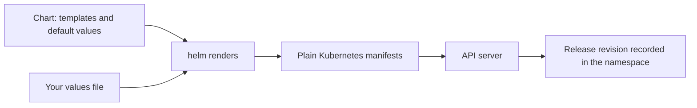

# Helm and Kustomize

## In plain words

By now you can write the manifests for an application: a Deployment, a Service, a ConfigMap, an Ingress, an autoscaler, a disruption budget. That is six files for one small program. A real company has dozens of programs and runs each of them in several **environments**: separate copies of the system for development, for testing (often called staging) and for real customers (production). The environments are *almost* identical. Production has more replicas, a different host name, a newer or older image tag and larger resource requests.

The approach most people try first is to copy the folder of YAML once per environment and edit the copies. It works for a week. Then somebody fixes a probe in the development copy and forgets production, and the copies drift apart until no one can say what the differences are meant to be.

Two tools solve this, with opposite philosophies.

- **Helm** treats your manifests as a **form letter**. You write the letter once with blanks in it ("Dear ____, your order of ____ is ready") and keep a separate sheet of answers for each recipient. Helm fills in the blanks. It also acts as a **package manager**: an app store from which you can install other people's software, such as a database or a monitoring stack, with one command.
- **Kustomize** treats your manifests as a **printed master document with sheets of tracing paper on top**. The master stays untouched and complete. Each environment has an overlay sheet carrying only its corrections: "here, 6 replicas instead of 2".

Why this matters for a job: you will rarely be asked to deploy raw YAML at work. Almost every team uses Helm, Kustomize or both, and reading an unfamiliar Helm chart is a first-week task for a new platform or backend engineer. Interviewers ask what a chart, a release and an overlay are, and when you would pick one tool over the other.

> **Before this lesson:** you should be comfortable reading manifests for Deployments ([Deployments, ReplicaSets, self-healing and scaling](#/lesson/kubernetes/deployments-replicasets)), Services ([Services, selectors, ClusterIP and EndpointSlices](#/lesson/kubernetes/services-clusterip)) and ConfigMaps ([ConfigMaps](#/lesson/kubernetes/configmaps)), and know `kubectl apply` ([kubectl and kubeconfig](#/lesson/kubernetes/kubectl-kubeconfig)).

## The problem, made concrete

Here is what differs for one service, `orders-api`, between two environments.

| Setting | Development | Production |
|---|---|---|
| Replicas | 1 | 6 |
| Image tag | `2.1.0-rc1` | `2.0.4` |
| CPU request | 100m | 500m |
| Log level | `debug` | `warn` |
| Host name | `orders.dev.harbour.example` | `orders.harbour.example` |

Five values differ. Everything else, perhaps 200 lines, is the same. A good tool lets you store the 200 lines once and the five values per environment.

## Helm

### Four words

- A **chart** is a package: a folder of manifest templates plus default settings.
- **Values** are the settings that fill in the templates. A chart ships defaults; you override the ones you care about.
- A **release** is one installation of a chart into a cluster, with a name. Install the same chart twice with different names and values and you have two releases.
- A **repository** is a place charts are published. Today that is usually an **OCI registry**, the same kind of server that stores container images (OCI is the Open Container Initiative, which defines the format).



Helm itself is a command-line program. It renders the templates on your machine (or in the pipeline), sends the result to the API server, and records what it did. Nothing of Helm runs inside the cluster.

### Anatomy of a chart

```bash
$ helm create orders-api
Creating orders-api

$ tree orders-api
orders-api
├── Chart.yaml
├── values.yaml
├── charts
└── templates
    ├── _helpers.tpl
    ├── deployment.yaml
    ├── service.yaml
    ├── ingress.yaml
    ├── hpa.yaml
    └── NOTES.txt
```

- `Chart.yaml` — the chart's identity card.
- `values.yaml` — the default values.
- `templates/` — manifests with blanks in them.
- `templates/_helpers.tpl` — reusable template snippets. Files starting with an underscore produce no manifest of their own.
- `templates/NOTES.txt` — a message shown to the user after installation.
- `charts/` — other charts this one depends on, such as a database.

`Chart.yaml`, line by line:

```yaml
apiVersion: v2
name: orders-api
description: The Harbour Coffee orders API
type: application
version: 0.4.0
appVersion: "2.0.3"
```

- `apiVersion: v2` — the chart format version. `v2` is the format introduced with Helm 3 and still used by Helm 4.
- `name` and `description` — what the chart is.
- `type: application` — a chart that installs something. The other type, `library`, only provides helpers to other charts.
- `version: 0.4.0` — the version **of the chart**. Raise it whenever the templates change.
- `appVersion: "2.0.3"` — the version **of the application** the chart installs by default. The two numbers move independently, and confusing them is a common beginner mistake.

`values.yaml` holds the defaults:

```yaml
replicaCount: 2
image:
  repository: ghcr.io/harbour-coffee/orders-api
  tag: ""
logLevel: info
resources:
  requests:
    cpu: 250m
    memory: 256Mi
  limits:
    memory: 256Mi
autoscaling:
  enabled: false
```

### A template, line by line

Helm templates use the Go programming language's template syntax. Anything between `{{` and `}}` is an instruction; the rest is copied through unchanged.

```yaml
apiVersion: apps/v1
kind: Deployment
metadata:
  name: {{ .Release.Name }}-api
  labels:
    app.kubernetes.io/name: {{ .Chart.Name }}
    app.kubernetes.io/instance: {{ .Release.Name }}
spec:
  {{- if not .Values.autoscaling.enabled }}
  replicas: {{ .Values.replicaCount }}
  {{- end }}
  selector:
    matchLabels:
      app.kubernetes.io/instance: {{ .Release.Name }}
  template:
    metadata:
      labels:
        app.kubernetes.io/instance: {{ .Release.Name }}
    spec:
      containers:
        - name: api
          image: "{{ .Values.image.repository }}:{{ .Values.image.tag | default .Chart.AppVersion }}"
          env:
            - name: LOG_LEVEL
              value: {{ .Values.logLevel | quote }}
          resources:
            {{- toYaml .Values.resources | nindent 12 }}
```

- `{{ .Release.Name }}` — the name given at install time. Building object names from it lets two releases of one chart live side by side in a namespace.
- `{{ .Chart.Name }}` — a field from `Chart.yaml`.
- `{{- if not .Values.autoscaling.enabled }}` … `{{- end }}` — a condition. The `replicas` line is produced only when autoscaling is off, which is exactly the "remove `replicas` when an HPA manages it" rule from the [autoscaling lesson](#/lesson/kubernetes/autoscaling). The dash in `{{-` removes the blank line the instruction would otherwise leave behind.
- `{{ .Values.replicaCount }}` — a value from `values.yaml` or from your overrides.
- `{{ .Values.image.tag | default .Chart.AppVersion }}` — the `|` symbol is a **pipe**: it passes the value on its left to the function on its right. If no tag is set, fall back to the chart's `appVersion`.
- `{{ .Values.logLevel | quote }}` — wrap the value in quotation marks so that YAML reads it as text.
- `{{- toYaml .Values.resources | nindent 12 }}` — convert a whole block of values back to YAML and indent it by 12 spaces so that it sits correctly under `resources:`. Indentation is the hardest part of writing templates, because the template engine knows nothing about YAML; it only produces text.

### Values and their order of precedence

Values come from several places, and later sources override earlier ones:

1. the chart's own `values.yaml`,
2. each file given with `-f`, in the order given,
3. each `--set key=value` on the command line.

Overriding is a **deep merge**: you supply only the keys you want to change, however deeply nested, and the rest of the defaults survive.

```python-run
import re

defaults = {"replicaCount": 2, "logLevel": "info",
            "image": {"repository": "ghcr.io/harbour-coffee/orders-api", "tag": "2.0.3"},
            "resources": {"requests": {"cpu": "250m", "memory": "256Mi"}}}
prod_file = {"replicaCount": 6, "logLevel": "warn", "resources": {"requests": {"cpu": "500m"}}}
set_flags = {"image": {"tag": "2.0.4"}}

def deep_merge(base, override):
    out = dict(base)
    for key, value in override.items():
        if isinstance(value, dict) and isinstance(out.get(key), dict):
            out[key] = deep_merge(out[key], value)        # merge nested maps key by key
        else:
            out[key] = value                              # anything else is replaced
    return out

def lookup(values, path):
    for part in path.split("."):
        values = values[part]
    return values

template = """metadata:
  name: {{ .Release.Name }}-api
spec:
  replicas: {{ .Values.replicaCount }}
  containers:
    - image: {{ .Values.image.repository }}:{{ .Values.image.tag }}
      env: LOG_LEVEL={{ .Values.logLevel }}
      cpu: {{ .Values.resources.requests.cpu }}
      memory: {{ .Values.resources.requests.memory }}"""

def render(template, release, values):
    text = template.replace("{{ .Release.Name }}", release)
    return re.sub(r"\{\{ \.Values\.([\w.]+) \}\}", lambda m: str(lookup(values, m.group(1))), text)

print("--- helm template dev ./orders-api")
print(render(template, "dev", defaults))
print("\n--- helm template prod ./orders-api -f values-prod.yaml --set image.tag=2.0.4")
print(render(template, "prod", deep_merge(deep_merge(defaults, prod_file), set_flags)))
```

Compare the two outputs. The production file changed the CPU request to `500m` and said nothing about memory, yet memory is still `256Mi`: the merge reached inside `resources.requests` and replaced one key. The `--set` flag changed only the tag and left the repository alone. This small program is a fair picture of what `helm template` does, minus the conditions, loops and functions.

### Installing, upgrading and rolling back

```bash
$ helm upgrade --install orders ./orders-api -n cafe --create-namespace \
    -f values-prod.yaml --set image.tag=2.0.4 --wait --timeout 5m
Release "orders" has been upgraded. Happy Helming!
NAME: orders
NAMESPACE: cafe
STATUS: deployed
REVISION: 3

$ helm list -n cafe
NAME     NAMESPACE   REVISION   UPDATED               STATUS     CHART              APP VERSION
orders   cafe        3          2026-11-20 10:31:44   deployed   orders-api-0.4.0   2.0.3

$ helm history orders -n cafe
REVISION   UPDATED                    STATUS       CHART              APP VERSION   DESCRIPTION
1          Mon Nov 16 09:12:01 2026   superseded   orders-api-0.4.0   2.0.3         Install complete
2          Wed Nov 18 14:02:37 2026   superseded   orders-api-0.4.0   2.0.3         Upgrade complete
3          Fri Nov 20 10:31:44 2026   deployed     orders-api-0.4.0   2.0.3         Upgrade complete

$ helm rollback orders 2 -n cafe
Rollback was a success! Happy Helming!
```

- `helm upgrade --install NAME CHART` — install the release if it does not exist, otherwise upgrade it. Pipelines use this one command for both cases.
- `-n cafe --create-namespace` — the target namespace, created if missing.
- `-f values-prod.yaml --set image.tag=2.0.4` — the overrides.
- `--wait --timeout 5m` — do not report success until the Deployments are ready, and give up after five minutes.
- `helm history` — every change is a numbered **revision**. Helm stores each one as a Secret in the release's namespace (named like `sh.helm.release.v1.orders.v3`), which is how it knows what it installed.
- `helm rollback orders 2` — render revision 2 again and apply it. This creates revision 4; history is never rewritten.

Note the `APP VERSION` column still says `2.0.3` although tag `2.0.4` is running: that column shows the chart's default, not your override. Trust the Pod's image field, not this column.

To install someone else's software, point Helm at a published chart:

```bash
$ helm install metrics oci://registry.example/charts/kube-state-metrics --version 5.27.0 -n monitoring
$ helm show values oci://registry.example/charts/kube-state-metrics --version 5.27.0 > defaults.yaml
```

`helm show values` prints every setting a chart accepts, which is the first thing to read when adopting a chart.

### Looking before you leap

```bash
$ helm lint ./orders-api
==> Linting ./orders-api
1 chart(s) linted, 0 chart(s) failed

$ helm template prod ./orders-api -f values-prod.yaml | kubectl apply --dry-run=server -f -
deployment.apps/prod-api created (server dry run)
service/prod-api created (server dry run)
```

`helm lint` checks the chart's structure. `helm template` renders to plain YAML without touching the cluster, and piping it into `kubectl apply --dry-run=server` asks the API server to validate every object without saving anything. Get into the habit of reading rendered output; the template is not what the cluster receives.

Helm has more features than one lesson can hold: **dependencies** (a chart that pulls in a database chart), **hooks** (Jobs that run before or after an install or upgrade, for example a database migration), loops with `range`, and named helper templates. They build on the same ideas.

## Kustomize

### Bases and overlays

Kustomize uses no templates. Every file is ordinary, valid YAML that you could apply directly. A **base** is a folder of complete manifests. An **overlay** is a folder that points at a base and lists changes to make. Kustomize is built into `kubectl`, so there is nothing to install.

```bash
$ tree orders-api
orders-api
├── base
│   ├── deployment.yaml
│   ├── service.yaml
│   └── kustomization.yaml
└── overlays
    ├── dev
    │   └── kustomization.yaml
    └── prod
        ├── kustomization.yaml
        └── resources-patch.yaml
```

The base's `kustomization.yaml` lists what belongs to it:

```yaml
apiVersion: kustomize.config.k8s.io/v1beta1
kind: Kustomization
resources:
  - deployment.yaml
  - service.yaml
labels:
  - pairs:
      app.kubernetes.io/part-of: cafe
```

- `apiVersion` and `kind` — this file is itself written like a Kubernetes object, though it is never sent to the cluster.
- `resources` — the manifests to include.
- `labels` — labels to add to every object.

The production overlay, line by line:

```yaml
apiVersion: kustomize.config.k8s.io/v1beta1
kind: Kustomization
namespace: cafe-prod
resources:
  - ../../base
images:
  - name: ghcr.io/harbour-coffee/orders-api
    newTag: 2.0.4
replicas:
  - name: orders-api
    count: 6
patches:
  - path: resources-patch.yaml
configMapGenerator:
  - name: orders-config
    literals:
      - LOG_LEVEL=warn
```

- `namespace: cafe-prod` — set this namespace on every object.
- `resources: [../../base]` — start from the base. An overlay can also add files of its own.
- `images` — wherever this image name appears, change its tag. Pipelines often run `kustomize edit set image` to update this one line on each release.
- `replicas` — set the replica count of the named Deployment.
- `patches` — files containing partial objects to merge over the originals.
- `configMapGenerator` — build a ConfigMap from literal values or files.

The patch file is a fragment that names its target and states only what changes:

```yaml
apiVersion: apps/v1
kind: Deployment
metadata:
  name: orders-api
spec:
  template:
    spec:
      containers:
        - name: orders-api
          resources:
            requests:
              cpu: 500m
```

Kustomize finds the Deployment called `orders-api`, finds the container called `orders-api` inside it, and sets its CPU request. This style is a **strategic merge patch**: it merges maps key by key and matches list items by their `name`, so you do not have to repeat the whole container list.

```bash
$ kubectl kustomize overlays/prod | head -20
$ kubectl diff -k overlays/prod
$ kubectl apply -k overlays/prod
service/orders-api configured
deployment.apps/orders-api configured
configmap/orders-config-7f2m9kd4tb created
```

`kubectl kustomize` prints the final YAML, `kubectl diff -k` shows what would change in the cluster, and `kubectl apply -k` applies it. The `-k` flag means "this folder is a kustomization".

### The hash suffix: a quiet, valuable feature

Look at the ConfigMap's name in the output above: `orders-config-7f2m9kd4tb`. Kustomize appended a hash of the ConfigMap's contents and rewrote every reference to it in the Deployment. Change `LOG_LEVEL` and the hash changes, so the name changes, so the Deployment's Pod template changes, so a rolling update starts. That solves a long-standing annoyance mentioned in the [ConfigMaps lesson](#/lesson/kubernetes/configmaps): editing a ConfigMap in place does not restart the Pods that read it as environment variables.

```python-run
import copy, hashlib, json

base = {"kind": "Deployment", "metadata": {"name": "orders-api"},
        "spec": {"replicas": 2, "template": {"spec": {"containers": [
            {"name": "orders-api", "image": "ghcr.io/harbour-coffee/orders-api:2.0.3",
             "envFrom": "orders-config", "resources": {"requests": {"cpu": "250m", "memory": "256Mi"}}}]}}}}

patch = {"spec": {"template": {"spec": {"containers": [
    {"name": "orders-api", "resources": {"requests": {"cpu": "500m"}}}]}}}}

def strategic_merge(original, change):
    if isinstance(original, dict) and isinstance(change, dict):
        out = dict(original)
        for key, value in change.items():
            out[key] = strategic_merge(original[key], value) if key in original else value
        return out
    if isinstance(original, list) and isinstance(change, list):         # match list items by their name
        out = [dict(item) for item in original]
        for item in change:
            for i, existing in enumerate(out):
                if existing.get("name") == item.get("name"):
                    out[i] = strategic_merge(existing, item)
                    break
            else:
                out.append(item)
        return out
    return change

def build(overlay_replicas, new_tag, config):
    obj = strategic_merge(copy.deepcopy(base), patch)
    obj["spec"]["replicas"] = overlay_replicas
    container = obj["spec"]["template"]["spec"]["containers"][0]
    container["image"] = container["image"].split(":")[0] + ":" + new_tag
    suffix = hashlib.sha256(json.dumps(config, sort_keys=True).encode()).hexdigest()[:10]
    container["envFrom"] = f"orders-config-{suffix}"                     # reference rewritten to the hashed name
    return obj

for config in ({"LOG_LEVEL": "warn"}, {"LOG_LEVEL": "error"}):
    result = build(6, "2.0.4", config)
    c = result["spec"]["template"]["spec"]["containers"][0]
    print(f"config={config}")
    print(f"  replicas={result['spec']['replicas']} image={c['image']}")
    print(f"  requests={c['resources']['requests']}")
    print(f"  ConfigMap reference={c['envFrom']}\n")
print("base is untouched:", base["spec"]["replicas"], base["spec"]["template"]["spec"]["containers"][0]["resources"]["requests"])
```

Three things to observe. The patch changed `cpu` and kept `memory`, because merging is key by key. The ConfigMap reference differs between the two runs, which is what forces Pods to restart on a configuration change. And the base is unchanged at the end: overlays never edit it.

## Helm or Kustomize?

| | Helm | Kustomize |
|---|---|---|
| Approach | Templates with placeholders | Plain YAML plus patches |
| Files are valid YAML before rendering | No | Yes |
| Logic (conditions, loops) | Yes | No |
| Packaging and distribution | Yes: versioned charts in registries | No |
| Tracks releases and supports rollback | Yes | No; you re-apply an earlier Git commit |
| Installed with | The `helm` program | Built into `kubectl` |
| Learning curve | Steeper; template syntax and indentation | Gentler |
| Typical use | Software you distribute to others; third-party software you install | Your own services across environments |

Neither is "better". A frequent arrangement uses both: third-party software arrives as Helm charts, in-house services use Kustomize overlays, and a GitOps tool such as Argo CD, the subject of the [next lesson](#/lesson/kubernetes/gitops-argo-cd), renders whichever it finds.

Two cautions apply to both tools. **Neither encrypts anything.** A Secret's value in a values file or an overlay is in plain sight to anyone with access to the repository; keep secret values in a dedicated system, as discussed in the [Secrets lesson](#/lesson/kubernetes/secrets). And **neither replaces validation**: both can render YAML that the API server rejects or, worse, accepts while it does the wrong thing, such as a Service whose selector matches no Pod.

> [!TIP]
> Before trusting any rendered output, run it through the cluster's own validation: `helm template ... | kubectl apply --dry-run=server -f -` or `kubectl apply -k DIR --dry-run=server`, and read `kubectl diff`. A server-side dry run catches unknown fields, wrong API versions and admission policy violations that a local check cannot see.

> [!INTERVIEW]
> **"What is Helm, and how does it differ from Kustomize?"** Helm is a package manager for Kubernetes. A chart bundles templated manifests with default values; installing it with a name and your own values creates a release, and each upgrade is a numbered revision stored as a Secret in the namespace, which makes `helm rollback` possible. Values are deep-merged in order: chart defaults, then `-f` files, then `--set`. Kustomize is template-free: a base of plain manifests plus per-environment overlays that patch them, set images, replicas, namespaces and labels, and generate ConfigMaps with a content hash in the name so that a configuration change triggers a rollout. Choose Helm to distribute or consume packaged software and when you need logic; choose Kustomize for your own services across environments where plain, reviewable YAML matters. Many teams use both, usually driven by a GitOps controller. Add that neither tool protects Secrets and that rendered output should be checked with a server-side dry run and a diff.

## Common pitfalls

- **Template indentation errors.** `nindent` with the wrong number produces YAML that is invalid or, worse, valid with the block in the wrong place.
- **Confusing `version` with `appVersion`.** One is the chart's, the other the application's.
- **Unquoted values.** A tag such as `1.10` becomes the number 1.1; a value `no` becomes a boolean. Use `quote`.
- **Editing live objects with `kubectl edit`.** The next `helm upgrade` or `kubectl apply -k` silently reverts the change. Change the source.
- **Huge values files nobody understands.** Expose the settings that differ between environments, not every field.
- **Secrets in values files or overlays committed to Git.**
- **Selector labels that change between chart versions.** A Deployment's selector is immutable, so the upgrade fails.
- **Patching a resource by the wrong name.** Kustomize reports that no target matched; read the error.
- **Disabling the hash suffix** and then wondering why Pods did not pick up new configuration.
- **Upgrading a third-party chart without reading its notes.** Major versions often rename values.

## Cheat sheet

| Task | Helm |
|---|---|
| Create a chart skeleton | `helm create NAME` |
| Render locally | `helm template RELEASE CHART -f values.yaml` |
| Install or upgrade | `helm upgrade --install RELEASE CHART -n NS -f values.yaml` |
| See releases and history | `helm list -A`, `helm history RELEASE` |
| See the values in use | `helm get values RELEASE` |
| Roll back | `helm rollback RELEASE REVISION` |
| Remove | `helm uninstall RELEASE` |
| Inspect a chart's settings | `helm show values CHART` |

| Task | Kustomize |
|---|---|
| Render | `kubectl kustomize DIR` |
| Compare with the cluster | `kubectl diff -k DIR` |
| Apply | `kubectl apply -k DIR` |
| Change an image tag | `images:` with `newTag` |
| Change replicas | `replicas:` with `count` |
| Partial change | `patches:` with a strategic merge or JSON patch |
| Generate configuration | `configMapGenerator`, `secretGenerator` |

## Summary

Applications are deployed to several nearly identical environments, and copying YAML between them leads to drift. Helm solves this with templates: a chart holds manifests with placeholders and default values, your values are deep-merged over the defaults, and each installation is a named release with numbered revisions you can roll back. Kustomize solves it with layers: a base of plain manifests and per-environment overlays that patch, rename, relabel and regenerate, including ConfigMaps whose hashed names trigger rollouts. Helm adds packaging, logic and release tracking; Kustomize keeps every file readable and valid. Both only produce manifests, so render, validate and diff before applying, and keep secret values elsewhere. The next lesson removes the last manual step, the `apply` itself.

## Glossary

- **Environment**: one copy of a system for a purpose, such as development, staging or production.
- **Drift**: unplanned differences that build up between things meant to be the same.
- **Helm**: a package manager and template engine for Kubernetes manifests.
- **Chart**: a Helm package of templates and default values.
- **Values**: the settings that fill a chart's templates.
- **Release**: a named installation of a chart in a cluster.
- **Revision**: one numbered state in a release's history.
- **OCI registry**: a server that stores container images and other artefacts such as charts.
- **Template**: a file with placeholders that a tool fills in.
- **Pipe**: the `|` symbol, passing a value to a template function.
- **Deep merge**: combining nested settings key by key, so unspecified keys keep their defaults.
- **Kustomize**: a tool, built into kubectl, that customises plain manifests with overlays.
- **Base**: a folder of complete manifests shared by all environments.
- **Overlay**: a folder that refers to a base and lists environment-specific changes.
- **Patch**: a partial object merged over an existing one.
- **Strategic merge patch**: a patch style that merges maps by key and list items by name.
- **Generator**: a Kustomize feature that builds ConfigMaps or Secrets, adding a content hash to the name.
- **Dry run**: asking a tool or the API server to validate a change without making it.

```quiz
[
  {"q": "In Helm, what is a release?",
   "options": ["A new version of the Helm program", "A named installation of a chart into a cluster, with its own values and revision history", "A container image tag", "A Git tag on the chart's repository"],
   "answer": 1,
   "explain": "A chart is the package; a release is one installation of it. The same chart installed twice under two names gives two independent releases."},
  {"q": "A chart's values.yaml sets resources.requests.cpu: 250m and resources.requests.memory: 256Mi. Your override file sets only resources.requests.cpu: 500m. What is the rendered memory request?",
   "options": ["Empty, because the override replaced the resources block", "256Mi, because values are deep-merged", "500m", "The render fails"],
   "answer": 1,
   "explain": "Overrides are merged key by key at every level. Only cpu was overridden; memory keeps its default."},
  {"q": "You pass -f values-prod.yaml (replicaCount: 6) and --set replicaCount=8 to helm upgrade. The chart default is 2. How many replicas are rendered?",
   "options": ["2", "6", "8", "The command is rejected as ambiguous"],
   "answer": 2,
   "explain": "Precedence runs from chart defaults to -f files to --set. The last source wins, so 8."},
  {"q": "In Chart.yaml, what is the difference between version and appVersion?",
   "options": ["They must always be equal", "version is the chart's own version; appVersion is the default version of the application it installs", "version is for Helm 2 and appVersion for Helm 3", "appVersion is the Kubernetes version required"],
   "answer": 1,
   "explain": "The templates and the application change at different times, so each has its own number."},
  {"q": "What does a Kustomize overlay contain?",
   "options": ["A full copy of every manifest, edited for the environment", "A reference to a base plus only the changes for that environment", "Go templates with placeholders", "Compiled binary patches"],
   "answer": 1,
   "explain": "The base stays complete and untouched. The overlay names it under resources and lists patches, image tags, replica counts and similar changes."},
  {"q": "Kustomize generates a ConfigMap named orders-config-7f2m9kd4tb. Why the suffix?",
   "options": ["To avoid name clashes between namespaces", "It is a hash of the contents, so changed configuration gives a new name and triggers a rolling update of the Pods that reference it", "It is the Git commit of the overlay", "It is random, to hide the name"],
   "answer": 1,
   "explain": "References in workloads are rewritten to the hashed name. New contents mean a new name, which changes the Pod template and starts a rollout."},
  {"q": "A colleague fixed a production problem with kubectl edit on a Deployment installed by Helm. What happens at the next helm upgrade?",
   "options": ["Helm merges the manual change into the chart", "The manual change is likely overwritten, because Helm applies what the chart and values render", "Helm refuses to upgrade for ever", "Nothing, Helm never changes existing objects"],
   "answer": 1,
   "explain": "The source of truth is the chart plus values. Changes made directly in the cluster are not recorded there and are lost when the release is next applied."},
  {"q": "Which statement about Helm, Kustomize and Secrets is correct?",
   "options": ["Helm encrypts values files automatically", "Kustomize's secretGenerator encrypts the data", "Neither tool encrypts anything; secret values placed in their files are readable by anyone who can read the repository", "Both refuse to render Secrets"],
   "answer": 2,
   "explain": "Both tools only produce manifests. Protecting secret values needs a separate mechanism such as an external secret store."}
]
```

> **Source:** this lesson extends the track beyond the chapters of Poulton's *The Kubernetes Book*. Project docs: https://helm.sh/docs/topics/charts/ , https://helm.sh/docs/chart_template_guide/ , https://helm.sh/docs/helm/helm_upgrade/ , https://kubectl.docs.kubernetes.io/references/kustomize/kustomization/ , https://kubernetes.io/docs/tasks/manage-kubernetes-objects/kustomization/ , https://kubernetes.io/docs/reference/kubectl/generated/kubectl_diff/
