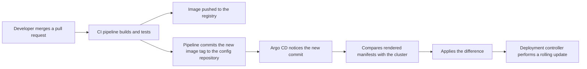

# GitOps with Argo CD

## In plain words

Think about how a large building is kept in order. Somewhere there is a set of approved drawings. A change to the building is supposed to begin as a change to the drawings, reviewed and signed. Now add an inspector who walks the building every few minutes with the drawings in hand. Wherever the building differs from the drawings, a wall moved or a door missing, the inspector puts it back as drawn. Nobody can quietly alter the building, and if a bad change is approved, restoring the previous drawing restores the building.

**GitOps** runs a Kubernetes cluster that way. The drawings are your manifests, stored in **Git**, the version-control system that records every change to a set of files together with its author, time and reason. The inspector is a program running inside the cluster that compares what Git says with what the cluster has and corrects the difference. **Argo CD** is the most widely used such program.

The earlier lesson on [reconciliation loops](#/lesson/kubernetes/declarative-reconciliation) showed controllers driving the cluster towards the desired state stored in the API server. GitOps adds one loop on top: it drives the *API server's* desired state towards what is in Git. Git becomes the single place where the truth about the system is written.

This lesson also covers how new versions are released with care, using **blue-green** and **canary** strategies, because a GitOps tool is where those strategies are usually put into practice.

Why this matters for a job: GitOps is the standard delivery model at most companies that run Kubernetes at scale. "How does code get from a merge to production?" is asked in nearly every platform, DevOps and backend interview, and a clear answer involving Git, a pipeline, a registry and Argo CD shows that you understand the whole path.

> **Before this lesson:** you need the declarative model ([The declarative model and reconciliation loops](#/lesson/kubernetes/declarative-reconciliation)), rolling updates ([Rolling updates, rollbacks and strategies](#/lesson/kubernetes/rolling-updates-rollbacks)), custom resources ([Extending the API: CRDs and operators](#/lesson/kubernetes/crds-operators)) and the previous lesson, [Helm and Kustomize](#/lesson/kubernetes/helm-kustomize). Basic Git words (commit, branch, pull request) are explained as they appear.

## Push and pull

There are two ways to get manifests into a cluster automatically.

**Push.** A **CI pipeline** (CI is continuous integration: a server that builds and tests code on every change) finishes its tests and then runs `kubectl apply` or `helm upgrade` against the cluster. This is easy to set up and has three weaknesses:

- The pipeline needs powerful cluster credentials, stored outside the cluster. Whoever breaks into the CI system can deploy anything.
- Nothing notices **drift**. If someone edits a Deployment by hand at 2 a.m., the cluster no longer matches the repository, and no tool says so until the next deployment overwrites it, or fails.
- The record of "what is running" is scattered across pipeline logs.

**Pull.** An agent inside the cluster watches a Git repository and applies what it finds. The cluster reaches out to Git; nothing outside holds cluster credentials. The agent compares continuously, so drift is detected within minutes and can be corrected automatically.

| | Push (pipeline applies) | Pull (GitOps agent) |
|---|---|---|
| Who talks to the API server | The CI system, from outside | An agent inside the cluster |
| Cluster credentials live | In the CI system | Nowhere outside the cluster |
| Drift | Unnoticed | Detected, optionally reverted |
| Record of the running state | Pipeline logs | The Git history |
| Rollback | Re-run an old pipeline | Revert a commit |

## The four principles

The OpenGitOps project sums the model up in four principles. A system managed by GitOps has its desired state:

1. **Declarative** — expressed as descriptions of the result, not as a script of steps.
2. **Versioned and immutable** — stored so that every version is kept and old versions cannot be altered. Git provides this.
3. **Pulled automatically** — software agents fetch the desired state by themselves.
4. **Continuously reconciled** — agents keep comparing actual with desired and act on differences.

## The whole path, from merge to running Pod



A **pull request** is a proposed change to a repository that colleagues review before it is **merged**, meaning accepted into the main line of history. Two details in the diagram deserve attention.

**Two repositories.** Most teams keep the application's source code in one repository and its deployment configuration in another. The reasons: a configuration change (more replicas) should not rebuild the application; access can differ (many people may change code, fewer may change production settings); and the configuration repository's history then reads as a clean log of deployments.

**The pipeline still exists, with a smaller job.** It builds the image, pushes it to the registry and then makes one commit: changing the image tag in the configuration repository. It never touches the cluster. With Kustomize that commit is a one-line change under `images:`; with Helm, one line in a values file.

## Argo CD

### What gets installed

Argo CD runs as a few Deployments in its own namespace, usually `argocd`.

- The **repository server** fetches Git repositories and renders their contents into plain manifests. It understands plain YAML folders, Kustomize overlays and Helm charts.
- The **application controller** is the inspector. It compares the rendered manifests with the live objects and, when allowed, applies the difference.
- The **API server** of Argo CD serves a web interface and a command-line tool, `argocd`.

Argo CD is configured through custom resources, so it manages itself the way it manages everything else. The central one is the **Application**: a pointer from one place in Git to one place in a cluster.

### An Application, line by line

```yaml
apiVersion: argoproj.io/v1alpha1
kind: Application
metadata:
  name: orders-api-prod
  namespace: argocd
spec:
  project: cafe
  source:
    repoURL: https://git.example/harbour-coffee/deploy-config.git
    targetRevision: main
    path: orders-api/overlays/prod
  destination:
    server: https://kubernetes.default.svc
    namespace: cafe-prod
  syncPolicy:
    automated:
      prune: true
      selfHeal: true
    syncOptions:
      - CreateNamespace=true
```

- `apiVersion: argoproj.io/v1alpha1`, `kind: Application` — a custom resource defined by Argo CD. It lives in the `argocd` namespace, not in the application's namespace.
- `spec.project: cafe` — an **AppProject**, Argo CD's unit of access control. A project limits which repositories its Applications may read and which clusters and namespaces they may write to, so that one team's Application cannot deploy into another team's namespace.
- `source.repoURL` — the Git repository holding the configuration.
- `source.targetRevision: main` — which branch, tag or commit to follow.
- `source.path` — the folder inside the repository. Here it is the Kustomize production overlay from the previous lesson; Argo CD detects the `kustomization.yaml` and renders it.
- `destination.server` — which cluster. `https://kubernetes.default.svc` is the cluster Argo CD itself runs in. One Argo CD can also manage other, registered clusters.
- `destination.namespace` — where the objects go.
- `syncPolicy.automated` — apply changes without a person pressing a button. Without this block Argo CD only reports differences and waits.
  - `prune: true` — delete objects from the cluster when they are removed from Git. Off by default, as a safety measure.
  - `selfHeal: true` — when the *cluster* is changed by hand, put it back.
- `syncOptions: [CreateNamespace=true]` — create the destination namespace if it does not exist.

### Two kinds of status

Argo CD reports two independent facts about every Application.

| Status | Question it answers | Values |
|---|---|---|
| **Sync status** | Does the cluster match Git? | `Synced`, `OutOfSync` |
| **Health status** | Are the objects working? | `Healthy`, `Progressing`, `Degraded`, `Missing`, `Suspended` |

They are different questions. `Synced` and `Degraded` together mean: the cluster has exactly what Git asked for, and what Git asked for does not work, perhaps because the new image crashes. `OutOfSync` and `Healthy` mean: things run fine, and someone changed something that Git does not know about.

```bash
$ kubectl get applications -n argocd
NAME              SYNC STATUS   HEALTH STATUS
orders-api-prod   Synced        Healthy
menu-api-prod     OutOfSync     Healthy
web-prod          Synced        Degraded

$ argocd app get orders-api-prod
Name:               argocd/orders-api-prod
Project:            cafe
Server:             https://kubernetes.default.svc
Namespace:          cafe-prod
Repo:               https://git.example/harbour-coffee/deploy-config.git
Target:             main
Path:               orders-api/overlays/prod
Sync Policy:        Automated (Prune)
Sync Status:        Synced to main (4f2a9c1)
Health Status:      Healthy

GROUP  KIND        NAMESPACE  NAME        STATUS  HEALTH
       Service     cafe-prod  orders-api  Synced  Healthy
apps   Deployment  cafe-prod  orders-api  Synced  Healthy

$ argocd app diff menu-api-prod
===== apps/Deployment cafe-prod/menu-api ======
<   replicas: 5
>   replicas: 3
```

`Synced to main (4f2a9c1)` names the exact commit that is running, which answers "what is in production?" precisely. `argocd app diff` shows the drift in the second Application: the live object has 5 replicas and Git says 3.

### The loop you can run

The simulation holds two dictionaries: what Git wants and what the cluster has. Each pass computes the difference, reports the sync status and, when automation is on, repairs it.

```python-run
import copy

git = {"Deployment/orders-api": {"image": "orders-api:2.0.3", "replicas": 3},
       "Service/orders-api": {"port": 80},
       "ConfigMap/orders-config": {"LOG_LEVEL": "info"}}
cluster = {}

def diff(desired, live):
    changes = []
    for name, spec in desired.items():
        if name not in live:
            changes.append(("create", name))
        elif live[name] != spec:
            changes.append(("update", name))
    for name in live:
        if name not in desired:
            changes.append(("prune", name))
    return changes

def reconcile(event, automated=True, prune=True, self_heal=True, drift=False):
    changes = diff(git, cluster)
    status = "OutOfSync" if changes else "Synced"
    print(f"{event}\n   sync status: {status}  {changes if changes else ''}")
    if not changes or not automated:
        return
    if drift and not self_heal:
        print("   selfHeal is off: reported, not corrected")
        return
    for action, name in changes:
        if action == "prune":
            if prune:
                del cluster[name]
            else:
                print(f"   prune is off: {name} is left in the cluster")
        else:
            cluster[name] = copy.deepcopy(git[name])
    print(f"   after sync: {'Synced' if not diff(git, cluster) else 'OutOfSync'}")

reconcile("1. Application created, cluster is empty")
git["Deployment/orders-api"]["image"] = "orders-api:2.0.4"
reconcile("2. Pipeline commits image tag 2.0.4 to Git")
cluster["Deployment/orders-api"]["replicas"] = 9
reconcile("3. Someone runs kubectl scale by hand", drift=True)
del git["ConfigMap/orders-config"]
reconcile("4. ConfigMap deleted from Git, prune off", prune=False)
reconcile("5. Same state, prune on")
git["Deployment/orders-api"]["image"] = "orders-api:2.0.3"
reconcile("6. git revert of the 2.0.4 commit")
print("\nfinal cluster state:", cluster)
```

Walk through the six events. Step 3 is self-healing: the manual scale to 9 is undone because Git says 3. Step 4 shows why pruning is a separate switch: with it off, an object removed from Git lingers in the cluster as an orphan, and the Application stays `OutOfSync`. Step 6 is a rollback: no special command, only a commit that restores the earlier text.

### Rollback is a Git operation

Because Git is the source of truth, undoing a release means undoing a commit:

```bash
$ git revert 4f2a9c1
[main 9d1e0b7] Revert "orders-api: release 2.0.4"
$ git push
```

`git revert` creates a *new* commit that reverses an earlier one, so history shows both the release and its withdrawal, with authors and times. Argo CD sees the new commit and syncs. Argo CD also has a rollback button, but with automated sync on, the cluster would be pulled forward again to match Git at the next comparison. Change Git; let the cluster follow.

### Order, many applications, many clusters

- **Sync waves.** Objects carry the annotation `argocd.argoproj.io/sync-wave` with a number. Lower waves are applied and must be healthy before higher ones begin. Typical use: a namespace and CRDs in wave 0, a database in wave 1, the application in wave 2.
- **Hooks.** A Job annotated `argocd.argoproj.io/hook: PreSync` runs before the sync, which suits database schema migrations. `PostSync` suits smoke tests.
- **App of apps.** One parent Application whose Git folder contains other Application manifests. Creating the parent creates all the children, which is how a whole cluster is bootstrapped from a single object.
- **ApplicationSet.** A template that stamps out many Applications from a list or from the folders of a repository.

```yaml
apiVersion: argoproj.io/v1alpha1
kind: ApplicationSet
metadata:
  name: orders-api
  namespace: argocd
spec:
  generators:
    - list:
        elements:
          - env: dev
          - env: staging
          - env: prod
  template:
    metadata:
      name: 'orders-api-{{env}}'
    spec:
      project: cafe
      source:
        repoURL: https://git.example/harbour-coffee/deploy-config.git
        targetRevision: main
        path: 'orders-api/overlays/{{env}}'
      destination:
        server: https://kubernetes.default.svc
        namespace: 'cafe-{{env}}'
```

The `list` generator supplies three values of `env`, and the template is rendered once for each, producing `orders-api-dev`, `orders-api-staging` and `orders-api-prod`. Other generators produce one Application per registered cluster or per folder in Git.

### Promoting between environments

A change should reach development first, then staging, then production. The widely recommended layout is **one folder per environment on a single branch**, as in the Kustomize overlays. Promotion is then a pull request that copies the new image tag from `overlays/staging` to `overlays/prod`. Long-lived branches per environment tend to diverge and make it hard to see how environments differ.

### Secrets

Git must not contain readable passwords, yet GitOps wants everything in Git. Three common answers:

- **Sealed Secrets**: you encrypt a Secret with a public key; only a controller in the cluster holds the private key that can open it. The encrypted form is safe to commit.
- **External Secrets Operator**: Git holds only a reference ("fetch `prod/orders/db` from the cloud's secret store"); a controller fetches the value and creates the Secret.
- **SOPS**: a tool that encrypts the values inside YAML files with keys from a cloud key service; the GitOps tool decrypts at render time.

**Flux** is the other major GitOps tool. It follows the same principles as a set of smaller controllers without a built-in web interface. Knowing one makes the other easy to pick up.

## Releasing with care: blue-green and canary

A Deployment's rolling update, from the [rolling updates lesson](#/lesson/kubernetes/rolling-updates-rollbacks), replaces Pods gradually, and it has one blind spot: its only test of the new version is the readiness probe. A version that starts correctly and then returns errors for 5% of orders passes that test and rolls out to everyone. Two strategies add a stage where the new version is judged before it serves all users.

| Strategy | How it works | Cost | Strength |
|---|---|---|---|
| Rolling update | Replace Pods a few at a time | Almost none | Built in and predictable |
| Blue-green | Run the complete new version (green) beside the old (blue); test green; switch all traffic at once | Double the resources during the release | Instant switch and instant switch back |
| Canary | Send a small share of real traffic to the new version; watch metrics; widen step by step | Needs traffic splitting and good metrics | Limits how many users a bad release reaches |

The name **canary** comes from coal mining, where a caged canary gave early warning of bad air. A canary release exposes a few users first, as the warning.

Plain Kubernetes can imitate both. Blue-green: two Deployments labelled `version: blue` and `version: green`, and a Service whose selector you switch from one to the other. Canary: two Deployments behind one Service, with the share of traffic roughly equal to the share of Pods. Doing this by hand is error-prone, so most teams use a controller. **Argo Rollouts** provides a `Rollout` resource that replaces a Deployment and adds the two strategies.

```yaml
apiVersion: argoproj.io/v1alpha1
kind: Rollout
metadata:
  name: orders-api
  namespace: cafe-prod
spec:
  replicas: 10
  selector:
    matchLabels:
      app: orders-api
  template:
    metadata:
      labels:
        app: orders-api
    spec:
      containers:
        - name: orders-api
          image: ghcr.io/harbour-coffee/orders-api:2.0.4
  strategy:
    canary:
      steps:
        - setWeight: 10
        - pause: {duration: 5m}
        - analysis:
            templates:
              - templateName: success-rate
        - setWeight: 50
        - pause: {duration: 10m}
```

- `kind: Rollout` — used in place of `kind: Deployment`. `replicas`, `selector` and `template` have the same meaning.
- `strategy.canary.steps` — the release plan, executed in order.
  - `setWeight: 10` — send 10% of traffic to the new version.
  - `pause: {duration: 5m}` — wait five minutes. A `pause: {}` with no duration waits for a person to approve.
  - `analysis` — run an **AnalysisTemplate**, a separate object containing a metric query (for example "the share of successful requests over the last five minutes") and a pass mark. If the analysis fails, the Rollout **aborts**: traffic returns to the old version automatically.
  - `setWeight: 50` and another pause — widen, wait, and after the last step go to 100%.

A blue-green Rollout instead names two Services, `activeService` and `previewService`, and switches the active one when the new version is approved.

```python-run
import random

def canary_release(new_error_rate, old_error_rate=0.002, threshold=0.01, requests_per_step=20000, seed=1):
    rng = random.Random(seed)
    print(f"new version's true error rate: {new_error_rate:.1%}   abort above {threshold:.1%}")
    harmed = 0
    for weight in (5, 25, 50, 100):
        to_new = int(requests_per_step * weight / 100)
        errors_new = sum(rng.random() < new_error_rate for _ in range(to_new))
        errors_old = sum(rng.random() < old_error_rate for _ in range(requests_per_step - to_new))
        observed = errors_new / to_new
        harmed += errors_new
        print(f"  weight {weight:3}%: {to_new:5} requests to new, canary error rate {observed:.2%}, old version errors {errors_old}")
        if observed > threshold:
            print(f"  ABORT: traffic back to the old version. Failed requests caused by the release: {harmed}\n")
            return
    print(f"  PROMOTED to 100%. Failed requests on the new version during the release: {harmed}\n")

canary_release(new_error_rate=0.002)       # as good as the old version
canary_release(new_error_rate=0.05)        # a bad release
print("For comparison, the bad release rolled out to everyone at once would have failed about",
      int(4 * 20000 * 0.05), "requests in the same period.")
```

The bad release is stopped at the first step, after harming a few dozen requests instead of thousands. That is the entire argument for canaries. It also shows their requirement: the decision is only as good as the metric and the threshold, and at 5% weight on a quiet service there may be too few requests to judge.

> [!TIP]
> Turn on `selfHeal` and `prune` only after the team has agreed that Git is the sole way to change the cluster. Until then, run with automated sync off, read the diffs Argo CD reports, and find out who is still editing things by hand. Enabling self-healing in a team that still relies on `kubectl edit` produces confusing "my change vanished" incidents.

> [!INTERVIEW]
> **"How does a code change reach production in a GitOps setup?"** A developer merges a pull request. CI builds and tests, pushes an image tagged with the commit to a registry, and then commits that tag to a separate configuration repository (a Kustomize overlay or Helm values file). Argo CD, running in the cluster, notices the new commit, renders the manifests, compares them with the live objects, reports `OutOfSync` and, with automated sync, applies the difference; the Deployment controller then performs the rolling update. Argo CD shows sync status (does the cluster match Git) and health status (does it work) separately. Rollback is `git revert`. Benefits over a pipeline running `kubectl apply`: no cluster credentials outside the cluster, a complete audit trail in Git, drift detection and self-healing, and one mechanism for many clusters. For safer releases mention canary or blue-green with Argo Rollouts and automated metric analysis, and for secrets mention Sealed Secrets or the External Secrets Operator.

## Common pitfalls

- **Editing the cluster by hand under self-healing.** The change disappears within minutes. Change Git.
- **Using Argo CD's rollback with automated sync on.** The next comparison brings the newer version back.
- **Following a moving tag such as `latest`.** Git does not change, so nothing is deployed; or the image changes underneath a "Synced" Application. Pin exact tags or digests.
- **Leaving `replicas` in Git for a workload with an HPA.** Argo CD and the autoscaler fight. Remove the field or tell Argo CD to ignore it.
- **Committing readable Secrets.** Once pushed, treat the value as leaked and rotate it.
- **One branch per environment.** Branches drift; use folders.
- **Pruning without thought.** With `prune: true`, deleting a file deletes the object, including its data if it owns any. Protect critical resources.
- **Treating `Synced` as `Healthy`.** They are different facts.
- **A canary without meaningful metrics.** Pausing for ten minutes and promoting regardless is a slow rolling update.
- **Giving the CI system cluster-admin "for convenience".** The pipeline should write to Git, not to the cluster.

## Cheat sheet

| Task | Command |
|---|---|
| List applications | `argocd app list` or `kubectl get applications -n argocd` |
| Details and resource tree | `argocd app get NAME` |
| What differs from Git | `argocd app diff NAME` |
| Sync now | `argocd app sync NAME` |
| Deployment history | `argocd app history NAME` |
| Roll back properly | `git revert COMMIT && git push` |
| Watch a canary | `kubectl argo rollouts get rollout NAME --watch` |
| Approve a paused step | `kubectl argo rollouts promote NAME` |
| Abort a release | `kubectl argo rollouts abort NAME` |

| Field | Meaning |
|---|---|
| `source.repoURL`, `targetRevision`, `path` | Where the desired state lives |
| `destination.server`, `namespace` | Where it is applied |
| `syncPolicy.automated` | Apply without manual approval |
| `prune` | Delete what Git no longer contains |
| `selfHeal` | Undo manual changes in the cluster |

## Summary

GitOps makes a Git repository the single source of truth for a cluster's desired state, and puts an agent inside the cluster to pull that state and reconcile continuously. Compared with a pipeline that pushes with `kubectl apply`, it removes cluster credentials from outside systems, records every change as a reviewed commit, detects drift and makes rollback a `git revert`. Argo CD implements it through the Application resource, which maps a path in a repository to a namespace in a cluster and reports sync status and health status separately; ApplicationSets, sync waves and projects scale it to many applications, clusters and teams. For the release itself, blue-green and canary strategies, automated by Argo Rollouts, test a new version on a preview or on a small share of traffic before everyone receives it. Delivery is now covered end to end; the next module is about what to do when something that was delivered does not work.

## Glossary

- **Git**: a version-control system that records every change to a set of files.
- **Commit**: one recorded change in Git, with author, time and message.
- **Pull request**: a proposed change that is reviewed before being merged.
- **CI (continuous integration)**: automatic building and testing of code on every change.
- **GitOps**: managing a system by storing its desired state in Git and reconciling automatically.
- **Push deployment**: an outside system applies changes to the cluster.
- **Pull deployment**: an agent in the cluster fetches and applies changes.
- **Drift**: a difference between the cluster and the declared state.
- **Argo CD**: a GitOps controller for Kubernetes with a web interface.
- **Application**: Argo CD's resource linking a Git path to a cluster and namespace.
- **AppProject**: Argo CD's grouping that restricts sources and destinations.
- **Sync status**: whether the cluster matches Git.
- **Health status**: whether the deployed objects are working.
- **Prune**: delete cluster objects that were removed from Git.
- **Self-heal**: revert manual changes made in the cluster.
- **Sync wave**: an ordering number for applying objects in stages.
- **ApplicationSet**: a template that generates many Applications.
- **Blue-green release**: run old and new side by side and switch all traffic at once.
- **Canary release**: expose a small share of traffic to the new version first.
- **Argo Rollouts**: a controller providing the Rollout resource for blue-green and canary releases.
- **AnalysisTemplate**: a metric check that decides whether a release step passes.

```quiz
[
  {"q": "What is the defining difference between push-based deployment and GitOps pull-based deployment?",
   "options": ["Push uses YAML and pull uses JSON", "In pull, an agent inside the cluster fetches the desired state from Git and applies it; in push, an outside system applies it", "Pull works only with Helm", "Push is declarative and pull is imperative"],
   "answer": 1,
   "explain": "The direction of the connection is the point. With pull, no system outside the cluster needs credentials to change it, and the agent can reconcile continuously."},
  {"q": "An Argo CD Application shows Sync Status: Synced and Health Status: Degraded. What does that tell you?",
   "options": ["Git and the cluster differ", "The cluster matches Git, and what Git describes is not working", "Argo CD has lost access to the repository", "Pruning is disabled"],
   "answer": 1,
   "explain": "Sync status compares the cluster with Git; health status reports whether the objects work. A crashing image that was faithfully deployed gives Synced and Degraded."},
  {"q": "With automated sync and selfHeal: true, an engineer runs kubectl scale to change a Deployment from 3 to 9 replicas. Git says 3. What happens?",
   "options": ["The Deployment stays at 9 until the next commit", "Argo CD detects the drift and returns it to 3", "Argo CD updates Git to say 9", "The Application is deleted"],
   "answer": 1,
   "explain": "Self-healing reverts changes made directly in the cluster so that it matches Git again. Argo CD never writes the cluster's state back to Git."},
  {"q": "A manifest is deleted from the Git folder an Application follows. prune is not enabled. What happens to the object in the cluster?",
   "options": ["It is deleted immediately", "It remains, and the Application reports OutOfSync", "It is moved to the argocd namespace", "The whole Application is rolled back"],
   "answer": 1,
   "explain": "Deleting from the cluster is opt-in. Without prune, the leftover object stays and is reported as a difference."},
  {"q": "What is the recommended way to roll back a bad release under GitOps?",
   "options": ["kubectl rollout undo on the Deployment", "Revert the commit in Git and let the controller sync", "Delete the Application", "Restore the etcd backup"],
   "answer": 1,
   "explain": "Git is the source of truth. A revert commit records the rollback and the controller applies it; a manual undo in the cluster would be reverted by self-healing."},
  {"q": "In the usual GitOps setup, what does the CI pipeline do after building and pushing an image?",
   "options": ["Runs kubectl apply against production", "Commits the new image tag to the configuration repository", "Restarts Argo CD", "Deletes the old Pods"],
   "answer": 1,
   "explain": "The pipeline's last step is a change in Git. It needs no cluster credentials; the in-cluster agent does the deploying."},
  {"q": "What does a canary release add that a plain rolling update lacks?",
   "options": ["It uses fewer Pods", "The new version receives a small share of real traffic and is judged on metrics before the release widens", "It never needs a readiness probe", "It deletes the old version first"],
   "answer": 1,
   "explain": "A rolling update proceeds on readiness alone. A canary holds at a small traffic share and can abort automatically if error rate or latency is worse."},
  {"q": "Why is running the full new version beside the old one (blue-green) more expensive than a rolling update?",
   "options": ["It needs a second cluster", "For the duration of the release both complete versions run, roughly doubling the workload's resources", "It requires a service mesh licence", "It rebuilds the image twice"],
   "answer": 1,
   "explain": "Green is brought up at full size while blue still serves. In return, switching traffic, and switching back, is immediate."}
]
```

> **Source:** this lesson extends the track beyond the chapters of Poulton's *The Kubernetes Book*. Project docs: https://opengitops.dev/ , https://argo-cd.readthedocs.io/en/stable/core_concepts/ , https://argo-cd.readthedocs.io/en/stable/user-guide/auto_sync/ , https://argo-cd.readthedocs.io/en/stable/user-guide/sync-waves/ , https://argo-cd.readthedocs.io/en/stable/operator-manual/applicationset/ , https://argo-rollouts.readthedocs.io/en/stable/features/canary/ , https://argo-rollouts.readthedocs.io/en/stable/features/bluegreen/ , https://fluxcd.io/flux/concepts/
