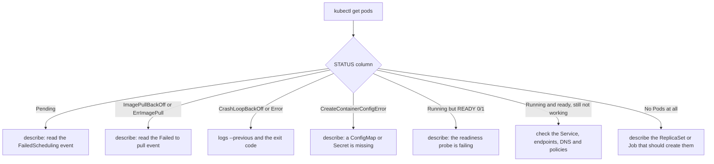

# Troubleshooting Pods: describe, logs, exec and events

## In plain words

A good doctor does not prescribe on the strength of "I feel unwell". There is a routine: take the temperature, read the chart, ask the patient what happened, examine, and order a test only when the earlier steps point somewhere. The routine matters more than brilliance, because it stops the doctor from treating the wrong illness.

Fixing a broken Pod works the same way, and Kubernetes gives you an instrument for each step:

| Doctor | Kubernetes | What it tells you |
|---|---|---|
| Take the temperature | `kubectl get pods` | One word of status per Pod |
| Read the chart | `kubectl describe pod` | The Pod's full state and recent history |
| Read the nurses' notes | Events | What the cluster tried to do, and what went wrong |
| Ask the patient | `kubectl logs` | What the program itself said |
| Examine | `kubectl exec`, `kubectl debug` | A look around from inside |

Beginners tend to skip the routine. They see `CrashLoopBackOff`, delete the Pod, see it again, and start changing things at random. This lesson replaces that with a method: read the status, let the status choose the next command, and move from the symptom to the cause in a few deliberate steps.

Why this matters for a job: debugging is most of the daily work with Kubernetes, and it is the skill interviewers probe hardest, because it cannot be faked. "A Pod is in CrashLoopBackOff, what do you do?" has a right answer, and it is a sequence, not a guess.

> **Before this lesson:** you need Pod phases, restart policies and probes ([Lifecycle, restart policies, probes, requests and limits](#/lesson/kubernetes/pod-lifecycle-resources)), Services and endpoints ([Services, selectors, ClusterIP and EndpointSlices](#/lesson/kubernetes/services-clusterip)), scheduling ([Steering the scheduler](#/lesson/kubernetes/scheduling-controls)) and basic `kubectl` ([kubectl and kubeconfig](#/lesson/kubernetes/kubectl-kubeconfig)).

## The method



Three rules sit behind the diagram.

1. **The status chooses the tool.** Logs are useless for a Pending Pod, because no container has ever started. Events are the place to look. For a crashing container the opposite holds.
2. **Go one level up when the Pod has no answer.** A Pod is created by a ReplicaSet, which is created by a Deployment. If no Pod exists, the explanation is in the object that failed to create it.
3. **Change one thing at a time**, and only after you can say what is wrong.

## The five instruments

### 1. `kubectl get pods`

```bash
$ kubectl get pods -n cafe
NAME                          READY   STATUS             RESTARTS        AGE
menu-api-6b7f9d4c88-2xk4p     1/1     Running            0               3d
orders-api-7c9d8f6b5d-4kx2p   0/1     CrashLoopBackOff   6 (2m10s ago)   9m
report-worker-5d8c7b6f-9hbtz  0/1     Pending            0               4m
web-84f6d9c7b-jq7ws           0/1     ImagePullBackOff   0               6m
```

Read three columns.

- `READY` — containers that are ready out of containers in the Pod. `0/1` means the one container is not ready, so the Pod receives no traffic from Services.
- `STATUS` — a one-word summary. It is not the same as the Pod's phase; it is the most informative reason `kubectl` could find.
- `RESTARTS` — how many times containers were restarted, and when the last one happened. A number that keeps growing means a loop.

Add `-o wide` to see each Pod's node and IP address. If every broken Pod is on one node, suspect the node.

### 2. `kubectl describe pod`

`describe` prints the whole chart. Four parts repay attention:

```bash
$ kubectl describe pod orders-api-7c9d8f6b5d-4kx2p -n cafe
...
Containers:
  orders-api:
    Image:          ghcr.io/harbour-coffee/orders-api:2.0.4
    State:          Waiting
      Reason:       CrashLoopBackOff
    Last State:     Terminated
      Reason:       Error
      Exit Code:    1
      Started:      Sat, 21 Nov 2026 09:14:02 +0800
      Finished:     Sat, 21 Nov 2026 09:14:03 +0800
    Ready:          False
    Restart Count:  6
...
Conditions:
  Type                        Status
  PodScheduled                True
  Initialized                 True
  ContainersReady             False
  Ready                       False
...
Events:
  Type     Reason     Age                  From               Message
  Normal   Scheduled  9m                   default-scheduler  Successfully assigned cafe/orders-api-7c9d8f6b5d-4kx2p to worker-2
  Normal   Pulled     7m (x5 over 9m)      kubelet            Container image "ghcr.io/harbour-coffee/orders-api:2.0.4" already present on machine
  Normal   Started    7m (x5 over 9m)      kubelet            Started container orders-api
  Warning  BackOff    2m (x34 over 9m)     kubelet            Back-off restarting failed container orders-api in pod orders-api-7c9d8f6b5d-4kx2p_cafe
```

- `State` — what the container is doing now: `Waiting`, `Running` or `Terminated`, with a reason.
- `Last State` — how the **previous** run ended. This is where the cause of a crash is recorded: `Reason` and `Exit Code`. Here the program ran for one second and exited with code 1.
- `Conditions` — a checklist the Pod passes through in order. The first `False` shows how far it got. `PodScheduled: False` means it never got a node.
- `Events` — the recent history, oldest first. `(x34 over 9m)` means the same event occurred 34 times in nine minutes.

### 3. Events

An **event** is a short record that a component writes when something notable happens: a Pod was scheduled, an image could not be pulled, a probe failed. `describe` shows the events of one object. To see a whole namespace in time order:

```bash
$ kubectl events -n cafe --types=Warning
LAST SEEN          TYPE      REASON             OBJECT                              MESSAGE
4m                 Warning   FailedScheduling   Pod/report-worker-5d8c7b6f-9hbtz    0/5 nodes are available: 5 Insufficient memory.
2m (x34 over 9m)   Warning   BackOff            Pod/orders-api-7c9d8f6b5d-4kx2p     Back-off restarting failed container orders-api
40s (x12 over 6m)  Warning   Failed             Pod/web-84f6d9c7b-jq7ws             Error: ImagePullBackOff
```

Events are kept for about one hour by default and then deleted. If you arrive late the notes are gone, which is one reason clusters ship events to a logging system (see [Metrics and logging stacks](#/lesson/kubernetes/metrics-logging)).

### 4. `kubectl logs`

Logs are whatever the program wrote to its standard output and standard error, the two text streams every program has.

| Command | Shows |
|---|---|
| `kubectl logs POD` | The current run of the container |
| `kubectl logs POD --previous` | The **previous** run, the one that crashed |
| `kubectl logs POD -c NAME` | One container of a multi-container Pod |
| `kubectl logs POD --all-containers` | Every container |
| `kubectl logs -f POD` | Follow new lines as they arrive |
| `kubectl logs POD --since=10m --tail=100` | Only recent lines |
| `kubectl logs deploy/NAME` | One Pod of a Deployment, chosen for you |
| `kubectl logs -l app=orders-api --prefix` | Every Pod with a label, each line marked with its Pod |

`--previous` is the flag people forget. In a crash loop the *current* container has often only begun, and its log is empty or cut short. The explanation is in the run that died.

### 5. `kubectl exec` and `kubectl debug`

`kubectl exec` runs a command inside a running container:

```bash
$ kubectl exec -n cafe deploy/menu-api -- env | grep DB_
DB_HOST=menu-db
DB_PORT=5432

$ kubectl exec -it -n cafe deploy/menu-api -- sh
/app $ wget -qO- -T 3 http://localhost:8080/healthz
ok
```

The first form runs one command and prints the result. The second, with `-it`, opens an interactive shell. Typical checks from inside: are the environment variables set, does the configuration file exist where the program expects it, can this Pod resolve and reach its dependencies?

`exec` has two limits. It needs a *running* container, so it cannot enter one that crashes at once. And many production images contain no shell at all, by design, to give attackers less to work with. `kubectl debug` handles both:

```bash
$ kubectl debug -it orders-api-7c9d8f6b5d-4kx2p -n cafe --image=busybox:1.36 --target=orders-api
Targeting container "orders-api". If you don't see processes from this container it may be because the container runtime doesn't support this feature.
/ # ps
PID   USER     COMMAND
    1 10001    /app/orders-api
   14 root     sh

$ kubectl debug orders-api-7c9d8f6b5d-4kx2p -n cafe -it --copy-to=orders-debug --container=orders-api -- sh
```

- The first command adds an **ephemeral container**: a temporary container attached to the existing Pod, bringing its own tools. `--target` lets it see the processes of the named container. Nothing is restarted.
- The second makes a **copy** of the Pod with the container's command replaced by a shell, so that you can start the program by hand and watch it fail.

## A catalogue of symptoms

| STATUS | Meaning | First place to look |
|---|---|---|
| `Pending` | Not placed on a node yet | Events: `FailedScheduling` |
| `ContainerCreating` (for a long time) | Placed, but a volume, Secret or network set-up is not complete | Events: `FailedMount`, `FailedCreatePodSandBox` |
| `ErrImagePull`, `ImagePullBackOff` | The image cannot be downloaded | Events: `Failed to pull image` |
| `CreateContainerConfigError` | A referenced ConfigMap or Secret (or key) does not exist | Events |
| `CrashLoopBackOff` | The container keeps exiting and is being restarted with growing delays | `logs --previous`, exit code |
| `Error` | The container exited with a non-zero code | `logs`, exit code |
| `OOMKilled` | Killed for exceeding its memory limit | `describe`: `Last State` |
| `Init:0/1`, `Init:CrashLoopBackOff` | An init container has not finished or is failing | `logs POD -c INIT_NAME` |
| `Running`, `READY 0/1` | Started, but the readiness probe fails | Events: `Unhealthy` |
| `Completed` | Exited with code 0 | Normal for Jobs; a mistake in a Deployment |
| `Terminating` (stuck) | Deletion requested but not finished | Finalizers; the node's state |
| `Evicted` | Removed by the kubelet because the node ran short of a resource | `describe`: the message |

The sections below take the most frequent ones in turn.

## Pending

A Pending Pod has not been scheduled. The scheduler's reasons are in the event:

```bash
Warning  FailedScheduling  4m  default-scheduler  0/5 nodes are available: 1 node(s) had untolerated taint {node-role.kubernetes.io/control-plane: }, 4 Insufficient memory.
```

| Message fragment | Cause | Fix |
|---|---|---|
| `Insufficient cpu` or `memory` | Requests exceed every node's unreserved capacity | Lower the requests, free capacity or add nodes |
| `untolerated taint` | The nodes are reserved | Add a toleration, or accept that those nodes are excluded |
| `didn't match Pod's node affinity/selector` | No node has the required labels | Fix the selector or label the nodes |
| `unbound immediate PersistentVolumeClaims` | The Pod's volume claim has no volume | `kubectl describe pvc` |
| `didn't match pod anti-affinity rules` or topology spread | Placement rules cannot be met | Relax the rule |

If the scheduler has said nothing at all, check that the Pod names an existing scheduler and that the control plane is healthy.

## No Pods at all

A Deployment says `0/3` ready and `kubectl get pods` shows nothing. No Pod means nothing to describe, so go up one level:

```bash
$ kubectl describe replicaset -n cafe -l app=report-worker
...
Events:
  Warning  FailedCreate  2m (x15 over 9m)  replicaset-controller  Error creating: pods "report-worker-5d8c7b6f-" is forbidden: exceeded quota: cafe-quota, requested: requests.memory=1Gi, used: requests.memory=7680Mi, limited: requests.memory=8Gi
```

The ReplicaSet tried to create Pods and the API server refused, here because of a ResourceQuota. Other refusals that appear in the same place: a Pod Security admission violation, a missing ServiceAccount, or a failing admission webhook.

## ImagePullBackOff

The kubelet could not download the image, tried again, and is now waiting between attempts with an increasing delay. `ErrImagePull` is the failure itself; `ImagePullBackOff` is the waiting state that follows.

```bash
Events:
  Normal   Pulling  45s (x3 over 90s)  kubelet  Pulling image "ghcr.io/harbour-coffee/web:3.2.O"
  Warning  Failed   44s (x3 over 89s)  kubelet  Failed to pull image "ghcr.io/harbour-coffee/web:3.2.O": rpc error: code = NotFound desc = failed to pull and unpack image: not found
  Warning  Failed   44s (x3 over 89s)  kubelet  Error: ErrImagePull
  Normal   BackOff  15s (x5 over 88s)  kubelet  Back-off pulling image "ghcr.io/harbour-coffee/web:3.2.O"
```

The message says `not found`, and a careful look at the tag shows a capital letter O where a zero belongs. The usual causes:

| Clue in the message | Cause |
|---|---|
| `not found`, `manifest unknown` | A typing mistake in the name or tag, or the tag was never pushed |
| `unauthorized`, `authentication required`, `denied` | A private registry and no valid `imagePullSecrets`, or the credential expired |
| `no match for platform` | The image was built for another CPU architecture, such as `arm64` on `amd64` nodes |
| `i/o timeout`, `no such host` | The node cannot reach the registry: network, DNS or proxy |
| `toomanyrequests` | The registry's rate limit was reached |

The kubelet keeps retrying, so once the cause is fixed (the tag pushed, the secret corrected) the Pod recovers without being deleted. A wrong image name must be corrected in the Deployment.

## CrashLoopBackOff

This is the status people fear, mostly because of a misunderstanding. **`CrashLoopBackOff` is not an error. It is a waiting state.** It says: the container started, exited, was restarted, exited again, and the kubelet is now pausing before the next attempt. The reason for the exits is somewhere else, and finding it is the whole task.

The pause grows: 10 seconds, then 20, 40, 80, 160, and from then on 5 minutes. After a container has run without trouble for 10 minutes, the delay resets.

```python-run
def backoff_timeline(crash_after_s, attempts, base=10, cap=300):
    clock, delay = 0, 0
    print(f"container crashes {crash_after_s}s after each start")
    print("attempt  started-at  crashed-at  status while waiting   next wait")
    for attempt in range(1, attempts + 1):
        start = clock
        crashed = start + crash_after_s
        delay = base if attempt == 1 else min(delay * 2, cap)
        print(f"{attempt:7}  {start:9}s  {crashed:9}s  CrashLoopBackOff       {delay:4}s")
        clock = crashed + delay
    minutes = clock / 60
    print(f"after {attempts} attempts {minutes:.0f} minutes have passed and RESTARTS shows {attempts - 1}")

backoff_timeline(crash_after_s=2, attempts=9)
```

Two practical lessons come out of the table. First, a Pod can look idle for five minutes at a stretch while nothing is being tried, so "I fixed the ConfigMap and nothing happened" often means "the next restart is not due yet"; deleting the Pod forces an immediate attempt. Second, most of the time `kubectl get pods` catches the Pod waiting, which is why you see `CrashLoopBackOff` far more often than `Error`.

### Finding the cause

```bash
$ kubectl logs orders-api-7c9d8f6b5d-4kx2p -n cafe --previous
2026-11-21T01:14:03Z FATAL config: required environment variable DB_PASSWORD is not set
```

That one line is usually the end of the investigation. When the log is empty, the exit code in `Last State` narrows things down:

| Exit code | Meaning | Typical cause |
|---|---|---|
| 0 | Success | A program that finishes was put in a Deployment; it exits, is restarted, exits again |
| 1 | General failure | An application error: bad configuration, a dependency that refused the connection, an unhandled exception |
| 2 | Wrong usage | Bad command-line arguments |
| 126 | Found but cannot be run | The file is not executable, or permissions are wrong |
| 127 | Command not found | A mistake in `command` or `args`, or the binary is missing from the image |
| 137 | Killed with signal 9 | Out of memory (`Reason: OOMKilled`), or killed after failing to stop within the grace period |
| 139 | Segmentation fault | A crash in native code |
| 143 | Stopped with signal 15 | Asked to terminate, commonly after a failed liveness probe |

Codes above 128 mean "ended by a signal": subtract 128 to get the signal's number. A **signal** is a message the operating system sends to a process; signal 9 kills it at once and signal 15 politely asks it to stop.

The causes behind a crash loop fall into a handful of groups:

1. **The application's own error at start-up**: a missing environment variable, an unreadable configuration file, a failed database migration.
2. **A dependency that is not available**, and a program that exits instead of retrying.
3. **A wrong `command` or `args`** in the manifest (exit code 127 or 126).
4. **Memory**: the limit is lower than the program needs to start (exit code 137 with `OOMKilled`).
5. **A liveness probe that fails**: the program was fine, but slow to start, and the kubelet killed it. Events show `Liveness probe failed` followed by `Container ... failed liveness probe, will be restarted`. The cure is a `startupProbe` or more generous timings.
6. **Permissions**: the container runs as a non-root user and cannot write where it wants to.

### OOMKilled

```bash
    Last State:     Terminated
      Reason:       OOMKilled
      Exit Code:    137
```

The container tried to use more memory than its limit and the kernel killed it. Decide which of two situations you are in. If the program needs more memory than you allowed, raise the limit (and the request). If its memory grows without bound, it has a leak, and raising the limit only postpones the next kill. `kubectl top pod` and a memory graph over time tell them apart.

## Running, but not ready

```bash
$ kubectl get pods -n cafe -l app=menu-api
NAME                        READY   STATUS    RESTARTS   AGE
menu-api-6b7f9d4c88-2xk4p   0/1     Running   0          5m

$ kubectl describe pod menu-api-6b7f9d4c88-2xk4p -n cafe | tail -3
  Warning  Unhealthy  4s (x31 over 5m)  kubelet  Readiness probe failed: HTTP probe failed with statuscode: 503
```

The process is alive and the readiness probe is failing, so the Pod is kept out of every Service. Ask whether the probe is right (path, port, timing) or the application is truly not ready (it cannot reach its database). The status code helps: 404 suggests a wrong path, `connection refused` a wrong port or a program not listening yet, 503 an application that reports itself unready.

## A Service that does not answer

The Pods are `Running` and `1/1`, and requests to the Service still fail. Work along the path from the name to the Pod, as the [packet path lesson](#/lesson/kubernetes/packet-path-troubleshooting) describes. The most valuable single command is the one that lists the Service's endpoints:

```bash
$ kubectl get endpointslices -n cafe -l kubernetes.io/service-name=orders-api
NAME               ADDRESSTYPE   PORTS     ENDPOINTS   AGE
orders-api-x7k2q   IPv4          <unset>   <unset>     12d
```

No endpoints means the Service has selected no ready Pods. The program below performs the checks in the order a person should.

```python-run
def diagnose(service, pods):
    """Return the first problem found on the way from a Service to its Pods."""
    selected = [p for p in pods if all(p["labels"].get(k) == v for k, v in service["selector"].items())]
    if not selected:
        return f"selector {service['selector']} matches no Pod; Pod labels are {[p['labels'] for p in pods]}"
    ready = [p for p in selected if p["ready"]]
    if not ready:
        return f"{len(selected)} Pod(s) selected but none is ready: fix the readiness probe or the application"
    wrong_port = [p["name"] for p in ready if service["targetPort"] not in p["ports"]]
    if wrong_port:
        return f"targetPort {service['targetPort']} is not a port the container listens on in {wrong_port}"
    return f"healthy: {len(ready)} endpoint(s) -> " + ", ".join(f"{p['ip']}:{service['targetPort']}" for p in ready)

pods = [{"name": "orders-api-1", "labels": {"app": "orders-api", "tier": "backend"}, "ready": True, "ip": "10.244.1.7", "ports": [8080]},
        {"name": "orders-api-2", "labels": {"app": "orders-api", "tier": "backend"}, "ready": False, "ip": "10.244.2.4", "ports": [8080]}]

cases = {
    "selector has a typing mistake": {"selector": {"app": "order-api"}, "port": 80, "targetPort": 8080},
    "selector asks for too much": {"selector": {"app": "orders-api", "version": "v2"}, "port": 80, "targetPort": 8080},
    "wrong targetPort": {"selector": {"app": "orders-api"}, "port": 80, "targetPort": 80},
    "correct": {"selector": {"app": "orders-api"}, "port": 80, "targetPort": 8080},
}
for name, service in cases.items():
    print(f"{name:30} -> {diagnose(service, pods)}")

pods[0]["ready"] = False
print(f"{'all Pods unready':30} -> {diagnose(cases['correct'], pods)}")
```

Four of the five outcomes are faults, and each has a different fix: correct the selector, correct the port, or repair readiness. If the endpoints are healthy and clients still fail, the remaining suspects are DNS (does the name resolve from the client's namespace?), a NetworkPolicy (the symptom is a timeout) and the client using the wrong port.

## Stuck in Terminating, and Evicted

A Pod that stays `Terminating` has been asked to go and has not gone. Usual reasons: the program ignores the stop signal and the grace period is long; a **finalizer** (a marker telling Kubernetes that some controller must finish clean-up before the object is removed) is waiting for a controller that no longer runs; or the node is unreachable, so nobody can confirm the containers have stopped. `kubectl delete pod NAME --grace-period=0 --force` removes the record from the API without waiting. Use it knowingly: on an unreachable node the container may still be running, which is dangerous for anything that writes to shared storage.

`Evicted` Pods were removed by the kubelet because the node ran short of memory or disk. The Pod's message names the resource. BestEffort and Burstable Pods using more than they requested go first, which is another reason to set requests honestly.

## When the node is the patient

If every Pod on one node is unwell, examine the node.

```bash
$ kubectl get nodes
NAME       STATUS     ROLES           AGE   VERSION
cp-1       Ready      control-plane   90d   v1.34.2
worker-1   Ready      <none>          90d   v1.34.2
worker-2   NotReady   <none>          90d   v1.34.2

$ kubectl describe node worker-2 | grep -A6 Conditions
Conditions:
  Type             Status    Reason              Message
  MemoryPressure   Unknown   NodeStatusUnknown   Kubelet stopped posting node status.
  DiskPressure     Unknown   NodeStatusUnknown   Kubelet stopped posting node status.
  Ready            Unknown   NodeStatusUnknown   Kubelet stopped posting node status.
```

`Kubelet stopped posting node status` means the control plane has lost contact: the machine is down, the kubelet has crashed or the network is cut. From there the work continues on the machine itself (`journalctl -u kubelet`), or through `kubectl debug node/worker-2 -it --image=busybox:1.36`, which starts a Pod on the node with the node's filesystem mounted at `/host`.

## The method as code

To close, the decision diagram from the start of the lesson written as a function. Give it what `kubectl get pods` and `describe` show, and it returns the next step.

```python-run
def next_step(pod):
    status, exit_code, ready = pod.get("status"), pod.get("exit_code"), pod.get("ready", False)
    if pod.get("missing"):
        return "No Pod exists: kubectl describe the ReplicaSet or Job and read FailedCreate events (quota, admission)."
    if status == "Pending":
        return "kubectl describe pod: read FailedScheduling (requests, taints, selectors, unbound volume claims)."
    if status in ("ErrImagePull", "ImagePullBackOff"):
        return "kubectl describe pod: read 'Failed to pull image' (name or tag, registry credentials, architecture, network)."
    if status == "CreateContainerConfigError":
        return "A referenced ConfigMap, Secret or key is missing: the event names it."
    if status in ("CrashLoopBackOff", "Error", "OOMKilled"):
        hints = {0: "the program finished normally; a Deployment is the wrong controller, use a Job",
                 127: "command not found: check command and args", 126: "not executable: check file permissions",
                 137: "killed: OOMKilled (raise the memory limit or fix a leak) or a forced stop",
                 143: "terminated by a signal: look for a failing liveness probe in the events"}
        return "kubectl logs --previous, then the exit code: " + hints.get(exit_code, "an application error; the log has the message")
    if status == "Running" and not ready:
        return "kubectl describe pod: the readiness probe is failing (path, port, timing, or a dependency)."
    if status == "Running" and ready:
        return "The Pod is fine: check the Service selector, endpoints, targetPort, DNS and NetworkPolicies."
    return "Unrecognised: read kubectl describe pod from top to bottom."

examples = [{"status": "Pending"}, {"status": "ImagePullBackOff"}, {"status": "CrashLoopBackOff", "exit_code": 1},
            {"status": "CrashLoopBackOff", "exit_code": 137}, {"status": "CrashLoopBackOff", "exit_code": 0},
            {"status": "CrashLoopBackOff", "exit_code": 127}, {"status": "Running", "ready": False},
            {"status": "Running", "ready": True}, {"missing": True}]
for pod in examples:
    print(f"{str(pod):50} -> {next_step(pod)}")
```

> [!TIP]
> When time is short, three commands give most of the picture: `kubectl get pods -o wide` (which Pods, which nodes), `kubectl describe pod NAME` (state, last state, events) and `kubectl logs NAME --previous` (what the program said before it died). Run them in that order before changing anything.

> [!INTERVIEW]
> **"A Pod is in CrashLoopBackOff. How do you debug it?"** Say first what the status means: the container starts and exits repeatedly, and the kubelet is waiting, with a back-off that doubles from 10 seconds to a 5-minute cap, before restarting it. It is a symptom, so find why the container exits. `kubectl describe pod` for the last state, exit code and events; `kubectl logs --previous` for the output of the run that died. Map the evidence to a cause: exit 1 with an error line is an application or configuration problem such as a missing environment variable or unreachable dependency; 127 is a wrong command; 137 with OOMKilled is the memory limit; 143 with `Liveness probe failed` events is a probe killing a slow starter, fixed with a startup probe; exit 0 means a program that finishes was given to a Deployment. If there is no shell or the container dies too fast for `exec`, use `kubectl debug` with an ephemeral container or a copy of the Pod with the command overridden. Fix the cause in the manifest, not in the running Pod. For other states, name the first command: Pending means the `FailedScheduling` event; ImagePullBackOff means the pull error in events; a Service without endpoints means comparing its selector with Pod labels and checking readiness.

## Common pitfalls

- **Reading `kubectl logs` without `--previous` during a crash loop.**
- **Deleting the Pod as the first step.** The replacement fails in the same way and the evidence of the earlier attempts is gone.
- **Looking for logs on a Pending Pod.** No container has run.
- **Treating `CrashLoopBackOff` as the diagnosis.** It only says "keeps exiting".
- **Raising a memory limit to cure a leak.** The kill comes later and bigger.
- **Forgetting init containers.** `Init:CrashLoopBackOff` needs `kubectl logs POD -c INIT_CONTAINER`.
- **Fixing things with `kubectl edit` or `exec`.** The next rollout, or the GitOps controller, removes the fix. Change the source.
- **Arriving after the events have expired.** Look quickly, or have events exported.
- **Force-deleting a Terminating Pod on an unreachable node** without thinking about what it may still be writing.
- **Blaming the application when a whole node is NotReady.**

## Cheat sheet

| Question | Command |
|---|---|
| What is the state of everything? | `kubectl get pods -A -o wide` |
| Only the unhealthy Pods | `kubectl get pods -A --field-selector=status.phase!=Running` |
| Why is this Pod in this state? | `kubectl describe pod NAME` |
| What happened recently in the namespace? | `kubectl events -n NS` or `kubectl get events --sort-by=.lastTimestamp` |
| What did the crashed run print? | `kubectl logs NAME --previous` |
| What does it see from inside? | `kubectl exec -it NAME -- sh` |
| No shell in the image | `kubectl debug -it NAME --image=busybox:1.36 --target=CONTAINER` |
| Crashes too fast to enter | `kubectl debug NAME -it --copy-to=NAME-debug --container=C -- sh` |
| Does the Service have backends? | `kubectl get endpointslices -l kubernetes.io/service-name=SVC` |
| Is the rollout stuck? | `kubectl rollout status deploy/NAME` |
| Why are there no Pods? | `kubectl describe rs -l app=NAME` |
| Is the node healthy? | `kubectl describe node NODE` |
| Reach the application directly | `kubectl port-forward pod/NAME 8080:8080` |

## Summary

Troubleshooting is a routine, not a talent. `kubectl get pods` gives a one-word status, and that word selects the next instrument: events for Pods that never started (Pending, image pull and configuration errors), the previous container's logs and its exit code for Pods that start and die, the readiness probe for Pods that run without becoming ready, and the Service's selector and endpoints for Pods that are healthy yet unreachable. When a Pod has no answer, look one level up to its controller or one level down to its node. `CrashLoopBackOff` and `ImagePullBackOff` are waiting states with growing delays, and the cause is always written somewhere nearby. The next lesson builds the systems that keep this evidence, the logs, metrics and events, for longer than a Pod's short life.

## Glossary

- **Status (kubectl)**: the one-word summary in `kubectl get pods`, derived from the Pod's phase and container states.
- **Event**: a short record of something a component did or failed to do, kept for about an hour.
- **Last State**: how a container's previous run ended, including reason and exit code.
- **Exit code**: the number a program returns on ending; 0 is success.
- **Signal**: a message from the operating system to a process, such as "terminate".
- **Back-off**: a waiting time that grows after each failure.
- **CrashLoopBackOff**: the waiting state of a container that keeps exiting and being restarted.
- **ImagePullBackOff**: the waiting state after repeated failures to download an image.
- **OOMKilled**: terminated by the kernel for exceeding the memory limit.
- **Standard output and standard error**: the two text streams a program writes to, collected as container logs.
- **Ephemeral container**: a temporary container added to a running Pod for debugging.
- **Finalizer**: a marker that delays an object's deletion until a controller has cleaned up.
- **Evicted**: removed from a node by the kubelet because of resource pressure.
- **NotReady (node)**: a node whose kubelet is not reporting healthy status.
- **Port-forward**: a tunnel from your machine to a port of a Pod.

```quiz
[
  {"q": "A Pod has been Pending for ten minutes. Which command is most useful, and why?",
   "options": ["kubectl logs, because the application explains itself", "kubectl describe pod, because the FailedScheduling event states why no node was chosen", "kubectl exec, to look inside", "kubectl rollout undo, to remove the fault"],
   "answer": 1,
   "explain": "A Pending Pod has no running container, so there are no logs and nothing to exec into. The scheduler's reasons are recorded as events."},
  {"q": "What does the status CrashLoopBackOff mean?",
   "options": ["The image cannot be downloaded", "The container repeatedly starts and exits, and the kubelet is waiting before the next restart", "The node has failed", "The Pod exceeded its CPU limit"],
   "answer": 1,
   "explain": "It is a waiting state, not a cause. The cause is found in the previous run's logs, the exit code and the events."},
  {"q": "During a crash loop, kubectl logs POD prints nothing. What should you try next?",
   "options": ["kubectl logs POD --previous", "kubectl delete pod POD", "kubectl scale to zero", "Wait an hour for the logs to arrive"],
   "answer": 0,
   "explain": "Without the flag you read the current run, which may have only begun. --previous shows the output of the run that crashed."},
  {"q": "describe shows Last State: Terminated, Reason: OOMKilled, Exit Code: 137. What happened?",
   "options": ["The image tag was wrong", "The container used more memory than its limit and the kernel killed it", "The liveness probe returned 404", "The node was drained"],
   "answer": 1,
   "explain": "137 is 128 + 9, a kill signal, and the reason says out of memory. Raise the limit if the need is real, or fix the leak."},
  {"q": "A container in a Deployment keeps restarting with exit code 0 and no errors in its log. What is the most likely explanation?",
   "options": ["The memory limit is too low", "The program completes its work and exits, and the Deployment restarts it; it should be a Job", "The image is for the wrong architecture", "DNS is broken"],
   "answer": 1,
   "explain": "Exit code 0 is success. A Deployment expects a long-running process and restarts anything that exits, producing a crash loop from a healthy program."},
  {"q": "Events show 'Failed to pull image ... unauthorized: authentication required'. What is the fix?",
   "options": ["Increase the memory request", "Provide valid registry credentials through imagePullSecrets, or correct the expired ones", "Add a toleration", "Use --previous"],
   "answer": 1,
   "explain": "The registry refused the pull for lack of credentials. The Pod's ServiceAccount or spec needs an imagePullSecret that the registry accepts."},
  {"q": "A Deployment's Pods are Running and 1/1 ready, but its Service has no endpoints. What do you check first?",
   "options": ["The node's kernel version", "That the Service's selector matches the Pods' labels", "The image pull policy", "The container's exit code"],
   "answer": 1,
   "explain": "Endpoints are the ready Pods matched by the selector. With ready Pods and no endpoints, a label or selector mismatch is the leading suspect."},
  {"q": "A Deployment reports 0 of 3 replicas and kubectl get pods lists no Pods for it. Where is the explanation?",
   "options": ["In kubectl logs of the Deployment", "In the events of its ReplicaSet, for example a FailedCreate caused by a quota or admission rule", "In the kubelet log of a random node", "Nowhere; the Deployment needs to be deleted"],
   "answer": 1,
   "explain": "When no Pod exists, look one level up. The ReplicaSet records why the API server rejected its attempts to create Pods."}
]
```

> **Source:** this lesson extends the track beyond the chapters of Poulton's *The Kubernetes Book*. Official docs: https://kubernetes.io/docs/tasks/debug/debug-application/debug-pods/ , https://kubernetes.io/docs/tasks/debug/debug-application/debug-running-pod/ , https://kubernetes.io/docs/tasks/debug/debug-application/determine-reason-pod-failure/ , https://kubernetes.io/docs/tasks/debug/debug-application/debug-service/ , https://kubernetes.io/docs/concepts/workloads/pods/pod-lifecycle/ , https://kubernetes.io/docs/concepts/containers/images/ , https://kubernetes.io/docs/tasks/debug/debug-cluster/
