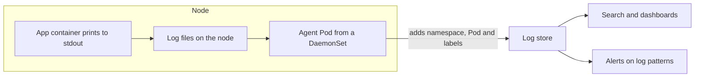
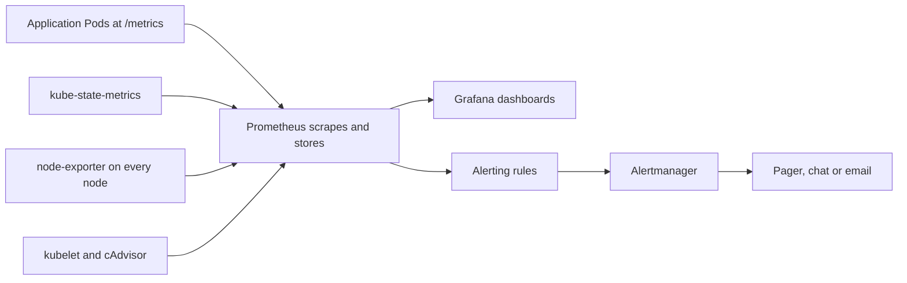

# Metrics and logging stacks

## In plain words

A car tells its driver about itself in three ways. The **dashboard** shows a few numbers that change all the time: speed, fuel, engine temperature. A glance says whether things are normal. The **service book** in the glovebox is a diary: on this date the oil was changed, on that date a warning light came on. And a **satellite-navigation record** can replay one particular journey, turn by turn, showing where the time went.

Software uses the same three kinds of evidence, and the field has names for them.

| Car | Software | What it is | Question it answers |
|---|---|---|---|
| Dashboard | **Metrics** | Numbers measured at regular intervals | Is something wrong? How much? Since when? |
| Service book | **Logs** | Timestamped lines of text written by programs | What exactly happened? |
| Journey record | **Traces** | The path of one request through many services | Where did this request spend its time? |

**Observability** is the property of a system that lets you work out what is happening inside it from the evidence it gives off, without logging in and poking around. **Monitoring** is the narrower habit of watching known signals and raising alerts.

The [previous lesson](#/lesson/kubernetes/troubleshooting-pods) used `kubectl logs`, `kubectl top` and events. Those commands show the present, for one Pod, for a short while. Delete the Pod and its logs are gone; wait an hour and the events are gone. Running a real service needs the evidence collected from every Pod, kept for weeks, searchable, and watched by something that wakes a person when it matters. That collection of tools is what people call a metrics stack and a logging stack.

Why this matters for a job: every production team is on call for something, and being on call means reading dashboards, searching logs and responding to alerts. Interviewers ask how you would monitor a service on Kubernetes, what you would alert on, and how logs leave a Pod. Site reliability and platform roles ask in depth; backend roles expect the outline.

> **Before this lesson:** you need Pods and containers ([The Pod as the atomic unit](#/lesson/kubernetes/pod-basics)), DaemonSets ([DaemonSets, Jobs and CronJobs](#/lesson/kubernetes/daemonsets-jobs-cronjobs)), Services and labels ([Services, selectors, ClusterIP and EndpointSlices](#/lesson/kubernetes/services-clusterip)), custom resources ([Extending the API: CRDs and operators](#/lesson/kubernetes/crds-operators)) and the metrics pipeline sketched in [Autoscaling](#/lesson/kubernetes/autoscaling).

## Why Kubernetes makes this harder, and easier

Harder, because the things you observe are short-lived and numerous. A Pod's name and IP address change on every restart. Yesterday's twelve replicas are not today's twelve. A crash's evidence lives on a node that the cluster autoscaler may delete tonight.

Easier, because everything carries **labels** and belongs to a namespace, and every tool in this lesson attaches that information automatically. You can ask for "error rate of everything labelled `app=orders-api` in namespace `cafe`" without knowing a single Pod name.

## Logs

### Where a container's output goes

Follow one line of text from a program to your terminal.

1. The program writes a line to **standard output** or **standard error**, the two text streams every process has. It does not write to a log file of its own; in a container, the convention is to print.
2. The **container runtime** on the node captures the stream and appends each line, with a timestamp, to a file on the node's disk under `/var/log/pods/`.
3. The **kubelet** rotates those files: when one reaches a size limit (10 MiB by default) it starts a new file, and it keeps a handful of old ones (5 by default).
4. `kubectl logs` asks the API server, which asks the kubelet on that node, which reads the file.

Three consequences follow. Only the most recent few megabytes exist. When the Pod is deleted, its log files are removed. When the node disappears, everything on it disappears. For anything beyond looking at a live Pod, logs must be copied off the node as they are written.

### Three ways to ship logs



| Pattern | How it works | When to use |
|---|---|---|
| **Node agent** | A DaemonSet runs one collector per node. It reads every container's files from the node's disk and forwards them. | The default. Applications need no changes. |
| **Sidecar** | An extra container in the Pod reads a file the application writes and prints or forwards it. | An application that can only log to files. |
| **Direct from the application** | The program sends logs straight to the log store over the network. | Rare; ties every program to the logging system. |

The node agent pattern dominates, and it explains the log-agent DaemonSet that served as the example in the [DaemonSets lesson](#/lesson/kubernetes/daemonsets-jobs-cronjobs): it mounts the node's log directory with a `hostPath` volume and tolerates every taint so that no node is left out.

The pieces have many brand names. It helps to sort them by role.

| Role | Common choices |
|---|---|
| Collector (the agent on each node) | Fluent Bit, Vector, the OpenTelemetry Collector, Grafana Alloy |
| Store and search | Grafana Loki, Elasticsearch or OpenSearch, or a cloud provider's logging service |
| Viewer | Grafana, Kibana or OpenSearch Dashboards, the cloud console |

Two acronyms you will hear: **EFK** for Elasticsearch, Fluentd or Fluent Bit, and Kibana; and "the Loki stack" for an agent, Loki and Grafana. Elasticsearch indexes the full text of every line, which makes searching fast and storage costly. Loki indexes only the labels (namespace, Pod, application) and scans the text at query time, which is cheaper and suits Kubernetes's label-centred model.

### Write logs that machines can read

The collector attaches *where* a line came from. *What* the line says is up to the application, and one habit makes logs far more useful: **structured logging**, meaning each line is a small JSON object with named fields instead of a free-form sentence.

```text
free form:   Failed to charge card for order 8812 after 3 tries (took 2.31s)
structured:  {"ts":"2026-11-21T02:14:07Z","level":"error","msg":"charge failed","order_id":8812,"attempts":3,"duration_ms":2310}
```

With the second form, "all errors for order 8812" or "every failed charge slower than two seconds" is a field filter, not a fragile text pattern. The program below plays the part of the collector and the store.

```python-run
import json
from collections import Counter

# What three Pods printed to stdout. The collector reads these lines from files on each node.
raw = {
    ("cafe", "orders-api-7c9d-4kx2p", "orders-api"): [
        '{"ts":"02:14:05","level":"info","msg":"order created","order_id":8811,"duration_ms":41}',
        '{"ts":"02:14:07","level":"error","msg":"charge failed","order_id":8812,"duration_ms":2310}',
        '{"ts":"02:14:09","level":"info","msg":"order created","order_id":8813,"duration_ms":38}'],
    ("cafe", "orders-api-7c9d-9hbtz", "orders-api"): [
        '{"ts":"02:14:06","level":"warn","msg":"retrying charge","order_id":8812,"duration_ms":900}',
        '{"ts":"02:14:08","level":"error","msg":"charge failed","order_id":8815,"duration_ms":2504}'],
    ("cafe", "menu-api-6b7f-2xk4p", "menu-api"): [
        '{"ts":"02:14:06","level":"info","msg":"menu served","duration_ms":12}',
        'plain text line that is not JSON'],
}

store = []
for (namespace, pod, app), lines in raw.items():                  # the collector's job
    for line in lines:
        try:
            record = json.loads(line)
        except json.JSONDecodeError:
            record = {"level": "unknown", "msg": line}             # keep unparsed lines, do not drop them
        record.update({"namespace": namespace, "pod": pod, "app": app})   # enrichment with Kubernetes metadata
        store.append(record)

def query(**filters):                                             # the store's job
    return [r for r in store if all(r.get(k) == v for k, v in filters.items())]

print("errors in orders-api, across all its Pods:")
for r in sorted(query(app="orders-api", level="error"), key=lambda r: r["ts"]):
    print(f"   {r['ts']} {r['pod']:24} {r['msg']} order={r['order_id']} {r['duration_ms']}ms")

print("\neverything about order 8812, in time order:")
for r in sorted(query(order_id=8812), key=lambda r: r["ts"]):
    print(f"   {r['ts']} {r['pod']:24} {r['level']:5} {r['msg']}")

print("\nlines per app and level:", dict(Counter((r["app"], r["level"]) for r in store)))
```

The second query is the reason central logging exists: order 8812 was handled by two different Pods, and only a store that holds both Pods' lines can tell the story in order. `kubectl logs` on one Pod would have shown half of it.

Practical rules for logs: print to standard output, one event per line, in JSON, with a level and a timestamp; never log passwords, tokens or personal data; and set a retention period, because log volume is the largest cost in most observability bills.

## Metrics

### What a metric is

A **metric** is a named measurement with **labels** and a numeric value, recorded repeatedly. Each distinct combination of name and labels forms a **time series**: a list of (time, value) pairs.

```text
http_requests_total{app="orders-api", method="POST", status="500"}   17
http_requests_total{app="orders-api", method="POST", status="200"}   18342
```

These are two time series of one metric. Compared with logs, metrics are tiny (one number per series per interval, however many requests occurred), which is why they are kept longer and why alerts are built on them.

There are three types worth knowing from the start.

| Type | Behaviour | Example | How it is used |
|---|---|---|---|
| **Counter** | Only goes up; resets to zero when the process restarts | Requests served, errors, bytes sent | Take its **rate**: increase per second |
| **Gauge** | Goes up and down | Memory in use, queue length, replicas | Read the value directly |
| **Histogram** | Counts observations in ranges called buckets | Request duration | Compute percentiles such as "99% of requests were faster than X" |

### Prometheus and the pull model

**Prometheus** is the standard metrics system in the Kubernetes world. Its central idea is **pull**: each program exposes its current numbers as plain text on an HTTP address, by convention `/metrics`, and Prometheus fetches that page from every target at a fixed interval. One fetch is called a **scrape**.

```bash
$ kubectl exec -n cafe deploy/orders-api -- wget -qO- localhost:8080/metrics | head -8
# HELP http_requests_total Total number of HTTP requests.
# TYPE http_requests_total counter
http_requests_total{method="GET",path="/orders",status="200"} 18342
http_requests_total{method="POST",path="/orders",status="201"} 4410
http_requests_total{method="POST",path="/orders",status="500"} 17
# HELP process_resident_memory_bytes Resident memory size in bytes.
# TYPE process_resident_memory_bytes gauge
process_resident_memory_bytes 1.89632512e+08
```

The format is readable by eye: a `HELP` line, a `TYPE` line, then one line per series. Pulling suits Kubernetes because Prometheus asks the API server which Pods and Services exist and updates its list of targets by itself as they come and go. If a scrape fails, that failure is itself a signal: the built-in series `up` becomes 0 for the target.



### Where Kubernetes metrics come from

No single component knows everything. A cluster's picture is assembled from several sources.

| Source | Runs as | Tells you | Example series |
|---|---|---|---|
| **cAdvisor**, built into the kubelet | Part of every node | CPU, memory, network and disk use of each container | `container_memory_working_set_bytes` |
| **kube-state-metrics** | One Deployment | The *state of API objects*: desired and available replicas, Pod phases, restart counts | `kube_pod_container_status_restarts_total` |
| **node-exporter** | A DaemonSet | The machine itself: CPU, memory, disks, network | `node_filesystem_avail_bytes` |
| **Control-plane components** | Built in | API request rates and latency, scheduler and etcd health | `apiserver_request_duration_seconds` |
| **Your applications** | Instrumented with a client library | Requests, errors, latency, business numbers | `http_requests_total` |
| **metrics-server** | One Deployment | The current CPU and memory of Pods and nodes, for `kubectl top` and the HPA | (served through the Metrics API, not stored) |

Two rows are often mixed up. **metrics-server** keeps only the latest reading and exists to feed autoscaling; it is not a monitoring system. **kube-state-metrics** measures nothing about usage; it turns object status into numbers, so that "available replicas are fewer than desired" becomes something you can graph and alert on.

### Telling Prometheus what to scrape

Most clusters install Prometheus through the **Prometheus Operator**, usually with the `kube-prometheus-stack` Helm chart, which bundles Prometheus, Alertmanager, Grafana, node-exporter and kube-state-metrics. The operator adds custom resources so that monitoring is configured with manifests like everything else.

```yaml
apiVersion: monitoring.coreos.com/v1
kind: ServiceMonitor
metadata:
  name: orders-api
  namespace: cafe
  labels:
    release: monitoring
spec:
  selector:
    matchLabels:
      app: orders-api
  endpoints:
    - port: http
      path: /metrics
      interval: 30s
```

- `apiVersion: monitoring.coreos.com/v1`, `kind: ServiceMonitor` — a custom resource from the Prometheus Operator.
- `metadata.labels.release: monitoring` — the Prometheus instance is configured to pick up only ServiceMonitors carrying a certain label. A missing or wrong label here is the most common reason for "my metrics do not appear".
- `spec.selector` — which **Services** to scrape, chosen by label. Prometheus then scrapes every Pod behind those Services.
- `endpoints[].port: http` — the *name* of the Service port to use, not a number.
- `path` and `interval` — fetch `/metrics` every 30 seconds.

### Asking questions with PromQL

Prometheus has its own query language, **PromQL**. Four patterns cover most daily use.

| Question | Query |
|---|---|
| Requests per second, per application | `sum by (app) (rate(http_requests_total[5m]))` |
| Share of requests that fail | `sum(rate(http_requests_total{status=~"5.."}[5m])) / sum(rate(http_requests_total[5m]))` |
| 99th percentile latency | `histogram_quantile(0.99, sum by (le) (rate(http_request_duration_seconds_bucket[5m])))` |
| Containers that restarted in the last hour | `increase(kube_pod_container_status_restarts_total[1h]) > 0` |

`rate(counter[5m])` is the workhorse: the average increase per second over the last five minutes. It exists because a counter's raw value (18,342 requests since start) is rarely interesting, while its speed of change is. It also copes with counter resets, as the program shows.

```python-run
# One counter, scraped every 30 seconds. The process restarted between the 5th and 6th scrape.
scrapes = [1000, 1060, 1120, 1180, 1240, 20, 80, 140, 200]
errors  = [10,   10,   11,   11,   12,   2,  8,  14,  20]
INTERVAL = 30

def increase(samples):
    total = 0
    for prev, cur in zip(samples, samples[1:]):
        total += cur - prev if cur >= prev else cur        # a drop means a reset: count from zero
    return total

def rate(samples):
    return increase(samples) / (INTERVAL * (len(samples) - 1))

print(f"naive (last - first) / time : {(scrapes[-1] - scrapes[0]) / (INTERVAL * 8):6.2f} requests/s   <- negative, nonsense")
print(f"rate() with reset handling  : {rate(scrapes):6.2f} requests/s")
print()
print("window        req/s   errors/s   error ratio   alert (>2% for 2 windows in a row)")
breaches = 0
for end in range(3, len(scrapes) + 1):
    window_req, window_err = scrapes[end - 3:end], errors[end - 3:end]
    ratio = rate(window_err) / rate(window_req)
    breaches = breaches + 1 if ratio > 0.02 else 0
    state = "FIRING" if breaches >= 2 else ("pending" if breaches == 1 else "ok")
    print(f"scrapes {end-2}-{end}   {rate(window_req):5.2f}   {rate(window_err):8.3f}   {ratio:10.1%}   {state}")
```

The first line is what goes wrong without `rate`: the restart makes the counter fall, and a simple subtraction reports a negative request rate. The table underneath shows an alert rule's life: the error ratio must stay above the threshold for a period before the alert **fires**. In between it is **pending**. That delay is the `for:` field in the rule below, and it prevents a single bad scrape from paging anyone.

### Alerts

```yaml
apiVersion: monitoring.coreos.com/v1
kind: PrometheusRule
metadata:
  name: orders-api-alerts
  namespace: cafe
  labels:
    release: monitoring
spec:
  groups:
    - name: orders-api
      rules:
        - alert: OrdersApiHighErrorRate
          expr: |
            sum(rate(http_requests_total{app="orders-api",status=~"5.."}[5m]))
              /
            sum(rate(http_requests_total{app="orders-api"}[5m])) > 0.02
          for: 10m
          labels:
            severity: page
          annotations:
            summary: "More than 2% of orders-api requests have failed for 10 minutes"
```

- `kind: PrometheusRule` — a custom resource holding alerting rules.
- `expr` — a PromQL expression. The alert is active while it returns a result: here, while the failure ratio is above 0.02.
- `for: 10m` — the condition must hold for ten minutes without a break before the alert fires.
- `labels.severity: page` — a label that Alertmanager uses for routing.
- `annotations.summary` — the text a person will read at 3 a.m. Write it for that reader.

**Alertmanager** receives firing alerts and decides who hears about them. It groups related alerts into one notification, silences alerts during planned maintenance, and routes by label: `severity: page` to the on-call phone, `severity: ticket` to a queue for working hours.

## Choosing what to measure and what to alert on

Three short lists guide the choice.

- **RED**, for anything that serves requests: **R**ate (requests per second), **E**rrors (failed requests per second), **D**uration (how long requests take).
- **USE**, for any resource such as a node, a disk or a connection pool: **U**tilisation (how busy), **S**aturation (how much work is queued), **E**rrors.
- The **four golden signals** from Google's site reliability practice: latency, traffic, errors and saturation. They are RED plus saturation.

For duration, use **percentiles**, not averages. The 99th percentile (written p99) is the value that 99% of requests are faster than.

```python-run
import random
rng = random.Random(4)
durations = [rng.gauss(80, 10) for _ in range(970)] + [rng.uniform(2000, 4000) for _ in range(30)]   # 3% are very slow
durations.sort()

def percentile(sorted_values, p):
    return sorted_values[min(len(sorted_values) - 1, int(len(sorted_values) * p / 100))]

print(f"requests: {len(durations)}, of which 30 hit a slow database query")
print(f"average : {sum(durations) / len(durations):7.0f} ms   <- describes nobody's experience")
for p in (50, 90, 95, 99):
    print(f"p{p:<3}    : {percentile(durations, p):7.0f} ms")
```

The average of about 170 ms matches no real request: most took 80 ms and a few took three seconds. The p50 says the typical user is fine, and the p99 says that some users are having a very bad time. A dashboard with only an average would hide the problem.

A principle for alerts follows from all this: **page on symptoms, not on causes.** A symptom is something users feel: errors, slowness, unavailability. A cause is something like high CPU on one node. Paging on causes wakes people for conditions that harm nobody, and misses failures nobody predicted. Teams formalise the idea with a **service level objective (SLO)**: a target such as "99.9% of requests succeed over 30 days", measured by a **service level indicator (SLI)**, the actual success ratio. The permitted 0.1% of failures is the **error budget**, and alerts fire when the budget is being spent too fast.

Kubernetes itself still deserves a handful of alerts, mostly built on kube-state-metrics:

| Condition | Why it matters |
|---|---|
| A Deployment's available replicas below desired for 15 minutes | A rollout is stuck or Pods are failing |
| A container restarting repeatedly | A crash loop, including OOM kills |
| Pods Pending for more than a few minutes | No capacity, or an impossible scheduling rule |
| A node `NotReady` | Lost capacity; Pods will be evicted |
| A PersistentVolume nearly full | The database stops when it fills |
| A Job or CronJob failing or not running on time | The nightly work silently stopped |
| Certificates close to expiry | A predictable outage with a known date |

## Traces and OpenTelemetry

Metrics say *that* orders are slow and logs say what each service did. When one request passes through five services, neither says which hop cost the time. A **trace** does. Each service records a **span** (its name, start time and duration) and passes a trace identifier to the next service in a request header, so that the spans can be joined into one timeline afterwards.

**OpenTelemetry** (often written OTel) is the vendor-neutral standard for producing all three signals: libraries for instrumenting code, a wire protocol called OTLP, and the **OpenTelemetry Collector**, a program that receives, processes and forwards telemetry. In Kubernetes the Collector commonly runs both as a DaemonSet (one per node) and as a central Deployment. Traces are stored in systems such as Jaeger or Grafana Tempo. Putting the same trace identifier into every log line is the trick that lets you jump from a slow trace to the exact log lines of that request.

> [!WARNING]
> Every distinct combination of label values is a separate time series. A label with unbounded values, such as a user ID, an order ID or a full URL with parameters, multiplies the series count without limit and can exhaust Prometheus's memory. This is called a **cardinality** explosion. Put such identifiers in logs and traces, never in metric labels.

> [!TIP]
> Before writing a new alert, ask "what will the person who receives this do?" If the answer is "nothing right now", it is a dashboard panel or a ticket, not a page. A few alerts that always mean action are worth more than a hundred that are routinely ignored.

> [!INTERVIEW]
> **"How would you set up monitoring and logging for services on Kubernetes?"** Three signals. **Logs**: applications print structured JSON to standard output; the container runtime writes it to files on the node; a collector such as Fluent Bit runs as a DaemonSet, tails those files, adds namespace, Pod and label metadata and ships to a store such as Loki or Elasticsearch, because node-local logs are rotated and disappear with the Pod. **Metrics**: Prometheus scrapes `/metrics` endpoints discovered through the Kubernetes API, configured with ServiceMonitors from the Prometheus Operator; cluster data comes from cAdvisor in the kubelet (container usage), kube-state-metrics (object state) and node-exporter (machines); Grafana for dashboards, PrometheusRules and Alertmanager for alerts. **Traces**: OpenTelemetry instrumentation exporting through a Collector to a tracing store. Then say what you would watch: rate, errors and duration percentiles per service, alerting on user-facing symptoms against an SLO, plus cluster basics such as replicas unavailable, restarts, Pending Pods and node readiness. Finish with two cautions: metrics-server is for autoscaling, not monitoring, and high-cardinality labels will break Prometheus.

## Common pitfalls

- **Relying on `kubectl logs` in production.** The logs vanish with the Pod and the node.
- **Applications writing logs to files inside the container.** Nothing collects them, and they fill the container's writable layer.
- **Free-form log lines.** Every question becomes a text search.
- **Logging secrets or personal data.** Logs are widely readable and kept for a long time.
- **Treating metrics-server as a monitoring system.** It keeps no history.
- **A ServiceMonitor without the label the Prometheus instance selects on.** Nothing is scraped and no error is shown.
- **High-cardinality labels.**
- **Dashboards of averages.** The slow tail is invisible.
- **Alerting on causes.** Pages for high CPU that harms no one; silence when users see errors.
- **Alerts without `for:`.** Every blip pages someone.
- **Running the monitoring stack only inside the cluster it monitors.** When the cluster fails, so does the alert that should report it. Have at least one check from outside.
- **No retention policy.** Storage costs grow until someone notices the bill.

## Cheat sheet

| Need | Tool or command |
|---|---|
| Live CPU and memory | `kubectl top pods`, `kubectl top nodes` (needs metrics-server) |
| Live logs of one Pod | `kubectl logs -f POD` |
| Logs of all Pods with a label | `kubectl logs -l app=NAME --prefix --tail=50` |
| Historical logs, many Pods | The log store: Loki, Elasticsearch, cloud logging |
| See a Pod's raw metrics | `kubectl port-forward POD 8080` then open `/metrics` |
| What Prometheus is scraping | Prometheus UI, the Targets page |
| List scrape configurations | `kubectl get servicemonitors,podmonitors -A` |
| List alert rules | `kubectl get prometheusrules -A` |

| PromQL piece | Meaning |
|---|---|
| `metric{label="x"}` | Select series by label |
| `rate(counter[5m])` | Per-second increase over five minutes |
| `sum by (label) (...)` | Add up, keeping one label |
| `histogram_quantile(0.99, ...)` | 99th percentile from a histogram |
| `increase(counter[1h])` | Total increase over an hour |

## Summary

Kubernetes shows you the present; observability stacks keep the past. Logs are text that containers print to standard output, stored briefly in files on each node and shipped by a per-node agent, with Kubernetes metadata attached, to a central store where they can be searched across Pods and time. Metrics are labelled numbers that Prometheus scrapes from `/metrics` endpoints: container usage from the kubelet's cAdvisor, object state from kube-state-metrics, machine health from node-exporter and request behaviour from your own code, queried with PromQL, drawn in Grafana and turned into alerts routed by Alertmanager. Traces follow single requests across services, with OpenTelemetry as the common standard. Measure rate, errors and duration, prefer percentiles to averages, and wake people for symptoms that users feel. The next module applies the whole track to a demanding kind of workload: machine learning.

## Glossary

- **Observability**: the ability to understand a system's internal state from the evidence it emits.
- **Metric**: a named, labelled number recorded over time.
- **Time series**: the sequence of values for one combination of metric name and labels.
- **Log**: a timestamped line of text written by a program.
- **Trace**: the record of one request's path through several services.
- **Span**: one service's part of a trace, with a start time and duration.
- **Standard output / standard error**: the text streams a process prints to; the source of container logs.
- **Log rotation**: replacing a log file with a fresh one when it reaches a size limit.
- **Node agent**: a collector running on every node through a DaemonSet.
- **Structured logging**: writing each log line as fields, usually JSON.
- **Prometheus**: a metrics system that scrapes targets and stores time series.
- **Scrape**: one fetch of a target's `/metrics` page.
- **Counter, gauge, histogram**: metric types that only rise, that move both ways, and that count observations in buckets.
- **PromQL**: the Prometheus query language.
- **kube-state-metrics**: a service that exposes the state of Kubernetes objects as metrics.
- **node-exporter**: an agent that exposes a machine's hardware and operating-system metrics.
- **cAdvisor**: the part of the kubelet that measures container resource use.
- **ServiceMonitor / PrometheusRule**: Prometheus Operator resources for scrape targets and alert rules.
- **Alertmanager**: the component that groups, silences and routes alerts.
- **Grafana**: a dashboard tool for metrics, logs and traces.
- **Percentile (p99)**: the value below which 99% of observations fall.
- **RED and USE**: checklists of what to measure for services and for resources.
- **SLI, SLO, error budget**: the measured quality, its target, and the allowed shortfall.
- **OpenTelemetry**: a vendor-neutral standard and toolset for metrics, logs and traces.
- **Cardinality**: the number of distinct label combinations, and so of time series.

```quiz
[
  {"q": "A Pod is deleted. What happens to the logs you could read with kubectl logs?",
   "options": ["They are archived by the API server", "They are removed with the Pod, unless a collector had already shipped them elsewhere", "They move to etcd", "They stay on the node for 30 days"],
   "answer": 1,
   "explain": "Container logs are files on the node, rotated by the kubelet and deleted with the Pod. Central logging exists to copy them off the node first."},
  {"q": "Why is the log collector usually deployed as a DaemonSet?",
   "options": ["DaemonSets are cheaper than Deployments", "Container log files live on each node's disk, so one collector per node can read them all without changing any application", "Only DaemonSets can use the network", "The API server requires it"],
   "answer": 1,
   "explain": "The node agent pattern places one collector on every node, mounting the node's log directory. Applications only need to print to standard output."},
  {"q": "What does Prometheus's pull model mean?",
   "options": ["Applications send each measurement to Prometheus as it happens", "Prometheus fetches each target's /metrics page at a regular interval", "Prometheus reads log files from the nodes", "Metrics are pulled from etcd"],
   "answer": 1,
   "explain": "Targets expose their current values over HTTP and Prometheus scrapes them. It discovers the targets through the Kubernetes API."},
  {"q": "Which component would tell you that a Deployment has 3 desired replicas and only 1 available?",
   "options": ["node-exporter", "cAdvisor", "kube-state-metrics", "metrics-server"],
   "answer": 2,
   "explain": "kube-state-metrics turns the status of API objects into metrics. node-exporter covers machines, cAdvisor covers container usage, and metrics-server feeds kubectl top and the HPA."},
  {"q": "http_requests_total is a counter currently at 18,342. Why do dashboards show rate(http_requests_total[5m]) instead of the raw value?",
   "options": ["The raw value is secret", "A counter's total since start says little; its per-second increase is the request rate, and rate() also handles resets", "rate() is faster to compute", "Counters cannot be graphed"],
   "answer": 1,
   "explain": "The interesting quantity is how fast the counter grows. rate() computes that over a window and treats a drop as a restart, not as negative traffic."},
  {"q": "An alert rule has for: 10m. What does that do?",
   "options": ["Repeats the notification every 10 minutes", "Requires the condition to hold continuously for 10 minutes before the alert fires", "Delays scraping by 10 minutes", "Silences the alert for 10 minutes"],
   "answer": 1,
   "explain": "Until the duration has passed the alert is pending. This keeps brief spikes from paging anyone."},
  {"q": "A developer adds a user_id label to a request counter. Why is that a problem?",
   "options": ["Labels may only contain numbers", "Each distinct user creates new time series, and unbounded label values can exhaust the metrics system's memory", "Prometheus drops metrics with more than two labels", "It makes the metric a gauge"],
   "answer": 1,
   "explain": "Series count is the product of label value counts. Identifiers with unlimited values belong in logs and traces, not in metric labels."},
  {"q": "Request latency averages 170 ms, with p50 at 80 ms and p99 at 3,400 ms. What is the right reading?",
   "options": ["All requests take about 170 ms", "Most requests are fast, and roughly one in a hundred is extremely slow, which the average hides", "The service is three times too slow for everyone", "The histogram is broken"],
   "answer": 1,
   "explain": "Percentiles describe the distribution. The median user sees 80 ms while the slowest 1% wait seconds; an average blends them into a number nobody experiences."}
]
```

> **Source:** this lesson extends the track beyond the chapters of Poulton's *The Kubernetes Book*. Official and project docs: https://kubernetes.io/docs/concepts/cluster-administration/logging/ , https://kubernetes.io/docs/concepts/cluster-administration/system-metrics/ , https://kubernetes.io/docs/tasks/debug/debug-cluster/resource-metrics-pipeline/ , https://prometheus.io/docs/introduction/overview/ , https://prometheus.io/docs/concepts/metric_types/ , https://prometheus-operator.dev/docs/ , https://github.com/kubernetes/kube-state-metrics , https://grafana.com/docs/loki/latest/ , https://opentelemetry.io/docs/concepts/ , https://sre.google/sre-book/monitoring-distributed-systems/
