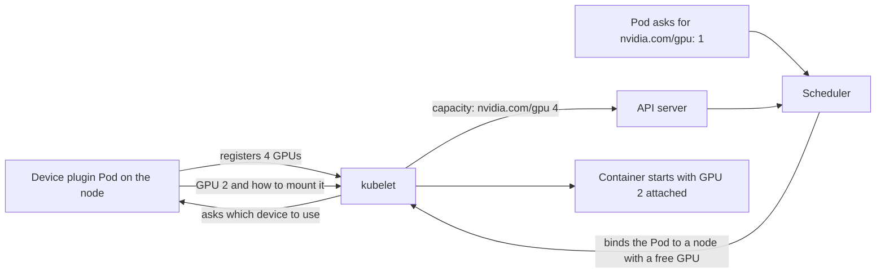

# GPU scheduling

## In plain words

A hospital owns a few MRI scanners. Each costs a fortune, each needs a specially built room and a trained technician, and a scanner cannot be shared by two patients at the same moment. So the hospital does three things. It keeps a list of which rooms hold a scanner. It makes sure those rooms are not used for ordinary appointments. And it runs a booking queue, because there are always more requests than scanner hours.

A **GPU** (graphics processing unit) is the MRI scanner of a data centre. It is a processor built to do the same arithmetic on thousands of numbers at once. That is what drawing graphics needs, and it happens to be what training and running machine-learning models needs too. A task that takes a week on ordinary processors (CPUs) can take hours on a GPU. GPUs are expensive, scarce, power-hungry and, by default, not divisible.

Kubernetes was designed around CPU and memory, which every machine has and which can be sliced finely. This lesson shows how the same scheduler is taught about GPUs: how a node announces that it has them, how a Pod asks for one, how GPU machines are kept for GPU work, how one card can be shared, and how a queue decides whose training run goes next.

Why this matters for a job: machine-learning platforms are built on Kubernetes almost everywhere, and GPU capacity is usually the largest line in their budget. Roles in ML infrastructure, MLOps and platform engineering all expect you to know how `nvidia.com/gpu` works, why a GPU Pod is Pending, and how to stop a cluster of very costly machines from sitting idle.

> **Before this lesson:** you need requests and limits ([Lifecycle, restart policies, probes, requests and limits](#/lesson/kubernetes/pod-lifecycle-resources)), Jobs and DaemonSets ([DaemonSets, Jobs and CronJobs](#/lesson/kubernetes/daemonsets-jobs-cronjobs)), and node selectors, taints, tolerations and priority ([Steering the scheduler](#/lesson/kubernetes/scheduling-controls)). No machine-learning knowledge is assumed.

## Two kinds of ML workload

Machine learning brings two very different shapes of work, and they map onto controllers you already know.

| | Training | Inference (serving) |
|---|---|---|
| What it does | Builds a model by processing a large dataset many times | Answers requests using a finished model |
| Shape | Runs for hours or days, then ends | Runs continuously |
| Controller | Job | Deployment, or a serving platform |
| Cares most about | Total time to finish; not losing progress | Response time; cost per request |
| GPU use | Often several GPUs at full load | Often a fraction of one GPU, in bursts |

This lesson concentrates on GPUs and training. The [next lesson](#/lesson/kubernetes/kserve-kubeflow) covers serving and pipelines.

## How Kubernetes learns that a node has GPUs

The scheduler knows about CPU and memory because the kubelet reports them. For anything else, Kubernetes has a general mechanism: the **device plugin**. It is a small program, supplied by the hardware vendor, that runs on each node and tells the kubelet, "this machine has four devices of the kind `nvidia.com/gpu`". The kubelet adds that to the node's reported capacity, and from then on the scheduler counts GPUs the way it counts CPU.

A resource announced this way is called an **extended resource**. Its name has a vendor prefix: `nvidia.com/gpu`, `amd.com/gpu`, `gpu.intel.com/i915`.



A GPU node needs four pieces of software before any of this works:

1. the **driver**, the kernel module that talks to the card,
2. a **container toolkit**, which lets the container runtime hand a GPU to a container,
3. the **device plugin**, described above,
4. a **feature discovery** agent that labels the node with what it has: model, memory, count.

Installing these by hand on every node is tedious and fragile. For NVIDIA hardware the **GPU Operator** does it: an operator that runs each piece as a DaemonSet restricted to GPU nodes, so that a new GPU node configures itself minutes after joining. Managed cloud node pools with GPUs usually arrive with the equivalent already in place.

```bash
$ kubectl describe node gpu-1 | grep -A8 Capacity
Capacity:
  cpu:                32
  memory:             131072Mi
  nvidia.com/gpu:     4
  pods:               110
Allocatable:
  cpu:                31800m
  memory:             126976Mi
  nvidia.com/gpu:     4

$ kubectl get nodes -L nvidia.com/gpu.product,nvidia.com/gpu.count
NAME       STATUS   ROLES    AGE   VERSION   GPU.PRODUCT             GPU.COUNT
gpu-1      Ready    <none>   12d   v1.34.2   NVIDIA-A100-SXM4-40GB   4
gpu-2      Ready    <none>   12d   v1.34.2   Tesla-T4                1
worker-1   Ready    <none>   90d   v1.34.2
```

`nvidia.com/gpu: 4` under `Capacity` is the device plugin's doing. The second command prints two labels added by feature discovery; `-L` shows label values as columns. If a node has cards and shows no `nvidia.com/gpu` line, the device plugin is not running there, and no Pod asking for a GPU can ever be placed on it.

## Asking for a GPU

```yaml
apiVersion: v1
kind: Pod
metadata:
  name: train-forecast
  namespace: ml
spec:
  restartPolicy: Never
  containers:
    - name: trainer
      image: ghcr.io/harbour-coffee/demand-forecast-train:0.9.2
      command: ["python", "train.py", "--epochs", "20"]
      resources:
        requests:
          cpu: "8"
          memory: 32Gi
        limits:
          memory: 32Gi
          nvidia.com/gpu: 1
```

- `resources.limits."nvidia.com/gpu": 1` — this container needs one GPU. The scheduler will place the Pod only on a node with at least one unallocated GPU, and the kubelet will attach one specific card.
- `requests.cpu` and `memory` — training also needs CPU, to load and prepare data, and plenty of memory. A GPU starved of input by too few CPU cores sits idle while you pay for it.

Extended resources follow stricter rules than CPU and memory:

| Rule | Consequence |
|---|---|
| Whole numbers only | `nvidia.com/gpu: 0.5` is rejected |
| Set them under `limits`; a request, if given, must equal the limit | There is no "burst" above your allocation |
| No overcommitment | A node with 4 GPUs runs at most 4 single-GPU containers |
| A device belongs to one container | Two containers, even in one Pod, do not share a card through this mechanism |
| Held for the Pod's whole life | A Pod that requested a GPU and is idle still blocks it |

The last row is the expensive one. A notebook server left running over a weekend with `nvidia.com/gpu: 1` keeps a costly card away from everyone else.

## Keeping GPU nodes for GPU work

Two things can go wrong with placement. An ordinary web Pod can land on a GPU node and occupy its CPU and memory, so that a later GPU Pod no longer fits. And a training Pod written for a large card can land on a small one and crash for lack of GPU memory. The tools from [Steering the scheduler](#/lesson/kubernetes/scheduling-controls) solve both.

```bash
$ kubectl taint nodes gpu-1 gpu-2 nvidia.com/gpu=present:NoSchedule
node/gpu-1 tainted
node/gpu-2 tainted
```

```yaml
spec:
  tolerations:
    - key: nvidia.com/gpu
      operator: Exists
      effect: NoSchedule
  nodeSelector:
    nvidia.com/gpu.product: NVIDIA-A100-SXM4-40GB
```

- The **taint** repels every Pod without a matching toleration, so ordinary workloads stay off the GPU machines.
- The **toleration** in the training Pod permits it to use them.
- The **node selector** picks the card model. Remember that a toleration only permits; the GPU request and the selector are what direct the Pod.

For a softer choice, such as "prefer the big card, accept the small one", use preferred node affinity instead of a node selector. DaemonSets that must run on GPU nodes too, such as the log agent, need the same toleration.

## Packing versus spreading

By default the scheduler prefers the emptiest node, which spreads Pods out. That is sensible for web services and harmful for GPUs, as the simulation shows. Six small jobs each want one GPU, and then a large job wants four on a single node.

```python-run
def schedule(strategy, requests, gpus_per_node=4, node_count=3):
    used = [0] * node_count
    print(f"strategy: {strategy}")
    for name, need in requests:
        candidates = [i for i in range(node_count) if gpus_per_node - used[i] >= need]
        if not candidates:
            free = [gpus_per_node - u for u in used]
            print(f"   {name:8} needs {need}: PENDING  (free GPUs per node {free}, total free {sum(free)})")
            continue
        if strategy == "spread":
            chosen = min(candidates, key=lambda i: (used[i], i))      # emptiest node first
        else:
            chosen = max(candidates, key=lambda i: (used[i], -i))     # fullest node that still fits
        used[chosen] += need
        print(f"   {name:8} needs {need}: node {chosen}   used per node {used}")
    print()

jobs = [(f"small-{i}", 1) for i in range(1, 7)] + [("large", 4)]
schedule("spread", jobs)
schedule("pack", jobs)
```

With spreading, every node ends up holding two small jobs. Six GPUs are free in total, yet no single node has four free, and the large job stays Pending. This waste is called **fragmentation**. With packing, the small jobs fill one node and half of the next, leaving a node completely empty for the large job. Filling nodes as full as possible is called **bin packing**.

In a real cluster you obtain packing by configuring the scheduler's resource-scoring strategy to favour the most allocated nodes for GPU resources, or by using a batch scheduler that does so. Packing has a second benefit: nodes that are entirely empty can be removed by the cluster autoscaler, and an idle GPU node is the costliest idle thing in the cluster.

## Sharing one GPU

Many workloads, inference above all, use a small part of a card. Whole-number allocation wastes the rest. Three techniques let several containers use one physical GPU, and they differ in how well they isolate the tenants from each other.

| Technique | How it works | Isolation | Good for |
|---|---|---|---|
| **Time-slicing** | The device plugin advertises each card as several GPUs; processes take turns | None: no memory limit between tenants, so one can exhaust the card for all | Development, light inference, trusted teams |
| **MPS** (Multi-Process Service) | An NVIDIA service lets processes run on the card at the same instant | Weak: limits can be set, faults can still spread | Many small jobs from one team |
| **MIG** (Multi-Instance GPU) | Supported cards are partitioned in hardware into fixed slices, each with its own memory and compute | Strong | Inference with predictable needs; several tenants |

With time-slicing set to 4, a node with one card reports `nvidia.com/gpu: 4`, and four Pods each asking for "one GPU" share the card without knowing it. With MIG, slices appear as their own resources, for example `nvidia.com/mig-1g.5gb` for a slice with 5 GB of memory. In both cases the Pod still asks for a whole number; what the number means has changed.

## Dynamic Resource Allocation: the newer model

Counting identical devices is a blunt instrument. It cannot express "a GPU with at least 40 GB of memory", "two GPUs on the same board" or "share this one card between these two containers". **Dynamic Resource Allocation (DRA)**, stable in current Kubernetes releases, replaces the counter with a richer description, loosely modelled on how storage is requested.

| Object | Role | Storage equivalent |
|---|---|---|
| **ResourceSlice** | Published by the driver: the devices on a node and their attributes | The available volumes |
| **DeviceClass** | Defined by an administrator: a named category of device | StorageClass |
| **ResourceClaim** | A request for devices meeting stated conditions | PersistentVolumeClaim |
| **ResourceClaimTemplate** | A stamp that creates one claim per Pod | A StatefulSet's volume claim template |

```yaml
apiVersion: resource.k8s.io/v1
kind: ResourceClaimTemplate
metadata:
  name: large-gpu
  namespace: ml
spec:
  spec:
    devices:
      requests:
        - name: gpu
          exactly:
            deviceClassName: gpu.example.com
            selectors:
              - cel:
                  expression: device.capacity["gpu.example.com"].memory.compareTo(quantity("40Gi")) >= 0
---
apiVersion: v1
kind: Pod
metadata:
  name: train-forecast
  namespace: ml
spec:
  restartPolicy: Never
  resourceClaims:
    - name: gpu
      resourceClaimTemplateName: large-gpu
  containers:
    - name: trainer
      image: ghcr.io/harbour-coffee/demand-forecast-train:0.9.2
      resources:
        claims:
          - name: gpu
```

- `kind: ResourceClaimTemplate` in the API group `resource.k8s.io` — a template from which a ResourceClaim is created for each Pod that refers to it.
- `devices.requests[].exactly.deviceClassName` — which class of device. The class name, and the attribute names used below, are defined by the installed driver; `gpu.example.com` is a placeholder.
- `selectors[].cel.expression` — a condition written in CEL, the Common Expression Language used elsewhere in Kubernetes for validation rules. This one reads: the device's memory is at least 40 GiB.
- In the Pod, `spec.resourceClaims` gives the claim a local name and points at the template, and `resources.claims` in the container says which claim that container uses. Two containers that list the same claim share the device.

The device plugin model remains in wide use, and `nvidia.com/gpu: 1` is still what you will meet most often. DRA is the direction of travel, and knowing its four object names is enough for now.

## Training jobs in practice

A training run is a Job. A few details separate one that works from one that wastes a night of GPU time.

```yaml
apiVersion: batch/v1
kind: Job
metadata:
  name: train-forecast-2026-11-21
  namespace: ml
  labels:
    kueue.x-k8s.io/queue-name: team-forecast
spec:
  suspend: true
  backoffLimit: 3
  ttlSecondsAfterFinished: 86400
  template:
    spec:
      restartPolicy: Never
      priorityClassName: batch-training
      tolerations:
        - key: nvidia.com/gpu
          operator: Exists
          effect: NoSchedule
      containers:
        - name: trainer
          image: ghcr.io/harbour-coffee/demand-forecast-train:0.9.2
          command: ["python", "train.py", "--epochs", "20", "--resume-from", "/checkpoints/latest"]
          resources:
            requests:
              cpu: "8"
              memory: 32Gi
            limits:
              memory: 32Gi
              nvidia.com/gpu: 1
          volumeMounts:
            - name: checkpoints
              mountPath: /checkpoints
            - name: shm
              mountPath: /dev/shm
      volumes:
        - name: checkpoints
          persistentVolumeClaim:
            claimName: forecast-checkpoints
        - name: shm
          emptyDir:
            medium: Memory
            sizeLimit: 8Gi
```

- `--resume-from /checkpoints/latest` and the `checkpoints` volume — a **checkpoint** is a saved copy of the model's progress. Training Pods are often pre-empted or run on cheap, interruptible machines that the cloud can take back at short notice. Without checkpoints on durable storage, each interruption restarts a twelve-hour run from the beginning. With them, the replacement Pod carries on where the last one stopped. This is the most valuable habit in the lesson.
- `backoffLimit: 3` with `restartPolicy: Never` — allow a few retries, each a fresh Pod.
- `priorityClassName: batch-training` — a low priority, so that serving workloads can pre-empt training when capacity is short. Training tolerates a delay; a customer-facing model does not.
- The `shm` volume — `/dev/shm` is shared memory, which data-loading libraries use to pass batches between processes. Containers get a tiny default, and training crashes with "bus error" or "no space left on device". An `emptyDir` with `medium: Memory` mounted at `/dev/shm` raises it. It counts against the container's memory limit.
- `suspend: true` and the `kueue.x-k8s.io/queue-name` label — explained in the next section.

For training across several machines, each worker must know its number and how to find the others. An Indexed Job provides the number (`JOB_COMPLETION_INDEX`), and a headless Service provides stable names. Purpose-built controllers such as the Kubeflow Trainer wrap this into one resource; the next lesson introduces them.

## Queues: who trains next

The default scheduler considers one Pod at a time, in order of priority, and binds it if it fits. For a shared GPU cluster that is not enough, for three reasons.

- **Fairness.** Nothing stops one team from submitting two hundred jobs and occupying every card for a week.
- **Waiting.** A Pod that does not fit stays Pending and is retried, but there is no ordered queue with quotas per team.
- **All or nothing.** A distributed job needing 6 workers is useless with 4 of them running. The 4 hold GPUs while waiting for 2 that may never come. Starting a group only when the whole group fits is called **gang scheduling**.

```python-run
def run(total_gpus, jobs, gang):
    free = total_gpus
    running = {name: 0 for name, _ in jobs}
    print(f"gang scheduling {'ON' if gang else 'OFF'}: {total_gpus} GPUs, jobs {jobs}")
    for round_no in range(1, 4):
        if gang:                                            # admit a job only if all its workers fit
            for name, workers in jobs:
                if running[name] == 0 and free >= workers:
                    running[name], free = workers, free - workers
        else:                                               # one Pod at a time, taking turns between jobs
            progress = True
            while free and progress:
                progress = False
                for name, workers in jobs:
                    if free and running[name] < workers:
                        running[name] += 1
                        free -= 1
                        progress = True
        state = ", ".join(f"{n}: {running[n]}/{w} workers" + (" TRAINING" if running[n] == w else " waiting") for n, w in jobs)
        print(f"   round {round_no}: {state}   idle-but-held GPUs: {sum(running[n] for n, w in jobs if running[n] < w)}")
        for name, workers in jobs:                          # a job that has all its workers finishes this round
            if running[name] == workers:
                free += workers
                running[name] = -1
        jobs = [(n, w) for n, w in jobs if running[n] != -1]
        if not jobs:
            print("   all jobs finished")
            break
    print()

run(8, [("job-a", 6), ("job-b", 6)], gang=False)
run(8, [("job-a", 6), ("job-b", 6)], gang=True)
```

Without gang scheduling, each job grabs four GPUs, neither reaches six, and all eight cards are held by Pods that do nothing, round after round. That is a **deadlock**. With gang scheduling, job A takes six, trains and finishes, and job B follows. Same hardware, same jobs; only the admission rule changed.

**Kueue** is the Kubernetes project's own answer to queueing. It does not replace the scheduler. It decides *when a Job may start*, using a field you met in the Jobs lesson:

1. Every Job is created with `suspend: true` and a label naming a queue.
2. Kueue keeps the Job suspended while its team's quota is used up.
3. When quota is available for the **entire** Job, Kueue sets `suspend: false`, and the normal Job controller and scheduler take over.

Its objects: a **ClusterQueue** holds quota, such as "16 GPUs", and can lend unused quota to other queues; a **LocalQueue** in each team's namespace points at a ClusterQueue; a **ResourceFlavor** describes a kind of capacity, for example "A100 nodes" or "interruptible nodes". **Volcano** is an older alternative that replaces the scheduler itself and adds gang scheduling directly.

## Watching the money

GPU capacity is costly enough that its use is tracked like a budget.

- **Measure utilisation.** NVIDIA's DCGM exporter runs as a DaemonSet and exposes per-card metrics to Prometheus, such as utilisation and memory in use. A card that is allocated and at 0% for hours is a Pod to ask questions about.
- **Scale GPU node pools to zero.** The cluster autoscaler can keep a GPU pool at zero nodes and add one when a GPU Pod is Pending. The price is a start-up delay of several minutes: the machine must boot and the drivers must load.
- **Expect large images.** ML images with frameworks and libraries often weigh many gigabytes, and the first pull on a fresh node takes minutes. Pre-pulling common images with a DaemonSet, or keeping one warm node, hides the delay.
- **Use interruptible machines for training** that checkpoints, and regular machines for serving.
- **Give notebooks an idle timeout.** Interactive sessions are the commonest source of allocated, unused GPUs.

> [!TIP]
> When a GPU Pod is Pending, check in this order: does any node advertise the resource (`kubectl describe node | grep nvidia.com/gpu`)? Are all GPUs already allocated (the "Allocated resources" section)? Does the Pod tolerate the GPU nodes' taint? Does its node selector name a label value that exists, spelled exactly as feature discovery wrote it? Is a queue holding the Job suspended?

> [!INTERVIEW]
> **"How does Kubernetes schedule GPU workloads?"** GPUs are not built-in resources. A vendor device plugin on each GPU node registers the cards with the kubelet, which advertises an extended resource such as `nvidia.com/gpu` in the node's capacity. A container asks for whole GPUs under `resources.limits`; the scheduler filters for nodes with enough unallocated GPUs, and the kubelet asks the plugin which device to attach. Extended resources are integers, cannot be overcommitted and are held for the Pod's lifetime. GPU nodes are usually tainted so that only Pods with a toleration land there, and node labels from feature discovery let Pods select a card model. To share a card, use time-slicing (no isolation), MPS or MIG (hardware partitions). Dynamic Resource Allocation is the newer model, with ResourceClaims and DeviceClasses that select devices by attribute. For batch training add: Jobs with checkpoints on persistent storage because Pods get pre-empted; a queueing layer such as Kueue for quotas, fairness and all-or-nothing admission; bin packing to avoid fragmentation; and utilisation metrics, because idle GPUs are the costliest waste in a cluster.

## Common pitfalls

- **Requesting a GPU without tolerating the GPU nodes' taint.** The Pod is Pending with "untolerated taint".
- **Tolerating the taint without requesting a GPU.** An ordinary Pod lands on a GPU machine and blocks it.
- **No checkpoints.** One pre-emption throws away hours of training.
- **Too little CPU beside the GPU.** Data loading becomes the bottleneck and the GPU idles.
- **Forgetting `/dev/shm`.** Data loaders crash with bus errors.
- **Assuming time-slicing isolates memory.** One tenant's out-of-memory error can take down the others.
- **Idle notebooks holding GPUs.** Allocation is not use.
- **Spreading small jobs across all GPU nodes.** Large jobs cannot fit although plenty of GPUs are free.
- **Driver and library version mismatches.** The container's CUDA libraries must be compatible with the node's driver; pin both.
- **Starting a distributed job without all-or-nothing admission.** Partial jobs hold GPUs and do no work.

## Cheat sheet

| Task | Command or field |
|---|---|
| Which nodes have GPUs, and how many? | `kubectl get nodes -L nvidia.com/gpu.product,nvidia.com/gpu.count` |
| GPUs allocated on a node | `kubectl describe node NODE`, "Allocated resources" |
| Ask for a GPU | `resources.limits: {nvidia.com/gpu: 1}` |
| Reserve GPU nodes | `kubectl taint nodes NODE nvidia.com/gpu=present:NoSchedule` |
| Allow a Pod onto them | A toleration with `key: nvidia.com/gpu`, `operator: Exists` |
| Pick a card model | `nodeSelector` on `nvidia.com/gpu.product` |
| Check the card from inside | `kubectl exec POD -- nvidia-smi` |
| More shared memory | `emptyDir` with `medium: Memory` mounted at `/dev/shm` |
| Queue a Job with Kueue | Label `kueue.x-k8s.io/queue-name: QUEUE`; the Job starts suspended |
| Newer allocation model | `ResourceClaimTemplate` plus `spec.resourceClaims` |

## Summary

A GPU reaches the scheduler through a device plugin, which makes a node advertise an extended resource such as `nvidia.com/gpu`. Pods ask for whole GPUs under limits; the devices cannot be overcommitted and stay allocated for the Pod's life. Taints with tolerations keep GPU nodes for GPU work, and labels select the card model. Because cards are scarce, the usual defaults are reversed: pack instead of spread, share a card through time-slicing, MPS or MIG where isolation allows, and consider Dynamic Resource Allocation for requests by attribute. Training runs are Jobs that must checkpoint to durable storage, and shared clusters add a queue such as Kueue for quotas, fairness and gang scheduling. Throughout, measure utilisation, because an idle GPU costs the same as a busy one. The next lesson moves from building models to serving them and to the platforms that tie the ML life cycle together.

## Glossary

- **GPU**: a processor specialised for doing the same arithmetic on many numbers at once.
- **Training**: building a model by repeatedly processing a dataset.
- **Inference**: using a finished model to answer requests.
- **Device plugin**: a per-node program that reports specialised hardware to the kubelet.
- **Extended resource**: a countable resource beyond CPU and memory, such as `nvidia.com/gpu`.
- **GPU Operator**: an operator that installs drivers, toolkit, device plugin and feature discovery on GPU nodes.
- **Feature discovery**: an agent that labels nodes with their hardware properties.
- **Fragmentation**: free capacity scattered so that no single node can host a large request.
- **Bin packing**: filling nodes as full as possible before using the next.
- **Time-slicing**: letting several processes take turns on one GPU.
- **MPS**: NVIDIA's Multi-Process Service for running processes on a GPU concurrently.
- **MIG**: Multi-Instance GPU, hardware partitioning of a card into isolated slices.
- **Dynamic Resource Allocation (DRA)**: the API for requesting devices by class and attribute through claims.
- **ResourceClaim / DeviceClass / ResourceSlice**: DRA's request, category and inventory objects.
- **CEL**: the Common Expression Language used for selection and validation rules.
- **Checkpoint**: a saved copy of training progress from which a run can resume.
- **Shared memory (`/dev/shm`)**: memory used to pass data between processes.
- **Gang scheduling**: starting a group of Pods only when all of them can be placed.
- **Deadlock**: a state where parties each hold what another needs and none can proceed.
- **Kueue**: a job-queueing controller that admits Jobs by quota by toggling `suspend`.
- **Interruptible (spot) machine**: a discounted cloud machine that can be reclaimed at short notice.

```quiz
[
  {"q": "How does the scheduler come to know that a node has four GPUs?",
   "options": ["It probes the node's hardware directly", "A device plugin on the node registers them with the kubelet, which reports nvidia.com/gpu: 4 in the node's capacity", "The administrator edits the scheduler's configuration file", "The container image declares them"],
   "answer": 1,
   "explain": "GPUs are extended resources. The vendor's device plugin tells the kubelet, and the kubelet publishes the count in the node's status, where the scheduler reads it."},
  {"q": "Which resource request for a container is valid?",
   "options": ["limits: nvidia.com/gpu: 0.5", "requests: nvidia.com/gpu: 1 with limits: nvidia.com/gpu: 2", "limits: nvidia.com/gpu: 1", "requests: nvidia.com/gpu: 2 and no limit"],
   "answer": 2,
   "explain": "Extended resources must be whole numbers, set under limits, with any request equal to the limit. Fractions and overcommitment are not allowed."},
  {"q": "GPU nodes carry the taint nvidia.com/gpu=present:NoSchedule. A Pod has the matching toleration and does not request a GPU or select a node. What can happen?",
   "options": ["It is rejected by the API server", "It may be scheduled on a GPU node and occupy CPU and memory there, or on any other node", "It is always placed on a GPU node", "It receives a GPU automatically"],
   "answer": 1,
   "explain": "A toleration only permits. Without a GPU request or selector the Pod can land anywhere, including on the expensive nodes it has no use for."},
  {"q": "Three nodes have 4 GPUs each. Six 1-GPU jobs are running, two on each node. A job needing 4 GPUs on one node arrives. What happens?",
   "options": ["It runs, because 6 GPUs are free", "It stays Pending, because no single node has 4 free GPUs", "The scheduler moves the small jobs", "It runs on 2 GPUs"],
   "answer": 1,
   "explain": "This is fragmentation. Free capacity is counted per node, and the scheduler does not move running Pods. Packing the small jobs onto fewer nodes would have left room."},
  {"q": "Which GPU-sharing technique gives each tenant its own hardware-isolated memory and compute?",
   "options": ["Time-slicing", "MIG (Multi-Instance GPU)", "Requesting nvidia.com/gpu: 0.25", "Using a larger /dev/shm"],
   "answer": 1,
   "explain": "MIG partitions supported cards in hardware. Time-slicing only takes turns and shares memory, so one tenant can exhaust the card for everyone."},
  {"q": "Why should a long training Job write checkpoints to a persistent volume or object storage?",
   "options": ["Kubernetes refuses GPU Jobs without one", "Training Pods are often pre-empted or run on interruptible machines, and a replacement Pod can resume from the checkpoint instead of starting over", "Checkpoints make the GPU faster", "They are required for the Job's TTL"],
   "answer": 1,
   "explain": "A Job replaces a failed Pod with a new one that has an empty filesystem. Durable checkpoints turn an interruption into a short delay."},
  {"q": "Two distributed jobs each need 6 GPUs and the cluster has 8. Without gang scheduling each gets 4 workers running. What is the outcome?",
   "options": ["Both train at two-thirds speed", "Neither can start training; all 8 GPUs are held by partial jobs, a deadlock", "The scheduler evicts one job automatically", "The jobs merge"],
   "answer": 1,
   "explain": "A distributed job needs all its workers. Admitting a job only when the whole group fits lets one run to completion and then the other."},
  {"q": "How does Kueue hold a Job back until quota is available?",
   "options": ["It deletes and recreates the Job", "The Job is created with suspend: true, and Kueue sets it to false when the whole Job fits its queue's quota", "It taints every node", "It replaces the kubelet"],
   "answer": 1,
   "explain": "Kueue decides when a Job may start by using the Job's own suspend field. Once unsuspended, the ordinary Job controller and scheduler do the rest."}
]
```

> **Source:** this lesson extends the track beyond the chapters of Poulton's *The Kubernetes Book*. Official and project docs: https://kubernetes.io/docs/tasks/manage-gpus/scheduling-gpus/ , https://kubernetes.io/docs/concepts/extend-kubernetes/compute-storage-net/device-plugins/ , https://kubernetes.io/docs/concepts/scheduling-eviction/dynamic-resource-allocation/ , https://kubernetes.io/docs/tasks/configure-pod-container/assign-resources/allocate-devices-dra/ , https://kubernetes.io/docs/concepts/scheduling-eviction/resource-bin-packing/ , https://docs.nvidia.com/datacenter/cloud-native/gpu-operator/latest/ , https://kueue.sigs.k8s.io/docs/overview/ , https://volcano.sh/en/docs/
