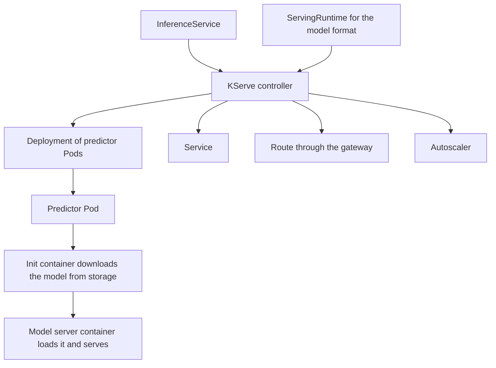
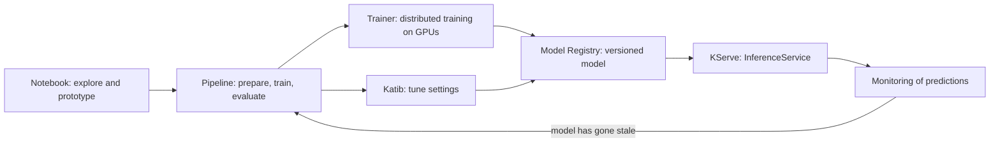

# KServe and Kubeflow

## In plain words

A restaurant has two very different rooms. In the **test kitchen**, chefs experiment for weeks to perfect a recipe: they try variations, taste, adjust and write the result down. In the **dining room**, that finished recipe is cooked to order, hundreds of times a night, quickly and identically, with more cooks on a Saturday and fewer on a Monday.

Machine learning has the same two rooms. **Training** is the test kitchen: a long, experimental process that ends with a file called a **model**, which holds everything the computer learned. **Serving** (also called **inference**) is the dining room: a program loads that file and answers requests, such as "given this week's weather and last year's sales, how many coffees will this branch sell tomorrow?"

Two open-source projects bring these rooms to Kubernetes.

- **KServe** is the dining room done properly. You hand it a model file and say what format it is in; it produces a running, scalable, monitored web service. Any kind of model goes through the same hatch.
- **Kubeflow** is the whole restaurant: notebooks for experimenting, pipelines that run the steps from raw data to finished model, controllers for training on many machines, a registry of finished models, and KServe for serving them.

Neither is part of Kubernetes itself. Both are built from the extension mechanisms taught earlier: custom resources and controllers.

Why this matters for a job: "MLOps" and "ML platform" roles consist largely of running these tools or their commercial equivalents. Even if a company uses a cloud provider's managed product, the concepts (a model server, an inference endpoint, autoscaling on request load, canary rollout of a model, a pipeline of containerised steps) are identical, and interviewers ask about them in those terms.

> **Before this lesson:** read [GPU scheduling](#/lesson/kubernetes/gpu-scheduling). You also need custom resources and operators ([Extending the API: CRDs and operators](#/lesson/kubernetes/crds-operators)), the Horizontal Pod Autoscaler ([Autoscaling](#/lesson/kubernetes/autoscaling)), init containers ([Multi-container Pods](#/lesson/kubernetes/multi-container-pods)) and canary releases ([GitOps with Argo CD](#/lesson/kubernetes/gitops-argo-cd)). No machine-learning background is assumed; each ML term is defined when it appears.

## What serving a model takes

A trained model is a file, or a folder of files, in a storage bucket. On its own it does nothing. To turn it into something an application can call, you need:

1. a **model server**: a program that loads the file into memory and listens for requests over HTTP or gRPC (a faster, binary alternative to HTTP for calls between services),
2. a way to **fetch the model file** from storage when the server starts,
3. **scaling** with demand, ideally on a signal that reflects inference load,
4. **safe rollout** of new model versions, because a new model can be perfectly valid software and still give worse answers,
5. **health checks, metrics and logs**.

You could build all of it by hand: a Deployment whose init container downloads the model, a container running a model server, a Service, an HTTPRoute, an HPA, probes. That is about 150 lines of YAML per model, repeated with small variations for every model the company has. KServe exists to reduce that to about a dozen lines and to make every model look the same from outside.

### Model formats and model servers

Different training libraries save models in different **formats**, and each format needs a server that understands it.

| Kind of model | Typical formats | Typical server |
|---|---|---|
| Classical ML (tables of numbers) | scikit-learn, XGBoost, LightGBM | MLServer, or KServe's own small servers |
| Deep learning | PyTorch, TensorFlow SavedModel, ONNX | NVIDIA Triton, TorchServe |
| Large language models | Hugging Face model folders | vLLM, Hugging Face runtimes |

A shared request format keeps clients independent of the server behind the endpoint. The **Open Inference Protocol** (also called the V2 protocol) defines one: send a JSON document listing named input **tensors** (a tensor is an array of numbers with a stated shape) to `/v2/models/NAME/infer`, and receive named output tensors back.

The program below is a complete, tiny model server for that protocol. Its "model" is a formula with three weights, which is what a small linear model amounts to.

```python-run
import json

MODEL = {"name": "demand-forecast", "weights": [2.0, 0.5, -1.5], "bias": 40.0}     # what training produced

def infer(model_name, body):
    """Handle POST /v2/models/<model_name>/infer."""
    if model_name != MODEL["name"]:
        return 404, {"error": f"model {model_name} not found"}
    request = json.loads(body)
    tensor = request["inputs"][0]
    rows, cols = tensor["shape"]
    if cols != len(MODEL["weights"]):
        return 400, {"error": f"expected {len(MODEL['weights'])} features per row, got {cols}"}
    flat = tensor["data"]
    predictions = []
    for r in range(rows):
        row = flat[r * cols:(r + 1) * cols]
        predictions.append(round(sum(w * x for w, x in zip(MODEL["weights"], row)) + MODEL["bias"], 2))
    return 200, {"model_name": model_name,
                 "outputs": [{"name": "predicted_cups", "shape": [rows], "datatype": "FP32", "data": predictions}]}

# Two branches: [temperature in C, day of week, rain in mm]
request_body = json.dumps({"inputs": [{"name": "features", "shape": [2, 3], "datatype": "FP32",
                                       "data": [31.0, 6.0, 0.0, 26.0, 2.0, 12.0]}]})
for name, body in [("demand-forecast", request_body), ("unknown-model", request_body),
                   ("demand-forecast", json.dumps({"inputs": [{"name": "f", "shape": [1, 2], "datatype": "FP32", "data": [1.0, 2.0]}]}))]:
    status, response = infer(name, body)
    print(f"POST /v2/models/{name}/infer -> {status}")
    print("  ", json.dumps(response))
```

The request states the shape `[2, 3]`: two rows of three numbers, sent as one flat list. The response has shape `[2]`, one prediction per row. Real servers do the same with far larger models and with batching, GPU memory management and metrics added. The point to keep is that a model server is an ordinary web service, so everything you know about Deployments, Services, probes and autoscaling applies to it.

## KServe

### An InferenceService, line by line

```yaml
apiVersion: serving.kserve.io/v1beta1
kind: InferenceService
metadata:
  name: demand-forecast
  namespace: ml
spec:
  predictor:
    minReplicas: 1
    maxReplicas: 5
    model:
      modelFormat:
        name: sklearn
      storageUri: s3://harbour-models/demand-forecast/v3
      resources:
        requests:
          cpu: "1"
          memory: 2Gi
        limits:
          memory: 2Gi
```

- `apiVersion: serving.kserve.io/v1beta1`, `kind: InferenceService` — the custom resource at the centre of KServe.
- `spec.predictor` — the component that makes predictions. It is the only required one.
- `minReplicas` and `maxReplicas` — the autoscaling range.
- `model.modelFormat.name: sklearn` — the format of the model file. You do not name a container image. KServe looks up which server handles this format.
- `model.storageUri` — where the model file lives. Buckets (`s3://`, `gs://`), a volume claim (`pvc://`), a model hub (`hf://`) and container images (`oci://`) are among the supported schemes.
- `resources` — ordinary requests and limits for the server container. A GPU model would add `nvidia.com/gpu: 1` under `limits`, with the toleration and node selection from the previous lesson.

```bash
$ kubectl apply -f demand-forecast.yaml
inferenceservice.serving.kserve.io/demand-forecast created

$ kubectl get inferenceservice -n ml
NAME              URL                                    READY   AGE
demand-forecast   http://demand-forecast.ml.example.com  True    2m

$ curl -s http://demand-forecast.ml.example.com/v2/models/demand-forecast/infer \
    -H 'Content-Type: application/json' \
    -d '{"inputs":[{"name":"features","shape":[1,3],"datatype":"FP32","data":[31.0,6.0,0.0]}]}'
{"model_name":"demand-forecast","outputs":[{"name":"predicted_cups","shape":[1],"datatype":"FP32","data":[105.0]}]}
```

`READY True` means every piece exists and the model has loaded. The `URL` is the address clients call.

### What the controller builds



Three ideas explain the diagram.

**Serving runtimes.** A **ServingRuntime** (namespaced) or **ClusterServingRuntime** (cluster-wide) is a custom resource that says "models in format X are served by this container image with these arguments". KServe installs several. When your InferenceService says `sklearn`, the controller finds the matching runtime and fills in the Pod template. A platform team can add its own runtime once, and every data scientist can then use that format by name.

**The storage initialiser.** The predictor Pod gets an **init container** that downloads the model from `storageUri` into a shared volume before the server starts. The server container finds the files on local disk. This is the init-container pattern from the [multi-container lesson](#/lesson/kubernetes/multi-container-pods): prepare something, exit, then let the main container start. For multi-gigabyte models the download dominates start-up time, which matters for autoscaling, as you will see shortly.

**Optional components.** Besides the predictor, an InferenceService may define a **transformer**, which converts raw input (say, an image file) into the tensors the model wants and converts the output back, and an **explainer**, which reports why the model gave an answer. Each is its own set of Pods and scales separately.

### Two deployment modes

KServe can realise an InferenceService in two ways.

| | Standard mode | Knative mode |
|---|---|---|
| Built from | A plain Deployment, Service and HPA (optionally KEDA) | Knative Serving, a platform for request-driven workloads |
| Traffic entry | Gateway API or Ingress | Knative's own gateway |
| Autoscaling signal | CPU, memory or custom metrics | Requests in flight (**concurrency**) or requests per second |
| Scale to zero | No | Yes |
| Traffic splitting between versions | Through the gateway or a rollout tool | Built in, by percentage |
| Typical use | Large GPU models and language models, which must stay loaded | Many small models with uneven traffic |

Older documentation calls these "raw deployment" and "serverless". The names changed; the trade-off did not.

## Autoscaling inference

### Why CPU is the wrong signal

The HPA's default signal, CPU utilisation, misleads for inference. A model on a GPU does its heavy work on the GPU, so the container's CPU may sit at 15% while requests queue. A better signal is how many requests each replica is handling at once, its **concurrency**. If one replica can serve 4 requests at a time at acceptable speed, then 20 requests in flight call for 5 replicas:

$$\text{desired replicas} = \left\lceil \frac{\text{requests in flight}}{\text{target concurrency per replica}} \right\rceil$$

It is the HPA formula from the [autoscaling lesson](#/lesson/kubernetes/autoscaling) with a different metric. In KServe you state it on the predictor:

```yaml
spec:
  predictor:
    minReplicas: 0
    maxReplicas: 8
    scaleMetric: concurrency
    scaleTarget: 4
```

- `scaleMetric: concurrency` and `scaleTarget: 4` — aim for four requests in flight per replica.
- `minReplicas: 0` — allow **scale to zero** (Knative mode): when no requests arrive for a while, remove every replica.

### The price of zero

Scale to zero saves real money, since an idle model on a GPU costs the same as a busy one. It also introduces the **cold start**: the first request after an idle period must wait while a Pod is scheduled, the image is pulled, the model is downloaded and loaded into memory. For a small model that is a few seconds. For a large one it can be minutes. While there are no Pods, a small component called the **activator** holds incoming requests and releases them when a replica is ready.

```python-run
import math

def simulate(min_replicas, cold_start_s, load, target_concurrency=4, max_replicas=8, idle_window=3):
    replicas = min_replicas
    starting = []                              # seconds at which new replicas become ready
    idle_for = 0
    held = 0                                   # requests waiting because there is no capacity yet
    print(f"minReplicas={min_replicas}, cold start {cold_start_s}s")
    print("  t  in-flight  ready  desired  note")
    for t, in_flight in enumerate(load):
        replicas += sum(1 for ready_at in starting if ready_at == t)
        starting = [r for r in starting if r > t]
        desired = max(min_replicas, min(max_replicas, math.ceil(in_flight / target_concurrency)))
        note = ""
        if in_flight == 0:
            idle_for += 1
        else:
            idle_for = 0
        if desired > replicas + len(starting):
            starting += [t + cold_start_s] * (desired - replicas - len(starting))
            note = f"scaling up, new replicas ready at t={t + cold_start_s}"
        elif desired < replicas and idle_for >= idle_window:
            replicas = desired
            note = "idle long enough, scaled down"
        capacity = replicas * target_concurrency
        waiting = max(0, in_flight - capacity)
        held += waiting
        if waiting:
            note += f"  [{waiting} requests waiting]"
        print(f"{t:3}  {in_flight:9}  {replicas:5}  {desired:7}  {note}")
    print(f"  request-seconds spent waiting: {held}\n")

load = [0, 0, 6, 6, 6, 6, 0, 0, 0, 0, 0, 3, 3, 3]
simulate(min_replicas=0, cold_start_s=3, load=load)
simulate(min_replicas=1, cold_start_s=3, load=load)
```

Compare the two runs. With `minReplicas=0`, both bursts of traffic meet a cluster with nothing running, and requests wait for the full cold start each time. With `minReplicas=1`, one replica absorbs part of the first burst and all of the second. The total waiting falls sharply, at the cost of one replica running all day. The rule of thumb that follows: scale to zero for models that are called rarely and whose callers can wait; keep at least one replica for anything a person is waiting on.

### Getting more out of each GPU

Autoscaling adds replicas. Two techniques raise what each replica can do. **Dynamic batching**: the server collects requests that arrive within a few milliseconds of each other and runs them through the model together, which a GPU does far more efficiently than one at a time. **Sharing**: several small models share one card through the time-slicing or MIG mechanisms from the previous lesson. For language models, which produce their answer word by word, the numbers to watch change too: time to the first token and tokens per second, alongside requests per second.

## Rolling out a new model

A new model version is riskier than a new code version in one particular way. Code that is wrong usually fails visibly. A model that is wrong returns well-formed answers that are slightly worse, and no probe will notice. So model rollouts lean on the canary strategy from the [GitOps lesson](#/lesson/kubernetes/gitops-argo-cd): send a small share of real traffic to the new version and compare outcomes.

```yaml
spec:
  predictor:
    canaryTrafficPercent: 10
    model:
      modelFormat:
        name: sklearn
      storageUri: s3://harbour-models/demand-forecast/v4
```

Changing `storageUri` to `v4` and setting `canaryTrafficPercent: 10` (in Knative mode) keeps the previous version serving 90% of requests while the new one takes 10%. Raise the number in steps; remove the field to finish; set it to 0 to send everything back. In standard mode the same result comes from weighted routes at the gateway. A related technique, **shadowing**, copies live requests to the new model and discards its answers, so that its predictions can be compared with the current model's before any user sees them.

## Kubeflow

### A toolbox, not a single program

**Kubeflow** is a family of projects, each a set of custom resources and controllers that you can install separately or together.

| Component | What it provides | Main custom resources |
|---|---|---|
| **Notebooks** | Browser-based coding environments (Jupyter and others) running as Pods, with storage and GPUs | `Notebook` |
| **Pipelines** | Multi-step workflows from data preparation to a registered model | Pipelines and runs |
| **Trainer** | Training across several machines for PyTorch and other frameworks | `TrainJob`; earlier `PyTorchJob`, `TFJob` |
| **Katib** | Automatic search for good training settings | `Experiment`, `Trial` |
| **Model Registry** | A catalogue of trained models, versions and where their files are | — |
| **KServe** | Serving, as above (it began life inside Kubeflow as KFServing) | `InferenceService` |



The loop at the bottom is the reason pipelines exist. A model is trained on yesterday's world. As the world changes, its predictions get worse, a problem called **drift**, and the model must be retrained on fresh data. Whatever must be repeated should be automated.

### Pipelines

A **pipeline** is a set of steps with dependencies between them: step C needs the outputs of A and B. Such a structure is a **directed acyclic graph (DAG)**: "directed" because each dependency points one way, "acyclic" because no step can depend, directly or indirectly, on itself. In Kubeflow Pipelines each step runs as its own container in its own Pod, so steps can use different images and different resources, and the heavy step alone can ask for a GPU.

Pipelines are usually written in Python with the `kfp` library and compiled to YAML that the cluster runs:

```python
from kfp import dsl

@dsl.component(base_image="python:3.12")
def prepare(days: int) -> str:
    ...                                  # load sales data, clean it, return where it was saved

@dsl.component(base_image="ghcr.io/harbour-coffee/train:0.9.2")
def train(data_path: str, learning_rate: float) -> str:
    ...                                  # train and return the model's location

@dsl.pipeline(name="demand-forecast")
def demand_forecast(days: int = 90, learning_rate: float = 0.01):
    data = prepare(days=days)
    model = train(data_path=data.output, learning_rate=learning_rate)
    model.set_accelerator_type("nvidia.com/gpu").set_accelerator_limit(1)
```

- `@dsl.component` turns a Python function into a containerised step; `base_image` is the image it runs in.
- `@dsl.pipeline` defines the graph. Passing `data.output` into `train` is what creates the dependency: `train` cannot start until `prepare` has finished.
- The last line asks for one GPU for the training step only.

Two features make pipelines worth the effort. **Artifact tracking**: every run records which data and settings produced which model, so a model in production can be traced back to its origins. And **caching**: a step whose inputs have not changed is skipped and its previous output reused. The executor below shows both the ordering and the caching.

```python-run
steps = {                                   # step -> (steps it depends on, parameters it uses)
    "prepare":  ([], ["days"]),
    "features": (["prepare"], []),
    "train":    (["features"], ["learning_rate"]),
    "evaluate": (["train", "features"], []),
    "register": (["evaluate"], []),
}
cache = {}                                  # (step, fingerprint of its inputs) -> output

def run_pipeline(params):
    print(f"run with {params}")
    done, outputs = set(), {}
    while len(done) < len(steps):
        ready = [s for s in steps if s not in done and all(d in done for d in steps[s][0])]
        for step in sorted(ready):          # everything in `ready` could run in parallel
            deps, used = steps[step]
            fingerprint = (tuple(outputs[d] for d in deps), tuple(params[p] for p in used))
            if (step, fingerprint) in cache:
                outputs[step] = cache[(step, fingerprint)]
                print(f"   {step:9} cached   -> {outputs[step]}")
            else:
                outputs[step] = f"{step}-out-{abs(hash((step, fingerprint))) % 1000:03d}"
                cache[(step, fingerprint)] = outputs[step]
                print(f"   {step:9} EXECUTED -> {outputs[step]}")
            done.add(step)
    print()

run_pipeline({"days": 90, "learning_rate": 0.01})
run_pipeline({"days": 90, "learning_rate": 0.01})      # nothing changed
run_pipeline({"days": 90, "learning_rate": 0.05})      # only the training setting changed
```

The second run executes nothing. The third re-runs `train` and the steps after it, because their inputs changed, and reuses `prepare` and `features`, which are often the slowest steps. On a real cluster that turns an hour of repeated data preparation into seconds. (The output names contain a hash, so the exact digits differ from run to run of the program; the EXECUTED and cached pattern is what to look at.)

### Distributed training

A single GPU is sometimes not enough. Training across several Pods needs each one to know its role and the others' addresses, and all of them to be created, restarted and cleaned up as a unit. A plain Job does not manage that, so Kubeflow provides a controller. The long-established form is the `PyTorchJob`:

```yaml
apiVersion: kubeflow.org/v1
kind: PyTorchJob
metadata:
  name: forecast-distributed
  namespace: ml
spec:
  pytorchReplicaSpecs:
    Master:
      replicas: 1
      restartPolicy: OnFailure
      template:
        spec:
          containers:
            - name: pytorch
              image: ghcr.io/harbour-coffee/demand-forecast-train:0.9.2
              resources:
                limits:
                  nvidia.com/gpu: 1
    Worker:
      replicas: 3
      restartPolicy: OnFailure
      template:
        spec:
          containers:
            - name: pytorch
              image: ghcr.io/harbour-coffee/demand-forecast-train:0.9.2
              resources:
                limits:
                  nvidia.com/gpu: 1
```

- `pytorchReplicaSpecs` — the roles. One `Master` coordinates and three `Worker` Pods join it: four GPUs in total.
- Each role holds an ordinary Pod template. The container must be named `pytorch`.
- The controller creates the Pods and a headless Service, and sets environment variables so that the PyTorch library in each Pod can find the others.

The newer Kubeflow Trainer replaces the per-framework kinds with a single `TrainJob` that refers to a reusable **training runtime** prepared by the platform team, the same division of labour as KServe's InferenceService and ServingRuntime. Both forms work with Kueue for queueing and gang admission.

### Tuning with Katib

Training has settings chosen before it starts, such as the learning rate. They are called **hyperparameters**, and good values are found by trying many. **Katib** automates the search: an `Experiment` states the range of each setting, the metric to improve and a budget; Katib launches `Trial` runs, each a training Job with different values, reads their results and picks the next values to try. It is a controller that creates Jobs, like much else in this track.

### How much of this do you need?

Less than the diagram suggests, at first. A team with three models can serve them with KServe alone, or with plain Deployments, and train with ordinary Jobs. Pipelines pay off when retraining becomes regular. The Trainer pays off when one GPU is too slow. A full Kubeflow installation is a substantial platform to operate, with its own authentication, storage and upgrade concerns, and many organisations adopt its components one at a time.

> [!TIP]
> Treat a model like any other release artefact. Give each version an immutable location (`.../demand-forecast/v4`, never a folder that is overwritten), keep the InferenceService manifest in Git, and promote versions through environments with the GitOps flow from earlier in the track. Then "which model is in production, and since when?" has an exact answer, and going back is a one-line revert.

> [!INTERVIEW]
> **"How would you serve a machine-learning model on Kubernetes, and scale it?"** A model server (Triton, TorchServe, MLServer or vLLM for language models) loads the model file and exposes an HTTP or gRPC inference endpoint, ideally the Open Inference Protocol. With KServe you declare an InferenceService giving the model format and a storage URI; the controller picks a ServingRuntime, adds an init container that downloads the model, and creates the Deployment, Service, route and autoscaler. GPU models request `nvidia.com/gpu` and tolerate the GPU nodes' taint. Scale on concurrency or requests per second, not CPU, since GPU work does not show in CPU utilisation. Scale to zero saves idle GPUs but brings cold starts while Pods schedule and the model loads, so keep a minimum replica for interactive use. Roll out new model versions as canaries with a traffic percentage, because a worse model still returns valid responses. For the wider life cycle, mention Kubeflow: Pipelines for a DAG of containerised steps with caching and lineage, the Trainer for distributed training, Katib for hyperparameter search, a model registry, and monitoring for drift that triggers retraining.

## Common pitfalls

- **Scaling a GPU model on CPU utilisation.** The CPU looks calm while requests queue.
- **Scale to zero for a user-facing model with a large file.** The first user after a quiet spell waits minutes.
- **Readiness reported before the model has loaded.** Traffic arrives and fails. Use a startup probe that allows for the load time.
- **Mutable model locations.** Overwriting `latest/` makes rollback impossible and running Pods inconsistent with new ones.
- **Baking a huge model into the container image without thought.** Every node pulls gigabytes; changing the model means rebuilding the image.
- **No memory headroom.** Loading a model can briefly need more memory than serving it, and the Pod is OOM-killed during start-up.
- **Replacing a model for all traffic at once.** Quality regressions are invisible to probes.
- **Installing all of Kubeflow for one model.** The platform costs more to run than the problem warrants.
- **Pipelines whose steps are not repeatable.** Caching then returns stale results, or reruns give different answers.
- **Forgetting the model's inputs.** A model served on data prepared differently from its training data gives poor answers without any error.

## Cheat sheet

| Task | Command or field |
|---|---|
| List models being served | `kubectl get inferenceservices -A` (short name `isvc`) |
| Why is one not ready? | `kubectl describe isvc NAME`, then the predictor Pod's events and logs |
| Logs of the model download | `kubectl logs POD -c storage-initializer` |
| Available runtimes | `kubectl get clusterservingruntimes` |
| Call a model | `POST /v2/models/NAME/infer` with an `inputs` list |
| Scale on request load | `scaleMetric: concurrency`, `scaleTarget: N` |
| Scale to zero | `minReplicas: 0` (Knative mode) |
| Canary a new version | `canaryTrafficPercent: 10` |
| Distributed training jobs | `kubectl get pytorchjobs` or `kubectl get trainjobs` |

## Summary

Serving a model means running a model server that loads a file and answers inference requests, then giving it everything any production service needs. KServe turns that into one custom resource: an InferenceService names a model format and a storage location, and the controller supplies the runtime image, an init container to fetch the model, the workload, the route and the autoscaler, in either a standard Deployment-based mode or a Knative mode with scale to zero. Inference should scale on request concurrency, with a deliberate choice between idle cost and cold starts, and new models should arrive as canaries. Kubeflow surrounds serving with the rest of the life cycle: notebooks, pipelines of containerised steps with caching and lineage, distributed training, hyperparameter search and a model registry. Every piece is an operator built on the Kubernetes API, which is why this lesson could be explained almost entirely with ideas from earlier ones. The final module gathers the whole track into the answers interviewers ask for.

## Glossary

- **Model**: the file produced by training, holding what was learned.
- **Inference (serving)**: using a model to answer requests.
- **Model server**: a program that loads a model and exposes an inference endpoint.
- **gRPC**: a binary protocol for calls between services, an alternative to HTTP with JSON.
- **Tensor**: an array of numbers with a stated shape.
- **Open Inference Protocol (V2)**: a standard request and response format for inference.
- **KServe**: a Kubernetes project that serves models through the InferenceService resource.
- **InferenceService**: KServe's resource describing a model to serve.
- **Predictor / transformer / explainer**: the components that predict, convert inputs and outputs, and explain predictions.
- **ServingRuntime**: a resource mapping a model format to a server image.
- **Storage initialiser**: the init container that downloads the model.
- **Knative**: a platform for request-driven workloads with scale to zero.
- **Concurrency**: the number of requests a replica is handling at one moment.
- **Scale to zero**: removing all replicas when idle.
- **Cold start**: the delay while a first replica starts and loads the model.
- **Activator**: the component that holds requests while a scaled-to-zero service starts.
- **Dynamic batching**: grouping near-simultaneous requests into one model call.
- **Shadowing**: sending copies of live requests to a new model without using its answers.
- **Kubeflow**: a family of Kubernetes projects for the machine-learning life cycle.
- **Pipeline**: a workflow of containerised steps with dependencies.
- **DAG**: directed acyclic graph; steps with one-way dependencies and no loops.
- **Artifact**: a file produced by a step, such as a dataset or a model.
- **Caching (pipelines)**: reusing a step's earlier output when its inputs are unchanged.
- **Hyperparameter**: a training setting chosen before training begins.
- **Katib**: Kubeflow's hyperparameter search component.
- **Drift**: the decline of a model's accuracy as real-world data changes.

```quiz
[
  {"q": "What do you specify in a minimal KServe InferenceService?",
   "options": ["A full Deployment, Service and HPA", "The model's format and where its files are stored", "The node to run on", "The model's source code"],
   "answer": 1,
   "explain": "The predictor names a modelFormat and a storageUri. The controller chooses a serving runtime and creates the workload, Service, route and autoscaler."},
  {"q": "How does the model file get into a KServe predictor Pod?",
   "options": ["It must be built into the server image", "An init container, the storage initialiser, downloads it from storageUri to a shared volume before the server starts", "The kubelet copies it from etcd", "The client uploads it with the first request"],
   "answer": 1,
   "explain": "KServe injects an init container that fetches the model. The server container then loads it from local disk."},
  {"q": "Why is CPU utilisation a poor autoscaling signal for a model served on a GPU?",
   "options": ["CPU metrics are not available for GPU Pods", "The heavy work happens on the GPU, so CPU can stay low while requests queue", "The HPA does not support Deployments with GPUs", "GPUs make CPU usage negative"],
   "answer": 1,
   "explain": "Request concurrency or requests per second reflects inference load directly. CPU may show little change while the GPU is saturated."},
  {"q": "A predictor has scaleMetric: concurrency and scaleTarget: 4. There are 18 requests in flight. How many replicas are wanted?",
   "options": ["4", "5", "18", "72"],
   "answer": 1,
   "explain": "ceil(18 / 4) = 5. It is the HPA formula with in-flight requests as the metric."},
  {"q": "What is the main cost of setting minReplicas: 0 on an InferenceService?",
   "options": ["The model can no longer be updated", "The first request after an idle period waits for a Pod to start and the model to load, a cold start", "GPU requests are ignored", "The Service is deleted"],
   "answer": 1,
   "explain": "Scale to zero removes idle cost and adds start-up latency. Large models can take minutes to become ready."},
  {"q": "Why are new model versions commonly rolled out as canaries, even when the serving code is unchanged?",
   "options": ["Kubernetes requires it for custom resources", "A worse model still returns well-formed responses, so only comparing real outcomes on a share of traffic reveals the regression", "Canaries make models load faster", "It halves the GPU cost"],
   "answer": 1,
   "explain": "Health probes check that the server answers, not that the answers are good. A small traffic share limits the effect of a poor model while it is evaluated."},
  {"q": "In Kubeflow Pipelines, a run repeats with the same data and settings except for the learning rate of the training step. With caching on, which steps execute?",
   "options": ["All steps", "Only the training step and the steps that depend on its output", "No steps", "Only the first step"],
   "answer": 1,
   "explain": "A step is skipped when its inputs are unchanged. Changing a training parameter invalidates that step and everything downstream; earlier steps are reused."},
  {"q": "What does a Kubeflow PyTorchJob or TrainJob add over a plain Kubernetes Job?",
   "options": ["It runs without containers", "It creates and manages a group of Pods with roles, gives them the addresses they need to find each other, and treats them as one training run", "It removes the need for GPUs", "It replaces the scheduler"],
   "answer": 1,
   "explain": "Distributed training needs coordinated Pods that know their peers. The training controller creates them, wires them together and handles restarts and clean-up as a unit."}
]
```

> **Source:** this lesson extends the track beyond the chapters of Poulton's *The Kubernetes Book*. Project docs: https://kserve.github.io/website/ , https://kserve.github.io/website/docs/concepts/architecture/control-plane , https://github.com/kserve/open-inference-protocol , https://knative.dev/docs/serving/autoscaling/ , https://www.kubeflow.org/docs/started/introduction/ , https://www.kubeflow.org/docs/components/pipelines/ , https://www.kubeflow.org/docs/components/trainer/ , https://www.kubeflow.org/docs/components/katib/
