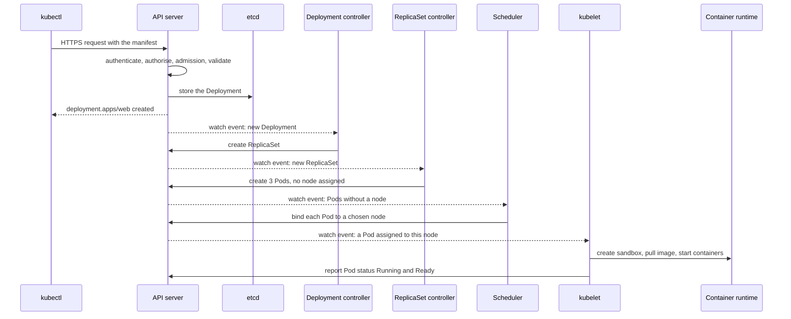
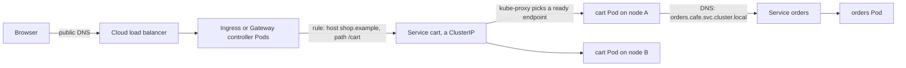

# What happens on kubectl apply, and how networking works

## In plain words

Ask a courier company "what happens after I click Buy?" and a good employee can tell the parcel's whole story: the order is checked and recorded, the warehouse picks the item, a planner assigns it to a van, the driver delivers it, and the tracking page is updated so that anyone can find it. A weak answer names one step. A strong answer walks the entire route, in order, and can say what happens when a step fails.

Kubernetes interviews are built around two such journeys.

1. **The journey of a manifest.** "What happens when you run `kubectl apply`?" tests whether you understand the control plane: who checks the request, who stores it, who acts on it and how a container finally starts.
2. **The journey of a packet.** "How does networking work in Kubernetes?" tests whether you understand how a request finds one particular Pod among thousands that keep changing.

Nearly everything else an interviewer asks is a detour from one of these two routes. This lesson gives you both tours in full, a short version of each to say aloud, and the follow-up questions that usually come next. It introduces nothing new. It joins what the earlier lessons taught into the form an interview asks for.

Why this matters for a job: these are the two most common Kubernetes interview questions for backend, platform, DevOps and site reliability roles. They are open-ended on purpose. The interviewer is listening for structure, for correct names, and for whether you stop at "the Pod gets created" or can go one level deeper when pressed.

> **Before this lesson:** this is a revision lesson. It draws on [The control plane](#/lesson/kubernetes/control-plane), [Worker nodes](#/lesson/kubernetes/worker-nodes), [The declarative model and reconciliation loops](#/lesson/kubernetes/declarative-reconciliation), [RBAC authorisation and admission control](#/lesson/kubernetes/rbac-admission), [Services, selectors, ClusterIP and EndpointSlices](#/lesson/kubernetes/services-clusterip), [Service registration and cluster DNS](#/lesson/kubernetes/service-registration-dns) and [From name to Pod: the packet path](#/lesson/kubernetes/packet-path-troubleshooting). If a term below is unfamiliar, the linked lesson teaches it from zero.

## How to answer an open question

An open question has no single correct sentence, so shape matters. A structure that works for both journeys:

1. **One sentence of summary first.** It proves you know where the story ends before you start telling it.
2. **Walk the path in order**, naming each component and its one responsibility.
3. **Stop at a sensible depth** and offer more: "I can go deeper on scheduling or on admission if that is useful."
4. **Mention one failure or trade-off** unprompted. It signals experience.

Speak in components and verbs: "the scheduler binds the Pod to a node", not "then Kubernetes puts it somewhere". Precise verbs are how interviewers tell understanding from memorised vocabulary.

## Journey one: `kubectl apply -f deployment.yaml`

### The 30-second version

> `kubectl` sends the manifest to the API server, which authenticates and authorises the request, runs admission control, validates the object and stores it in etcd. Nothing has started yet; only desired state was recorded. Controllers watching the API then react in a chain: the Deployment controller creates a ReplicaSet, the ReplicaSet controller creates Pods, the scheduler assigns each Pod to a node, and the kubelet on that node tells the container runtime to pull the image and start the containers. Once readiness probes pass, the Pod's address is added to the Service's EndpointSlice and kube-proxy routes traffic to it.

### The full walk



**Step 1: the client.** `kubectl` reads your **kubeconfig** file to learn which cluster to talk to and which credentials to present. It reads the YAML, converts it to JSON and sends an HTTPS request to the API server. With `apply`, the request means "make the object look like this", so the same command creates the object the first time and updates it afterwards.

**Step 2: the API server's checkpoints.** Every request passes the same sequence.

| Checkpoint | Question | Failure looks like |
|---|---|---|
| Authentication | Who are you? | `401 Unauthorized` |
| Authorisation (RBAC) | May you do this verb on this resource in this namespace? | `403 Forbidden` |
| Mutating admission | Should the object be changed? (defaults, injected sidecars) | — |
| Schema validation | Is this a well-formed object of this kind? | `400` or `422`, naming the bad field |
| Validating admission | Does it comply with policy? (quotas, Pod Security) | `403` with the policy's message |
| Persistence | Write to etcd | The object now exists |

Only after the write does `kubectl` print `deployment.apps/web created`. At this instant **no container is running**. The cluster has accepted a statement of what you want.

**Step 3: the controllers' chain reaction.** Controllers do not call each other. Each one **watches** the API server, meaning it holds a connection open and is told at once when objects of its kind change, and each reacts only to what it sees.

- The **Deployment controller** sees a Deployment with no matching ReplicaSet and creates one.
- The **ReplicaSet controller** sees a ReplicaSet wanting three Pods and owning none, and creates three Pod objects. Their `spec.nodeName` is empty and their phase is `Pending`.

**Step 4: the scheduler.** It watches for Pods without a node. For each one it **filters** out nodes that cannot run it (insufficient unreserved resources, untolerated taints, failed affinity), **scores** the rest, and **binds** the Pod by writing the winner's name into `spec.nodeName`. The scheduler starts nothing.

**Step 5: the kubelet.** Each node's kubelet watches for Pods bound to its node. On seeing one, it asks the **container runtime** through the Container Runtime Interface (CRI) to create the Pod's **sandbox** (the shared network namespace), calls the **CNI plug-in** to give the Pod an IP address, pulls the images, runs any init containers to completion, and starts the application containers. Volumes and ConfigMap or Secret data are mounted on the way.

**Step 6: becoming reachable.** The kubelet runs the startup and readiness probes and reports status to the API server. When the Pod is Ready, the **EndpointSlice controller**, which watches Pods and Services, adds the Pod's IP to the slices of every Service whose selector matches. **kube-proxy** on every node watches EndpointSlices and updates its packet-forwarding rules. From now on, traffic to the Service can reach the new Pod.

### The chain reaction, runnable

Each "controller" below is a function that looks at a shared store and acts only on what it finds, as the real ones do. The loop keeps calling them until nobody has anything left to do.

```python-run
store = {"deployments": {}, "replicasets": {}, "pods": {}, "endpoints": []}
nodes = {"worker-1": 0, "worker-2": 0}
log = []

def api_server(user, verb, deployment):
    if user != "alice":                       return "401 Unauthorized"
    if verb not in ("create", "apply"):       return "403 Forbidden"
    if deployment["replicas"] < 0:            return "422 Invalid: replicas must be >= 0"
    store["deployments"][deployment["name"]] = deployment
    return f"deployment.apps/{deployment['name']} created"

def deployment_controller():
    for name, d in store["deployments"].items():
        if name + "-rs" not in store["replicasets"]:
            store["replicasets"][name + "-rs"] = {"replicas": d["replicas"], "image": d["image"]}
            return f"Deployment controller: created ReplicaSet {name}-rs"

def replicaset_controller():
    for name, rs in store["replicasets"].items():
        owned = [p for p in store["pods"] if p.startswith(name)]
        if len(owned) < rs["replicas"]:
            pod = f"{name}-{len(owned)}"
            store["pods"][pod] = {"node": None, "phase": "Pending", "ready": False}
            return f"ReplicaSet controller: created Pod {pod} (no node yet)"

def scheduler():
    for name, pod in store["pods"].items():
        if pod["node"] is None:
            pod["node"] = min(nodes, key=lambda n: (nodes[n], n))
            nodes[pod["node"]] += 1
            return f"Scheduler: bound {name} to {pod['node']}"

def kubelet():
    for name, pod in store["pods"].items():
        if pod["node"] and pod["phase"] == "Pending":
            pod.update(phase="Running", ready=True, ip=f"10.244.{list(nodes).index(pod['node']) + 1}.{len(store['endpoints']) + 5}")
            return f"kubelet on {pod['node']}: sandbox, IP {pod['ip']}, image pulled, container started, probe passed"

def endpointslice_controller():
    for name, pod in store["pods"].items():
        if pod["ready"] and pod["ip"] not in store["endpoints"]:
            store["endpoints"].append(pod["ip"])
            return f"EndpointSlice controller: added {pod['ip']}; kube-proxy updates its rules"

def run(controllers):
    progress = True
    while progress:
        progress = False
        for controller in controllers:
            message = controller()
            if message:
                log.append(message); print("  ", message)
                progress = True

everything = [deployment_controller, replicaset_controller, scheduler, kubelet, endpointslice_controller]
print("kubectl apply as mallory ->", api_server("mallory", "apply", {"name": "web", "replicas": 2, "image": "web:1.0"}))
print("kubectl apply as alice   ->", api_server("alice", "apply", {"name": "web", "replicas": 2, "image": "web:1.0"}))
print("with the scheduler stopped:")
run([c for c in everything if c is not scheduler])
print("   Pods:", {n: p["phase"] for n, p in store["pods"].items()}, " endpoints:", store["endpoints"])
print("scheduler started again:")
run(everything)
print("   endpoints:", store["endpoints"])
```

The middle section is the answer to a favourite follow-up, "what if the scheduler is down?" The request still succeeds and the Pods are still created, because the API server and the other controllers do not depend on the scheduler. The Pods wait in `Pending`. When the scheduler returns it finds them and the chain continues. No component told another to proceed; each one found work by looking at the stored state.

### Follow-up questions and how to answer them

| Question | Answer in a sentence or two |
|---|---|
| What makes this "declarative"? | You submit the desired end state, not steps. Controllers continually compare desired with actual and act on the difference, so the system heals itself after failures. |
| How does the kubelet find out about a new Pod? | It keeps a watch open on the API server for Pods whose `spec.nodeName` is its own node. Nothing pushes to it over a separate channel. |
| What if etcd is unavailable? | The API server cannot read or write state, so no changes are possible. Running containers keep running, because the kubelet and runtime work from what they already know. |
| What if the API server is down? | Same for existing workloads: they continue. Nothing new can be scheduled, scaled or healed until it returns. |
| What if a node dies after the Pods are running? | Its kubelet stops reporting. After a grace period of under a minute the node is marked `NotReady` and tainted; Pods tolerate that taint for 300 seconds by default, then are evicted and their controller creates replacements elsewhere. Recovery takes several minutes with the defaults. |
| `apply` or `create`? | `create` fails if the object exists. `apply` creates or updates, merging your manifest with fields that other managers own, and is the basis of declarative workflows. |
| Where does a mutating webhook fit? | In admission, before validation. A service mesh uses one to inject its sidecar container into the Pod specification. |
| How is the image pulled from a private registry? | The kubelet passes credentials from the Pod's `imagePullSecrets` (or its ServiceAccount's) to the runtime. |

## Journey two: how networking works

### The 30-second version

> Kubernetes networking solves four problems. Containers in one Pod share a network namespace and talk over localhost. Every Pod gets its own IP address, and any Pod can reach any other Pod directly without address translation; a CNI plug-in implements that. Because Pod IPs change, a Service provides a stable virtual IP and DNS name, and kube-proxy on each node rewrites traffic for that IP to one of the ready Pods listed in the Service's EndpointSlices. Traffic from outside enters through a NodePort or a cloud load balancer, usually in front of an Ingress or Gateway controller that routes by host name and path.

### The four problems

| Problem | Solution | Implemented by |
|---|---|---|
| Container to container, same Pod | Shared network namespace; use `localhost` and distinct ports | The Pod sandbox |
| Pod to Pod, any node | Every Pod has a unique, routable IP; no translation between Pods | The CNI plug-in (Calico, Cilium, Flannel and others) |
| Pod to Service | A stable virtual IP and DNS name in front of a changing set of Pods | Service, EndpointSlice, kube-proxy, CoreDNS |
| Outside to Service | An entry point from beyond the cluster | NodePort, LoadBalancer, Ingress or Gateway API |

### One request, end to end

Follow a browser's request for `https://shop.example/cart` to a container.



1. **Public DNS** resolves `shop.example` to the address of a cloud load balancer, which was created because a Service of type `LoadBalancer` exists for the ingress controller.
2. The **load balancer** forwards to the ingress or gateway controller's Pods.
3. The **controller** is a reverse proxy configured by Ingress or HTTPRoute objects. It ends the TLS connection, matches host and path, and forwards to the Pods of the `cart` Service.
4. Inside the cluster, when the cart Pod calls `http://orders`, its DNS resolver asks **CoreDNS**, which answers with the `orders` Service's **ClusterIP**, a virtual address that no network interface owns.
5. The packet leaves the cart Pod addressed to that ClusterIP. On the node, rules installed by **kube-proxy** rewrite the destination to the IP of one ready `orders` Pod (destination NAT). The choice is spread across the endpoints.
6. The **CNI** network carries the packet to that Pod, on this node or another. The reply is translated back on the way.

Three facts are worth stating outright in an interview, because many candidates get them wrong:

- A ClusterIP is **virtual**. You cannot ping it meaningfully, and no process listens on it. It exists only as forwarding rules on every node.
- kube-proxy is **not in the data path** in its usual modes. It programs the kernel (iptables, IPVS or nftables rules) and the kernel forwards the packets.
- Only **ready** Pods are endpoints. Readiness probes are therefore a networking feature as much as a health feature.

### Names

A Service named `orders` in namespace `cafe` has the full name `orders.cafe.svc.cluster.local`. Pods have DNS search domains configured, so:

| From a Pod in | This name works | Why |
|---|---|---|
| `cafe` | `orders` | The search list appends `cafe.svc.cluster.local` |
| any other namespace | `orders.cafe` | The search list appends `svc.cluster.local` |
| anywhere | `orders.cafe.svc.cluster.local` | Fully qualified |

The classic bug is calling `orders` from a different namespace: the name resolves to nothing, or worse, to another team's Service of the same name in your own namespace.

```python-run
services = {("cafe", "orders"): {"cluster_ip": "10.96.40.12", "port": 80, "target_port": 8080, "selector": {"app": "orders"}},
            ("cafe", "menu"): {"cluster_ip": "10.96.17.3", "port": 80, "target_port": 8080, "selector": {"app": "menu"}}}
pods = [{"ns": "cafe", "labels": {"app": "orders"}, "ip": "10.244.1.7", "ready": True},
        {"ns": "cafe", "labels": {"app": "orders"}, "ip": "10.244.2.4", "ready": False},
        {"ns": "cafe", "labels": {"app": "orders"}, "ip": "10.244.3.9", "ready": True},
        {"ns": "cafe", "labels": {"app": "menu"}, "ip": "10.244.1.8", "ready": False}]

def resolve(name, client_ns):
    parts = name.split(".")
    candidates = [(client_ns, parts[0])] if len(parts) == 1 else [(parts[1], parts[0])]
    for key in candidates:
        if key in services:
            return key
    return None

def trace(client_ns, url_host, port, request_no=0):
    print(f"from a Pod in '{client_ns}': http://{url_host}:{port}")
    key = resolve(url_host, client_ns)
    if key is None:
        print("   1. DNS: NXDOMAIN, no such Service from this namespace. Error: could not resolve host\n"); return
    svc = services[key]
    print(f"   1. DNS: {key[1]}.{key[0]}.svc.cluster.local -> ClusterIP {svc['cluster_ip']}")
    if port != svc["port"]:
        print(f"   2. No Service port {port} (it exposes {svc['port']}). Error: connection times out\n"); return
    endpoints = [p["ip"] for p in pods if p["ns"] == key[0] and p["ready"]
                 and all(p["labels"].get(k) == v for k, v in svc["selector"].items())]
    print(f"   2. EndpointSlice (ready Pods matching {svc['selector']}): {endpoints}")
    if not endpoints:
        print("   3. No endpoints. Error: connection refused\n"); return
    chosen = endpoints[request_no % len(endpoints)]
    print(f"   3. kube-proxy rule rewrites {svc['cluster_ip']}:{port} -> {chosen}:{svc['target_port']}")
    print(f"   4. CNI network delivers the packet to the Pod at {chosen}\n")

trace("cafe", "orders", 80)
trace("cafe", "orders", 80, request_no=1)
trace("marketing", "orders", 80)
trace("marketing", "orders.cafe", 80)
trace("cafe", "orders", 8080)
trace("cafe", "menu", 80)
```

Six requests, four different outcomes, and each failure appears at a different step with a different error. That is the practical value of knowing the path: the error message tells you which step to inspect. A name that will not resolve is a DNS or namespace problem. A refused connection with a correct name points at empty endpoints. Notice that the unready Pod `10.244.2.4` never receives traffic.

### Service types in one table

| Type | Reachable from | How | Typical use |
|---|---|---|---|
| `ClusterIP` (default) | Inside the cluster | Virtual IP plus DNS name | Service-to-service calls |
| `NodePort` | Outside, at `NodeIP:port` | A port from 30000-32767 opened on every node, forwarding to the ClusterIP | Simple external access; a building block |
| `LoadBalancer` | Outside, at a cloud IP | The cloud provisions a load balancer that targets the nodes or Pods | Exposing one service; fronting an ingress controller |
| `ExternalName` | Inside | A DNS alias (CNAME) to an outside name | Pointing at an external database |
| Headless (`clusterIP: None`) | Inside | DNS returns the Pod IPs directly, no virtual IP | StatefulSets; clients that balance by themselves |

Each of the first three builds on the previous one: a LoadBalancer Service has a NodePort and a ClusterIP underneath.

### Ingress, Gateway API and LoadBalancer

A frequent follow-up: "Why use an Ingress if LoadBalancer Services exist?" A LoadBalancer Service works at the transport layer (TCP and UDP) and gives one external address per Service, each a billed cloud resource. An **Ingress** or **Gateway** works at the HTTP layer: one external entry point routes many host names and paths to many Services, and handles TLS certificates in one place. The **Gateway API** is the newer design. It splits the entry point (Gateway, owned by the platform team) from the routing rules (HTTPRoute, owned by application teams) and supports traffic weights and header matching without vendor-specific annotations.

### More networking follow-ups

| Question | Answer in a sentence or two |
|---|---|
| What is a CNI plug-in responsible for? | Giving each Pod an IP address and making Pod-to-Pod traffic work across nodes; many also enforce NetworkPolicies. |
| Can a Pod in one namespace reach a Pod in another? | Yes, by default. Namespaces do not isolate traffic. NetworkPolicies do, if the CNI plug-in enforces them. |
| How does a Pod reach the internet? | Its traffic leaves through the node, with the source address translated to the node's (source NAT). |
| What are EndpointSlices? | The list of ready Pod IPs and ports behind a Service, kept up to date by a controller and split into chunks for scale. |
| Why did my Service stop working after a default-deny policy? | Egress to cluster DNS was blocked. Allow UDP and TCP port 53 to the DNS Pods. |
| What does `externalTrafficPolicy: Local` do? | Sends external traffic only to Pods on the node that received it, which preserves the client's source IP and avoids an extra hop. |
| What is a service mesh? | Sidecar or node-level proxies that add mutual TLS, retries, traffic splitting and detailed metrics between services, configured through custom resources. |

## Whiteboard scenario: expose a web application to the internet

A typical design prompt: "We have a web front end and an API. Draw how users reach them on Kubernetes, and make it survive the loss of a zone."

A sound answer, in the order you would draw it:

1. **Public DNS** points `shop.example` at a cloud load balancer's address.
2. A **cloud load balancer** spans three availability zones and health-checks its targets.
3. **Gateway controller Pods**, at least two, spread across zones, each terminating TLS with a certificate managed in the cluster.
4. **HTTPRoutes**: `/` to the `web` Service, `/api` to the `api` Service.
5. Two **ClusterIP Services**, each selecting its Deployment's Pods.
6. **Deployments** with three or more replicas, topology spread across zones, readiness probes, and a PodDisruptionBudget.
7. **NetworkPolicies**: the API accepts traffic only from the gateway and the web tier; the database only from the API.

Then say what happens on failure. A Pod crash: the readiness state removes it from EndpointSlices within seconds, and the ReplicaSet replaces it. A node loss: remaining replicas carry the load while replacements are scheduled. A zone loss: the load balancer stops sending to that zone, and two thirds of each tier are still running because of the spread constraint. Naming the mechanism behind each recovery is what turns a drawing into an answer.

> [!TIP]
> Practise each 30-second version aloud until it takes 30 seconds. Spoken fluency is a different skill from recognition on a page, and the first minute of an answer sets the interviewer's expectations for the rest.

> [!INTERVIEW]
> **The two answers in one breath.** *Apply:* kubectl sends the manifest over HTTPS; the API server authenticates, authorises, runs mutating admission, validates, runs validating admission and writes to etcd; the Deployment controller creates a ReplicaSet; the ReplicaSet controller creates Pods; the scheduler filters, scores and binds each to a node; the kubelet has the runtime create the sandbox, the CNI assigns an IP, images are pulled and containers started; after readiness passes, the EndpointSlice controller lists the Pod and kube-proxy programs the route. Every arrow is a watch on the API server, not a direct call. *Networking:* containers in a Pod share localhost; every Pod has a routable IP through the CNI plug-in; a Service is a stable virtual IP and DNS name, resolved by CoreDNS and rewritten by kube-proxy's kernel rules to a ready Pod from the EndpointSlices; external traffic enters by NodePort or cloud load balancer, normally through an Ingress or Gateway controller that routes on host and path.

## Common pitfalls

- **"kubectl creates the Pod."** kubectl only sends a request. Controllers create Pods.
- **"The scheduler starts the container."** It records a decision. The kubelet and the runtime start containers.
- **"The API server tells the kubelet."** Components watch; the API server does not issue orders.
- **Skipping admission control.** Mutating and validating admission sit between authorisation and storage, and interviewers notice when they are missing.
- **Saying only "then it is running".** Readiness, EndpointSlices and kube-proxy are the last third of the story.
- **Treating a ClusterIP as a real interface.** It is a virtual address implemented by rules on every node.
- **Placing kube-proxy in the data path.** It configures the kernel in its common modes.
- **Claiming namespaces isolate network traffic.** They do not, without NetworkPolicies.
- **Confusing `port`, `targetPort` and `nodePort`.** The Service's port, the container's port and the port on every node.
- **Reciting without structure.** A correct list of facts in a random order sounds like memorisation.

## Cheat sheet

| Stage of `apply` | Component | Verb |
|---|---|---|
| Send | kubectl | reads kubeconfig, sends HTTPS |
| Admit | API server | authenticates, authorises, mutates, validates |
| Store | etcd | persists desired state |
| Expand | Deployment and ReplicaSet controllers | create ReplicaSet, create Pods |
| Place | Scheduler | filters, scores, binds |
| Run | kubelet, runtime, CNI | sandbox, IP, pull, start, probe |
| Publish | EndpointSlice controller, kube-proxy | list the Pod, program routes |

| Networking question | Key phrase |
|---|---|
| Same Pod | Shared network namespace, localhost |
| Pod to Pod | One IP per Pod, flat network, CNI |
| Pod to Service | ClusterIP, CoreDNS, EndpointSlices, kube-proxy DNAT |
| Outside in | NodePort, LoadBalancer, Ingress or Gateway |
| Isolation | NetworkPolicy, enforced by the CNI plug-in |

## Summary

Two journeys organise most Kubernetes interview answers. A manifest travels from kubectl through the API server's checkpoints (authentication, authorisation, admission, validation) into etcd, after which independent controllers, each watching the API, expand it step by step: Deployment to ReplicaSet to Pods, the scheduler binding Pods to nodes, the kubelet and runtime starting containers, and the EndpointSlice controller and kube-proxy making them reachable. A packet travels from a name, resolved by CoreDNS to a virtual ClusterIP, through kernel rules that rewrite it to a ready Pod's address, over a flat Pod network supplied by the CNI plug-in, with external traffic entering through load balancers and HTTP routers. Answer both by summarising first, walking the path with precise verbs, and volunteering what happens when a step fails. The next lesson applies the same treatment to workloads and resources.

## Glossary

- **kubeconfig**: the file telling kubectl which cluster, user and namespace to use.
- **Watch**: a long-lived request through which a component is notified of changes to objects.
- **Admission control**: the stage where requests are modified (mutating) and checked against policy (validating).
- **Desired state**: what the stored objects say should exist.
- **Bind**: the scheduler's act of assigning a Pod to a node.
- **CRI**: the Container Runtime Interface between the kubelet and the container runtime.
- **Sandbox**: the Pod-level environment, including its network namespace, that containers join.
- **CNI plug-in**: the component that gives Pods IP addresses and connects them.
- **ClusterIP**: a Service's stable virtual IP address inside the cluster.
- **EndpointSlice**: the list of ready Pod addresses behind a Service.
- **kube-proxy**: the per-node agent that programs forwarding rules for Services.
- **Destination NAT**: rewriting a packet's destination address, here from ClusterIP to Pod IP.
- **CoreDNS**: the cluster's DNS server.
- **Search domain**: a suffix the resolver appends to short names.
- **NodePort / LoadBalancer**: Service types that expose a port on every node, and a cloud load balancer.
- **Ingress / Gateway API**: APIs for routing HTTP traffic by host and path through shared entry points.
- **Reverse proxy**: a server that accepts requests and forwards them to back-end servers.

```quiz
[
  {"q": "kubectl prints 'deployment.apps/web created'. What is guaranteed at that moment?",
   "options": ["The containers are running", "The Pods have been scheduled", "The Deployment object has been admitted and stored in etcd", "The Service has endpoints"],
   "answer": 2,
   "explain": "The response confirms that the API server accepted and persisted the desired state. Controllers, the scheduler and kubelets act afterwards."},
  {"q": "In what order does the API server process a write request?",
   "options": ["Validation, authentication, admission, authorisation", "Authentication, authorisation, mutating admission, validation, validating admission, storage", "Authorisation, authentication, storage, admission", "Admission, storage, authentication"],
   "answer": 1,
   "explain": "Identity first, then permission, then mutation, schema validation and policy validation, and only then the write to etcd."},
  {"q": "Which component creates the Pod objects for a Deployment?",
   "options": ["kubectl", "The Deployment controller directly", "The ReplicaSet controller", "The scheduler"],
   "answer": 2,
   "explain": "The Deployment controller creates and scales ReplicaSets. The ReplicaSet controller creates the Pods. The scheduler only assigns existing Pods to nodes."},
  {"q": "The scheduler is down. You apply a Deployment with 3 replicas. What do you observe?",
   "options": ["The apply fails with an error", "Three Pods exist in Pending with no node, and start once the scheduler returns", "The kubelets pick the Pods up themselves", "The Pods run on the control plane"],
   "answer": 1,
   "explain": "The API server and controllers work independently of the scheduler. Pods are created but stay unbound until a scheduler assigns them."},
  {"q": "How does the kubelet learn that it should run a new Pod?",
   "options": ["The scheduler connects to the kubelet and instructs it", "It watches the API server for Pods whose spec.nodeName is its node", "etcd pushes the Pod to the node", "kubectl connects to the node"],
   "answer": 1,
   "explain": "Components coordinate through the API server. The kubelet's watch delivers Pods bound to its node."},
  {"q": "What is a Service's ClusterIP?",
   "options": ["The IP address of the node running the first Pod", "A virtual address implemented by forwarding rules on every node; no interface owns it", "The IP of the kube-proxy Pod", "A public address allocated by the cloud"],
   "answer": 1,
   "explain": "The ClusterIP exists only in rules programmed by kube-proxy, which rewrite traffic to a ready Pod's address."},
  {"q": "A Pod in namespace 'marketing' calls http://orders, but the orders Service lives in namespace 'cafe'. What happens?",
   "options": ["It works; Service names are cluster-wide", "The short name is tried in 'marketing' and fails to resolve; orders.cafe is needed", "The request is blocked by a NetworkPolicy", "CoreDNS returns every Service called orders"],
   "answer": 1,
   "explain": "Short names are completed with the client's own namespace first. Across namespaces, use at least name.namespace."},
  {"q": "A Service's Pods are running but their readiness probes fail. A client connects to the Service. What is the result?",
   "options": ["Traffic is sent to the unready Pods anyway", "The Service has no endpoints, so the connection fails", "The API server restarts the Pods", "DNS stops resolving the Service name"],
   "answer": 1,
   "explain": "Only ready Pods are listed in EndpointSlices. With none ready there is nothing to forward to, although the name still resolves to the ClusterIP."}
]
```

> **Source:** revision of Poulton, *The Kubernetes Book*, ch. 2, 7, 8, 9, 13 and 14 (topic coverage only; wording and examples are original). Official docs: https://kubernetes.io/docs/concepts/overview/components/ , https://kubernetes.io/docs/concepts/architecture/controller/ , https://kubernetes.io/docs/reference/access-authn-authz/controlling-access/ , https://kubernetes.io/docs/concepts/services-networking/ , https://kubernetes.io/docs/concepts/services-networking/service/ , https://kubernetes.io/docs/concepts/services-networking/dns-pod-service/ , https://kubernetes.io/docs/concepts/architecture/nodes/
