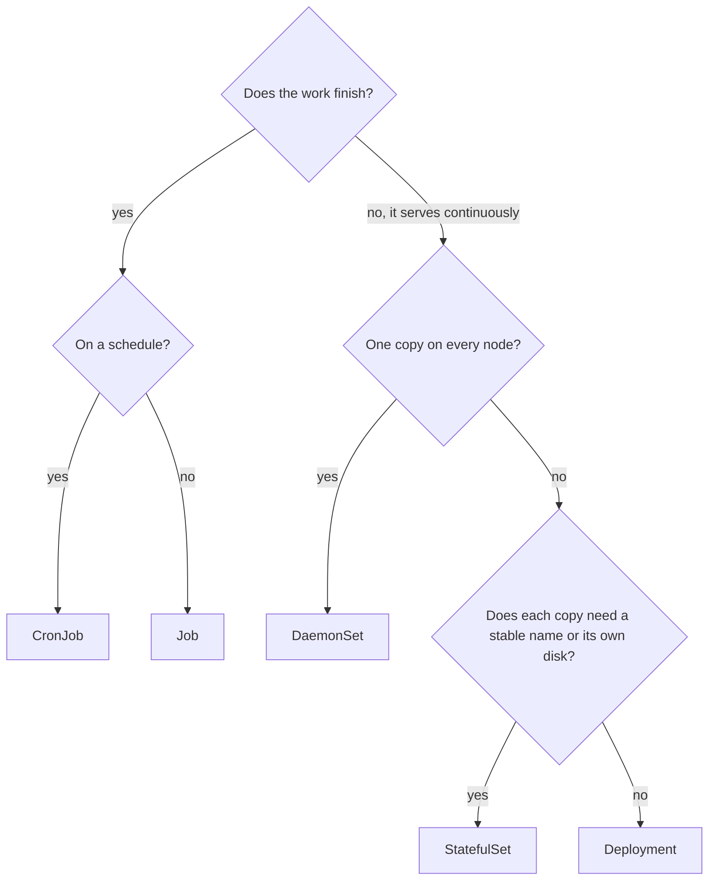

# Workload types, requests, limits, QoS and rolling updates

## In plain words

Imagine you manage a small chain of cafés and must explain your staffing to the owner. You would cover three things. First, **what kinds of contract** you use: permanent baristas who are interchangeable, a named accountant who keeps her own books, one cleaner assigned to each branch, a contractor hired to repaint a wall, and a window cleaner who comes every Monday. Second, **how you budget** for each person: the hours you promise them and the most they may work. Third, **how you replace staff** without closing a shop: the new barista shadows for a morning before the old one leaves.

The second group of Kubernetes interview questions is the same three topics.

1. **Which workload controller would you use?** Deployment, StatefulSet, DaemonSet, Job or CronJob.
2. **How do requests, limits and quality-of-service classes work?** The budget.
3. **How does a rolling update work, and how do you make it lose no requests?** The replacement.

The [previous lesson](#/lesson/kubernetes/interview-apply-networking) dealt with two journeys that you narrate. These three are different: interviewers want a **decision** with a reason ("a StatefulSet, because each replica needs its own disk") or a **number** worked out on the spot ("with 10 replicas and the defaults, at most 13 Pods and at least 8 available"). This lesson gives the model answers, the arithmetic, and programs to practise it with.

Why this matters for a job: these questions separate people who have deployed real services from people who have read about Kubernetes. Wrong requests and careless rollouts are behind a large share of production incidents, so employers probe them closely.

> **Before this lesson:** this is a revision lesson. It draws on [Deployments, ReplicaSets, self-healing and scaling](#/lesson/kubernetes/deployments-replicasets), [Rolling updates, rollbacks and strategies](#/lesson/kubernetes/rolling-updates-rollbacks), [StatefulSets: identity, order and storage](#/lesson/kubernetes/statefulset-theory), [DaemonSets, Jobs and CronJobs](#/lesson/kubernetes/daemonsets-jobs-cronjobs), [Lifecycle, restart policies, probes, requests and limits](#/lesson/kubernetes/pod-lifecycle-resources) and [Autoscaling](#/lesson/kubernetes/autoscaling).

## Question one: which workload controller?

### The 30-second version

> It depends on two things: whether the work is meant to run for ever or to finish, and whether the copies are interchangeable. Long-running and interchangeable is a Deployment. Long-running where each copy needs a stable name and its own storage is a StatefulSet. One copy per node is a DaemonSet. Work that runs to completion is a Job, and a Job on a timetable is a CronJob. I would not create bare Pods, because nothing recreates them when they die.

### The decision



| Controller | Pod names | Storage | Scaling and updates | Use for |
|---|---|---|---|---|
| **Deployment** | Random suffix, interchangeable | Shared, or none | Any order; rolling update through ReplicaSets | Web servers, APIs, workers reading a queue |
| **StatefulSet** | Fixed ordinals: `db-0`, `db-1` | One PersistentVolumeClaim per replica, kept across restarts | One at a time, in order; updates in reverse order | Databases, brokers, anything clustered |
| **DaemonSet** | One per node | Often the node's own paths | Follows the nodes | Log, metric, network and storage agents |
| **Job** | Random suffix | Whatever the task needs | Runs until `completions` succeed | Migrations, imports, training |
| **CronJob** | Creates Jobs | As Job | One Job per scheduled time | Reports, backups, clean-ups |

```python-run
def choose(finishes=False, scheduled=False, per_node=False, stable_identity=False, own_disk=False):
    if finishes:
        return ("CronJob", "it runs to completion on a timetable") if scheduled else ("Job", "it runs to completion once")
    if per_node:
        return "DaemonSet", "the work belongs to each node, so the count follows the nodes"
    if stable_identity or own_disk:
        return "StatefulSet", "replicas are not interchangeable: fixed names and a volume each"
    return "Deployment", "long-running, interchangeable replicas"

scenarios = [
    ("REST API behind a load balancer", {}),
    ("PostgreSQL primary with two replicas", {"stable_identity": True, "own_disk": True}),
    ("Agent that ships every node's logs", {"per_node": True}),
    ("Database schema migration before a release", {"finishes": True}),
    ("Nightly sales report at 02:30", {"finishes": True, "scheduled": True}),
    ("Worker pulling tasks from a message queue", {}),
    ("Three-member etcd or Kafka cluster", {"stable_identity": True, "own_disk": True}),
    ("Model training run on one GPU", {"finishes": True}),
    ("Redis used purely as a throwaway cache", {}),
]
for description, facts in scenarios:
    controller, why = choose(**facts)
    print(f"{description:44} -> {controller:11} because {why}")
```

The last scenario deserves a comment. "It is a database, so StatefulSet" is a reflex, not a reason. A cache whose contents can be lost and whose replicas do not need to find each other by name is interchangeable, and a Deployment suits it. Decide by the properties, not by the product's category.

### Follow-ups

| Question | Answer in a sentence or two |
|---|---|
| What does a StatefulSet guarantee that a Deployment does not? | Stable Pod names and DNS entries through a headless Service, a dedicated PersistentVolumeClaim per ordinal that is reattached after rescheduling, and ordered creation, scaling and updates. |
| What happens to a StatefulSet's volumes when you scale down or delete it? | By default the claims are kept, to protect data. You delete them deliberately, or set a retention policy. |
| Why not run every database on Kubernetes? | You can, usually through an operator that handles failover and backups. A managed database is often less work; the choice is about who carries the operational burden. |
| How does a Deployment relate to a ReplicaSet? | The Deployment owns one ReplicaSet per version of the Pod template and shifts replicas between them during a rollout. You manage the Deployment, never the ReplicaSet. |
| Why does a Job reject `restartPolicy: Always`? | A Job must finish. Only `Never` and `OnFailure` are consistent with a container that exits and stays exited. |
| Can an HPA scale a DaemonSet? | No. Its Pod count is the number of eligible nodes. |

## Question two: requests, limits and QoS

### The 30-second version

> A request is what the scheduler reserves for a container, and it decides placement. A limit is the ceiling enforced at run time. Exceeding a CPU limit throttles the container; exceeding a memory limit gets it OOM-killed. From the two, Kubernetes derives a QoS class: Guaranteed when every container has requests equal to limits for CPU and memory, BestEffort when nothing is set, Burstable otherwise. Under node memory pressure, Pods using more than they requested are evicted first, so BestEffort goes first and Guaranteed last. I set memory requests equal to limits, set CPU requests from measured usage, and treat CPU limits as a deliberate choice.

### The mechanics

| | Request | Limit |
|---|---|---|
| Used by | The scheduler, at placement | The kubelet and the kernel, at run time |
| Meaning | "Reserve this much for me" | "Never let me use more than this" |
| If missing | The container reserves nothing (or inherits the limit, if only a limit is set) | The container may use whatever the node has free |
| Over the value, CPU | Allowed, if the node has spare CPU | **Throttled**: slowed down, not killed |
| Over the value, memory | Allowed, but the Pod becomes a candidate for eviction | **OOM-killed**: the container is terminated and restarted |

The difference between the last two rows comes from the nature of the resources. CPU is **compressible**: a program given less of it runs slower. Memory is **incompressible**: memory in use cannot be taken away without ending the process.

### QoS classes

| Class | Rule | Under node memory pressure |
|---|---|---|
| **Guaranteed** | Every container sets CPU and memory limits, and requests equal limits | Evicted last |
| **Burstable** | At least one container sets a request or limit, and the Guaranteed rule is not met | In between |
| **BestEffort** | No container sets any request or limit | Evicted first |

When a node runs short of memory, the kubelet evicts Pods to protect the node. It ranks them by three things in order: whether the Pod's usage **exceeds its requests**, then the Pod's **priority**, then **how far above its requests** its usage is. A BestEffort Pod has no requests, so any usage exceeds them.

```python-run
def qos_class(containers):
    if all(not c.get("requests") and not c.get("limits") for c in containers):
        return "BestEffort"
    for c in containers:
        limits = c.get("limits", {})
        requests = {**limits, **c.get("requests", {})}          # a missing request defaults to the limit
        for resource in ("cpu", "memory"):
            if resource not in limits or requests.get(resource) != limits[resource]:
                return "Burstable"
    return "Guaranteed"

pods = {
    "payments":  {"priority": 1000, "usage_mi": 900,  "containers": [{"requests": {"cpu": 500, "memory": 1024}, "limits": {"cpu": 500, "memory": 1024}}]},
    "web":       {"priority": 500,  "usage_mi": 700,  "containers": [{"requests": {"cpu": 250, "memory": 512}, "limits": {"memory": 1024}}]},
    "reports":   {"priority": 100,  "usage_mi": 300,  "containers": [{"requests": {"cpu": 100, "memory": 512}}]},
    "scratch":   {"priority": 100,  "usage_mi": 400,  "containers": [{}]},
    "limits-only": {"priority": 500, "usage_mi": 200, "containers": [{"limits": {"cpu": 200, "memory": 256}}]},
    "sidecar-mix": {"priority": 500, "usage_mi": 350, "containers": [{"requests": {"cpu": 100, "memory": 256}, "limits": {"cpu": 100, "memory": 256}}, {}]},
}

print("Pod            QoS class    memory request   usage   over request")
ranking = []
for name, pod in pods.items():
    request = sum({**c.get("limits", {}), **c.get("requests", {})}.get("memory", 0) for c in pod["containers"])
    over = pod["usage_mi"] - request
    print(f"{name:14} {qos_class(pod['containers']):11}  {request:10} Mi  {pod['usage_mi']:5}   {over:+5}")
    ranking.append((0 if over > 0 else 1, pod["priority"], -over, name))

print("\neviction order under memory pressure (first to go at the top):")
for exceeds, priority, neg_over, name in sorted(ranking):
    print(f"   {name:14} {'exceeds its request' if exceeds == 0 else 'within its request':20} priority {priority}")
```

Three lines of the output repay study. `limits-only` is **Guaranteed**: when only limits are given, requests default to the same values. `sidecar-mix` is **Burstable**, because one container with nothing set spoils the Guaranteed rule for the whole Pod. And in the eviction list, `web` goes before `reports` although `web` has the higher priority: `web` is over its request and `reports` is not, and that test comes first.

### "Should you set CPU limits?"

This is a known debate, and a balanced answer scores better than a slogan.

- **Memory**: set the request equal to the limit. Memory cannot be reclaimed, so promising less than you allow invites eviction and OOM kills at the worst moment.
- **CPU requests**: always set them, from measured usage. They drive scheduling, the HPA's utilisation figure and the share of CPU a container gets under contention.
- **CPU limits**: a trade-off. A limit caps a container even when the node has idle CPU, which adds latency through throttling. Many teams therefore omit CPU limits for latency-sensitive services and rely on requests for fair sharing. Limits remain useful where predictability matters more than peak speed: shared clusters with untrusted tenants, benchmarking, and workloads that want the Guaranteed class.

Namespaces can enforce a policy: a **LimitRange** supplies default requests and limits to containers that omit them, and a **ResourceQuota** caps the namespace's totals.

## Question three: rolling updates

### The 30-second version

> Changing a Deployment's Pod template creates a new ReplicaSet. The Deployment controller scales the new one up and the old one down in steps, bounded by maxSurge, the extra Pods allowed above the desired count, and maxUnavailable, the Pods allowed to be missing. Both default to 25%; surge rounds up and unavailable rounds down. New Pods must pass their readiness probe before old ones are removed, so a broken version stalls the rollout instead of replacing healthy Pods. The old ReplicaSet is kept at zero replicas, which is what makes rollback possible.

### The arithmetic

At every moment during a rollout:

$$\text{total Pods} \le \text{replicas} + \text{maxSurge} \qquad\qquad \text{available Pods} \ge \text{replicas} - \text{maxUnavailable}$$

Percentages are taken of `replicas`. `maxSurge` rounds **up**; `maxUnavailable` rounds **down**. Both cannot be zero.

```python-run
import math

def resolve(value, replicas, round_up):
    if isinstance(value, str) and value.endswith("%"):
        exact = replicas * int(value[:-1]) / 100
        return math.ceil(exact) if round_up else math.floor(exact)
    return value

def rollout(replicas, max_surge="25%", max_unavailable="25%", show=False):
    surge = resolve(max_surge, replicas, round_up=True)
    unavailable = resolve(max_unavailable, replicas, round_up=False)
    if surge == 0 and unavailable == 0:
        return "invalid: both resolve to 0, the rollout could never move"
    ceiling, floor = replicas + surge, replicas - unavailable
    old, new, steps = replicas, 0, 0
    while old > 0 or new < replicas:
        steps += 1
        removable = min(old, old + new - floor)            # old Pods that can go while staying at or above the floor
        old -= removable
        starting = min(replicas - new, ceiling - old - new)   # new Pods that fit under the ceiling
        new += starting                                    # assume they are ready before the next step
        if show:
            print(f"      step {steps}: remove {removable} old, start {starting} new -> old={old} new={new} total={old + new}")
    return f"surge={surge} unavailable={unavailable} -> at most {ceiling} Pods, at least {floor} available, about {steps} steps"

for replicas, surge, unavail in [(10, "25%", "25%"), (4, "25%", "25%"), (4, 1, 0), (3, 0, 1), (10, "100%", 0), (1, "25%", "25%"), (4, 0, 0)]:
    print(f"replicas={replicas:2} maxSurge={str(surge):5} maxUnavailable={str(unavail):4}: {rollout(replicas, surge, unavail)}")

print("\n   in detail, replicas=4, maxSurge=1, maxUnavailable=0:")
rollout(4, 1, 0, show=True)
```

Check the first line against a calculation by hand: 25% of 10 is 2.5, so surge is 3 and unavailable is 2, giving at most 13 Pods and at least 8 available. The line for a single replica is the one interviewers like: 25% of 1 is 0.25, which rounds **up** to 1 for surge and **down** to 0 for unavailable, so a one-replica Deployment with default settings starts the new Pod before stopping the old one. The detailed trace shows the "never below four" configuration proceeding one Pod at a time.

### Zero downtime is more than the two dials

The strategy bounds how many Pods exist. Whether requests are lost depends on what happens at the edges of each Pod's life.

| Requirement | Mechanism | Without it |
|---|---|---|
| Do not send traffic to a Pod before it can serve | A **readiness probe** that reflects real readiness | Requests hit a starting process and fail |
| Do not count a Pod that is ready for an instant | `minReadySeconds` | A Pod that crashes after ten seconds is counted as good |
| Let in-flight requests finish | The application handles the stop signal and shuts down gracefully | Connections are cut mid-request |
| Cover the gap while routing tables update | A `preStop` sleep of a few seconds | A Pod that has already stopped still receives requests |
| Allow enough time | `terminationGracePeriodSeconds` longer than the slowest request plus the sleep | The Pod is killed before it has finished |
| Keep capacity during the change | `maxUnavailable: 0` with `maxSurge` of 1 or more | Capacity dips while new Pods start |
| Survive node maintenance during a rollout | A PodDisruptionBudget | A drain and a rollout together remove too many Pods |
| Stop a bad version | `progressDeadlineSeconds`, and watching `kubectl rollout status` | A stalled rollout is noticed late |

The `preStop` row is the subtle one. When a Pod is deleted, two things begin at the same moment: the kubelet sends the stop signal, and the Pod is removed from EndpointSlices. Removal takes a moment to reach every node's forwarding rules and every load balancer. For that moment a Pod that has begun shutting down may still be sent new requests. A short sleep before the stop signal closes the gap. The next lesson simulates it.

### Follow-ups

| Question | Answer in a sentence or two |
|---|---|
| What triggers a rollout? | A change to `spec.template` only. Changing `replicas` scales without a rollout. |
| How do you roll back? | `kubectl rollout undo deployment/NAME`, optionally with `--to-revision`. It scales an old ReplicaSet back up. Under GitOps, revert the commit instead. |
| How many old versions are kept? | `revisionHistoryLimit`, 10 by default. |
| When would you use `Recreate`? | When old and new versions must never run together, for example with an incompatible schema, accepting downtime. |
| A rollout is stuck at "1 old replicas are pending termination" or "waiting for rollout to finish". Why? | New Pods are not becoming ready: a failing probe, a crash, an image pull error or no capacity for the surge Pod. Describe the new Pods. |
| How is a rolling update different from a canary? | A rolling update proceeds on readiness alone. A canary holds a small share of traffic on the new version and judges it on metrics before widening. |

## Quick-fire comparisons

Short contrasts that come up as warm-up questions.

| Pair | The difference |
|---|---|
| Liveness vs readiness vs startup probe | Liveness failing restarts the container. Readiness failing removes the Pod from Service endpoints. Startup holds the other two off until a slow application has started. |
| ConfigMap vs Secret | Both inject configuration. A Secret is for sensitive values: base64-encoded (not encrypted by default), with tighter access rules and optional encryption at rest. |
| Label vs annotation | Labels identify and select objects. Annotations attach other information that tools read and nothing selects on. |
| Taint vs node affinity | A taint makes a node repel Pods. Affinity makes a Pod prefer or require nodes. Dedicated nodes need both. |
| HPA vs VPA vs cluster autoscaler | Number of Pods, size of each Pod, number of nodes. |
| PodDisruptionBudget vs `maxUnavailable` | A PDB limits voluntary evictions such as drains. `maxUnavailable` limits a Deployment's own rollout. |
| Init container vs sidecar | An init container runs to completion before the application starts. A sidecar runs alongside it for the Pod's life. |
| Role vs ClusterRole | Permissions within one namespace, or across the cluster and for cluster-scoped resources. |
| Namespace vs cluster | A namespace divides names, quotas and access inside one cluster. It does not isolate the network or the kernel. |

## Whiteboard scenario: size and harden a service

A typical prompt: "An API must handle 1,800 requests per second at peak. One Pod handles 150 requests per second when its CPU is fully used, with a request of 500 millicores and 512 MiB. Nodes offer 3.5 CPUs to Pods. The cluster spans three zones and must survive losing one. How many Pods and nodes do you need?"

Work through it aloud, one assumption at a time.

```python-run
import math

peak_rps = 1800
rps_per_pod_at_full_cpu = 150
hpa_target = 0.60                 # run Pods at 60% so there is headroom while scaling
cpu_request_m, memory_request_mi = 500, 512
node_allocatable_m = 3500
daemonset_overhead_m = 300        # log agent, metrics agent, network plug-in on every node
zones = 3

rps_per_pod = rps_per_pod_at_full_cpu * hpa_target
pods_for_peak = math.ceil(peak_rps / rps_per_pod)
print(f"1. At a {hpa_target:.0%} target each Pod serves {rps_per_pod:.0f} rps -> {pods_for_peak} Pods for the peak")

pods_per_zone = math.ceil(pods_for_peak / (zones - 1))        # two surviving zones must carry everything
total_pods = pods_per_zone * zones
print(f"2. To lose one of {zones} zones and still have {pods_for_peak}: {pods_per_zone} per zone -> {total_pods} Pods")

pods_per_node = (node_allocatable_m - daemonset_overhead_m) // cpu_request_m
nodes_per_zone = math.ceil(pods_per_zone / pods_per_node)
print(f"3. A node fits {pods_per_node} such Pods -> {nodes_per_zone} nodes per zone -> {nodes_per_zone * zones} nodes")

print(f"4. Reserved in total: {total_pods * cpu_request_m / 1000:.0f} CPUs and {total_pods * memory_request_mi / 1024:.0f} GiB of memory")
print(f"5. HPA: minReplicas {zones * 2} (two per zone), maxReplicas {total_pods + pods_per_zone}, target {hpa_target:.0%} CPU")
print(f"6. PodDisruptionBudget: maxUnavailable 1; topology spread over zones with maxSkew 1")
```

The numbers matter less than the chain of reasoning: measured capacity per Pod, a utilisation target that leaves headroom, redundancy for the failure you were asked to survive, overhead that people forget, and then the controls that keep the result true (autoscaler bounds, a spread constraint, a disruption budget). State each assumption so that the interviewer can change one and watch you recompute.

Then list what the manifest needs for production, which doubles as a review checklist:

- requests on every container; memory limit equal to the memory request,
- readiness and liveness probes, and a startup probe if start-up is slow,
- a rolling update strategy with `maxUnavailable: 0`, a `preStop` sleep and a sufficient grace period,
- topology spread across zones and hostnames,
- a PodDisruptionBudget,
- an HPA, and no `replicas` field in the manifest,
- configuration from ConfigMaps and Secrets, an image pinned by tag or digest,
- a dedicated ServiceAccount, a restrictive security context and NetworkPolicies.

> [!TIP]
> When asked for a number, say the formula before the result: "surge is 25% of 10, rounded up, so 3". If you slip on the arithmetic, the interviewer has already heard that you know the rule, which is what was being tested.

> [!INTERVIEW]
> **Three answers to have ready.** *Controllers:* Deployment for interchangeable long-running replicas; StatefulSet when replicas need stable names and their own volumes; DaemonSet for one Pod per node; Job for run-to-completion work; CronJob for scheduled Jobs; never bare Pods. *Resources:* requests reserve capacity and drive scheduling, limits cap usage; CPU over the limit is throttled, memory over the limit is OOM-killed; QoS is Guaranteed (requests equal limits everywhere), Burstable or BestEffort (nothing set), and under node pressure Pods exceeding their requests are evicted first, then by priority. *Rollouts:* a template change creates a new ReplicaSet; replicas shift within `replicas + maxSurge` total and `replicas - maxUnavailable` available, with surge rounded up and unavailable rounded down; readiness gates progress; old ReplicaSets remain for rollback; zero downtime also needs graceful shutdown, a `preStop` delay and a PodDisruptionBudget.

## Common pitfalls

- **Choosing a StatefulSet because the software is called a database.** Decide by identity and storage needs.
- **Saying "limits are for scheduling".** Requests are. Limits are enforced at run time.
- **Saying "exceeding the CPU limit kills the container".** It throttles. Memory kills.
- **Forgetting that one unset container makes the Pod Burstable.**
- **Rounding both percentages the same way.** Surge up, unavailable down.
- **Claiming a rolling update guarantees zero downtime by itself.** Readiness and graceful shutdown do the real work.
- **Confusing a PDB with a rollout setting.**
- **Leaving `replicas` in a manifest managed by an HPA.**
- **Sizing for the average.** Size for the peak, and for the failure you must survive.
- **Giving a number without the reasoning.**

## Cheat sheet

| Need | Answer |
|---|---|
| Stateless service | Deployment |
| Stable name and volume per replica | StatefulSet with a headless Service |
| One per node | DaemonSet |
| Run once / on a schedule | Job / CronJob |
| Scheduling input | Requests |
| Run-time ceiling | Limits |
| CPU over limit / memory over limit | Throttled / OOM-killed |
| Guaranteed QoS | Requests equal limits, CPU and memory, every container |
| Rollout bounds | `replicas + maxSurge` total, `replicas - maxUnavailable` available |
| Rounding | `maxSurge` up, `maxUnavailable` down |
| Defaults | Both 25%; `revisionHistoryLimit` 10; `progressDeadlineSeconds` 600 |
| Roll back | `kubectl rollout undo deployment/NAME` |
| Restart all Pods | `kubectl rollout restart deployment/NAME` |
| QoS of a Pod | `kubectl get pod NAME -o jsonpath='{.status.qosClass}'` |

## Summary

Three topics make up the second family of interview questions. Choosing a controller is a short decision: does the work finish, does it belong to every node, and are the replicas interchangeable. Resources come down to two numbers with different jobs, requests for placement and limits for enforcement, with CPU throttled and memory killed when limits are exceeded, and a QoS class derived from the pair that orders eviction. A rolling update moves replicas from an old ReplicaSet to a new one inside bounds set by maxSurge and maxUnavailable, waits on readiness, and keeps history for rollback, and it loses no requests only when probes, graceful shutdown and a short pre-stop delay are in place. Answer with a decision and its reason, or with a formula and then its result. The final lesson turns to the remaining family: scenarios in which something is broken.

## Glossary

- **Workload controller**: an object that creates and manages Pods according to a pattern.
- **Bare Pod**: a Pod with no controller; it is not recreated if it is lost.
- **Ordinal**: the fixed number in a StatefulSet Pod's name.
- **Request**: the amount of a resource reserved for a container and used for scheduling.
- **Limit**: the maximum amount of a resource a container may use.
- **Compressible resource**: one that can be reduced by slowing the consumer, such as CPU.
- **Throttling**: slowing a container that has reached its CPU limit.
- **OOM kill**: termination of a container that exceeded its memory limit.
- **QoS class**: Guaranteed, Burstable or BestEffort, derived from requests and limits.
- **Node pressure eviction**: the kubelet removing Pods to protect a node short of memory or disk.
- **LimitRange**: a namespaced object supplying default and permitted requests and limits.
- **Rollout**: the replacement of a Deployment's Pods after its template changes.
- **maxSurge**: how many Pods above the desired count may exist during a rollout.
- **maxUnavailable**: how many Pods below the desired count may be unavailable during a rollout.
- **minReadySeconds**: how long a new Pod must stay ready before counting as available.
- **Graceful shutdown**: finishing in-flight work after receiving the stop signal, then exiting.
- **preStop hook**: a command or delay run before the stop signal is sent.
- **Headroom**: spare capacity kept to absorb spikes and failures.

```quiz
[
  {"q": "A three-member message broker needs each member to keep its own data and to be reachable by a fixed name after restarts. Which controller fits?",
   "options": ["Deployment", "StatefulSet", "DaemonSet", "Job"],
   "answer": 1,
   "explain": "Stable network identity and a dedicated volume per replica are what a StatefulSet provides. A Deployment's Pods are interchangeable and get new names."},
  {"q": "A container's memory usage rises above its memory limit. What happens?",
   "options": ["It is throttled", "It is OOM-killed and restarted according to the restart policy", "The scheduler moves it to a larger node", "Nothing, limits are advisory"],
   "answer": 1,
   "explain": "Memory is incompressible. A container over its memory limit is terminated. CPU over its limit is throttled instead."},
  {"q": "A Pod has two containers. One sets requests equal to limits for CPU and memory; the other sets nothing. What is the Pod's QoS class?",
   "options": ["Guaranteed", "Burstable", "BestEffort", "It has no class"],
   "answer": 1,
   "explain": "Guaranteed needs every container to meet the rule. BestEffort needs every container to set nothing. A mixture is Burstable."},
  {"q": "A container specifies only limits: cpu 200m and memory 256Mi. What are its requests and the Pod's QoS class?",
   "options": ["No requests; BestEffort", "Requests default to the limits; Guaranteed", "Requests default to zero; Burstable", "The Pod is rejected"],
   "answer": 1,
   "explain": "When a limit is set and the request is omitted, the request defaults to the limit. With both resources covered, the Pod is Guaranteed."},
  {"q": "A Deployment has replicas: 10 and the default strategy. During a rollout, what are the maximum total Pods and the minimum available Pods?",
   "options": ["12 and 8", "13 and 8", "13 and 7", "12 and 7"],
   "answer": 1,
   "explain": "25% of 10 is 2.5. maxSurge rounds up to 3, so 13 total. maxUnavailable rounds down to 2, so 8 available."},
  {"q": "A Deployment has replicas: 1 and the default 25% settings. How does a rollout proceed?",
   "options": ["The old Pod is deleted first, then the new one starts", "A new Pod is started first (surge rounds up to 1), and the old one is removed after the new one is ready (unavailable rounds down to 0)", "The rollout is rejected", "Both Pods are deleted"],
   "answer": 1,
   "explain": "0.25 rounds up to 1 for surge and down to 0 for unavailable, so capacity never drops below one."},
  {"q": "Under node memory pressure, which Pod does the kubelet evict first?",
   "options": ["The one with the most memory in absolute terms", "One whose usage exceeds its memory request, before any Pod that is within its request", "The newest Pod", "A Guaranteed Pod, because its limit is strict"],
   "answer": 1,
   "explain": "Exceeding requests is the first ranking criterion, then priority, then how far over. BestEffort Pods always exceed their (zero) requests."},
  {"q": "Why add a short preStop sleep to a web service's Pods?",
   "options": ["To slow down rollouts for safety", "Because endpoint removal takes a moment to propagate, and without the delay a Pod that has begun shutting down may still receive new requests", "To let the image finish pulling", "Because the readiness probe needs it"],
   "answer": 1,
   "explain": "Termination and endpoint removal start together. Delaying the stop signal briefly lets routing catch up, so no new requests arrive at a stopping Pod."}
]
```

> **Source:** revision of Poulton, *The Kubernetes Book*, ch. 4, 6 and 12 (topic coverage only; wording and examples are original). Official docs: https://kubernetes.io/docs/concepts/workloads/ , https://kubernetes.io/docs/concepts/configuration/manage-resources-containers/ , https://kubernetes.io/docs/concepts/workloads/pods/pod-qos/ , https://kubernetes.io/docs/concepts/scheduling-eviction/node-pressure-eviction/ , https://kubernetes.io/docs/concepts/workloads/controllers/deployment/ , https://kubernetes.io/docs/concepts/workloads/pods/pod-lifecycle/#pod-termination
