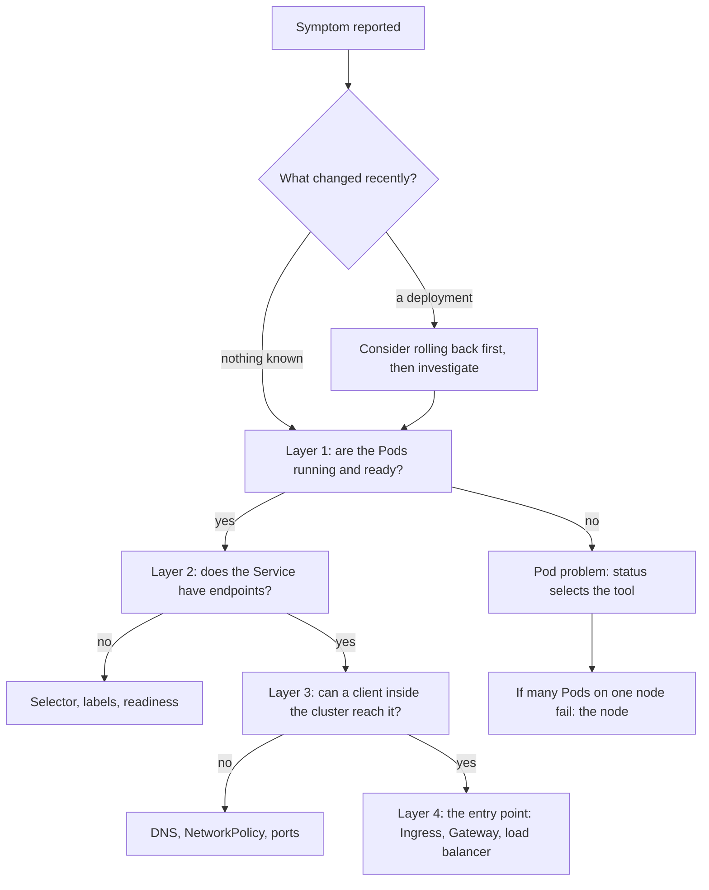

# Debugging scenarios and CKA/CKAD pointers

## In plain words

Hospitals train junior doctors with case studies. "A 40-year-old arrives with chest pain. What do you do first?" The examiner does not want the name of a disease. The examiner wants to hear the order in which you would look, what each finding would rule in or out, and when you would act. A candidate who blurts out a diagnosis, even a correct one, has shown luck. A candidate who reasons aloud from symptom to evidence to cause has shown skill.

The third family of Kubernetes interview questions works exactly like that. "Users report errors after this morning's deployment. Go." "A Pod has been Pending for ten minutes. What do you check?" There is a cluster in the story, something is wrong with it, and you are asked to find out what. The hands-on certification exams, **CKA** (Certified Kubernetes Administrator) and **CKAD** (Certified Kubernetes Application Developer), are the same exercise with a real terminal and a clock.

This lesson is a casebook. It gives a way to structure any debugging answer, twelve scenarios with their evidence, causes and fixes, two simulations of failures that are hard to picture, and practical pointers for the exams. The diagnostic commands themselves were taught in [Troubleshooting Pods](#/lesson/kubernetes/troubleshooting-pods); here they are put to work.

Why this matters for a job: debugging questions carry the most weight in interviews for platform, DevOps and reliability roles, because they predict how you will behave during an incident. They are also the largest single domain of the CKA exam.

> **Before this lesson:** this is a revision lesson. Read [Troubleshooting Pods: describe, logs, exec and events](#/lesson/kubernetes/troubleshooting-pods) first; it teaches every command used below. The scenarios also draw on [From name to Pod: the packet path](#/lesson/kubernetes/packet-path-troubleshooting), [Rolling updates, rollbacks and strategies](#/lesson/kubernetes/rolling-updates-rollbacks), [Steering the scheduler](#/lesson/kubernetes/scheduling-controls), [RBAC authorisation and admission control](#/lesson/kubernetes/rbac-admission), [NetworkPolicies, isolation and auditing](#/lesson/kubernetes/network-policies-auditing) and the two earlier interview lessons.

## How to answer a debugging question

Use the same five moves every time.

1. **Clarify and scope.** "Is it all users or some? One service or several? Did anything change recently?" In an interview, asking shows method; in an incident, it saves an hour.
2. **Look before touching.** State the first read-only command and what you expect it to show.
3. **Follow the evidence down the layers.** Each observation chooses the next command.
4. **Name the cause, then the fix.** Restore service first (often a rollback), then repair properly, in the manifest and not in the live object.
5. **Close the loop.** Say how you would confirm the fix and prevent a repeat: an alert, a probe, a policy.



Two habits score well. **Say what a result would mean before you get it**: "if endpoints are empty, I will compare the selector with the Pod labels". And **prefer the cheapest informative check**: `kubectl get pods` costs two seconds and halves the search space.

## The casebook

Each case lists the symptom, the evidence a good first command returns, the cause and the fix. Cover the cause and try to predict it from the evidence.

### Case 1: the Pod that will not schedule

**Symptom.** A new Deployment's Pods stay `Pending`.

```bash
$ kubectl describe pod report-worker-5d8c7b6f-9hbtz -n cafe | tail -2
  Warning  FailedScheduling  3m  default-scheduler  0/6 nodes are available: 1 node(s) had untolerated taint {node-role.kubernetes.io/control-plane: }, 2 node(s) had untolerated taint {dedicated: ml}, 3 Insufficient memory.
```

**Cause.** Read the event as a count: six nodes, three ruled out by taints that are meant to exclude this Pod, three ruled out for memory. The real problem is the memory request, 6Gi, when no ordinary node has that much unreserved.

**Fix.** Lower the request to what the program uses, or add capacity. With a cluster autoscaler, check why it did not add a node: a request larger than any node type in its node groups cannot be satisfied by scaling.

### Case 2: crash loop after a release

**Symptom.** After a deployment, new Pods show `CrashLoopBackOff`; the rollout does not finish.

```bash
$ kubectl logs orders-api-6f9c7d5b8-x2k4p -n cafe --previous
FATAL config: required environment variable DB_PASSWORD is not set

$ kubectl get secret orders-db -n cafe -o jsonpath='{.data}' | tr ',' '\n'
{"db-password":"..."
```

**Cause.** The manifest reads key `password` from the Secret, and the Secret's key is `db-password`. Someone renamed one side. Had the key been marked required, which is the default for `secretKeyRef`, the Pod would have shown `CreateContainerConfigError`; here it was `optional: true`, so the container started with the variable unset and the application exited.

**Fix.** Roll back to restore service (`kubectl rollout undo deployment/orders-api`), correct the key name in the manifest, redeploy. Old Pods kept serving throughout, because the rolling update waits for new Pods to become ready.

### Case 3: the image that cannot be pulled

**Symptom.** `ImagePullBackOff` on every Pod of one Deployment, in one namespace only.

```bash
  Warning  Failed  30s (x4 over 2m)  kubelet  Failed to pull image "registry.harbour.example/cafe/web:3.2.0": failed to authorize: 401 Unauthorized
```

**Cause.** `401 Unauthorized` means credentials, not a wrong name (that would be `not found`). The registry is private, and this namespace has no pull secret, or the token in it has expired. Pull secrets are namespaced, which explains why the same image works elsewhere.

**Fix.** Create or renew the `docker-registry` Secret in this namespace and reference it under `imagePullSecrets` in the Pod template or on the ServiceAccount. The kubelet retries by itself.

### Case 4: the Service with no endpoints

**Symptom.** Pods are `Running` and `1/1`. Calls to the Service fail with "connection refused".

```bash
$ kubectl get endpointslices -n cafe -l kubernetes.io/service-name=menu-api
NAME             ADDRESSTYPE   PORTS     ENDPOINTS   AGE
menu-api-k8x2p   IPv4          <unset>   <unset>     40d

$ kubectl get svc menu-api -n cafe -o jsonpath='{.spec.selector}'
{"app":"menu-api"}

$ kubectl get pods -n cafe --show-labels | grep menu
menu-api-6b7f9d4c88-2xk4p   1/1   Running   0   20m   app.kubernetes.io/name=menu-api,pod-template-hash=6b7f9d4c88
```

**Cause.** The Service selects `app=menu-api`. A recent change moved the Pods to the recommended label `app.kubernetes.io/name=menu-api` and did not update the Service. No Pod matches, so there are no endpoints.

**Fix.** Make the selector and the labels agree. This fault produces no error anywhere, because a Service selecting nothing is valid, which is why checking endpoints belongs near the top of every routine.

### Case 5: the rollout that never finishes

**Symptom.** `kubectl rollout status` hangs. Users notice nothing.

```bash
$ kubectl rollout status deployment/web -n cafe
Waiting for deployment "web" rollout to finish: 1 out of 4 new replicas have been updated...

$ kubectl get pods -n cafe -l app=web
NAME                   READY   STATUS    RESTARTS   AGE
web-84f6d9c7b-jq7ws    1/1     Running   0          3d
web-84f6d9c7b-m2c5d    1/1     Running   0          3d
web-84f6d9c7b-zr8vn    1/1     Running   0          3d
web-84f6d9c7b-4xk2p    1/1     Running   0          3d
web-5c7d8e9f6a-9hbtz   0/1     Running   0          8m

$ kubectl describe pod web-5c7d8e9f6a-9hbtz -n cafe | tail -1
  Warning  Unhealthy  5s (x48 over 8m)  kubelet  Readiness probe failed: HTTP probe failed with statuscode: 404
```

**Cause.** The new version moved its health endpoint from `/healthz` to `/health`, and the probe still asks for the old path. With `maxUnavailable: 0` the controller will not remove an old Pod until a new one is ready, so the rollout waits, and the old version keeps serving. This is the system working as designed.

**Fix.** `kubectl rollout undo`, or correct the probe path and apply again. After `progressDeadlineSeconds` (600 by default) the Deployment reports `ProgressDeadlineExceeded`, which a pipeline or GitOps controller should treat as a failure.

```python-run
def rollout_status(replicas, new_becomes_ready, max_surge=1, max_unavailable=0, deadline_s=600, tick_s=120):
    old, new, new_ready, last_progress = replicas, 0, 0, 0
    print(f"new Pods become ready: {new_becomes_ready}")
    for t in range(0, 1201, tick_s):
        if new_becomes_ready and new_ready < new:
            new_ready, last_progress = new, t                       # Pods created on the previous tick pass their probe
        removable = min(old, old + new_ready - (replicas - max_unavailable))
        if removable > 0:
            old, last_progress = old - removable, t
        can_create = min(replicas - new, replicas + max_surge - old - new)
        if can_create > 0:
            new, last_progress = new + can_create, t
        serving = old + new_ready
        state = "complete" if (old == 0 and new_ready == replicas) else "progressing"
        if state != "complete" and t - last_progress >= deadline_s:
            state = "ProgressDeadlineExceeded"
        print(f"   t={t:4}s  old={old} new={new} new-ready={new_ready}  serving={serving}/{replicas}  {state}")
        if state != "progressing":
            break
    print()

rollout_status(4, new_becomes_ready=True)
rollout_status(4, new_becomes_ready=False)
```

In the second run, `serving` stays at 4 from start to finish. A failing readiness probe on the new version costs no capacity; it only stops the rollout, and after ten minutes without progress the Deployment says so. Compare that with what would happen without a readiness probe: each new Pod would count as ready at once, and all four healthy Pods would be replaced by broken ones in under a minute.

### Case 6: a few errors on every deployment

**Symptom.** Each release produces a short burst of `502 Bad Gateway` responses, then everything is fine.

**Cause.** A timing race at Pod shutdown. When a Pod is deleted, two things start together: the kubelet sends the stop signal, and the Pod is removed from the EndpointSlices. It takes a moment, often a second or two, for that removal to reach every node's forwarding rules and the load balancer. During that moment new requests can still be sent to a Pod whose program has already stopped listening.

```python-run
def shutdown(pre_stop_sleep_s, graceful, propagation_s=2.0, request_every_s=0.25, request_takes_s=0.5, grace_s=30):
    """A Pod is deleted at t=0. Count requests that fail because of it."""
    sigterm_at = pre_stop_sleep_s                       # the stop signal is sent after the preStop hook
    stops_listening_at = sigterm_at                     # the program closes its listener on the signal
    failed_new = failed_inflight = routed = 0
    t = -request_takes_s
    while t < propagation_s:                            # until routing has caught up, requests may still arrive here
        ends = t + request_takes_s
        if t >= 0:
            routed += 1
        if t >= stops_listening_at:
            failed_new += 1                             # connection refused: nobody is listening
        elif ends > sigterm_at and not graceful:
            failed_inflight += 1                        # the program exited with this request unfinished
        t += request_every_s
    label = f"preStop sleep {pre_stop_sleep_s}s, {'graceful' if graceful else 'abrupt  '} shutdown"
    print(f"{label:42} requests sent to the dying Pod: {routed:2}   refused: {failed_new:2}   cut off mid-flight: {failed_inflight}")

for takes in (0.5, 4.0):
    print(f"requests that take {takes} seconds each:")
    for sleep, graceful in [(0, False), (0, True), (5, False), (5, True)]:
        print("   ", end="")
        shutdown(pre_stop_sleep_s=sleep, graceful=graceful, request_takes_s=takes)
```

Read the two blocks line by line. Graceful shutdown alone saves the requests already in progress and still refuses the ones that arrive during the two seconds of propagation. The sleep alone keeps the Pod listening through that window, which is enough for quick requests; with slow requests, some are still running when the signal finally comes, and an abrupt exit cuts them off. Both together lose nothing in either block.

**Fix.** A `preStop` hook that sleeps a few seconds, an application that finishes in-flight requests on the stop signal, and a `terminationGracePeriodSeconds` longer than the sleep plus the slowest request.

### Case 7: killed in production only

**Symptom.** A service that passed all tests restarts every few hours in production.

```bash
    Last State:     Terminated
      Reason:       OOMKilled
      Exit Code:    137
    Restart Count:  14
```

**Cause.** The container exceeds its memory limit. "Only in production" has two usual explanations: production data and traffic are larger, or memory grows slowly (a leak) and only long-lived production Pods run long enough to reach the limit. A graph of memory over time tells them apart: a plateau above the limit means the limit is too low; a steady climb means a leak.

**Fix.** Raise the limit and request for the first; fix the leak for the second. Also check that the language runtime knows about the container's limit, for example the heap settings of a Java virtual machine.

### Case 8: a node goes NotReady

**Symptom.** Several unrelated Pods fail at once.

```bash
$ kubectl get pods -A -o wide | grep -v Running | awk '{print $8}' | sort | uniq -c
     11 worker-3

$ kubectl describe node worker-3 | grep -A5 Conditions
Conditions:
  Type             Status  Reason                       Message
  DiskPressure     True    KubeletHasDiskPressure       kubelet has disk pressure
  Ready            True    KubeletReady                 kubelet is posting ready status
```

**Cause.** The first command is the important one: every affected Pod is on `worker-3`. The node's disk is nearly full, commonly from container images and logs, so the kubelet evicts Pods and refuses new ones.

**Fix.** `kubectl cordon worker-3` to stop new Pods landing there, free space or replace the node, then `kubectl uncordon`. In a cloud, replacing the node is normally quicker than repairing it. If the condition were `Ready: Unknown` with "Kubelet stopped posting node status", the node or its kubelet would be down, and the Pods would be evicted after the five-minute toleration.

### Case 9: the namespace that will not delete

**Symptom.** `kubectl delete namespace staging` has shown `Terminating` for an hour.

```bash
$ kubectl get namespace staging -o jsonpath='{.status.conditions[*].message}'
Some resources are remaining: certificates.cert-manager.io has 2 resource instances
Some content in the namespace has finalizers remaining: finalizer.cert-manager.io in 2 resource instances
```

**Cause.** A **finalizer** is a marker that blocks deletion until a controller has cleaned up. Two custom resources carry one, and the controller that should remove it was uninstalled earlier, so nobody ever will.

**Fix.** Reinstall the controller so that it can finish, or, knowing that nothing external is left to clean up, remove the finalizer from those objects with `kubectl patch`. Editing the namespace's own finalizers to force it through is a last resort that can leave orphaned resources.

### Case 10: forbidden

**Symptom.** A pipeline fails with `Error from server (Forbidden): deployments.apps is forbidden: User "system:serviceaccount:ci:deployer" cannot patch resource "deployments" in API group "apps" in the namespace "cafe"`.

```bash
$ kubectl auth can-i patch deployments -n cafe --as=system:serviceaccount:ci:deployer
no
$ kubectl get rolebindings -n cafe -o wide | grep deployer
deployer-binding   Role/deployer   10d                ci-deployer
```

**Cause.** The error message is complete: who, which verb, which resource, which API group, which namespace. The RoleBinding exists and names the subject `ci-deployer`; the ServiceAccount is called `deployer`. The binding points at nobody.

**Fix.** Correct the subject in the RoleBinding. `kubectl auth can-i ... --as=...` tests permissions for another identity without needing its credentials, and `kubectl auth can-i --list` shows everything an identity may do.

### Case 11: name resolution fails after a security change

**Symptom.** After a NetworkPolicy change, applications in one namespace log `could not resolve host`.

**Cause.** A default-deny egress policy was applied. DNS queries are egress traffic to the cluster DNS Pods, and nothing allows them.

**Fix.** Add an egress rule allowing UDP and TCP port 53 to the `kube-dns` Pods in `kube-system`. The clue is the kind of error: resolution failures across a whole namespace straight after a policy change, while the DNS Pods themselves are healthy.

### Case 12: the claim that stays Pending

**Symptom.** A StatefulSet's first Pod is `Pending`, with the event `pod has unbound immediate PersistentVolumeClaims`.

```bash
$ kubectl describe pvc data-db-0 -n cafe | tail -1
  Warning  ProvisioningFailed  2m  persistentvolume-controller  storageclass.storage.k8s.io "fast-ssd" not found
```

**Cause.** The claim names a StorageClass that does not exist in this cluster. Other causes with the same symptom: no default StorageClass and none named, a quota on storage, or a volume in a different zone from every node the Pod may use.

**Fix.** Use an existing class (`kubectl get storageclass`). Since most fields of a claim cannot be changed, delete the claim and let the StatefulSet recreate it from a corrected template.

## Patterns across the cases

| If you see | Think of |
|---|---|
| Many unrelated Pods failing together | A node, or something shared: DNS, the registry, a quota |
| Failure right after a deployment | The change itself. Roll back, then read the diff |
| Failure right after a security or policy change | NetworkPolicy, RBAC, admission |
| Works in one namespace and not another | Namespaced things: Secrets, pull secrets, quotas, policies, short DNS names |
| Timeout | Something is dropping packets: a NetworkPolicy, a firewall, a wrong address |
| Connection refused | Nothing is listening: no endpoints, wrong port, the process is down |
| Name will not resolve | DNS: wrong namespace in the name, blocked port 53, unhealthy CoreDNS |
| An object stuck Terminating | A finalizer whose controller is not doing its job |
| No error anywhere, and it does not work | A selector or label mismatch |

## CKA and CKAD pointers

### What the exams are

Both are **performance-based**: there are no multiple-choice questions. You are given a terminal connected to real clusters and a list of tasks, such as "create a Deployment with these properties" or "the Pod in namespace X is failing; fix it", and an automatic checker inspects the resulting cluster state. Both last two hours, are taken online with a remote proctor, and allow you to consult the official documentation at kubernetes.io in the exam's browser.

| | CKA | CKAD |
|---|---|---|
| Aimed at | People who run clusters | People who build and deploy applications on them |
| Largest area | Troubleshooting | Application configuration, security and deployment |
| Also covers | Cluster installation and upgrade with kubeadm, etcd backup, networking, storage, scheduling | Pod design, probes, Jobs, Services, ConfigMaps and Secrets, Helm and deployment strategies |

The domains and their weights are revised from time to time by the Linux Foundation and the CNCF, and so are the price, the passing mark and the validity period. Read the current curriculum and candidate handbook before you book. The exam purchase normally includes sessions on a practice simulator that is deliberately harder than the real thing; use them.

### Speed is the skill

Most candidates who fail run out of time, not knowledge. The techniques below matter more than extra reading.

**Generate YAML; never type it from memory.**

```bash
$ kubectl create deployment web --image=nginx:1.27 --replicas=3 --dry-run=client -o yaml > web.yaml
$ kubectl run tmp --image=busybox:1.36 --restart=Never --dry-run=client -o yaml -- sleep 3600 > pod.yaml
$ kubectl expose deployment web --port=80 --target-port=8080 --dry-run=client -o yaml > svc.yaml
$ kubectl create job report --image=busybox:1.36 --dry-run=client -o yaml -- date > job.yaml
$ kubectl create cronjob nightly --image=busybox:1.36 --schedule="30 2 * * *" --dry-run=client -o yaml -- date > cj.yaml
$ kubectl create configmap app-config --from-literal=LOG_LEVEL=info --dry-run=client -o yaml
$ kubectl create role reader --verb=get,list --resource=pods --dry-run=client -o yaml
```

`--dry-run=client -o yaml` prints the manifest without creating anything. Redirect it to a file, edit the few lines the task needs, and apply. For fields with no flag, such as probes, volumes and affinity, copy a snippet from the documentation.

**Let the cluster tell you the field names.**

```bash
$ kubectl explain pod.spec.containers.livenessProbe
$ kubectl explain deployment.spec.strategy --recursive | head -20
```

**Do the cheap things first.**

- Each task states a **context**. Run the given `kubectl config use-context` command before doing anything else; work done on the wrong cluster earns nothing.
- Read the namespace in the task and add `-n` every time, or set it once with `kubectl config set-context --current --namespace=NAME`.
- Set up two shortcuts at the start: `alias k=kubectl` (often present already) and `export do="--dry-run=client -o yaml"`, so that `k create deploy web --image=nginx $do` works.
- **Verify** each task: `kubectl get` the object, check that Pods are `Running`, and test a Service with a temporary Pod. The checker grades the result, not the effort.
- Tasks carry different weights and need different amounts of time. Skip and flag a long task of low weight, and return to it at the end.

The last point is worth seeing in numbers.

```python-run
tasks = [("Fix a failing Deployment", 7, 6), ("etcd backup and restore", 7, 16), ("Create a NetworkPolicy", 6, 8),
         ("Upgrade a node with kubeadm", 7, 22), ("Expose a Deployment", 4, 3), ("Pod with a sidecar", 5, 6),
         ("Troubleshoot a NotReady node", 9, 12), ("PV, PVC and a Pod", 6, 9), ("RBAC for a ServiceAccount", 6, 7),
         ("Custom scheduler rule", 4, 18), ("Ingress with two paths", 6, 9), ("Scale and roll back", 4, 4),
         ("Drain a node safely", 4, 5), ("Find the Pod using most CPU", 3, 3), ("Fix a broken kubeconfig", 5, 8),
         ("HPA for a Deployment", 5, 5), ("Install a chart with Helm", 5, 6), ("Gateway and HTTPRoute", 7, 9)]
# each task: (name, percent of the marks, minutes this candidate needs)

def in_the_order_given(tasks, minutes=120):
    used = score = 0
    for name, weight, cost in tasks:
        if used + cost > minutes:
            break                                   # the clock runs out part-way through this task
        used, score = used + cost, score + weight
    return score, used

def best_value_first(tasks, minutes=120):
    used = score = 0
    for name, weight, cost in sorted(tasks, key=lambda t: t[1] / t[2], reverse=True):
        if used + cost <= minutes:                  # skip what no longer fits and try the next
            used, score = used + cost, score + weight
    return score, used

print(f"marks available: {sum(t[1] for t in tasks)}%, time needed for everything: {sum(t[2] for t in tasks)} minutes, time allowed: 120")
score, used = in_the_order_given(tasks)
print(f"working strictly in the order given:         {score}% in {used} minutes")
score, used = best_value_first(tasks)
print(f"quick, valuable tasks first, slow ones last: {score}% in {used} minutes")
```

This candidate needs 156 minutes for everything and has 120. Working in the order given, the clock runs out with easy marks still unattempted. Doing the tasks with the most marks per minute first collects far more with the same knowledge. You cannot know your exact minutes in advance, but you can tell at a glance that "expose a Deployment" is quick and "upgrade a node" is not.

### How this track maps to the exams

| Exam area | Lessons in this track |
|---|---|
| Cluster architecture and components | Principles of operation; the Kubernetes API |
| Workloads and scheduling | Pods, Deployments, StatefulSets, workloads and scaling |
| Services and networking | Services, Ingress and Gateway API, service discovery, NetworkPolicies |
| Storage | Volumes, claims, StorageClasses |
| Configuration and security | ConfigMaps and Secrets, API security, threat modelling |
| Packaging and deployment | Helm and Kustomize, rolling updates, GitOps |
| Observability and troubleshooting | Troubleshooting Pods, metrics and logging, this lesson |

Cluster installation and upgrade with `kubeadm`, and etcd backup and restore, are CKA topics that need hands-on practice on a cluster you are free to break; a local multi-node cluster from the [getting a cluster lesson](#/lesson/kubernetes/getting-a-cluster) is enough.

> [!TIP]
> Practise on a real cluster with a timer. Break things on purpose (a wrong image tag, a mismatched selector, a missing key in a Secret, a taint), walk away, and come back to diagnose them from the symptoms alone. Ten such drills teach more than rereading any casebook, this one included.

> [!INTERVIEW]
> **"Users report errors after a deployment. What do you do?"** Scope it first: all users or some, which service, when did it start, what changed. Because a deployment correlates, be ready to roll back early; restoring service comes before understanding. Then look, without changing anything: `kubectl get pods` for the workload; if new Pods are not ready or are crash-looping, `describe` and `logs --previous` give the reason, and the rollout has probably stalled with old Pods still serving. If Pods are healthy, check that the Service has endpoints, then test from inside the cluster to separate application faults from routing faults, then the Ingress or Gateway and the load balancer. Interpret errors on the way: a timeout suggests a policy or firewall, connection refused suggests no endpoints or a wrong port, an unresolved name suggests DNS or a namespace mistake. State the cause, fix it in the manifest, verify with a real request, and say what you would add so that the same fault is caught earlier next time: a readiness probe, an alert on unavailable replicas, a policy check in the pipeline.

## Common pitfalls

- **Naming a cause before gathering evidence.** Interviewers mark the reasoning.
- **Not asking what changed.** The most recent change is the most likely cause.
- **Investigating for an hour before rolling back.** Restore service first.
- **Debugging the application when the node is at fault.** Check where the failing Pods run.
- **Fixing the live object.** The next deployment restores the fault.
- **Removing finalizers as a first resort.** Find the controller that should have acted.
- **Ignoring the wording of the error.** `401` and `not found`, timeout and refused, each point somewhere specific.
- **In the exams: working in the wrong context or namespace.**
- **In the exams: typing manifests by hand.** Generate them.
- **In the exams: not verifying.** A Deployment that was created and whose Pods never start earns nothing.
- **In the exams: sinking twenty minutes into one task.** Flag it and move on.

## Cheat sheet

| Situation | First command |
|---|---|
| Something is wrong, no details | `kubectl get pods -A -o wide`, with an eye on the node column |
| Pod Pending | `kubectl describe pod NAME` and read `FailedScheduling` |
| Pod crash-looping | `kubectl logs NAME --previous` |
| Image will not pull | `kubectl describe pod NAME` and read the pull error |
| Service unreachable | `kubectl get endpointslices -l kubernetes.io/service-name=SVC` |
| Rollout stuck | `kubectl rollout status deploy/NAME`, then describe the new Pods |
| Undo a release | `kubectl rollout undo deploy/NAME` |
| Node unhealthy | `kubectl describe node NODE`, then `cordon` and `drain` |
| Permission denied | `kubectl auth can-i VERB RESOURCE -n NS --as=SUBJECT` |
| Namespace stuck | `kubectl get ns NAME -o yaml` and read the status conditions |
| Volume claim Pending | `kubectl describe pvc NAME` |
| Test from inside | `kubectl run tmp --rm -it --image=busybox:1.36 --restart=Never -- sh` |
| Generate a manifest | `kubectl create ... --dry-run=client -o yaml` |
| Look up a field | `kubectl explain KIND.spec.FIELD` |

## Summary

Debugging questions are answered with a method, not a guess: scope the problem and ask what changed, look with read-only commands, follow the evidence layer by layer from Pods to Services to the network to the entry point, name the cause and the fix, and say how you would confirm and prevent it. The twelve cases show the recurring shapes: scheduling failures written in events, crash loops explained by the previous run's log, pull errors that distinguish credentials from names, Services silently selecting nothing, rollouts stalled by readiness while old Pods keep serving, shutdown races behind brief errors, memory kills, sick nodes, finalizers, RBAC subjects, blocked DNS and unbound claims. The CKA and CKAD exams test the same skills against a clock, so generate manifests, mind the context and namespace, verify every task and spend time where the marks are. That completes the track: from what a container orchestrator is for, through every major object and tool, to explaining and repairing a cluster under pressure.

## Glossary

- **CKA**: Certified Kubernetes Administrator, a hands-on exam about operating clusters.
- **CKAD**: Certified Kubernetes Application Developer, a hands-on exam about running applications on clusters.
- **Performance-based exam**: an exam graded on tasks completed in a live environment.
- **Scope (an incident)**: to establish who and what is affected, since when.
- **Rollback**: returning to the previous working version.
- **Read-only command**: a command that inspects and changes nothing.
- **Endpoints**: the ready Pod addresses a Service forwards to.
- **Progress deadline**: the time after which a rollout without progress is reported as failed.
- **Propagation delay**: the time for a change, such as an endpoint's removal, to reach every node and load balancer.
- **Graceful shutdown**: finishing in-flight requests after the stop signal before exiting.
- **Disk pressure**: a node condition raised when free disk space is low.
- **Finalizer**: a marker that delays deletion until a controller has cleaned up.
- **Impersonation (`--as`)**: running a kubectl command as another identity to test its permissions.
- **Context**: a kubeconfig entry combining a cluster, a user and a namespace.
- **Dry run**: producing or validating a manifest without creating the object.
- **kubeadm**: the standard tool for installing and upgrading clusters by hand.

```quiz
[
  {"q": "An interviewer says: 'Users report errors since this morning's release.' What is the strongest way to begin?",
   "options": ["Name the most likely bug", "Ask who is affected and what changed, be ready to roll back, and start with read-only commands such as kubectl get pods", "Restart all the Pods", "Scale the Deployment to zero and back"],
   "answer": 1,
   "explain": "Scoping, restoring service and gathering evidence in order shows method. A guessed cause, even a correct one, does not."},
  {"q": "kubectl rollout status hangs at '1 out of 4 new replicas have been updated', the new Pod is Running 0/1, and users see no errors. What is happening?",
   "options": ["The cluster is out of nodes", "The new Pod is failing its readiness probe, so the rollout waits while the old Pods keep serving", "The old Pods have crashed", "The Service was deleted"],
   "answer": 1,
   "explain": "A rolling update proceeds only as new Pods become ready. With maxUnavailable 0, no old Pod is removed, so capacity is intact and the rollout stalls."},
  {"q": "Every release causes a brief burst of 502 errors. Pods are healthy before and after. What is the likely cause and fix?",
   "options": ["Too few replicas; add more", "A shutdown race: terminating Pods still receive requests while endpoint removal propagates; add a preStop sleep and graceful shutdown", "The image is too large; shrink it", "DNS caching; restart CoreDNS"],
   "answer": 1,
   "explain": "Termination and endpoint removal begin together. A short preStop delay keeps the Pod serving until routing has caught up, and graceful shutdown finishes requests in progress."},
  {"q": "Eleven Pods from six different applications are failing, and kubectl get pods -o wide shows all of them on worker-3. Where do you look?",
   "options": ["At each application's logs in turn", "At the node: kubectl describe node worker-3 for its conditions", "At the Ingress controller", "At the ResourceQuota"],
   "answer": 1,
   "explain": "Unrelated workloads failing in one place share that place. Node conditions such as DiskPressure or NotReady explain it."},
  {"q": "An image pull fails with '401 Unauthorized' in one namespace, while the same image runs in another. What is the most likely cause?",
   "options": ["The tag does not exist", "The namespace lacks a valid image pull secret, since pull secrets are namespaced", "The node has no network", "The image was built for another architecture"],
   "answer": 1,
   "explain": "401 concerns credentials. A missing tag would say not found. Secrets do not cross namespaces, so each namespace needs its own."},
  {"q": "A namespace has been Terminating for an hour. What usually explains it?",
   "options": ["Namespaces can never be deleted", "Objects inside carry finalizers, and the controller responsible for clearing them is absent or failing", "The API server is too busy", "The namespace still has a ResourceQuota"],
   "answer": 1,
   "explain": "Deletion waits for finalizers to be removed. The namespace's status conditions name the remaining resources and finalizers."},
  {"q": "In a hands-on exam, what is the fastest reliable way to produce a Deployment manifest?",
   "options": ["Type it from memory", "kubectl create deployment NAME --image=IMAGE --dry-run=client -o yaml, then edit the output", "Copy one from another cluster", "Use kubectl edit on an empty file"],
   "answer": 1,
   "explain": "Generating the skeleton avoids indentation and field-name mistakes and takes seconds. Only the task-specific lines need editing."},
  {"q": "How can you check whether the ServiceAccount 'deployer' in namespace 'ci' may patch Deployments in namespace 'cafe'?",
   "options": ["Log in as the ServiceAccount", "kubectl auth can-i patch deployments -n cafe --as=system:serviceaccount:ci:deployer", "kubectl describe deployment", "kubectl get secrets -n ci"],
   "answer": 1,
   "explain": "kubectl auth can-i with --as asks the API server whether that identity is authorised, without needing its credentials."}
]
```

> **Source:** revision lesson; the diagnostic approach extends Poulton, *The Kubernetes Book*, ch. 9 (troubleshooting service discovery) with original scenarios. Official docs: https://kubernetes.io/docs/tasks/debug/ , https://kubernetes.io/docs/tasks/debug/debug-application/ , https://kubernetes.io/docs/tasks/debug/debug-cluster/ , https://kubernetes.io/docs/concepts/workloads/pods/pod-lifecycle/#pod-termination , https://kubernetes.io/docs/reference/kubectl/quick-reference/ , https://kubernetes.io/docs/reference/access-authn-authz/rbac/ . Exam information: https://training.linuxfoundation.org/certification/certified-kubernetes-administrator-cka/ , https://training.linuxfoundation.org/certification/certified-kubernetes-application-developer-ckad/ , https://github.com/cncf/curriculum
