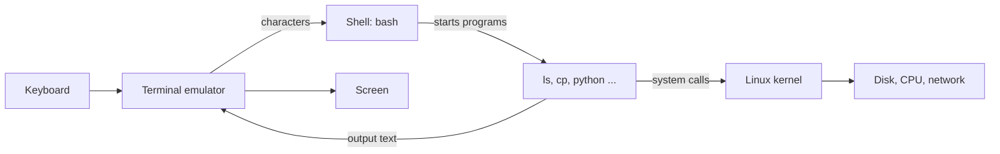
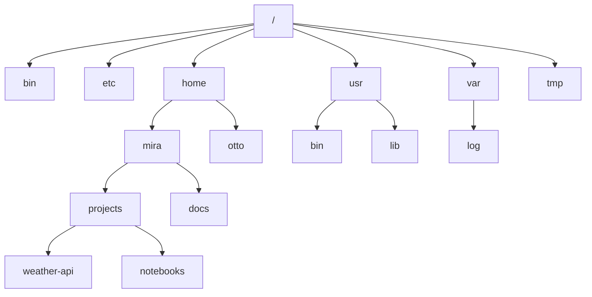

# The shell, the prompt and navigation

> **Before this lesson:** nothing. This is the first lesson of the track. You need a computer with a terminal: any Linux system, macOS, or Windows with WSL (Windows Subsystem for Linux, which runs Linux inside Windows).

## In plain words

The **command line** is a way of using a computer by typing short instructions instead of pointing and clicking. You type a line of text, press Enter, and the computer answers with text. The program that reads what you type and carries it out is called the **shell**.

An everyday picture: clicking through menus is like ordering in a restaurant by pointing at photographs on the menu. It is easy, but you can only have what is pictured. Typing commands is like speaking the cook's language — you can ask for exactly what you want, combine dishes, and say "the same again for all forty guests" in one sentence.

Files on a computer are kept in **directories** (the same thing as "folders"), and directories sit inside other directories, like rooms inside a building. This lesson teaches the three instructions for moving through that building: where am I, what is here, and go there.

Why this matters for a job: servers, cloud machines and the computers that train machine-learning models have no screen to click on. The command line is the only way to work on them, and it is used every day in software, data and operations roles.

## Why bother with a text interface?

Every server you will ever deploy to, every container you will ever debug and every GPU box you will ever train a model on has one thing in common: there is no desktop on it. There is a blinking cursor, and whatever you can type after it. The command line is not a nostalgic alternative to clicking — on most machines that matter professionally it is the *only* interface.

It is also a more expressive one. A graphical file manager offers the operations its designers thought of. A shell offers a language: small programs that each do one job, plus a grammar for combining them. "Find every log file older than a week, compress it, and tell me how much space I got back" is one line of that language. Once you can write such lines, you stop doing repetitive work by hand.

This first lesson builds the foundation everything else stands on: what the shell actually is, how to read the prompt, and how to move around the file system without getting lost.

## Terminal, shell, kernel: who does what

Three different pieces of software are involved when you type a command, and beginners often blur them together.

- The **terminal emulator** is the window. It draws characters and forwards your key presses. GNOME Terminal, Konsole, iTerm2, Windows Terminal and the pane inside VS Code are all terminal emulators. It knows nothing about files or commands.
- The **shell** is a program running *inside* that window. It prints the prompt, reads the line you type, works out what you meant, and starts other programs on your behalf. The default shell on almost every Linux distribution is `bash` (the Bourne Again SHell); macOS ships `zsh`, which behaves the same for everything in this lesson.
- The **kernel** is the core of the operating system. Programs ask it to open files, create processes and talk to hardware. The shell is one more program making those requests.



The practical consequence: when something looks wrong on screen (odd colours, broken line wrapping) suspect the terminal; when a command is "not found" or a wildcard misbehaves, suspect the shell; when you see "Permission denied" or "No such file or directory", that message ultimately came from the kernel refusing a request.

> [!INTERVIEW]
> "What is the difference between a terminal and a shell?" is a genuine screening question. A crisp answer: the terminal is the I/O device (today, a window emulating one); the shell is the command interpreter running in it. You can run different shells in the same terminal, and the same shell over `ssh` with no local terminal program on the remote side at all.

## Reading the prompt

Open a terminal and you will see something like this:

```bash
mira@forge:~$
```

That short string is dense with information:

| Piece | Meaning |
|---|---|
| `mira` | the user you are logged in as |
| `forge` | the host name of the machine — vital once you have several `ssh` sessions open |
| `~` | the current directory; `~` is shorthand for your home directory |
| `$` | you are an ordinary user. A `#` here means you are **root**, the administrator |

The prompt is the shell saying "I am idle, type something." If you do not get a prompt back, the previous command is still running (or waiting for input).

> [!WARNING]
> A prompt ending in `#` means every command runs with unlimited privileges: no file is protected from you, including the ones the system needs to boot. Work as a normal user and borrow root power one command at a time with `sudo`. Treat a `#` prompt the way you would treat a loaded tool on a workbench.

### Your first commands

A command is a word, optionally followed by more words. Try a few that cannot hurt anything:

```bash
mira@forge:~$ date
Fri Nov 20 09:14:52 UTC 2026
mira@forge:~$ whoami
mira
mira@forge:~$ uptime
 09:14:57 up 12 days,  3:41,  2 users,  load average: 0.08, 0.11, 0.09
mira@forge:~$ free -h
               total        used        free      shared  buff/cache   available
Mem:            31Gi       6.2Gi        18Gi       310Mi       7.1Gi        24Gi
Swap:          2.0Gi          0B       2.0Gi
mira@forge:~$ df -h /
Filesystem      Size  Used Avail Use% Mounted on
/dev/nvme0n1p2  468G  121G  324G  28% /
```

`date` prints the clock. `whoami` prints your user name. `uptime` reports how long the machine has been running and how busy it is. `free -h` shows memory and `df -h /` shows disk space, both in **h**uman-readable units — the `-h` is an *option*, a small switch that modifies behaviour. Notice the pattern: you type a line, press Enter, the program prints its answer, and the prompt returns.

Now type nonsense:

```bash
mira@forge:~$ flurble
bash: flurble: command not found
```

Nothing broke. The shell looked for a program called `flurble`, failed, and said so. Being wrong at the prompt is cheap; the expensive mistakes are the ones where the command *is* found and does exactly what you typed rather than what you meant.

To leave, type `exit` or press `Ctrl-D` on an empty line. `Ctrl-C` interrupts whatever is currently running and hands the prompt back — memorise it before anything else.

> [!TIP]
> Press the up-arrow key to bring back the previous command, and again for the one before that. The shell keeps a history of roughly the last thousand lines. You will learn far more powerful ways to search it in the lesson on keyboard tricks, but the arrow keys alone remove half of all retyping.

## The file system is one tree

Windows gives every disk its own letter and therefore its own separate tree. Unix-like systems do the opposite: there is exactly **one** tree, it starts at a directory called `/` (the *root directory*), and every disk, USB stick or network share is grafted onto a branch of it. You never need to know which physical device a path lives on in order to use it.



A few facts about names in this tree:

- Names are **case-sensitive**. `Report.txt`, `report.txt` and `REPORT.TXT` are three different files that can sit side by side.
- A name may contain almost any character, including spaces — but spaces make command lines awkward, so experienced users write `quarterly_report.txt` or `quarterly-report.txt`.
- Linux attaches no meaning to "extensions". A file ending in `.txt` is not special to the system; the suffix is a hint for humans and for some applications.
- Names that begin with a dot (`.bashrc`, `.ssh`) are **hidden**: listings skip them unless you ask.

At any moment your shell is "standing" in exactly one directory, the **current working directory**. Commands that take file names interpret them relative to that spot unless told otherwise. Three commands let you find out where you are, look around and move.

### `pwd` — where am I?

```bash
mira@forge:~$ pwd
/home/mira
```

`pwd` prints the working directory as a full path from the root. A new terminal starts in your **home directory**, the one place on the system that belongs to you and where you may freely create files.

### `ls` — what is here?

```bash
mira@forge:~$ ls
docs  downloads  projects  scratch.txt
```

With no arguments `ls` lists the working directory. Give it a path and it lists that instead, without moving you:

```bash
mira@forge:~$ ls /var/log
alternatives.log  auth.log  dpkg.log  journal  kern.log  syslog
mira@forge:~$ ls projects
notebooks  weather-api
```

### `cd` — go somewhere

```bash
mira@forge:~$ cd projects/weather-api
mira@forge:~/projects/weather-api$ pwd
/home/mira/projects/weather-api
```

The prompt updated itself to show the new location. `cd` produces no output when it succeeds — a recurring Unix habit: *silence means it worked*.

## Absolute and relative paths

There are two ways to write down the location of anything.

An **absolute path** starts with `/` and spells out the whole route from the root. It means the same thing no matter where you are standing:

```bash
mira@forge:~/projects/weather-api$ cd /usr/bin
mira@forge:/usr/bin$ pwd
/usr/bin
```

A **relative path** does not start with `/`. It is followed from the current directory, and so the same text can refer to different places at different times. Two special names make relative paths useful:

- `.` (one dot) is the current directory itself;
- `..` (two dots) is the parent — the directory one level closer to the root.

```bash
mira@forge:/usr/bin$ cd ..
mira@forge:/usr$ cd lib
mira@forge:/usr/lib$ cd ../share/doc
mira@forge:/usr/share/doc$ pwd
/usr/share/doc
```

Read the third command slowly: from `/usr/lib`, go up to `/usr`, then down into `share`, then down into `doc`. You can chain as many `..` steps as you need (`cd ../../..`). At the root, `..` leads back to the root; you cannot climb out of the tree.

Almost always you may leave out a leading `./`. `cd lib` and `cd ./lib` are the same request. The explicit form matters in one situation you will meet later: running a program that sits in the current directory, as in `./train.sh`.

### Shortcuts every user relies on

| You type | You land in |
|---|---|
| `cd` | your home directory, from anywhere |
| `cd ~` | the same; `~` expands to your home path |
| `cd ~otto` | the home directory of user `otto` |
| `cd -` | the directory you were in *before* the last `cd` (and it prints the path) |
| `cd ..` | the parent directory |
| `cd /` | the root of the tree |

`cd -` is a toggle between two places and is worth forming a habit around:

```bash
mira@forge:~/projects/weather-api$ cd /var/log
mira@forge:/var/log$ cd -
/home/mira/projects/weather-api
mira@forge:~/projects/weather-api$ cd -
/var/log
```

### A worked trip

Suppose you are in `/home/mira/projects/notebooks` and want to reach `/home/mira/docs/invoices`. All of these work:

```bash
cd /home/mira/docs/invoices      # absolute: unambiguous, a bit long
cd ~/docs/invoices               # home-relative: short and still position-independent
cd ../../docs/invoices           # relative: up two levels, then down
```

Which to choose? In interactive work, whichever is fewest keystrokes. In scripts, prefer absolute or `~`-based paths, because a script cannot assume where it was started from.

## How the shell resolves a path

It helps to see path resolution as a tiny algorithm. Split the path on `/`. Keep a stack of directory names. A normal name is pushed; `.` is ignored; `..` pops one name (unless the stack is already empty). The block below simulates that in Python — edit the calls and run it to test your intuition.

```python-run
def resolve(cwd, path):
    """Mimic how `cd` turns what you typed into an absolute location."""
    start = path if path.startswith("/") else cwd + "/" + path
    stack = []
    for part in start.split("/"):
        if part in ("", "."):
            continue              # empty piece (from //) or "stay here"
        if part == "..":
            if stack:
                stack.pop()       # climb one level, but never above the root
        else:
            stack.append(part)    # descend
        print(f"  after {part!r:14} -> /{'/'.join(stack)}")
    return "/" + "/".join(stack)

print(resolve("/home/mira/projects/notebooks", "../../docs/invoices"))
print(resolve("/usr/lib", "/etc/./ssh/../hosts"))
print(resolve("/", "../../.."))
```

The practice problem *Resolve a Path Like cd Does* asks you to write this function yourself.

## Anatomy of a command line

Now that you have typed a dozen commands, look at their general shape:

```
command  -options  arguments
```

- The **command** is the first word: the program (or shell feature) to run.
- **Options** adjust its behaviour. Short options are a dash and a letter (`-l`); several can be bundled (`-la` is `-l -a`). Long options are two dashes and a word (`--all`), which is more readable in scripts.
- **Arguments** are the things to operate on, typically file or directory names.

```bash
mira@forge:~$ ls -l -a projects
total 16
drwxr-xr-x  4 mira mira 4096 Nov 18 16:02 .
drwxr-x--- 19 mira mira 4096 Nov 20 08:55 ..
drwxr-xr-x  3 mira mira 4096 Nov 12 10:30 notebooks
drwxr-xr-x  6 mira mira 4096 Nov 18 16:02 weather-api
mira@forge:~$ ls --all --human-readable -l projects
total 16K
drwxr-xr-x  4 mira mira 4.0K Nov 18 16:02 .
drwxr-x--- 19 mira mira 4.0K Nov 20 08:55 ..
drwxr-xr-x  3 mira mira 4.0K Nov 12 10:30 notebooks
drwxr-xr-x  6 mira mira 4.0K Nov 18 16:02 weather-api
```

The first two entries of the `-a` listing are the `.` and `..` you have been using: they are real entries in every directory, merely hidden because their names start with a dot. The next lesson dissects every column of this long format.

The shell separates words at spaces, so the number of spaces between them does not matter, but a space *inside* a name does:

```bash
mira@forge:~$ cd Holiday Photos
bash: cd: too many arguments
mira@forge:~$ cd "Holiday Photos"
mira@forge:~/Holiday Photos$
```

Quotes tell the shell "this is one word". You can also press `Tab` after typing `Hol` and let the shell complete and escape the name for you — tab completion is the single biggest speed-up at the prompt and it also prevents typos, because it only completes names that exist.

## Pitfalls

**Assuming where you are.** Relative paths depend on the working directory. Before a command that changes or deletes anything, a glance at the prompt (or a quick `pwd`) costs a second and occasionally saves a day.

**Case mistakes.** `cd documents` fails if the directory is `Documents`. The error "No such file or directory" is very often a capitalisation problem.

**Confusing `/` and `~`.** `/` is the root of the whole system; `~` is your personal corner of it. `cd /projects` looks for a top-level directory named `projects`, which is almost certainly not what you meant; `cd ~/projects` is.

**A leading slash by accident.** `cd /docs` and `cd docs` differ by one character and by an entire tree. When a path "does not exist" although you can see it in `ls`, check for a stray leading `/`.

**Thinking nothing happened.** No output usually means success. If you want confirmation, run `pwd` or `ls` afterwards rather than repeating the command.

**Staying logged in as root.** Covered above, repeated because it is the mistake with the largest blast radius.

## Cheat sheet

| Command | What it does |
|---|---|
| `date`, `whoami`, `hostname` | clock, current user, machine name |
| `uptime` | how long the system has run and its load averages |
| `free -h`, `df -h` | memory and disk usage in readable units |
| `pwd` | print the working directory |
| `ls`, `ls dir` | list the working directory, or `dir` |
| `ls -a` | include hidden (dot) entries |
| `ls -l`, `ls -lh` | long format; with human-readable sizes |
| `cd dir` | change into `dir` |
| `cd`, `cd ~` | go home |
| `cd -` | go back to the previous directory |
| `cd ..`, `cd ../..` | up one level, up two levels |
| `Tab` | complete a command or file name |
| `Ctrl-C` | interrupt the running command |
| `Ctrl-D` or `exit` | end the shell session |

## Summary

- The terminal displays; the shell interprets; the kernel does the real work. Knowing which layer produced an error tells you where to look.
- The prompt shows user, host and working directory. `$` is a normal user, `#` is root.
- Linux has a single directory tree rooted at `/`. Your shell always has one working directory inside it.
- `pwd`, `ls` and `cd` are the three navigation verbs. Absolute paths start at `/`; relative paths start where you stand and use `.` and `..`.
- `~` means home, `cd -` jumps back, and `Tab` completes names.
- A command line is *command, options, arguments*; spaces separate words, so quote names that contain them.

## Glossary

| Term | Meaning |
|---|---|
| command line | a text interface: you type instructions and read the replies |
| terminal | the window in which the typing and replies appear |
| shell | the program that reads your commands and runs them; `bash` is the most common |
| kernel | the core of the operating system, which controls files, memory and hardware |
| prompt | the text the shell shows when it is ready for a command |
| root | the administrator account, with unlimited rights; also the top directory `/` |
| directory | a container for files and other directories (a folder) |
| path | the written route to a file or directory |
| absolute / relative path | a route from the top `/` / a route from where you are now |
| working directory | the directory your shell is currently in |
| home directory | your personal directory, written `~` |
| option / argument | a switch that changes how a command behaves / the thing it works on |

## Check yourself

```quiz
[
  {"q": "You open a terminal over ssh and see the prompt `root@db-02:/etc#`. What does the final `#` tell you?",
   "options": ["The line is a comment", "You are the superuser", "The previous command failed", "The directory is read-only"],
   "answer": 1,
   "explain": "By convention the prompt ends in # for root and in the dollar sign for ordinary users. Everything typed at a # prompt runs with full privileges."},
  {"q": "Your working directory is `/home/mira/projects/api`. Which directory does `cd ../../docs` take you to?",
   "options": ["/home/docs", "/home/mira/docs", "/home/mira/projects/docs", "/docs"],
   "answer": 1,
   "explain": "Each .. climbs one level: api -> projects -> mira. Then docs is entered from /home/mira."},
  {"q": "Which statement about the path `notes/todo.txt` is true?",
   "options": ["It always refers to the same file", "It is absolute because it contains a slash", "Its meaning depends on the current working directory", "It is invalid without a leading ./"],
   "answer": 2,
   "explain": "A path that does not start with / is relative and is followed from wherever the shell currently is."},
  {"q": "What does `cd -` do?",
   "options": ["Moves to the parent directory", "Moves to the home directory", "Returns to the previous working directory", "Prints an error because - is not a directory"],
   "answer": 2,
   "explain": "The shell remembers the last directory in OLDPWD; cd - switches to it and prints the path, so repeating it toggles between two places."},
  {"q": "A command prints nothing and the prompt returns. What is the most reasonable conclusion?",
   "options": ["It crashed silently", "It succeeded; many Unix tools are quiet on success", "The terminal is frozen", "You must run it again with sudo"],
   "answer": 1,
   "explain": "Unix tools report problems and otherwise stay quiet. cd, cp, mv and mkdir all behave this way."},
  {"q": "Which component decides that `flurble` is not a known command?",
   "options": ["The terminal emulator", "The shell", "The keyboard driver", "The file system"],
   "answer": 1,
   "explain": "The shell looks up the first word of the line among its built-ins and the programs on its search path, and prints 'command not found' when the lookup fails."},
  {"q": "In `ls -la /var/log`, what are `-la` and `/var/log` respectively?",
   "options": ["Arguments and options", "Two bundled short options and an argument", "A long option and a command", "A file name and a directory"],
   "answer": 1,
   "explain": "-la is the short options -l and -a written together; /var/log is the argument naming what to list."},
  {"q": "Why does `cd Holiday Photos` fail when a directory with that name exists?",
   "options": ["Directory names cannot contain spaces", "cd needs sudo for names with spaces", "The shell splits the line at the space and passes two arguments", "The name must be written in lower case"],
   "answer": 2,
   "explain": "Unquoted spaces separate words. Quote the name or use Tab completion so the shell treats it as a single argument."}
]
```

> **Source:** Shotts, *The Linux Command Line*, ch. 1 (What Is the Shell?) and ch. 2 (Navigation). All examples and wording are original to this guide.
