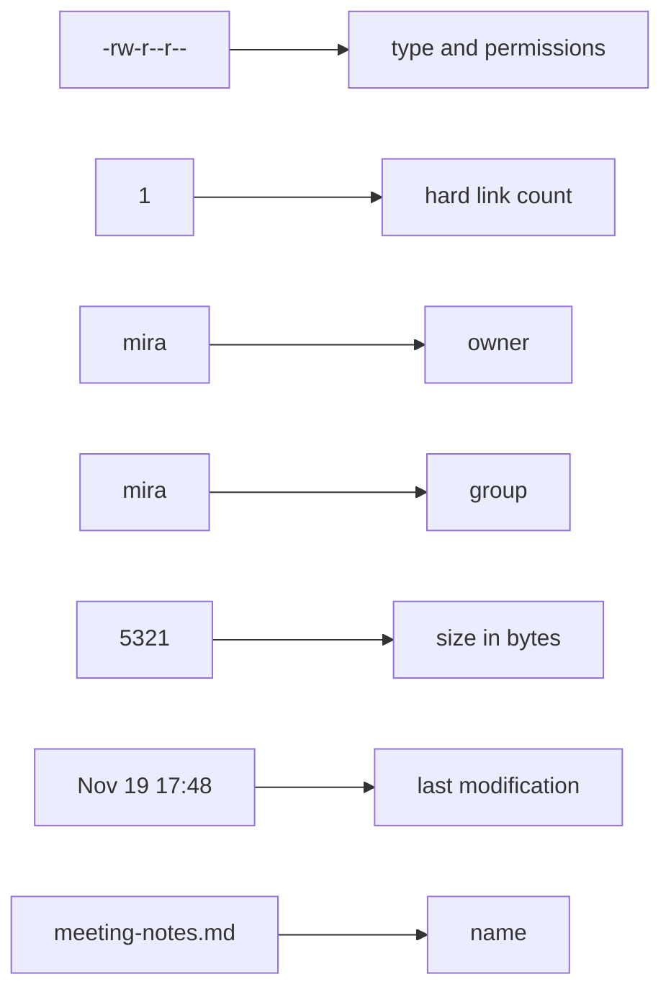

# Exploring the system: ls, file, less and the directory tour

> **Before this lesson:** you should be able to open a terminal and move around with `pwd`, `ls` and `cd`, as taught in [The shell, the prompt and navigation](#/lesson/linux-cli/shell-and-navigation).

## In plain words

Arriving in an unfamiliar building, you would want three things: a way to read the labels on the doors, a way to tell what is inside a box without tipping it out, and a floor plan. This lesson gives you the same three things for a Linux computer.

`ls -l` reads the labels: it lists files together with their size, their owner and the date they last changed. `file` looks inside a file and tells you what kind of data it holds — text, a picture, a program. `less` opens a text file for reading, one screen at a time, without any risk of changing it. And the **directory tree** — the way directories are nested inside one another, starting from a single top directory written `/` — is laid out the same way on nearly every Linux system, so learning the floor plan once works everywhere.

Why this matters for a job: the first task on any new server is to find things — where the settings are, where a program writes its **logs** (the diary of events it keeps), how much space a file takes. These three commands and the standard layout answer most of those questions in a minute.

## Motivation

You have been handed access to a machine you have never seen. Maybe it is a cloud VM that a colleague set up, maybe a training server, maybe the inside of a container that keeps crashing. Before you can fix or build anything you need answers to very ordinary questions: What is installed here? Where are the configuration files? Where do the logs go? Is this 40 GB thing a text file I can read or a binary blob?

Three small commands answer nearly all of them. `ls` tells you what exists and its vital statistics, `file` tells you what kind of data something holds, and `less` lets you read it without changing it. Add a mental map of the standard directory layout and an unfamiliar Linux box stops being unfamiliar within minutes.

## Getting more out of `ls`

Plain `ls` shows names. Its options turn it into an inspection tool.

```bash
mira@forge:~$ ls
docs  downloads  projects  scratch.txt
mira@forge:~$ ls -a
.  ..  .bash_history  .bashrc  .cache  .config  docs  downloads  .profile  projects  scratch.txt  .ssh
```

`-a` (all) reveals the dot-files: per-user configuration and state that programs keep out of your way. You can list several places at once, and mix files and directories:

```bash
mira@forge:~$ ls docs /etc/ssh
/etc/ssh:
moduli  ssh_config  ssh_config.d  sshd_config  sshd_config.d  ssh_host_ed25519_key  ssh_host_ed25519_key.pub

docs:
cv.pdf  invoices  meeting-notes.md
```

### The long format, column by column

`-l` prints one entry per line with seven pieces of information:

```bash
mira@forge:~$ ls -l docs
total 212
-rw-r--r-- 1 mira mira 198744 Oct  3 11:20 cv.pdf
drwxr-xr-x 2 mira mira   4096 Nov  2 09:05 invoices
-rw-r--r-- 1 mira mira   5321 Nov 19 17:48 meeting-notes.md
```



| Field | Example | What it tells you |
|---|---|---|
| Type and mode | `-rw-r--r--` | First character: `-` regular file, `d` directory, `l` symbolic link, `c`/`b` device, `s` socket, `p` pipe. The remaining nine are permissions for owner, group and everyone else (a later lesson is devoted to them). |
| Links | `1` | How many directory entries point at this file's data. |
| Owner | `mira` | The user who owns it. |
| Group | `mira` | The group that owns it. |
| Size | `5321` | Bytes. For a directory this is the size of the directory's own index, not of its contents. |
| Timestamp | `Nov 19 17:48` | When the content was last modified. Entries older than about six months show the year instead of the time. |
| Name | `meeting-notes.md` | The entry's name; for links, followed by `-> target`. |

The `total 212` line is the disk space used by the listed entries, in 1 KiB blocks.

### Options worth memorising

| Option | Long form | Effect |
|---|---|---|
| `-a` | `--all` | show names beginning with a dot |
| `-A` | `--almost-all` | like `-a` but omit `.` and `..` |
| `-d` | `--directory` | describe the directory itself instead of listing what is inside |
| `-F` | `--classify` | append a marker: `/` directory, `*` executable, `@` link |
| `-h` | `--human-readable` | sizes as `4.0K`, `190M`, `2.3G` (with `-l`) |
| `-l` |  | long format |
| `-r` | `--reverse` | reverse the sort order |
| `-S` |  | sort by size, largest first |
| `-t` |  | sort by modification time, newest first |
| `-R` | `--recursive` | descend into subdirectories |
| `-1` |  | one name per line (handy for piping) |
| `-i` | `--inode` | show each entry's inode number |

Options combine freely, and a few combinations become muscle memory:

```bash
mira@forge:~$ ls -lt /var/log | head -n 5       # what was written most recently?
total 5124
-rw-r----- 1 syslog adm   912340 Nov 20 09:20 syslog
-rw-r----- 1 syslog adm    48211 Nov 20 09:17 auth.log
-rw-r----- 1 syslog adm   301877 Nov 20 08:59 kern.log
drwxr-sr-x 3 root   systemd-journal 4096 Nov  8 05:36 journal
mira@forge:~$ ls -lhS ~/downloads | head -n 4    # what is taking the space?
total 6.3G
-rw-r--r-- 1 mira mira 4.1G Nov 11 21:14 ubuntu-desktop.iso
-rw-r--r-- 1 mira mira 1.9G Nov 14 13:02 embeddings.parquet
-rw-r--r-- 1 mira mira 310M Nov 16 08:40 dataset-sample.tar.gz
mira@forge:~$ ls -ld /tmp                        # the directory itself, not its contents
drwxrwxrwt 21 root root 4096 Nov 20 09:17 /tmp
```

`ls -ltr` (long, by time, reversed) deserves special mention: the newest entry ends up at the *bottom*, right above your prompt, which is exactly where your eyes are. It is the quickest answer to "what did that program create a moment ago?".

> [!TIP]
> Many distributions define `ll` as an alias for `ls -alF` or similar. Type `alias ll` to see what it expands to on your system. If it is missing, you will learn to add it in the lesson on startup files.

## `file` — what kind of thing is this?

Because names carry no guaranteed meaning, a file called `report.pdf` could contain anything. The `file` command opens it, examines the first bytes for known signatures, and tells you what it really is:

```bash
mira@forge:~$ file docs/cv.pdf
docs/cv.pdf: PDF document, version 1.7, 2 pages
mira@forge:~$ file downloads/dataset-sample.tar.gz
downloads/dataset-sample.tar.gz: gzip compressed data, from Unix, original size modulo 2^32 331089920
mira@forge:~$ file /usr/bin/ls
/usr/bin/ls: ELF 64-bit LSB pie executable, x86-64, version 1 (SYSV), dynamically linked, stripped
mira@forge:~$ file /usr/bin/pip3
/usr/bin/pip3: Python script, ASCII text executable
mira@forge:~$ file projects
projects: directory
mira@forge:~$ file /etc/hostname
/etc/hostname: ASCII text
```

Two of those answers are instructive. `/usr/bin/ls` is a compiled binary (ELF is the Linux executable format) while `/usr/bin/pip3` is a text file that happens to be executable — a script. Both are run the same way. And knowing something is "ASCII text" tells you it is safe to open in a pager; pointing a pager at a 4 GB binary is merely unhelpful, but dumping one to the terminal with the wrong tool can scramble your display.

> [!TIP]
> If your terminal ever starts showing garbage characters after you accidentally printed binary data, type `reset` and press Enter (you may not see what you type). It reinitialises the terminal.

## `less` — reading without touching

A great deal of Linux configuration and almost all logging is plain text. `less` displays text one screen at a time and never modifies the file, which makes it the right tool for a first look at anything.

```bash
mira@forge:~$ less /etc/services
```

The screen clears, the first page appears, and `less` waits for single-key commands:

| Key | Action |
|---|---|
| `Space` or `PageDown` | forward one screen |
| `b` or `PageUp` | back one screen |
| `Down` / `Up`, `j` / `k` | one line at a time |
| `g` / `G` | jump to the first / last line |
| `50g` | jump to line 50 |
| `/text` | search forward for *text* |
| `?text` | search backward |
| `n` / `N` | next / previous match |
| `-N` | toggle line numbers |
| `-S` | toggle chopping of long lines instead of wrapping (great for wide logs and CSV files) |
| `F` | follow: wait for new lines to be appended, like `tail -f`; `Ctrl-C` stops following |
| `h` | help |
| `q` | quit |

A typical log-reading session: open the file, press `G` to jump to the end where the newest entries are, type `?ERROR` to search backwards for the most recent error, and press `n` to step to earlier ones.

`less` is also what displays manual pages, so these keys work whenever you run `man something`. The name is a pun: it replaced an older pager called `more`, which could only scroll forwards — "less is more".

Two relatives are worth knowing from day one. `cat file` prints an entire file straight to the terminal with no paging, which is perfect for short files. `head -n 20 file` and `tail -n 20 file` print only the first or last lines.

```bash
mira@forge:~$ cat /etc/hostname
forge
mira@forge:~$ head -n 3 /etc/passwd
root:x:0:0:root:/root:/bin/bash
daemon:x:1:1:daemon:/usr/sbin:/usr/sbin/nologin
bin:x:2:2:bin:/bin:/usr/sbin/nologin
```

## A guided tour of the tree

Linux distributions agree on a layout known as the Filesystem Hierarchy Standard. You do not need to memorise all of it, but knowing where categories of things live lets you guess correctly on machines you have never seen.

| Directory | What lives there | Typical reason you visit |
|---|---|---|
| `/` | the root; contains only other directories | starting point |
| `/bin`, `/usr/bin` | programs for all users (`ls`, `python3`, `git`). On modern systems `/bin` is a link to `/usr/bin` | "where is this command?" |
| `/sbin`, `/usr/sbin` | system-administration programs | tools that need root |
| `/boot` | the kernel and boot loader files | rarely, and carefully |
| `/dev` | device nodes: disks (`/dev/nvme0n1`), terminals, and curiosities such as `/dev/null` | identifying disks |
| `/etc` | system-wide configuration, almost all of it readable text | changing how a service behaves |
| `/home` | one directory per ordinary user | your own files |
| `/root` | the home directory of the root user | — |
| `/lib`, `/usr/lib` | shared libraries (the Linux equivalent of DLLs) | diagnosing "library not found" |
| `/media`, `/mnt` | mount points for removable or temporary file systems | USB sticks, extra disks |
| `/opt` | optional, usually commercial or third-party software bundles | vendor tools, CUDA on some systems |
| `/proc` | a *virtual* file system: the kernel describing itself and every process as files | `cat /proc/cpuinfo`, `/proc/meminfo` |
| `/sys` | another virtual view, of devices and drivers | hardware details |
| `/run` | runtime state since boot (PID files, sockets) | service sockets |
| `/tmp` | scratch space any user may write to; cleared on reboot on many systems | throwaway files |
| `/usr` | the bulk of installed software and its read-only data | — |
| `/usr/local` | software installed by the local administrator, outside the package manager | hand-built tools |
| `/usr/share` | architecture-independent data: documentation, icons, time zones | `/usr/share/doc` |
| `/var` | data that changes while the system runs | — |
| `/var/log` | log files | first stop when something breaks |
| `/var/lib` | persistent application state: databases, Docker images, package records | "why is the disk full?" |

Take the tour yourself. For each directory: `cd` into it, run `ls -l`, pick an interesting entry, ask `file` what it is, and if it is text open it in `less`.

```bash
mira@forge:~$ cd /proc
mira@forge:/proc$ head -n 5 meminfo
MemTotal:       32675212 kB
MemFree:        19140736 kB
MemAvailable:   25633104 kB
Buffers:          412208 kB
Cached:          6650924 kB
mira@forge:/proc$ file meminfo
meminfo: empty
mira@forge:/proc$ ls -l meminfo
-r--r--r-- 1 root root 0 Nov 20 09:31 meminfo
```

That last pair of results is a small revelation. `meminfo` reports a size of zero and `file` calls it empty, yet reading it produces text. Nothing is stored on any disk: the kernel manufactures the content at the moment you read it. Much of Linux's introspection — per-process details under `/proc/<pid>`, hardware under `/sys` — works this way, and it is why "everything is a file" is the system's best-known slogan.

> [!WARNING]
> Exploring with `ls`, `file`, `less`, `cat` and `head` is completely safe: none of them writes anything. The same is not true of an editor opened with `sudo`. While touring `/etc`, `/boot` or `/dev`, read; do not edit or delete until you know exactly what a file is for and have a copy of it.

## Symbolic links and hard links: a first look

While touring you will meet listings like this:

```bash
mira@forge:~$ ls -l /usr/bin/python3 /bin
lrwxrwxrwx 1 root root  7 Mar  2  2025 /bin -> usr/bin
lrwxrwxrwx 1 root root 10 Aug  7 14:02 /usr/bin/python3 -> python3.12
```

The leading `l` marks a **symbolic link** (also called a symlink or soft link): a tiny file whose content is the path of another file. Opening the link transparently opens the target. Links solve a real problem — letting one thing be reachable under several names. `python3` can keep pointing at whichever exact version is current; when 3.13 is installed, the link is re-pointed and nothing that calls `python3` has to change. The same trick is used for shared libraries (`libssl.so.3 -> libssl.so.3.0.13`) and for the "current release" directory in many deployment schemes.

Because the permissions shown on a symlink are always `rwxrwxrwx`, they are meaningless; the target's permissions are what count. And a link whose target has been removed is *dangling*: it still appears in listings (often in red) but opening it fails with "No such file or directory".

The **hard link** count in the second column refers to a different mechanism, in which two directory entries share the very same underlying data. The next lesson creates both kinds and compares them.

## A small parser to cement the format

Reading the long format fluently is a skill; writing a parser for it is a good way to gain it. Run this, then change the sample lines:

```python-run
def describe(line):
    # 8 fixed fields, then the name (which may contain spaces)
    mode, links, owner, group, size, month, day, when, name = line.split(None, 8)
    kinds = {"-": "regular file", "d": "directory", "l": "symbolic link",
             "c": "character device", "b": "block device"}
    kind = kinds.get(mode[0], "something exotic")
    target = ""
    if mode[0] == "l" and " -> " in name:
        name, t = name.split(" -> ", 1)
        target = f" pointing at {t!r}"
    human = int(size)
    for unit in ("B", "K", "M", "G", "T"):
        if human < 1024:
            break
        human /= 1024
    return f"{name!r}: {kind}{target}, {human:.1f}{unit}, owner {owner}, modified {month} {day} {when}"

samples = [
    "-rw-r--r-- 1 mira mira 198744 Oct  3 11:20 cv.pdf",
    "drwxr-xr-x 2 mira mira   4096 Nov  2 09:05 Tax Returns 2025",
    "lrwxrwxrwx 1 root root     10 Aug  7 14:02 python3 -> python3.12",
    "-rw-r--r-- 1 mira mira 4402341888 Nov 11 21:14 ubuntu-desktop.iso",
]
for s in samples:
    print(describe(s))
```

> [!INTERVIEW]
> A classic warm-up: "Walk me through the output of `ls -l`." Name the seven fields in order, mention that the first character is the file type, and add one detail that shows depth — for example that a directory's size is that of its entry table rather than its contents, or that the link count of a directory is two plus the number of its subdirectories (its own `.` plus each child's `..`).

## Pitfalls

- **Listing a directory when you wanted its own details.** `ls -l /var/log` lists the contents; `ls -ld /var/log` shows the permissions of `/var/log` itself.
- **Trusting extensions.** Use `file` before assuming what something contains.
- **Reading `Size` on directories as their total size.** It is not. Use `du -sh directory` to measure the contents.
- **`cat` on huge or binary files.** Prefer `less`, `head` or `file` first.
- **Forgetting hidden files.** "The directory is empty but `rmdir` refuses to remove it" usually means there are dot-files; check with `ls -A`.
- **Editing through curiosity.** Tour with read-only tools.

## Cheat sheet

| Task | Command |
|---|---|
| Everything, including hidden entries, with details | `ls -la` |
| Newest entries last | `ls -ltr` |
| Largest files first, readable sizes | `ls -lhS` |
| Details of the directory itself | `ls -ld dir` |
| Mark directories and executables | `ls -F` |
| Identify a file's real type | `file name` |
| Page through a text file | `less name` |
| Search inside `less` | `/pattern`, then `n` |
| Jump to the end / start in `less` | `G` / `g` |
| Print a short file | `cat name` |
| First / last ten lines | `head name` / `tail name` |
| Fix a garbled terminal | `reset` |

## Summary

- `ls` options turn a name list into a diagnostic: `-l` for details, `-a` for hidden entries, `-t`/`-S`/`-r` for ordering, `-h` for readable sizes, `-d` for the directory itself.
- The long format always has the same seven fields; the first character is the file type.
- `file` identifies content by inspecting it; extensions are only hints.
- `less` is a safe, searchable viewer and shares its keys with manual pages.
- The directory layout is standardised: configuration in `/etc`, logs in `/var/log`, programs in `/usr/bin`, kernel-generated views in `/proc` and `/sys`, your files in `/home`.
- Symbolic links are small files that point at other paths; they show up with a leading `l` and an arrow.

## Glossary

| Term | Meaning |
|---|---|
| long listing | the detailed output of `ls -l`, one file per line |
| owner / group | the user and the set of users a file belongs to |
| hidden file | a file whose name starts with a dot; listings skip it unless asked |
| pager | a program such as `less` that shows text one screen at a time |
| log | a file in which a program records what it did, line by line |
| configuration file | a text file holding a program's settings |
| binary | a file of machine instructions or other non-text data |
| script | a program stored as readable text |
| symbolic link | a small file that points to another file or directory |
| virtual file system | directories such as `/proc` whose contents are produced by the kernel on request |
| FHS | Filesystem Hierarchy Standard: the agreed layout of Linux directories |

## Check yourself

```quiz
[
  {"q": "Which command shows the permissions of the directory `/srv/data` itself rather than its contents?",
   "options": ["ls -l /srv/data", "ls -ld /srv/data", "ls -la /srv/data/*", "file /srv/data"],
   "answer": 1,
   "explain": "-d tells ls to treat a directory argument as an entry to describe instead of a container to list."},
  {"q": "In the listing `lrwxrwxrwx 1 root root 10 Aug 7 14:02 python3 -> python3.12`, what is the first character telling you?",
   "options": ["The file is locked", "It is a symbolic link", "It is a library", "It is a large file"],
   "answer": 1,
   "explain": "The first character is the type: l for symbolic link, d for directory, - for a regular file."},
  {"q": "You want the most recently modified file in a busy directory to appear right above your prompt. Which invocation does that?",
   "options": ["ls -lS", "ls -lt", "ls -ltr", "ls -la"],
   "answer": 2,
   "explain": "-t sorts newest first and -r reverses it, so the newest entry is printed last."},
  {"q": "Why can `cat /proc/meminfo` print text although `ls -l` reports the file size as 0?",
   "options": ["The file is compressed", "ls has a bug for system files", "The kernel generates the content on the fly when it is read", "Only root can see the true size"],
   "answer": 2,
   "explain": "/proc is a virtual file system. Its entries are interfaces to kernel data, not data stored on disk."},
  {"q": "A file is named `backup.txt`. What is the most reliable way to learn what it actually contains?",
   "options": ["Trust the .txt extension", "Run file backup.txt", "Check its size with ls -l", "Look at its modification time"],
   "answer": 1,
   "explain": "Extensions carry no guarantee on Linux. file inspects the content and reports the real format."},
  {"q": "Inside `less`, which key sequence jumps to the end of a log and then searches backwards for the word timeout?",
   "options": ["g then /timeout", "G then ?timeout", "q then timeout", "F then n"],
   "answer": 1,
   "explain": "G goes to the last line; ? starts a backward search. Use n to move on to earlier matches."},
  {"q": "Where would you look first for the configuration file of a system service such as the SSH server?",
   "options": ["/var/log", "/usr/bin", "/etc", "/tmp"],
   "answer": 2,
   "explain": "System-wide configuration lives under /etc, for example /etc/ssh/sshd_config."},
  {"q": "The size column of `ls -l` shows 4096 for a directory holding 30 GB of files. Why?",
   "options": ["ls rounds large sizes down", "The number is the size of the directory's own entry table", "The files are hidden", "The disk is corrupted"],
   "answer": 1,
   "explain": "A directory is a small table of names and inode numbers. To total the contents use du -sh."}
]
```

> **Source:** Shotts, *The Linux Command Line*, ch. 3 (Exploring the System). All examples and wording are original to this guide.
