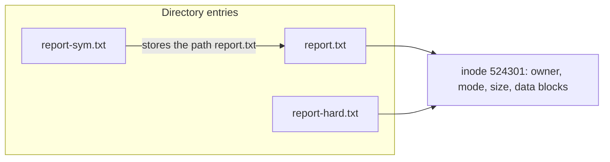

# Manipulating files and directories

> **Before this lesson:** you should be able to navigate and list files ([The shell, the prompt and navigation](#/lesson/linux-cli/shell-and-navigation)) and read a long listing ([Exploring the system](#/lesson/linux-cli/exploring-the-system)).

## In plain words

This lesson is about the everyday housekeeping of files: making directories, copying, moving, renaming and deleting. In a graphical file manager you do these by dragging icons. Here you type a short command for each.

Think of an office with filing cabinets. `mkdir` adds a new drawer, `cp` photocopies a document, `mv` moves it to another drawer or changes the label on it, and `rm` puts it through the shredder. That last comparison is exact: there is no waste-paper basket to fish things out of. A deleted file is gone.

The big advantage over dragging icons is the **wildcard**: a symbol that stands for "any name fitting this shape". `*.jpg` means "every file whose name ends in .jpg". One command can therefore act on a thousand files as easily as on one.

Why this matters for a job: organising data sets, tidying build output, making backups before a risky change and cleaning up temporary files are constant small tasks. Doing them quickly — and, above all, safely — is a basic professional skill.

## Motivation

Dragging a file from one folder to another with a mouse is easy. Dragging the four hundred files in a folder that end in `.csv`, were produced by last night's job, and are not already present in the destination — that is a miserable afternoon with a mouse and a single line at the prompt. The commands in this lesson (`mkdir`, `cp`, `mv`, `rm`, `ln`) are simple on their own. Their power comes from the fact that each accepts *many* names at once, and that the shell can generate those names for you from a pattern.

That power cuts both ways. There is no recycle bin on the command line. A deleted file is gone, an overwritten file is replaced, and neither operation asks "are you sure?" by default. So this lesson teaches two things together: the commands, and the habits that make them safe.

## Wildcards: describing many files at once

Before a command runs, the shell looks at each word you typed. If a word contains wildcard characters, the shell replaces it with the list of existing file names that fit — a process called *globbing* or pathname expansion. The command itself never sees the pattern, only the resulting names.

| Wildcard | Matches |
|---|---|
| `*` | any run of characters, including none |
| `?` | exactly one character |
| `[abc]` | one character from the set |
| `[!abc]` or `[^abc]` | one character **not** in the set |
| `[a-f]`, `[0-9]` | one character in the range |
| `[[:class:]]` | one character from a named class: `[:alpha:]`, `[:digit:]`, `[:upper:]`, `[:lower:]`, `[:alnum:]` |

Some patterns and how to read them:

| Pattern | Reads as |
|---|---|
| `*` | every (non-hidden) name |
| `*.csv` | names ending in `.csv` |
| `run_*` | names starting with `run_` |
| `report_??.txt` | `report_` then exactly two characters then `.txt` |
| `[A-Z]*` | names starting with a capital letter |
| `*[0-9]` | names ending in a digit |
| `img_[0-9][0-9][0-9].png` | `img_000.png` to `img_999.png` |
| `[!.]*.bak` | names ending in `.bak` that do not start with a dot |

A leading dot is never matched by `*` or `?`, which protects hidden files from casual patterns.

The safest way to learn what a pattern does is to hand it to a harmless command first. `echo` only prints its arguments, so it shows exactly what the shell expanded:

```bash
mira@forge:~/lab$ ls
data_01.csv  data_02.csv  data_10.csv  notes.txt  plot.png  README.md  results.CSV
mira@forge:~/lab$ echo *.csv
data_01.csv data_02.csv data_10.csv
mira@forge:~/lab$ echo data_0?.csv
data_01.csv data_02.csv
mira@forge:~/lab$ echo [A-Z]*
README.md
mira@forge:~/lab$ echo *.xml
*.xml
```

Two details in that transcript matter. `results.CSV` was not matched by `*.csv` because matching is case-sensitive. And when nothing matches, bash leaves the pattern untouched and passes the literal text `*.xml` to the command — which is why you sometimes see errors such as `cannot access '*.xml': No such file or directory`.

> [!TIP]
> Make "echo first" a reflex. Before `rm *.tmp`, run `echo *.tmp` or `ls *.tmp` and read the list. If the list surprises you, you have saved your files.

The following simulation implements the matching rules, so you can test patterns here without a shell:

```python-run
def glob_match(pattern, name):
    """True if the whole name matches a shell pattern using * ? [..] [!..]."""
    if not pattern:
        return not name
    head = pattern[0]
    if head == "*":
        # star swallows 0..len(name) characters
        return any(glob_match(pattern[1:], name[i:]) for i in range(len(name) + 1))
    if not name:
        return False
    if head == "?":
        return glob_match(pattern[1:], name[1:])
    if head == "[":
        end = pattern.index("]", 2)
        body = pattern[1:end]
        negate = body[0] in "!^"
        if negate:
            body = body[1:]
        hit, i = False, 0
        while i < len(body):
            if i + 2 < len(body) and body[i + 1] == "-":
                hit |= body[i] <= name[0] <= body[i + 2]
                i += 3
            else:
                hit |= body[i] == name[0]
                i += 1
        return hit != negate and glob_match(pattern[end + 1:], name[1:])
    return head == name[0] and glob_match(pattern[1:], name[1:])

files = ["data_01.csv", "data_02.csv", "data_10.csv", "notes.txt",
         "plot.png", "README.md", "results.CSV", ".env"]
for pat in ["*.csv", "data_0?.csv", "[A-Z]*", "*[!v]", "*"]:
    hits = [f for f in files if not f.startswith(".") and glob_match(pat, f)]
    print(f"{pat:14} -> {hits}")
```

## `mkdir` — make directories

```bash
mira@forge:~/lab$ mkdir raw clean reports
mira@forge:~/lab$ mkdir archive/2026/q4
mkdir: cannot create directory ‘archive/2026/q4’: No such file or directory
mira@forge:~/lab$ mkdir -p archive/2026/q4
mira@forge:~/lab$ ls -F
archive/  clean/  data_01.csv  data_02.csv  data_10.csv  notes.txt  plot.png  raw/  README.md  reports/  results.CSV
```

`mkdir` takes any number of names. Without `-p` it refuses to create a directory whose parent is missing; with `-p` ("parents") it creates the whole chain and, usefully in scripts, does not complain when the directory already exists.

## `cp` — copy

`cp` has two shapes:

```
cp  source  destination          # one item to a new name or into a directory
cp  source...  directory         # several items into an existing directory
```

```bash
mira@forge:~/lab$ cp notes.txt notes.backup.txt     # duplicate under a new name
mira@forge:~/lab$ cp data_*.csv raw                 # three files into raw/
mira@forge:~/lab$ ls raw
data_01.csv  data_02.csv  data_10.csv
mira@forge:~/lab$ cp raw raw-copy
cp: -r not specified; omitting directory 'raw'
mira@forge:~/lab$ cp -r raw raw-copy                # directories need -r
```

| Option | Meaning |
|---|---|
| `-r`, `-R` | recursive: copy directories and everything inside them |
| `-a` | archive: recursive **and** preserve ownership, permissions, timestamps and links — the right choice for backups |
| `-i` | interactive: ask before overwriting an existing file |
| `-n` | never overwrite an existing file |
| `-u` | update: copy only when the source is newer than the destination or the destination is missing |
| `-v` | verbose: print each file as it is copied |
| `-p` | preserve mode, ownership and timestamps |

A subtle rule about `cp -r src dst`: if `dst` **does not exist**, it is created as a copy of `src`. If `dst` **already exists** as a directory, the copy is placed *inside* it as `dst/src`. Running the same command twice therefore gives two different results.

```bash
mira@forge:~/lab$ cp -r raw snapshot      # snapshot did not exist -> snapshot/ holds the csv files
mira@forge:~/lab$ cp -r raw snapshot      # snapshot exists -> creates snapshot/raw/
mira@forge:~/lab$ ls snapshot
data_01.csv  data_02.csv  data_10.csv  raw
```

> [!WARNING]
> `cp` silently replaces an existing destination file. If `clean/data_01.csv` holds an afternoon of manual fixes, `cp raw/data_01.csv clean/` destroys them without a word. Use `cp -i` (prompt) or `cp -n` (never clobber) whenever the destination might already contain something you care about.

## `mv` — move and rename

`mv` has the same two shapes as `cp`. Renaming and moving are one operation: both change the path by which a file is reached.

```bash
mira@forge:~/lab$ mv notes.backup.txt notes.old       # rename
mira@forge:~/lab$ mv plot.png reports/                 # move into a directory
mira@forge:~/lab$ mv reports/plot.png reports/fig1.png # rename inside it
mira@forge:~/lab$ mv raw-copy archive/2026/q4/         # directories move without -r
```

`mv` accepts `-i`, `-n`, `-u` and `-v` with the same meanings as `cp`. On the same file system a move is instantaneous regardless of size, because only the directory entry changes; across file systems `mv` quietly copies and then deletes.

> [!WARNING]
> Like `cp`, `mv` overwrites its destination without asking. `mv draft.md final.md` when `final.md` already exists replaces it permanently. A particularly painful variant: `mv *.txt` with **no directory at the end**, in a directory containing exactly two text files, renames the first over the second.

## `rm` — remove

```bash
mira@forge:~/lab$ rm notes.old
mira@forge:~/lab$ rm -i results.CSV
rm: remove regular file 'results.CSV'? n
mira@forge:~/lab$ rm snapshot
rm: cannot remove 'snapshot': Is a directory
mira@forge:~/lab$ rm -r snapshot
mira@forge:~/lab$ rmdir clean          # rmdir only removes EMPTY directories - a built-in safety check
```

| Option | Meaning |
|---|---|
| `-i` | ask before each removal |
| `-I` | ask once if removing more than three files or recursing |
| `-r` | recursive: remove directories and their contents |
| `-f` | force: never ask, ignore names that do not exist |
| `-v` | print each name as it is removed |

> [!WARNING]
> **`rm` has no undo.** There is no trash; the space is released immediately. The most destructive typo in computing is an accidental space: `rm -rf build/ *` instead of `rm -rf build/*` first removes `build/` and then, because `*` is now a separate argument, **everything in the current directory**. Before any `rm` with a wildcard or `-r`:
>
> 1. Run the same pattern with `ls` and read the output.
> 2. Recall the command with the up arrow and change `ls` to `rm`, so the pattern is guaranteed identical.
> 3. Never paste `rm -rf` lines containing variables you have not printed first — an empty variable turns `rm -rf "$DIR"/` into `rm -rf /`.

## `ln` — links

A link gives a file an additional name. There are two kinds, and the difference is a favourite interview topic.

To understand them you need one fact about how files are stored. A file's content and metadata (owner, permissions, size, timestamps) live in a structure called an **inode**, identified by a number. A directory is a table mapping *names* to inode numbers. The name is not part of the file; it is an entry pointing at it.



A **hard link** is a second directory entry for the same inode. A **symbolic link** is a separate little file whose content is a path.

```bash
mira@forge:~/lab$ echo "quarterly numbers" > report.txt
mira@forge:~/lab$ ln report.txt report-hard.txt          # hard link
mira@forge:~/lab$ ln -s report.txt report-sym.txt        # symbolic link
mira@forge:~/lab$ ls -li report*
524301 -rw-r--r-- 2 mira mira 18 Nov 20 10:12 report-hard.txt
524307 lrwxrwxrwx 1 mira mira 10 Nov 20 10:12 report-sym.txt -> report.txt
524301 -rw-r--r-- 2 mira mira 18 Nov 20 10:12 report.txt
```

Read the listing closely. `-i` added the inode number in front. The two hard-linked names share inode 524301 and their link count is now `2`; neither is "the original" — they are equal. The symlink has its own inode, type `l`, and a size of 10 bytes, which is exactly the length of the text `report.txt`.

Now delete the first name and see what survives:

```bash
mira@forge:~/lab$ rm report.txt
mira@forge:~/lab$ cat report-hard.txt
quarterly numbers
mira@forge:~/lab$ cat report-sym.txt
cat: report-sym.txt: No such file or directory
mira@forge:~/lab$ ls -l report*
-rw-r--r-- 1 mira mira 18 Nov 20 10:12 report-hard.txt
lrwxrwxrwx 1 mira mira 10 Nov 20 10:12 report-sym.txt -> report.txt
```

The data is still there under the hard link — `rm` only removes a *name*, and the content is freed when the link count reaches zero. The symlink, however, now points at a name that no longer exists: it is dangling.

| | Hard link | Symbolic link |
|---|---|---|
| What it is | another name for the same inode | a small file containing a path |
| Created with | `ln target name` | `ln -s target name` |
| Can cross file systems | no | yes |
| Can point at a directory | no (not for users) | yes |
| If the original name is deleted | data stays reachable | link dangles |
| Visible in `ls -l` | only as a link count above 1 | type `l` and `-> target` |

In practice you will create symlinks far more often: `current -> releases/2026-11-20`, `python -> python3`, a dataset directory linked into a project. One gotcha: a *relative* target is interpreted relative to the directory the link lives in, not the directory you ran `ln` from. `ln -s ../data/train.csv experiments/train.csv` works only if `../data/train.csv` makes sense starting from `experiments/`.

The tiny model below reproduces the experiment above in Python; step through it to see why the outcomes differ.

```python-run
inodes = {}          # inode number -> {"data": ..., "links": n}
directory = {}       # name -> ("hard", inode) or ("sym", target name)
next_inode = [524301]

def create(name, data):
    ino = next_inode[0]; next_inode[0] += 1
    inodes[ino] = {"data": data, "links": 1}
    directory[name] = ("hard", ino)

def ln(target, name):
    kind, ino = directory[target]
    inodes[ino]["links"] += 1
    directory[name] = ("hard", ino)

def ln_s(target, name):
    directory[name] = ("sym", target)

def rm(name):
    kind, ref = directory.pop(name)
    if kind == "hard":
        inodes[ref]["links"] -= 1
        if inodes[ref]["links"] == 0:
            del inodes[ref]           # only now is the data freed

def cat(name):
    if name not in directory:
        return f"cat: {name}: No such file or directory"
    kind, ref = directory[name]
    return cat(ref) if kind == "sym" else inodes[ref]["data"]

create("report.txt", "quarterly numbers")
ln("report.txt", "report-hard.txt")
ln_s("report.txt", "report-sym.txt")
print("before rm:", cat("report-hard.txt"), "|", cat("report-sym.txt"))
rm("report.txt")
print("after rm :", cat("report-hard.txt"), "|", cat("report-sym.txt"))
print("inodes left:", inodes)
```

> [!INTERVIEW]
> "What is the difference between a hard link and a soft link?" Start from the inode: a hard link is an additional directory entry for the same inode, so it is indistinguishable from the original, cannot span file systems, and keeps the data alive until the last link is removed. A soft (symbolic) link is a separate file storing a path, so it can cross file systems and point to directories, but breaks if the target is moved or deleted. A strong follow-up remark: this is also why deleting a huge log file that a running process still holds open does not free disk space — the open file handle counts as a reference too.

## A complete worked session

Putting the pieces together — organise a messy experiment directory:

```bash
mira@forge:~/lab$ ls
data_01.csv  data_02.csv  data_10.csv  fig_a.png  fig_b.png  notes.txt  README.md  tmp_1  tmp_2
mira@forge:~/lab$ mkdir -p data figures archive
mira@forge:~/lab$ ls data_*.csv                 # preview the pattern
data_01.csv  data_02.csv  data_10.csv
mira@forge:~/lab$ mv -v data_*.csv data/
renamed 'data_01.csv' -> 'data/data_01.csv'
renamed 'data_02.csv' -> 'data/data_02.csv'
renamed 'data_10.csv' -> 'data/data_10.csv'
mira@forge:~/lab$ mv fig_?.png figures/
mira@forge:~/lab$ cp -a data archive/data-2026-11-20
mira@forge:~/lab$ ls -d tmp_*                   # look before deleting
tmp_1  tmp_2
mira@forge:~/lab$ rm -r tmp_[12]
mira@forge:~/lab$ ln -s data/data_10.csv latest.csv
mira@forge:~/lab$ ls -F
archive/  data/  figures/  latest.csv@  notes.txt  README.md
```

## Pitfalls

- **Trailing-slash and existing-directory surprises** with `cp -r`: check whether the destination exists.
- **Overwriting through `cp` or `mv`.** Use `-i` or `-n` when in doubt; add `-v` to see what happened.
- **A space in the wrong place in an `rm` line.** Preview with `ls`.
- **Patterns that match more than you think.** `rm *log*` also removes `catalog.json` and `blog/` (with `-r`).
- **Unmatched patterns are passed literally**, producing confusing "No such file" errors that mention a star.
- **Relative symlink targets** resolve from the link's location.
- **Names beginning with a dash.** A file called `-rf` is read as options; refer to it as `./-rf` or put `--` before it (`rm -- -rf`).

## Cheat sheet

| Task | Command |
|---|---|
| Create nested directories | `mkdir -p a/b/c` |
| Copy a file | `cp src dst` |
| Copy a directory tree, preserving attributes | `cp -a src dst` |
| Copy without overwriting | `cp -n src dst` |
| Rename or move | `mv old new`, `mv file dir/` |
| Move, asking before overwrite | `mv -i src dst` |
| Delete a file | `rm file` |
| Delete a tree | `rm -r dir` |
| Delete an empty directory | `rmdir dir` |
| Preview a pattern | `echo pattern` or `ls -d pattern` |
| Hard link | `ln target name` |
| Symbolic link | `ln -s target name` |
| Show inode numbers | `ls -li` |
| Handle a name starting with a dash | `rm -- -name` |

## Summary

- The shell, not the command, expands `*`, `?` and `[...]` into matching file names; preview with `echo` or `ls`.
- `mkdir -p` builds whole paths. `cp` copies (use `-r` or `-a` for directories), `mv` renames and moves, `rm` deletes forever.
- `cp` and `mv` overwrite silently; `-i`, `-n` and `-v` are your seat belts.
- Names are entries pointing at inodes. Hard links are extra entries for one inode; symbolic links are files that hold a path.
- Deleting removes a name; data disappears only when nothing references it any longer.

## Glossary

| Term | Meaning |
|---|---|
| wildcard (glob) | a pattern such as `*.csv` that the shell replaces with matching file names |
| pathname expansion | the shell's replacement of a wildcard pattern by the names it matches |
| recursive | applying to a directory and everything inside it, at every depth |
| overwrite | replace an existing file's contents, losing what was there |
| inode | the record in which the file system keeps a file's data location and attributes |
| hard link | an additional name for the same inode |
| symbolic link | a small file containing the path of another file |
| dangling link | a symbolic link whose target no longer exists |
| link count | how many names point at one inode |

## Check yourself

```quiz
[
  {"q": "A directory contains `a.txt`, `b.txt` and `.secret.txt`. What does `echo *.txt` print?",
   "options": ["a.txt b.txt .secret.txt", "a.txt b.txt", "*.txt", ".secret.txt"],
   "answer": 1,
   "explain": "Wildcards never match a leading dot, so hidden files are skipped unless the pattern itself starts with a dot."},
  {"q": "Which pattern matches `log_7.txt` and `log_3.txt` but not `log_12.txt`?",
   "options": ["log_*.txt", "log_?.txt", "log_[0-9]*.txt", "log_.txt"],
   "answer": 1,
   "explain": "? matches exactly one character; * and the bracket-then-star form both also match two digits."},
  {"q": "`backup/` already exists. What does `cp -r site backup` create?",
   "options": ["It replaces backup with a copy of site", "backup/site containing the copy", "Nothing; it reports an error", "A symbolic link named backup"],
   "answer": 1,
   "explain": "When the destination is an existing directory the source is copied into it, giving backup/site."},
  {"q": "What happens when you run `mv notes.md final.md` and `final.md` already exists?",
   "options": ["mv refuses and prints an error", "mv asks for confirmation", "final.md is silently replaced by notes.md", "Both files are merged"],
   "answer": 2,
   "explain": "By default mv overwrites without asking. Use -i to be prompted or -n to keep the existing file."},
  {"q": "Two names, `x` and `y`, are hard links to the same inode. After `rm x`, what is true?",
   "options": ["y is now a dangling link", "The data is still fully available through y", "The data is deleted but y remains as an empty file", "rm fails because the link count is 2"],
   "answer": 1,
   "explain": "rm removes one directory entry and decrements the link count. Data is freed only when the count reaches zero."},
  {"q": "Which of these can a symbolic link do that a hard link cannot?",
   "options": ["Share the same inode as its target", "Survive deletion of the target", "Point to a directory or to a file on another file system", "Hide itself from ls"],
   "answer": 2,
   "explain": "A symlink stores a path, so it can name anything anywhere. Hard links are confined to one file system and to non-directories."},
  {"q": "Why is `rm -rf build/ *` so dangerous compared with `rm -rf build/*`?",
   "options": ["The -f flag only applies to the first form", "The space makes * a separate argument that expands to everything in the current directory", "build/ with a slash deletes the parent directory", "There is no difference"],
   "answer": 1,
   "explain": "The shell splits on the space, so rm receives build/ and then every name in the working directory."},
  {"q": "You typed `ls *.yaml` and got `ls: cannot access '*.yaml': No such file or directory`. What happened?",
   "options": ["ls does not support wildcards", "No file matched, so bash passed the pattern through literally", "The files are owned by root", "The asterisk must be quoted"],
   "answer": 1,
   "explain": "With no match, bash leaves the pattern unchanged and the command receives the literal text."}
]
```

> **Source:** Shotts, *The Linux Command Line*, ch. 4 (Manipulating Files and Directories). All examples and wording are original to this guide.
