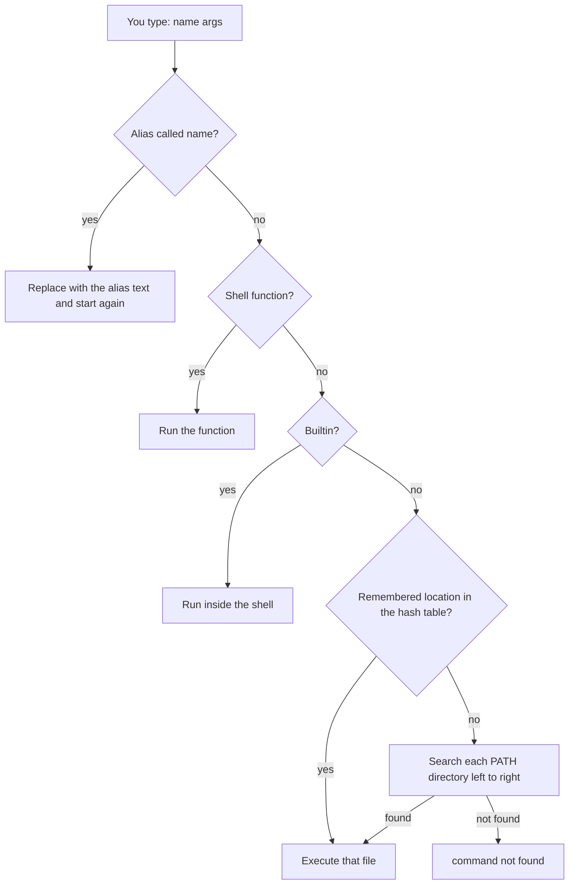

# Working with commands and getting help

> **Before this lesson:** you should be able to run commands with options and arguments ([The shell, the prompt and navigation](#/lesson/linux-cli/shell-and-navigation)) and read text in `less` ([Exploring the system](#/lesson/linux-cli/exploring-the-system)).

## In plain words

Nobody carries every command in their head. What experienced people have is a quick way of looking things up, the way a good cook does not memorise every recipe but knows exactly which shelf the cookbook is on.

A Linux system comes with its own built-in manuals. This lesson shows the four shelves: `help` for commands that are part of the shell itself, `--help` for a quick reminder, `man` (short for *manual*) for the full reference, and `apropos` for finding a command when you know what you want to do but not what it is called.

It also answers a question that sounds odd at first: when you type a word, what exactly runs? The word might be a program stored on disk, a feature built into the shell, or a nickname someone has defined. The command `type` tells you which. Finally, you will make nicknames of your own, called **aliases**, for commands you type often.

Why this matters for a job: being able to find the answer yourself, quickly, is what makes someone independent at the terminal. It is also how you investigate when "the wrong version of a program" runs.

## Motivation

Nobody remembers every option of every command. What experienced people have instead is a fast, reliable way of *finding out*: what a name at the prompt actually refers to, what its options are, and which command exists for a job they have never done before. A Linux system carries its own documentation, tens of thousands of pages of it, a few keystrokes away and available even when the network is not.

This lesson answers three questions you will ask daily:

1. When I type `foo`, what exactly runs?
2. How do I use `foo`?
3. I need to do *X* — which command does that?

It ends by showing how to create commands of your own with `alias`.

## What a "command" can be

The first word of a command line can refer to four different kinds of thing:

1. **An executable program** — a file on disk such as `/usr/bin/grep`. It may be a compiled binary or a script written in Python, Perl, Bash or anything else.
2. **A shell builtin** — a command implemented inside bash itself, such as `cd`, `echo`, `export` and `history`. `cd` *has* to be a builtin: a separate program could change only its own working directory, not the shell's.
3. **A shell function** — a small named script stored in the shell's memory, usually loaded from your startup files.
4. **An alias** — a nickname that the shell replaces with other text before doing anything else.

When several of these share a name, bash picks in a fixed order:



That last step is where the environment variable `PATH` comes in. It is a colon-separated list of directories; the shell tries each in turn and runs the first match.

```bash
mira@forge:~$ echo $PATH
/home/mira/.local/bin:/usr/local/sbin:/usr/local/bin:/usr/sbin:/usr/bin:/sbin:/bin
```

The order matters: a `python3` in `/home/mira/.local/bin` shadows the one in `/usr/bin`. Notice also what is *absent* — the current directory. That is why a script in front of you must be started as `./script.sh`: without a slash in the name, the shell consults only `PATH`.

## `type` — what will the shell run?

`type` is a builtin that answers the first question exactly, because it uses the same lookup the shell itself performs:

```bash
mira@forge:~$ type cd
cd is a shell builtin
mira@forge:~$ type ls
ls is aliased to `ls --color=auto'
mira@forge:~$ type cp
cp is /usr/bin/cp
mira@forge:~$ type if
if is a shell keyword
mira@forge:~$ type -a echo
echo is a shell builtin
echo is /usr/bin/echo
mira@forge:~$ type -t grep
alias
```

`type -a` lists *every* candidate in priority order — here it reveals that `echo` exists both as a builtin and as a separate program, and the builtin wins. `type -t` prints a single word (`alias`, `keyword`, `function`, `builtin` or `file`), convenient in scripts.

## `which` and `command -v`

`which` searches `PATH` and prints the full path of the first matching executable:

```bash
mira@forge:~$ which python3
/usr/bin/python3
mira@forge:~$ which cd
mira@forge:~$
```

It printed nothing for `cd`, because `which` is an external program that knows only about files — it cannot see builtins, functions or aliases defined in your shell. Use it for the specific question "which file on disk?", for instance when two versions of a tool are installed. In scripts the portable test for "is this command available?" is the builtin `command -v`:

```bash
mira@forge:~$ command -v jq
/usr/bin/jq
mira@forge:~$ command -v nvidia-smi || echo "no GPU tools here"
no GPU tools here
```

> [!INTERVIEW]
> "You installed a new version of a tool but the old one keeps running. How do you investigate?" Run `type -a tool` to see every match in lookup order; check for an alias or function shadowing it; inspect `echo $PATH` for directory order; and remember bash caches locations — `hash -r` clears that cache so the next lookup searches `PATH` afresh.

Here is the PATH search written out, so you can experiment with ordering and shadowing:

```python-run
def lookup(name, path, filesystem, aliases=None, builtins=()):
    """Follow bash's lookup order for a command name."""
    aliases = aliases or {}
    if name in aliases:
        return f"alias -> {aliases[name]!r}"
    if name in builtins:
        return "shell builtin"
    for directory in path.split(":"):
        candidate = directory + "/" + name
        if candidate in filesystem:
            return candidate
    return f"bash: {name}: command not found"

fs = {"/usr/bin/python3", "/usr/bin/ls", "/usr/bin/echo",
      "/home/mira/.local/bin/python3", "/home/mira/projects/api/run.sh"}
PATH = "/home/mira/.local/bin:/usr/local/bin:/usr/bin:/bin"

for cmd in ["python3", "ls", "echo", "cd", "run.sh", "ll"]:
    print(f"{cmd:8} ->", lookup(cmd, PATH, fs,
                                aliases={"ll": "ls -alF"},
                                builtins=("cd", "echo", "type")))

# Reverse the PATH order and the 'winning' python3 changes:
print(lookup("python3", "/usr/bin:/home/mira/.local/bin", fs))
```

## Five sources of documentation

### 1. `help` — for builtins

Builtins have no manual page of their own; bash documents them itself.

```bash
mira@forge:~$ help cd
cd: cd [-L|[-P [-e]] [-@]] [dir]
    Change the shell working directory.

    Change the current directory to DIR.  The default DIR is the value of the
    HOME shell variable.
    ...
```

The first line is a **synopsis**, written in a notation used throughout Unix documentation:

| Notation | Meaning |
|---|---|
| `word` | type it literally |
| `[item]` | optional |
| `a\|b` | either `a` or `b`, not both |
| `item...` | may be repeated |
| `UPPERCASE` or `<name>` | a placeholder you replace with a real value |

So `cd [-L|[-P [-e]] [-@]] [dir]` says: `cd`, optionally followed by `-L` or `-P` (and `-P` may itself be followed by `-e`), optionally `-@`, optionally a directory. Typing `help` alone lists all builtins.

### 2. `--help` — the quick reminder

Most external programs print a usage summary when given `--help` (some use `-h`). It is usually the fastest way to jog your memory:

```bash
mira@forge:~$ mkdir --help
Usage: mkdir [OPTION]... DIRECTORY...
Create the DIRECTORY(ies), if they do not already exist.

Mandatory arguments to long options are mandatory for short options too.
  -m, --mode=MODE   set file mode (as in chmod), not a=rwx - umask
  -p, --parents     no error if existing, make parent directories as needed,
                    with their modes unaffected by any -m option.
  -v, --verbose     print a message for each created directory
      --help        display this help and exit
      --version     output version information and exit
```

If the output scrolls past, pipe it through the pager: `tar --help | less`.

### 3. `man` — the reference manual

```bash
mira@forge:~$ man ls
```

`man` opens the formal manual page in `less`, so everything you know about `less` applies: `/pattern` to search, `n` for the next hit, `G` for the end, `q` to quit. Manual pages follow a predictable outline — NAME, SYNOPSIS, DESCRIPTION, OPTIONS, often EXAMPLES, FILES and SEE ALSO. They are **reference** material, terse and complete, not tutorials; the efficient way to use one is to search inside it rather than read from the top. To find what `-h` means in `df`, open `man df` and type `/-h` followed by Enter.

The manual is divided into numbered sections, because the same name can mean different things:

| Section | Contents | Example |
|---|---|---|
| 1 | user commands | `man 1 printf` — the shell command |
| 2 | system calls (kernel interfaces) | `man 2 open` |
| 3 | C library functions | `man 3 printf` — the C function |
| 4 | devices and special files | `man 4 null` |
| 5 | file formats and configuration files | `man 5 crontab`, `man 5 passwd` |
| 6 | games | — |
| 7 | overviews and conventions | `man 7 signal`, `man 7 regex` |
| 8 | system-administration commands | `man 8 mount` |

`man passwd` shows the command for changing a password; `man 5 passwd` documents the format of `/etc/passwd`. If a page seems to describe the wrong thing, you are probably in the wrong section.

### 4. `apropos` and `whatis` — finding the command for a job

`apropos` (identical to `man -k`) searches the one-line descriptions of all manual pages for a keyword. This answers question three, "which command does X?":

```bash
mira@forge:~$ apropos partition
cfdisk (8)           - display or manipulate a disk partition table
fdisk (8)            - manipulate disk partition table
lsblk (8)            - list block devices
parted (8)           - a partition manipulation program
partprobe (8)        - inform the OS of partition table changes
mira@forge:~$ apropos -s 1 compress | head -n 4
bzip2 (1)            - a block-sorting file compressor, v1.0.8
gzip (1)             - compress or expand files
xz (1)               - Compress or decompress .xz and .lzma files
zstd (1)             - zstd, zstdmt, unzstd, zstdcat - Compress or decompress .zst files
```

The number in parentheses is the manual section. `whatis` prints the same one-line description for a name you already know:

```bash
mira@forge:~$ whatis tar rsync
tar (1)              - an archiving utility
rsync (1)            - a fast, versatile, remote (and local) file-copying tool
```

### 5. `info`, package documentation and friends

GNU programs often have a longer, hyperlinked manual readable with `info` (for example `info coreutils`). Inside it, `n` and `p` move to the next and previous node, `u` goes up, Enter follows the link under the cursor, and `q` quits. In practice many people read these manuals on the web instead, but `info` works offline.

Packages also install README files, changelogs and sample configurations under `/usr/share/doc/<package>`. Files there ending in `.gz` can be read without unpacking using `zless`:

```bash
mira@forge:~$ ls /usr/share/doc/rsync
changelog.Debian.gz  copyright  NEWS.md.gz  README.md.gz  scripts
mira@forge:~$ zless /usr/share/doc/rsync/README.md.gz
```

> [!TIP]
> Community cheat-sheet tools such as `tldr` (install the package `tldr` or `tealdeer`) show five or six practical examples for a command — `tldr tar` — and are a good complement to the exhaustive manual page. Reach for `tldr` to get started and `man` to be certain.

## Running several commands on one line

Separate commands with a semicolon to run them one after another:

```bash
mira@forge:~$ cd /var/log; ls | head -n 3; cd -
alternatives.log
apt
auth.log
/home/mira
```

With `;` each command runs regardless of whether the previous one succeeded. Two related operators make the sequence conditional, and you will use them constantly: `a && b` runs `b` only if `a` succeeded, and `a || b` runs `b` only if `a` failed.

```bash
mira@forge:~$ mkdir -p build && cd build && echo "now in $(pwd)"
now in /home/mira/build
mira@forge:~/build$ cd /nonexistent || echo "could not enter"
bash: cd: /nonexistent: No such file or directory
could not enter
```

> [!WARNING]
> Prefer `&&` over `;` whenever a later command depends on an earlier one. `cd /tmp/scratch; rm -rf *` deletes the contents of **whatever directory you were already in** if the `cd` fails. `cd /tmp/scratch && rm -rf *` does nothing in that case.

## `alias` — your own commands

An alias is a name that the shell textually replaces with something longer. Check the name is free, define it, use it:

```bash
mira@forge:~$ type gs
bash: type: gs: not found
mira@forge:~$ alias gs='git status --short --branch'
mira@forge:~$ alias ll='ls -alFh'
mira@forge:~$ alias ..='cd ..'
mira@forge:~$ type gs
gs is aliased to `git status --short --branch'
mira@forge:~$ alias
alias ..='cd ..'
alias gs='git status --short --branch'
alias ll='ls -alFh'
alias ls='ls --color=auto'
mira@forge:~$ unalias gs
```

Syntax rules: no spaces around `=`, and the replacement goes in single quotes. Running `alias` with no arguments lists every alias in force; you will usually discover that your distribution already defined a few, such as colourised `ls` and `grep`.

Three things to know about aliases:

- **They vanish when the shell exits.** To keep them, put the `alias` lines in `~/.bashrc` (covered in the lesson on startup files).
- **They cannot take arguments in the middle.** An alias only substitutes the first word; anything else you type is appended. For a command that needs parameters in specific positions, write a shell function instead.
- **They can mask real commands.** A popular safety net is `alias rm='rm -i'`. It helps — until you work on a server without it and delete something expecting a prompt that never comes. To bypass an alias once, prefix the command with a backslash (`\rm file`) or use `command rm file`.

## Pitfalls

- **Using `which` to investigate shell behaviour.** It cannot see aliases, functions or builtins; `type -a` can.
- **Reading manual pages linearly.** Search them with `/`.
- **Wrong manual section.** `man printf` is not the C function; `man 3 printf` is.
- **Expecting `man cd` to work.** For builtins use `help cd` (or search `man bash`).
- **Assuming the current directory is on `PATH`.** It is not, deliberately — otherwise a malicious file called `ls` in a shared directory would run when you tried to list it.
- **Relying on personal aliases in scripts or on other machines.** Scripts do not expand aliases by default, and servers do not have your dot-files.
- **Stale lookups.** After installing a program in a new location, `hash -r` makes bash forget cached paths.

## Cheat sheet

| Question | Command |
|---|---|
| What runs when I type *name*? | `type name`, `type -a name` |
| Where is the executable? | `which name`, `command -v name` |
| Help for a builtin | `help name` |
| Quick usage summary | `name --help` |
| Full reference | `man name`, `man 5 name` |
| Which command does a job? | `apropos keyword` (`man -k keyword`) |
| One-line description | `whatis name` |
| GNU long manual | `info name` |
| Packaged docs | `ls /usr/share/doc/name` |
| Define / list / remove an alias | `alias n='...'`, `alias`, `unalias n` |
| Bypass an alias once | `\name` or `command name` |
| Forget cached command locations | `hash -r` |
| Run b only if a succeeds / fails | `a && b` / `a \|\| b` |

## Summary

- A command is an alias, function, builtin or executable file, looked up in that order; executables are found by searching the directories in `PATH` from left to right.
- `type` shows what the shell will actually run; `which` only finds files.
- Documentation is layered: `help` for builtins, `--help` for a reminder, `man` for the full reference (mind the sections), `apropos` to discover commands by keyword, `info` and `/usr/share/doc` for longer material.
- Learn to read synopsis notation — brackets optional, bar alternatives, dots repetition.
- `;`, `&&` and `||` chain commands; `&&` is the safe default.
- `alias` gives short names to long commands for the current session; make them permanent in `~/.bashrc`.

## Glossary

| Term | Meaning |
|---|---|
| executable | a file that can be run as a program |
| builtin | a command that is part of the shell itself, such as `cd` |
| alias | a short name the shell replaces with a longer command |
| shell function | a small named group of commands kept in the shell's memory |
| `PATH` | the list of directories the shell searches for programs |
| manual page | the reference document for a command, shown by `man` |
| synopsis | the one-line summary of how a command may be written |
| section | a numbered part of the manual (1 commands, 5 file formats, 8 administration) |
| exit status | the number a command returns when it ends; 0 means success |

## Check yourself

```quiz
[
  {"q": "Why must `cd` be a shell builtin rather than a separate program?",
   "options": ["Builtins are faster to type", "A separate process could only change its own working directory, not the shell's", "External programs cannot read directory names", "It needs root privileges"],
   "answer": 1,
   "explain": "Each process has its own working directory. A child process changing directory has no effect on its parent shell."},
  {"q": "`type ls` prints that ls is aliased to `ls --color=auto`, yet `which ls` prints `/usr/bin/ls`. Why do they differ?",
   "options": ["which is out of date", "type shows what the shell will run, including aliases; which only searches PATH for files", "The alias is broken", "They refer to different users"],
   "answer": 1,
   "explain": "which is an external program with no knowledge of the shell's aliases, functions or builtins."},
  {"q": "PATH is `/opt/tools/bin:/usr/bin` and both directories contain an executable named `convert`. Which one runs?",
   "options": ["/usr/bin/convert, because system directories win", "/opt/tools/bin/convert, because PATH is searched left to right", "Both, one after the other", "Neither; bash reports an ambiguity"],
   "answer": 1,
   "explain": "The first match in PATH order is used. Changing the order of directories changes which program runs."},
  {"q": "In the synopsis `sort [OPTION]... [FILE]...`, what do the brackets and dots mean?",
   "options": ["Brackets are typed literally; dots mean the output is truncated", "Brackets mark optional items; dots mean the item may be repeated", "Brackets mark required items; dots mean a range", "They are decoration with no meaning"],
   "answer": 1,
   "explain": "Square brackets denote optional parts and an ellipsis means one or more of the preceding item."},
  {"q": "You need the documentation for the FORMAT of the crontab file, not the crontab command. What do you type?",
   "options": ["man crontab", "man 5 crontab", "help crontab", "which crontab"],
   "answer": 1,
   "explain": "Section 5 of the manual covers file formats. Without a section number man shows the first match, the section 1 command."},
  {"q": "Which command helps when you know what you want to do but not the name of the tool?",
   "options": ["type", "apropos", "which", "hash"],
   "answer": 1,
   "explain": "apropos (man -k) searches the short descriptions of all manual pages for a keyword."},
  {"q": "What is the risk in `cd /data/tmp; rm -rf *` compared with `cd /data/tmp && rm -rf *`?",
   "options": ["The semicolon version is slower", "With a semicolon, rm still runs if cd fails, deleting files in the directory you were in", "The && version deletes hidden files too", "There is no difference"],
   "answer": 1,
   "explain": "A semicolon runs the next command unconditionally; && runs it only when the previous command succeeded."},
  {"q": "You defined `alias gs='git status'` and it works, but tomorrow in a new terminal it is gone. Why?",
   "options": ["Aliases expire after 24 hours", "Aliases live only in the memory of the shell that defined them unless saved in a startup file", "git removed it", "The alias name was too short"],
   "answer": 1,
   "explain": "An alias exists only in the current shell process. Add it to ~/.bashrc to have it defined in every new interactive shell."}
]
```

> **Source:** Shotts, *The Linux Command Line*, ch. 5 (Working with Commands). All examples and wording are original to this guide.
