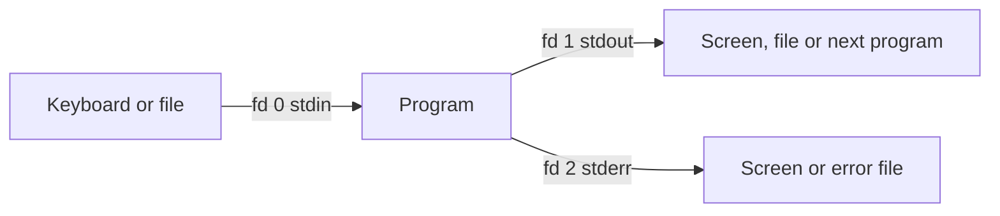

# Redirection and pipelines

> **Before this lesson:** you should be able to run commands and view files ([Exploring the system](#/lesson/linux-cli/exploring-the-system)), use wildcards ([Manipulating files](#/lesson/linux-cli/manipulating-files)) and look up options ([Working with commands](#/lesson/linux-cli/commands-and-help)).

## In plain words

Normally a command prints its answer on your screen. This lesson teaches two ways of sending that answer somewhere else.

**Redirection** sends a command's output into a file instead of to the screen, like holding a bucket under a tap instead of letting the water run into the sink. **A pipe** connects the output of one command directly to the input of another, like joining two lengths of garden hose: whatever comes out of the first flows straight into the second.

Pipes are the big idea of the whole command line. Linux has dozens of tiny programs that each do one small thing — one sorts lines, one counts them, one keeps only the lines containing a word. Alone they look almost too small to be useful. Joined by pipes they become a production line that can answer complicated questions in a single line of typing.

Why this matters for a job: saving the output of a long run to a file, keeping error messages apart from results, and chaining tools to summarise a log are things engineers do many times a day. Questions about redirection are also among the most common in technical interviews.

## Motivation

A web server has written two million lines of access log overnight, and someone asks: "Which ten IP addresses hit us hardest?" There is no program called `top-ten-ips`. There does not need to be. On the command line you answer by snapping together five tiny programs, none of which knows anything about web servers:

```bash
cut -d' ' -f1 access.log | sort | uniq -c | sort -rn | head -n 10
```

This lesson explains the plumbing that makes such a line possible. It is the most important idea in the whole track: programs read from a standard input and write to a standard output, and the shell can connect those to files or to each other. Master it and every tool you learn afterwards multiplies the usefulness of every tool you already know.

## Three standard streams

Every process starts life with three open channels, identified by small numbers called **file descriptors**:

| Number | Name | Default connection | Purpose |
|---|---|---|---|
| 0 | standard input, *stdin* | keyboard | data the program reads |
| 1 | standard output, *stdout* | terminal screen | the program's results |
| 2 | standard error, *stderr* | terminal screen | error messages and diagnostics |

Results and errors both appear on your screen, so they look like one stream — but they are separate, and that separation is deliberate. It lets you save the results of a long job in a file while still seeing problems immediately, or throw the noise away and keep the data.

A program does not know or care what its streams are attached to. **Redirection** is the shell re-attaching them before the program starts.



## Redirecting standard output

`>` sends stdout to a file, creating it or **emptying it first** if it already exists. `>>` appends instead.

```bash
mira@forge:~/lab$ ls -l /usr/bin > listing.txt
mira@forge:~/lab$ wc -l listing.txt
1842 listing.txt
mira@forge:~/lab$ date >> run.log
mira@forge:~/lab$ echo "step 1 finished" >> run.log
mira@forge:~/lab$ cat run.log
Fri Nov 20 10:41:07 UTC 2026
step 1 finished
```

Nothing appeared on screen after the first command because the output went into the file. Now watch what happens when the command fails:

```bash
mira@forge:~/lab$ ls -l /no/such/place > listing.txt
ls: cannot access '/no/such/place': No such file or directory
mira@forge:~/lab$ wc -l listing.txt
0 listing.txt
```

Two lessons in three lines. The error still reached the screen, because it travelled on stderr, which was not redirected. And `listing.txt` is now **empty**: the shell truncated the file while setting up the redirection, before `ls` even ran. The previous 1842 lines are gone.

> [!WARNING]
> `>` destroys the existing contents of its target immediately, even if the command then fails or prints nothing. A notorious self-inflicted wound is `sort data.txt > data.txt`: the shell empties `data.txt` first, `sort` then reads an empty file, and you are left with nothing. Write to a new name and rename afterwards (`sort data.txt > data.sorted && mv data.sorted data.txt`), or use the tool's own in-place option (`sort -o data.txt data.txt`). To make bash refuse to overwrite existing files with `>`, run `set -o noclobber`; `>|` then forces an overwrite when you mean it.

A handy consequence of truncation: `> file` with no command at all creates an empty file or empties an existing one.

## Redirecting standard error

Prefix the operator with the descriptor number. `2>` redirects stderr:

```bash
mira@forge:~/lab$ ls -l /no/such/place 2> errors.txt
mira@forge:~/lab$ cat errors.txt
ls: cannot access '/no/such/place': No such file or directory
```

(`>` on its own is shorthand for `1>`.) You can redirect both streams to different places in one command:

```bash
mira@forge:~/lab$ find /etc -name "*.conf" > found.txt 2> denied.txt
mira@forge:~/lab$ wc -l found.txt denied.txt
  412 found.txt
   17 denied.txt
  429 total
```

### Both streams into one file

Two spellings do this. The traditional one redirects stdout to the file and then points stderr at "wherever stdout currently goes":

```bash
mira@forge:~/lab$ python train.py > train.log 2>&1
```

Read `2>&1` as "make descriptor 2 a copy of descriptor 1". **Order matters**, because redirections are processed left to right:

```bash
python train.py > train.log 2>&1    # correct: 1 -> file, then 2 -> same file
python train.py 2>&1 > train.log    # wrong:   2 -> terminal (where 1 was), then 1 -> file
```

In the second form stderr is duplicated from stdout *before* stdout has been moved, so errors still land on the terminal. Modern bash has a shorter, order-proof spelling:

```bash
mira@forge:~/lab$ python train.py &> train.log      # overwrite
mira@forge:~/lab$ python train.py &>> train.log     # append
```

> [!INTERVIEW]
> "What does `2>&1` mean, and why is `cmd > out 2>&1` different from `cmd 2>&1 > out`?" The expected answer walks through file descriptors: each redirection is applied in order; `2>&1` copies whatever descriptor 1 refers to *at that moment*. Candidates who can explain the ordering have clearly understood descriptors rather than memorised an incantation.

### Throwing output away

`/dev/null` is a special file that discards everything written to it. Redirecting there silences a stream:

```bash
mira@forge:~/lab$ find / -name "id_ed25519" 2> /dev/null
/home/mira/.ssh/id_ed25519
mira@forge:~/lab$ ping -c 1 forge.internal &> /dev/null && echo up || echo down
up
```

The first command hides hundreds of "Permission denied" lines so the one real answer is visible. The second discards all output and keeps only the success-or-failure result.

## Redirecting standard input

`<` attaches a file to stdin. Many commands accept either file names or stdin, and `cat` is the clearest demonstration. With no arguments it copies stdin to stdout:

```bash
mira@forge:~/lab$ cat > shopping.txt
oat milk
coffee beans
(press Ctrl-D on an empty line)
mira@forge:~/lab$ cat < shopping.txt
oat milk
coffee beans
```

In the first command `cat` read your keyboard until `Ctrl-D` signalled end-of-file, and its output was redirected into a new file — a zero-dependency way to create small files. The second fed the file back through stdin. Because `cat` joins (con*cat*enates) all the files it is given, it also reassembles split files: `cat part_*.bin > whole.bin`.

There are two more input forms you will use in scripts. A **here document** feeds the lines that follow as stdin, and a **here string** feeds a single string:

```bash
mira@forge:~/lab$ sort <<EOF
pear
apple
fig
EOF
apple
fig
pear
mira@forge:~/lab$ wc -w <<< "four words right here"
4
```

## Pipelines

The pipe operator `|` connects the stdout of the command on its left to the stdin of the command on its right. No temporary file is involved; the kernel passes the data through a small in-memory buffer and both programs run **at the same time**.

```bash
mira@forge:~/lab$ ls -l /usr/bin | less
mira@forge:~/lab$ ls /usr/bin | wc -l
1841
```


Programs designed to sit in the middle of a pipeline — read lines, transform them, write lines — are called **filters**. Here are the essential ones, each of which gets fuller treatment later in the track.

| Filter | What it does |
|---|---|
| `sort` | orders lines (`-n` numeric, `-r` reverse, `-k` by field, `-u` unique) |
| `uniq` | collapses **adjacent** duplicate lines (`-c` count them, `-d` only duplicates) |
| `wc` | counts lines, words and bytes (`-l` lines only) |
| `grep PATTERN` | keeps lines matching a pattern (`-i` ignore case, `-v` invert) |
| `head` / `tail` | first / last lines (`-n N`); `tail -f` follows a growing file |
| `cut` | extracts columns |
| `tr` | translates or deletes characters |
| `tee FILE` | copies stdin to a file **and** to stdout |

### Building a pipeline step by step

The right way to write a pipeline is incrementally: run the first stage, look at its output, add the next stage, look again. Take the question from the introduction.

```bash
mira@forge:~/lab$ head -n 3 access.log
203.0.113.9 - - [20/Nov/2026:09:00:01 +0000] "GET /api/forecast HTTP/1.1" 200 512
198.51.100.4 - - [20/Nov/2026:09:00:01 +0000] "GET /health HTTP/1.1" 200 2
203.0.113.9 - - [20/Nov/2026:09:00:02 +0000] "POST /api/login HTTP/1.1" 401 87
mira@forge:~/lab$ cut -d' ' -f1 access.log | head -n 3
203.0.113.9
198.51.100.4
203.0.113.9
mira@forge:~/lab$ cut -d' ' -f1 access.log | sort | uniq -c | head -n 3
     12 192.0.2.77
   8841 198.51.100.4
  30172 203.0.113.9
mira@forge:~/lab$ cut -d' ' -f1 access.log | sort | uniq -c | sort -rn | head -n 3
  30172 203.0.113.9
   8841 198.51.100.4
    977 192.0.2.140
```

Stage by stage: `cut` keeps the first space-separated field (the IP). `sort` brings identical addresses together — essential, because `uniq` only merges neighbours. `uniq -c` replaces each run with one line prefixed by its count. `sort -rn` orders those lines numerically, largest first. `head` keeps the top of the list.

The simulation below builds the same pipeline from Python generators. Each stage pulls lines from the one before it, exactly as processes in a pipe do; edit the stages to see how the output changes.

```python-run
import itertools

LOG = """203.0.113.9 GET /api/forecast 200
198.51.100.4 GET /health 200
203.0.113.9 POST /api/login 401
192.0.2.77 GET /api/forecast 500
203.0.113.9 GET /api/forecast 200
198.51.100.4 GET /health 200
203.0.113.9 GET /static/app.js 304""".splitlines()

def cut(lines, field):                 # cut -d' ' -fN
    for line in lines:
        yield line.split(" ")[field - 1]

def sort(lines, numeric_reverse=False): # sort / sort -rn
    key = (lambda s: -int(s.split()[0])) if numeric_reverse else None
    yield from sorted(lines, key=key)

def uniq_c(lines):                      # uniq -c  (adjacent runs only!)
    for value, run in itertools.groupby(lines):
        yield f"{len(list(run)):7d} {value}"

def head(lines, n):                     # head -n N
    yield from itertools.islice(lines, n)

pipeline = head(sort(uniq_c(sort(cut(LOG, 1))), numeric_reverse=True), 2)
print("\n".join(pipeline))

print("--- without the first sort, uniq sees no adjacent duplicates:")
print("\n".join(uniq_c(cut(LOG, 1))))
```

### `tee` — a T-junction

Sometimes you want to save an intermediate result *and* keep processing it. `tee` writes its input to a file and passes it along unchanged:

```bash
mira@forge:~/lab$ python train.py 2>&1 | tee train.log | grep -i "epoch"
epoch 1/40  loss 2.314
epoch 2/40  loss 1.987
```

Everything the script prints (stdout and stderr, merged by `2>&1`) is recorded in `train.log`, while only the epoch lines reach your screen. `tee -a` appends instead of overwriting.

`tee` also solves a puzzle that trips up everyone once. `sudo echo "127.0.0.1 forge" >> /etc/hosts` fails with "Permission denied" even though you used `sudo`: the *redirection* is performed by your own unprivileged shell, and only `echo` runs as root. Let a privileged `tee` do the writing instead:

```bash
mira@forge:~$ echo "127.0.0.1 forge" | sudo tee -a /etc/hosts > /dev/null
```

### Pipes carry stdout only

By default a pipe transports only stdout; stderr still goes to the terminal. To send both through, merge them first with `2>&1 |` or use the shorthand `|&`:

```bash
mira@forge:~/lab$ make 2>&1 | grep -c "warning"
14
mira@forge:~/lab$ make |& tee build.log | tail -n 5
```

### The difference between `>` and `|`

`>` connects a command to a **file**; `|` connects a command to another **command**. Confusing them is dangerous:

> [!WARNING]
> `ls > less` does not page your listing — it creates (or overwrites) a file named `less` in the current directory. Done as root in a system directory, the same slip (`some-command > another-command`) can replace a real program with garbage. If the thing on the right is a program, you want a pipe.

### Exit status of a pipeline

The exit status of a pipeline is that of its **last** command, so a failure earlier in the chain goes unnoticed:

```bash
mira@forge:~/lab$ cat missing.csv | wc -l
cat: missing.csv: No such file or directory
0
mira@forge:~/lab$ echo $?
0
```

`wc` succeeded, so the pipeline "succeeded". In scripts, `set -o pipefail` makes a pipeline fail if any stage fails; you will meet it again in the troubleshooting lesson.

> [!TIP]
> When a pipeline gives surprising results, cut it short: delete stages from the right until the output makes sense, then add them back one at a time. Inserting `| head` after any stage shows a sample of what is flowing at that point, and `| tee /tmp/stage2.txt |` records it without disturbing the rest.

## Pitfalls

- **Clobbering a file with `>`** when you meant `>>`, or reading and writing the same file in one command.
- **Wrong order for `2>&1`.** It must come after the stdout redirection it is meant to follow.
- **Forgetting that `uniq` needs sorted input.** Unsorted duplicates that are not adjacent are not merged.
- **Sorting numbers as text.** Without `-n`, `sort` puts `10` before `9`.
- **Expecting errors to flow through a pipe.** They do not, unless merged with `2>&1` or `|&`.
- **`sudo cmd > protected-file`.** The redirection is not privileged; use `sudo tee`.
- **Useless use of `cat`.** `cat file | grep x` works but `grep x file` is simpler and lets `grep` report the file name.

## Cheat sheet

| Syntax | Effect |
|---|---|
| `cmd > file` | stdout to file (overwrite) |
| `cmd >> file` | stdout to file (append) |
| `cmd 2> file` | stderr to file |
| `cmd > out 2> err` | stdout and stderr to separate files |
| `cmd > file 2>&1` or `cmd &> file` | both to the same file |
| `cmd 2> /dev/null` | discard errors |
| `cmd &> /dev/null` | discard everything |
| `cmd < file` | stdin from file |
| `cmd <<EOF ... EOF` | here document as stdin |
| `cmd <<< "text"` | here string as stdin |
| `a \| b` | stdout of `a` becomes stdin of `b` |
| `a 2>&1 \| b` or `a \|& b` | stdout and stderr of `a` to `b` |
| `a \| tee file \| b` | save a copy mid-pipeline |
| `set -o noclobber` | refuse to overwrite with `>` |
| `set -o pipefail` | pipeline fails if any stage fails |

## Summary

- Every program has stdin (0), stdout (1) and stderr (2). Redirection rewires them without the program knowing.
- `>` truncates, `>>` appends, `2>` handles errors, `&>` or `> file 2>&1` captures both — and redirections are applied left to right.
- `/dev/null` swallows unwanted output.
- A pipe feeds one command's stdout into the next command's stdin; filters such as `sort`, `uniq`, `grep`, `wc`, `head`, `tail` and `tee` are the building blocks.
- Build pipelines incrementally, remember that `uniq` needs sorted input, and that a pipeline's status is its last command's.

## Glossary

| Term | Meaning |
|---|---|
| standard input (stdin) | the stream a program reads from; the keyboard by default |
| standard output (stdout) | the stream for a program's normal results; the screen by default |
| standard error (stderr) | a separate stream for error messages |
| file descriptor | the number of a stream: 0 input, 1 output, 2 error |
| redirection | connecting a stream to a file with `>`, `>>` or `<` |
| truncate | empty a file before writing to it, which `>` does |
| append | add to the end of a file, which `>>` does |
| pipe | the vertical-bar symbol: sends the output of one command to the input of the next |
| pipeline | several commands joined by pipes |
| filter | a program that reads lines, changes or selects them and prints the result |
| `/dev/null` | a special file that discards everything written to it |

## Check yourself

```quiz
[
  {"q": "After `ls /nonexistent > out.txt`, what is in out.txt and where did the error message go?",
   "options": ["The error text is in out.txt", "out.txt is empty and the error was printed on the terminal", "out.txt was not created", "out.txt contains the previous listing"],
   "answer": 1,
   "explain": "> redirects only stdout and truncates the file before the command runs. The error travels on stderr, which still points at the terminal."},
  {"q": "Which command line captures BOTH normal output and errors of `job` in job.log?",
   "options": ["job 2>&1 > job.log", "job > job.log 2>&1", "job > job.log 2> &1", "job | job.log"],
   "answer": 1,
   "explain": "Redirections are processed left to right: first stdout goes to the file, then stderr is made a copy of stdout. Reversing the order leaves stderr on the terminal."},
  {"q": "What does `sort names.txt > names.txt` leave in names.txt?",
   "options": ["The sorted names", "The original names, unsorted", "Nothing; the file is emptied before sort reads it", "An error message"],
   "answer": 2,
   "explain": "The shell truncates the output file while setting up the redirection, so sort reads an empty file."},
  {"q": "Why is `sort` placed before `uniq -c` in a counting pipeline?",
   "options": ["uniq requires numeric input", "uniq only merges identical lines that are adjacent", "sort removes blank lines", "It makes the pipeline faster"],
   "answer": 1,
   "explain": "uniq compares each line only with the one before it. Sorting brings equal lines together so every distinct value forms one run."},
  {"q": "What does `2> /dev/null` accomplish?",
   "options": ["Deletes the file /dev/null", "Sends error messages to a device that discards them", "Redirects standard input from an empty file", "Writes two copies of the output"],
   "answer": 1,
   "explain": "/dev/null accepts and discards anything written to it; redirecting descriptor 2 there hides error messages."},
  {"q": "`make | grep warning` shows fewer warnings than you expected because compilers print warnings on stderr. How do you fix it?",
   "options": ["make > grep warning", "make 2>&1 | grep warning", "make | grep warning 2>&1", "make < grep warning"],
   "answer": 1,
   "explain": "A pipe carries stdout only. Merging stderr into stdout before the pipe sends both streams to grep."},
  {"q": "What is the purpose of `tee` in `./deploy.sh | tee deploy.log | tail -n 20`?",
   "options": ["It filters out duplicate lines", "It writes a copy of the stream to deploy.log while passing it on unchanged", "It runs deploy.sh twice", "It converts stderr to stdout"],
   "answer": 1,
   "explain": "tee duplicates its input: one copy to the named file, one copy to its own stdout for the next stage."},
  {"q": "`cat missing.txt | wc -l` prints an error and then 0. What is the exit status of the pipeline by default?",
   "options": ["1, because cat failed", "0, because the last command (wc) succeeded", "2, because two commands ran", "It is undefined"],
   "answer": 1,
   "explain": "Without set -o pipefail, a pipeline's status is that of its final command only."}
]
```

> **Source:** Shotts, *The Linux Command Line*, ch. 6 (Redirection). All examples and wording are original to this guide.
